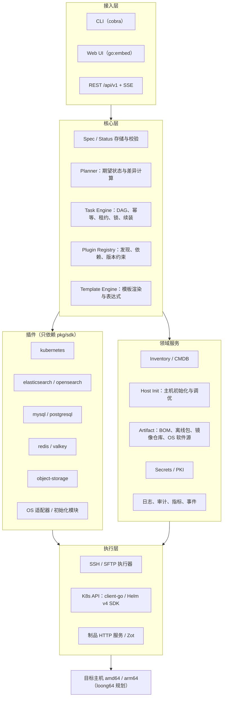
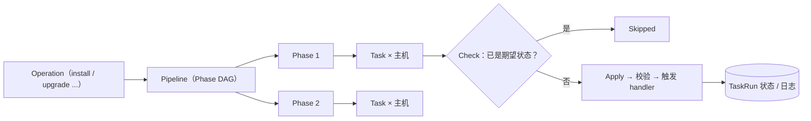

# 02 平台架构与插件体系

> **本文定位**：平台层设计，与具体组件无关。Kubernetes 是第一个组件插件（详见「04 Kubernetes 安装规划与设计」），Elasticsearch / OpenSearch、对象存储、MySQL、PostgreSQL、Redis / Valkey 等后续按本文的插件规范扩展。主机纳管与初始化见「03 CMDB 与主机初始化」；工程结构、依赖版本与 Go 接口草案见「05 开发文档」。
>
> **版本**：v2.2（S6 更新，2026-11-26；v2.2 对齐 `Component` 签名、15 个内置 Task、`Operation` 7 态与锁序、崩溃重附着、`kinstall.io/v1alpha1` 清单及短期 kubeconfig 策略）。按 ADR-020～022、ADR-025、ADR-030 修订执行器、API（一期 REST + SSE，无 gRPC）与插件依赖边界；新增用户角色与场景（A3）、规模目标（A7）、术语表（A8）、版本兼容策略（A9）、任务引擎持久化与锁（ADR-035、B16）、平台高可用（B11）、配置与模板引擎（ADR-036、B13）、多集群管理（E19）；数据访问层定稿见 ADR-034。版本号截至 2026-11-26。

## 1. 目标与边界

### 1.1 目标

- 一个 Go 单二进制（暂定代号 `kinstall`，`CGO_ENABLED=0`），覆盖“主机纳管 → 主机初始化 → 组件安装 → 生命周期运维”全流程。
- **插件化**：组件（K8s、ES、MySQL……）、OS 适配、初始化模块、K8s 的 CRI / CNI / CSI / HA 入口 / Addon 都以插件或扩展点形式注册，主程序不写死任何组件逻辑。
- **离线优先、多架构**：目标主机 amd64 / arm64 为一期，loong64 规划中（E22）；平台二进制提供 linux amd64 / arm64 / loong64 与 darwin CLI；覆盖主流国际与信创操作系统（`03 §3`）。
- **声明式**：用户提交 Spec（YAML、CLI 或 Web 表单），平台先生成 Plan（差异预览），确认后执行，结果写回 Status。
- **可审计、可回滚、可断点续装**：每次操作都有 Operation 记录、逐主机日志和变更清单（`InstalledFile`）。
- **目标主机零依赖（ADR-025）**：Facts 采集与 Task 只依赖 POSIX sh + coreutils，不依赖 Python / Agent；兼容 `sudo-rs` 与 Rust coreutils。

### 1.2 非目标（一期）

- 不做通用配置管理，不替代 Ansible / Salt，只覆盖插件需要的操作。
- 不创建云资源（IaaS 由 Terraform 等完成，平台接收现成主机）。
- 不做应用发布（CI/CD），不接管非 kinstall 安装的集群（E23）。
- 不支持 Windows 主机；不提供 gRPC API（ADR-021）。

### 1.3 用户角色与使用场景（A3）

| 角色 | 典型职责 | 默认权限（§9） |
| --- | --- | --- |
| 平台管理员 | 安装 / 升级平台；管理插件、BOM、离线包、凭据主密钥、用户与项目；审批高风险操作 | `admin`（全局） |
| 项目管理员 | 管理本项目的环境、成员、审批策略与配额 | `project-admin` |
| 运维工程师 | 主机纳管与初始化、创建 / 变更实例、执行日常运维操作 | `operator`（项目内） |
| 审计 / 安全 | 只读查看操作记录、审计日志、合规报告；导出证据 | `auditor`（只读 + 审计导出） |
| 只读用户 / CI | 查看状态；CI 使用 API Token 执行限定操作（如 `plan`） | `viewer` / 自定义 |

| 场景 | 关键特征 | 平台能力 |
| --- | --- | --- |
| 在线安装 | 部署机可访问上游 | 按 BOM 下载并校验签名，仍先落本地制品库再分发 |
| 内网离线安装 | 无外网，靠离线包导入 | Bundle 导入、内置 HTTP 软件源 + Zot 镜像仓库（§7、`04 §11`） |
| 信创环境 | 国产 CPU（鲲鹏 / 飞腾 / 海光 / 兆芯）+ 国产 OS（麒麟 / 统信 / openEuler / 龙蜥） | OS 识别数据化（ADR-024）、64K 页治理（ADR-028）、安全执行控制加白（ADR-027）、等保加固（ADR-018） |
| 混合架构 | 同一集群 amd64 + arm64 | 按主机架构分发制品、多架构 OCI Index 强校验（`04 §3.4`） |
| 现场交付 / PoC | 单人、单机、可能断网 | CLI 单机模式 + SQLite，数据目录可整体打包迁移 |
| 平台团队集中管理 | 多项目、多环境、多集群 | Server 模式（PostgreSQL、RBAC、审批、SSE 实时日志）、多集群管理（§14） |

### 1.4 规模目标（A7）

| 指标 | CLI 单机（SQLite） | Server 模式（PostgreSQL） | 说明 |
| --- | --- | --- | --- |
| 纳管主机数 | ≤ 500 | ≤ 5,000（单平台实例组） | 超出时按项目拆分平台实例 |
| 同时执行的主机数（全局） | 50 | 200（每副本 100） | 受 SSH 连接与部署机带宽限制，可配置 |
| 单 Phase 默认并发 | 10 台 | 10 台 | 插件可声明上限；有状态步骤强制串行（§5） |
| 单 K8s 集群节点数 | 设计 1,000；验证 500 | 同左 | > 250 节点推荐外置 etcd（`04 §3.3`） |
| 并发写操作 | 每实例 1 个 | 每实例 1 个；全局 ≥ 50 | 实例级排他锁（§5.4） |
| 单次操作日志 | ≤ 1 GiB / Operation | 同左 | 超限截断并保留尾部，完整日志落文件 |
| 平台二进制体积 | ≤ 150 MiB（含内嵌 Web UI） | 同左 | `-trimpath -ldflags "-s -w"` |
| K8s 离线包体积 | 单架构 + 单 OS ≤ 3 GiB；双架构 + 3 OS ≤ 8 GiB | 同左 | 按需裁剪 CNI / CSI / Addon，层去重（`04 §11`） |
| 1,000 节点集群安装时长 | — | ≤ 2 h（离线、千兆网络） | 节点从制品 HTTP 服务拉取（§6） |

### 1.5 术语表（A8）

| 术语 | 含义 |
| --- | --- |
| **Host** | 被纳管的一台主机（CMDB 实体，含 Facts、标签、凭据引用，`03 §1`） |
| **Facts** | 从主机采集并归一化的事实（OS、内核、架构、页大小、cgroup、网卡、磁盘等，`03 §2`） |
| **Profile** | 一组初始化模块及参数的组合（`base`、`k8s-node`、`database-pg` 等，`03 §6`） |
| **Plugin** | 可注册到平台的能力单元：Component、Extension、OS Adapter、Init Module 等（§3.1） |
| **Component** | 安装和管理一个“产品”的插件，产出 Instance（如 `kubernetes`、`redis`） |
| **Extension** | Component 定义的扩展点实现（如 K8s 的 `cni/calico`、`csi/longhorn`） |
| **Instance** | Component 的一个部署实例（一个 K8s 集群、一个 Valkey 集群） |
| **Spec / Status** | Instance 的期望状态 / 观测状态；Spec 变更使 `generation` +1 |
| **Plan** | 期望与实际的差异及将执行的变更清单；有 `planId` 和过期时间，`apply` 必须引用 |
| **Operation** | 一次对 Instance / Host 的操作（install / upgrade / scale / backup……），异步执行，有状态机 |
| **Pipeline / Phase / Task** | Operation 展开的执行 DAG：Pipeline 由 Phase 组成，Phase 内对目标主机执行 Task |
| **TaskRun** | 一个 Task 在一台主机上的一次执行记录（状态、输入摘要 InputHash、日志、耗时） |
| **HostRequirements** | 插件 / 扩展向主机初始化层声明的需求（包、内核模块、sysctl、服务、端口，ADR-003） |
| **HostRole.Claims** | 实例在主机上占用的端口、目录、独占盘、内存等声明，用于冲突检测（`03 §8.5`） |
| **BOM** | 某产品版本的物料清单（组件版本、镜像、制品、页大小兼容等），有独立 revision（`04 §2.2`） |
| **Bundle** | 按 BOM × 架构 × OS 构建的离线包，含 manifest 与签名（`04 §11`） |
| **InstalledFile** | 平台在主机上写入的每个文件 / 包的记录（来源制品、digest、属主权限），用于审计与卸载 |
| **Project / Environment** | 权限与资源隔离单元：项目下分环境（dev / test / prod），资源归属环境 |

## 2. 分层架构

> [!NOTE]
> 本节为一期分层草图（插件仅列首批 5 类）。纳入三元目标、`Stack`、3-Way Diff、三元介质源与 28 个 `internal/` 包后的**规范全景架构**见 [`ARCHITECTURE.md`](./ARCHITECTURE.md) §3–§4。



| 模块 | 职责 | 技术选型（版本见 05 §2） |
| --- | --- | --- |
| CLI | 所有能力的命令行入口，支持 `-o json/yaml`，可被 CI 调用；可作为 Server 客户端（`--server`） | spf13/cobra |
| Server + Web UI | 多用户、多项目、任务进度与实时日志、审计；OpenAPI 契约优先（ADR-021） | net/http + chi、oapi-codegen；SSE；Web UI 锁定 Vue `3.5.45` + Element Plus `2.14.2` + `@hey-api/openapi-ts` + `go:embed`（ADR-023 定稿，见 `WEB_DESIGN.md`） |
| Spec / Status | 资源的声明式规格和观测状态，带 `generation` / `observedGeneration` | 自定义资源模型，JSON Schema（santhosh-tekuri/jsonschema v6）校验 |
| Planner | 比较期望状态与 CMDB 中的实际状态，生成 Plan | 自研 |
| Task Engine | Pipeline → Phase → Task 的 DAG 执行，幂等、重试、断点续装、并发控制、租约与锁（ADR-035） | 自研，状态写入数据库 |
| Template Engine | 配置模板渲染、按版本选模板、条件表达式（ADR-036） | `text/template` + 白名单函数；expr |
| Plugin Registry | 插件注册、版本与依赖解析、兼容矩阵、签名校验 | 自研；semver（Masterminds/semver v3） |
| Inventory（CMDB） | 主机、凭据、Facts、分组标签、实例与角色绑定、变更历史 | `modernc.org/sqlite`（默认）/ PostgreSQL（Server），bun + goose（ADR-034） |
| Host Init | 主机初始化与调优，以 Profile 组合 | 内置初始化模块（`03 §5–§7`） |
| Artifact | 制品清单、离线包构建与校验、内置 HTTP 软件源、OCI 镜像仓库 | go-containerregistry、oras-go v3、Zot、sigstore-go |
| Secrets / PKI | 凭据信封加密、主密钥、CA 与证书签发（供 K8s 和各中间件复用） | AES-256-GCM、crypto/x509 |
| Executor | 远程执行、文件传输、sudo、跳板机（ADR-020） | `golang.org/x/crypto/ssh` + `pkg/sftp` 自研薄封装 |
| 可观测 | 结构化日志、平台指标、操作审计、事件 | log/slog、Prometheus client_golang、可选 OpenTelemetry |

## 3. 插件体系

### 3.1 插件类型

| 类型 | 作用 | 示例 | 由谁调用 |
| --- | --- | --- | --- |
| Component（组件插件） | 安装和管理一个“产品”，产出一个可管理的实例（Instance） | kubernetes、elasticsearch、mysql、postgresql、redis、object-storage | 用户直接创建实例 |
| Extension（扩展点实现） | 组件插件定义的可替换实现 | K8s 的 CRI / CNI / CSI / HA 入口 / Addon；MySQL 的高可用方案 | 组件插件 |
| OS Adapter | 屏蔽 OS 差异：包管理、服务、防火墙、SELinux / AppArmor、内核、网络配置、软件源 | 按 `spec/osmatch.yaml` 的 7 个族（ADR-024 / 029） | 平台与所有插件 |
| Init Module | 主机初始化与调优的一个能力，组合成 Profile | kernel、packages、firewall、selinux、swap、sysctl、limits、chrony、thp、disk、harden | Host Init |
| Executor | 连接方式 | ssh、local；后续可加 agent | 任务引擎 |
| Artifact Source | 制品来源 | 离线包、HTTP 镜像站、OCI 仓库、客户提供的 ISO / 内网源 | Artifact |

### 3.2 插件清单 plugin.yaml（示例：Redis / Valkey）

```yaml
apiVersion: kinstall.io/v1
kind: Plugin
metadata:
  name: redis
  version: 0.1.0                 # 插件自身版本，与产品版本无关
spec:
  type: component
  displayName: Redis / Valkey
  sdkVersion: v1alpha1           # 依赖的 pkg/sdk 接口版本（§3.6）
  products:
  - name: valkey
    versions: ["9.1.x"]
  - name: redis
    versions: ["8.x"]
  topologies: [standalone, replication-sentinel, cluster]
  targets: [host-binary, host-container, kubernetes] # host-binary：二进制+systemd；host-container：Docker Compose+systemd（ADR-066）；kubernetes：Operator/Helm
  requires:
    platform: ">=0.3.0 <1.0.0"
    hostProfiles: [base, cache]  # 需要的主机初始化 Profile（见 03）
    plugins: []                  # target=kubernetes 时依赖 kubernetes 插件
  platforms:
    os: [rhel-like, debian-like, kylin, openeuler, anolis]
    arch: [amd64, arm64]
    pageSizes: [4096, 65536]     # ADR-028：jemalloc 4K-only 构建只能声明 4096
  paramsSchema: schema/params.json   # JSON Schema：CLI 校验、Web UI 自动生成表单
  artifacts: artifacts.yaml          # 每个产品版本 × 架构的二进制 / 包 / 镜像 + sha256
  operations: [install, scale, upgrade, backup, restore, reconfigure, uninstall]
  ports:
  - {name: client, port: 6379, protocol: tcp}
  - {name: cluster-bus, port: 16379, protocol: tcp}
```

### 3.3 插件接口

插件只能 import `pkg/sdk`（ADR-022，由 golangci-lint depguard 强制），接口在 SDK 中以 `v1alpha1` 版本发布，完整 Go 草案见 `05 §3`。核心形态：

```go
// Component 是所有组件插件实现的接口（pkg/sdk）
type Component interface {
    Meta() PluginMeta
    // 校验用户规格与主机条件（Facts、Profile、端口、资源、版本约束）
    Validate(ctx context.Context, req *ValidateRequest) (*ValidationReport, error)
    // 根据期望规格和当前状态生成执行计划，不做任何变更
    Plan(ctx context.Context, req *PlanRequest) (*PlanResult, error)
    // 返回一个操作：install / scale / upgrade / backup / restore / reconfigure / uninstall
    Operation(name string) (Operation, bool)
    // 采集实例运行状态，写回 Status
    Status(ctx context.Context, req *StatusRequest) (*InstanceStatus, error)
}
```

**关键约束（ADR-003）**：插件只“描述要做什么”，通过平台提供的 Task 库生成任务，不直接调用 SSH、不直接访问数据库。这样幂等、日志、重试、审计、dry-run 对所有插件一致。插件对主机的附加需求一律以 `HostRequirements` 交给 Host Init（`03`），对端口 / 目录 / 磁盘的占用以 `HostRole.Claims` 声明（`03 §8.5`）。

### 3.4 内置 Task 库（全平台 15 个权威原子 Task，完整契约见 `D2 §5.1`）

| # | Task | 作用 | 幂等判断 |
| :---: | --- | --- | --- |
| 1 | `file.sync` | 上传/同步文件并设 mode/owner（ADR-018）；支持 `managed` / `create-only` / `managed-block`（ADR-070） | 远端 `stat` + sha256 3-Way Diff |
| 2 | `template.render` | 部署机白名单模板渲染（含 Secret 解密与脱敏注册），复用 `file.sync` 落盘 | 复用 `file.sync` 3-Way Diff |
| 3 | `pkg.ensure` | 安装 OS 逻辑包（`spec/pkgmap.yaml`）并加排斥锁（ADR-026） | 查询已安装版本与冲突包 |
| 4 | `binary.install` | 经 `D3 §7` 三元介质源拉取并装至 `/opt/kinstall/bin/<prod>/<ver>/`，匹配 `PageSize`/`glibc`（ADR-028/068） | 版本目录、sha256 与 `current` 软链 |
| 5 | `systemd.unit` | 原子写 unit、daemon-reload、enable、按变更重启 | 文件哈希、is-enabled、is-active |
| 6 | `sysctl.apply` | 写 `/etc/sysctl.d/99-kinstall-*.conf` 并生效 | 读取 `/proc/sys/...` 与文件比对 |
| 7 | `kmod.ensure` | 持久化并 `modprobe` 内核模块 | `/sys/module/<mod>` 与持久化配置 |
| 8 | `cmd.run` | 受控自定义命令（建用户/建目录/受控引导/KYSEC 加白等）；必须提供 `checkCmd` 或 `creates` | `checkCmd` 返回 0 或 `creates` 存在 |
| 9 | `wait.tcp` | 轮询等待 `host:port` TCP 握手就绪，超时返回 `KI-WAIT-0001` | 无副作用探针 |
| 10 | `wait.http` | 轮询等待 HTTP/HTTPS 端点健康（支持自定义 CA / mTLS） | 无副作用探针 |
| 11 | `cert.issue` | 部署机内存签发叶子证书并原子落盘（`0600`） | 证书 CA 指纹、SAN 与剩余有效期 > 30% |
| 12 | `helm.release` | Helm v4 SDK 安装/升级/回滚集群内 Release（`04 §12.2`） | Helm revision 与 Chart digest |
| 13 | `docker.ensure` | 安装 Docker Engine 29 + Compose v5、`LimitNOFILE=1048576`、`daemon.json` 与 `DOCKER-USER`（ADR-066） | 版本、配置哈希与防火墙规则 |
| 14 | `image.load` | 经全局 `registryMirror` 重写并导入镜像（Zot 拉取或 `zstd \| docker load`，ADR-066） | 本机 `RepoDigests` 精确匹配 |
| 15 | `compose.sync` | 预建显式 `file\|dir` 挂载、写 `0600 .env` 与 `Type=oneshot` unit 并 `docker compose up -d`（ADR-066） | Compose 3-Way Diff + 容器 digest/健康 |

> 主机级初始化（内核 Profile、受控重启、KYSEC/fapolicyd 授权加白）由 `internal/hostinit`（`03 §5`）在主机入池阶段编排，插件仅通过 `HostRequirements.Profiles` / `SecurityExec` 声明需求。

文件变更可以触发 handler（如“配置变了才重启服务”），语义类似 Ansible 的 notify，但由引擎统一调度和去重。

### 3.5 插件交付形态

| 形态 | 实现 | 优点 | 缺点 | 用途 |
| --- | --- | --- | --- | --- |
| 内置 Go 插件 | 编译进主程序，在唯一组合根 `cmd/kinstall/plugins.go` **显式注册**到 Registry（禁止 `init()` 隐式全局注册，`D1 §1.1` 铁律 3） | 类型安全、调试方便、性能好 | 新增或升级需重新发版 | 核心产品主力（K8s、Valkey、PG、MySQL、OpenSearch/ELK、Kafka、SkyWalking、对象存储，ADR-069） |
| 声明式插件包 | plugin.yaml + 参数 Schema + 模板 + 步骤定义（只能用内置 Task 库与白名单函数 / 表达式，§13），打成 OCI artifact 分发 | 不改主程序即可新增轻量组件或扩展新版本模板 | 不适合复杂分布式共识引导 | 轻量无共识组件与配置/BOM 热扩展（B7，ADR-069） |
| 外部插件进程 | hashicorp/go-plugin（gRPC，仅本机进程间通信，不对外暴露），独立二进制 | 语言无关、进程隔离、第三方可开发 | 协议版本管理和分发更复杂 | 三期：厂商或第三方插件（如厂商 CSI、硬件密码机 HSM） |

- 不采用 Go 原生 `plugin`（.so）：要求同一编译器版本和依赖，需要 CGO，跨平台差。
- WASM 插件作为远期选项，不进入一期。
- 外部插件进程使用 gRPC 只是本机插件协议，与 ADR-021“对外 API 一期不提供 gRPC”不冲突。

### 3.6 注册、版本兼容、依赖与签名（A9）

**三层版本与兼容约束**：

| 层 | 版本对象 | 规则 |
| --- | --- | --- |
| 平台 | `kinstall` 二进制（semver） | 次版本内保持 REST API `/api/v1` 与 SDK 向后兼容；数据库 schema 只前滚（goose），升级前自动备份 |
| SDK | `pkg/sdk` 接口版本（`v1alpha1` → `v1beta1` → `v1`） | 插件清单声明 `sdkVersion`；平台同时支持当前与上一个 SDK 版本（提供适配层），alpha 期间允许破坏性变更但须在发布说明列出 |
| 插件 | `name@version`（semver） | 清单 `requires.platform` 用 semver 范围；插件状态 schema 带版本号，插件升级时执行状态迁移 |
| 产品 / BOM | 产品版本（如 K8s 1.37）+ BOM revision | 插件声明支持的产品版本范围；BOM revision 独立于平台与插件发布（G8），补丁升级只换 BOM |

- **兼容矩阵**：Registry 在加载时计算“平台 × SDK × 插件 × 产品版本”可用组合，不满足直接拒绝加载并给出原因；Plan 阶段再校验 OS / 架构 / 页大小（ADR-028）。
- **依赖解析**：例如 `elasticsearch` 的 `target=kubernetes` 依赖 `kubernetes` 实例且要求有默认 StorageClass；端口和角色冲突在 Plan 阶段报错。
- **签名**：插件包与 BOM 导入时校验签名（cosign / sigstore-go），插件仓库可以是本地目录或 OCI 仓库（Zot）；跳过校验必须显式参数并记审计。

### 3.7 中间件插件的通用模型

| 维度 | 统一抽象 | 示例 |
| --- | --- | --- |
| 部署目标 | `host`（二进制或 OS 包 + systemd）或 `kubernetes`（Operator / Helm） | MySQL、Redis 常用 host 模式；ES 可用 ECK |
| 拓扑 | standalone、replication、sentinel、cluster 等，由插件声明 | Redis：standalone / 哨兵 / cluster |
| 节点角色 | 实例内的角色分配 | ES：master / data / ingest；PG：primary / replica |
| 主机 Profile | 对 OS 调优的要求，安装前自动应用 | ES：`vm.max_map_count`；Redis：`vm.overcommit_memory=1`、关闭 THP |
| 数据盘 | 数据目录、文件系统、挂载参数 | XFS + noatime |
| 凭据 | 自动生成、加密存储、按需下发 | root 密码、复制账号 |
| 证书 | 复用平台 PKI，每个实例一个 CA | ES 传输层 TLS、MySQL TLS |
| 备份恢复 | 统一 backup / restore 操作，目标存储可选 NFS / S3 | xtrabackup、pgBackRest、ES snapshot |
| 监控 | 统一 exporter 与告警规则模板 | mysqld_exporter、postgres_exporter、redis_exporter |
| 升级 | 滚动升级 + 版本约束（只允许支持的升级路径） | ES、PG 大版本升级需要专门流程 |

许可证与选型要提前确认（详见「01 调研 Checklist」R-MW 系列）：MinIO 社区版 2025-10 起只发布源码、2026-02 仓库归档，对象存储插件不再默认 MinIO；Redis 8 起为 RSALv2 / SSPLv1 / AGPLv3 三选一，Valkey 为 BSD。中间件通用规范在 S8 细化（F1、F8–F10）。

## 4. 声明式模型：Spec、Status 与对账

资源类型：`Project`、`Environment`、`Host`、`HostGroup`、`Credential`、`Profile`、`Plugin`、`BOM`、`Bundle`、`Instance`（一个 K8s 集群或一个 Redis 集群都是 Instance）、**`Stack`**（多组件复合应用栈，声明子 Instance 依赖 DAG 与输出引用，如 ELK 全栈 / SkyWalking，ADR-067，详见 `18 §2.2`）、`Plan`、`Operation` / `TaskRun`、`Cluster`（Instance 中 K8s 类型的访问视图，§14）。

```yaml
apiVersion: kinstall.io/v1alpha1
kind: Instance
metadata:
  name: cache-prod
  project: payment
  env: prod
spec:
  plugin: valkey@0.2.0
  product: valkey
  version: 9.1.4
  topology: replication-sentinel
  deployTarget: host-binary  # host-binary | host-container | kubernetes（ADR-066，对应 D2 deploy_target）
  hosts:
  - selector: {matchLabels: {pool: cache}}
    roles: [data, sentinel]
  params:
    maxmemory: 8gb
    persistence: aof
status:
  phase: Running            # Pending / Provisioning / Running / Updating / Degraded / Failed / Deleting
  generation: 3
  observedGeneration: 3
  endpoints: ["10.0.1.11:6379", "10.0.1.12:6379"]
  lastOperation: {id: op_01JF..., type: reconfigure, result: Succeeded}
```

处理流程：修改 Spec → `generation` +1 → Planner 执行**三向合并（3-Way Diff：`lastApplied` vs `liveObserved` vs `desired`，ADR-070）**计算差异生成 Plan（若发现远端被人工临时修改则标红阻断，需 `--adopt` 或 `--force-override`；带 `planId`、输入摘要与过期时间，默认 24 h）→ 用户确认（可配置审批门）→ `apply(planId)` 创建 Operation → 任务引擎执行 → 写回 Status 与 `observedGeneration`。若 apply 时 Spec 或主机 Facts 已变化导致输入摘要不一致，拒绝执行并要求重新 Plan。所有变更（谁、何时、改了什么、执行结果）写入审计。

## 5. 任务引擎（ADR-035、R-PLAT-06、B16）

### 5.1 执行模型



- **自研，不引入工作流引擎**：river 只支持 PostgreSQL（不适合 SQLite 单机模式），Temporal / Argo 等过重且需额外服务；kinstall 的 DAG 规模小（单 Operation 通常 < 100 Phase × 数百主机），自研 + 数据库持久化即可满足离线、单二进制约束。
- **幂等**：所有任务先 Check 再 Apply；连续执行两次，第二次应全部 Skipped（测试硬指标）。
- **plan / diff**：`kinstall instance plan` 输出每台主机将变更的文件、服务、参数，类似 terraform plan。
- **dry-run**：渲染所有模板、只执行 Check，不做变更。

### 5.2 状态机与持久化

| 对象 | 状态 | 持久化 |
| --- | --- | --- |
| Operation | `awaiting_approval → pending → running → (succeeded \| failed \| cancelled)`；`awaiting_approval → rejected`；`failed → pending`（`--resume`，同一 Operation）；维护窗口外保持 `pending`（`ARCHITECTURE §5.2`） | `operations`：类型、目标、fencing_token、发起人、租约、pipeline_json |
| Phase | `pending → running → succeeded / failed / skipped`（由 `operations.pipeline_json` 定义，按 `task_runs.phase_idx` 持久化） | `operations.pipeline_json` + `task_runs.phase_idx` |
| TaskRun | `Pending → Running → Succeeded / Skipped / Failed / Cancelled` | `task_runs`：主机、InputHash、尝试次数、开始 / 结束、退出码；日志落 `/var/lib/kinstall/logs/<op>/<host>.log`，数据库存索引与尾部 |

- **断点续装**：`--resume` 或 Server 重启后，从数据库恢复未完成 Operation；跳过“已成功且 InputHash 未变”的 TaskRun，从第一个未成功的 Task 继续。
- **失败策略**：Phase 级 `failFast`（默认，有状态步骤）或 `continueOnError` + 失败比例阈值（如批量初始化允许 ≤ 5% 失败）；失败主机进入 Operation 报告。

### 5.3 租约与崩溃恢复（平台高可用基础）

- 每个执行中的 Operation 持有数据库租约：`lease_owner`（副本 ID）、`lease_expires_at`；持有者每 10 s 续约，TTL 30 s。
- 副本崩溃后租约过期，其他副本接管（`fencing_token` 递增）：对处于 `running` 的 TaskRun 按 `D2 §2.2` 先重新附着 Async Detached 远端进程并检查 `rc` 文件（`rc` 存在直接回写结果，绝不重跑脚本）；仅当 `rc` 缺失且远端进程已异常消失时标记 `KI-ENG-0005` 并按幂等策略重新执行 `Check → Apply`。
- SQLite 单机模式同样写租约（单进程内意义为防止两个 CLI 进程并发执行同一实例）。

### 5.4 并发、锁与滚动（B16）

| 锁 / 限流 | 粒度 | 规则 |
| --- | --- | --- |
| 实例锁 | Instance | 同一实例同一时刻只能有一个写 Operation（排他），读操作（status、plan）不加锁 |
| 主机锁 | Host | 写主机的 Task 持有共享锁；`reboot`、内核升级、cgroup 切换、主机初始化持有排他锁，防止“初始化与安装”在同一主机并发 |
| 加锁顺序 | — | 按 `Stack → Instance → Host（ID 升序）` 一次性批量获取；任一资源冲突整体回滚并返回 `KI-LOCK-0001`（不部分持锁等待，详见 `D2 §2.3`） |
| 全局并发 | 平台 / 副本 | 同时执行主机数上限（§1.4），超出排队 |
| Phase 并发 | Phase | 默认 10 台；`serial: true` 用于 etcd、数据库主节点、控制面 |
| 滚动 | Phase | `maxUnavailable`（数量或百分比）+ 每批健康检查门禁；失败自动暂停 |
| 维护窗口 | Environment / Instance | 可配置 cron 式窗口（如 `Sat 01:00–05:00`）；窗口外创建的写 Operation 保持 `pending` 不被领取，窗口开启后由 Worker 领取；窗口结束时完成当前批次后停止继续推进 |

- **重试与超时**：网络类操作指数退避重试（go-retry / backoff）；每个任务有超时，取消时杀掉远端进程组（`setsid` 启动）。
- **取消**：`:cancel` 置取消标志 → 正在执行的 Task 收到 context 取消 → 远端进程组终止 → Operation `Cancelled`；有状态步骤（etcd 成员变更）不可中途取消，完成当前步骤后停止。
- **日志**：每台主机每个任务的 stdout / stderr 实时写入文件，Web UI 与 CLI 通过 SSE 推送（`Last-Event-ID` 续传）；敏感值自动打码。

## 6. 执行器（SSH，ADR-020）

- **实现**：基于 `golang.org/x/crypto/ssh` + `pkg/sftp` 自研薄封装；参考 k0sproject/rig v2 的设计（连接、sudo、远程文件系统抽象），但不直接依赖，避免其 OS 探测与 kinstall 的 `osmatch.yaml`（ADR-024）重复。
- **主机密钥（H5）**：首次连接记录指纹（TOFU）或预置 `known_hosts` / 指纹确认，之后不一致即阻断；可显式 `--accept-new-hostkey`（记审计）。
- **认证**：密码、私钥、ssh-agent；支持多级跳板机（ProxyJump）；凭据由 Secrets 模块解密后只在内存中使用。
- **权限模型（ADR-030）**：Mode A 默认专用账号 + 公钥 + 部署机来源 IP 限制 + `NOPASSWD: ALL` + 双侧审计；Mode B 只读巡检账号仅白名单放行 root 拥有的无参采集脚本。`sudo -S -p ''` 通过 stdin 传密码，不放在命令行；先用 `sudo -n true` 探测；兼容 `sudo-rs`（Ubuntu 26.04 默认）。
- **环境**：统一 `LC_ALL=C`，`PATH` 追加 `/usr/local/bin:/usr/sbin`；使用自己的临时目录 `/var/lib/kinstall/tmp`（规避 `/tmp` noexec 和等保加固的 umask / TMOUT，ADR-018）；命令只使用 POSIX sh + coreutils（ADR-025）。
- **文件传输**：优先 SFTP；SFTP 子系统被禁用时退回 `cat > file`（stdin 流式）+ sha256 校验。
- **连接复用**：每台主机一个连接、多个会话，受 sshd `MaxSessions`（默认 10）限制；开启 keepalive；faillock 环境限流重试（ADR-018）。
- **大文件**：超过阈值或主机数较多时，由目标主机从制品 HTTP 服务拉取并校验 sha256，避免部署机带宽成为瓶颈。

## 7. 制品管理

- 每个插件提供 `artifacts.yaml`：产品版本 × 架构 × OS 的二进制、OS 包、容器镜像、Helm chart，以及 sha256 和上游签名信息；镜像以 `images.lock` 固定多架构 digest（`04 §11`）。
- **离线包（Bundle）**：按“平台 + 插件 + BOM + 架构 + OS”组合构建，包含 manifest（文件清单 + sha256）和签名，结构见 `04 §11`。
- **镜像**：OCI image layout 存储多架构索引，导入时推送到内置 Zot 仓库；节点通过 containerd `hosts.toml` 访问。
- **OS 软件源**：按 OS 版本和架构构建 rpm / deb 仓库（在对应 OS 的容器中下载依赖闭包，G3 / S13），部署机内置 HTTP 服务对外提供；客户自有 ISO 或内网源可以直接作为制品源。
- **信任链**：上游签名（如 K8s 制品的 cosign 签名）→ 平台构建时校验 → 离线包整体签名 → 导入时校验 → 节点安装前再校验 sha256。
- 每台主机安装了哪些文件、来自哪个制品、digest 是多少，全部记录在 CMDB（`InstalledFile`），用于审计和卸载清理。

## 8. 部署形态与平台高可用（B10、B11、ADR-021）

| 形态 | 说明 | 适用 |
| --- | --- | --- |
| CLI 单机 | 一个二进制 + SQLite（WAL），数据在 `/var/lib/kinstall`（root）或 `~/.kinstall` | 单团队、PoC、离线现场 |
| Server 模式 | `kinstall server` 提供 **REST `/api/v1` + SSE**（一期不提供 gRPC，ADR-021）+ Web UI，PostgreSQL 存储，多用户 RBAC、审批门、审计 | 平台团队管理多个环境 |
| Server 高可用 | 多副本（无状态）+ PostgreSQL（主备或客户已有 HA 集群）+ 任务租约（§5.3）；前置 LB 做会话无关的负载均衡 | 大型组织 |
| 节点侧 | 默认不常驻 Agent；只按需部署组件自身的服务（如 K8s 的节点本地 apiserver 代理） | 降低安全审批难度 |

**平台高可用设计（B11）**：

- **副本无状态**：所有状态（Spec、Operation、租约、锁、事件游标）在 PostgreSQL；日志文件写共享存储（NFS / 对象存储）或由每副本本地写入、经 API 按 Operation 所属副本代理读取（一期采用后者 + 结束后归档到数据库 / 对象存储）。
- **任务分配**：副本轮询 `operations` 中 `Pending` 且无有效租约的记录，用 `SELECT ... FOR UPDATE SKIP LOCKED` 抢占并写租约；SQLite 模式不支持多副本。
- **SSE 多副本**：事件写入 `operation_events` 表（单调 `seq`），任一副本按 `Last-Event-ID` 从数据库追读，客户端断线可切换副本续传；PostgreSQL 下可用 `LISTEN/NOTIFY` 降低轮询延迟。
- **制品服务**：内置 HTTP 软件源与 Zot 在 HA 模式下改为指向共享存储或客户已有制品库（Harbor / Nexus），平台只管理元数据。
- **升级**：滚动升级副本；数据库迁移由首个启动的新版本副本在迁移锁下执行（goose，只前滚），旧副本检测到 schema 版本更高时停止领取新任务。
- **主密钥**：多副本共享同一 KEK 来源（文件挂载 / 环境变量 / KMS / OpenBao，H7 在 S7 细化）。

CLI 与 Server 共用同一套核心库；CLI 也可以作为 Server 的客户端（`--server` 参数）。

## 9. 安全与权限

- **凭据**：AES-256-GCM 信封加密存储（KEK / DEK，H7、R-SEC-07 在 S7 细化）；主密钥来自环境变量、文件或外部 KMS / OpenBao；任何日志不输出明文。
- **密钥材料**：各实例的 CA 私钥加密存储；K8s 的 etcd-ca、front-proxy-ca 私钥不下发到节点（`04 §8`）。
- **权限模型**：项目（Project）→ 环境（Environment）→ 资源；内置角色 `admin` / `project-admin` / `operator` / `auditor` / `viewer`（§1.3）；Server 模式支持 OIDC 单点登录与 API Token（B12，S7 细化）；高风险操作（etcd 恢复、CA 轮换、删除实例、跳过签名校验）可配置审批门。
- **审计**：所有写操作（含 CLI）记录操作者、时间、参数摘要、Plan 摘要、执行结果。
- **远程执行**：密码和密钥不出现在命令行参数中（走 stdin 或 0600 临时文件并在结束后删除）；主机密钥固定（H5）。
- **插件与制品**：导入时强制校验签名；跳过校验必须显式参数并记审计。

## 10. 可观测与审计

- 平台：`log/slog` JSON 日志（字段规范与打码见 05 §5，S7）；Server 暴露 `/metrics`（任务数、耗时、失败率、SSH 连接数、租约接管次数）；可选 OpenTelemetry 链路追踪。
- 操作报告：每次操作生成报告（计划、实际变更、耗时、失败原因、下一步建议），可导出 Markdown / JSON（I4）。
- 被安装组件：插件提供健康检查、指标采集配置和告警规则模板（如 K8s 证书到期、etcd 备份时间、数据库复制延迟，`04 §12.4`）。
- 诊断：`kinstall support-bundle` 收集日志（journalctl）、配置（脱敏）、Facts、事件，打包供排障。

## 11. 路线图

> [!IMPORTANT]
> 本表为一期立项时的**原始路线图**，已被 `18 §2.8` 反过度设计护栏与 [`DEV_TASK_CHECKLIST.md`](./DEV_TASK_CHECKLIST.md)（M0–M5 共 126 项任务）**取代**：PG HA Server + Web UI 前移至 M3（第 17–24 周），M4 改为三元目标 + `Stack` + 3-Way Diff + Valkey/PG，声明式插件包后移至 M5。排期以 `DEV_TASK_CHECKLIST.md` 为唯一权威口径（见 [`ARCHITECTURE.md`](./ARCHITECTURE.md) §12.2 口径漂移 F-03）。

| 里程碑 | 周期 | 内容 | 验收 |
| --- | --- | --- | --- |
| M0 PoC | 2 周 | 执行器 + Facts + 最小任务引擎；Rocky 9 / Ubuntu 24.04 / 麒麟 V11（arm64）各装一套 K8s 1.37 单主集群 | 三套集群通过冒烟测试 |
| M1 核心 + K8s MVP | 8 周 | CMDB、主机初始化（base / k8s-node Profile）、插件框架（内置插件）、离线包、K8s 三主 HA、Calico、containerd | 离线环境 30 分钟内完成 3 主 3 从 |
| M2 K8s 生命周期 | 6 周 | 扩缩容、升级（1.36 → 1.37）、证书续期、etcd 备份恢复、重置 | 生命周期用例全部自动化通过 |
| M3 Server + Web UI | 6 至 8 周 | 多用户、RBAC、任务实时日志、审计、主机批量导入、多集群视图 | 运维人员只用 UI 完成建集群 |
| M4 中间件第一批 | 6 周 | 声明式插件包；Valkey / Redis、PostgreSQL 插件（host 模式） | 插件框架无需修改核心即可新增组件 |
| M5 扩展 | 持续 | MySQL、ES / OpenSearch、对象存储；信创矩阵扩展；K8s 1.38 BOM；Server 高可用 | 按矩阵验收 |

## 12. 平台级风险

| 风险 | 影响 | 应对 |
| --- | --- | --- |
| 插件通用性与组件深度难以兼顾 | 框架过度设计或插件各自为政 | 先用 K8s + Redis 两个差异大的插件验证接口，再冻结 SDK v1 |
| OS × 架构 × 组件版本矩阵膨胀 | 测试成本指数增长 | 分 P0 / P1 / P2 支持等级，只对 P0 做全量回归 |
| 上游许可证与分发变化 | 无法合法或持续提供制品（MinIO、Redis 已发生） | 每个插件维护许可证与上游状态，选型时优先基金会项目 |
| SSH 在大规模下的性能与稳定性 | 数百台主机时超时、带宽瓶颈 | 连接复用、并发上限、节点 HTTP 拉取制品 |
| 离线包体积 | 多架构、多 OS 后体积巨大 | 按需组合构建，镜像层去重，OS 包按需裁剪 |
| 插件接口不稳定 | 插件反复修改 | SDK 版本化（v1alpha1 → v1），平台同时支持两个 SDK 版本 |
| 关键 Go 依赖维护停滞 | 安全漏洞无人修复（如 glebarez/sqlite、sprig 长期无发布） | 依赖准入看发布活跃度；数据层不用 gorm（ADR-034）；模板函数自维护白名单（ADR-036）；`govulncheck` 进 CI |
| 自研任务引擎正确性 | 并发、续装、接管出错导致重复执行 | 全部 Task 幂等 + Check 先行；租约 / 锁有单元与故障注入测试（S7 / S15） |

## 13. 配置与模板引擎（ADR-036、R-PLAT-09、B13）

### 13.1 变量来源与优先级（由低到高）

1. 插件内置默认值（`defaults.yaml`）；
2. BOM（版本、镜像、制品路径）；
3. OS 族 / 版本覆盖（`vars/os/<family>.yaml`，如 EL8 降级 iptables）；
4. 环境级变量（Environment）；
5. 实例 Spec `params`；
6. 主机级覆盖（Host 标签 / `hostVars`，仅限插件声明为可按主机覆盖的键）；
7. 运行时事实（Facts、计算值，如 kubelet 预留 `04 §10.7`）——只读，不允许被用户覆盖。

合并后的变量集在 Plan 中可预览，Secret 只以引用形式出现（`{{ secret "pg-admin" }}` 在渲染时解析，Plan 与日志中显示为 `******`）。

### 13.2 模板

- 引擎：Go 标准库 `text/template`，`Option("missingkey=error")`，未定义变量即失败。
- **函数白名单**：自维护函数表（实现参考 sprig v3.3.0 子集，但不直接暴露 sprig 全量函数）：字符串（`quote`、`indent`、`nindent`、`trim`、`upper`、`lower`、`replace`、`join`、`split`）、编码（`b64enc`、`toYaml`、`toJson`、`sha256sum`）、集合（`list`、`dict`、`has`、`default`、`ternary`、`sortAlpha`）、网络（`cidrHost`、`cidrContains`、`ipFamily`）、版本（`semverCompare`）、kinstall 专用（`secret`、`bomImage`、`pkgName`）。**禁止**非确定性或越权函数：`env`、`expandenv`、`now`、`date`、`randAlpha`、`uuidv4`、`getHostByName`、文件读写。
- **确定性**：同一输入必然产生同一输出（golden 测试前提，J7）；时间、随机数等由平台在 Plan 阶段生成后作为变量传入。
- **按版本选模板**：模板目录按 semver 范围组织（`templates/<组件>/<范围>/`，如 `>=1.35 <1.37`），Registry 加载时校验范围不重叠、无空洞（`04 §2.4`）。
- **测试**：每个模板目录配 `testdata/*.vars.yaml` 与 `*.golden`，`go test -update` 刷新；K8s 模板额外与同版本 kubeadm 基线对比（J7）。

### 13.3 条件与校验表达式

- 声明式插件包与 Profile 中的条件（`when:`）与参数校验（`validate:`）使用 **expr**（`github.com/expr-lang/expr`）：编译期类型检查、无副作用、可禁用内置函数与限制节点数 / 内存；表达式在加载阶段预编译，错误在导入插件时即暴露。
- 不选 CEL（cel-go）作为一期默认：功能相当但依赖更重；K8s 准入场景已有 VAP / CEL，平台内部条件优先轻量实现，保留切换可能（接口抽象为 `Evaluator`）。

## 14. 多集群管理（E19）

- **模型**：每个 `kubernetes` Instance 在平台中对应一个 `Cluster` 视图（API 端点、CA、版本、节点数、健康状态）；一个平台可管理任意多个集群，按 Project / Environment 隔离。
- **平台自身访问集群**：使用 kinstall 专用身份（`kinstall:platform`，ClusterRoleBinding 到受限的自定义角色 + 安装期临时 `cluster-admin`），客户端证书由平台签发、短有效期（默认 24 h）、按需轮换，不长期保存 `super-admin`（`04 §8.2`）。
- **用户 kubeconfig 分发**：用户在平台申请 → 按其项目角色映射到集群 RBAC（`operator` → `edit`、`viewer` → `view`、`project-admin` → 命名空间级 `admin`）→ 平台签发短期客户端证书（默认 `8 h`，硬上限 `24 h`，`admin` 须二次确认且最长 `4 h`；**严禁签发 `O=system:masters` 证书**，`admin` 绑定 `kinstall:cluster-admin` → `ClusterRole/cluster-admin`，详见 `G2 §1`）或对接集群 OIDC（集群 `AuthenticationConfiguration` 配置平台 / 企业 IdP 为 issuer）→ 下载 kubeconfig；全部签发记审计，可吊销（证书模式通过 RBAC 解绑用户 / 组实现即时失效）。
- **集群外访问端点**：优先 VIP / LB 域名（`04 §9.4`），无 VIP 时使用首个控制面并在 kubeconfig 中提示。
- **跨集群操作**：批量升级、批量证书续期、BOM 补丁推送以“多个独立 Operation + 编排批次”实现，不引入跨集群联邦控制面（Karmada 等不在一期范围）。
- **跨机房**：etcd 不拉伸（`04 §10.3`、E16），每地一套集群，由多集群视图统一管理。
