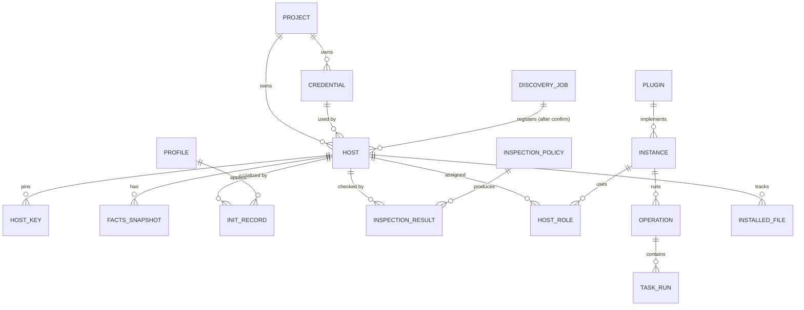
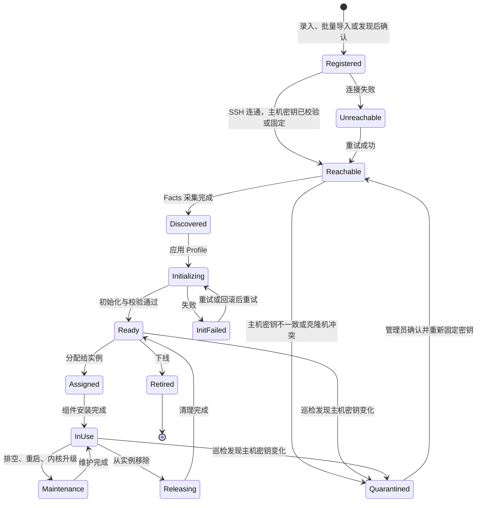
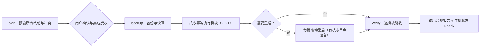

# 03 CMDB 与主机初始化

> **本文定位**：主机纳管（CMDB）、操作系统适配和主机初始化调优。所有组件插件（K8s、ES、MySQL、PG、Redis / Valkey、对象存储……）共用本层能力：插件只声明“需要哪些 Profile、端口和主机能力”，由本层负责把主机调整到可安装状态。OS 版本与生命周期以 2026-11-25 为准。
>
> **版本**：v2（S3 完成，2026-11-26）。全文（§1–§9）定稿；§3、§4.2、§4.3 以 `spec/`（`osmatch.yaml`、`pkgmap.yaml`）为唯一来源，表格由 `spec/gen_os_docs.py` 生成（ADR-029）；S3 修订 §5–§7 并新增 §9 等保主机加固（ADR-018）（v2.1 会话 V：统一备份路径 `/var/lib/kinstall/backups/` 与 22 模块口径）。

## 1. 数据模型

### 1.1 实体关系



### 1.2 核心结构（Go）

```go
type Host struct {
    ID            string
    Name          string            // 唯一；符合 DNS-1123，作为 K8s nodeName 等
    ProjectID     string
    Address       string            // SSH 地址（IP 或域名）
    Port          int
    User          string            // 执行账号，建议专用账号 + sudo 规则（见 1.4）
    Become        string            // sudo / sudo-password / none(root) / su（兼容模式，P2）
    CredentialID  string
    Bastions      []string          // 跳板机链，可多级；每一跳有自己的凭据和主机密钥
    HostKeys      []HostKey         // 已固定的主机公钥（可多种算法），见 8.3
    HostKeyPolicy string            // strict / tofu / ca；为空时继承项目设置
    InternalIPv4  string            // 业务 / 集群通信地址（可与 SSH 地址不同）
    InternalIPv6  string
    Labels        map[string]string // 自由标签：pool=cache、env=prod ...
    Topology      Topology          // 故障域，见 1.5
    Location      Location          // 机房、机柜、U 位（可选，资产信息）
    Profiles      []string          // 已应用的 Profile，如 base@1.2、k8s-node@1.0
    Status        HostStatus        // 见 1.3 状态机
    MachineID     string            // /etc/machine-id，识别克隆机
    ProductUUID   string            // /sys/class/dmi/id/product_uuid
    Facts         *HostFacts        // 最新快照；历史见 FactsSnapshot
    Capabilities  *HostCapabilities // 由 Facts + 适配器推导，见 2.2
}

type HostKey struct {
    Algorithm   string    // ssh-ed25519 / ecdsa-sha2-nistp256 / rsa-sha2-512
    Fingerprint string    // SHA256:...
    Source      string    // tofu / imported / ca
    FirstSeen   time.Time
    LastSeen    time.Time
}

type Topology struct {
    Region      string // 映射 topology.kubernetes.io/region
    Zone        string // 映射 topology.kubernetes.io/zone
    Rack        string
    PowerDomain string // 同一 PDU / 供电回路
    Hypervisor  string // 虚拟机所在宿主机；同宿主机视为同一故障域
}

type HostFacts struct {
    Arch           string   // amd64 / arm64 / loong64
    X86Level       string   // v1 / v2 / v3 / v4（EL10 要求 v3）
    PageSize       int      // getconf PAGESIZE：4096 / 16384 / 65536
    ArmVABits      int      // arm64：CONFIG_ARM64_VA_BITS（39 / 42 / 47 / 48 / 52）
    OSID           string   // os-release 的 ID：rocky、anolis、alinux、kylin、openEuler、uos、ubuntu ...
    OSIDLike       []string
    OSVersion      string   // VERSION_ID
    OSVariant      string   // 细分版本：麒麟 /etc/.kyinfo、UOS /etc/os-version 的 EditionName + MinorVersion（如 e-1070）
    PlatformID     string   // os-release 的 PLATFORM_ID，如 platform:el9、platform:uel20、platform:uelc20
    Adapter        string   // 匹配到的 osmatch 规则 ID 与适配器族，如 kylin-v11-sp1 / kylin
    PkgManager     string   // yum / dnf / apt / zypper
    Kernel         string
    KernelFlavor   string   // 龙蜥 RHCK / ANCK；Ubuntu generic / hwe / 64k
    KernelCmdline  map[string]string // 解析后的启动参数（systemd.unified_cgroup_hierarchy、selinux 等）
    CgroupVersion  int      // 1 / 2（hybrid 记为 1，另记 CgroupHybrid）
    CgroupHybrid   bool
    CgroupControllers []string // v2：/sys/fs/cgroup/cgroup.controllers
    Systemd        int      // systemd 版本号
    SystemdDefaultHierarchy string // systemctl --version 特性串中的 default-hierarchy=（systemd ≥ 256 无此项）
    Glibc          string
    Coreutils      string   // gnu / uutils（Ubuntu 26.04 默认 uutils）
    Sudo           string   // sudo / sudo-rs
    NftVersion     string   // nft --version
    IptablesMode   string   // nf_tables / legacy（iptables -V）
    CPUVendor      string   // Intel / AMD / Hygon / Zhaoxin / HiSilicon(Kunpeng) / Phytium / Loongson / Ampere
    CPUModel       string
    CPUs           int
    MemoryMB       int
    NUMANodes      int
    Virtualization string   // kvm / vmware / none ...
    Disks          []Disk   // 含分区 / 文件系统 / 是否旋转盘 / 序列号 / WWN
    NICs           []NIC
    Routes         []Route
    DNS            DNSInfo  // nameserver、search、是否 systemd-resolved
    TimeSync       TimeInfo // 服务、是否同步、偏差
    Security       SecurityInfo // SELinux / AppArmor / KYSEC / fapolicyd，见 4.6
    ExecProbe      ProbeResult  // 在安装目录试写、试执行探针的结果，见 2.1
    Firewall       string   // firewalld / ufw / nftables / iptables / none
    Swap           []Swap   // 含 zram
    KernelModules  []string
    Limits         LimitsInfo
    Repos          []RepoInfo // 已配置软件源及可用性
    ListenPorts    []int
    CollectedAt    time.Time
}

type SecurityInfo struct {
    SELinux        string            // enforcing / permissive / disabled / absent
    AppArmor       string            // enabled / disabled / absent
    KySec          string            // enforcing / permissive / disable / absent（麒麟）
    KySecFuncs     map[string]string // exectl / netctl / fpro / kmod / ppro ... → on / off / warning
    SecuritySwitch string            // 麒麟 security-switch --get：none / default / strict / custom
    Fapolicyd      string            // active / inactive / absent（EL8+ 应用白名单）
}
```

另有：

- `Credential`：凭据，见 1.4。
- `FactsSnapshot`：历史快照，用于漂移对比。
- `InitRecord`：哪个 Profile 的哪个版本在何时应用、改了哪些文件、备份位置。
- `InstalledFile`：插件写入的每个文件及 digest，用于审计、卸载清理；在启用 KYSEC 的主机上同时记录已做的白名单标记（见 4.6）。
- `InspectionPolicy` / `InspectionResult`：定时巡检的策略和结果，见 8.4。
- `DiscoveryJob`：网段发现任务及其候选主机，见 8.2。
- `HostRole` / `ResourceClaims`：主机与实例的绑定关系及资源占用声明（端口、目录、磁盘、CPU / 内存、独占），见 8.5。

### 1.3 主机状态机



`Quarantined`（隔离）状态下禁止任何写操作，只允许只读采集和管理员处置，防止把凭据交给被替换或被劫持的主机。

### 1.4 凭据管理

| 方面 | 设计 |
| --- | --- |
| 类型 | 密码；私钥（可带口令）；SSH 用户证书（由 SSH CA 签发）；ssh-agent（仅 CLI 本机模式）；外部引用（Vault KV、云 KMS / 密钥管理服务、文件路径、环境变量） |
| 存储 | 信封加密：每条凭据一个数据密钥（AES-256-GCM），数据密钥由主密钥加密；主密钥来自 KMS、本地密钥文件（0600）或启动口令。数据库只存密文 |
| 暴露面 | API 字段只写不读，只回显类型、指纹、末 4 位和更新时间；日志统一打码（slog 处理器）；任务环境变量与命令行不出现明文（通过 stdin 或临时文件 0600 传递，用后删除） |
| 作用域 | 归属项目；与主机多对多；跳板机每一跳可用不同凭据 |
| 提权 | 默认 `sudo`（NOPASSWD，或 `sudo -S` 读取密码）；支持 sudo-rs；root 直连可选（等保环境常禁止）；`su -c` 仅作兼容模式（P2）。提供 `/etc/sudoers.d/kinstall` 模板（全量授权或按命令白名单） |
| 轮换 | 轮换是一个 Operation：生成新密钥 → 分发公钥 → 用新密钥验证登录 → 移除旧公钥 → 更新凭据，任一步失败回滚；密码轮换同理 |
| 一次性凭据 | 引导用的一次性密码只在内存中使用，用完即弃、不落库（用于 8.2 的公钥批量分发） |
| 审计 | 每次使用凭据都记录：谁、何时、对哪台主机、属于哪个 Operation |

### 1.5 标签、拓扑与故障域

- **自由标签**：`k=v` 形式，供实例按标签选择器选主机，如 `pool=k8s-master,zone in (az1,az2)`。
- **拓扑字段**（`Topology`）是保留的结构化字段，插件据此做反亲和与分布校验：
  - K8s：写入节点标签 `topology.kubernetes.io/region`、`topology.kubernetes.io/zone`；etcd / 控制面成员尽量分布在不同 zone，至少不同宿主机。
  - ES / OpenSearch：生成 `node.attr.zone`、`node.attr.rack`，开启分片分配感知。
  - MinIO / 对象存储、Redis / Valkey、PG、MySQL：主从或副本不放在同一宿主机、机柜或供电域。
- **校验规则**：规划阶段（Plan）检查分布约束，不满足时给出告警或阻断（由插件声明严格程度）。例如 3 个 etcd 成员落在同一台宿主机的 3 台虚拟机上，直接阻断。
- **来源**：手工填写、CSV / Excel 导入、外部 CMDB 同步；虚拟化平台对接（读取虚拟机所在宿主机）放到后续版本。

## 2. Facts 采集

| 信息 | 命令 / 来源 | 归一化与用途 |
| --- | --- | --- |
| 架构 | `uname -m` | x86_64 → amd64；aarch64 → arm64；loongarch64 → loong64 |
| x86 指令集级别 | `/lib64/ld-linux-x86-64.so.2 --help`（glibc ≥ 2.33），或 `/proc/cpuinfo` 的 avx2、bmi2、fma、movbe | EL10 要求 x86-64-v3；老服务器和部分国产 x86 需提前检测 |
| 页大小 | `getconf PAGESIZE` | arm64 上可能是 64K（见 03-A §5），影响 jemalloc 等组件（见 4.5） |
| arm64 VA 位数 | `/boot/config-$(uname -r)` 或 `/proc/config.gz` 中的 `CONFIG_ARM64_VA_BITS` | 低于 48 位时 tcmalloc（Envoy）可能无法分配内存；读不到配置时记为 unknown |
| 系统 | `/etc/os-release`；补充 `/etc/redhat-release`、`/etc/kylin-release`、`/etc/.kyinfo`、`/etc/openEuler-release`、`/etc/anolis-release`、`/etc/os-version`（UOS）、`/etc/debian_version`；麒麟可用 `nkvers` | ID、ID_LIKE、VERSION_ID、PLATFORM_ID → osmatch 规则（见 4.2） |
| 内核 | `uname -r`、`/proc/cmdline` | semver 比较；龙蜥区分 RHCK / ANCK；解析 cgroup、SELinux、THP 等启动参数 |
| cgroup | `stat -fc %T /sys/fs/cgroup/`；`/sys/fs/cgroup/unified` 是否存在；`/sys/fs/cgroup/cgroup.controllers` | cgroup2fs 为 v2；tmpfs 为 v1，若同时有 unified 目录则为 hybrid；v2 时记录可用控制器 |
| systemd / glibc | `systemctl --version`（含特性串）、`ldd --version` | 记录版本和 `default-hierarchy=`；systemd ≥ 256 默认拒绝 cgroup v1，258 起彻底移除 |
| nftables / iptables | `nft --version`、`iptables -V` | kube-proxy nftables 模式要求 nft ≥ 1.0.1；记录 iptables 后端（nf_tables / legacy） |
| CPU / 内存 | `lscpu`、`nproc`、`/proc/meminfo`、`/sys/devices/system/node/` | 厂商归一化：HiSilicon → 鲲鹏，Phytium → 飞腾，Hygon → 海光；记录 NUMA 节点数 |
| 虚拟化 | `systemd-detect-virt` | 部分虚拟化平台禁用 VRRP、需要调整网卡 offload |
| 磁盘 | `lsblk -J -b -o NAME,SIZE,TYPE,FSTYPE,MOUNTPOINT,ROTA,SERIAL,WWN`、`wipefs -n` | 识别空盘（数据盘、Ceph、Longhorn）；按序列号 / WWN 标识，不用 /dev/sdX |
| 网络 | `ip -j addr`、`ip -j route`、`ip -j link` | 选择业务网卡、MTU、检查网段冲突 |
| DNS | `/etc/resolv.conf`、`resolvectl status` | 识别 systemd-resolved 的 127.0.0.53 |
| 时间 | `timedatectl`、`chronyc tracking` | 偏差超过阈值时阻断 |
| 安全模块 | `getenforce`；`/sys/module/apparmor/parameters/enabled`、`aa-status`；麒麟 `getstatus`（V10）/ `kysec_policy status`（V11）/ `security-switch --get`；`systemctl is-active fapolicyd` | 见 4.6；命令不存在即记为 absent |
| 执行探针 | 见 2.1 | 识别 noexec、KYSEC、fapolicyd 等会阻止二进制运行或文件写入的机制 |
| 防火墙 | `systemctl is-active firewalld ufw nftables` | — |
| swap | `swapon --show --bytes`、`/proc/swaps` | 含 zram |
| 内核模块 | `lsmod`、`modinfo overlay br_netfilter nf_tables nf_conntrack iscsi_tcp rbd` | 缺失时给出安装建议 |
| 资源限制 | `ulimit -n`、`systemctl show -p DefaultLimitNOFILE` | — |
| 唯一性 | `/etc/machine-id`、`/sys/class/dmi/id/product_uuid`、MAC | 克隆机检测 |
| 端口 | `ss -lntupH` | 端口冲突预检 |
| 软件源 | `dnf repolist` / `yum repolist`、`apt-cache policy`、`zypper lr` | 判断能否在线安装、是否需要切 vault 或离线源 |
| sudo / coreutils | `sudo -V` 首行；`ls --version` 首行 | 识别 sudo-rs、uutils coreutils（Ubuntu 26.04 默认），执行器据此调整参数（见 4.7） |

### 2.1 采集实现要点

- 上传一个 POSIX sh 采集脚本（ADR-025），一次执行、输出 JSON；不依赖 python、jq，最小化系统也能跑；每项独立超时，单项失败不影响整体。
- 工作目录用 `/var/lib/kinstall/tmp`（0700），不用 `/tmp`：等保加固常把 `/tmp` 挂成 noexec。
- **执行探针**：把一个小的静态探针二进制写入 `/var/lib/kinstall/tmp` 和插件声明的安装目录（如 `/usr/local/bin`），分别执行 `--version`，并尝试写入 `/etc/systemd/system`、`/etc/sysctl.d`。失败时结合 `dmesg`、`ausearch` 和 4.6 的检测结果给出原因（noexec、KYSEC 执行控制、fapolicyd、SELinux、只读文件系统）。
- 结果写入 FactsSnapshot；与上一次快照对比，发现内核、IP、磁盘、cgroup、主机密钥、安全模块状态等变化时提示（配置漂移）。
- 采集可周期执行（Server 模式，见 8.4），也可在每次操作前自动刷新。

### 2.2 能力判定（HostCapabilities）

Facts 是原始数据，插件不直接解析，而是读取由“Facts + 适配器规则”推导出的能力字段。判定规则见 4.5。

```go
type HostCapabilities struct {
    CgroupV2           bool   // 当前已运行在 cgroup v2
    CgroupV2Switchable bool   // 可通过启动参数切到 v2（需重启）
    CgroupV1Bootable   bool   // 还能以 v1 启动（systemd ≥ 258 为 false）
    KubeProxyNftables  bool   // 内核 ≥ 5.13 且 nft ≥ 1.0.1
    KernelRecommended  bool   // 满足插件声明的推荐内核（K8s 为 5.8+）
    PageSize64K        bool
    TcmallocSafe       bool   // 非 arm64，或 arm64 VA ≥ 48 位
    X86V3              bool
    ExecBlockers       []string // noexec / kysec / fapolicyd / selinux / readonly
    PkgSource          string // online / vault / offline / none
    Tier               string // P0 / P1 / P2 / unverified（来自 osmatch）
}
```

## 3. 操作系统支持矩阵

> 支持矩阵、识别规则与生命周期以 `spec/osmatch.yaml` 为唯一来源，下述两个表格由 `spec/gen_os_docs.py` 生成（ADR-029）。基线数据取自「03-A OS 软件源实测矩阵」（截至 2026-11-25，48 组官方软件源实测）；安装镜像或云厂商镜像可能改写启动参数或内核变体，运行时一律以 Facts 实测为准。

### 3.1 支持等级与 EOL 策略

**支持等级**

| 等级 | 含义 | 测试承诺与执行策略 |
| --- | --- | --- |
| **P0** | 主推版本 | 每次发版前全量回归（amd64 / arm64），完整覆盖纳管、初始化、K8s 安装与升级 |
| P1 | 正式支持 | 核心用例回归（纳管、初始化、K8s 单主 / 三主安装、小版本升级） |
| P2 | 尽力支持 | 保证纳管与主机初始化；具体组件支持以插件声明为准，不承诺全量回归 |
| unverified | 未实测或兜底命中 | 命中兜底规则，或证据等级为 `documented` / `none` 的目标规则；执行任何写操作前必须用户确认 |
| unsupported | 不满足全局底线（floor） | 不满足 `spec/osmatch.yaml` 的 `floor`（架构为 amd64 / arm64、内核 ≥ 3.10、PID 1 为 systemd）时直接拒接，不再匹配规则 |

**证据等级（`support.evidence`）**

- `measured`：已实测官方软件源索引与包内特征（03-A）。
- `represented`：以同源重建发行版的实测数据代表（如 RHEL / AlmaLinux 以 Rocky 代表）。
- `documented`：仅有官方文档或社区资料，未拿到软件源数据（如 UOS V20、CentOS Stream 8、openEuler 创新版）。
- `none`：兜底规则，无基线数据。
- **执行原则**：证据等级为 `documented` 或 `none` 的规则，即使目标等级标为 P1 / P2，在补齐实测前一律按 `unverified` 执行。

**生命周期状态与 EOL 策略**（相对 `dataAsOf = 2026-11-25` 计算）

- 状态取值：**支持中**、**即将 EOL**（距 EOL 不足 `eolSoonDays = 180` 天）、**已 EOL**、**未公开**、**按版本**（如 openEuler 创新版按各小版本计算）。
- **EOL 策略**：已 EOL 的系统（CentOS 7 / 8、Anolis 7、openEuler 22.03、Leap 15.6、Ubuntu 20.04 标准支持、Debian 11 LTS）现场仍大量存在，平台允许纳管与主机初始化，并在 Facts、Plan、合规报告与生命周期巡检（§8.4）中醒目告警；对 K8s 1.35+ 判定至多为 ⚠️（不推荐），且内核 < 5.8 时直接阻断。

**相对 v1 的等级调整**：麒麟 V11 2503 由 P0 调为 P1，P0 改为编译默认已切到 cgroup v2 的麒麟 V11 SP1 2603；新增 Alibaba Cloud Linux 3 / 4 为 P1；新增 Oracle Linux 9、OpenCloudOS 9、BCLinux 8 / for Euler、openSUSE Leap 15.6 / 16.0 为 P2；CentOS Stream 8 纳入为 P2（仅文档）。当前 P0 共 5 项：`el-9`、`openeuler-24.03-lts`、`kylin-v11-sp1`、`ubuntu-22.04`、`ubuntu-24.04`。

### 3.2 支持矩阵

_下表由 `spec/gen_os_docs.py` 生成（块：os-matrix），请改 `spec/osmatch.yaml` 后重新生成，勿手改。_

| 系统 | 规则 | 适配器 / 包管理 | 等级 | 依据 | 生命周期 | 状态（截至 2026-11-25） | 软件源 | 主机初始化 |
| --- | --- | --- | --- | --- | --- | --- | --- | --- |
| CentOS Linux 7 | `centos-7` | rhel-like / yum | P2 | 实测：CentOS 7.9（amd64） | 2024-06-30 结束 | 已 EOL | vault / 离线 | ✅；需切 vault 或离线源；可选工具缺 `jq`、`zstd` |
| CentOS Linux 8 | `centos-8` | rhel-like / dnf | P2 | 实测：CentOS 8.5（amd64） | 2021-12-31 结束 | 已 EOL | vault / 离线 | ✅；需切 vault 或离线源 |
| CentOS Stream 8 | `centos-stream-8` | rhel-like / dnf | P2（目标；实测前按 unverified） | 文档资料 | 2024-05-31 结束 | 已 EOL | vault / 离线 | ✅；需切 vault 或离线源；未实测 |
| CentOS Stream 9 | `centos-stream-9` | rhel-like / dnf | P1 | 实测：CentOS Stream 9（amd64） | 至 2027-05-31 | 支持中 | 在线 | ✅ |
| CentOS Stream 10 | `centos-stream-10` | rhel-like / dnf | P2 | 实测：CentOS Stream 10（amd64） | 至 2030-05-31 | 支持中 | 在线 | ✅；可选工具缺 `gdisk` |
| RHEL / Rocky / AlmaLinux 8 | `el-8` | rhel-like / dnf | P1 | 实测：Rocky 8.10（amd64、arm64）；RHEL / AlmaLinux 以 Rocky 代表 | 至 2029-05-31 | 支持中 | 在线 | ✅ |
| RHEL / Rocky / AlmaLinux 9 | `el-9` | rhel-like / dnf | **P0** | 实测：Rocky 9.9（amd64、arm64）；RHEL / AlmaLinux 以 Rocky 代表 | 至 2032-05-31 | 支持中 | 在线 | ✅ |
| RHEL / Rocky / AlmaLinux 10 | `el-10` | rhel-like / dnf | P1 | 实测：Rocky 10.3（amd64、arm64）；RHEL / AlmaLinux 以 Rocky 代表 | 至 2035-05-31 | 支持中 | 在线 | ✅；可选工具缺 `gdisk` |
| Oracle Linux 9 | `ol-9` | rhel-like / dnf | P2 | 实测：Oracle Linux 9.9（amd64） | 至 2032-06（Premier；Extended 至 2035-06） | 支持中 | 在线 | ✅ |
| OpenCloudOS 9 | `opencloudos-9` | rhel-like / dnf | P2 | 实测：OpenCloudOS 9.6（amd64、arm64） | 至 2033-04-30（完整支持至 2030-04-30） | 支持中 | 在线 | ✅ |
| Anolis OS 7 | `anolis-7` | anolis / yum | P2 | 实测：Anolis 7.9（amd64） | 2024-06-30 结束（社区另有 ELS 延保） | 已 EOL | 在线（已停更） | ✅；源已停更，建议离线源；缺 `container-selinux`（SELinux enforcing 时阻断）；可选工具缺 `jq`、`zstd` |
| Anolis OS 8 | `anolis-8` | anolis / dnf | P1 | 实测：Anolis 8.10（amd64、arm64） | 至 2031-03-31 | 支持中 | 在线 | ✅ |
| Anolis OS 23 | `anolis-23` | anolis / dnf | P1 | 实测：Anolis 23.5（amd64、arm64） | 至 2033 | 支持中 | 在线 | ✅ |
| Alibaba Cloud Linux 3 | `alinux-3` | anolis / dnf | P1 | 实测：Alibaba Cloud Linux 3（amd64、arm64） | 至 2031-03（维护期；扩展支持至 2034-03-31） | 支持中 | 在线 | ✅ |
| Alibaba Cloud Linux 4 | `alinux-4` | anolis / dnf | P1 | 实测：Alibaba Cloud Linux 4（amd64、arm64） | 至 2035-06（维护期；扩展支持至 2038-06-30） | 支持中 | 在线 | ✅ |
| BCLinux 8 | `bclinux-8` | anolis / dnf | P2 | 实测：BCLinux 8.8（amd64） | 未找到公开数据 | 未公开 | 在线 | ✅ |
| openEuler 22.03 LTS | `openeuler-22.03-lts` | openeuler / dnf | P2 | 实测：openEuler 22.03 LTS SP4（amd64、arm64） | 2026-03-30 结束 | 已 EOL | 在线（已停更） | ✅；源已停更，建议离线源 |
| openEuler 24.03 LTS | `openeuler-24.03-lts` | openeuler / dnf | **P0** | 实测：openEuler 24.03 LTS SP4（amd64、arm64）；样本为 SP4 | 基础版 2026-05；SP1 2026-12；SP2 2026-04-24；SP3 2027-12；SP4 2027-03 | SP3 支持中；SP1、SP4 即将 EOL；基础版、SP2 已 EOL | 在线 | ✅ |
| openEuler 创新版 | `openeuler-innovation` | openeuler / dnf | P2（目标；实测前按 unverified） | 文档资料 | 按版本：每个创新版支持 6 个月，如 26.09 至 2027-03 | 按版本 | 在线 | ✅；未实测 |
| BCLinux for Euler | `bclinux-euler` | openeuler / dnf | P2 | 实测：BCLinux for Euler 22.10U2（amd64） | 未找到公开数据 | 未公开 | 在线 | ✅ |
| 麒麟 V10（SP1–SP3） | `kylin-v10` | kylin / dnf | P1 | 实测：麒麟 V10 SP3 2403（amd64、arm64）；样本为 SP3 2403；SP1 / SP2 未实测 | 产品线 5+5+3 共 13 年；各 SP 停服日期未公开 | 未公开 | 在线 | ✅ |
| 麒麟 V11 2503 | `kylin-v11-2503` | kylin / dnf | P1 | 实测：麒麟 V11 2503（amd64、arm64） | 5+5+3 年；具体日期未公开 | 未公开 | 在线 | ✅ |
| 麒麟 V11 SP1 2603 | `kylin-v11-sp1` | kylin / dnf | **P0** | 实测：麒麟 V11 SP1 2603（amd64、arm64） | 5+5+3 年；具体日期未公开 | 未公开 | 在线 | ✅ |
| 统信 UOS V20 a 版（1070a） | `uos-20-a` | uos → anolis / dnf | P1（目标；实测前按 unverified） | 文档资料 | 至 2032 | 支持中 | 需授权 / 离线 | ✅；需授权源或离线源；未实测 |
| 统信 UOS V20 e 版（1070e） | `uos-20-e` | uos → openeuler / dnf | P1（目标；实测前按 unverified） | 文档资料 | 至 2032 | 支持中 | 需授权 / 离线 | ✅；需授权源或离线源；未实测 |
| openSUSE Leap 15.6 | `leap-15.6` | suse / zypper | P2 | 实测：openSUSE Leap 15.6（amd64） | 2026-04-30 结束 | 已 EOL | 在线（已停更） | ✅；源已停更，建议离线源 |
| openSUSE Leap 16.0 | `leap-16.0` | suse / zypper | P2 | 实测：openSUSE Leap 16.0（amd64）；arm64 只做了内核配置探测 | 至 2027-10（约；每个小版本支持 24 个月） | 支持中 | 在线 | ✅ |
| Ubuntu 20.04 | `ubuntu-20.04` | debian-like / apt | P2 | 实测：Ubuntu 20.04（amd64） | 2025-05-31 结束（标准支持已结束，仅 Ubuntu Pro ESM） | 已 EOL | 在线（已停更） | ✅；源已停更，建议离线源 |
| Ubuntu 22.04 | `ubuntu-22.04` | debian-like / apt | **P0** | 实测：Ubuntu 22.04（amd64） | 至 2027-06（标准支持） | 支持中 | 在线 | ✅ |
| Ubuntu 24.04 | `ubuntu-24.04` | debian-like / apt | **P0** | 实测：Ubuntu 24.04（amd64、arm64） | 至 2029-05（标准支持；List of releases 页为 2029-06，取较早者） | 支持中 | 在线 | ✅ |
| Ubuntu 26.04 | `ubuntu-26.04` | debian-like / apt | P1 | 实测：Ubuntu 26.04（amd64） | 至 2031-05（标准支持） | 支持中 | 在线 | ✅ |
| Debian 11 | `debian-11` | debian-like / apt | P2 | 实测：Debian 11（amd64） | 2026-08-31 结束（LTS 已结束；ELTS 为付费服务） | 已 EOL | 在线（已停更） | ✅；源已停更，建议离线源 |
| Debian 12 | `debian-12` | debian-like / apt | P1 | 实测：Debian 12（amd64、arm64） | 至 2028-06-30（安全支持已于 2026-06 结束，现为 LTS） | 支持中 | 在线 | ✅ |
| Debian 13 | `debian-13` | debian-like / apt | P1 | 实测：Debian 13（amd64） | 至 2030-06-30（安全支持至 2028-08-09，之后为 LTS；ELTS 至 2035-06-30） | 支持中 | 在线 | ✅ |
**列说明**：`规则` 为 `spec/osmatch.yaml` 中的精确规则 ID；`适配器 / 包管理` 为族（`uos` 按规则指定父族）及默认包管理器（含规则级 `overrides`，如 EL7 用 `yum`）；`依据` 标明实测样本与架构（`documented` 显示“文档资料”）；`软件源` 区分在线、在线（已停更）、vault / 离线、需授权 / 离线；`主机初始化` 汇总源提示及由 `spec/pkgmap.yaml` 推导的真实缺包（区分必需包阻断与可选工具跳过）。

### 3.3 内核、cgroup 与 K8s 1.35+ 判定

**判定规则**（由 `spec/gen_os_docs.py` 与运行时能力推导共用，与 04 §2.3、ADR-010 一致）

1. **cgroup v2 下限**：`systemd < 239` 或内核 `< 4.18` → ❌ 阻断（无法可靠运行 cgroup v2）。
2. **默认 cgroup**：编译默认为 `v1` 或 `hybrid` → 初始化模块写入 `systemd.unified_cgroup_hierarchy=1` 并安排分批重启（需用户确认，S3 D18）；legacy 模式（`failCgroupV1: false`）只用于 K8s 1.35–1.37 过渡（1.38 仍可用但为短期方案，随上游移除而下线，见 ADR-010 与 04 §2.3）。
3. **内核 < 5.8**：
   - 有官方 HWE 或厂商官方内核 ≥ 5.8（如 Ubuntu 20.04 HWE 5.15、UOS V20 ISO 可选 5.10）→ ⚠️ 提示切换内核；
   - 否则若 OS 已 EOL → ❌ 阻断；
   - 若 OS 未 EOL → ⚠️ 仅实验模式（`--allow-unsupported-kernel`），或提示换用第三方 LTS 内核（如 EL8 的 ELRepo kernel-lt）。
4. **已 EOL**：即使内核与 cgroup 满足要求，K8s 1.35+ 判定至多为 ⚠️（不推荐生产新建）。
5. **硬件与证据提示**：EL10 / Stream 10 提示 x86 需 `x86-64-v3`（AlmaLinux 10 另有 `x86_64_v2` 构建，见 Q-27）；`documented` 规则标明“未实测”。
6. **kube-proxy / Calico nftables 模式**（ADR-014）：内核 ≥ 5.13 且 `nft` ≥ 1.0.1 时启用 nftables，否则两者统一降级为 iptables。

_下表由 `spec/gen_os_docs.py` 生成（块：os-k8s），请改 `spec/osmatch.yaml` 后重新生成，勿手改。_

| 系统 | 默认内核 | 其他内核 | systemd | 编译默认 cgroup | nft | kube-proxy nftables | arm64 页大小 | K8s 1.35+ | 说明 / 初始化动作 |
| --- | --- | --- | --- | --- | --- | --- | --- | --- | --- |
| CentOS Linux 7 | 3.10.0-1160 | — | 219 | 仅 v1 | 0.8 | ❌ 内核与 nft 均不足 | 未实测 | ❌ | systemd / 内核不支持 cgroup v2 |
| CentOS Linux 8 | 4.18.0-348 | — | 239 | v1 | 0.9.3 | ❌ 内核与 nft 均不足 | 未实测 | ❌ | 内核 < 5.8 且 OS 已 EOL |
| CentOS Stream 8 | 4.18.0 | — | 239 | v1 | — | 待实测 | 未实测 | ❌ | 内核 < 5.8 且 OS 已 EOL |
| CentOS Stream 9 | 5.14.0-765 | — | 252 | v2 | 1.0.9 | ✅ | 未实测 | ✅ | — |
| CentOS Stream 10 | 6.12.0-284 | — | 257 | 仅 v2 | 1.1.7 | ✅ | 未实测 | ✅ | x86 需 x86-64-v3 |
| RHEL / Rocky / AlmaLinux 8 | 4.18.0-553 | — | 239 | v1 | 1.0.4 | ❌ 内核 < 5.13 | **64K** | ⚠️ | 切 cgroup v2（重启）；内核 < 5.8：仅实验模式（`--allow-unsupported-kernel`），或换用第三方 LTS 内核（ELRepo kernel-lt 等，S3 复核） |
| RHEL / Rocky / AlmaLinux 9 | 5.14.0-741 | — | 252 | v2 | 1.0.9 | ✅ | 4K（可选 64K：`kernel-64k`） | ✅ | — |
| RHEL / Rocky / AlmaLinux 10 | 6.12.0-264 | — | 257 | 仅 v2 | 1.1.5 | ✅ | 4K（可选 64K：`kernel-64k`） | ✅ | x86 需 x86-64-v3 |
| Oracle Linux 9 | 5.14.0-741 | UEK 8 6.12 / UEK 7 5.15 | 252 | v2 | 1.0.9 | ✅ | 未实测 | ✅ | — |
| OpenCloudOS 9 | 6.6.119-53 | — | 255 | v2 | 1.0.8 | ✅ | 4K | ✅ | — |
| Anolis OS 7 | 3.10.0-1160 | — | 219 | 仅 v1 | 0.8 | ❌ 内核与 nft 均不足 | 未实测 | ❌ | systemd / 内核不支持 cgroup v2 |
| Anolis OS 8 | 5.10.134-20 | RHCK 4.18.0 | 239 | v1 | 1.0.4 | ❌ 内核 < 5.13 | 4K | ✅ | 切 cgroup v2（重启） |
| Anolis OS 23 | 6.6.102-8 | — | 255 | v2 | 1.0.8 | ✅ | 4K | ✅ | — |
| Alibaba Cloud Linux 3 | 5.10.134-20 | — | 239 | v1 | 1.0.4 | ❌ 内核 < 5.13 | 4K（可选 64K：kernel-64k（plus-64k 仓库）） | ✅ | 切 cgroup v2（重启） |
| Alibaba Cloud Linux 4 | 6.6.102-8 | — | 255 | v2 | 1.0.8 | ✅ | 4K（可选 64K：kernel（kernel-64k 仓库）） | ✅ | — |
| BCLinux 8 | 4.19.0-553 | — | 239 | v1 | 0.9.3 | ❌ 内核与 nft 均不足 | 未实测 | ⚠️ | 切 cgroup v2（重启）；内核 < 5.8：仅实验模式（`--allow-unsupported-kernel`） |
| openEuler 22.03 LTS | 5.10.0-342 | — | 249 | v1 | 1.0.0 | ❌ 内核与 nft 均不足 | 4K | ⚠️ | 切 cgroup v2（重启）；OS 已 EOL，不推荐 |
| openEuler 24.03 LTS | 6.6.0-159 | — | 255 | v1 | 1.0.8 | ✅ | 4K（可选 64K：`kernel-64k`） | ✅ | 切 cgroup v2（重启） |
| openEuler 创新版 | — | — | — | — | — | — | 未实测 | — | 视具体版本 |
| BCLinux for Euler | 5.10.0-153 | — | 249 | v1 | 1.0.0 | ❌ 内核与 nft 均不足 | 未实测 | ✅ | 切 cgroup v2（重启） |
| 麒麟 V10（SP1–SP3） | 4.19.90-89 | — | 243 | v1 | 0.9.6 | ❌ 内核与 nft 均不足 | **64K** | ⚠️ | 切 cgroup v2（重启）；内核 < 5.8：仅实验模式（`--allow-unsupported-kernel`） |
| 麒麟 V11 2503 | 6.6.0-32 | — | 255 | v1 | 1.0.8 | ✅ | 4K | ✅ | 切 cgroup v2（重启） |
| 麒麟 V11 SP1 2603 | 6.6.0-40 | — | 255 | v2 | 1.0.8 | ✅ | 4K | ✅ | — |
| 统信 UOS V20 a 版（1070a） | 4.19.0 | 5.10.0（ISO 可选） | 243 | 待实测 | — | 待实测 | 未实测 | ⚠️ | 默认 cgroup 待实测；切换内核：ISO 自带的可选 5.10 内核；未实测 |
| 统信 UOS V20 e 版（1070e） | 4.19.90 | 5.10.0（ISO 可选） | 243 | 待实测 | — | 待实测 | 未实测 | ⚠️ | 默认 cgroup 待实测；切换内核：ISO 自带的可选 5.10 内核；未实测 |
| openSUSE Leap 15.6 | 6.4.0 | — | 254 | v2 | 0.9.8 | ❌ nft < 1.0.1 | 未实测 | ⚠️ | OS 已 EOL，不推荐 |
| openSUSE Leap 16.0 | 6.12.0 | — | 257 | 仅 v2 | 1.1.3 | ✅ | 4K（可选 64K：`kernel-64kb`） | ✅ | — |
| Ubuntu 20.04 | 5.4.0-216 | HWE 5.15.0 | 245 | hybrid | 0.9.3 | ❌ 内核与 nft 均不足 | 未实测 | ⚠️ | 切 cgroup v2（重启）；升级 HWE 5.15 内核；OS 已 EOL，不推荐 |
| Ubuntu 22.04 | 5.15.0-204 | HWE 6.8.0 | 249 | v2 | 1.0.2 | ✅ | 未实测 | ✅ | — |
| Ubuntu 24.04 | 6.8.0-151 | HWE 7.0.0 | 255 | v2 | 1.0.9 | ✅ | 4K（可选 64K：`linux-image-generic-64k`） | ✅ | — |
| Ubuntu 26.04 | 7.0.0-44 | — | 259 | 仅 v2 | 1.1.6 | ✅ | 未实测 | ✅ | — |
| Debian 11 | 5.10.223-1 | — | 247 | v2 | 0.9.8 | ❌ 内核与 nft 均不足 | 未实测 | ⚠️ | OS 已 EOL，不推荐 |
| Debian 12 | 6.1.176-1 | — | 252 | v2 | 1.0.6 | ✅ | 4K | ✅ | — |
| Debian 13 | 6.12.117-1 | — | 257 | 仅 v2 | 1.1.3 | ✅ | 未实测 | ✅ | — |
**arm64 页大小说明**：表中的“arm64 页大小”来自 03-A §5 对默认内核与可选 64K 内核包的 `.config` 实测。RHEL 8 系（Rocky 8 实测）与麒麟 V10 SP3 默认内核为 **64K 页**，其余已测 arm64 发行版默认 4K 页；组件级影响与 BOM 预检规则见 §4.5（ADR-028）。

### 3.4 结论与推荐

- **K8s 1.35+ 推荐底座**：
  - 原生 cgroup v2（直接可装）：EL9 / EL10、CentOS Stream 9 / 10、Oracle Linux 9、OpenCloudOS 9、Anolis 23、Alibaba Cloud Linux 4、麒麟 V11 SP1 2603、openSUSE Leap 16.0、Ubuntu 22.04 / 24.04 / 26.04、Debian 12 / 13。其中主推 P0 为 EL9、Ubuntu 22.04 / 24.04、麒麟 V11 SP1 2603。
  - 需切 cgroup v2 后重启（满足内核 ≥ 5.8）：Anolis 8（ANCK 5.10）、Alibaba Cloud Linux 3（ANCK 5.10）、openEuler 24.03 LTS（P0）、BCLinux for Euler、麒麟 V11 2503（P1）；已 EOL 的 openEuler 22.03 LTS、Ubuntu 20.04（升 HWE 5.15 后）也可切 v2 但仅建议存量过渡。
- **仅实验模式（⚠️）**：RHEL / Rocky / AlmaLinux 8（4.18，可换 ELRepo kernel-lt）、BCLinux 8（4.19）、麒麟 V10 SP1–SP3（4.19.90，由 v1 的 ❌ 调整为 ⚠️ 实验，以统一 `kernel < 5.8` 且未 EOL 的判定口径）。
- **阻断（❌）**：CentOS Linux 7、CentOS Linux 8、CentOS Stream 8、Anolis OS 7。其中 Anolis 7.9 官方源还缺少 `container-selinux`（Q-21），SELinux enforcing 时无法安装容器运行时。
- **openEuler 24.03 LTS 选型建议**：按官方生命周期，24.03 LTS 按 SP 独立计算 EOL——当前建议选用 **SP3**（至 2027-12）；SP4 计划 EOL（2027-03）早于 SP3 是官方公开数据（论坛答复 SP4 之后可能转 SP5，持续在 01 R-OS-05 跟踪）；基础版（2026-05）和 SP2（2026-04-24 停维）均已 EOL，SP1（2026-12）即将 EOL。
- **主机初始化与中间件**：上表所有系统（含已 EOL 系统）均支持纳管和主机初始化；中间件支持范围由各插件声明。
- **迁移建议**：CentOS 7 → AlmaLinux ELevate 原地升级或龙蜥迁移工具 AOMS；CentOS 8 → Rocky / Alma / 龙蜥 8；麒麟 V10 → 麒麟 V11 SP1（注意 arm64 页大小由 64K 变为 4K，见 Q-23）；openEuler 22.03 → 24.03 SP3；Ubuntu 20.04 → Ubuntu 22.04 / 24.04。

### 3.5 未实测与待定

- **统信 UOS**：V20（1070a / 1070e）软件源需授权未能实测，目前按官方文档建为 `documented` 规则（目标等级 P1，实测前按 `unverified` 执行）；V25（2510，2026-09-08 发布，Linux 6.6 LTS）尚无公开 os-release 样本，当前落入兜底规则 `fb-uos`（按包管理器探测底座）。
- **CTyunOS**：天翼云镜像站为动态页面，仓库路径未确认（新增调研项 R-OS-22）；已知 CTyunOS 2 支持至 2031-06-30、CTyunOS 3 至 2032-12-31，基于 openEuler 衍生，当前走兜底规则 `fb-openeuler`。
- **RHEL / AlmaLinux**：RHEL 源需订阅，AlmaLinux 与 Rocky 同为 RHEL 重建，规则合并在 `el-8` / `el-9` / `el-10` 中以 Rocky 实测数据代表（AlmaLinux 10 的 `x86_64_v2` 构建差异见 Q-27）。
- **其他历史或小众版本**：Oracle Linux 8、OpenCloudOS 8、Alibaba Cloud Linux 2（已于 2026-03-31 停服）、SLES、openEuler 20.03 等不单独建精确规则，统一落入对应族的兜底规则（`fb-rhel`、`fb-opencloudos`、`fb-anolis`、`fb-suse`、`fb-openeuler`），以 `unverified` 处理。
- **LoongArch64 / SW64**：暂不在 `floor.arch` 内（平台 Go 二进制可交叉编译，但上游 K8s / containerd / etcd 无官方二进制），支持范围见 01 R-OS-19。


## 4. OS 适配器

### 4.1 接口

```go
type OSAdapter interface {
    ID() string                     // 适配器族：rhel-like / anolis / openeuler / kylin / uos / suse / debian-like
    Parent() string                 // 继承关系，只覆盖差异：anolis、openeuler → rhel-like；kylin → openeuler；uos 按变体选 anolis 或 openeuler
    Packages() PackageManager       // install / remove / query / repo add / makecache / lock（versionlock、apt-mark hold、zypper addlock）
    PackageName(logical string, f *HostFacts) ([]string, bool) // 逻辑包名 → 实际包名（可随版本变化，见 4.3）
    Services() ServiceManager       // systemd 封装
    Firewall() Firewall             // firewalld / ufw / nftables / none
    MAC() MandatoryAccessControl    // SELinux / AppArmor
    Security() SecurityModules      // KYSEC、fapolicyd 等：检测、白名单标记（见 4.6）
    Kernel() KernelManager          // 内核包、启动参数、默认启动项、64K 内核
    Network() NetworkConfigurer     // NetworkManager / netplan / ifupdown / wicked
    TimeSync() TimeSync             // chrony / systemd-timesyncd
    Capabilities(f *HostFacts) HostCapabilities // 能力判定（见 4.5）
    Quirks(f *HostFacts) []Quirk    // 已知问题与绕过方法（见 4.7）
}
```

与 v1 的区别：OS 识别规则和逻辑包名映射全部迁入数据文件 `spec/osmatch.yaml` 与 `spec/pkgmap.yaml`（ADR-024、ADR-029），适配器代码只实现 7 个族（`families`）的默认行为，版本差异通过规则级 `overrides`（如 EL7 的 `yum`、Leap 16.0 的 `selinux` / `NetworkManager`、Debian 的 `ifupdown`）覆盖；新增 `Security()` 和 `Capabilities()`；`PackageName` 按“规则覆盖 > 族覆盖（含父族链）> pkgType 默认”的顺序查表解析。

### 4.2 识别规则（`spec/osmatch.yaml`，ADR-024 / ADR-029）

**识别流程（5 步）**

1. **底线检查（`floor`）**：校验架构（amd64 / arm64）、内核（≥ 3.10）和 PID 1（systemd）；不满足时直接判为 `unsupported`，不再匹配规则。
2. **采集标识文件**：读取 `/etc/os-release`（不存在时回退 `/usr/lib/os-release`）并解析键值，同时只读采集补充文件（存在才读）：`/etc/redhat-release`、`/etc/openEuler-release`、`/etc/kylin-release`、`/etc/.kyinfo`、`/etc/os-version`（UOS）、`/etc/debian_version`。
3. **按优先级匹配**：按 `priority` 从高到低遍历 `spec/osmatch.yaml` 中的规则（精确规则 100 / 110，兜底规则 10–30），取最高优先级的命中项；**同一优先级同时命中多条规则视为配置错误并报错**（在 CI golden 测试中拦截）。
4. **提取变体（`variants`）**：按命中规则声明的 `variants` 提取细分标识（如 openEuler 的 `sp`、麒麟 V10 的 `sp` / `milestone`、麒麟 V11 SP1 的 `release`、Alinux 3 的 `update`、UOS 的 `minor` / `edition`、Debian 13 的 `point`），用于按变体计算生命周期或写入 `HostFacts.OSVariant`。
5. **无命中兜底**：所有规则均未命中时，按目标主机可用包管理器（`dnf` / `yum` / `apt` / `zypper`）探测基础适配器族，规则记为 `unknown`、等级记为 `unverified`，任何写操作前必须经用户确认。

**匹配语义**

- 字符串默认**大小写不敏感**的精确匹配；以 `re:` 开头表示正则（RE2 语法子集，Go `regexp` 与 Python `re` 通用）。
- 列表取 **OR**（任一元素命中即可）；同一个 `match` 块内的多个键取 **AND**；支持 `anyOf`、`not`、`osrelease`（任意键）和 `file`（存在性 / 内容正则）。
- `idLike` 按空格拆分 `ID_LIKE` 后逐词比对，任一词命中即满足。

**实测要点（03-A §2）**

- **无 `ID_LIKE`**：openEuler、麒麟、Anolis 23、BCLinux for Euler、UOS 均无 `ID_LIKE`，精确规则必须先按 `ID` 显式匹配，`ID_LIKE` 只用于兜底（Q-03）。
- **特殊 `ID_LIKE`**：OpenCloudOS 的 `ID_LIKE` 是自身（`opencloudos`），Oracle Linux 只有 `fedora`，Alibaba Cloud Linux 4 只有 `anolis`（Q-04），不能靠 `ID_LIKE` 推导族。
- **同 `ID` / `VERSION_ID` 细分**：麒麟 V11 2503 与 V11 SP1 2603 同为 `ID=kylin`、`VERSION_ID=V11`，靠 `KYLIN_RELEASE_ID=2603` 或 `VERSION` 中的 `(swan25)` / `(swan26)` 区分（Q-24）；麒麟 V10 各 SP 靠 `VERSION` 代号与 `/etc/.kyinfo` 的 `milestone` 区分（Q-26）；openEuler LTS 的 SP 取自 `VERSION` 中的 `LTS-SPn`，生命周期按 SP 独立计算（Q-25）。
- **架构一致性**：所有已测 arm64 与 amd64 样本的 os-release 完全一致，规则不区分架构。

**文件格式节选**（完整文件见 `spec/osmatch.yaml`）

```yaml
apiVersion: kinstall.io/v1alpha1
kind: OSMatch
metadata:
  revision: "2026.11.26-1"
  dataAsOf: "2026-11-25"
  eolSoonDays: 180
floor: {arch: [amd64, arm64], kernelMin: "3.10", init: systemd}
families:
  rhel-like: {pkgType: rpm, pkgManager: dnf, lock: dnf-versionlock, firewall: firewalld, mac: selinux, network: NetworkManager, bootloader: grubby, timeSync: chrony}
  anolis:    {parent: rhel-like}
  openeuler: {parent: rhel-like}
  kylin:     {parent: openeuler, security: [kysec]}
  uos:       {parent: per-rule}
  suse:      {pkgType: rpm, pkgManager: zypper, lock: zypper-addlock, firewall: firewalld, mac: apparmor, network: wicked, bootloader: grub2-mkconfig, timeSync: chrony}
  debian-like: {pkgType: deb, pkgManager: apt, lock: apt-mark-hold, firewall: ufw, mac: apparmor, network: netplan, bootloader: update-grub, timeSync: chrony}
rules:
  - id: el-9
    display: RHEL / Rocky / AlmaLinux 9
    family: rhel-like
    priority: 100
    match: {id: [rhel, rocky, almalinux], versionId: 're:^9(\.|$)'}
    support: {tier: P0, evidence: measured, evidenceNote: RHEL / AlmaLinux 以 Rocky 代表, samples: [rocky9, rocky9-arm64], pkgSource: online, lifecycle: {eol: "2032-05-31"}}
    baseline: {kernel: "5.14.0-741", systemd: 252, cgroup: v2, nft: "1.0.9", glibc: "2.34", arm64: {pageSize: 4K, optional64k: kernel-64k}}
  - id: kylin-v11-sp1
    display: 麒麟 V11 SP1 2603
    family: kylin
    priority: 100
    match: {id: kylin, versionId: V11, anyOf: [{osrelease: {KYLIN_RELEASE_ID: "2603"}}, {version: 're:(?i)\(swan26\)'}]}
    variants: {release: {from: osrelease, key: KYLIN_RELEASE_ID}}
    support: {tier: P0, evidence: measured, samples: [kylinv11sp1, kylinv11sp1-arm64], pkgSource: online, lifecycle: {eol: null, note: "5+5+3 年；具体日期未公开"}}
    baseline: {kernel: "6.6.0-40", systemd: 255, cgroup: v2, nft: "1.0.8", glibc: "2.38", arm64: {pageSize: 4K}}
  - id: openeuler-24.03-lts
    display: openEuler 24.03 LTS
    family: openeuler
    priority: 100
    match: {id: openEuler, versionId: "24.03", version: 're:LTS'}
    variants: {sp: {from: version, pattern: 'LTS-SP(?P<v>\d+)', default: "0", labels: {"0": 基础版}}}
    support: {tier: P0, evidence: measured, samples: [oe2403, oe2403-arm64], pkgSource: online, lifecycle: {eol: null, byVariant: {sp: {"0": "2026-05", "1": "2026-12", "2": "2026-04-24", "3": "2027-12", "4": "2027-03"}}}}
  - id: uos-20-e
    display: 统信 UOS V20 e 版（1070e）
    family: uos
    parent: openeuler
    priority: 100
    match: {id: uos, versionId: "20", anyOf: [{platformId: "platform:uel20"}, {versionCodename: fuyu}]}
    variants: {minor: {from: file, path: /etc/os-version, pattern: '^MinorVersion=(?P<v>\S+)'}}
    support: {tier: P1, evidence: documented, samples: [], pkgSource: licensed, lifecycle: {eol: "2032"}}
  - id: fb-rhel
    display: RHEL 系其他版本
    family: rhel-like
    priority: 10
    match: {anyOf: [{idLike: [rhel, centos, fedora]}, {id: [rhel, centos, rocky, almalinux, ol]}, {file: {path: /etc/redhat-release, exists: true}}]}
    support: {tier: unverified, evidence: none}
```

**全部规则（42 条：精确 34、兜底 8）**

_下表由 `spec/gen_os_docs.py` 生成（块：os-rules），请改 `spec/osmatch.yaml` 后重新生成，勿手改。_

| 优先级 | 规则 | 匹配条件 | 适配器族 | 变体 | 等级 |
| --- | --- | --- | --- | --- | --- |
| 100 | `centos-7` | ID = `centos`，VERSION_ID = `7` | rhel-like | — | P2 |
| 100 | `centos-8` | ID = `centos`，VERSION_ID = `8`，NAME = `CentOS Linux` | rhel-like | — | P2 |
| 100 | `centos-stream-8` | ID = `centos`，VERSION_ID = `8`，NAME = `CentOS Stream` | rhel-like | — | P2（目标；实测前按 unverified） |
| 100 | `centos-stream-9` | ID = `centos`，VERSION_ID = `9`，NAME = `CentOS Stream` | rhel-like | — | P1 |
| 100 | `centos-stream-10` | ID = `centos`，VERSION_ID = `10`，NAME = `CentOS Stream` | rhel-like | — | P2 |
| 100 | `el-8` | ID ∈ {`rhel`、`rocky`、`almalinux`}，VERSION_ID ~ `^8(\.\|$)` | rhel-like | — | P1 |
| 100 | `el-9` | ID ∈ {`rhel`、`rocky`、`almalinux`}，VERSION_ID ~ `^9(\.\|$)` | rhel-like | — | **P0** |
| 100 | `el-10` | ID ∈ {`rhel`、`rocky`、`almalinux`}，VERSION_ID ~ `^10(\.\|$)` | rhel-like | — | P1 |
| 100 | `ol-9` | ID = `ol`，VERSION_ID ~ `^9(\.\|$)` | rhel-like | — | P2 |
| 100 | `opencloudos-9` | ID = `opencloudos`，VERSION_ID ~ `^9(\.\|$)` | rhel-like | — | P2 |
| 100 | `anolis-7` | ID = `anolis`，VERSION_ID ~ `^7(\.\|$)` | anolis | — | P2 |
| 100 | `anolis-8` | ID = `anolis`，VERSION_ID ~ `^8(\.\|$)` | anolis | — | P1 |
| 100 | `anolis-23` | ID = `anolis`，VERSION_ID ~ `^23(\.\|$)` | anolis | — | P1 |
| 100 | `alinux-3` | ID = `alinux`，VERSION_ID ~ `^3(\.\|$)` | anolis | update（ALINUX_UPDATE_ID） | P1 |
| 100 | `alinux-4` | ID = `alinux`，VERSION_ID ~ `^4(\.\|$)` | anolis | — | P1 |
| 100 | `bclinux-8` | ID = `bclinux`，VERSION_ID ~ `^8(\.\|$)` | anolis | — | P2 |
| 100 | `openeuler-22.03-lts` | ID = `openEuler`，VERSION_ID = `22.03`，VERSION ~ `LTS` | openeuler | sp（VERSION） | P2 |
| 100 | `openeuler-24.03-lts` | ID = `openEuler`，VERSION_ID = `24.03`，VERSION ~ `LTS` | openeuler | sp（VERSION） | **P0** |
| 100 | `openeuler-innovation` | ID = `openEuler`，且非（VERSION ~ `LTS`） | openeuler | — | P2（目标；实测前按 unverified） |
| 100 | `bclinux-euler` | ID = `bclinux`，（PRETTY_NAME ~ `(?i)for euler` 或 VERSION_ID ~ `^2[0-9]\.[0-9]+`） | openeuler | — | P2 |
| 100 | `kylin-v10` | ID = `kylin`，VERSION_ID = `V10` | kylin | sp（VERSION）；milestone（/etc/.kyinfo） | P1 |
| 100 | `kylin-v11-2503` | ID = `kylin`，VERSION_ID = `V11`，VERSION ~ `(?i)\(swan25\)` | kylin | — | P1 |
| 100 | `kylin-v11-sp1` | ID = `kylin`，VERSION_ID = `V11`，（KYLIN_RELEASE_ID = `2603` 或 VERSION ~ `(?i)\(swan26\)`） | kylin | release（KYLIN_RELEASE_ID） | **P0** |
| 100 | `uos-20-a` | ID = `uos`，VERSION_ID = `20`，（PLATFORM_ID = `platform:uelc20` 或 VERSION_CODENAME = `kongzi`） | uos → anolis | minor（/etc/os-version）；edition（/etc/os-version） | P1（目标；实测前按 unverified） |
| 100 | `uos-20-e` | ID = `uos`，VERSION_ID = `20`，（PLATFORM_ID = `platform:uel20` 或 VERSION_CODENAME = `fuyu`） | uos → openeuler | minor（/etc/os-version）；edition（/etc/os-version） | P1（目标；实测前按 unverified） |
| 100 | `leap-15.6` | ID = `opensuse-leap`，VERSION_ID = `15.6` | suse | — | P2 |
| 100 | `leap-16.0` | ID = `opensuse-leap`，VERSION_ID = `16.0` | suse | — | P2 |
| 100 | `ubuntu-20.04` | ID = `ubuntu`，VERSION_ID = `20.04` | debian-like | — | P2 |
| 100 | `ubuntu-22.04` | ID = `ubuntu`，VERSION_ID = `22.04` | debian-like | — | **P0** |
| 100 | `ubuntu-24.04` | ID = `ubuntu`，VERSION_ID = `24.04` | debian-like | — | **P0** |
| 100 | `ubuntu-26.04` | ID = `ubuntu`，VERSION_ID = `26.04` | debian-like | — | P1 |
| 100 | `debian-11` | ID = `debian`，VERSION_ID = `11` | debian-like | — | P2 |
| 100 | `debian-12` | ID = `debian`，VERSION_ID = `12` | debian-like | — | P1 |
| 100 | `debian-13` | ID = `debian`，VERSION_ID = `13` | debian-like | point（DEBIAN_VERSION_FULL） | P1 |
| 30 | `fb-anolis` | ID_LIKE 含 `anolis` | anolis | — | unverified |
| 30 | `fb-openeuler` | （ID = `openEuler` 或 存在 `/etc/openEuler-release`） | openeuler | — | unverified |
| 30 | `fb-kylin` | ID = `kylin` | kylin | — | unverified |
| 30 | `fb-uos` | ID = `uos` | 按包管理器探测 | — | unverified |
| 20 | `fb-opencloudos` | （ID = `opencloudos` 或 ID_LIKE 含 `opencloudos`） | rhel-like | — | unverified |
| 20 | `fb-suse` | （ID_LIKE 含 `suse` 或 ID ~ `^(sles\|sled\|opensuse.*)$`） | suse | — | unverified |
| 20 | `fb-debian` | （ID_LIKE 含 {`debian`、`ubuntu`} 或 ID ∈ {`debian`、`ubuntu`}） | debian-like | — | unverified |
| 10 | `fb-rhel` | （ID_LIKE 含 {`rhel`、`centos`、`fedora`} 或 ID ∈ {`rhel`、`centos`、`rocky`、`almalinux`、`ol`} 或 存在 `/etc/redhat-release`） | rhel-like | — | unverified |
**Golden 测试样本（`spec/osmatch_golden.yaml`）**

_下表由 `spec/gen_os_docs.py` 生成（块：os-golden），请改 `spec/osmatch.yaml` 后重新生成，勿手改。_

| 样本 | 来源 | 命中规则 | 变体 |
| --- | --- | --- | --- |
| `research/repo_scan.json` 全部实测样本（45 个，含 arm64） | 实测 | 各自所属规则（`support.samples`） | 7 个样本另断言变体 |
| RHEL 9.6 | 文档 | `el-9` | — |
| RHEL 8.10 | 文档 | `el-8` | — |
| AlmaLinux 9.6 | 文档 | `el-9` | — |
| AlmaLinux 10.1 | 文档 | `el-10` | — |
| CentOS Stream 8 | 文档 | `centos-stream-8` | — |
| openEuler 24.03 LTS（基础版） | 文档 | `openeuler-24.03-lts` | sp=0 |
| openEuler 24.03 LTS SP1 | 文档 | `openeuler-24.03-lts` | sp=1 |
| openEuler 24.09（创新版） | 文档 | `openeuler-innovation` | — |
| openEuler 20.03 LTS SP4（已 EOL，无规则） | 文档 | `fb-openeuler` | — |
| 麒麟 V10 SP1 | 文档 | `kylin-v10` | sp=SP1 |
| 麒麟 V10 SP2 | 文档 | `kylin-v10` | sp=SP2 |
| 麒麟 V10 SP3 2303 | 文档 | `kylin-v10` | sp=SP3、milestone=Server-V10-SP3-General-Release-2303 |
| 麒麟 V11 后续版本（构造） | 构造 | `fb-kylin` | — |
| 统信 UOS Server 20 1070e | 文档 | `uos-20-e` | minor=1070 |
| 统信 UOS Server 20 1070a | 文档 | `uos-20-a` | minor=1070 |
| 统信 UOS V25（构造，os-release 未见公开样例） | 构造 | `fb-uos` | — |
| CTyunOS（构造，openEuler 衍生） | 构造 | `fb-openeuler` | — |
| 龙蜥衍生版（构造） | 构造 | `fb-anolis` | — |
| Alibaba Cloud Linux 2（构造，已停止支持） | 构造 | `fb-rhel` | — |
| OpenCloudOS 8（构造） | 构造 | `fb-opencloudos` | — |
| Oracle Linux 8.10 | 文档 | `fb-rhel` | — |
| SLES 15 SP6 | 文档 | `fb-suse` | — |
| Ubuntu 25.10（非 LTS） | 文档 | `fb-debian` | — |
| Debian testing（forky） | 构造 | `fb-debian` | — |
| Fedora（构造） | 构造 | `fb-rhel` | — |
| Arch Linux（构造，不支持） | 构造 | 无（→ 包管理器探测 → unknown） | — |
**维护流程（ADR-029）**：新增或调整 OS 规则时，修改 `spec/osmatch.yaml` 与 `spec/osmatch_golden.yaml` → 运行 `python3 spec/gen_os_docs.py --write` 校验结构、重跑全部 golden 与基线核对并同步更新本文表格 → CI 执行 `python3 spec/gen_os_docs.py --check` 防止文档与规则漂移。`metadata.revision` 可随 BOM 目录独立发布，无需等待平台二进制发版。

### 4.3 逻辑包名映射（`spec/pkgmap.yaml`，ADR-026 / ADR-029）

插件和初始化模块只引用逻辑包名（如 `conntrack`、`iscsi`、`multipath`），由适配器按 `spec/pkgmap.yaml`（由 `spec/gen_pkgmap.py` 依据 `research/pkgmap.json` 生成，共 64 个逻辑包 + 6 个冲突检测项）解析为目标 OS 的实际包名。

**解析与安装流程（4 步）**

1. **命令先行检测**：先按 `provides` 列表在目标主机执行 `command -v` 检查命令是否已存在；命令已存在即视为满足，跳过包安装（减少离线包体积并兼容最小化 / 定制镜像）。
2. **分层覆盖解析**：按 `规则覆盖（when.rule）> 族覆盖（when.family，沿父族链向上查找）> pkgType 默认（default.rpm / default.deb）` 解析实际包名。
3. **缺包处理（`pkg: null`）**：`class` 为 `required`（或命中生效条件的 `conditional`）时阻断并提示通过离线包补齐；`optional` 跳过并在初始化报告中注明；`detect` 仅用于 Facts 探测，不安装。
4. **冲突包检测（`conflicts`）**：发行版自带的容器 / K8s 包只检测、不安装（ADR-026），发现已安装或可能被系统更新引入时在预检中给出卸载或版本锁定（`exclude=` / `apt-mark hold` / `zypper addlock`）计划。

**格式示例**（节选自 `spec/pkgmap.yaml`）

```yaml
- name: multipath
  class: conditional
  when: 'storage: multipath'
  purpose: 多路径存储
  provides: [multipath, multipathd]
  default: {rpm: device-mapper-multipath, deb: multipath-tools}
  overrides:
  - when: {family: openeuler}
    pkg: multipath-tools
  - when: {family: suse}
    pkg: multipath-tools
  - when: {rule: [anolis-23, alinux-4]}
    pkg: multipath-tools
- name: iptables
  class: required
  purpose: kube-proxy iptables 模式、CNI
  provides: [iptables]
  default: {rpm: iptables, deb: iptables}
  overrides:
  - when: {rule: [centos-stream-9, centos-stream-10, el-9, el-10, ol-9, opencloudos-9, anolis-23, alinux-4]}
    pkg: iptables-nft
```

**存在族 / 规则差异的逻辑包（24 项）**

_下表由 `spec/gen_os_docs.py` 生成（块：pkg-diff），请改 `spec/gen_pkgmap.py` 后重新生成，勿手改。_

| 逻辑名 | 类别 | 默认（rpm / deb） | 覆盖（族 / 规则 → 包名） | 用途 |
| --- | --- | --- | --- | --- |
| iproute | 必需 | `iproute` / `iproute2` | suse → `iproute2` | 网络配置与排障（ip、tc） |
| iptables | 必需 | `iptables` / `iptables` | centos-stream-9、centos-stream-10、el-9、el-10、ol-9、opencloudos-9、anolis-23、alinux-4 → `iptables-nft` | kube-proxy iptables 模式、CNI |
| iptables-legacy | 可选 | 无 / `iptables` | openeuler → `iptables`；anolis-8、alinux-3、bclinux-8、leap-15.6 → `iptables`；opencloudos-9、anolis-23、alinux-4 → `iptables-legacy` | 检测 legacy 后端（03 Q-17） |
| ebtables | 必需 | `ebtables` / `ebtables` | leap-16.0 → `iptables`；centos-8、el-8、anolis-8、alinux-3、bclinux-8 → `iptables-ebtables`；centos-stream-9、centos-stream-10、el-9、el-10、ol-9、opencloudos-9、anolis-23、alinux-4 → `iptables-nft` | 桥接流量规则（部分 CNI） |
| nfs-client | 条件必需（storage: nfs） | `nfs-utils` / `nfs-common` | suse → `nfs-client` | NFS CSI、Longhorn RWX |
| iscsi | 条件必需（storage: iscsi） | `iscsi-initiator-utils` / `open-iscsi` | openeuler → `open-iscsi`；suse → `open-iscsi` | Longhorn、iSCSI 存储 |
| multipath | 条件必需（storage: multipath） | `device-mapper-multipath` / `multipath-tools` | openeuler → `multipath-tools`；suse → `multipath-tools`；anolis-23、alinux-4 → `multipath-tools` | 多路径存储 |
| gdisk | 可选 | `gdisk` / `gdisk` | suse → `gptfdisk`；centos-stream-10、el-10 → 无此包 | sgdisk 分区（EL10 无，用 parted / sfdisk） |
| libseccomp | 必需 | `libseccomp` / `libseccomp2` | suse → `libseccomp2` | runc |
| container-selinux | 条件必需（mac: selinux） | `container-selinux` / 无 | anolis-7、leap-15.6 → 无此包 | SELinux enforcing 下运行容器 |
| selinux-utils | 条件必需（mac: selinux） | `policycoreutils-python-utils` / `policycoreutils-python-utils` | centos-7、anolis-7 → `policycoreutils-python` | semanage fcontext |
| apparmor | 条件必需（mac: apparmor） | 无 / `apparmor` | suse → `apparmor-parser`；kylin-v11-2503、kylin-v11-sp1 → `apparmor`；kylin-v10 → `apparmor-parser` | AppArmor 配置加载 |
| fapolicyd | 检测 | 无 / `fapolicyd` | centos-8、centos-stream-9、centos-stream-10、el-8、el-9、el-10、ol-9、opencloudos-9、anolis-8、alinux-3、bclinux-8 → `fapolicyd`；ubuntu-20.04、ubuntu-22.04、debian-11 → 无此包 | 检测执行控制（03 §4.6） |
| ufw | 检测 | 无 / `ufw` | leap-16.0 → `ufw` | 检测防火墙 |
| jq | 可选 | `jq` / `jq` | centos-7、anolis-7 → 无此包 | 排障 |
| zstd | 可选 | `zstd` / `zstd` | centos-7、anolis-7 → 无此包 | 解包 |
| vim | 可选 | `vim-enhanced` / `vim` | suse → `vim` | 编辑 |
| netcat | 可选 | `nmap-ncat` / `netcat-openbsd` | openeuler → `nmap`；suse → `netcat-openbsd` | 端口连通性检查 |
| grubby | 可选 | `grubby` / 无 | leap-16.0 → 无此包 | 内核启动参数（rhel-like） |
| sudo-rs | 检测 | 无 / 无 | ubuntu-24.04、ubuntu-26.04、debian-13 → `sudo-rs` | 检测 sudo 实现（03 Q-18） |
| rust-coreutils | 检测 | 无 / `rust-coreutils` | ubuntu-20.04、ubuntu-22.04、debian-11 → 无此包 | 检测 coreutils 实现（03 Q-18） |
| python3 | 可选 | `python3` / `python3` | anolis-8、alinux-3 → `python3.11`；el-8 → `python3.12`；centos-8、bclinux-8 → `python39` | 排障工具；kinstall 不依赖（ADR-025） |
| procps | 必需 | `procps-ng` / `procps` | suse → `procps` | sysctl、ps |
| zram-generator | 检测 | 无 / `systemd-zram-generator` | suse → `zram-generator`；centos-stream-9、centos-stream-10、el-9、el-10、ol-9、opencloudos-9、anolis-23、alinux-4 → `zram-generator`；ubuntu-20.04、debian-11 → `zram-tools` | 检测 zram swap |
**无族 / 规则差异的逻辑包（40 项）**

_下表由 `spec/gen_os_docs.py` 生成（块：pkg-same），请改 `spec/gen_pkgmap.py` 后重新生成，勿手改。_

| 类别 | 无族 / 规则差异的逻辑包（括号内为与逻辑名不同的 rpm / deb 包名） |
| --- | --- |
| 必需 | `conntrack`（rpm：`conntrack-tools`）、`ipset`、`socat`、`ethtool`、`nftables`、`chrony`、`lvm2`、`xfsprogs`、`e2fsprogs`、`util-linux`、`audit`（deb：`auditd`）、`curl`、`tar`、`sudo`、`openssl`、`ca-certificates`、`kmod`、`iputils`（deb：`iputils-ping`） |
| 条件必需 | `restorecon`（`policycoreutils`） |
| 可选 | `ipvsadm`、`parted`、`rsync`、`wget`、`unzip`、`lsof`、`psmisc`、`sysstat`、`tcpdump`、`bash-completion`、`net-tools`、`dns-utils`（rpm：`bind-utils`；deb：`bind9-dnsutils`）、`numactl`、`tuned`、`irqbalance`、`keepalived`、`haproxy`、`nvme-cli` |
| 检测 | `firewalld`、`NetworkManager`（deb：`network-manager`）、`netplan`（rpm 无；deb：`netplan.io`） |
**关键要点**

- **真实缺失（已通过 2880 项回放验证，完整矩阵见 03-A §4）**：EL10（Stream 10、Rocky 10）官方源无 `gdisk`，disk 模块统一使用 `parted` / `sfdisk`（Q-20）；Anolis 7.9 官方源无 `container-selinux`，SELinux enforcing 时无法安装容器运行时，只能改 permissive 或由离线包补齐（Q-21）；CentOS 7.9 与 Anolis 7.9 无 `jq`、`zstd`，平台自身零依赖（ADR-025），缺失时跳过并记录（Q-22）。
- **iptables 后端（Q-17）**：EL9+ / Anolis 23 / Alinux 4 / OC9 使用 `iptables-nft`，而 EL8 / openEuler / 麒麟 / Debian / Ubuntu 仍为 `iptables` 包，其底层后端（`nf_tables` / `legacy`）由运行时 `iptables -V` 判定，避免混用导致规则不可见。
- **python3（Q-19）**：EL8 系（CentOS 8、Rocky 8、Anolis 8、Alinux 3、BCLinux 8）没有名为 `python3` 的元包，由模块流（`python39`、`python3.11`、`python3.12` 等）提供；kinstall 执行器与采集脚本不依赖 Python（ADR-025），`python3` 仅作为 `detect` 项记录。
- **发行版冲突包（ADR-026、Q-13）**：`pkgmap.yaml` 的 `conflicts` 涵盖 `containerd`、`docker`（含 `docker-engine`、`moby-engine`、`docker-ce`、`docker.io`）、`runc`、`podman`、`kubelet`（`kubernetes-kubelet`、`kubernetes-node`、`kubernetes`）与 `cri-o`。各发行版源中版本分布见 03-A §7，预检发现冲突时阻断并输出人工处理步骤，不自动卸载。

### 4.4 命令差异

| 能力 | rhel-like（含 anolis / openeuler / kylin / uos） | debian-like | suse | 说明 |
| --- | --- | --- | --- | --- |
| 安装包 | `dnf install -y`（EL7 用 `yum`） | `DEBIAN_FRONTEND=noninteractive apt-get install -y` | `zypper --non-interactive install` | 统一由 PackageManager 封装 |
| 本地 / 离线源 | `/etc/yum.repos.d/kinstall.repo` | `/etc/apt/sources.list.d/kinstall.sources`（deb822）或 `.list` | `zypper addrepo`（`/etc/zypp/repos.d/kinstall.repo`） | baseurl 指向部署机内置 HTTP 服务 |
| 锁定版本 | `dnf versionlock` 或 repo 中 `exclude=` | `apt-mark hold` | `zypper addlock` | 防止系统更新覆盖或引入冲突包 |
| 防火墙 | firewalld（firewall-cmd） | ufw | firewalld | 底层均为 nftables / iptables |
| 强制访问控制 | SELinux | AppArmor | Leap 15：AppArmor；Leap 16 起新装默认 SELinux | — |
| 内核启动参数 | `grubby --update-kernel=ALL --args=...` | 修改 `/etc/default/grub` 后 `update-grub` | 修改 `/etc/default/grub` 后 `grub2-mkconfig -o /boot/grub2/grub.cfg` | 麒麟、openEuler、龙蜥、UOS 同 rhel-like |
| 默认启动内核 | `grubby --set-default` | `grub-set-default` 或 `GRUB_DEFAULT` | `grub2-set-default` | — |
| 网络配置 | NetworkManager（nmcli；EL9 起 keyfile） | Ubuntu 用 netplan，Debian 用 ifupdown | Leap 15：wicked；Leap 16：NetworkManager | 默认只校验、不修改 |
| 时间同步 | chronyd | chrony 或 systemd-timesyncd | chronyd | 统一使用 chrony |
| DNS | NetworkManager 管理 `/etc/resolv.conf` | systemd-resolved（127.0.0.53） | netconfig（wicked）/ NetworkManager | K8s 需特殊处理（见 6.7） |
| 安全模块 | SELinux；麒麟另有 KYSEC；EL8+ 可能启用 fapolicyd | AppArmor | AppArmor / SELinux | 见 4.6 |

### 4.5 能力判定规则

适配器把 Facts 换算成 HostCapabilities（见 2.2）。插件只读能力字段，不自己解析 Facts。

| 能力字段 | 判定规则 | 不满足时 |
| --- | --- | --- |
| `CgroupMode` | `stat -fc %T /sys/fs/cgroup` 为 `cgroup2fs` → v2；为 `tmpfs` 且存在 `/sys/fs/cgroup/unified` → hybrid；其余 → v1 | K8s 1.35+ 要求 v2（见 04 §2.3） |
| `CgroupV2Switchable` | 内核 ≥ 4.18 且 systemd ≥ 239：可加 `systemd.unified_cgroup_hierarchy=1` 后重启切到 v2 | 不可切换时阻断 K8s 安装 |
| `CgroupV1Bootable` | systemd < 256：可以；256–257：要设 `SYSTEMD_CGROUP_ENABLE_LEGACY_FORCE=1`；≥ 258：不能用 v1 启动（[v256 发布说明](https://github.com/systemd/systemd/releases/tag/v256)、[v258 NEWS](https://raw.githubusercontent.com/systemd/systemd/v258/NEWS)） | kinstall 只做 v1 → v2，不提供切回 v1 |
| `KernelForK8s` | ≥ 5.8：满足 cgroup v2 官方要求；4.18–5.7：只能用 `--allow-unsupported-kernel` 实验安装 | 见 04 §2.3 |
| `KubeProxyNftables` | 内核 ≥ 5.13 且 `nft` ≥ 1.0.1 | 降级为 iptables 模式 |
| `PageSize` | `getconf PAGESIZE`：4096 / 16384 / 65536 | 64K 时按下表做组件级预检 |
| `ArmVABits` | arm64 读 `/boot/config-$(uname -r)` 或 `/proc/config.gz` 中的 `CONFIG_ARM64_VA_BITS` | < 48 时阻断依赖 tcmalloc 的组件 |
| `ExecAllowed` | 执行探针结果（见 2.1、4.6） | 阻断，并给出授权步骤 |
| `PkgSource` | 在线源可达 → online；CentOS 7/8 → vault；离线包已上传 → offline；都没有 → none | none 时只能装纯二进制组件 |
| `Tier` | 来自 `spec/osmatch.yaml`（见 4.2）：P0 / P1 / P2 / unverified；证据为 `documented` 或 `none` 时一律按 `unverified` 执行 | unverified 需要用户确认后才能继续 |

**arm64 64K 页的组件影响（ADR-028）**：组件 BOM 必须记录各构建支持的页大小，安装前按主机 `PageSize` 预检；同一集群或实例内混用 4K 与 64K 页主机时给出提示（bbolt 数据文件不可跨页大小直接拷贝，迁移只能走逻辑备份或快照恢复）。

| 组件 | 64K 页下的问题 | kinstall 处理 |
| --- | --- | --- |
| jemalloc（Redis / Valkey 官方构建等） | 页大小在编译时固定（默认 `LG_PAGE=12` 即 4K）。4K 构建在 64K 内核上报 “Unsupported system page size” 后无法启动；上游 PR #2845 已把 aarch64 默认改为 64K（[jemalloc PR #2845](https://github.com/jemalloc/jemalloc/pull/2845)、[redis 镜像案例](https://github.com/redis/docker-library-redis/issues/208)） | 64K 主机只选用 64K 兼容构建（或 libc malloc 构建），否则阻断 |
| tcmalloc（Envoy 等） | 依赖 48 位虚拟地址；39 位 VA（3 级页表）内核上启动失败（[envoy#23339](https://github.com/envoyproxy/envoy/issues/23339)） | 预检 `ArmVABits` ≥ 48 |
| bbolt（etcd、containerd 元数据） | 默认页大小等于 OS 页大小（[bbolt db.go](https://github.com/etcd-io/bbolt/blob/master/db.go)），数据文件在不同页大小的主机之间直接拷贝不可靠 | 跨主机迁移只用 snapshot 恢复，不拷贝数据目录 |
| PostgreSQL 大页 | 64K 页内核的默认大页为 512MB（4K 页内核为 2MB）（[内核文档 arm64 HugeTLBpage](https://docs.kernel.org/arch/arm64/hugetlbpage.html)） | 读取 `/proc/meminfo` 的 `Hugepagesize` 计算 `vm.nr_hugepages`，不写死 2MB |
| Go 程序（K8s 组件、etcd、containerd） | 运行时动态获取页大小 | 无需处理 |
| 整体内存 | 页缓存、小对象占用变大 | 容量评估留余量 |

**arm64 实测结论（03-A §5）**：默认内核为 **64K 页**（VA 48 位、3 级页表）的有 **RHEL 8 系**（Rocky 8.10 实测）和 **麒麟 V10 SP3**；其余已测 arm64 发行版默认均为 **4K 页**（VA 48 位、4 级页表）。官方源另提供可选 64K 内核的有：EL9 / EL10（`kernel-64k`）、openEuler 24.03（`kernel-64k`）、Alinux 3（`plus-64k` 仓库 `kernel-64k`）、Alinux 4（`kernel-64k` 仓库，包名也叫 `kernel`）、Ubuntu 24.04（`linux-image-generic-64k`）、openSUSE Leap 16.0（`kernel-64kb`）。所有已测官方内核的 VA 位数均为 48 位（满足 tcmalloc 约束），但定制内核仍按 Facts 预检。麒麟 V10 升级到 V11 时页大小由 64K 变为 4K（Q-23），同时 V11 2503 与 V11 SP1 2603 的编译默认 cgroup 也有差异（Q-24），升级与迁移前须复核。

### 4.6 国产 OS 安全机制与执行限制

**原则（ADR-027）**：kinstall 通过上传上游二进制到目标主机并运行来完成部署（ADR-026），因此任何强制执行控制都会直接阻断安装。平台对 KYSEC、fapolicyd、SELinux、noexec 等安全机制统一坚持**只检测与预检阻断、经管理员显式授权后按文件加白、绝不自动关闭安全机制**的原则；所有白名单标记写入 `InstalledFile` 与审计日志，升级后重新标记，卸载时同步清理。

**软件源实测分布（03-A §8）**：
- **KYSEC**：麒麟 V10 SP3、V11 2503、V11 SP1 2603 源中均包含完整 KYSEC 组件（`kysec-daemon`、`kysec-utils`、`security-switch`、`kysec_set` 等，V11 系列另含 `kysec_policy` 与 `kysec2-*`）。
- **fapolicyd**：存在于 EL8+（CentOS 8、Stream 9 / 10、Rocky 8 / 9 / 10）、Oracle Linux 9、Anolis 8、Alibaba Cloud Linux 3、BCLinux 8、OpenCloudOS 9、Ubuntu 24.04+、Debian 12+；在 openEuler、麒麟、Anolis 23、Alibaba Cloud Linux 4、openSUSE 源中未发现。

下表中的机制在 Facts 中检测（见 2），并由执行探针（见 2.1）实际验证。

| 机制 | 检测方法 | 对安装的影响 | kinstall 的处理 |
| --- | --- | --- | --- |
| 麒麟 KYSEC | V10：`getstatus`（或 `getstatus -m kysec`）；V11：`kysec_policy status`；整体安全模式：`security-switch --get`（none / default / strict / custom） | 状态为 enforcing（V11 称 enable）且执行控制 exectl 为 on 时，只有带合法标记的程序能执行：网络下载、拷贝来的二进制都会被拒绝，已标记的文件被修改、移动、重命名后也会失效。联网控制 netctl 可能阻止未授权程序联网；文件保护 fpro 阻止修改受保护文件；kmod 阻止卸载内核模块；ppro 阻止结束受保护进程 | 预检时阻断并说明原因。经用户授权后，对 kinstall 写入的每个可执行文件执行 `kysec_set -n exectl -v trusted <文件>`（strict 模式下只有安全管理员 secadm 能执行），标记记录在 InstalledFile 中；升级替换二进制后重新标记，卸载时清理。**不自动关闭 KYSEC**：切到软模式（`setstatus softmode`，立即生效、重启后恢复）或关闭（`setstatus kysec -s disable`，需重启）只作为用户确认后的选项 |
| KYSEC 默认状态 | 同上 | V11 服务器手册写明默认关闭；V10 SP3 的加固指南建议开启；云底座 V10 默认安全模式为 none。现场经过等保加固的主机常被打开 | 不假设关闭，每次操作前刷新状态 |
| fapolicyd（EL8+ 等） | `systemctl is-active fapolicyd` | 启用后，不在信任库中的二进制不能执行 | 预检阻断；用户授权后执行 `fapolicyd-cli --file add <路径> --trust-file kinstall` 和 `fapolicyd-cli --update` |
| noexec 挂载 | `findmnt -no OPTIONS /tmp /var/tmp <安装目录>` | 临时目录中的脚本和二进制不能执行 | 工作目录固定为 `/var/lib/kinstall/tmp`；安装目录是 noexec 时阻断 |
| SELinux enforcing | `getenforce` | 自定义路径下的二进制和数据目录标签不对，服务可能起不来 | 插件声明文件上下文，安装时用 `semanage fcontext` + `restorecon` 设置（加白流程见 5.6；K8s 卷挂载验证见 S5） |
| 统信 UOS | 暂无专用命令 | 公开资料中，服务器版没有类似 KYSEC 的默认执行控制；桌面版有应用签名校验和开发者模式 | 依靠执行探针发现问题；V20 / V25 需真机复核 |

检测命令和状态取值来自麒麟官方手册：V11 高级服务器系统管理员手册 §9.2.1、V10 SP3 2403 安全中心用户手册（`security-switch`、`setstatus`）和 V10 SP3 2403 安全加固指南（`getstatus -m kysec`）。

### 4.7 发行版特殊情况（Quirks）

`spec/osmatch.yaml` 中每条规则通过 `quirks` 引用下表编号；规则命中时，对应条目自动写入 Plan 提示与主机报告。

| 编号 | 适用 | 情况 | 处理 |
| --- | --- | --- | --- |
| Q-01 | CentOS 7 / 8、Stream 8 | 官方常规源已停维护 | 检测 vault 或受控离线源，不自动替换生产仓库（策略见 5.5） |
| Q-02 | CentOS Linux 8、Stream 8 | 两者 `ID=centos`、`VERSION_ID=8` 相同 | 结合 `NAME`（`CentOS Linux` / `CentOS Stream`）、仓库与 release 包区分 |
| Q-03 | openEuler、麒麟、Anolis 23、BCLinux for Euler、UOS | os-release 无 `ID_LIKE` | 精确规则先按 `ID` 显式匹配，不依赖 `ID_LIKE` |
| Q-04 | OpenCloudOS 9、Oracle Linux 9、Alinux 4 | `ID_LIKE` 分别为 `opencloudos` / `fedora` / `anolis` | 建显式精确规则与专用兜底，避免被误判到错误族 |
| Q-05 | 统信 UOS V20（1070a / 1070e） | 同为 `ID=uos`、`VERSION_ID=20`，底座不同 | 按 `PLATFORM_ID`（`uelc20` / `uel20`）或 `VERSION_CODENAME`（`kongzi` / `fuyu`）区分，辅以 `/etc/os-version`；待授权真机复核 |
| Q-06 | Anolis OS 8 | 源中同时提供 RHCK 4.18 与 ANCK 5.10 | 按 `uname -r` 判定运行内核；RHCK 4.18 仅实验模式，建议切换 ANCK 5.10 |
| Q-07 | Alibaba Cloud Linux 3 | os / updates 源不含内核，内核在 `plus` 仓库（已由 repodata 索引，位于 `plus/<架构>/kernels/`） | 配置离线源或内核管理时包含 `plus` 仓库 |
| Q-08 | Alibaba Cloud Linux 4（arm64） | `kernel-64k` 仓库中包名也叫 `kernel` | 结合仓库源与运行中 `getconf PAGESIZE` 区分，不能只看包名 |
| Q-09 | Oracle Linux 9 | 9.7 / 9.8 起新装默认 UEK 8（6.12），升级机保持 UEK 7（5.15），RHCK 5.14 可选；aarch64 仅 UEK | 运行时读取 `uname -r` 与已安装包，UEK / RHCK 均满足 nftables 模式 |
| Q-10 | openEuler 系、麒麟 | 部分包名与 EL 不同（`multipath-tools`、`nmap`、`open-iscsi`） | 通过 `spec/pkgmap.yaml` 的族覆盖解析，不硬编码 EL 包名 |
| Q-11 | openSUSE Leap 15.6 / 16.0 | 使用 zypper 及不同包名；Leap 15.6 已于 2026-04-30 EOL；Leap 16 改用 SELinux 与 NetworkManager | 独立 `suse` 族；Leap 16 通过规则 `overrides` 覆盖 MAC 与网络，并按实机检测 |
| Q-12 | EL10、CentOS Stream 10 | x86_64 要求 `x86-64-v3`（AlmaLinux 10 例外见 Q-27） | 安装前预检 `HostFacts.X86Level` |
| Q-13 | openEuler、麒麟、Anolis 23、Alinux 4、OC9、Ubuntu / Debian 等 | 发行版自带 containerd / docker / runc / kubelet 版本落后于 BOM（03-A §7） | 按 ADR-026 预检冲突并输出卸载或版本锁定计划，不自动卸载 |
| Q-14 | EL10、Leap 16、Debian 13、Ubuntu 26.04（systemd ≥ 256） | systemd 256–257 默认拒绝 v1，≥ 258 移除 v1 支持 | 以实测 systemd 版本判定 `CgroupV1Bootable`；平台不提供切回 v1 |
| Q-15 | 麒麟、EL8+、等保加固主机 | KYSEC、fapolicyd、SELinux、noexec 均可能阻断二进制执行 | 按 ADR-027 预检阻断并提示授权加白，不自动关闭安全机制 |
| Q-16 | arm64 全平台 | 存在 4K / 64K 页大小与可选 64K 内核差异 | 按运行内核 `PageSize` 与组件 BOM 支持范围预检（ADR-028） |
| Q-17 | EL8、openEuler、麒麟、Debian / Ubuntu | `iptables` 包底层可能是 `legacy` 或 `nf_tables` 后端 | 运行时用 `iptables -V` 判定实际后端，避免混用导致规则不可见 |
| Q-18 | Ubuntu 24.04 / 26.04、Debian 13 | 源中含 `sudo-rs` 与 `rust-coreutils`，Ubuntu 26.04 默认启用 | 采集脚本与执行器按 ADR-025 兼容，适配规则见 5.6（S15 VM 回归验证） |
| Q-19 | EL8 系（CentOS 8、Rocky 8、Anolis 8、Alinux 3、BCLinux 8） | 官方源无 `python3` 元包，由模块流（`python39` / `3.11` / `3.12`）提供 | 平台零 Python 依赖（ADR-025），`python3` 仅作 `detect` 记录 |
| Q-20 | CentOS Stream 10、EL10（Rocky / RHEL / Alma 10） | 官方源无 `gdisk`（`sgdisk`） | disk 模块统一使用 `parted` / `sfdisk`，`gdisk` 仅作可选工具 |
| Q-21 | Anolis OS 7.9 | 官方源无 `container-selinux` | SELinux enforcing 时无法安装容器运行时，需改 permissive 或补离线包（见 5.5、6.8） |
| Q-22 | CentOS 7.9、Anolis 7.9 | 官方源无 `jq`、`zstd`（需 EPEL 或离线包） | 平台不依赖二者（ADR-025），缺失时跳过并在报告中注明 |
| Q-23 | RHEL 8 系（Rocky 8）、麒麟 V10 SP3（arm64） | arm64 默认内核为 **64K 页**；麒麟 V10 → V11 升级后变为 4K 页 | 4K 编译的 jemalloc 组件预检阻断；跨页大小迁移禁止直拷 bbolt 数据目录（见 4.5、03-A §5） |
| Q-24 | 麒麟 V11 2503、V11 SP1 2603 | 两者 `VERSION_ID` 均为 `V11`，但 SP1 编译默认已改为 cgroup v2、2503 仍为 v1 | 按 `KYLIN_RELEASE_ID=2603` 或 `VERSION` 中的 `(swan25)` / `(swan26)` 区分，cgroup 仍以 Facts 为准 |
| Q-25 | openEuler 22.03 / 24.03 LTS | 生命周期按 SP 独立计算（24.03：SP2 已停维、SP3 至 2027-12、SP4 至 2027-03），EOL 后源仍保留但不再更新 | 从 `VERSION` 解析 `LTS-SPn`（无 SP 为基础版），按 `byVariant` 计算状态 |
| Q-26 | 麒麟 V10（SP1–SP3） | 各 SP 的 `VERSION_ID` 均为 `V10` | 按 `VERSION` 代号映射（Tercel=SP1、Sword=SP2、Lance=SP3、Halberd=SP3-2403）并读取 `/etc/.kyinfo` 的 `milestone` |
| Q-27 | AlmaLinux 10 | AlmaLinux 10 另提供 `x86_64_v2` 构建，而 RHEL / Rocky 10 要求 `x86-64-v3` | x86 微架构级别以主机实测 `X86Level` 与实际安装构建共同预检，不能只按 `VERSION_ID` 判定 |

### 4.8 OS 适配风险（L2）

| 风险 | 影响 | 缓解措施 | 状态 / 跟踪 |
| --- | --- | --- | --- |
| **arm64 64K 页不兼容** | RHEL 8 系、麒麟 V10 SP3 默认 64K 页，或用户在 EL9 / openEuler / Ubuntu 上选用 64K 内核时，4K 编译的 jemalloc（Valkey / Redis）无法启动；bbolt 数据目录跨页大小迁移损坏 | Facts 采集 `getconf PAGESIZE` 与 `ArmVABits`；组件 BOM 标注支持页大小并安装前预检（ADR-028）；同集群混用 4K / 64K 告警 | 设计已定，S8 / S15 验证 |
| **KYSEC / fapolicyd 阻断二进制执行** | 麒麟开启 KYSEC `exectl` 或 EL 系启用 `fapolicyd` 时，上传的 K8s / 中间件二进制直接被内核拒绝执行；二进制升级覆盖后原标记失效 | Facts + 执行探针双重检测；按 ADR-027 预检阻断、经授权后逐文件加白并记录在 `InstalledFile`，升级后自动重标 | 检测与处理已定（§4.6、§5.6），S15 实测 |
| **Ubuntu 26.04 默认 `sudo-rs` 与 Rust coreutils** | `sudo -S -p ''` 提权行为、退出码或 `stat` / `date` 等输出格式与 GNU 版本存在细微差异，导致执行器或 Facts 解析失败 | Facts 显式识别 `Sudo` 与 `Coreutils` 实现；脚本遵循 POSIX sh（ADR-025）；禁用 `requiretty` 与局部参数通配符 | 兼容规则已定（§5.6），S15 VM 回归 |
| **openEuler 按 SP 提前停维** | 同属 24.03 LTS 的不同 SP 停服时间差异大（SP2 已停维、SP4 早于 SP3），按大版本判断会误以为仍在支持期 | `osmatch.yaml` 按 `variants.sp` 维护 `byVariant` 生命周期；推荐 SP3 并由巡检每周告警 | 已落地 `spec/osmatch.yaml`，R-OS-05 跟踪 |
| **授权 OS 未实测（UOS / CTyunOS）** | 统信 UOS 源需授权、CTyunOS 源路径未确认，包名映射、默认 cgroup、安全机制缺乏一手实测 | 证据等级标为 `documented` / `none`，运行时按 `unverified` 强制确认；依赖执行探针与 `provides` 命令先检兜底 | 跟踪 R-OS-07、R-OS-22，真机补测 |
| **发行版自带容器 / K8s 包冲突** | openEuler / 麒麟 / Anolis 23 / Ubuntu 等源中自带老旧 docker / containerd / kubelet，已安装或后续 `dnf update` 覆盖 BOM 二进制 | `pkgmap.yaml` 定义 `conflicts` 清单；预检阻断并生成卸载 / `exclude` / `apt-mark hold` 计划（ADR-026） | 处理方案已定（§5.5），M1 编码实现 |
| **安装镜像或云镜像改写默认启动参数** | 03-A 的 cgroup / 页大小来自软件源包内实测，实际主机可能被云镜像改过 GRUB 参数或预装 64K 内核 | `spec/osmatch.yaml` 的 `baseline` 仅用于文档矩阵与预期参考，运行时能力判定一律以目标机 Facts 为准 | 设计已定，S15 VM 验证 |
| **EL10 x86-64-v3 硬件门槛** | 老旧 x86 服务器或部分国产 x86 CPU 不支持 avx2 / bmi2 / fma / movbe，升级或重装 EL10 失败 | Facts 采集 `X86Level` 预检；不满足时提示保持 EL9 或选用 AlmaLinux 10 `x86_64_v2` 构建（Q-27） | 已落地规则 |
| **systemd ≥ 256 / 258 移除 cgroup v1** | EL10、Leap 16、Debian 13、Ubuntu 26.04 无法退回 cgroup v1，强依赖 v1 的遗留组件无法运行 | 能力推导提供 `CgroupV1Bootable`，平台不提供切回 v1 能力 | 已落地规则 |


## 5. 主机初始化

主机初始化由“原子初始化模块 + 版本化 Profile”组合驱动（ADR-006）。所有改动遵循“先 `plan` 预览差异 → 用户确认 → 备份 → 按序幂等执行 → `verify` 验收”的闭环；不依赖目标主机 Python（ADR-025），不自动关闭安全执行控制（ADR-027）。

### 5.1 模块与执行顺序（D1）

| 序号 | 模块 | 主要动作 | 默认 | 需重启 | 回滚 | 细则 |
| --- | --- | --- | --- | --- | --- | --- |
| 1 | `backup` | 备份拟改动文件至 `/var/lib/kinstall/backups/<时间戳>/`，冻结当前 `FactsSnapshot` | 开 | 否 | — | §5.4 |
| 2 | `hostname` | 校验 DNS-1123 与唯一性、设主机名、写 `/etc/hosts` 受管区块、修复克隆机 `machine-id` | 开 | 否 | 恢复备份 | §5.6 |
| 3 | `repos` | 配置离线 / 内网源与优先级；EOL 系统切 vault / archive 或离线源；禁用不可达源；锁定发行版冲突包（ADR-026） | 开 | 否 | 恢复 repo 与锁 | §5.5 |
| 4 | `packages` | 按 `spec/pkgmap.yaml` 与 Profile 安装必备工具；检出冲突包时阻断（不自动卸载） | 开 | 否 | 记录新增包，可卸载 | §4.3、§5.5 |
| 5 | `kernel` | 可选升级厂商 / 渠道内核；切换 cgroup v2（写 GRUB 参数并校验存量副作用） | 关（需显式开启） | 是 | GRUB 保留旧内核与参数 | §5.2 |
| 6 | `firewall` | `disable` / `managed` / `managed-k8s`（与 CNI 共存）/ `keep` | 按 Profile | 否 | 恢复规则 | §5.3 |
| 7 | `selinux` | `permissive` / `enforcing`（配 `container-selinux` 与 fcontext）；Debian / Ubuntu 处理 AppArmor | `permissive` | `disabled` 时需要 | 恢复配置 | §5.6、§6.8 |
| 8 | `security-allowlist` | 按管理员授权对平台与组件文件写入 KYSEC / `fapolicyd` / SELinux 白名单并记入 `InstalledFile`（ADR-027） | 按需（检测触发） | 否 | 按清单清理标记 | §4.6、§5.6 |
| 9 | `swap` | 关闭 swap、注释 `/etc/fstab`、屏蔽 swap 及 zram unit | 按 Profile | 否 | 恢复 fstab 并 unmask | §6.8 |
| 10 | `kmod` | 加载并持久化内核模块（`overlay`、`br_netfilter`、`nf_conntrack`、`nf_tables` 及插件声明模块） | 按 Profile | 否 | 删除配置文件 | §6.4 |
| 11 | `sysctl` | 写 `/etc/sysctl.d/9x-kinstall-*.conf`，`sysctl --system` 后逐键校验（含动态大页联动） | 按 Profile | 否 | 删除配置并恢复原值 | §6.2 |
| 12 | `limits` | `/etc/security/limits.d/90-kinstall.conf` + `/etc/systemd/system.conf.d/90-kinstall.conf` | 开 | 否（需 `daemon-reexec`） | 删除配置文件 | §6.3 |
| 13 | `chrony` | 统一为 `chrony`，屏蔽 `systemd-timesyncd` / `ntpd`，配置内网或部署机时间源并校验偏差 | 开 | 否 | 恢复原时间服务 | §6.6 |
| 14 | `locale` | 设置时区（默认 `Asia/Shanghai`）、校验 UTF-8 locale、部署 logrotate 策略 | 开 | 否 | 恢复备份 | §5.6 |
| 15 | `network` | NetworkManager 忽略 CNI 网卡、禁用 `nm-cloud-setup`、校验主 IP / MTU / 路由 / DNS 与 `systemd-resolved` | 按 Profile | 否 | 删除受管配置 | §6.7 |
| 16 | `thp` | 关闭透明大页（数据库、缓存类），并与 `tuned` 策略对齐 | 按 Profile | 否 | 停用 unit | §6.5 |
| 17 | `tuned` | 设置 `tuned` 自定义 profile 与 CPU 调速器 | 按 Profile | 否 | 恢复原 profile | §6.5 |
| 18 | `disk` | 按序列号 / WWN 确认空盘，`parted` / `sfdisk` 分区、可选 LVM、格式化（XFS `ftype=1` / ext4）、按 UUID 挂载、I/O 调度 udev 持久化 | 关（高危，需二次确认） | 否 | 不自动回滚 | §6.10 |
| 19 | `journald` | 日志持久化、容量与留存上限、与 `rsyslog` 转发衔接 | 开 | 否 | 删除配置文件 | §6.9 |
| 20 | `users` | 创建服务用户与数据目录；校验执行账号 sudo / `sudo-rs` 片段与口令豁免（ADR-030） | 按插件 / 按需 | 否 | 清理受管片段 | §5.6 |
| 21 | `harden` | 等保 2.0 三级主机加固（可选，默认关闭，与 K8s 及执行器兼容，ADR-018） | 关（需显式开启） | 视项目 | 恢复备份 | §9 |
| 22 | `verify` | 刷新 Facts，逐模块对照期望值生成合规报告；通过后主机进入 `Ready` | 开 | — | — | §7 |



### 5.2 内核升级策略与 cgroup v2 切换（D3、D18、R-INIT-12、R-INIT-13）

#### 5.2.1 各发行版内核升级渠道与国产 OS 边界

| 系统 | 推荐方式 | 核实结论与边界（2026-11-26） |
| --- | --- | --- |
| CentOS 7 | 第三方维护的 `kernel-lt`，或客户自备内核包 | ELRepo 已停止维护 EL7（仅维护 EL8 / EL9 / EL10）；升级内核也无法绕过 `systemd 219` 对 cgroup v2 的限制，K8s 1.35+ 仍阻断 |
| EL8（Rocky / Alma / RHEL） | ELRepo `kernel-lt`（5.15）或 `kernel-ml`（7.x） | 用于满足 K8s cgroup v2（≥ 5.8）与 nftables（≥ 5.13）要求；生产前须验证硬件驱动与安全基线 |
| 龙蜥 Anolis OS 8 | 切换到官方 **ANCK 5.10**（`kernel-5.10` 仓库） | 官方仓库直接提供 `5.10.134`，可从 RHCK 4.18 平滑切换，优先于第三方内核（Q-06）；不支持 nftables（< 5.13） |
| EL9 / EL10 / OL9 / Anolis 23 / Alinux 4 / OC9 | 一般不升级 | 5.14 / 6.6 / 6.12 已满足 cgroup v2 与 nftables；ELRepo 亦提供 EL9 `kernel-lt` 6.1 与 EL10 `kernel-ml` |
| Ubuntu | 官方 HWE 内核（如 `linux-generic-hwe-22.04` / `24.04`） | 官方支持，优先于第三方 mainline；arm64 注意区分标准 4K 与 `linux-image-generic-64k`（ADR-028） |
| Debian | 官方 `backports` 内核 | 按需升级；Debian 12（6.1）/ 13（6.12）默认已满足 |
| 麒麟 V10（SP1–SP3） | **只用厂商小版本安全更新，不跨大版本换核** | V10 服务器版全系固定在 `4.19.90` 内核分支，**无官方 ≥ 5.10 / ≥ 5.13 内核**（5.4 / 5.10 为桌面版分支）。需 6.6 内核与 cgroup v2 时应升级 OS 至 **麒麟 V11 SP1（2603）** |
| openEuler 22.03 LTS | **不提供官方 6.6 换核，改为升级 OS** | 22.03 LTS 全系固定 `5.10` 分支且已于 2026-03-30 EOL；需 6.6 内核与 nftables 时应升级至 **openEuler 24.03 LTS（推荐 SP3）** |
| 统信 UOS Server V20（1070a / e） | **优先启用 ISO 官方可选的 `5.10.0` 内核** | 默认 `4.19`，官方安装镜像自带可选 `5.10.0` 内核（满足 K8s ≥ 5.8，但不满足 nftables ≥ 5.13）；需 6.6 内核应升级至 **UOS Server V25（2510）** |
| 麒麟 V11 / openEuler 24.03 / Alinux 3 | 只用厂商内核更新 | 麒麟 V11 / openEuler 24.03 默认 6.6、Alinux 3（`plus` 源）默认 5.10，均不引入第三方内核，保证信创认证与驱动兼容 |

内核升级执行流程：从离线源 / 客户仓安装内核包 → 写入默认启动项（`grubby --set-default` / `grub-set-default` / `grub2-set-default`）→ 保留旧内核作为 GRUB 回退项 → 按故障域分批滚动重启（etcd、控制面、数据库主节点逐台操作并校验仲裁/业务恢复）→ 校验 `uname -r`、页大小（`getconf PAGESIZE`）与驱动加载正常。

#### 5.2.2 cgroup v2 切换与回滚（D18、R-INIT-13）

适用于运行在 cgroup v1 或 hybrid 模式、但满足切换条件的发行版（如 EL8、Anolis 8、Alinux 3、openEuler 22.03 / 24.03、麒麟 V10 / V11 2503、Ubuntu 20.04）。

**准入条件（由 `HostCapabilities.CgroupV2Switchable` 判定）**：

- 内核 ≥ 4.18（K8s 正式支持要求 ≥ 5.8，4.18–5.7 须显式确认 `--allow-unsupported-kernel`）；
- `systemd` ≥ 239（CentOS 7 / Anolis 7 的 `systemd 219` 阻断，无法切换）。

**各族引导参数配置命令**：

| 适配器族 | 切换至 cgroup v2 命令 | 回退至 cgroup v1 命令（仅 `CgroupV1Bootable=true`） | 注意事项 |
| --- | --- | --- | --- |
| `rhel-like` / `anolis` / `openeuler` / `kylin` / `uos` | `grubby --update-kernel=ALL --args="systemd.unified_cgroup_hierarchy=1 systemd.legacy_systemd_cgroup_controller=0"`；同时同步更新 `/etc/default/grub` 的 `GRUB_CMDLINE_LINUX` 防止后续升级内核丢失参数 | `grubby --update-kernel=ALL --remove-args="systemd.unified_cgroup_hierarchy=1 systemd.legacy_systemd_cgroup_controller=0"` 并清理 `/etc/default/grub` | 执行后校验 `grubby --info=ALL \| grep args`；部分云镜像（UEFI/BLS）须确认 `/boot/loader/entries/*.conf` 已生效 |
| `debian-like` | 在 `/etc/default/grub` 的 `GRUB_CMDLINE_LINUX` 追加 `systemd.unified_cgroup_hierarchy=1`，运行 `update-grub` | 移除对应参数后运行 `update-grub` | Ubuntu 22.04+、Debian 11+ 默认已为 v2，通常仅 Ubuntu 20.04 hybrid 需要切换 |
| `suse` | 修改 `/etc/default/grub` 的 `GRUB_CMDLINE_LINUX_DEFAULT`，运行 `grub2-mkconfig -o /boot/grub2/grub.cfg` | 移除参数后重建 `grub.cfg` | Leap 15.6 / 16.0 编译默认已为 v2；不可变变体需走 `transactional-update` |

**回滚边界**：

- `systemd < 256`：支持上述命令回退重启；
- `systemd 256–257`（如 Debian 13、Leap 16）：默认拒绝 v1 启动，仅在附加 `SYSTEMD_CGROUP_ENABLE_LEGACY_FORCE=1` 时可临时回退；
- `systemd ≥ 258`（如 EL10、Ubuntu 26.04）：上游已彻底移除 cgroup v1 引导代码（`CgroupV1Bootable=false`），**不可切回 v1**，平台不提供“v2 → v1”切换能力。

**重启编排与存量服务副作用预检（Plan 阶段强制扫描与提示）**：

切换 cgroup v2 前，`plan` 自动探测目标机已运行的 Java、Node.js、容器与监控进程，若命中以下风险项须管理员显式确认（建议在空闲维护窗口或新装空机上执行）：

| 存量组件 | 副作用与故障表现 | 预检方法与处理建议 |
| --- | --- | --- |
| **Java / JVM** | OpenJDK `< 8u372`、`< 11.0.16`、`< 15`（缺 JDK-8230305 补丁）无法识别 cgroup v2 限额，退化为读取**宿主机总内存 / CPU**，导致堆分配过大触发 OOMKill | 扫描运行中的 `java -version`；要求升级至 8u372+ / 11.0.16+ / 17+ / 21+，或显式配置 `-Xmx` / `-XX:ActiveProcessorCount`，并用 `java -XshowSettings:system` 复核 |
| **Node.js** | Node.js `< 22` 原生不感知 cgroup v2 内存上限 | 提示升级或显式传递 `--max-old-space-size` |
| **监控代理与运维脚本** | 老版 `cAdvisor`、`node_exporter`、`telegraf`、Zabbix / Datadog Agent 或自写脚本硬编码读取 `/sys/fs/cgroup/memory/memory.limit_in_bytes`、`cpu,cpuacct` 路径，切换后采集报错或归零 | 预检运行进程与 `/etc/cron*` / systemd 自定义脚本中的 v1 路径引用，提示先升级监控 Agent |
| **老旧容器运行时** | Docker `< 20.10`、containerd `< 1.4`、runc `< 1.0.0-rc93` 不支持 cgroup v2 | 结合 ADR-026 预检阻断，须先清理老运行时再切换 |

切换重启后验证：`stat -fc %T /sys/fs/cgroup/` 返回 `cgroup2fs`，且 `/sys/fs/cgroup/cgroup.controllers` 包含 `cpu memory io pids`。

### 5.3 防火墙策略与 CNI 共存（R-NET-08）

| 策略 | 行为 | 适用场景 |
| --- | --- | --- |
| `disable` | 停止并禁用 `firewalld` / `ufw`（kubeasz、RKE2、Calico 官方推荐做法） | **K8s 节点默认**：CNI 与 kube-proxy 直接管理 nftables / iptables 规则，与主机防火墙共存复杂度高；访问控制交由外围安全组 / 网络 ACL + K8s `NetworkPolicy` |
| `managed` | 由插件声明监听端口与允许源网段，平台生成受管 `firewalld` service（如 `kinstall-postgres.xml`）、`ufw` 规则或独立 nftables 表 `table inet kinstall` | **中间件主机默认**（PostgreSQL、MySQL、Valkey、ES、对象存储等） |
| `managed-k8s` | 保持主机防火墙开启，按下方共存基线放行 Pod / Service 网段、CNI 接口、K8s 角色与对应 CNI 端口 | **合规 / 客户强制要求不能关闭主机防火墙的 K8s 节点**（需显式选择并确认运维约束） |
| `keep` | 不修改防火墙规则，仅做端口与跨节点连通性预检 | 客户自管主机防火墙 |

> **架构替代建议**：若客户需要在 K8s 节点上实施宿主机级访问控制而非仅满足“进程在运行”的合规检查，优先推荐启用 CNI 原生主机防火墙——**Calico `HostEndpoint` + `GlobalNetworkPolicy`** 或 **Cilium `Host Firewall`**（`CiliumClusterwideNetworkPolicy`），由单一数据面统一管辖宿主机与 Pod 流量，避免 `firewalld` / `ufw` 与 CNI 双套规则冲突。

#### `managed-k8s` 共存实施细则

1. **`firewalld` 主机（EL / openEuler / 麒麟 / 龙蜥 / SUSE）**：
   - 将 Pod CIDR、Service CIDR（双栈含 IPv6）及对应 CNI 虚拟接口加入 `trusted` 区域：
     - `firewall-cmd --permanent --zone=trusted --add-source=<podCIDR>`（及 `<serviceCIDR>`）
     - `firewall-cmd --permanent --zone=trusted --add-interface=<cni-iface>`（如 `cali+`、`tunl0`、`vxlan.calico`、`flannel.1`、`cni0`、`cilium_host`、`cilium_net`、`cilium_vxlan`、`lxc+`）
   - 启用转发与伪装：`firewall-cmd --permanent --zone=public --add-masquerade`；在 `firewalld ≥ 1.0`（EL9+ / 麒麟 V11 / openEuler 24.03 / Leap 16）上执行 `--add-forward`（或使用 firewalld Policy Objects 控制跨 zone 转发）。
   - 按下表放行宿主机控制面 / 工作节点 / CNI 端口（**源地址尽量限定为集群节点 CIDR**），执行一次 `--reload`。
   - **关键运维约束**：`firewall-cmd --reload` 会清空并重建底层 nftables / iptables 规则，**会冲掉 Calico / kube-proxy 已写入的链**。因此 `managed-k8s` 规则必须在 K8s 与 CNI 安装前一次落盘；集群运行后若必须执行 `--reload`，随后须滚动重启 `kube-proxy` 与 CNI Agent Pod，并在 `plan` 中强制提示。
2. **`ufw` 主机（Ubuntu / Debian）**：
   - 修改 `/etc/default/ufw`：`DEFAULT_FORWARD_POLICY="ACCEPT"`。
   - **必检陷阱**：检查 `/etc/ufw/sysctl.conf`，确保其不会把 `net/ipv4/ip_forward`、`net/ipv6/conf/all/forwarding` 或 `rp_filter` 覆盖回 `0` / `1`（若存在冲突行，在受管注释后以 `/etc/sysctl.d/91-kinstall-k8s.conf` 为准）。
   - 放行 CNI 接口入向流量（如 `ufw allow in on cali+`、`cilium_host`、`cilium_net`、`cilium_vxlan`、`lxc+`、`flannel.1`、`cni0`）及 Pod / Service CIDR，再按下表放行节点角色与 CNI 端口。

#### K8s 与 CNI 宿主机端口 / 协议放行清单（`managed-k8s` 与外围安全组共用）

| 作用域 | 端口 / 协议 | 建议允许源 | 用途与安全提示 |
| --- | --- | --- | --- |
| **K8s 控制面** | `6443/tcp` | 集群节点、运维网段 / LB | kube-apiserver |
| **K8s 控制面 / etcd** | `2379-2380/tcp` | **仅限控制面与 etcd 节点** | etcd 客户端与节点间通信（**严禁对 Worker 或外部开放**） |
| **K8s 控制面** | `10257/tcp`、`10259/tcp` | 仅本机 `127.0.0.1`（或监控采集网段） | kube-controller-manager、kube-scheduler |
| **K8s 高可用入口** | IP 协议 `112`（VRRP）或 `179/tcp`（BGP） | 控制面节点 / 上联交换机 | keepalived VRRP / kube-vip BGP |
| **K8s 全节点** | `10250/tcp` | 控制面节点与集群节点 | kubelet API / metrics |
| **K8s 工作节点** | `10256/tcp` | 本机 / LB 健康检查网段 | kube-proxy healthz |
| **K8s 工作节点** | `30000-32767/tcp,udp` | 业务访问网段 / 外部 LB | NodePort 范围（按需收敛源网段） |
| **Calico** | `179/tcp`（BGP）、`4789/udp`（VXLAN）、IP 协议 `4`（IPIP）、`5473/tcp`（Typha）、`51820-51821/udp`（WireGuard v4/v6）、`9098-9099/tcp`（健康检查） | **仅限集群节点网段** | 按实际数据面模式开放；**严禁将 VXLAN `4789/udp` 暴露到外部网络** |
| **Cilium** | `8472/udp`（VXLAN）或 `6081/udp`（Geneve）、`4240/tcp` + `ICMP Type 8/0`（`cilium-health`）、`4244-4245/tcp`（Hubble）、`4250/tcp`（Mutual Auth）、`51871/udp`（WireGuard）、IP 协议 `50`（IPsec ESP） | **仅限集群节点网段** | 按开启特性开放；**严禁将 VXLAN `8472/udp` / Geneve `6081/udp` 暴露到外部网络** |
| **Flannel** | `8472/udp`（VXLAN 默认；自定义端口除外）、`51820-51821/udp`（WireGuard v4/v6）、`8285/udp`（旧版 UDP 后端） | **仅限集群节点网段** | 另须允许 Pod CIDR 访问控制面 `6443/tcp`；**严禁将 `8472/udp` 暴露到公网** |

### 5.4 备份、幂等与回滚（D8）

- **非侵入写入**：能使用 `.d/` 独立配置目录的场景一律写入独立文件（如 `9x-kinstall-*.conf`）；必须修改既有文件（`/etc/hosts`、`/etc/fstab`、`/etc/default/grub`、旧版 `sshd_config`）时写入受管区块（`# BEGIN kinstall managed` / `# END kinstall managed`），保留用户原有内容。
- **备份与记录**：初始化执行前将所有拟修改文件（含权限与 SELinux 上下文）备份至 `/var/lib/kinstall/backups/<operation-id>/`，把备份清单、改动摘要与目标 Profile 版本写入 CMDB `InitRecord`。
- **统一模块契约**：每个模块实现 `Check(ctx) → DriftDiff`、`Apply(ctx)`、`Verify(ctx) → CheckResult` 与 `Rollback(ctx, backupRef)`。`kinstall host init --plan` 展示逐项差异，`kinstall host init --rollback <record-id>` 按逆序恢复。
- **高危操作门禁**：磁盘分区格式化（`disk`）、内核升级与 cgroup v2 重启（`kernel`）、SELinux `disabled`、等保加固（`harden`）默认关闭；启用须在 Plan 中单独高亮、经管理员二次确认并写入审计日志。

### 5.5 软件源管理与已 EOL 系统处理（D9、R-OS-20、ADR-026）

#### 5.5.1 离线源优先与源优先级策略

生产与离线环境遵循**离线源 / 内网镜像优先、禁用不可达公网源**原则，避免包管理器等待公网超时数分钟：

| 包管理器 | 离线源配置位置 | 最高优先级配置 | 禁用不可达源 |
| --- | --- | --- | --- |
| `dnf` / `yum` | `/etc/yum.repos.d/kinstall-offline.repo` | `priority=1`、`gpgcheck=1`（使用包内签名密钥）；需要覆盖模块流时加 `module_hotfixes=1` | 将不可达既有 `.repo` 备份到 `/var/lib/kinstall/backups/` 并移出 `/etc/yum.repos.d/`（或置 `enabled=0`），不直接删除原文件 |
| `apt` | `/etc/apt/sources.list.d/kinstall-offline.sources`（deb822，旧系统回退 `.list`） | `/etc/apt/preferences.d/90-kinstall` 设置 `Pin: origin "<repo-host>"`、`Pin-Priority: 1001` | 将不可达源移入备份目录，刷新 `apt-get update` |
| `zypper` | `/etc/zypp/repos.d/kinstall-offline.repo` | `zypper mr -p 10 kinstall-offline`（数值越小优先级越高，默认 99） | `zypper mr -d <不可达源>` 并记录原状态以便回滚 |

#### 5.5.2 已 EOL 系统软件源策略与迁移建议（截至 2026-11-26 核实）

在 Facts、Plan 与合规报告中对已 EOL 系统醒目标注 `EOL` 警告（无上游安全补丁）；**不自动覆写生产主机既有私有源**，仅当主机无可用源且用户确认切归档源或启用离线源时执行：

| 已 EOL 系统 | EOL 日期 | 在线归档 / 现状 | kinstall 处理与迁移建议 |
| --- | --- | --- | --- |
| **CentOS 7.9** | 2024-06-30 | `https://vault.centos.org/7.9.2009/{os,updates,extras}/$basearch/`（须注释失效的 `mirrorlist=`） | 优先用离线源；在线仅在确认后切 vault。K8s 1.35+ 阻断；建议用 AlmaLinux ELevate 或龙蜥 AOMS 迁移 |
| **CentOS Linux 8.5** | 2021-12-31 | `https://vault.centos.org/8.5.2111/{BaseOS,AppStream,extras}/$basearch/os/` | 优先离线源；建议迁至 Rocky / Alma / Anolis 8 或 EL9 |
| **CentOS Stream 8** | 2024-05-31 | `https://vault.centos.org/8-stream/{BaseOS,AppStream}/$basearch/os/` | 优先离线源；建议迁至 EL9 / Stream 9 |
| **Debian 11 (Bullseye)** | 2026-08-31（LTS 结束） | 已迁至 `http://archive.debian.org/debian`（`bullseye`）及 `http://archive.debian.org/debian-security`（`bullseye-security`）；过期 `InRelease` 需在 `/etc/apt/apt.conf.d/90-kinstall-eol` 设置 `Acquire::Check-Valid-Until "false";` | 优先离线源；在线确认后切 archive（Freexian ELTS 属付费服务）；建议升级 Debian 12 / 13 |
| **Ubuntu 20.04 (Focal)** | 2025-05-31（标准支持结束） | `archive.ubuntu.com` / `ports.ubuntu.com` 仍保留冻结包（无免费安全更新，补丁需 Ubuntu Pro ESM） | 优先离线源；提示仅剩冻结包或接入 ESM；建议升级 Ubuntu 22.04 / 24.04 |
| **openEuler 22.03 LTS / Anolis 7.9 / openSUSE Leap 15.6** | 2026-03-30 / 2024-06-30 / 2026-04-30 | 官方仓库维持 `online-frozen`（可读但不再提供社区安全更新；Anolis 7 另有付费 ELS） | 优先离线源；建议分别升级至 openEuler 24.03 SP3、Anolis 8 / 23、Leap 16.0 |

#### 5.5.3 发行版冲突容器 / K8s 包防护（ADR-026）与缺包分支

- **已安装冲突包预检**：`packages` 模块依据 `spec/pkgmap.yaml` 的 `conflicts` 清单检查目标机是否已安装发行版自带的 `docker*`、`moby*`、`containerd*`、`runc*`、`podman-docker`、`kubelet*`、`kubernetes*`、`cri-o`。发现冲突时**预检阻断**并输出逐条人工清理命令，不自动卸载可能正在承载业务的旧运行时。
- **防止后续系统更新误引入（写锁）**：在 K8s 节点（`k8s-node` Profile）上由 `repos` 模块写入防护锁，防止日后管理员执行 `dnf update` / `apt upgrade` 时把过旧的发行版包拉入覆盖 BOM 二进制：
  - `dnf` / `yum`：在 `/etc/dnf/dnf.conf`（或 `/etc/yum.conf`）受管区块写入 `exclude=docker* moby* containerd* runc* podman-docker kubelet* kubeadm* kubectl* kubernetes*`；
  - `apt`：写入 `/etc/apt/preferences.d/91-kinstall-conflicts`，对 `docker.io`、`docker-ce`、`containerd`、`runc`、`kubelet`、`kubeadm`、`kubectl` 设置 `Pin-Priority: -1`（若存在客户豁免则记录例外）；
  - `zypper`：执行 `zypper addlock` 锁定 `docker*`、`containerd*`、`runc*`、`kubernetes*`。
- **Anolis 7.9 缺失 `container-selinux` 处理（Q-21）**：当规则命中 `anolis-7` 且需要安装容器运行时，若主机 SELinux 处于 `enforcing`，`packages` 预检直接阻断并给出两条可选路径：① 在 Plan 中确认将 SELinux 设为 `permissive`（见 §6.8）；② 由管理员向离线仓补入经过验收的 `container-selinux` RPM 后重试。

### 5.6 主机名、执行账号、安全软件处理与基础环境（D10、D13、D14、D15、H6、R-INIT-11、ADR-027、ADR-030）

#### 5.6.1 主机名、`/etc/hosts` 与克隆机 `machine-id` 修复（D10）

- **命名规则**：强制符合 RFC 1123（小写字母 `a-z`、数字 `0-9`、连字符 `-`，首尾为字母或数字，长度 1–63），且在项目内全局唯一（作为 K8s `nodeName` 与证书 SAN）。
- **设置方式**：通过 `hostnamectl set-hostname <name>` 持久化，并核验 `/etc/hostname` 一致。
- **`/etc/hosts` 受管区块**：将集群或同项目相关主机的 `<InternalIPv4> <hostname>`（及双栈 IPv6）写入 `# BEGIN kinstall managed` 区块；**自动检测并移除 Debian / Ubuntu 安装器生成的 `127.0.1.1 <hostname>` 行**（否则 etcd / kubelet / 中间件可能将本机名解析到回环地址导致跨节点通信失败）。
- **克隆机 `machine-id` 修复（衔接 §8.3）**：CMDB 检测到多台主机 `MachineID` 重复时，在 `hostname` 模块提供显式开启的修复动作（需确认）：备份并清空 `/etc/machine-id` 后执行 `systemd-machine-id-setup` 重新生成（若 `/var/lib/dbus/machine-id` 非软链则同步重建），并刷新 Facts 复核唯一性。

#### 5.6.2 执行账号、`sudo-rs` / `rust-coreutils` 兼容与最小权限评估（D13、H6、R-INIT-11、ADR-030）

**1. `sudo-rs` 与 `rust-coreutils`（uutils）兼容性规范（Ubuntu 24.04 / 26.04、Debian 13）**

依据 2026-10 / 2026-11 对 Ubuntu 26.04.1（默认 `sudo-rs 0.2.13` 与 `uutils 0.8.0 / 0.10.0`）的公开实测资料，kinstall 执行器与采集脚本按 `HostFacts.Sudo` / `HostFacts.Coreutils` 遵循以下硬约束（并在 S15 做 VM 回归验证）：

| 组件 | 已知不兼容行为 | kinstall 执行器与脚本适配规则 |
| --- | --- | --- |
| **`sudo-rs` 配置语法** | **拒绝 `requiretty` 与 `!requiretty`**（报 `unknown setting: 'requiretty'` 导致 `visudo -c` 失败）；不支持 `log_output` / `log_input` / `logfile` / `iolog` / `sudo -E` / `sudoers.ldap` / 正则规则 | 仅当 `HostFacts.Sudo == "sudo"` 时按需生成 `Defaults:kinstall !requiretty`；`sudo-rs` 下禁止输出该行与 I/O log 指令，日志统一走 syslog |
| **`sudo-rs` 通配符与静默跳过** | 命令参数中的**局部通配符**（如 `/bin/rm -f /etc/cron.d/app-*`、`*.txt`、`a?`）直接报错；方括号 `[abc]` 会被按字面匹配；**遇到不支持的行时打印错误并静默跳过该行继续解析**，可能导致自动化账号授权被静默撤销 | 禁止在 sudoers 片段中使用局部参数通配符或 `[abc]`；写入 `/etc/sudoers.d/90-kinstall` 前先写临时文件，必须同时通过 **`visudo -cf <tmp>`** 与 **`sudo -l -U <user>`** 双重校验后才原子替换；核查 `/etc/sudoers` 权限为 `0440`（最小化容器镜像曾出现 `0644`） |
| **`sudo-rs` 提权提示** | 交互提示格式为 `[sudo: authenticate] Password:`（不同于传统 `[sudo] password for <user>:`） | 密码提权统一采用 **`sudo -S -p ""`**（实测在 `sudo` 与 `sudo-rs` 下均静默从 stdin 读密码、无需 tty 且不输出干扰提示） |
| **`rust-coreutils`（uutils）** | Ubuntu 26.04 默认以 uutils 提供 `ls` / `cat` / `stat` / `ln` / `chown` / `date`（`cp` / `df` / `mv` / `rm` 仍保留 GNU 9.7）：`stat` 人类可读输出大小写与符号链接格式不同；`chown user: file`（尾冒号省去组名）在 uutils 0.10.0 不更新属组；英文 stderr 文案不同（如 `Already exists` vs `File exists`）；`date` 本地化格式存在边缘差异 | 采集与初始化脚本（ADR-025）一律：① `stat` 只用机器格式 `stat -c '...'` / `stat -fc %T`；② `chown` 始终显式写 `chown user:group`；③ `date` 只用 ISO 格式 `date -u +%Y-%m-%dT%H:%M:%SZ` 或 `date +%s`；④ 判断命令退出码而非 grep 英文 stderr。若客户环境因 uutils 缺陷需回退，记录官方回退命令：`apt install sudo && update-alternatives --set sudo /usr/bin/sudo.ws`；`apt install coreutils-from-gnu coreutils-from-uutils- --allow-remove-essential`（注意与 `build-essential` 冲突） |

**2. 执行账号最小权限 sudo 命令白名单可行性评估（H6、ADR-030）**

经过评估，**对全功能基础设施安装账号实施“细粒度 sudo 命令白名单”在工程与安全上均不成立**：

1. **无法形成真实提权边界**：主机初始化与组件安装必须调用包管理器（`dnf` / `apt` / `zypper`）、写入 `/etc/systemd/system/*.service`、修改 `/etc/sysctl.d/` 与 `/etc/udev/rules.d/`、分区格式化磁盘、调用 `systemctl` / `grubby`；上述任一命令（如写 systemd unit 或安装包）都等价于完整 root 权限，长清单白名单只会制造“虚假最小权限”错觉并大幅增加误拦与维护成本。
2. **与 `sudo-rs` 语法冲突**：`sudo-rs` 禁止命令参数局部通配符，跨 7 个 OS 族的路径与参数白名单在 Ubuntu 26.04 / Debian 13 上极易失效或被静默跳过。

据此确立 **ADR-030 双层执行权限模型**：

| 模式 | 适用场景 | 权限与隔离措施 |
| --- | --- | --- |
| **Mode A（默认，运维 / 安装账号）** | 常规与大多数生产 / 等保环境 | 专用账号（如 `kinstall`），**禁用密码登录，仅允许 SSH 公钥**；通过 `sshd_config.d` `Match User kinstall` 限定仅允许部署机 IP（`AllowUsers kinstall@<deploy-ip>`、`PasswordAuthentication no`）；sudoers 授予 `NOPASSWD: ALL`（配合 `env_reset`、`secure_path`）；执行账号做口令过期豁免（`chage -M 99999 kinstall`），SSH 公钥登录天然绕过 `pam_faillock`；所有命令由平台操作审计与主机 syslog / `auditd` 双侧留痕 |
| **Mode B（高安全分阶段 / 只读巡检账号）** | 强审计 / 职责分离环境（平时不允许常驻 root 提权） | **日常巡检**：使用独立只读账号 `kinstall-ro`，sudoers 仅白名单放行 1 个 root 拥有、权限 `0750`、只读的封装脚本 `/usr/local/sbin/kinstall-facts ""`（**双引号空参数 `""` 表示不允许任何命令行参数**，在传统 `sudo` 与 `sudo-rs` 上均严格生效且无提权逃逸）；**安装 / 变更期**：经审批门在维护窗口临时下发 Mode A 授权（或一次性 `sudo -S` 凭据），变更完成后自动回收 |

```sudoers
# /etc/sudoers.d/90-kinstall（权限 0440，写入前须通过 visudo -cf 与 sudo -l -U 校验）
Defaults:kinstall env_reset
Defaults:kinstall secure_path="/usr/local/sbin:/usr/local/bin:/usr/sbin:/usr/bin:/sbin:/bin"
# 仅在传统 sudo 上启用下一行；HostFacts.Sudo == "sudo-rs" 时严禁生成！
# Defaults:kinstall !requiretty

# Mode A（安装与运维账号，须配合 sshd Match User 限定部署机来源 IP 与公钥认证）
kinstall ALL=(root) NOPASSWD: ALL

# Mode B（可选只读巡检账号：仅允许无参调用 root 拥有的只读采集脚本，兼容 sudo 与 sudo-rs）
# kinstall-ro ALL=(root) NOPASSWD: /usr/local/sbin/kinstall-facts ""
```

#### 5.6.3 安全软件冲突处理与授权加白流程（D14、ADR-027）

衔接 §4.6 的检测机制，本节定义 `security-allowlist` 模块在初始化与组件安装期的标准处理流程（**绝不自动关闭安全机制**）：

| 安全机制 | 预检阻断条件 | 管理员授权后的加白动作 | 升级与卸载维护 |
| --- | --- | --- | --- |
| **麒麟 KYSEC** | `KySec == enforcing/enable` 且 `exectl == on`（或执行探针失败） | 逐文件执行 `kysec_set -n exectl -v trusted <二进制路径>`；若 `SecuritySwitch == strict`（三权分立模式），普通 root 无权打标，平台生成带文件清单与 SHA256 的《KYSEC 授权工单》，由安全管理员 `secadm` 执行后点击“重新探针”继续；如启用 `netctl` 联网控制，一并列出待放行二进制与目标端口 | 每次写入或替换二进制后重打标记（覆盖/移动会使原标记失效），全部登记在 `InstalledFile`；卸载 / 退役时逐条移除标记 |
| **fapolicyd（EL8+ 等）** | `Fapolicyd == active` 且执行探针被拒 | 按 `InstalledFile` 写入独立信任库：`fapolicyd-cli --file add <路径> --trust-file kinstall`，批量完成后执行一次 `fapolicyd-cli --update` | 升级替换二进制后重新 `--file update` + `--update`；卸载时 `--file delete <路径> --trust-file kinstall` 并刷新 |
| **SELinux `enforcing`** | `SELinux == enforcing` 且目标路径非标准上下文（如自定义 `/data/*`、`/usr/local/bin/*`） | 安装 `policycoreutils-python-utils`（逻辑包 `selinux-utils`）与 `container-selinux`；按插件声明的 `(路径正则, 上下文类型)` 执行 `semanage fcontext -a -t <type> '<pattern>'`（已存在则 `-m`）+ `restorecon -Rv <path>`（如可执行文件 `bin_t`、容器数据目录 `container_var_lib_t`） | `InstalledFile` 记录受管 fcontext 规则，卸载时 `semanage fcontext -d` 清理 |
| **第三方 EDR / 杀毒软件** | 进程探测（常见 EDR Agent）或执行探针出现非内核拒绝 / 文件写后瞬间消失 / 异常 I/O 延迟 | 平台不直接停用第三方 EDR，在 Plan 中输出建议由安全团队配置的**排除扫描目录清单**：`/var/lib/kinstall`、`/var/lib/containerd`、`/var/lib/docker`、`/var/lib/kubelet`、`/var/lib/etcd`、`/data/<组件>`，避免实时查杀导致 etcd 写入抖动或镜像层损坏 | 纳入巡检基线提示 |
| **`auditd` 规则冲突** | 等保或主机已有全量 `execve` / 容器路径审计规则导致 K8s 节点审计队列溢出（`audit: backlog limit exceeded`） | 提示并可选写入受管排除规则（见 §9.3），过滤 `containerd` / `kubelet` 高频容器进程事件，保留关键系统文件与特权变更审计 | 随 `harden` / 卸载清理 |

#### 5.6.4 时区、Locale 与 logrotate（D15）

- **时区**：通过 `timedatectl set-timezone <tz>` 统一设置（默认 `Asia/Shanghai`，项目可配置），并在 `verify` 中核对全集群一致。
- **Locale**：kinstall 所有远端执行脚本头部统一导出 `export LC_ALL=C PATH=/usr/local/sbin:/usr/local/bin:/usr/sbin:/usr/bin:/sbin:/bin`（保证数值、日期、命令输出不受主机中文或其他本地化设置影响）；主机层面在 `locale` 模块校验至少存在 `C.UTF-8` 或 `en_US.UTF-8`（供 PostgreSQL 等数据库初始化字符集使用），缺失时提示安装对应 locale 包。
- **logrotate**：为平台自身及非 systemd/落盘日志的组件（如 K8s 审计日志、数据库慢查询日志）生成 `/etc/logrotate.d/kinstall`：

```text
# /etc/logrotate.d/kinstall
/var/log/kinstall/*.log /var/log/kubernetes/audit/*.log {
    daily
    maxsize 100M
    rotate 14
    compress
    delaycompress
    missingok
    notifempty
    copytruncate
    create 0640 root root
}
```

（若启用 §9 等保加固并对接远端 `rsyslog`，本地 `rotate` 与 `journald` 保留周期按磁盘容量与 6 个月集中留存策略协同配置。）

### 5.7 主机退役与清理（C12）

主机下线解除纳管遵循“门禁检查 → 受控清理 → 残留验收 → 状态迁移”流程；若主机曾承载 K8s 节点，须先完成 `04 §13.6` 的节点排空与集群移除。

1. **前置门禁**：查询 CMDB `HostRole`（§8.5），确认主机不存在任何 `planned` / `bound` / `releasing` 状态的角色绑定；若仍有关联实例则**阻断退役**，要求先执行实例缩容或销毁。
2. **清理计划（`kinstall host retire <host> --plan`）**：
   - 可选回滚 `InitRecord` 中由平台写入的受管文件（`/etc/sysctl.d/9x-kinstall-*.conf`、`/etc/modules-load.d/90-kinstall.conf`、`/etc/security/limits.d/90-kinstall.conf`、`90-kinstall-cni.conf`、`kinstall-thp.service`、`60-kinstall-ioscheduler.rules`、受管防火墙规则等）；
   - 按 `InstalledFile` 清理平台残留文件，并同步撤销 KYSEC（`kysec_set`）、`fapolicyd`（`fapolicyd-cli --file delete`）与 SELinux `fcontext` 标记；
   - 清理 `/var/lib/kinstall`（可选先将备份与审计清单归档回部署机）；
   - 移除 `/etc/sudoers.d/90-kinstall` 与目标账号 `~/.ssh/authorized_keys` 中的平台公钥（若执行账号由平台创建且无其他用途，可按选项锁定或删除）。
3. **残留检查（必须全部通过，或由管理员确认豁免）**：
   - **进程与服务**：无 `kinstall-*` 或已卸载组件的活跃 / enabled systemd unit；
   - **端口**：原 `ResourceClaims.Ports` 均已不在 `ss -lntupH` 中监听；
   - **挂载与存储**：无原组件数据挂载点（如 `/var/lib/kubelet/pods/*`）或失效 `/etc/fstab` 条目（数据盘数据是否擦除默认**保留**，须显式 `--wipe-data` 二次确认才清空）；
   - **网络与防火墙**：无残留 CNI 虚拟网卡（`cali*`、`tunl*`、`flannel*`、`cni0`、`cilium*`、`lxc*`），无残留 `table inet kinstall` 或空受管防火墙服务；
   - **凭据清理**：主机上已无平台公钥与临时凭据文件。
4. **状态迁移与审计**：残留检查通过后，主机状态由 `Ready → Retired`（§1.3），CMDB 保留历史审计与快照（不可再被任何新实例选中，可归档导出）。

## 6. Profile 与配置模板

### 6.1 Profile 定义（D2）

Profile 是一组初始化模块与内核 / 系统参数的版本化组合。一台主机可叠加多个 Profile（如 `k8s-node` + `search`），合并优先级为：**主机级覆盖 > 后加入的 Profile > 先加入的 Profile**。若不同 Profile 存在**硬互斥内核参数**（例如 `k8s-node` / `cache` 要求 `vm.overcommit_memory=1` 与 `database-pg` 要求 `vm.overcommit_memory=2`），Plan 阶段无论同机共置策略如何均**直接阻断**（见 §8.5）。

| Profile | 内容摘要 | 典型使用者 |
| --- | --- | --- |
| `base` | 主机名与 `/etc/hosts`、软件源与冲突包锁定、必备工具、chrony、时区 / locale / logrotate、journald、limits、基础 sysctl、防火墙与 SELinux 策略 | 所有主机（隐式前置） |
| `k8s-node` | `base` + 关闭 swap / zram、`overlay` / `br_netfilter` / `nf_conntrack` / `nf_tables` 模块、K8s sysctl（含 6 项 `protectKernelDefaults` 必选键）、NetworkManager 忽略 CNI 网卡、cgroup v2 检查与切换、`systemd-resolved` 适配、防火墙默认 `disable`（可选 `managed-k8s`） | K8s 控制面 / etcd / 工作节点 |
| `database-pg` | `base` + `vm.overcommit_memory=2`（配合 `overcommit_ratio`）、`vm.swappiness=1`、按字节控制脏页（`dirty_background_bytes` / `dirty_bytes`）、关闭 THP（对齐 `tuned`）、`systemd-logind` `RemoveIPC=no`、按 `Hugepagesize` 动态计算大页、`LimitMEMLOCK=infinity`、I/O 调度与可选 read-ahead | PostgreSQL 专用主机 |
| `database-mysql` | `base` + `vm.swappiness=1`、`vm.zone_reclaim_mode=0`、脏页控制、关闭 THP（对齐 `tuned`）、多 NUMA `numactl --interleave=all` / `innodb_numa_interleave=ON` 建议、高 `LimitNOFILE`、I/O 调度（不强制 `vm.overcommit_memory=2`） | MySQL 专用主机 |
| `search` | `base` + `vm.max_map_count=1048576`、关闭 swap 或 `LimitMEMLOCK=infinity`、高文件句柄与线程数、`net.ipv4.tcp_retries2=5` | Elasticsearch、OpenSearch（含运行 ES Pod 的 K8s 节点） |
| `cache` | `base` + `vm.overcommit_memory=1`、关闭 THP、`net.core.somaxconn=65535`、`vm.swappiness=1` | Valkey、Redis |
| `object-storage` | `base` + 每块数据盘独立 XFS（`noatime`、不建软 RAID）、高文件句柄、严格时间同步（对齐 etcd/DB 档位）、I/O 调度 `none` / `mq-deadline` | 对象存储节点（选型见 S12） |

> 兼容说明：用户在 CLI / Spec 中简写 `database` 时，须通过参数或插件自动映射为 `database-pg` 或 `database-mysql`；拆分为两个子 Profile 可避免 PostgreSQL 的 `vm.overcommit_memory=2` 误伤 MySQL 或其他共置服务。

### 6.2 sysctl 模板与资源预留 / 大页联动（R-INIT-02、R-INIT-06、D16）

```ini
# /etc/sysctl.d/90-kinstall-base.conf
fs.file-max = 2097152
fs.inotify.max_user_watches = 524288
fs.inotify.max_user_instances = 8192
kernel.pid_max = 4194304
net.core.somaxconn = 32768
net.core.netdev_max_backlog = 65536
net.ipv4.tcp_max_syn_backlog = 65536
net.ipv4.tcp_fin_timeout = 30
```

```ini
# /etc/sysctl.d/91-kinstall-k8s.conf
net.ipv4.ip_forward = 1
net.ipv6.conf.all.forwarding = 1
net.bridge.bridge-nf-call-iptables = 1
net.bridge.bridge-nf-call-ip6tables = 1
# 宽松反向路径过滤；严格模式（1）会导致部分 CNI 非对称路由丢包
net.ipv4.conf.all.rp_filter = 2
net.ipv4.conf.default.rp_filter = 2
net.netfilter.nf_conntrack_max = 1048576
# 大集群 ARP / 邻居表
net.ipv4.neigh.default.gc_thresh1 = 4096
net.ipv4.neigh.default.gc_thresh2 = 8192
net.ipv4.neigh.default.gc_thresh3 = 16384
# 防止内核临时端口与默认 NodePort 范围冲突
net.ipv4.ip_local_reserved_ports = 30000-32767
vm.swappiness = 0
# 以下 6 项已对照 kubelet 源码（container_manager_linux.go setupKernelTunables &
# component-helpers/node/util/sysctl/sysctl.go）复核：
# protectKernelDefaults=true 时任一项不符将导致 kubelet 拒绝启动（R-INIT-02）
vm.overcommit_memory = 1
vm.panic_on_oom = 0
kernel.panic = 10
kernel.panic_on_oops = 1
kernel.keys.root_maxkeys = 1000000
kernel.keys.root_maxbytes = 25000000
```

```ini
# /etc/sysctl.d/92-kinstall-database-pg.conf（按主机内存动态渲染）
vm.overcommit_memory = 2
# 按 (总内存 - 预留) / 总内存 计算，默认 80（高内存纯 PG 专机可调至 90，或改用 vm.overcommit_kbytes）
vm.overcommit_ratio = 80
vm.swappiness = 1
# 大内存主机（≥ 16 GB）优先按绝对字节限制脏页，避免百分比方式导致写回抖动；小内存主机退回 5% / 10%
vm.dirty_background_bytes = 67108864
vm.dirty_bytes = 536870912
vm.zone_reclaim_mode = 0
kernel.sched_autogroup_enabled = 0
# 可选大页（由 D16 按 /proc/meminfo 的 Hugepagesize 动态计算，严禁写死 2MB）
# vm.nr_hugepages = <computed>
# vm.hugetlb_shm_group = <postgres_gid>
```

```ini
# /etc/systemd/logind.conf.d/90-kinstall.conf（database-pg 必配：防止会话注销清理 SysV / POSIX 共享内存）
[Login]
RemoveIPC=no
```
（同时由 `users` 模块以系统账号 `useradd -r` 创建 `postgres` 用户，双保险避免 `systemd-logind` 销毁共享内存。）

```ini
# /etc/sysctl.d/92-kinstall-database-mysql.conf
vm.swappiness = 1
vm.zone_reclaim_mode = 0
vm.dirty_background_bytes = 67108864
vm.dirty_bytes = 536870912
kernel.sched_autogroup_enabled = 0
```
（多 NUMA 节点的 MySQL 主机由插件启用 `innodb_numa_interleave=ON` 或通过 `numactl --interleave=all` 启动，避免 swap 失衡。）

```ini
# /etc/sysctl.d/93-kinstall-search.conf
vm.max_map_count = 1048576
vm.swappiness = 1
net.ipv4.tcp_retries2 = 5
```

```ini
# /etc/sysctl.d/94-kinstall-cache.conf
vm.overcommit_memory = 1
net.core.somaxconn = 65535
vm.swappiness = 1
```

**sysctl 执行注意事项**：

- 绝不写入已从内核移除的参数（如 Linux 4.12 删除的 `net.ipv4.tcp_tw_recycle`）；对旧内核不存在的键（如部分内核的 `fs.may_detach_mounts`）先探测 `/proc/sys/...` 存在性，不存在则跳过并告警。
- `br_netfilter` 加载后 `net.bridge.*` 键才出现，因此 `kmod` 模块必须位于 `sysctl` 之前。
- 写入后执行 `sysctl --system` 并逐键比对实际运行值（防止 `/etc/sysctl.conf` 或 `/etc/ufw/sysctl.conf` 中更高优先级文件静默覆盖）。

**资源预留与大页联动（D16）**：

大页（HugePages）一旦分配便被内核锁定，不能被常规进程或容器使用。kinstall 在主机初始化与容量视图（§8.5）之间建立统一核算口径，防止双重计算引发 OOM：

1. **动态识别大页尺寸（ADR-028）**：从目标机 `/proc/meminfo` 读取 `Hugepagesize`（x86_64 与 4K 页 arm64 为 `2048 kB` = 2 MB；**64K 页 arm64 为 `524288 kB` = 512 MB**），绝不硬编码 2 MB。
2. **PostgreSQL 大页计算**：
   - 安装前估算：`nr_hugepages = ceil((shared_buffers_kB * 1.15) / Hugepagesize_kB)`，PostgreSQL 配置先设为 `huge_pages = try`（大页不足时优雅回退而非拒绝启动）；
   - 实例初始化后精确复核：调用 `postgres -D <PGDATA> -C shared_memory_size_in_huge_pages` 获取精确页数，回写 `vm.nr_hugepages` 后可按需切换 `huge_pages = on`；同时为服务 unit 配置 `LimitMEMLOCK=infinity` 或设置 `vm.hugetlb_shm_group`。
3. **与容量声明及 kubelet 预留的联动**：
   - 大页总锁定内存 `HugePagesMB = nr_hugepages * Hugepagesize_kB / 1024` 计入该主机的不可共享预留，并累加到 `HostRole.Claims.MemoryMB`（§8.5）；
   - 主机剩余可分配内存基数 `EffectiveMemoryMB = HostFacts.MemoryMB - HugePagesMB - OSReserveMB`；
   - 对 K8s 节点，kubelet 的 `systemReserved`、`kubeReserved` 与 `evictionHard` 以 `EffectiveMemoryMB`（若节点另启用 K8s HugePages 特性则按 K8s 预留规则核算）作为输入，K8s 具体按核数 / 内存分档的公式与推荐值已于 S5 定稿，见 `04 §10.7`（`E17`、ADR-033）：K8s 节点的 `OSReserveMB` 取 `systemReserved + kubeReserved + evictionHard` 内存之和，大页由 kubelet 自动从可分配内存扣除、不再计入预留。

### 6.3 资源限制

```ini
# /etc/security/limits.d/90-kinstall.conf（仅对 PAM 登录会话生效）
*  soft  nofile  1048576
*  hard  nofile  1048576
*  soft  nproc   65535
*  hard  nproc   65535
```

```ini
# /etc/systemd/system.conf.d/90-kinstall.conf（systemd 服务默认值，需 systemctl daemon-reexec 生效）
[Manager]
DefaultLimitNOFILE=1048576
DefaultLimitNPROC=65535
```

- systemd 托管的服务不读取 `limits.conf`；各组件插件在其 unit 中仍显式写明 `LimitNOFILE`、`LimitNPROC` 与 `LimitMEMLOCK`（`database-pg` 启用大页或 `search` 启用内存锁定时设 `LimitMEMLOCK=infinity`）。
- 若 `nofile` 超过 `1048576`，须先同步调高 `fs.nr_open`（内核硬上限），否则 `limits` 设置会失败。

### 6.4 内核模块

```ini
# /etc/modules-load.d/90-kinstall.conf
overlay
br_netfilter
nf_conntrack
nf_tables
# 以下按插件声明按需追加：
# iscsi_tcp                          Longhorn / iSCSI 存储
# rbd                                Ceph RBD
# dm_snapshot / dm_thin_pool         LVM 快照 / thin pool
# ip_vs ip_vs_rr ip_vs_wrr ip_vs_sh  仅存量 ipvs 集群
```

- **EL10 特别提示**：RHEL 10 / Rocky 10 / AlmaLinux 10 默认最小化内核将部分 netfilter / conntrack / VXLAN / SCTP 模块拆至 `kernel-modules-extra`；`kmod` 执行 `modinfo` 发现缺模块时，先由 `packages` 提示安装 `kernel-modules-extra`。
- **Cilium eBPF 文件系统**：当集群选用 Cilium 时，在 `/etc/fstab` 持久化挂载 `bpffs /sys/fs/bpf bpf defaults 0 0` 并立即执行 `mount /sys/fs/bpf`，保证 Agent 重启期间 eBPF 状态持久。

### 6.5 关闭透明大页（THP）与 `tuned` 联动

```ini
# /etc/systemd/system/kinstall-thp.service
[Unit]
Description=Disable Transparent Huge Pages (kinstall)
DefaultDependencies=no
After=sysinit.target local-fs.target
Before=basic.target

[Service]
Type=oneshot
ExecStart=/bin/sh -c 'echo never > /sys/kernel/mm/transparent_hugepage/enabled; echo never > /sys/kernel/mm/transparent_hugepage/defrag'

[Install]
WantedBy=basic.target
```

- 也可通过内核参数 `transparent_hugepage=never` 持久关闭（需重启）。
- **`tuned` 冲突治理**：EL / openEuler / 麒麟上 `tuned` 的 `throughput-performance` 等内置 profile 会在启动后重新把 THP 设回 `always`。当主机启用 `tuned` 且应用了 `database-pg` / `database-mysql` / `cache` Profile 时，`tuned` 模块创建派生配置 `/etc/tuned/kinstall-nothp/tuned.conf`（`include=<原profile>` + `[vm] transparent_hugepages=never`）并切换激活，确保重启后 THP 与 CPU 调速器（`performance`）保持一致。

### 6.6 时间同步（R-INIT-09、D15）

**各 OS 族默认时间服务差异（2026-11-26 核实）**：

| 发行版 | 系统默认服务 | `chrony` 配置路径 | `chrony` 服务名 |
| --- | --- | --- | --- |
| RHEL / Rocky / Alma / CentOS / Anolis / Alinux / OL9 / OC9 / openEuler / 麒麟 / UOS / SUSE | `chronyd` | `/etc/chrony.conf` | `chronyd` |
| Ubuntu 20.04 / 22.04 / 24.04、Debian 11 / 12 / 13 | `systemd-timesyncd`（仅 SNTP 客户端，不能做服务端） | `/etc/chrony/chrony.conf` | `chrony` |
| **Ubuntu 25.10 / 26.04** | **`chrony`**（官方自 25.10 起已将默认时间服务切回 `chrony`） | `/etc/chrony/chrony.conf` | `chrony` |

**统一配置策略**：

- 平台统一使用 `chrony`：启用前先 `systemctl disable --now` 并 `mask` `systemd-timesyncd` 与 `ntpd`，杜绝多时间服务争抢系统时钟。
- **离线 / 内网部署机充当时间源**：若客户机房无现成内网 NTP 服务器，可在部署机（或指定管理节点）上启用 `chrony` 服务端模式（`local stratum 10`、`allow <cluster-cidr>`、`manual`），目标主机指向该地址。
- **配置模板**：

```ini
# rhel-like / suse：/etc/chrony.conf；debian-like：/etc/chrony/chrony.conf
server ntp1.example.local iburst
server ntp2.example.local iburst
driftfile /var/lib/chrony/drift
makestep 1.0 3
rtcsync
# 部署机离线服务端模式额外追加：
# allow 10.0.0.0/8
# local stratum 10
```

- **立即同步与分级偏差阈值**：配置完成后执行 `chronyc makestep` + `chronyc waitsync 10 0.1` 等待收敛，再通过 `chronyc tracking` 校验偏差：
  - **通用主机 / K8s 工作节点**：偏差 > **500 ms** 告警，> **5 s** 阻断；
  - **etcd / 数据库 / 对象存储节点**：偏差 > **100 ms** 告警，> **500 ms** 阻断（保障 Raft 选举、MVCC 时间戳与复制一致性）。

### 6.7 网络与 DNS（D11、D12、R-INIT-07）

**1. NetworkManager / Wicked 与 CNI 共存**

```ini
# /etc/NetworkManager/conf.d/90-kinstall-cni.conf（覆盖 Calico / Flannel / Cilium / Kube-OVN）
[keyfile]
unmanaged-devices=interface-name:cali*;interface-name:tunl*;interface-name:vxlan.calico;interface-name:vxlan-v6.calico;interface-name:wireguard.cali;interface-name:wg-v6.cali;interface-name:flannel*;interface-name:cni0;interface-name:cilium*;interface-name:lxc*;interface-name:ovn*
```

- 写入后执行 `systemctl reload NetworkManager`（不重启连接，避免业务断网）。
- **云镜像 `nm-cloud-setup` 干扰**：Oracle Linux / 部分 EL8–EL9 云镜像自带 `nm-cloud-setup.service` 与 `nm-cloud-setup.timer`，会周期重写路由表破坏 CNI 路由；K8s 节点预检发现其启用时提示禁用并屏蔽。
- **SUSE `wicked`（Leap 15.6）**：无 NetworkManager，须校验转发配置已开启（`net.ipv4.ip_forward=1`）；Leap 16.0 已默认切换为 NetworkManager，按上表处理。
- **Cilium 保留路由表**：使用 Cilium 时预检主机策略路由（`ip rule`），确保未占用 Cilium 保留路由表 ID（`200`、`202`、`2004`、`2005`）。

**2. 多网卡主 IP 选择与网络只读校验（D11）**

默认**只校验、不修改**业务网卡配置（`netplan` / `ifupdown` / `NetworkManager` keyfile / `wicked`），避免误改导致 SSH 失联；配置 bond / VLAN 仅作为显式独立任务执行。

- **主业务 IP（`InternalIPv4` / `InternalIPv6`）确定优先级**：
  1. CMDB 中用户显式指定的 `Host.InternalIPv4` / `InternalIPv6`（校验该 IP 确已绑定在主机非虚拟网卡上）；
  2. 项目级网卡选择规则（按指定网卡名或目标 CIDR 匹配）；
  3. 回退至默认路由出口网卡的全局单播 IP。
  - 始终排除 `lo`、`docker*`、`cni0`、`cali*`、`flannel*`、`cilium*`、`virbr*`、`br-*` 等回环 / 虚拟接口。
- **校验项**：
  - 同一集群节点业务网卡的 MTU 一致性（若存在巨帧 / 1450 云网络差异则在 Plan 中提示同步调整 CNI MTU）；
  - bond 接口校验所有 slave 均处于 `UP` 状态；
  - 默认路由存在且业务网段之间三层互通；Pod CIDR / Service CIDR 不得与主机任意现有路由重叠；
  - 虚拟化 / NAT 场景 VXLAN 校验和卸载 Quirk：遇到已知丢包平台（或 Flannel 处于 NAT 后）时，通过 udev 规则持久化 `ethtool -K <iface> tx-checksum-ip-generic off`（如 `/etc/udev/rules.d/90-kinstall-vxlan-offload.rules`）。

**3. DNS 与 `systemd-resolved`（D12）**

- 检测 `/etc/resolv.conf` 是否指向 `127.0.0.53`（Ubuntu / Debian 启用 `systemd-resolved` 常见）。命中时 K8s 插件自动将 kubelet 的 `resolvConf` 设为 `/run/systemd/resolve/resolv.conf`，防止 Pod 内 DNS 查询回环。
- 校验上游 `nameserver` 数量不超过 3 个、全部可达，且 `search` 域不过长（否则结合 K8s 默认 `ndots:5` 会成倍放大 CoreDNS 查询）；双栈环境额外校验 IPv6 转发与 AAAA 解析策略。

### 6.8 swap 与 SELinux

```bash
# 关闭 swap（k8s-node、search）
swapoff -a
sed -ri '/\sswap\s/ s/^([^#])/# kinstall: \1/' /etc/fstab
systemctl list-units --type=swap --no-legend --plain | awk '{print $1}' | xargs -r systemctl mask --now
# 屏蔽 zram 自动生成的 swap（Fedora / EL9+ / 部分 Ubuntu 云镜像常见）
systemctl mask --now systemd-zram-setup@zram0.service 2>/dev/null || true
```

```bash
# SELinux permissive（默认）
setenforce 0 || true
sed -ri 's/^SELINUX=.*/SELINUX=permissive/' /etc/selinux/config
```

- **默认 `permissive` 而非 `disabled`**：EL9+ 起在 `/etc/selinux/config` 写 `SELINUX=disabled` 已无法彻底关闭 SELinux（需加内核参数 `selinux=0` 并重启）；`permissive` 立即生效且保留文件标签便于后续切回 `enforcing`。
- **`enforcing` 模式**：需要同时安装 `container-selinux` 与 `selinux-utils` 并通过 §5.6 `security-allowlist` 设置上下文（Anolis 7.9 源缺 `container-selinux`，见 §5.5 与 Q-21；K8s 1.37 `SELinuxMount` GA 行为见 S5 `R-STO-02`）。
- **AppArmor（Ubuntu / Debian / Leap 15）**：保持启用状态，不粗暴卸载；仅在容器运行时 / 插件有专用 profile 冲突时按需加载或置 complain 模式。
- **K8s swap 选项**：K8s 1.34 起节点 `LimitedSwap` 已 GA，平台保留显式开启选项，默认仍关闭 swap。

### 6.9 journald

```ini
# /etc/systemd/journald.conf.d/90-kinstall.conf
[Journal]
Storage=persistent
SystemMaxUse=2G
SystemMaxFileSize=200M
MaxRetentionSec=2week
```

- 常规场景可按需设置 `ForwardToSyslog=no` 避免与本地 `/var/log/messages` 双写占用磁盘；**启用 §9 等保加固并配置 `rsyslog` 远程集中审计时**，保持 `rsyslog` 的 `imjournal` 采集或 `ForwardToSyslog=yes`，确保审计日志完整送达日志服务器。

### 6.10 数据盘初始化（`disk` 模块，D6、R-INIT-10）

`disk` 模块属于高危写操作，默认关闭，必须经管理员按设备唯一标识二次确认后执行，且**不支持自动回滚**。

1. **候选盘发现与安全门禁**：
   - Facts 采集 `lsblk -J -b -o NAME,SIZE,TYPE,FSTYPE,MOUNTPOINT,ROTA,SERIAL,WWN` 与 `wipefs -n`；
   - 仅当 `TYPE == "disk"`、无分区、无文件系统签名、未挂载、不属于 LVM / RAID / multipath 成员且非系统盘时才列入安全候选；存在任意数据痕迹的磁盘默认**拒绝操作**（必须显式传 `--force` 并二次确认）。
2. **稳定设备定位**：严禁使用可能随重启漂移的 `/dev/sdX`，在 Plan 与执行中统一绑定 `/dev/disk/by-id/...`（优先 WWN，其次序列号）。
3. **GPT 分区与可选 LVM**：
   - 因 EL10 官方源已移除 `gdisk` / `sgdisk`（Q-20），平台统一使用 **`parted -s <dev> mklabel gpt mkpart primary 0% 100%`**（自动 1 MiB 对齐）或 `sfdisk`（随 `util-linux` 在 100% OS 上自带）；
   - 按插件声明决定直接整盘分区（如对象存储单盘独立 XFS）或创建 LVM（PV / VG / LV，如多目录共享数据盘或需要快照）。
4. **文件系统格式化与校验**：
   - **XFS（容器运行时、etcd、数据库、对象存储默认推荐）**：显式执行 `mkfs.xfs -n ftype=1 <part>`，格式化后必须执行 `xfs_info <mount>` 验证输出含 `ftype=1`（overlayfs 硬性要求）；
   - **ext4（可选）**：执行 `mkfs.ext4 -E lazy_itable_init=0 -m 0 <part>`（立即初始化 inode 避免上线后后台 I/O 抖动，数据盘不保留 5% root 空间）。
5. **按 UUID 持久化挂载**：
   - 获取 `blkid -s UUID -o value <part>`，在 `/etc/fstab` 受管区块写入 `UUID=<uuid> <mountpoint> <fstype> defaults,noatime 0 0` 并执行 `mount -a` 与 `findmnt` 校验；
   - **TRIM 策略**：SSD / NVMe 挂载参数**不启用持续 `discard`**（避免同步写放大抖动），改为启用 systemd 周期回收 `systemctl enable --now fstrim.timer`（每周低峰执行）；不使用已从新内核移除的 `nobarrier`。
6. **I/O 调度器与预读（udev 持久化）**：

```udev
# /etc/udev/rules.d/60-kinstall-ioscheduler.rules
# NVMe 固态盘：none（内核多队列直通）
ACTION=="add|change", KERNEL=="nvme[0-9]*n[0-9]*", ATTR{queue/scheduler}="none"
# 非旋转 SATA / SAS / virtio SSD：none（旧内核无 none 时由模板降级为 mq-deadline）
ACTION=="add|change", KERNEL=="sd[a-z]*|vd[a-z]*", ATTR{queue/rotational}=="0", ATTR{queue/scheduler}="none"
# 机械盘 HDD：mq-deadline
ACTION=="add|change", KERNEL=="sd[a-z]*|vd[a-z]*", ATTR{queue/rotational}=="1", ATTR{queue/scheduler}="mq-deadline"
```

   - 写入后执行 `udevadm control --reload-rules && udevadm trigger --subsystem-match=block` 立即生效并校验 `/sys/block/<dev>/queue/scheduler` 中 `[...]` 当前值。
   - **数据库预读（read-ahead）**：对 `database-pg` 顺序扫描 / 混合负载数据盘，可按选项通过 udev `ATTR{bdi/read_ahead_kb}="4096"`（EDB 推荐）配置；纯随机 NVMe OLTP 负载默认保持内核 `128–256 KB`（Profile 参数可调）。

## 7. 预检、验收与合规（C6、D17、R-INIT-14）

### 7.1 通用预检（所有插件）

在应用 Profile 或安装任何组件之前执行（只读，不改动主机）：

- **连接与身份**：SSH 连通、主机密钥校验通过（非 `Quarantined`）、sudo / `sudo-rs` 提权可用、工作目录 `/var/lib/kinstall/tmp` 可写且非 `noexec`、执行探针通过（无未授权的 KYSEC / `fapolicyd` / SELinux 阻断）。
- **唯一性**：主机名符合 DNS-1123 且项目内唯一；`machine-id`、`product_uuid`、主网卡 MAC、SSH 主机公钥无克隆重复。
- **OS 与硬件能力**：`osmatch` 规则命中且 `Tier` 已确认（`unverified` 须显式确认）；EOL 告警确认；`X86Level`、`PageSize`、`ArmVABits`、内核版本、systemd 与 cgroup 满足插件声明。
- **环境基础**：时间偏差在阈值内、DNS 可解析、软件源（或离线源）可达且无未处理冲突包（ADR-026）。
- **资源与网络**：CPU、内存（扣除大页与系统预留后）、系统盘与数据目录空间满足 `ResourceClaims`；声明端口未被占用且节点间按需互通；Pod / Service 网段不与主机路由冲突。

插件专属预检（如 K8s cgroup v2、CNI 要求、etcd 磁盘 IOPS 压测、数据库故障域反亲和）由各插件在 `Validate` 阶段补充。

### 7.2 初始化模块逐项验收矩阵（D17）

初始化末尾的 `verify` 模块刷新 Facts，按已应用的 Profile 对每个启用模块执行自动化验收，产出逐项状态（`PASS` / `WARN` / `FAIL`）：

| 模块 | 验收命令 / 采集点 | `PASS` 标准 | `WARN` / `FAIL` 判定 |
| --- | --- | --- | --- |
| `hostname` | `hostnamectl --static`、`/etc/hosts`、`/etc/machine-id` | 符合 DNS-1123、项目内唯一、受管区块含业务 IP、无 `127.0.1.1 <hostname>`、无重复 `machine-id` | 任一不满足 → `FAIL` |
| `repos` | `dnf repolist` / `apt-cache policy` / `zypper lr`、锁配置 | 离线 / 目标源可用且优先级最高；无超时失败源；冲突包排斥锁生效 | EOL 源告警 → `WARN`；源不可用或冲突锁缺失 → `FAIL` |
| `packages` | `pkgmap` 必需包与 `conflicts` 核查 | Profile 必需逻辑包均已安装；冲突列表为 0 | 仅缺失非关键可选包（如 Q-22 `jq`/`zstd`）→ `WARN`；必需包缺失或存在未处理冲突包 → `FAIL` |
| `kernel` | `uname -r`、`stat -fc %T /sys/fs/cgroup/`、`getconf PAGESIZE` | 内核版本与页大小符合预期；要求 v2 时为 `cgroup2fs` 且控制器含 `cpu memory io pids` | 4.18–5.7 实验内核 → `WARN`；要求 v2 仍为 v1 → `FAIL` |
| `firewall` | `systemctl is-active firewalld ufw`、`firewall-cmd --list-all` / `ufw status` / `nft list table inet kinstall` | 与策略一致（`disable` 已停且禁启；`managed`/`managed-k8s` 规则与期望端口/zone 一致） | `keep` 仅连通性告警 → `WARN`；策略不符或关键端口被拦 → `FAIL` |
| `selinux` | `getenforce`、`/etc/selinux/config`、`aa-status` | 运行态与持久化配置均符合预期（如 `permissive` 或 `enforcing`） | 仅持久化已改但待重启（如 `disabled`）→ `WARN`；策略不符 → `FAIL` |
| `security-allowlist` | 执行探针 + `kysec_get` / `fapolicyd-cli --list` / `matchpathcon` | 安装目录与工作目录探针可执行，受管文件均已打标 | 存在未登记的告警提示 → `WARN`；探针执行被拒 → `FAIL` |
| `swap` | `swapon --show`、`/proc/swaps`、`/etc/fstab`、swap unit | 关闭策略下无活跃 swap（含 zram）、fstab 已注释、unit 已 mask | fstab 未注释但当前关闭 → `WARN`；仍有活跃 swap → `FAIL` |
| `kmod` | `/proc/modules`、`/etc/modules-load.d/90-kinstall.conf` | 声明模块均已加载且已持久化 | 模块内建于内核（`modules.builtin`）视为 `PASS`；缺失 → `FAIL` |
| `sysctl` | `sysctl -n <key>` 逐键核对、大页 `HugePages_Total` | 所有适用键运行值 == 期望值（含 `protectKernelDefaults` 6 项）；大页数达到预期 | 旧内核不存在的跳过键 → `WARN`；任一必选键不符 → `FAIL` |
| `limits` | `/etc/security/limits.d/90-kinstall.conf`、`systemctl show -p DefaultLimitNOFILE` | systemd 默认限制与文件均达到期望值 | 仅当前交互 shell 未重新登录 → `WARN`；systemd 未生效 → `FAIL` |
| `chrony` | `systemctl is-active chronyd/chrony`、`chronyc tracking`、`timedatectl` | `chrony` 运行、`timesyncd`/`ntpd` 已停；偏差在分级阈值内 | 超过告警阈值（500 ms / 100 ms）→ `WARN`；未同步或超阻断阈值（5 s / 500 ms）→ `FAIL` |
| `locale` | `timedatectl show -p Timezone`、`locale -a`、`/etc/logrotate.d/kinstall` | 时区一致、存在 UTF-8 locale、`logrotate -d` 语法通过 | 非关键告警 → `WARN`；时区不符或语法错 → `FAIL` |
| `network` | `ip -j addr/route`、`90-kinstall-cni.conf`、`resolvectl`、`/etc/resolv.conf` | 主 IP、MTU、路由正常；NM 忽略规则生效；`nm-cloud-setup` 已停；DNS 可解析且数量 ≤ 3 | `nameserver > 3` 或 `search` 过多 → `WARN`；IP / 路由 / DNS 失败 → `FAIL` |
| `thp` & `tuned` | `/sys/kernel/mm/transparent_hugepage/{enabled,defrag}`、`tuned-adm active` | 均显示 `[never]`，与激活的 `tuned` profile 无冲突 | `tuned` 未安装（仅靠 unit）→ `WARN`；THP 被改回 `[always]` → `FAIL` |
| `disk` | `findmnt`、`xfs_info`、`/etc/fstab`、`/sys/block/*/queue/scheduler`、`fstrim.timer` | 按 UUID 挂载且含 `noatime`（无 `discard`）；XFS `ftype=1`；I/O 调度匹配介质类型 | `fstrim.timer` 未启（HDD 忽略）→ `WARN`；未挂载或 XFS `ftype=0` → `FAIL` |
| `journald` | `/etc/systemd/journald.conf.d/90-kinstall.conf`、`/var/log/journal` | 持久化目录存在且配置已重载生效 | —；目录不可写 → `FAIL` |
| `users` | `id <user>`、`visudo -c`、`sudo -l -U <user>`、`chage -l <user>` | 账号与属组存在；sudoers 语法与实际权限均通过（防 `sudo-rs` 静默跳过）；执行账号未临近过期 | 口令即将过期 → `WARN`；提权校验失败 → `FAIL` |
| `harden` | 按 §9.2 逐项检查（`sshd -T`、PAM、`auditctl -l`、`umask` 等） | 全部启用加固项达标且与 K8s / 执行器兼容项无冲突 | 已登记豁免项 → `WARN`；未豁免加固项不达标或破坏 K8s 必选 sysctl → `FAIL` |

### 7.3 巡检基线、配置漂移与合规报告（C6、R-INIT-14）

主机进入 `Ready` / `InUse` 后，CMDB 定时巡检（§8.4）按以下**持续巡检基线**对比最新 Facts 与 `InitRecord` 期望状态：

| 巡检维度 | 检查内容 | 告警阈值（`WARN`） | 严重 / 阻断阈值（`FAIL` / `CRITICAL`） |
| --- | --- | --- | --- |
| **连通性与主机密钥** | SSH 握手与主机公钥指纹 | 单次超时 / 抖动 | 连续不可达，或指纹变化（立即进入 `Quarantined`） |
| **时间同步** | `chronyc tracking` 偏差与同步源状态 | 通用 > 500 ms；etcd / DB > 100 ms | 通用 > 5 s；etcd / DB > 500 ms；时间服务停机 |
| **swap / zram 复开** | `/proc/swaps`（要求关闭 swap 的主机） | — | 任意 swap / zram 重新启用 |
| **内核参数与限制漂移** | `sysctl`、`limits`、`kmod`、THP 对比 `InitRecord` | 非关键参数偏离 | 关键参数偏离（如 `ip_forward=0`、`protectKernelDefaults` 6 项变动、`max_map_count` 回退） |
| **磁盘与 inode 水位** | 系统盘、容器根目录、数据盘使用率与 inode | 磁盘或 inode ≥ **80%** | 磁盘或 inode ≥ **90%**，或挂载点变只读（`ro`） |
| **证书有效期** | 插件登记在 CMDB 中的全部 TLS 证书 | 剩余 ≤ **30 天** | 剩余 ≤ **7 天** 或已过期 |
| **安全模块状态变更** | SELinux / AppArmor / KYSEC / `fapolicyd` / 主机防火墙 | 策略级别变化（如 `permissive` → `enforcing`） | 执行探针突然失败（可能阻断后续升级 / 重启） |
| **未纳管监听端口** | `ss -lntupH` 对比 `HostRole.Claims.Ports` 与白名单 | 新增未知监听端口 | 占用已规划端口或暴露高危端口（如 etcd 2379 暴露到 `0.0.0.0`） |
| **系统生命周期** | `osmatch` 规则 `lifecycle.eol` | 距 EOL ≤ **180 天** | 已过 EOL 日期 |

**合规报告结构与 CLI**：

- 命令：`kinstall host check <host|selector> [--profile <p>] [--format table|json|md] [--output <file>]`；退出码 `0`（全通过）、`1`（存在 `FAIL`）、`2`（仅存在 `WARN` 且开启 `--strict`）。
- 报告结构（与 REST `GET /api/v1/hosts/{id}/compliance` 一致）：

```go
type ComplianceReport struct {
    HostID      string        `json:"hostId"`
    HostName    string        `json:"hostName"`
    CheckedAt   time.Time     `json:"checkedAt"`
    Profiles    []string      `json:"profiles"`    // 如 ["base@2.0", "k8s-node@2.0"]
    InitRecord  string        `json:"initRecord"`  // 基准 InitRecord ID
    Summary     CheckSummary  `json:"summary"`     // Pass / Warn / Fail / Waived 计数
    Items       []CheckItem   `json:"items"`       // 逐项检查结果
}

type CheckItem struct {
    Module      string `json:"module"`
    Key         string `json:"key"`          // 如 "sysctl.vm.overcommit_memory"
    Status      string `json:"status"`       // PASS / WARN / FAIL / WAIVED
    Expected    string `json:"expected"`
    Actual      string `json:"actual"`
    Severity    string `json:"severity"`     // info / warn / critical
    Remediation string `json:"remediation"`  // 建议修复命令或重新应用 Profile
}
```

- **修复边界**：巡检与 `host check` 严格只读，**永不自动修改主机**；检测到漂移后，管理员可运行 `kinstall host init <host> --reconcile --plan` 预览修复差异并经确认发起 Operation 重新收敛。

## 8. CMDB 功能

### 8.1 功能清单

| 功能 | 说明 |
| --- | --- |
| 批量导入 / 导出 | Excel / CSV / YAML 模板（名称、地址、端口、用户、凭据引用、标签、拓扑、机房位置）；导入先校验（地址格式、重名、凭据引用是否存在），预览差异后确认入库 |
| 凭据托管 | 密码、私钥、SSH 证书、外部引用；信封加密、只写不读、轮换（见 1.4） |
| 主机发现 | 按网段发现 SSH 服务，人工确认后入库（见 8.2） |
| 公钥批量分发 | 用一次性密码登录后分发平台公钥，之后改用密钥登录（见 8.2） |
| 主机密钥校验 | strict / tofu / ca 三种策略，指纹变化即隔离（见 8.3） |
| 分组、标签与拓扑 | 按项目、环境、资源池组织；结构化故障域字段供插件做反亲和（见 1.5） |
| 定时巡检 | 连通性、漂移、合规、证书到期、EOL 提醒（见 8.4） |
| 拓扑视图 | 主机 ↔ 实例 ↔ 角色的关系，可按 zone / 机柜 / 宿主机分组展示 |
| 变更历史 | Facts 快照、初始化记录、安装文件清单、操作审计 |
| 外部同步 | REST API + Webhook，与企业 CMDB 双向同步；字段映射可配置，每个字段指定权威来源，冲突时以权威来源为准 |

### 8.2 主机发现与公钥批量分发

**主机发现（DiscoveryJob）**

- 输入：CIDR、IP 范围或列表，以及 SSH 端口（默认 22）。创建任务时要求填写授权说明，写入审计。
- 探测方式：只做 TCP 连接和 SSH 协议握手，读取版本串和主机公钥指纹，**不尝试登录**。
- 限速：默认每秒 50 个新连接、并发 200，可调；单个地址超时 3 秒。
- 结果进入“待确认”列表（附 SSH 版本、指纹、反向解析名），人工勾选后以 Registered 状态入库，可批量套用标签、拓扑和凭据。发现时拿到的指纹作为 tofu 的初始值，避免首次登录时再盲信一次。

**公钥批量分发**

1. 选择主机，输入一次性凭据（密码只在内存中使用，不落库）。
2. 并发登录，把平台公钥追加到目标账号的 `~/.ssh/authorized_keys`：保留已有内容，目录 0700、文件 0600；SELinux 启用时执行 `restorecon -R ~/.ssh`。
3. 用新密钥重新登录验证，成功后把主机凭据切换为平台密钥。
4. 可选：提示用户关闭该账号的密码登录（只给出建议，不默认修改 `sshd_config`）。

失败的主机单独列出原因：密码错误、账号已锁定、sshd 禁止密码认证、主机密钥不一致、磁盘只读等。等保主机通常启用 pam_faillock（连续 5 次失败锁定），所以**同一主机密码错误后不再重试**，整批任务也设错误上限，达到即停止。

### 8.3 SSH 主机密钥校验策略

| 策略 | 行为 | 适用场景 |
| --- | --- | --- |
| strict | 只接受预先导入的指纹（known_hosts 文件、导入模板中的指纹列、外部 CMDB）或受信 SSH CA 签发的主机证书；遇到未知主机直接拒绝 | 生产、等保环境 |
| tofu（默认） | 首次连接时固定指纹（或采用发现阶段记录的指纹），记录来源和时间；之后指纹变化即隔离 | 一般环境 |
| ca | 校验主机证书由配置的 SSH CA 签发，且 principals 包含连接地址或主机名 | 已有 SSH CA 的企业 |

- **指纹变化**：主机进入 Quarantined（见 1.3），阻断所有写操作，发出事件和 Webhook 告警；管理员用带外方式核对新指纹后重新固定，全过程审计。
- **克隆机**：不同主机记录出现相同的主机公钥、machine-id 或 product_uuid 时告警（虚拟机模板克隆常见）。K8s 等插件要求 machine-id 唯一，重新生成 machine-id 的修复动作见 §5.6.1。
- **算法**：优先 ssh-ed25519、ecdsa；接受 rsa-sha2-256 / 512；默认拒绝 ssh-rsa（SHA-1）和 ssh-dss，确需兼容老系统时按主机显式放开。
- **跳板机**：每一跳单独校验主机密钥，策略与目标主机相同。

### 8.4 定时巡检

| 巡检项 | 默认周期 | 发现问题时 |
| --- | --- | --- |
| 连通性与主机密钥 | 10 分钟 | 不可达告警；密钥变化进入 Quarantined |
| Facts 刷新与漂移 | 6 小时 | 内核、IP、磁盘、cgroup、安全模块状态变化时告警 |
| 合规（期望配置与实际对比） | 每天 | sysctl、limits、服务状态、SELinux、swap、时间同步等偏离时告警，可一键重新应用 Profile |
| 资源水位 | 30 分钟 | 磁盘使用率与 inode、内存、负载超过阈值时告警 |
| 证书到期 | 每天 | 插件登记的证书（K8s、etcd、ES、MinIO 等）提前 30 天、7 天告警 |
| 时间偏差 | 30 分钟 | 超过阈值告警（阈值由插件声明，etcd 等更严格） |
| 生命周期 | 每周 | OS 已 EOL 或 180 天内 EOL 时提醒（数据来自 osmatch） |

- 巡检只读，不自动修改主机；修复需要用户发起 Operation。
- 结果同时输出为事件和 Prometheus 格式指标，便于接入企业告警。
- 分批执行并限制并发，避免大规模集群上形成 SSH 风暴；每台主机的巡检脚本有总超时。

### 8.5 主机与实例关系、容量视图（C11）

平台需要支持一台主机承载多个组件角色（例如 K8s worker 与本地监控代理，或测试环境混部多个中间件），同时在生产环境防止资源争抢、端口冲突或互斥内核参数覆盖。因此 CMDB 在 Plan 阶段就以结构化方式登记“主机 ↔ 实例 ↔ 资源占用”。

**数据模型**

```go
type HostRole struct {
    HostID     string
    InstanceID string
    Plugin     string          // k8s / valkey / postgres / mysql / es / object-storage ...
    Role       string          // control-plane / etcd / worker / primary / replica ...
    State      string          // planned / bound / releasing
    Colocation string          // allow / warn / deny（默认由插件与项目策略决定）
    Claims     ResourceClaims  // 该角色占用的主机资源
    BoundAt    time.Time
}

type ResourceClaims struct {
    Ports     []PortClaim      // 协议（tcp/udp）、端口、监听地址（0.0.0.0 / 业务 IP / 127.0.0.1）
    Dirs      []DirClaim       // 路径、所在挂载点、预估容量（GB）
    Disks     []string         // 独占整盘的序列号 / WWN（如 Ceph OSD、Longhorn 数据盘）
    CPU       float64          // 预留核数（K8s 节点含 system-reserved + kube-reserved）
    MemoryMB  int              // 预留内存（含大页折算）
    Exclusive bool             // 独占整台主机（不允许其他实例共置）
}
```

**冲突检测与同机共置策略（`colocation`）**

在 Plan 阶段对每台目标主机执行以下预检：

| 检查项 | 规则 | 不满足时 |
| --- | --- | --- |
| 端口 | 同一主机上 `(协议, 端口, 监听地址)` 唯一；`0.0.0.0` 与任意具体地址冲突；同时核对 Facts 中的 `ListenPorts`（发现未纳管进程占用） | 阻断 |
| 目录 | 不同角色的目录不能互为前缀；所在挂载点可用空间须大于各 `DirClaim` 之和加安全余量 | 阻断 |
| 独占磁盘 | 同一磁盘（按序列号 / WWN 标识）只能被一个角色声明，且与系统盘互斥 | 阻断 |
| CPU / 内存 | 已绑定与本次声明之和不超过主机总量减去系统保留（默认 10%，可配置） | 超限阻断；接近阈值（默认 85%）告警 |
| 同机共置（`colocation`） | `Exclusive=true` 或任一方策略为 `deny` → 禁止共置；`warn` → 允许但在 Plan 中醒目提示并需确认；`allow` → 允许混部。若两角色所依赖 Profile 的 sysctl 存在互斥项（如 K8s `vm.overcommit_memory=1` 与 PostgreSQL `2`），无论策略如何均阻断 | 按策略阻断或确认 |
| 故障域与页大小 | 同一实例的副本分布须满足反亲和（§1.5）；组件构建页大小与主机 `PageSize` 兼容（§4.5、ADR-028） | 阻断或告警 |

**容量视图**

- **单主机视图**：展示总量（Facts）、已声明（`bound` + `planned` 的 `Claims`）、实际水位（§8.4 定时巡检），以及当前绑定的实例、角色、端口、目录与独占磁盘明细。
- **资源池 / 拓扑视图**：按项目、标签选择器、机房 / 可用区 / 宿主机聚合剩余可用主机数与剩余 CPU / 内存 / 磁盘容量，支持在 Plan 前试算“当前池能否放下某规模实例（含故障域反亲和约束）”。

**释放与下线**

- 实例缩容或销毁时，对应 `HostRole` 进入 `releasing`，清理服务、文件和白名单标记（`InstalledFile`）并校验端口已释放后删除记录、释放 `ResourceClaims`。
- 只有当主机不存在任何 `planned` / `bound` / `releasing` 状态的 `HostRole` 时，主机状态机才允许由 `InUse` 回到 `Ready` 或下线为 `Retired`（§1.3），防止误删仍在服役的节点。

**CLI 与 REST 接口**

| 能力 | CLI | REST API（ADR-021） |
| --- | --- | --- |
| 查看主机绑定的实例、角色与资源占用 | `kinstall host show <host> --allocations` | `GET /api/v1/hosts/{id}/allocations` |
| 查询项目 / 标签池容量汇总与放置试算 | `kinstall capacity [--selector k=v] [--group-by zone]` | `GET /api/v1/capacity`、`POST /api/v1/capacity:estimate` |
| 列出实例关联的主机与角色 | `kinstall instance show <instance> --hosts` | `GET /api/v1/instances/{id}/roles` |

## 9. 等保主机加固（`harden` 模块，D7、ADR-018）

### 9.1 定位与启用原则

`harden` 模块面向需要通过**网络安全等级保护 2.0 三级**测评及满足《网络安全法》日志留存要求的主机环境（同时衔接 `04 §14` K8s 安全基线与 S14 `13-安全合规.md` 的条款映射）：

- **可选且默认关闭（ADR-018）**：仅在主机 Profile 或初始化参数中显式开启 `harden.enabled=true` 时生效，避免对普通测试环境造成运维阻碍。
- **可裁剪与可豁免**：支持按控制项单独开关或登记豁免理由（写入审计与合规报告，显示为 `WAIVED`）。
- **幂等、可预览、可回滚**：所有加固项遵循 §5.4 备份与回滚契约，变更前必须通过 `plan` 确认。

### 9.2 等保 2.0 三级主机加固控制项（R-INIT-08）

参考阿里云 Alibaba Cloud Linux 等保 2.0 三级版检查规则、ACK 等保加固说明、`kubeasz/roles/os-harden` 及等保三级测评实践，涵盖 8 个控制域：

| 控制域 | 编号 | 加固项与推荐基线值 | 跨 OS 族实现要点 |
| --- | --- | --- | --- |
| **1. 身份鉴别与口令策略** | H-01 | 禁止空口令账号；检查除 `root` 外无 UID 为 `0` 的账号；清理或锁定无用系统账号（`sync` / `shutdown` / `halt` / `games` 等） | 扫描 `/etc/shadow`、`/etc/passwd`；仅告警不自动删除业务用户，须确认后 `usermod -L -s /sbin/nologin` |
| | H-02 | 口令复杂度（`pam_pwquality`）：`minlen=8`（金融/高敏可设 12）、`minclass=3`（大小写、数字、特殊字符至少三类，或 `dcredit/ucredit/lcredit/ocredit=-1`）；历史口令禁止复用 `remember=5`（`pam_pwhistory`） | 写 `/etc/security/pwquality.conf.d/90-kinstall.conf`（旧系统写 `/etc/security/pwquality.conf` 受管区块）；PAM 规则按族适配（见下 H-04） |
| | H-03 | 口令生命周期（`/etc/login.defs`）：`PASS_MAX_DAYS 90`、`PASS_MIN_DAYS 1`、`PASS_WARN_AGE 7`（对存量交互账号同步 `chage`） | 执行账号 `kinstall` 按 §9.3 豁免，避免 90 天后自动化中断 |
| **2. 登录失败处理** | H-04 | `pam_faillock`：连续失败 `deny=5` 次锁定 `unlock_time=600`（10 分钟，可配 900）、开启 `audit`；`even_deny_root` 默认关闭（可选开启，开启前强制告警防止无带外控制台时锁死 root） | **EL8+ / Anolis / Alinux 3 / openEuler / 麒麟 V11 已移除 `pam_tally2`**，一律使用 `pam_faillock`；EL8+/9/10 优先通过 `authselect`（`enable-feature with-faillock` + `/etc/security/faillock.conf`）管理，Debian / Ubuntu 通过受管 `pam-auth-update` 片段写入 `/etc/pam.d/common-auth`，严禁整文件覆写 PAM |
| **3. 会话超时** | H-05 | 交互式登录会话空闲超时自动断开：`TMOUT=600`（10 分钟，可配 300–900） | 写 `/etc/profile.d/90-kinstall-harden.sh`（`TMOUT=600; readonly TMOUT; export TMOUT`） |
| **4. SSH 与远程访问安全** | H-06 | 禁用明文远程服务（`telnet`、`rsh`、`rlogin`）；SSH 强制 `Protocol 2`、`PermitEmptyPasswords no`、`MaxAuthTries 4`、`LoginGraceTime 60`、`ClientAliveInterval 300`、`ClientAliveCountMax 2`、`X11Forwarding no`、`UseDNS no`、`AllowAgentForwarding no`；禁用弱加密/MAC/KEX 算法；可选启用 `PermitRootLogin no` 与 `PasswordAuthentication no` | OpenSSH ≥ 8.2 写入 `/etc/ssh/sshd_config.d/90-kinstall-harden.conf`（注意 `sshd_config.d` 采用**首次匹配生效**，需确认排序靠前或主文件未提前写死冲突项）；旧版 OpenSSH（EL7 等）写入 `/etc/ssh/sshd_config` 受管区块 |
| **5. 文件权限与 `umask`** | H-07 | 默认 `umask 027`（写 `/etc/profile.d/90-kinstall-harden.sh` 与 `/etc/login.defs` `UMASK 027`）；用户家目录权限 `0750`；关键系统文件权限核查：`/etc/passwd` `0644`、`/etc/group` `0644`、`/etc/shadow` `0000`/`0640`、`/etc/gshadow` `0000`/`0640`、`/etc/sudoers` `0440`、`/etc/ssh/sshd_config` `0600`；检查系统无属主文件与未设 sticky bit 的世界可写目录 | 仅修复明确基线文件权限；无属主/世界可写文件扫描输出到报告由管理员确认处理 |
| **6. 特权分离与控制** | H-08 | 限制仅 `wheel`（rpm/suse）或 `sudo`（deb）组成员可使用 `su`（`/etc/pam.d/su` 启用 `pam_wheel.so use_uid`）；禁止无关用户拥有 `NOPASSWD: ALL` | 变更前确认当前管理账号与 `kinstall` 账号归属对应特权组；`sudoers` 校验遵守 §5.6.2 `sudo-rs` 规范 |
| **7. 安全审计与日志留存** | H-09 | 启用 `auditd`，下发受管审计规则 `/etc/audit/rules.d/90-kinstall-harden.rules`（监控 `/etc/passwd`、`/etc/shadow`、`/etc/group`、`/etc/sudoers*`、`/etc/ssh/sshd_config*`、`/etc/kubernetes` 变更，时间变更、内核模块加载、特权提权调用）；配置 `rsyslog` 经 TCP/TLS 将本地 `authpriv`、`audit` 与 `journald` 日志实时转发至集中日志服务器，满足《网络安全法》**留存 ≥ 6 个月**要求 | 若未提供集中日志服务器地址，则在合规报告中标记 `WARN`（单机本地磁盘通常无法留存 6 个月）；与 §6.9 `journald` 及 §5.6.4 `logrotate` 协同 |
| **8. 内核与网络安全参数** | H-10 | 写入 `/etc/sysctl.d/95-kinstall-harden.conf`（安全无冲突项）：禁 ICMP 重定向与源路由（`accept_redirects=0`、`send_redirects=0`、`accept_source_route=0`）、开启 SYN Cookie（`tcp_syncookies=1`）、忽略广播 ping（`icmp_echo_ignore_broadcasts=1`）、记录欺骗包（`log_martians=1`）、限制内核指针与 dmesg 暴露（`kernel.kptr_restrict=1`、`kernel.dmesg_restrict=1`）、关闭核心转储 SUID（`fs.suid_dumpable=0`）；禁用多余网络服务与协议（如 `avahi-daemon`、`cups`） | **严格遵守 §9.3 K8s 豁免规则**：绝不覆盖 `ip_forward`、`rp_filter`、`bridge-nf-call-iptables` 等 K8s 必选参数 |

### 9.3 与 K8s 及 kinstall 执行器的兼容性矩阵（ADR-018）

直接照搬传统主机等保脚本会破坏 K8s 集群网络或中断自动化运维。`harden` 模块内置以下强制兼容设计：

| 传统等保加固项 | 对 K8s 或 kinstall 执行器的破坏 | kinstall 内置兼容策略（强制生效） |
| --- | --- | --- |
| **口令 90 天过期（H-03）** | 90 天后执行账号口令过期，自动化巡检、证书轮换、扩容全部失联 | `kinstall` 执行账号强制走 SSH 公钥认证，且显式设置 `chage -M 99999 kinstall`（或配合 PAM 允许公钥登录的锁定口令），纳入合规报告的“自动化账号豁免说明” |
| **登录失败 5 次锁定（H-04 `pam_faillock`）** | 批量任务凭据写错或并发重试瞬间触发 5 次失败，把整批主机锁死 | ① 日常操作采用 SSH 公钥登录，天然绕过 PAM 口令计数；② 密码引导与 `sudo -S` 场景中，执行器强制**单机单次失败立即停止不重试**（§8.2），整批达错误上限熔断 |
| **交互会话超时（H-05 `TMOUT`）** | 长时间部署任务被 shell 超时强杀 | kinstall 执行器全部走非交互 SSH `exec` 通道（不触发 `/etc/profile.d` 的交互 `TMOUT`） |
| **禁止 root 远程登录（H-06 `PermitRootLogin no`）** | 尚未验证非 root 执行账号与 sudo 可用时就禁用 root，直接锁死主机 | **强制顺序门禁**：开启 `PermitRootLogin no` 前，模块必须先新建探活会话，验证非 root 执行账号能通过 SSH 公钥登录并成功执行 `sudo -n true`；验证不通过则**拒绝应用**该项 |
| **默认 `umask 027`（H-07）** | 安装器生成的证书公钥、配置文件、二进制或目录缺少其他用户（如非 root 容器用户、kube-apiserver/etcd 服务账号）读/执行权限 | 平台全部 Task 在写入文件与创建目录时**显式指定 `chmod` 与 `chown user:group`**（ADR-018），绝不依赖进程默认 `umask` |
| **`/tmp` 挂载 `noexec`（常见加固）** | 上传到 `/tmp` 的采集脚本、探针或临时二进制无法执行 | kinstall 工作目录固定在 `/var/lib/kinstall/tmp`（`0700`），完全不依赖 `/tmp` 执行权限；`harden` 模块默认不自动重挂 `/tmp`（避免破坏部分第三方软件），仅做检查提示 |
| **禁转发与严格源校验（H-10 `ip_forward=0`、`rp_filter=1`）** | 直接打断 K8s Pod 跨节点路由、Service NAT 与 CNI 非对称路由 | 当主机包含 `k8s-node` Profile 时，`95-kinstall-harden.conf` **自动跳过** `net.ipv4.ip_forward`、`net.ipv6.conf.all.forwarding`、`rp_filter`、`net.bridge.*`，并在合规模板与报告中附带“K8s 网络必需项豁免”说明 |
| **`auditd` 全量系统调用审计（H-09）** | K8s 节点容器高频启停与 `kubelet` 探针触发海量 `execve` / `openat` 审计事件，造成 `audit: backlog limit exceeded`、日志磁盘爆满甚至节点卡死 | K8s 节点自动在 `/etc/audit/rules.d/89-kinstall-exclude.rules` 置前写入精准降噪规则（如按容器运行时二进制 / `/var/lib/containerd` / `/run/containerd` 排除高频非特权事件，并调大 `-b 8192` 缓冲区），仅对关键系统配置与特权变更做文件监控（`-w`） |

### 9.4 变更安全护栏与回滚

修改 `sshd_config` 与 PAM 是主机运维中风险最高的失联触发点，`harden` 模块强制执行以下防失联护栏：

1. **SSH 变更双会话验证**：写入 `sshd_config.d/90-kinstall-harden.conf` 后，先执行 `sshd -t` 校验语法；通过后仅执行 `systemctl reload sshd`（保持当前 SSH 连接不断开）；随后执行器在**新开独立 TCP/SSH 连接**上使用目标凭据完成登录 + `sudo -n true` 探活；**若新连接失败，立即在当前存活连接中自动恢复备份并重载 `sshd`**，标记模块失败。
2. **PAM 变更安全护栏**：优先调用发行版原生工具（`authselect` / `pam-auth-update`）而非手工拼接 PAM 栈；写入前强制完整备份 `/etc/pam.d/` 与 `/etc/security/`，变更后立即以新子进程验证 `sudo` 与本地认证可用，失败则立即还原。
3. **合规报告衔接**：`harden` 执行后由 `verify` 输出逐项等保核查结果（`PASS` / `WAIVED` / `FAIL`），作为 S14《13-安全合规》等保 2.0 三级测评证据包的直接输入。
