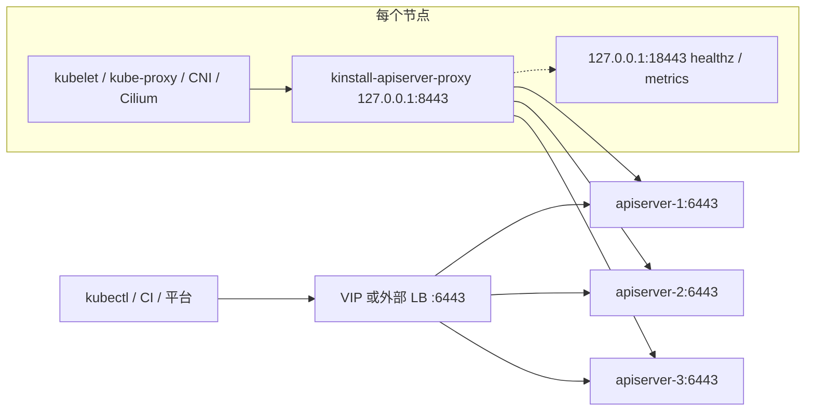
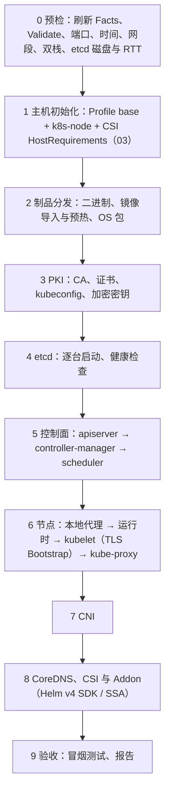

# 04 Kubernetes 安装规划与设计

> **本文定位**：Kubernetes 组件插件（`kubernetes`）的安装规划与设计，包括版本基线与 BOM、集群拓扑（含混合架构）、网络规划、CRI / CNI / CSI、PKI、高可用入口、组件参数、离线制品、Addon、生命周期和安全基线。平台能力（任务引擎、执行器、制品）见「02」，主机纳管与初始化调优见「03」。版本号与生命周期以 2026-11-25 为准（S4 / S5 专题复核截至 2026-11-26）。
>
> **版本**：v2.1（S5/V 更新，2026-11-26；v2.1 修正 `AuthenticationConfiguration` API 组为 `apiserver.config.k8s.io/v1` 并统一 64K 节点默认污点策略）。**§1–§16 全文定稿**：S4 定稿 §1–§5；S5 完成 §6–§16 复核（CNI 双栈、CSI 主机依赖 / SELinuxMount / 厂商接入、节点本地代理规范、etcd 调优、kubelet 资源预留分档、Addon 冻结与 Helm v4 SDK、告警与审计模板）。1.38 BOM 待 GA 后增补（E14）。

## 1. 设计原则

- **纯二进制 + systemd，不依赖 kubeadm（ADR-007）**：每个 K8s 小版本对应一份 BOM 与一套按 semver 分支的参数模板，并与同版本 `kubeadm` 生成的配置做基线对比测试（golden 测试），防止参数漂移。
- **插件内扩展点解耦**：CRI、CNI、CSI、HA 入口与 Addon 均为 `kubernetes` 插件下的 Extension，可按集群声明式组合，不侵入主机初始化层（`03`）。
- **单主按可平滑演进为 HA 设计（ADR-011）**：证书 SAN 预留 VIP / 域名，所有节点组件均经节点本地代理（`127.0.0.1:8443`）访问 apiserver，单主扩三主无需重建集群或重发节点 kubeconfig。
- **主机能力前置校验（衔接 03 v2）**：严格依据 `03 §2.2` 的 `HostCapabilities` 校验 OS、cgroup v2、内核与 nftables、arm64 页大小（ADR-028）、发行版冲突包（ADR-026）与安全执行控制（ADR-027），不绕过主机安全机制。
- **安全默认值优先与幂等编排**：最小权限证书、匿名访问仅放行健康检查、Secret 静态加密、审计日志、PSA 默认 baseline；每一步可 `plan`、幂等重放、断点续装（`02 §5`）。

## 2. 版本基线、BOM 与破坏性变更（E1、A4、R-K8S-11）

### 2.1 支持策略

| 项 | 策略 |
| --- | --- |
| 新建集群 | 上游维护中的三个小版本：**1.35**（`v1.35.10`，EOL 2027-02-28）/ **1.36**（`v1.36.6`，EOL 2027-06-28）/ **1.37**（`v1.37.2`，EOL 2027-10-28，**默认**）。**1.38** 计划 2026-12-16 GA，待 GA 后通过测试矩阵再增补 1.38 BOM（E14） |
| 补丁版本 | BOM 独立于平台二进制发布 revision，跟进上游安全补丁，每月复核（G8） |
| 升级路径 | 严格逐个小版本升级（如 `1.35 → 1.36 → 1.37`），遵守官方版本偏差策略（R-K8S-08） |
| EOL 版本 | 1.34（2026-10-27 EOL）及更早版本禁止新建；存量 kinstall 集群可先升级至受支持小版本 |
| 接管非 kinstall 集群 | 一期不做（E23） |

### 2.2 BOM（1.37 示例）

```yaml
apiVersion: kinstall.io/v1
kind: BOM
metadata:
  name: kubernetes-1.37
  revision: 2026.11.3          # S5 冻结 Addon 版本（§12.1）
spec:
  kubernetes: v1.37.2        # apiserver / controller-manager / scheduler / kubelet / kube-proxy / kubectl
  etcd: v3.7.4               # 跟随 3.7 线最新补丁（kubeadm 默认镜像为 3.7.0-0）
  runtimes:
    containerd: {default: v2.3.7, alternatives: [v2.4.2]}   # 2.3 为 LTS（至 2028-04-30）；2.4 活跃至 2027-05-16
    runc: v1.5.3
    docker: v29.10.0         # 仅 docker 运行时（需配合 cri-dockerd ≥ v0.4.8）
    cri-dockerd: v0.4.11     # 仅 docker 运行时
    cri-o: v1.37.4           # 二期
  tools: {crictl: v1.37.0, nerdctl: v2.4.2, helm: v4.3.2}
  cniPlugins: v1.10.0
  images:
    pause: registry.k8s.io/pause:3.10.2
    coredns: registry.k8s.io/coredns/coredns:v1.14.6        # 跟随 kubeadm 1.37 基线（上游最新 v1.15.0）
  cni: {calico: v3.33.1, cilium: v1.20.5, flannel: v0.28.11, kube-ovn: v1.17.1, kube-network-policies: v1.1.3}
  csi: {local-path: v0.0.37, nfs: v4.13.6, longhorn: v1.13.0, rook-ceph: v1.21.3, openebs: v4.6.2, external-snapshotter: v8.7.1}
  addons:
    metrics-server: v0.9.1
    kubelet-csr-approver: v1.2.16
    kube-vip: v1.3.2
    metallb: v0.16.2
    gateway-api: v1.7.0
    envoy-gateway: v1.10.0
    headlamp: v0.46.0              # 取代已归档的 Kubernetes Dashboard（ADR-019）
    node-local-dns: v1.26.0
    cert-manager: v1.21.3
    kube-prometheus-stack: 93.11.0 # Helm chart 版本；镜像清单由 images.lock 固定 digest（§11）
  arch: [amd64, arm64]
  requireMultiArchIndex: true      # 混合架构集群强制校验所有镜像具备多架构 OCI Image Index（E20）
  pageSizes:                       # 组件级页大小兼容声明（ADR-028）
    goBinaries: [4096, 65536]      # K8s / etcd / containerd / runc 运行时动态识别页大小（注意 bbolt 禁跨页直拷）
    envoy: {minArmVABits: 48}      # tcmalloc 要求 arm64 VA ≥ 48 位（03 §4.5）
```

- 每个 BOM 条目在 `artifacts.yaml` 中展开为“架构 × 文件 × SHA256 × 上游签名（cosign / GPG）”。
- BOM 有独立 `revision`：补丁升级仅替换 BOM，不改插件代码；Addon 版本已于 revision `2026.11.3` 冻结（§12.1、`R-ADD-04`），镜像按 `images.lock` digest 锁定（§11）。

### 2.3 节点要求（K8s 1.35+）

`03 §3.3` 矩阵中“K8s 1.35+”一列及安装前 `Validate` 均按本表结合 `HostCapabilities` 判定：

| 检查项 | 要求 | 不满足时 |
| --- | --- | --- |
| **cgroup** | **v2**（`stat -fc %T /sys/fs/cgroup/` 返回 `cgroup2fs` 且控制器含 `cpu memory io pids`） | 阻断。可由 `03 §5.2.2` 初始化模块写入 `systemd.unified_cgroup_hierarchy=1` 并滚动重启切换；**legacy 模式（`failCgroupV1: false`）在 1.35–1.38 仍可用但仅作短期过渡，默认关闭、需显式开启并随上游 KEP-5573 移除而下线（ADR-010）** |
| **内核** | ≥ 5.8（官方 cgroup v2 要求）；kube-proxy + Calico nftables 需 ≥ 5.13；Calico ≥ 5.10（或已验证发行版）；Cilium ≥ 5.10（RHEL 8.10 4.18 例外） | 低于 5.8 阻断（EL8 4.18 / 麒麟 V10 4.19 须显式 `--allow-unsupported-kernel` 实验模式）；5.8–5.12 自动将 kube-proxy 与 Calico 同步降级为 `iptables`（ADR-014） |
| **systemd** | ≥ 239 且支持 cgroup v2 统一层级（CentOS 7 / Anolis 7 的 systemd 219 不满足） | 阻断 |
| **运行时** | `containerd ≥ 2.0`（推荐 2.3 LTS / 2.4）或 `Docker 29.x + cri-dockerd ≥ 0.4.8`（1.38 需支持 CRI `RuntimeConfig`） | containerd 1.7 已 EOL 不提供；发行版自带冲突包按 ADR-026 预检阻断 |
| **架构与微架构** | `amd64` / `arm64`；EL10 x86 需 `X86Level ≥ v3`（AlmaLinux 10 `x86_64_v2` 除外）；arm64 校验 `PageSize` 与 `ArmVABits ≥ 48`（ADR-028） | 阻断或对 64K 页节点自动加标隔离 |
| **安全执行控制** | 执行探针通过（无未授权的 KYSEC / `fapolicyd` / SELinux / `noexec` 阻断，ADR-027） | 阻断并按 `03 §5.6.3` 引导管理员授权加白 |
| **防火墙** | 默认 `disable`；合规禁止关闭时显式启用 `managed-k8s` 共存模式（`03 §5.3`） | 未配置共存且未关闭时阻断 |
| **资源** | 最低：控制面 2C4G、worker 2C2G；生产规格见 §3.3；可用内存须扣除大页预留（`03 §6.2` D16），kubelet 预留与驱逐按 §10.7 分档（ADR-033） | 告警或阻断（可配置） |
| **swap** | 默认关闭（含 zram，见 `03 §6.8`）；`NodeSwap`（`LimitedSwap`）需显式开启 | 阻断 |
| **时间同步** | 通用节点 > 500 ms 告警、> 5 s 阻断；**控制面 / etcd 节点 > 100 ms 告警、> 500 ms 阻断**（`03 §6.6`） | 阻断 |
| **主机名与唯一性** | DNS-1123 且全局唯一（作为 `nodeName`）；`machine-id` / `product_uuid` / MAC 无克隆重复（`03 §5.6.1`） | 阻断 |
| **端口** | 符合 §10.1 且未与 `03 §8.5` `HostRole.Claims.Ports` 冲突 | 阻断 |

### 2.4 破坏性变更与逐版本模板差异清单（R-K8S-11）

#### 1. 逐版本破坏性变更跟踪（对安装器与运维有直接影响）

| 版本 | 关键变更（来源：官方发布博客 / CHANGELOG / 1.38 Sneak Peek） | 对 kinstall 的影响 |
| --- | --- | --- |
| **1.35** | `kubelet` `failCgroupV1` 默认 `true`；**移除 `--pod-infra-container-image`**；`kube-proxy` `ipvs` 模式弃用；最后一个支持 containerd 1.x 的版本（暴露 `kubelet_cri_losing_support`）；Kubelet Drop-in 配置目录（`--config-dir`）、按时间镜像 GC（`imageMaximumGCAge`）、并行拉取限制（`maxParallelImagePulls`）、原地 Pod 扩缩容 GA | 默认 cgroup v2；pause 镜像仅在 CRI 配置；新集群禁选 ipvs；模板支持 drop-in 扩展 |
| **1.36** | **`gitRepo` 卷永久禁用**；移除树内 Portworx 卷插件；`Service.spec.externalIPs` 弃用（计划 1.43 移除）；`ExtendWebSocketsToKubelet` 默认开启；User Namespaces、OCI Image Volumes、`MutatingAdmissionPolicy`、**kubelet API 细粒度鉴权** GA；**kube-proxy nftables 大规模 Endpoint 性能优化**；存储指标重命名（`volume_operation_total_errors` → `volume_operation_errors_total`） | 升级预检扫描 `gitRepo` / `externalIPs`；Docker 运行时强制 **`cri-dockerd ≥ v0.4.8`**（修复 WebSocket exec/attach 缺陷 #569）；大规模集群优先推荐 1.36+ 开 nftables |
| **1.37** | 默认 etcd 3.7（BOM 用 `v3.7.4`）；**移除 cAdvisor 遗留 kubelet 参数**（`--containerd`、`--containerd-namespace`、`--boot-id-file`、`--global-housekeeping-interval`）；**静态 Pod 禁止引用 Secret / ConfigMap**；**`SELinuxMount` GA 默认开启**；**`eventRecordQPS: 0` 生效为无限制**；移除 `SidecarContainers` / `AnyVolumeDataSource` / `RelaxedDNSSearchValidation` 等锁定 gate 与 controller-manager `--concurrent-service-syncs`；`kubeadm` 移除 `v1beta3` 配置 API；`kube-proxy` 未显式设 `mode` 时打弃用警告（计划 1.40 默认 nftables、ipvs 默认关、1.43 移除 ipvs）；`kube-apiserver` 支持 `manifest-based admission`（`staticManifestsDir`）Beta、默认开启 `ExcludeAdmissionWebhookVirtualResources`、watch cache 预热期返回 HTTP 429；`kube-dns` 弃用；`kubelet` 启动日志打印生效配置 | 模板彻底移除已删 flag/gate；`KubeletConfiguration` 显式设 `eventRecordQPS: 50`；`KubeProxyConfiguration` 必显式写 `mode`；限制 `nodes/log` RBAC；SELinux enforcing 节点按 §7.3 处置 CSI（`R-STO-02`）；kubeadm 基线测试统一用 `v1beta4` |
| **1.38（预告）** | **CRI `RuntimeConfig` 强制接管 cgroup 驱动**：kubelet 拒绝配置中的 `cgroupDriver` 字段（除非开启临时弃用开关 `LegacyCgroupDriverFallback`），**运行时必须先于 kubelet 启动**否则 kubelet 退出；`failCgroupV1: false` 短期仍保留（ADR-010）；移除 `kubectl` WebSocket 退出环境变量（`KUBECTL_REMOTE_COMMAND_WEBSOCKETS`、`KUBECTL_PORT_FORWARD_WEBSOCKETS`）；`kuberc`（v1 去 allowlist `name` 字段）与 `PodLevelResources`（影响 `LimitedSwap` 计费）预计 GA | 1.38 模板删除 `cgroupDriver` 字段；`kubelet.service` 强依赖运行时 unit 先启动并探活 CRI socket；`containerd ≥ 2.0` 与 `cri-dockerd ≥ 0.4.8` 经 1.38 GA 实测转正（ADR-015） |

#### 2. 多版本配置 API 与模板分支规范（`templates/<组件>/<版本范围>/`）

模板由 semver 约束选择，渲染结果全部纳入 golden 测试并与同版本 `kubeadm v1beta4` 基线对比（`05 §6`）：

| 组件 / 配置文件 | 配置 API 版本 | `>=1.35 <1.37` 分支 | `>=1.37 <1.38` 分支 | `>=1.38` 分支（预告） |
| --- | --- | --- | --- | --- |
| **kubelet**（`config.yaml` + systemd unit） | `kubelet.config.k8s.io/v1beta1`（配 `--config-dir=/etc/kubernetes/kubelet.conf.d`） | 显式写 `cgroupDriver: systemd`、`failCgroupV1: true`、`protectKernelDefaults: true`、`eventRecordQPS: 50`、`maxParallelImagePulls: 3`、`imageMaximumGCAge: 168h`；**不含** `--pod-infra-container-image` | 同左，并**彻底禁止** `--containerd` / `--containerd-namespace` / `--boot-id-file` / `--global-housekeeping-interval` 与已删 gate；静态 Pod 禁止引用 Secret/ConfigMap；显式 `eventRecordQPS: 50` 防 0 无限制 | **移除 `cgroupDriver` 字段**（由 CRI `RuntimeConfig` 自动上报）；systemd unit 强写 `After=` + `Requires=` 运行时服务与 socket 探活；不启用 `LegacyCgroupDriverFallback` |
| **kube-proxy**（`config.yaml`） | `kubeproxy.config.k8s.io/v1alpha1` | 显式设 `mode: nftables`（满足条件）或 `mode: iptables`；1.35 超大规模集群（> 250 节点）提示 nftables 链同步开销（`#135639`） | 同左；**必须显式设 `mode`** 消除 1.37 未设模式告警；充分利用 1.36+ nftables 链图优化 | 同 1.37 |
| **kube-apiserver**（flags + 结构化文件） | `AuthenticationConfiguration`（`apiserver.config.k8s.io/v1`，1.34 起 GA，1.35–1.38 统一）、`AuthorizationConfiguration`（`v1beta1` / `v1`）、`AdmissionConfiguration`（`v1`）、`AuditPolicy`（`audit.k8s.io/v1`） | 通过 `--authentication-config` 限定匿名仅放行 `/livez`、`/readyz`、`/healthz`；`--authorization-config` 管理 Node+RBAC+Webhook；`EncryptionConfiguration`（`v1`，`secretbox` / KMS v2） | 移除 1.37 已删锁定 gate；可选启用 `staticManifestsDir`（manifest-based admission Beta）；客户端与本地控制器需遵守 watch cache 预热期 429 退避 | 同步 1.38 `ExcludeAdmissionWebhookVirtualResources` 默认行为与新 GA API |
| **kube-controller-manager** | CLI flags + kubeconfig | 常规安全参数（`--bind-address=127.0.0.1`、`--profiling=false`、`--use-service-account-credentials=true`） | **移除 `--concurrent-service-syncs`** 与已删 gate | 同 1.37 |
| **kube-scheduler** | `kubescheduler.config.k8s.io/v1` | `--bind-address=127.0.0.1`、`--profiling=false` | 清理已删 alpha `scheduling.k8s.io/v1alpha2` 引用 | 同 1.37 |
| **etcd** | CLI flags / `etcd.conf.yaml` | etcd `v3.7.4`（`--feature-gates=InitialCorruptCheck=true,CompactHashCheck=true`；磁盘与 RTT 分档见 §10.3） | 同左 | 同左 |
| **Calico 3.33 CRD** | `operator.tigera.io/v1` | **K8s 1.35**：安装 `v3_projectcalico_org-v1beta1.yaml` | **K8s ≥ 1.36**：安装 `v3_projectcalico_org.yaml` | 同 1.37 |

## 3. 集群拓扑（E2、E20、R-K8S-12）

### 3.1 拓扑类型

| 拓扑 | 控制面 | etcd | 适用 | 说明 |
| --- | --- | --- | --- | --- |
| All-in-One | 1 | 1（同机） | 开发、演示 | 去掉控制面污点，所有组件在一台机器 |
| 单主 | 1 | 1（同机） | 测试、边缘、小规模 | 按可扩展为 HA 设计（ADR-011） |
| 三主（生产默认） | 3 | 3（堆叠） | 大多数生产环境 | 容忍 1 台故障，成员跨故障域反亲和（`03 §1.5`） |
| 五主 | 5 | 5（堆叠） | 大规模或高可用要求 | 容忍 2 台故障，etcd 写延迟略增 |
| 外置 etcd | 3 及以上 | 3 或 5（独立主机） | 超大规模、etcd 独立运维 | 控制面与 etcd 分别扩缩，独立 NVMe / SSD 盘 |

规则：

- etcd 成员数必须为奇数，且 3/5 成员禁止落于同一宿主机（`03 §1.5` 故障域硬阻断）。
- 控制面节点默认带 `node-role.kubernetes.io/control-plane:NoSchedule` 污点，可配置为可调度。
- 单主扩为三主是标准操作（§13.2），不需要重建集群。

### 3.2 节点角色

`etcd`、`control-plane`、`worker`、`lb`（keepalived + haproxy 或 kube-vip，可与控制面同机），以及可选标签 `ingress`、`storage`（Longhorn / Ceph 数据节点）。角色在 Instance Spec 中通过主机选择器分配（`02 §4`），并在 Plan 阶段写入 CMDB `HostRole`（`03 §8.5`）做端口、目录、独占盘与同机共置冲突检测。

### 3.3 生产规格建议

| 集群规模（节点数） | 控制面 | etcd | 说明 |
| --- | --- | --- | --- |
| 100 以内 | 8C16G | 2–4C8G，SSD 50 GB | 堆叠部署时 etcd 数据目录单独用 SSD |
| 100–250 | 8C32G | 4C16G，SSD 150 GB | — |
| 250–500 | 16C32G | 8C32G，SSD 250 GB | 建议外置 etcd |
| 500 以上 | 16C64G 起 | 8C32G 起，NVMe | 单独评估（`R-K8S-09`；跨机房延迟与 fio IOPS 基线见 §10.3） |

预检用 `fio` 测试 etcd 数据盘 8 KB 顺序写 + `fdatasync` 延迟，目标 `etcd_disk_wal_fsync_duration_seconds` p99 < 10 ms（≥ 50 IOPS，重负载 500 IOPS / 约 2 ms）。

### 3.4 混合架构集群（`amd64` + `arm64`，E20、R-K8S-12）

信创替换与异构算力场景常需在同一 K8s 集群中混部 `amd64`（Intel / AMD / 海光 / 兆芯）与 `arm64`（鲲鹏 / 飞腾 / Ampere）节点。kinstall 从二进制分发、镜像清单、调度防护与页大小四个层面统一治理：

1. **按节点架构分发二进制与制品**
   - 同一 BOM 声明 `arch: [amd64, arm64]`，执行器依据每台主机的 `HostFacts.Arch` 自动拉取对应架构的 `kubelet`、`kube-proxy`、`containerd`、`runc`、`cni-plugins`、`crictl` 与平台本地代理二进制；离线预热镜像时按节点架构拉取对应平台层或导入完整多架构 OCI layout。
2. **多架构 OCI Image Index 强校验（离线与在线均生效）**
   - 集群混合存在 `amd64` 与 `arm64` 节点时，所有系统与基础组件镜像（`pause`、CoreDNS、CNI、CSI、Gateway、Headlamp、监控等）在 Plan 与 Bundle 构建阶段必须校验为包含 `linux/amd64` 与 `linux/arm64` 的 **OCI Image Index**（`application/vnd.oci.image.index.v1+json` 或 Docker manifest list v2），缺失任一目标架构直接**阻断**；
   - 内置 Zot 镜像仓库（`02 §7`）与离线打包器默认保留完整多架构 manifest list，严禁通过 `docker pull && docker push` 单架构拉推把多架构 tag 覆盖成单架构镜像。
3. **节点标签与单架构业务防误调度**
   - kubelet 自动维护标准标签 `kubernetes.io/arch=amd64|arm64` 与 `kubernetes.io/os=linux`；kinstall 同时写入 `kinstall.io/cpu-vendor=<vendor>`（如 `kunpeng`、`phytium`、`hygon`）供精细调度；
   - **默认防误调度模式（推荐开启）**：对次架构节点池（通常是新引入的 `arm64` 节点池，或由 Spec 指定）自动附加污点 `kinstall.io/arch=arm64:NoSchedule`；系统 DaemonSet（CNI、CSI、kube-proxy、监控 Exporter，已确认多架构）自动注入对应 toleration，存量单架构业务 Pod 不会被误调度到异构节点引发 `exec format error`（`CrashLoopBackOff`），待业务镜像完成多架构构建后再声明 `tolerations` / `nodeAffinity` 迁入。
   - **可选准入保护**：支持启用 `ValidatingAdmissionPolicy` 规则，要求未匹配默认架构池的 Deployment / StatefulSet 显式声明 `nodeSelector` / `nodeAffinity` 或目标架构镜像校验注解。
4. **控制面、etcd 与 4K / 64K 页大小混部约束（ADR-028）**
   - **控制面与 etcd**：技术上支持 `amd64` 与 `arm64` 控制面混部，但生产默认推荐**控制面与 etcd 采用同构架构**（简化故障排查与备份恢复）；混部时在 Plan 中显式确认。
   - **arm64 64K 页节点混部（衔接 03 §4.5）**：若 `arm64` 节点中存在默认 64K 页 OS（如 RHEL 8 系、麒麟 V10 SP3 或选用 `kernel-64k`），kinstall 自动为该节点打标 **`kinstall.io/page-size=64k`**（4K 节点打 `4k`），并默认附加污点 `kinstall.io/page-size=64k:PreferNoSchedule`（可配置升级为 `NoSchedule`，与 `P1 §2` 一致） 防止集群内运行 4K-only jemalloc 容器（如旧版 Redis / Valkey 镜像）误调度崩溃；**严禁跨 4K / 64K 节点直接拷贝 etcd / containerd 的 bbolt 数据目录**，etcd 迁移与恢复必须走 `etcdctl snapshot save/restore`。

## 4. 网络规划（E3、R-NET-06）

### 4.1 地址规划

| 参数 | 默认值 | 校验 |
| --- | --- | --- |
| Service CIDR（IPv4） | `10.96.0.0/12` | 不与主机路由、Pod CIDR、客户网段重叠 |
| Pod CIDR（IPv4） | `10.244.0.0/16` | 同上；节点子网掩码（默认 `/24`）× 最大节点数不得超出网段 |
| Service CIDR（IPv6，双栈） | `fd00:10:96::/108` | 双栈启用时必填，不与主机 IPv6 路由重叠 |
| Pod CIDR（IPv6，双栈） | `fd00:10:244::/56`，节点掩码 `/64` | 同上 |
| 集群域名 | `cluster.local` | 修改后全链路（证书、kubelet、CoreDNS）一致 |
| apiserver Service IP | Service CIDR 第 1 个地址（`10.96.0.1`） | 写入 apiserver 证书 SAN |
| CoreDNS Service IP | Service CIDR 第 10 个地址（`10.96.0.10`） | 写入 kubelet `clusterDNS` |
| NodePort 范围 | `30000–32767` | 与 `03 §6.2` `net.ipv4.ip_local_reserved_ports` 保持一致 |

预检读取每台主机 `ip -j addr` 与 `ip -j route`（`03 §2`、`§6.7`），自动检测网段重叠。

### 4.2 双栈

- 开关：`networking.dualStack: true`。所有节点须同时配置 `InternalIPv4` 与 `InternalIPv6`（`03 §6.7`），kubelet 显式传 `--node-ip=<v4>,<v6>`（未显式传参会导致 IPv6 访问异常）。
- `kube-apiserver` 与 `kube-controller-manager` 的 `--service-cluster-ip-range`、`kube-controller-manager` 的 `--cluster-cidr` 均写入双栈两段，IPv4 在前即 IPv4 为主栈。
- CNI 必须支持双栈：Calico、Cilium、Kube-OVN 原生支持，Flannel 需 `EnableIPv6` 配置；各 CNI 限制、主机前置与预检见 §6.7（`R-NET-07`）。
- **双栈只能在新建集群时开启**，一期不支持单栈原地迁双栈，也禁止改变主栈族（ADR-031）。
- 默认单栈 IPv4；纯 IPv6 单栈一期不支持。

### 4.3 MTU

`Pod MTU = 业务网卡 MTU − 封装开销`。平台从 Facts 核验集群节点业务网卡 MTU 一致性（`03 §6.7`）后自动计算：VXLAN `−50`（IPv6 underlay `−70`）、IPIP `−20`、WireGuard `−60`（IPv6 `−80`）、Geneve `−50` 起、BGP 无封装 `−0`。云平台 / OpenStack 常见的 `1450` 网卡 MTU 会自动推导 VXLAN Pod MTU 为 `1400` 并在 Plan 中确认。

### 4.4 kube-proxy 模式与 Calico nftables 协同方案（ADR-008、ADR-014、R-NET-06）

#### 1. 模式选型矩阵

| 模式 | 准入条件 | 策略与说明 |
| --- | --- | --- |
| **`nftables`** | 内核 ≥ `5.13` 且 `nft` ≥ `1.0.1`（由 `HostCapabilities.KubeProxyNftables` 判定） | **默认推荐（ADR-008）**：基于 nftables verdict map 实现近 O(1) 转发，替代 O(n) 的 iptables 顺序扫描；**K8s 1.36+ 合入了大规模 Endpoint 链图优化（`#135639` / `#139513`），大规模集群强烈推荐 1.36+**；K8s 1.35 若预计节点 > 250 或 Endpoint > 50,000，Plan 提示升级 1.36+ 或暂选 iptables |
| **`iptables`** | 不满足 `nftables` 条件（如 EL8、Anolis 8、Alinux 3、openEuler 22.03、麒麟 V10、Ubuntu 20.04、Debian 11、Leap 15.6） | 自动降级并在 Plan 中提示；Calico 同步使用 iptables 数据面 |
| **`ipvs`** | 1.35 起已弃用（计划 1.40 默认关闭、1.43 移除） | 新建集群不提供；仅存量升级保留并提示迁移至 nftables |
| **不部署 kube-proxy** | 选用 Cilium 并开启 `kubeProxyReplacement=true` | 选择 Cilium 时的可选模式 |

#### 2. Calico 3.33 + kube-proxy `nftables` 协同落地配置（ADR-014、R-NET-06 方案）

- **硬性一致性约束**：Calico 启用 `linuxDataplane: Nftables` 时，集群 `kube-proxy` **必须同为 `mode: nftables`**；严禁一侧 nftables、另一侧 iptables 或 ipvs（会引发 Service 不可达或 Felix 异常）。
- **主机前置与冲突清理**：
  - 内核加载 `nf_tables`、`nf_conntrack`、`br_netfilter`（`03 §6.4`），无需 `ipvsadm`；
  - 预检检查 `iptables -V`（`HostFacts.IptablesMode`）与存量 `iptables-legacy` 表：若存在非空的 `iptables-legacy` 规则（特别是 `FORWARD DROP`），在 Plan 中提示清理，防止旧表静默丢弃 nftables 流量；
  - 若节点因合规启用了 `03 §5.3` `managed-k8s` 主机防火墙，`firewalld`（表 `inet firewalld`）与 `kube-proxy`（表 `ip kube-proxy` / `ip6 kube-proxy`）、Calico 共享 netfilter hook，必须提前将 Pod / Service CIDR 与 `cali+` / `vxlan.calico` / `tunl0` 加入 `trusted` 区域，且集群上线后禁止随意执行 `firewall-cmd --reload`。
- **`KubeProxyConfiguration` 关键模板（必显式写 `mode`）**：

```yaml
apiVersion: kubeproxy.config.k8s.io/v1alpha1
kind: KubeProxyConfiguration
mode: "nftables"
clusterCIDR: "10.244.0.0/16"
# nftables 模式下 NodePort 默认只监听节点主 IP，避免暴露到管理口或回环
nodePortAddresses:
  - primary
metricsBindAddress: "127.0.0.1:10249"
oomScoreAdj: -998
conntrack:
  maxPerCore: 0          # 由 03 §6.2 sysctl 统一控制 nf_conntrack_max
nftables:
  masqueradeAll: false
  masqueradeBit: 14
  minSyncPeriod: 1s
  syncPeriod: 30s
```

- **Calico 3.33 安装分支与 CR 要点**：
  - 按 K8s 版本选择 Calico 3.33 CRD：**K8s ≥ 1.36** 用 `v3_projectcalico_org.yaml`，**K8s 1.35** 用 `v3_projectcalico_org-v1beta1.yaml`；
  - `Installation` CR 显式设 `spec.calicoNetwork.linuxDataplane: Nftables`、`encapsulation: VXLANCrossSubnet`、`natOutgoing: Enabled`（完整 CR 见 §6.3）；
  - **S15 VM 验收项（R-NET-06 实测）**：在 EL9 / Ubuntu 24.04 / 麒麟 V11 SP1 上校验 `nft list table ip kube-proxy`、`nft list map ip kube-proxy service-ips`，验证 ClusterIP、NodePort（主 IP 监听）、`externalTrafficPolicy: Local`、Hairpin NAT 及 Calico Ingress / Egress `NetworkPolicy` 全部生效。

### 4.5 DNS

- CoreDNS 默认 2 副本，按节点规模扩容（可选 `cluster-proportional-autoscaler`），通过反亲和分散到不同节点 / 故障域。
- NodeLocal DNSCache（`v1.26.0`）可选（中大型集群推荐），监听 `169.254.20.10`，kubelet `clusterDNS` 随之调整。
- 使用 `systemd-resolved`（`/etc/resolv.conf → 127.0.0.53`）的主机，kubelet 自动设置 `resolvConf: /run/systemd/resolve/resolv.conf`（`03 §6.7`）。
- 上游 DNS 默认继承主机上游解析器；离线环境可配置内网 DNS 转发或仅解析集群内域。

### 4.6 南北向入口（ADR-016）

- Ingress NGINX 已于 2026-03-24 退役，**不再作为默认**。默认采用 **Gateway API `v1.7.0` + Envoy Gateway `v1.10.0`**，可选 Calico Ingress Gateway 或 Cilium Gateway API；提供 `ingress2gateway v1.2.0` 迁移指引。
- 裸金属 `LoadBalancer` Service 可选 **MetalLB `v0.16.2`** 或 **kube-vip `v1.3.2`**（ARP / BGP）。

## 5. 容器运行时（CRI）（E4、R-RT-04 / 06 / 08、ADR-015）

### 5.1 选型

| 运行时 | 定位 | BOM 版本与生命周期 | 说明 |
| --- | --- | --- | --- |
| **containerd** | **默认** | `v2.3.7`（**首个年度 LTS，至 2028-04-30**）；可选 `v2.4.2`（活跃至 2027-05-16） | 官方矩阵：K8s 1.36 推荐 2.3+，1.37 推荐 2.4 / 2.3；1.7（2026-09-30）与 2.2（2026-11-06）均已 EOL 不再提供 |
| **Docker Engine + cri-dockerd** | 兼容选项（需 `docker` CLI 或沿用存量习惯） | Docker Engine `29.10.0` + `cri-dockerd v0.4.11`（**K8s 1.36+ 强制 ≥ `v0.4.8`**） | 仅使用 Docker 自带 containerd；`cri-dockerd` 已实现 CRI `RuntimeConfig`，1.38 预期可用、GA 后实测转正（ADR-015） |
| **CRI-O** | 可选（二期） | `v1.37.4`（与 K8s 小版本严格对齐） | — |

### 5.2 containerd（默认）

- **安装内容**：`containerd`、`containerd-shim-runc-v2`、`ctr`、`runc`、`crictl`、`nerdctl`（可选），以及 `/opt/cni/bin` 下的 CNI plugins `v1.10.0`。一律采用 BOM 上游静态二进制，不混用发行版自带包（ADR-026）。
- **配置格式演进（`version = 4`）**：
  - `containerd 2.3.0+` 正式引入 **`version = 4`** 配置版本（最低要求 containerd ≥ 2.3.0；虽兼容自动迁移 `version = 3`，但 NVIDIA GPU Operator 等生态组件在 2.3+ 上要求显式 `version = 4`，参考 `kubespray#13285`）。kinstall 对 2.3 / 2.4 模板直接输出 `version = 4`（以目标版本 `containerd config default` 为基线验证）。
  - **规避 containerd 2.4 已移除配置项**：模板必须使用 **`bin_dirs = ['/opt/cni/bin']`**（2.4 已移除 `bin_dir`），**不再输出 `enable_cdi`**（2.4 已移除，CDI 恒默认开启）；仓库配置严格仅用 **`config_path = "/etc/containerd/certs.d"`**（不用已弃用且会触发 Transfer Service 回退本地拉取的 `registry.mirrors` / `configs` / `auths`）。
  - **Transfer Service（2.1+ 默认）**：并发下载数在 `[plugins.'io.containerd.transfer.v1.local']` 中配置 `max_concurrent_downloads`，避免在 CRI 段改写旧字段导致自动回退 local pull。
- **cgroup 与 1.38 启动顺序**：设置 `SystemdCgroup = true`（确保所有 runc 运行时类一致，containerd 2.0+ 通过 CRI `RuntimeConfig` 自动向 kubelet 上报 `systemd`）。`kubelet.service` 强制声明 `After=containerd.service` + `Requires=containerd.service`，并在启动前由 `ExecStartPre` 检查 `/run/containerd/containerd.sock` 就绪，满足 K8s 1.38 “运行时必须先于 kubelet 启动”的硬要求。
- **存储、镜像与 SELinux**：数据目录 `/var/lib/containerd` 挂独立 XFS（`ftype=1`）数据盘（`03 §6.10`）；pause 镜像仅在 `pinned_images.sandbox` 指定（1.35 已删 kubelet 参数）；离线通过 `certs.d/<registry>/hosts.toml` 重定向至内置 Zot；SELinux `enforcing` 时设 `enable_selinux = true` 并配 `container-selinux`。

```toml
# /etc/containerd/config.toml（containerd 2.3 LTS / 2.4，version = 4）
version = 4
root = "/var/lib/containerd"
state = "/run/containerd"
imports = ["/etc/containerd/conf.d/*.toml"]

[plugins.'io.containerd.transfer.v1.local']
  max_concurrent_downloads = 3

[plugins.'io.containerd.cri.v1.images']
  snapshotter = "overlayfs"

[plugins.'io.containerd.cri.v1.images'.pinned_images]
  sandbox = "registry.k8s.io/pause:3.10.2"

[plugins.'io.containerd.cri.v1.images'.registry]
  config_path = "/etc/containerd/certs.d"

[plugins.'io.containerd.cri.v1.runtime']
  enable_selinux = false   # 主机为 SELinux enforcing 时由模板渲染为 true

[plugins.'io.containerd.cri.v1.runtime'.cni]
  bin_dirs = ["/opt/cni/bin"]
  conf_dir = "/etc/cni/net.d"

[plugins.'io.containerd.cri.v1.runtime'.containerd]
  default_runtime_name = "runc"

[plugins.'io.containerd.cri.v1.runtime'.containerd.runtimes.runc]
  runtime_type = "io.containerd.runc.v2"
  [plugins.'io.containerd.cri.v1.runtime'.containerd.runtimes.runc.options]
    SystemdCgroup = true
```

```toml
# /etc/containerd/certs.d/registry.k8s.io/hosts.toml（离线：重定向到内置 Zot）
server = "https://registry.k8s.io"

[host."https://registry.kinstall.local:5000/v2/registry.k8s.io"]
  capabilities = ["pull", "resolve"]
  ca = "/etc/kinstall/pki/registry-ca.crt"
  override_path = true
```

### 5.3 Docker Engine 29 + `cri-dockerd`（ADR-015、R-RT-04 / 06 / 08）

- **组件形态与 29.7.0 更正（R-RT-06）**：
  - 安装 Docker Engine 29.x 静态二进制包（含其自带的独立 `containerd` / `runc`）+ `cri-dockerd`（监听 `/run/cri-dockerd.sock`），不另装第二套 containerd 给 kubelet。
  - **版本特性核实**：Docker Engine **29.7.0 起提供实验性内嵌 containerd（`embedded-containerd`），默认仍为独立 `containerd` 进程**（截至 29.10.0）。kinstall 生产模式**不启用**实验性内嵌模式，保持独立 `containerd.service` 以便日志排查、指标采集与独立恢复。
- **镜像存储后端选型与 GC / 磁盘水位影响（R-RT-08）**：
  - Docker Engine 29.0 起新装默认启用 **containerd image store（`containerd-snapshotter`）**，而从旧版本升级仍沿用经典 `overlay2` graphdriver。为避免新装节点与升级节点行为不一致，kinstall 要求在 `/etc/docker/daemon.json` 中**显式声明存储后端**：
    - **默认（`containerd-snapshotter: true`）**：原生支持多架构 OCI Image Index 与后续 snapshotter 演进。**关键工程约束**：① containerd image store **同时保存压缩 content store 与解压 snapshot 层**，同镜像磁盘占用通常比经典 `overlay2` 高 **1.5–2×**（节点数据盘容量规划必须按 1.5–2× 预留）；② **严禁在已运行节点上原地切换存储后端**（原后端镜像会滞留磁盘形成不可见空间占用）；③ **必须将 Docker `data-root`（`/var/lib/docker`）与自带 containerd `root`（`/var/lib/containerd`）置于同一独立数据盘挂载点**，防止 `cri-dockerd` 上报的 `ImageFsInfo` 挂载点与实际镜像存放分区分离，导致 kubelet `imagefs` 磁盘水位监控与镜像 GC（`imageGCHighThresholdPercent`）失准；④ 规避 `moby#51662`（mTLS 证书在 snapshotter 下 `hosts.toml` 不生效），私有库认证优先使用 `imagePullSecrets` 或标准 HTTPS + CA 证书。
    - **兼容回退（`containerd-snapshotter: false` + `"storage-driver": "overlay2"`）**：当集群需要开启 Docker `userns-remap`（与 containerd image store 互斥，`moby#47377`）、需要 `--storage-opt size` 限制容器写层，或节点磁盘空间紧张需避免双份层占用时，在 Spec 中显式选择 `overlay2` 并在初始化阶段一次性锁定。
- **`cri-dockerd` 与 K8s 1.36–1.38 兼容性（ADR-015、R-RT-04）**：
  - **1.36+ 强制要求 `cri-dockerd ≥ v0.4.8`**：K8s 1.36 默认开启 `ExtendWebSocketsToKubelet`，旧版 `cri-dockerd` 因相对 `BaseURL` 缺陷导致 `kubectl exec/attach` 报 `HTTP response to HTTPS client`（#569），`v0.4.8` 已修复并在 1.37 验证通过。
  - **镜像 GC 防误删**：`cri-dockerd ≥ v0.4.7` 支持 pinned image selectors（`--pod-infra-container-image` 及固定镜像选择器），防止 pause 等关键基础镜像被 kubelet 镜像 GC 清除。
  - **1.38 `RuntimeConfig` 结论**：已核实 `cri-dockerd` 源码（`core/docker_service.go`，PR #222 / #425）**已实现 CRI `RuntimeConfig` RPC**，按 Docker 实际 `cgroupdriver` 返回 `systemd` / `cgroupfs`。因此 **Docker 运行时在 K8s 1.38 预期可用**，待 1.38 GA 后完成实测（`R-RT-07`）即转为正式支持，不再因缺 RPC 标记实验性。
- **systemd 强启动顺序与配置模板**：
  - 依赖链：`containerd.service` → `docker.service` → `cri-docker.service`（+ `cri-docker.socket`）→ `kubelet.service`（`Requires=cri-docker.service`、`After=cri-docker.service`），kubelet 配置 `containerRuntimeEndpoint: unix:///run/cri-dockerd.sock`。

```json
{
  "data-root": "/data/docker",
  "exec-opts": ["native.cgroupdriver=systemd"],
  "features": {
    "containerd-snapshotter": true
  },
  "log-driver": "json-file",
  "log-opts": {
    "max-size": "50m",
    "max-file": "5"
  },
  "registry-mirrors": ["https://registry.kinstall.local:5000"],
  "live-restore": false
}
```
（当显式选择经典 `overlay2` 时，设置 `"features": {"containerd-snapshotter": false}` 并增加 `"storage-driver": "overlay2"`；`live-restore` 在 K8s 节点建议设 `false` 避免与 kubelet Pod 生命周期接管冲突。）

### 5.4 运行时通用要求

- 每个运行时实现 `RuntimePlugin` 扩展点：`Validate`（内核、cgroup、SELinux、冲突包、磁盘空间与页大小）、渲染配置、安装二进制与 systemd unit、健康检查（`crictl info` + CRI `RuntimeConfig` 探活）、滚动升级（逐节点 `drain → 升级 → 验证 → uncordon`）。
- **多架构镜像预热**：按 BOM 与所选 CNI / CSI / Addon，在离线或弱网环境依据节点 `HostFacts.Arch` 预导入 `pause`、CNI、CoreDNS 等核心镜像，避免节点就绪后首次拉取超时。
- **日志轮转与 GC**：containerd 模式下容器日志轮转由 kubelet 控制（`containerLogMaxSize: 50Mi`、`containerLogMaxFiles: 5`）；镜像 GC 统一由 kubelet `imageGCHighThresholdPercent`（默认 85%）/ `imageGCLowThresholdPercent`（默认 80%）与 `imageMaximumGCAge`（1.35+ GA）管控。

## 6. 网络插件（CNI）（E5、R-NET-07、ADR-008 / ADR-014 / ADR-031）

### 6.1 选型矩阵

| CNI | BOM 版本 | 封装 / 数据面 | NetworkPolicy | 双栈（R-NET-07） | 内核要求 | 适用 | 默认 |
| --- | --- | --- | --- | --- | --- | --- | --- |
| **Calico** | `v3.33.1`（Tigera Operator） | IPIP / VXLAN / BGP 无封装；`Nftables` / `Iptables` 数据面，可选 eBPF | ✅ | ✅ 仅新建集群；IPv6 池不支持 IPIP（用 VXLAN 或 BGP 无封装） | ≥ 5.10 或已验证发行版；nftables 数据面 ≥ 5.13；IPv6 VXLAN ≥ 4.19.1（RHEL ≥ 4.18） | 通用生产；需与机房 BGP 打通 | ✅ |
| **Cilium** | `v1.20.5`（Helm） | VXLAN / Geneve / 原生路由；eBPF；可替代 kube-proxy | ✅（含 L7） | ✅ `ipv6.enabled=true`；IPv6 underlay 隧道 1.18+ 支持 | ≥ 5.10（RHEL 8.10 的 4.18 例外）；IPv6 BIG TCP ≥ 5.19 | 新内核、大规模、需 Hubble 可观测或去 kube-proxy | — |
| **Flannel** | `v0.28.11` | VXLAN / host-gw / WireGuard | 需叠加 kube-network-policies `v1.1.3` | ✅ 仅 `vxlan` / `wireguard` / `host-gw` 后端 | 低（VXLAN ≥ 3.7） | 简单、小规模、老内核 | — |
| **Kube-OVN** | `v1.17.1` | Geneve overlay / VLAN underlay（OVS） | ✅ | ✅ 子网 `cidrBlock` 写 `v4,v6`（IPv4 在前），join 子网也须双栈 | 需 `openvswitch`、`geneve` 模块 | 子网管理、固定 IP、VLAN underlay、多租户 VPC | — |

### 6.2 Validate 自动选择与约束

- **一个集群只有一个主 CNI**；Multus 等多网卡方案二期以 Addon 形式提供。
- 内核 < 5.10 的节点只允许 Flannel，或在已验证发行版（EL8 4.18、麒麟 V10 4.19 等）上使用 Calico `Iptables` 数据面；内核 5.8–5.12 时 kube-proxy 与 Calico 同步降级为 `iptables`（ADR-014，§4.4）。
- 选择 Cilium 并开启 `kubeProxyReplacement=true` 时不部署 kube-proxy；关闭时 kube-proxy 照常按 §4.4 选择模式。
- 需要固定 Pod IP、VLAN underlay 或多租户 VPC 时推荐 Kube-OVN。
- `allocate-node-cidrs` 由 CNI 决定：Flannel 与 Cilium `ipam.mode=kubernetes` 为 `true`；Calico IPAM、Cilium `cluster-pool`、Kube-OVN 为 `false`（§10.5）。
- 双栈集群额外执行 §6.7 的预检；CNI 不支持当前双栈组合（如 Calico IPv6 池选 IPIP）时 Plan 阻断。
- 所有 CNI 端口、内核模块与 NetworkManager 忽略接口由 CNI Extension 通过 `HostRequirements` 声明，交给 `03 §5.3`（防火墙）、`§6.4`（kmod）、`§6.7`（NetworkManager）执行（ADR-003）。

### 6.3 Calico（默认）

- **部署**：Tigera Operator + 渲染后的 `Installation` / `APIServer` CR（3.33 使用单一 `calico/calico` 镜像）；不接受 Operator 的环境可选 manifest 方式。离线时 `spec.registry` 指向内置 Zot。
- **CRD 分支（S4 已定）**：**K8s ≥ 1.36** 安装 `v3_projectcalico_org.yaml`，**K8s 1.35** 安装 `v3_projectcalico_org-v1beta1.yaml`，由模板分支选择（§2.4）。
- **封装**：同二层网段用 `VXLANCrossSubnet`（或 `IPIPCrossSubnet`）；跨网段或云上默认 `VXLAN`；客户网络支持 BGP 时可选无封装并与 ToR 建立对等（`BGPPeer` / `BGPConfiguration` 由 Spec 渲染，默认关闭 node-to-node mesh 超过 100 节点时提示改用路由反射器）。
- **数据面**：内核 ≥ 5.13 且 `nft` ≥ 1.0.1 时 `linuxDataplane: Nftables`，与 kube-proxy nftables 一致；否则两者都用 `Iptables`（ADR-014）。eBPF 数据面作为可选项，需内核 ≥ 5.10 且不部署 kube-proxy 或开启 Calico kube-proxy 替代，一期不作为默认。
- **IPAM**：Calico IPAM，`blockSize` IPv4 为 26、IPv6 为 122；controller-manager `--allocate-node-cidrs=false`。
- **规模**：节点 > 50 时 Operator 自动部署 Typha（端口 5473/TCP），无需手工开关。
- **升级**：3.33 只能从 3.31 / 3.32 升级，插件内置升级路径约束；升级前校验 CRD 分支与 K8s 版本匹配。
- **主机联动**：NetworkManager 忽略 `cali*`、`tunl*`、`vxlan.calico`、`vxlan-v6.calico`、`wireguard.cali`（`03 §6.7`）；端口 BGP 179/TCP、VXLAN 4789/UDP、Typha 5473/TCP、WireGuard 51820–51821/UDP（启用时）。

```yaml
# 单栈 IPv4（默认）
apiVersion: operator.tigera.io/v1
kind: Installation
metadata:
  name: default
spec:
  registry: registry.kinstall.local:5000/   # 离线时指向内置仓库
  calicoNetwork:
    linuxDataplane: Nftables                # 内核 < 5.13 时渲染为 Iptables
    mtu: 1450                               # 由平台按业务网卡 MTU 计算（§4.3）
    nodeAddressAutodetectionV4:
      kubernetes: NodeInternalIP            # 与 kubelet --node-ip 保持一致
    ipPools:
    - name: default-ipv4-ippool
      cidr: 10.244.0.0/16
      encapsulation: VXLANCrossSubnet
      blockSize: 26
      natOutgoing: Enabled
      nodeSelector: all()
```

```yaml
# 双栈（仅新建集群，ADR-031）：IPv6 池不可用 IPIP，统一 VXLAN 或 BGP 无封装
spec:
  calicoNetwork:
    nodeAddressAutodetectionV4: {kubernetes: NodeInternalIP}
    nodeAddressAutodetectionV6: {kubernetes: NodeInternalIP}
    ipPools:
    - {name: default-ipv4-ippool, cidr: 10.244.0.0/16, encapsulation: VXLANCrossSubnet, blockSize: 26, natOutgoing: Enabled}
    - {name: default-ipv6-ippool, cidr: "fd00:10:244::/56", encapsulation: VXLAN, blockSize: 122, natOutgoing: Enabled}  # ULA 私有段需 natOutgoing
```

### 6.4 Cilium

- **部署**：Helm chart（Helm v4 SDK，§12.2）；chart 与镜像进入离线包。
- **kube-proxy 替代**：`kubeProxyReplacement: true`，`k8sServiceHost: 127.0.0.1`、`k8sServicePort: 8443`（指向节点本地代理，§9），避免 Cilium 在 Service 可用前依赖 ClusterIP。开启时 kinstall 不部署 kube-proxy，并在重装 / 切换时清理残留的 `kube-proxy` nftables / iptables 规则（§13.6）。
- **IPAM**：默认 `ipam.mode=cluster-pool`（`clusterPoolIPv4PodCIDRList` 与 §4.1 一致，`--allocate-node-cidrs=false`）；用户选 `kubernetes` 模式时由 controller-manager 分配。
- **路由**：默认 `routingMode: tunnel` + `tunnelProtocol: vxlan`（8472/UDP）；同二层或 BGP 环境可选 `native` + `autoDirectNodeRoutes` / BGP Control Plane。
- **双栈**：`ipv6.enabled: true`（IPv4 默认开启）+ `clusterPoolIPv6PodCIDRList`；IPv6 underlay 隧道（1.18+）需显式设 underlay 协议。**必须先保证所有节点具备 IPv6 地址与默认路由，再启用 Cilium 双栈**（上游 issue #28909 提示中途开启会出现部分节点不可达）。
- **主机前置**：内核 ≥ 5.10；挂载 `bpffs`（`/sys/fs/bpf`）与 cgroup v2（已由 04 §2.3 保证）；`systemd-networkd` 环境需设置 `ManageForeignRoutes=no` / `ManageForeignRoutingPolicyRules=no`（Ubuntu / Debian 默认 networkd 时由 `03 §6.7` 下发）；端口 4240/TCP（健康）、8472/UDP（VXLAN）、4244/TCP（Hubble，启用时）。

### 6.5 Flannel

- 需要 controller-manager 分配 Pod CIDR（`--allocate-node-cidrs=true`、`--node-cidr-mask-size-ipv4=24`）。
- `net-conf.json` 默认 `Backend: vxlan`（8472/UDP）；同二层可选 `host-gw`；需要加密时选 `wireguard`。
- **双栈**：仅 `vxlan` / `wireguard` / `host-gw` 后端支持；`net-conf.json` 设置 `EnableIPv6: true` 与 `IPv6Network`，节点主网卡须同时具备 IPv4 / IPv6 地址与两条默认路由；可选 `EnableIPv6Masq`。公网 IPv6 段需要外部路由支撑。
- flannel CNI 二进制由 flannel 镜像 init 容器安装（上游已从 `containernetworking/plugins` 拆出，要求 ≥ v1.0.1），不依赖 CNI plugins v1.10.0 自带。
- 需要 NetworkPolicy 时叠加 kube-network-policies `v1.1.3`（基于 nftables，内核 < 5.13 时提示降级说明）。

### 6.6 Kube-OVN

- 主机前置：加载 `openvswitch`、`geneve`（`ip6_udp_tunnel` 依赖自动加载）模块；与发行版自带 `openvswitch` 服务冲突时按 ADR-026 预检阻断。
- 控制面组件（`ovn-central`）按节点标签 `kube-ovn/role=master` 部署在 3 个控制面上；端口 6641–6644/TCP（OVN NB / SB / Raft）、6081/UDP（Geneve）、10660–10665/TCP（指标，限本网段）。
- `--allocate-node-cidrs=false`；默认子网 `ovn-default` 与 §4.1 Pod CIDR 一致，join 子网默认 `100.64.0.0/16`（须与客户网段核对重叠）。
- **双栈**：默认子网与 join 子网 `cidrBlock` 均写 `<IPv4 CIDR>,<IPv6 CIDR>`，IPv4 在前；安装参数 `DUAL_STACK=true` 由模板渲染。

### 6.7 双栈专题（R-NET-07、ADR-031）

#### 1. 决策

- **双栈只能在新建集群时开启（ADR-031）**：一期不支持“单栈 → 双栈”原地迁移，也禁止“双栈 → 单栈”与主栈族互换。依据：Calico 官方双栈任务仅适用于新集群；controller-manager node IPAM 不会为既有节点补分配 IPv6 Pod CIDR（k3s #11280 同类问题）、既有 Pod 需重建才能获得 IPv6 地址；RKE2 等发行版同样要求创建时配置。确有迁移需求时走“新建双栈集群 + 业务迁移”。
- 纯 IPv6 单栈一期不支持（§4.2）。

#### 2. K8s 组件参数（双栈时由模板统一渲染，IPv4 在前即主栈）

| 组件 | 参数 |
| --- | --- |
| kube-apiserver | `--service-cluster-ip-range=10.96.0.0/12,fd00:10:96::/108`；`--advertise-address` 用 IPv4 |
| kube-controller-manager | `--service-cluster-ip-range` 同上；`--cluster-cidr=10.244.0.0/16,fd00:10:244::/56`；`--node-cidr-mask-size-ipv4=24`、`--node-cidr-mask-size-ipv6=64`（仅 `allocate-node-cidrs=true` 时生效） |
| kubelet | `--node-ip=<v4>,<v6>`（必填，缺省会导致 IPv6 InternalIP 缺失） |
| kube-proxy | `clusterCIDR: "10.244.0.0/16,fd00:10:244::/56"`；`nodePortAddresses: [primary]` 同时覆盖两族主 IP |
| 证书 | apiserver SAN 增加 IPv6 Service IP（`fd00:10:96::1`）、节点 IPv6 地址（§8.2） |
| CoreDNS | Service `ipFamilyPolicy: PreferDualStack`；kubelet `clusterDNS` 仍用 IPv4 地址 |

#### 3. 各 CNI 双栈要点

| CNI | 配置 | 限制 | 主机要求 |
| --- | --- | --- | --- |
| Calico 3.33 | 两个 `ipPools`（IPv4 `/26`、IPv6 `/122`），`nodeAddressAutodetectionV6` | IPIP 仅 IPv4；IPv6 池用 VXLAN 或 BGP 无封装；IPv6 VXLAN 需内核 ≥ 4.19.1（RHEL ≥ 4.18）；ULA 段需 `natOutgoing` | IPv6 默认路由；`net.ipv6.conf.all.forwarding=1` |
| Cilium 1.20 | `ipv6.enabled=true` + IPv6 Pod CIDR 列表 | 先全节点 IPv6 就绪再开启（#28909）；IPv6 BIG TCP 需 ≥ 5.19 | 同上；内核 ≥ 5.10 |
| Flannel 0.28 | `EnableIPv6` + `IPv6Network`（+ 可选 `EnableIPv6Masq`） | 仅 vxlan / wireguard / host-gw | 主网卡双族地址与双默认路由 |
| Kube-OVN 1.17 | 子网 `cidrBlock: v4,v6`；join 子网同为双栈 | IPv4 必须在前 | 同上 |

#### 4. 预检（Plan 阻断项）

- 每个节点 `InternalIPv4` 与 `InternalIPv6` 均存在且位于同一业务网卡，IPv6 默认路由存在（`03 §6.7` Facts）；
- `net.ipv6.conf.all.disable_ipv6=0`、`net.ipv6.conf.all.forwarding=1`（后者已在 `03 §6.2` `k8s-node` sysctl 中下发）；双栈时 K8s 插件经 `HostRequirements` 追加：使用 SLAAC 的业务网卡设 `net.ipv6.conf.<iface>.accept_ra=2`，避免开启转发后丢失默认路由；
- Service / Pod IPv6 段与主机 IPv6 路由、客户段不重叠；IPv6 Pod 节点掩码 `/64` × 节点数不超出 `/56`；
- 所选 CNI 封装与双栈组合合法（如 Calico IPv6 池不得为 IPIP）；
- 防火墙 `managed-k8s` 模式下同时放行 IPv6 端口（`03 §5.3`）。

### 6.8 CNI 通用规范

- 所有 CNI 的镜像与 Helm chart 进入离线包，并在混合架构集群中强校验多架构 OCI Index（§3.4）。
- CNI plugins（`v1.10.0`）由运行时 Extension 安装到 `/opt/cni/bin`；CNI 自身配置写入 `/etc/cni/net.d`，只保留一个主配置文件。
- MTU 由平台计算后渲染（§4.3），不依赖 CNI 自动探测。
- 卸载时按 CNI 类型清理接口（`cali*` / `vxlan.calico` / `cilium_*` / `flannel.1` / `ovn0` 等）、路由、nftables / iptables 表与 `/var/lib/cni`（§13.6）。

## 7. 存储插件（CSI）（E6、R-STO-02 / 03 / 04、ADR-032）

### 7.1 选型

| CSI | BOM 版本 | 类型 / 访问模式 | 快照 | `seLinuxMount`（§7.3） | 适用 |
| --- | --- | --- | --- | --- | --- |
| local-path-provisioner | `v0.0.37` | 本地目录（hostPath），RWO，无副本 | ✗ | 不适用（非 CSI，运行时递归重标） | 开发测试；自带副本的中间件（ES、Kafka） |
| csi-driver-nfs | `v4.13.6` | NFS 共享，RWX | ✅（tar 归档方式） | **必须 `false`**（共享导出目录） | 已有 NAS；需要 RWX |
| Longhorn | `v1.13.0`（要求 K8s ≥ 1.34） | 分布式块存储（多副本），RWO；RWX 经 share-manager（NFSv4） | ✅ | RWO 卷可 `true`；RWX 卷按 NFS 处理 | 中小规模通用块存储 |
| Rook-Ceph | `v1.21.3`（1.20 起须用 ceph-csi-operator） | RBD 块 RWO、CephFS RWX、RGW 对象 | ✅ | RBD 可 `true`；CephFS 视共享情况，默认 `false` | 大规模；需要对象存储 |
| OpenEBS | `v4.6.2` | LocalPV（hostpath / LVM / ZFS）、Mayastor（NVMe-oF 副本） | LVM / ZFS / Mayastor ✅ | LVM / ZFS / Mayastor 可 `true`；hostpath 不适用 | 本地高性能卷 |
| 厂商 CSI | 按厂商包 | 商业存储（iSCSI / FC / NVMe-oF / NFS） | 按厂商 | 按厂商声明（§7.4） | 已有集中式存储；信创替换 |

- 同时部署 external-snapshotter `v8.7.1`（`snapshot.storage.k8s.io/v1` CRD + 唯一一份 snapshot-controller）；厂商包自带 snapshot-controller 时必须关闭其副本，CRD 版本以 BOM 为准。
- 只设置一个默认 StorageClass；中间件插件依赖检查时要求存在默认 StorageClass（`02 §3.6`）。
- `reclaimPolicy` 默认 `Delete`（local-path、开发场景）/ `Retain`（生产中间件可在 Spec 覆盖）；`volumeBindingMode` 对本地卷一律 `WaitForFirstConsumer`。

### 7.2 主机依赖：软件包、内核模块与服务（R-STO-04）

选择 CSI 后，插件通过 `HostRequirements` 向 Host Init 声明附加需求，由 `03` 的 packages（逻辑包名见 `spec/pkgmap.yaml`）、kmod（持久化到 `/etc/modules-load.d/kinstall-csi.conf`）与服务模块执行，CSI 插件本身不写主机命令（ADR-003）：

| CSI | 逻辑包（`pkgmap.yaml`） | 内核模块 | 系统服务 / 其他 | 不满足时 |
| --- | --- | --- | --- | --- |
| local-path | — | — | 数据目录（默认 `/opt/local-path-provisioner`，建议独立数据盘，`03 §6.10`） | — |
| csi-driver-nfs | `nfs-client` | `nfs`、`nfsv4`（按需自动加载） | NFSv3 需 `rpcbind` / `rpc-statd`；默认挂载参数 `nfsvers=4.1,hard` | 阻断 |
| Longhorn（v1 数据引擎） | `iscsi`、`nfs-client`（RWX）；可选 `cryptsetup`（卷加密） | `iscsi_tcp`；RWX 需 `nfsv4`；加密需 `dm_crypt` | `iscsid` 启用；**multipathd 必须排除 Longhorn 设备**（按 `vendor "IET"` / `product "VIRTUAL-DISK"` 写 blacklist，避免误接管）；数据目录 `/var/lib/longhorn` 独立盘 | 阻断 |
| Longhorn（v2 数据引擎，可选） | 同上 + `nvme-cli` | `nvme_tcp`、`vfio_pci` 或 `uio_pci_generic` | 每节点 2 MiB 大页 ≥ 2 GiB；**64K 页 arm64 节点不支持**（大页为 512 MiB，ADR-028） | 阻断 |
| Rook-Ceph | `lvm2` | `rbd`；CephFS 需 `ceph` | 候选 OSD 盘必须为空（无分区 / 文件系统，`03 §6.10` 锁定）；时钟偏差 < 50 ms（`03 §6.6`）；内核 ≥ 5.4 推荐（CephFS 内核客户端） | 阻断 |
| OpenEBS LocalPV LVM | `lvm2` | `dm_snapshot`、`dm_thin_pool` | 预建 VG（由 `03 §6.10` 磁盘模块创建） | 阻断 |
| OpenEBS LocalPV ZFS | ZFS 用户态（厂商 / 发行版源） | `zfs` | 多数 EL / 国产 OS 无官方 ZFS 包，默认不推荐 | 告警 |
| OpenEBS Mayastor | `nvme-cli` | `nvme_tcp`、`nvme_fabrics` | 每 io-engine 节点 2 MiB 大页 ≥ 2 GiB（1024 页）并计入 `03 §6.2` D16 扣减；独占 2 个 CPU 核；**64K 页 arm64 不支持** | 阻断 |
| 厂商 CSI（块） | `iscsi`、`multipath`；NVMe-oF 加 `nvme-cli` | `iscsi_tcp`、`dm_multipath`；`nvme_tcp` / `nvme_rdma` / `nvme_fc` | `iscsid`、`multipathd` 启用并写厂商 `multipath.conf` 设备段；华为 UltraPath 与 `dm-multipath` 二选一 | 按厂商声明 |

- 包名在各 OS 上的映射已由 S2 实测（`03-A §4`）：`iscsi` → `iscsi-initiator-utils` / `open-iscsi`，`multipath` → `device-mapper-multipath` / `multipath-tools`，`nfs-client` → `nfs-utils` / `nfs-client` / `nfs-common`。
- 每个 iSCSI 节点的 `/etc/iscsi/initiatorname.iscsi` 必须唯一：克隆机由 `03 §5.6.1` 唯一性检查一并重置。
- Longhorn 与厂商 CSI 同时使用 multipath 时，multipathd 采用 `find_multipaths "strict"` + 厂商白名单，避免接管本地盘与 Longhorn 设备。

### 7.3 SELinuxMount 与 SELinux enforcing 节点（R-STO-02、ADR-032）

#### 1. 上游行为（截至 2026-11-26）

- 1.36：`SELinuxMountReadWriteOncePod`、`SELinuxChangePolicy` GA；`SELinuxMount` Beta（默认关）。**1.37：`SELinuxMount` GA 且默认开启**。
- 卷以 `-o context=<label>` 挂载（免递归重标）需同时满足：节点 SELinux 启用；Pod 设置 `seLinuxOptions.level`（或由运行时分配）；CSI 驱动的 `CSIDriver.spec.seLinuxMount: true`；Pod `securityContext.seLinuxChangePolicy` 为空或 `MountOption`。否则退回运行时递归重标（`Recursive`）。
- **破坏性场景**：同一节点上共享同一卷的多个 Pod 使用不同 SELinux 标签（如特权 Pod 与普通 Pod 共享、不同 `level` 通过不同 `subPath` 共享），后到的 Pod 会卡在 `ContainerCreating`。可对相关 Pod 设置 `seLinuxChangePolicy: Recursive` 退出挂载选项方式。
- 1.36 起 kube-controller-manager 提供 `selinux-warning-controller`（需在 `--controllers` 中显式启用）对冲突发事件与指标，kubelet 暴露 `volume_manager_selinux_*` 指标，用于升级前评估。

#### 2. 各 CSI 的 `seLinuxMount` 策略

| CSI | `CSIDriver.spec.seLinuxMount` | 说明 |
| --- | --- | --- |
| Longhorn（RWO） / Rook RBD / OpenEBS LVM / ZFS / Mayastor / 厂商块存储 | 可为 `true`（以驱动发行版本为准，kinstall 不改写上游 CSIDriver） | 块设备每卷独占文件系统，挂载选项方式安全且显著加速大卷启动 |
| csi-driver-nfs / nfs-subdir / CephFS（共享） / Longhorn RWX | **`false`** | 同一导出目录被多个卷 / Pod 共享，`context=` 挂载会冲突 |
| local-path（hostPath） | 不适用 | 由运行时递归重标；数据目录需 `container_file_t` 标签（`03 §5.6.3`） |

#### 3. kinstall 处置

- **CSI Extension 声明**：每个 CSI Extension 在清单中声明 `selinuxMount: true|false` 与已验证的 K8s 版本区间；Plan 将声明与集群中实际 `CSIDriver` 对象比对，不一致时告警。
- **默认不设置 `seLinuxChangePolicy`**；kinstall 自带的特权共享类工作负载（备份代理、日志采集读取宿主卷等）显式设为 `Recursive`。
- **升级到 1.37 的预检**（集群存在 SELinux `enforcing` 节点时）：在 1.36 阶段启用 `selinux-warning-controller` 采集冲突事件并在 Plan 中列出“共享同一卷且 SELinux 标签不同”的 Pod；未处置前阻断升级（可显式确认跳过）。
- **主机侧**：SELinux `enforcing` 节点要求安装 `container-selinux`，containerd `enable_selinux = true`（§5.2）；Longhorn 特权容器运行于 `spc_t`，已知 RHEL 系 AVC 拒绝按上游 KB 处理，验收项采集 `ausearch -m AVC` 结果（S15）。

### 7.4 厂商 CSI 接入规范（R-STO-03）

#### 1. 主流国产 / 企业存储 CSI 现状（截至 2026-11-26）

| 厂商 | 项目 | 最新版本与兼容性 | 协议 / 特性 | 结论 |
| --- | --- | --- | --- | --- |
| 华为 OceanStor / OceanStor Pacific / Dorado | `Huawei/eSDK_K8S_Plugin`（开源） | `v4.8.0`（`v4.9.0` POC 增加 DME）；官方声明支持至 K8s 1.32，**1.35–1.37 未公开声明** | iSCSI / FC / NVMe over RoCE / NVMe over FC / NFS / DPC；UltraPath 或 dm-multipath；`oceanctl` 管理工具；Helm 部署；OS 含麒麟 V10 SP1/SP2（arm）/SP3（x86）、EulerOS V2R12、UOS V20、BC-Linux、openEuler 22.03、Ubuntu 22.04 | 首选适配对象；需厂商出具 1.35–1.37 兼容证明 |
| XSKY（星辰天合） | `xsky-storage/xsky-csi-driver` | 公开仓库 block / file `1.0.0`，测试版本为 K8s 1.13+（文档较旧）；厂商宣称通过 CSI 认证 | iSCSI 块、NFS 文件 | 以厂商当前交付包为准 |
| 杉岩（SandStone） | `sandstone-storage/sandstone-csi-driver` | `v1.0`，K8s 1.11+（文档较旧） | iSCSI 块 | 以厂商当前交付包为准 |
| 浪潮（Inspur InStorage / AS 系列） | 未发现公开仓库 | 厂商随存储交付 | iSCSI / FC / NFS | 仅支持厂商离线包接入 |

#### 2. 接入规范（厂商 Extension 包）

厂商 CSI 不内置在 kinstall 中，而是以“厂商 Extension 包”接入（二期声明式插件包格式见 `02 §3.5`，一期以目录 + 清单导入）：

1. **清单**：`csi-vendor.yaml` 声明厂商、驱动名（`CSIDriver.metadata.name`）、版本、chart 与镜像（含 digest）、**已验证 K8s 版本区间**、支持的 OS / 架构、访问模式、快照 / 扩容 / 克隆能力、`selinuxMount` 声明。
2. **主机需求**：通过 `HostRequirements` 声明逻辑包（`iscsi` / `multipath` / `nvme-cli`）、内核模块、服务与 `multipath.conf` 设备段；需要私有内核模块或 UltraPath 的，以厂商 rpm/deb 进入 `os-pkgs/vendor/` 并签名。
3. **兼容性门禁**：目标 K8s 小版本不在厂商声明区间内时 Plan **告警并要求显式确认**；混合架构集群强校验多架构镜像；64K 页 arm64 节点需厂商单独声明。
4. **快照对齐**：使用 BOM 中 external-snapshotter `v8.7.1` 的 CRD 与 snapshot-controller，禁止厂商包重复安装。
5. **凭据**：存储管理口账号经平台 Secret 引用注入（`02 §9`），不明文写入 values。
6. **验收**：PVC 创建 / 挂载 / 扩容 / 快照 / 克隆 / 节点故障漂移、多路径切换（拔线 / 禁用路径）用例写入 S15 测试矩阵。

## 8. PKI 证书与 TLS Bootstrap（E7）

### 8.1 原则

- 使用平台内置的 Go PKI（`crypto/x509`），不依赖 cfssl / openssl。
- 三个相互独立的 CA：`kubernetes-ca`、`etcd-ca`、`front-proxy-ca`，另有 ServiceAccount 签名密钥对。
- CA 私钥加密保存在平台（`02 §9`）。`kubernetes-ca` 私钥需要下发到控制面（controller-manager 签发 CSR）；`etcd-ca`、`front-proxy-ca` 私钥不下发。
- 默认有效期：CA 10 年，叶子证书 1 年（可配置，与 kubeadm 一致）。到期前 30 天平台告警，集群内另有 Prometheus 证书告警兜底（§12.4），并提供续期操作（§13.4）。
- 密钥算法：默认 RSA-2048（兼容性最好），可选 ECDSA P-256 / P-384、RSA-3072 / 4096。
- 每张证书的 CN、O、SAN、有效期在 plan 中可预览；重签前对比 SAN 差异。

### 8.2 证书清单

| 证书 | 签发 CA | Subject（CN / O） | 用途 | SAN / 权限说明 | 分发 |
| --- | --- | --- | --- | --- | --- |
| kube-apiserver（每个控制面一张） | kubernetes-ca | `kube-apiserver` | server | `kubernetes`、`kubernetes.default`、`kubernetes.default.svc`、`kubernetes.default.svc.<集群域名>`、apiserver Service IP、本节点 IP 与主机名、VIP / LB 域名（预留）、`127.0.0.1`、`localhost`；双栈时追加 IPv6 Service IP（`fd00:10:96::1`）与节点 IPv6 地址、`::1` | 控制面 |
| apiserver-kubelet-client | kubernetes-ca | `kube-apiserver-kubelet-client` | client | 绑定 `system:kubelet-api-admin`，不使用 `system:masters` | 控制面 |
| apiserver-etcd-client | etcd-ca | `kube-apiserver-etcd-client` | client | — | 控制面 |
| front-proxy-client | front-proxy-ca | `front-proxy-client` | client | 聚合层（metrics-server 等） | 控制面 |
| etcd-server（每个成员一张） | etcd-ca | 主机名 | server + client | 主机名、IP（双栈含 IPv6）、`localhost`、`127.0.0.1` | etcd |
| etcd-peer（每个成员一张） | etcd-ca | 主机名 | server + client | 主机名、IP | etcd |
| etcd-healthcheck-client | etcd-ca | `kube-etcd-healthcheck-client` | client | 平台健康检查与备份 | etcd |
| kube-controller-manager | kubernetes-ca | `system:kube-controller-manager` | client | 内嵌在 kubeconfig | 控制面 |
| kube-scheduler | kubernetes-ca | `system:kube-scheduler` | client | 内嵌在 kubeconfig | 控制面 |
| controller-manager / scheduler serving（可选） | kubernetes-ca | `kube-controller-manager` / `kube-scheduler` | server | 启用集群监控时签发（节点 IP + 主机名 + `127.0.0.1`），否则组件自签（§12.3） | 控制面 |
| kube-proxy | kubernetes-ca | `system:kube-proxy` | client | 内嵌在 kubeconfig | 所有节点 |
| admin | kubernetes-ca | `kubernetes-admin` / `kinstall:cluster-admins` | client | 通过 ClusterRoleBinding 绑定 cluster-admin，可撤销 | 平台 |
| super-admin（应急） | kubernetes-ca | `kubernetes-super-admin` / `system:masters` | client | 只加密保存在平台，有效期短，每次使用都记审计 | 平台 |
| kubelet client | kubernetes-ca（CSR） | `system:node:<nodeName>` / `system:nodes` | client | TLS Bootstrap 自动签发并轮换 | 所有节点 |
| kubelet serving | kubernetes-ca（CSR） | `system:node:<nodeName>` / `system:nodes` | server | `serverTLSBootstrap: true` + CSR 审批（§8.4）；双栈时 SAN 含 IPv6 | 所有节点 |
| sa.key / sa.pub | — | — | SA token 签名 | 所有控制面共用同一对 | 控制面 |

每个控制面使用自己的 apiserver 证书（公共 SAN + 本节点地址），因此增加控制面时不需要重签其他节点的证书。

### 8.3 kubeconfig

| 文件 | 身份 | server | 位置 |
| --- | --- | --- | --- |
| controller-manager.kubeconfig | `system:kube-controller-manager` | `https://127.0.0.1:6443`（本机 apiserver） | 控制面 |
| scheduler.kubeconfig | `system:kube-scheduler` | `https://127.0.0.1:6443` | 控制面 |
| bootstrap-kubelet.kubeconfig | bootstrap token | `https://127.0.0.1:8443`（本地代理） | 新节点，加入后删除 |
| kubelet.kubeconfig | `system:node:<nodeName>`（轮换证书） | `https://127.0.0.1:8443` | 所有节点 |
| kube-proxy.kubeconfig | `system:kube-proxy` | `https://127.0.0.1:8443` | 所有节点 |
| admin.kubeconfig | `kubernetes-admin` | VIP / LB 域名；没有时用首个控制面 | 平台；按需签发给用户（带有效期，E19 在 S6 细化） |

### 8.4 TLS Bootstrap 与 CSR 审批

1. 平台为每批新节点创建 bootstrap token：Secret `bootstrap-token-<id>`，开启 `usage-bootstrap-authentication`，`auth-extra-groups` 为 `system:bootstrappers:kinstall:default-node-token`，TTL 默认 1 小时；写入 `bootstrap-kubelet.kubeconfig`。
2. apiserver 设置 `--enable-bootstrap-token-auth=true`；controller-manager 启用 `bootstrapsigner`、`tokencleaner` 控制器。
3. RBAC：`system:bootstrappers` 绑定 `system:node-bootstrapper`；客户端证书自动批准：`system:bootstrappers` 绑定 `system:certificates.k8s.io:certificatesigningrequests:nodeclient`，`system:nodes` 绑定 `system:certificates.k8s.io:certificatesigningrequests:selfnodeclient`（续期）。
4. kubelet serving 证书：controller-manager 不会自动批准 `kubernetes.io/kubelet-serving` 类型的 CSR（R-SEC-04）。安装和扩容时由平台审批；集群内默认部署 kubelet-csr-approver `v1.2.16` 处理后续轮换。两者规则一致：只批准 CN 为 `system:node:<nodeName>`、SAN 中的 IP / DNS 与 CMDB 记录一致的请求（ADR-017）。
5. 所有节点的 serving 证书签发后，apiserver 开启 `--kubelet-certificate-authority`，校验 kubelet 服务端证书。
6. 节点加入后删除 bootstrap kubeconfig；过期 token 由 tokencleaner 清理。

### 8.5 国密边界

Go 标准库和 Kubernetes 组件都不支持 SM2 / SM3 / SM4（R-SEC-05），集群内部 TLS 保持国际标准算法。国密要求在外围满足：支持国密的入口网关、堡垒机、制品附加 SM2 签名（可选），并在合规文档中说明边界（S14 细化）。

### 8.6 存储与权限

- 节点目录：`/etc/kubernetes/pki/`（K8s）、`/etc/kubernetes/pki/etcd/`（etcd）。私钥 0600、证书 0644，属主 root。
- 平台记录每张证书的序列号、指纹、SAN 和到期时间（CMDB `InstalledFile`），用于到期提醒和审计。

## 9. 高可用入口（E8、R-HA-04、ADR-009）

### 9.1 架构



- 集群内所有节点组件经本地代理访问 apiserver；控制面组件（controller-manager / scheduler）直连本机 `127.0.0.1:6443`。
- 集群外访问经 VIP 或外部 LB（§9.4）。单主集群同样部署本地代理（ADR-011），扩为三主时只更新后端列表。

### 9.2 节点本地代理规范（`kinstall-apiserver-proxy`）

| 方面 | 规范 |
| --- | --- |
| **转发模型** | 纯 L4 TCP 透传：`Accept` 后选后端 `Dial`，双向 `io.Copy`（Linux 下走 `splice` 零拷贝），**不终结 TLS、不解析 HTTP**。因此对 HTTP/2、WebSocket（1.31+ `kubectl exec/attach/port-forward` 默认）、SPDY 升级与长连接 watch 完全透明，客户端证书认证原样到达 apiserver |
| **监听** | 仅 `127.0.0.1:8443`（双栈节点可额外 `[::1]:8443`），不监听业务网卡；管理端口 `127.0.0.1:18443` 提供 `/healthz`、`/readyz`、`/metrics`、`/backends` |
| **负载均衡** | 新连接按“最少活跃连接 + 随机打散”选择健康后端；不做会话保持。长连接 HTTP/2 偏斜由 apiserver `--goaway-chance=0.001`（≥ 2 个 apiserver 时启用，§10.4）周期性促使客户端重连再均衡 |
| **主动健康检查** | 每 2 s 对每个后端发起 HTTPS `GET /readyz`（匿名仅放行健康端点，§10.4；校验 `kubernetes-ca`，SNI 为 `kubernetes`），超时 1 s；连续 3 次失败摘除（fall=3），连续 2 次成功加回（rise=2）。`/readyz` 返回非 200（如 etcd 断连、watch cache 预热期）视为失败 |
| **被动摘除与熔断** | 建连超时 2 s；单后端连续 3 次建连失败立即标记不健康，进入指数退避（1 s 起，×2，上限 30 s）后由主动检查恢复；建连失败时同一请求自动重试下一个健康后端（最多遍历全部后端一次）。已建立连接不迁移（由客户端重连） |
| **全部不健康** | 不拒绝服务：降级为“对所有后端轮询尝试”，避免健康检查误判（如 CA 轮换中）造成全量断连；同时 `/readyz` 返回 503 并告警 |
| **TCP 参数** | 双向 `TCP_NODELAY`；keepalive 30 s；空闲超时不设（watch 可长期空闲）；单进程连接上限 `LimitNOFILE=1048576`；优雅退出时停止 Accept 并等待存量连接最多 30 s |
| **后端列表** | 来源 1（权威）：平台下发 `/etc/kinstall/apiserver-proxy/backends.yaml`（含 `generation`），扩缩控制面时更新；**fsnotify 监听 + `SIGHUP`** 热加载，不中断存量连接。来源 2（可选）：每 60 s 读取 `default/kubernetes` EndpointSlice 作为补充（仅新增、不删除平台列表中的地址），读取失败不影响转发 |
| **可观测** | Prometheus 指标：`apiserver_proxy_backend_up{backend}`、`..._active_connections`、`..._connections_total{result}`、`..._dial_duration_seconds`、`..._health_check_failures_total`、`..._config_generation`；日志用 slog JSON 写 journald |
| **systemd** | `kinstall-apiserver-proxy.service`：`Type=notify`、`Restart=always`、`RestartSec=2`；kubelet / kube-proxy unit `After=` + `Wants=` 本服务；`MemoryMax=256M`、`CPUQuota=50%`；以 root 运行但 `CapabilityBoundingSet=` 为空（仅需监听高端口） |
| **安全** | 不持有任何私钥（健康检查匿名访问）；仅加载 CA 证书；不暴露于业务网卡 |
| **备选** | nginx stream（cby-chen 方案思路）或 haproxy 作为 `ha-proxy` Extension 备选，提供给不接受自研代理的客户，健康检查参数保持一致 |

### 9.3 故障注入验证方案（S15 / J5）

| # | 场景 | 注入方式 | 期望 |
| --- | --- | --- | --- |
| 1 | 单个 apiserver 进程停止 | `systemctl stop kube-apiserver` | ≤ 6 s 摘除；新请求 0 失败（建连失败自动重试）；`kubectl get --watch` 断开后自动重连 |
| 2 | apiserver 假活（端口通、`/readyz` 503） | 断开该节点到 etcd 的网络 | 3 次检查后摘除；业务 watch 迁移 |
| 3 | 后端网络黑洞 | `nft` 丢弃到 6443 的 SYN | 建连 2 s 超时后切换；指数退避生效 |
| 4 | 全部后端不可用后恢复 | 依次停止 3 台 apiserver 再恢复 | 期间降级轮询；恢复后 ≤ 4 s 自动加回，节点不 NotReady（`node-monitor-grace-period` 内） |
| 5 | 扩容 / 缩容控制面 | 平台更新 `backends.yaml` | 热加载生效，存量连接不中断，`config_generation` 递增 |
| 6 | 代理进程崩溃 | `kill -9` | systemd 2 s 内拉起；kubelet 重连成功 |
| 7 | `kubectl exec` / `port-forward` 长会话 | 会话中执行 1 | 已建立会话所在后端停止时会话中断（预期），重连成功；其他后端会话不受影响 |
| 8 | 高并发 | 5,000 并发 watch + 压测 | 代理 CPU < 0.5 核、内存 < 128 MiB；连接在后端间偏差 < 20%（启用 `goaway-chance`） |

### 9.4 集群外访问

| 方案 | 说明 | 适用 |
| --- | --- | --- |
| 外部 LB（硬件负载均衡、云 LB） | TCP 透传 6443，健康检查 `GET /readyz`（HTTPS） | 已有 LB 的数据中心（推荐） |
| keepalived + haproxy | 部署在两台独立主机或控制面上，VRRP 漂移 VIP；不允许组播的环境用单播 VRRP（`unicast_peer`）；`vrrp_script` 检查本机 haproxy | 没有 LB 的机房；需确认网络允许 VRRP / 免费 ARP（部分虚拟化平台禁止） |
| kube-vip `v1.3.2`（ARP / BGP） | 在控制面上以二进制 + systemd 运行（使用本机 `admin` 级专用 kubeconfig 做租约选主） | 不想额外安装 keepalived 的环境 |
| 不设 VIP | 只使用本地代理；kubectl 直连某台控制面 | 单主、测试 |

VIP / 域名在安装时写入 apiserver 证书 SAN；事后补加需要重签 apiserver 证书（平台提供该操作）。

### 9.5 防火墙端口联动

在 `03 §5.3` `managed-k8s` 主机防火墙模式下，K8s 插件通过 `HostRole.Claims.Ports` 声明：控制面 6443/TCP（集群节点 + VIP 来源）、2379–2380/TCP（仅 etcd 成员与控制面）、10250/TCP（控制面与监控来源）、VRRP（协议 112，keepalived 时）、NodePort 30000–32767/TCP+UDP，以及 §6 各 CNI 端口；本地代理 8443 / 18443 只监听回环，无需放行。双栈时 IPv4 / IPv6 规则成对下发。

## 10. 组件部署规范与参数模板（E9、E16、E17、R-K8S-09 / 10、R-HA-03、ADR-033）

### 10.1 目录与端口

| 路径 | 内容 |
| --- | --- |
| `/opt/kinstall/bin/<组件>/<版本>/`，并软链到 `/usr/local/bin/` | 二进制（`02 §3.4` `binary.install`） |
| `/etc/kubernetes/` | kubeconfig、组件配置文件、`pki/` |
| `/etc/kubernetes/kubelet.conf.d/` | kubelet drop-in 配置目录（`--config-dir`） |
| `/etc/kinstall/apiserver-proxy/` | 本地代理后端列表与 CA |
| `/etc/systemd/system/` | 各组件 unit |
| `/var/lib/etcd` | etcd 数据（建议独立 SSD / NVMe） |
| `/var/lib/kubelet` | kubelet 数据 |
| `/var/log/kubernetes/audit/` | apiserver 审计日志（§14.2） |
| `/var/lib/kinstall/backup/etcd/` | etcd 快照 |

| 端口 | 组件 | 节点 | 说明 |
| --- | --- | --- | --- |
| 6443 | kube-apiserver | 控制面 | — |
| 8443 / 18443（127.0.0.1） | 本地代理转发 / 管理 | 所有节点 | 只监听回环地址 |
| 2379 / 2380 | etcd client / peer | etcd | — |
| 2381 | etcd metrics | etcd | 默认 127.0.0.1；启用监控时绑定节点 IP 并限来源（§12.3） |
| 10250 | kubelet | 所有节点 | — |
| 10249 / 10256 | kube-proxy metrics / healthz | 所有节点 | metrics 默认 127.0.0.1，监控时同上 |
| 10257 / 10259 | controller-manager / scheduler | 控制面 | 默认 127.0.0.1，监控时同上 |
| 30000–32767 | NodePort | 所有节点 | — |
| CNI 端口 | 见 §6.3–§6.6 | 按 CNI | 由 CNI Extension 声明 |

### 10.2 systemd 规范

- 所有组件：`Restart=always`、`RestartSec=5`、`LimitNOFILE=1048576`；etcd 与 kube-apiserver 使用 `Type=notify`。
- kubelet：`After=` 与 `Requires=` 运行时服务（containerd.service 或 cri-docker.service），并 `After=` + `Wants=` 本地代理；`ExecStartPre` 探活 CRI socket，满足 1.38“运行时先启动”的要求；`Wants=network-online.target`。
- 参数尽量写进配置文件（`--config`），命令行只保留没有配置文件字段的参数。
- 配置变更通过 handler 只重启受影响的服务（`02 §3.4`）。

### 10.3 etcd（E16、R-K8S-09、R-HA-03）

```
--name=<主机名>  --data-dir=/var/lib/etcd
--listen-client-urls=https://<IP>:2379,https://127.0.0.1:2379  --advertise-client-urls=https://<IP>:2379
--listen-peer-urls=https://<IP>:2380  --initial-advertise-peer-urls=https://<IP>:2380
--initial-cluster=<name1>=https://<IP1>:2380,...  --initial-cluster-state=new  --initial-cluster-token=<实例 ID>
--client-cert-auth=true  --trusted-ca-file=<etcd-ca>  --cert-file=<server.crt>  --key-file=<server.key>
--peer-client-cert-auth=true  --peer-trusted-ca-file=<etcd-ca>  --peer-cert-file=<peer.crt>  --peer-key-file=<peer.key>
--listen-metrics-urls=http://127.0.0.1:2381
--heartbeat-interval=100  --election-timeout=1000          # 按下表 RTT 分档渲染
--snapshot-count=10000  --quota-backend-bytes=8589934592    # 8 GiB
--feature-gates=InitialCorruptCheck=true,CompactHashCheck=true  --watch-progress-notify-interval=5s
--auto-compaction-mode=periodic  --auto-compaction-retention=0   # 压缩由 apiserver --etcd-compaction-interval=5m 负责
--cipher-suites=<与 apiserver 一致的强套件>  --tls-min-version=TLS1.2
```

- 参数名以同版本 kubeadm 基线为准（R-K8S-07）；3.6 起 `--experimental-*` 已转正或改为 `--feature-gates`，模板不再输出旧参数。
- 新成员先以 learner 身份加入，同步完成后再提升为投票成员。
- etcd 进程 `ionice -c2 -n0`（unit `IOSchedulingClass=best-effort`、`IOSchedulingPriority=0`）、`Nice=-10`，数据盘不与容器镜像盘共用（`03 §6.10`）。

**磁盘基线（预检阻断 / 告警）**：用 `fio --rw=write --ioengine=sync --fdatasync=1 --bs=8k --size=22m`（etcd 官方方法）测试数据盘：

| 指标 | 通过 | 告警 | 阻断 |
| --- | --- | --- | --- |
| fdatasync p99 | < 10 ms | 10–25 ms | > 25 ms |
| 8 KB 顺序写 IOPS | ≥ 500（重负载 / > 250 节点） | 50–500 | < 50 |

**网络 RTT 分档（Plan 由执行器测成员间 TCP 建连 RTT 中位数与 p99）**：

| 成员间 RTT（p99） | 典型场景 | `--heartbeat-interval` | `--election-timeout` | 策略 |
| --- | --- | --- | --- | --- |
| ≤ 10 ms | 同机房、同城多可用区 | 100 ms（默认） | 1000 ms（默认） | 推荐 |
| 10–50 ms | 同城远距离 / 近距离跨城 | `max(100, 1.5×RTT)` | `max(1000, 10×RTT, 10×heartbeat)` | 告警；需显式确认 |
| 50–100 ms | 跨城 | 同上 | 同上（上限 50,000 ms） | 强告警，不推荐 |
| > 100 ms | 远距离跨城 / 跨境 | — | — | **阻断：不拉伸 etcd，改为每地一套集群**（E16），跨集群由上层多集群管理（E19）处理 |

**容量与维护**：

- `quota-backend-bytes` 8 GiB（上游建议上限）；DB 使用率 > 80% 告警（§12.4）。
- 碎片整理：平台定时任务在 DB > 1 GiB 且碎片率 > 50% 时**逐成员**执行 `etcdctl defrag`（leader 最后），期间该成员短暂不可用；不在业务高峰执行。
- 备份 / 恢复见 §13.5。

### 10.4 kube-apiserver

```
--advertise-address=<IP>  --secure-port=6443
--etcd-servers=https://<etcd1>:2379,...  --etcd-cafile  --etcd-certfile  --etcd-keyfile
--service-cluster-ip-range=10.96.0.0/12            # 双栈：10.96.0.0/12,fd00:10:96::/108
--service-node-port-range=30000-32767
--client-ca-file=ca.crt  --tls-cert-file  --tls-private-key-file  --tls-min-version=VersionTLS12
--tls-cipher-suites=TLS_ECDHE_ECDSA_WITH_AES_128_GCM_SHA256,TLS_ECDHE_RSA_WITH_AES_128_GCM_SHA256,TLS_ECDHE_ECDSA_WITH_AES_256_GCM_SHA384,TLS_ECDHE_RSA_WITH_AES_256_GCM_SHA384,TLS_ECDHE_ECDSA_WITH_CHACHA20_POLY1305,TLS_ECDHE_RSA_WITH_CHACHA20_POLY1305
--kubelet-client-certificate  --kubelet-client-key  --kubelet-preferred-address-types=InternalIP,Hostname
--kubelet-certificate-authority=ca.crt        # kubelet serving 证书全部签发后开启（§8.4）
--authentication-config=/etc/kubernetes/authentication-config.yaml
--authorization-config=/etc/kubernetes/authorization-config.yaml
--enable-bootstrap-token-auth=true
--enable-admission-plugins=NodeRestriction  --admission-control-config-file=/etc/kubernetes/admission-config.yaml
--service-account-issuer=https://kubernetes.default.svc.cluster.local
--service-account-key-file=sa.pub  --service-account-signing-key-file=sa.key
--requestheader-client-ca-file=front-proxy-ca.crt  --requestheader-allowed-names=front-proxy-client
--requestheader-username-headers=X-Remote-User  --requestheader-group-headers=X-Remote-Group
--requestheader-extra-headers-prefix=X-Remote-Extra-  --proxy-client-cert-file  --proxy-client-key-file
--encryption-provider-config=/etc/kubernetes/encryption-config.yaml
--audit-policy-file=/etc/kubernetes/audit-policy.yaml  --audit-log-path=/var/log/kubernetes/audit/audit.log
--audit-log-format=json  --audit-log-maxage=30  --audit-log-maxbackup=20  --audit-log-maxsize=200  --audit-log-compress=true
--goaway-chance=0.001                         # 仅 ≥ 2 个 apiserver 时渲染（§9.2）
--allow-privileged=true  --profiling=false
```

配置文件模板（apiVersion 以目标版本模板为准，§2.4）：

```yaml
# authentication-config.yaml：匿名只放行健康检查（替代 --anonymous-auth）
apiVersion: apiserver.config.k8s.io/v1
kind: AuthenticationConfiguration
anonymous:
  enabled: true
  conditions:
  - path: /livez
  - path: /readyz
  - path: /healthz
---
# authorization-config.yaml：替代 --authorization-mode=Node,RBAC
apiVersion: apiserver.config.k8s.io/v1
kind: AuthorizationConfiguration
authorizers:
- type: Node
  name: node
- type: RBAC
  name: rbac
---
# encryption-config.yaml：默认 secretbox；接入 KMS 时改为 KMS v2
apiVersion: apiserver.config.k8s.io/v1
kind: EncryptionConfiguration
resources:
- resources: [secrets]
  providers:
  - secretbox:
      keys:
      - name: key-20261125
        secret: <平台生成的 32 字节 base64 密钥，加密保存>
  - identity: {}
---
# admission-config.yaml：Pod Security Admission 集群默认值
apiVersion: apiserver.config.k8s.io/v1
kind: AdmissionConfiguration
plugins:
- name: PodSecurity
  configuration:
    apiVersion: pod-security.admission.config.k8s.io/v1
    kind: PodSecurityConfiguration
    defaults: {enforce: baseline, enforce-version: latest, audit: restricted, warn: restricted}
    exemptions: {namespaces: [kube-system]}
```

审计策略模板与日志转发见 §14.2（E18）。

### 10.5 kube-controller-manager

```
--kubeconfig=controller-manager.kubeconfig  --authentication-kubeconfig  --authorization-kubeconfig
--bind-address=127.0.0.1                        # 启用集群监控时渲染为节点 IP（§12.3）
--leader-elect=true  --use-service-account-credentials=true
--controllers=*,bootstrapsigner,tokencleaner    # 存在 SELinux enforcing 节点且 1.36+ 时追加 selinux-warning-controller（§7.3）
--cluster-signing-cert-file=ca.crt  --cluster-signing-key-file=ca.key  --cluster-signing-duration=8760h
--root-ca-file=ca.crt  --service-account-private-key-file=sa.key
--service-cluster-ip-range=10.96.0.0/12          # 双栈同 apiserver
--allocate-node-cidrs=<由 CNI 决定，§6.2>  --cluster-cidr=10.244.0.0/16  --node-cidr-mask-size-ipv4=24
                                                 # 双栈：--cluster-cidr=10.244.0.0/16,fd00:10:244::/56 --node-cidr-mask-size-ipv6=64
--requestheader-client-ca-file=front-proxy-ca.crt  --profiling=false
```

### 10.6 kube-scheduler

```yaml
# 启动参数：--config  --authentication-kubeconfig  --authorization-kubeconfig  --bind-address=127.0.0.1（监控时为节点 IP）
apiVersion: kubescheduler.config.k8s.io/v1
kind: KubeSchedulerConfiguration
clientConnection:
  kubeconfig: /etc/kubernetes/scheduler.kubeconfig
leaderElection:
  leaderElect: true
enableProfiling: false
```

### 10.7 kubelet（含资源预留与驱逐分档，E17、R-K8S-10、ADR-033）

```yaml
apiVersion: kubelet.config.k8s.io/v1beta1
kind: KubeletConfiguration
containerRuntimeEndpoint: unix:///run/containerd/containerd.sock   # Docker 运行时为 unix:///run/cri-dockerd.sock
cgroupDriver: systemd            # 仅 1.35–1.37 模板；1.38 起由 CRI RuntimeConfig 提供（§2.4）
failCgroupV1: true
authentication:
  anonymous: {enabled: false}
  webhook: {enabled: true}
  x509: {clientCAFile: /etc/kubernetes/pki/ca.crt}
authorization: {mode: Webhook}
readOnlyPort: 0
rotateCertificates: true
serverTLSBootstrap: true
protectKernelDefaults: true      # 依赖 03 §6.2 中的 6 个内核参数（R-INIT-02）
tlsMinVersion: VersionTLS12
clusterDomain: cluster.local
clusterDNS: [10.96.0.10]         # 启用 NodeLocal DNSCache 时为 169.254.20.10
resolvConf: /etc/resolv.conf     # systemd-resolved 主机为 /run/systemd/resolve/resolv.conf
maxPods: 110
podPidsLimit: 4096
serializeImagePulls: false
maxParallelImagePulls: 3
imageMaximumGCAge: 168h
imageGCHighThresholdPercent: 85
imageGCLowThresholdPercent: 80
eventRecordQPS: 50               # 1.37 起 0 表示无限制，必须显式设置（§2.4）
containerLogMaxSize: 50Mi
containerLogMaxFiles: 5
enforceNodeAllocatable: [pods]   # 只对 Pod 强制；不对 system/kube 预留 cgroup 强制，避免 OOM 杀 sshd / 运行时
# 以下由平台按节点规格计算（4C8G、maxPods 110 示例）
kubeReserved: {cpu: 80m, memory: 1465Mi, ephemeral-storage: 1Gi}
systemReserved: {cpu: 100m, memory: 512Mi, ephemeral-storage: 1Gi}
evictionHard: {memory.available: 200Mi, nodefs.available: "10%", nodefs.inodesFree: "5%", imagefs.available: "15%", imagefs.inodesFree: "5%", pid.available: "10%"}
evictionSoft: {memory.available: 400Mi, nodefs.available: "15%", imagefs.available: "20%"}
evictionSoftGracePeriod: {memory.available: 1m30s, nodefs.available: 2m, imagefs.available: 2m}
evictionMinimumReclaim: {memory.available: 256Mi, nodefs.available: 1Gi, imagefs.available: 2Gi}
evictionMaxPodGracePeriod: 60
evictionPressureTransitionPeriod: 5m
shutdownGracePeriod: 60s
shutdownGracePeriodCriticalPods: 20s
```

- 命令行只保留 `--config`、`--config-dir`、`--kubeconfig`、`--bootstrap-kubeconfig`、`--hostname-override`（与 CMDB 主机名一致）和 `--node-ip`（多网卡或双栈时必填）。
- `cpuManagerPolicy` 默认 `none`；数据库等独占 CPU 节点池可选 `static` + `reservedSystemCPUs`（由预留 CPU 向上取整得出），二期细化。

#### 资源预留与驱逐计算口径（R-K8S-10）

**调研依据（截至 2026-11-26）**：GKE（2026-11-10 文档）CPU 预留为首核 6%、第 2 核 1%、第 3–4 核 0.5%、4 核以上 0.25%；内存按 4 GiB 内 25%、次 4 GiB 20%、次 8 GiB 10%、至 128 GiB 6%、以上 2% 分档，另加 100 MiB 驱逐阈值，1.37.2-gke.1325000 起改为 `min(分档值, 15 MiB × maxPods + 基础开销)`。EKS 内存为 `255 MiB + 11 MiB × maxPods`。ACK（2026-10-15 文档，1.28+）CPU 同 GKE 分档，内存为 `min(11 MiB × maxPods + 255 MiB, 25% × 节点内存)`，kube 与 system 按 50:50 拆分。kubelet 默认 `evictionHard` 为 `memory.available 100Mi / nodefs 10% / imagefs 15% / inodesFree 5%`。

**kinstall 口径（ADR-033）**：

- **输入**：`NodeMemMiB = MemoryMB − HugePagesMB`（kubelet 会自动从可分配内存中扣除预分配大页，因此大页**不**再计入 reserved，避免重复扣减）；`Cores` 为逻辑 CPU 数；`maxPods` 取 Spec 值（默认 110）。
- **与 `03 §6.2` D16 衔接**：K8s 节点的 `OSReserveMB` 取 `systemReserved.memory + kubeReserved.memory + evictionHard.memory.available`，从而 03 容量视图中的 `EffectiveMemoryMB` 与 kubelet `Allocatable.memory` 对齐。
- **kubeReserved（kubelet + 运行时，云厂商公式）**：
  - `cpu = 60m + 10m×[Cores≥2] + 5m×min(max(Cores−2,0),2) + 2.5m×max(Cores−4,0)`；
  - `memory = min(255Mi + 11Mi × maxPods, 25% × NodeMemMiB)`。
- **systemReserved（OS 守护进程：systemd、journald、sshd、chronyd、auditd、本地代理等；云厂商托管 OS 很精简，通用 / 信创 OS 须单列）**：
  - `cpu`：≤ 4 核 100m，≤ 8 核 200m，≤ 16 核 300m，≤ 32 核 400m，> 32 核 500m；
  - `memory`：≤ 4 GiB 256Mi，≤ 8 GiB 512Mi，≤ 16 GiB 768Mi，≤ 64 GiB 1Gi，≤ 128 GiB 1.5Gi，> 128 GiB 2Gi；启用 `harden`（`03 §9`，auditd 全量规则）或检测到 EDR / 杀毒代理（`03 §5.6.3` Facts）时 +256Mi。
  - `ephemeral-storage`：kube / system 各 1Gi。
- **驱逐**：`evictionHard.memory.available = clamp(2% × NodeMemMiB, 200Mi, 1Gi)`；`evictionSoft.memory.available = 2 × hard`（宽限 1m30s）；磁盘阈值与最小回收量取上方模板固定值。
- **控制面节点**：二进制部署的 apiserver / etcd / controller-manager / scheduler 以 systemd 服务运行、**不在 Pod 内**。默认控制面带 `NoSchedule` 污点，预留按普通公式；若用户取消污点允许调度业务，则 `systemReserved` 额外加上控制面进程预算（≤ 100 节点：CPU 1 核 / 内存 4Gi；100–500 节点：2 核 / 8Gi；按 §3.3 规格推导），否则 Plan 阻断。
- **校验**：`Allocatable.memory ≥ 50% × NodeMemMiB` 且 `≥ 1Gi`，不满足时告警（小规格节点建议降低 `maxPods`）。

**分档结果（`maxPods = 110`，未启用 harden，无大页）**：

| 节点规格 | kubeReserved（CPU / 内存） | systemReserved（CPU / 内存） | evictionHard 内存 | 可分配 CPU | 可分配内存（占比） |
| --- | --- | --- | --- | --- | --- |
| 2C4G | 70m / 1024Mi（25% 封顶） | 100m / 256Mi | 200Mi | 1830m | 2.55 GiB（63.9%） |
| 4C8G | 80m / 1465Mi | 100m / 512Mi | 200Mi | 3820m | 5.87 GiB（73.4%） |
| 8C16G | 90m / 1465Mi | 200m / 768Mi | 328Mi | 7710m | 13.50 GiB（84.4%） |
| 16C32G | 110m / 1465Mi | 300m / 1Gi | 655Mi | 15590m | 28.93 GiB（90.4%） |
| 32C64G | 150m / 1465Mi | 400m / 1Gi | 1Gi | 31450m | 60.57 GiB（94.6%） |
| 64C128G | 230m / 1465Mi | 500m / 1.5Gi | 1Gi | 63270m | 124.07 GiB（96.9%） |
| 128C256G | 390m / 1465Mi | 500m / 2Gi | 1Gi | 127110m | 251.57 GiB（98.3%） |

### 10.8 kube-proxy

kube-proxy 与其他节点组件一样以二进制 + systemd 运行，随节点升级（Cilium `kubeProxyReplacement=true` 时不部署）。

```yaml
apiVersion: kubeproxy.config.k8s.io/v1alpha1
kind: KubeProxyConfiguration
clientConnection:
  kubeconfig: /etc/kubernetes/kube-proxy.kubeconfig
mode: nftables                   # 必须显式设置；条件不满足时渲染为 iptables（§4.4）
clusterCIDR: 10.244.0.0/16       # 双栈：10.244.0.0/16,fd00:10:244::/56
nodePortAddresses: [primary]
metricsBindAddress: 127.0.0.1:10249   # 启用集群监控时渲染为 <节点 IP>:10249（§12.3）
healthzBindAddress: 0.0.0.0:10256
oomScoreAdj: -998
conntrack:
  maxPerCore: 0                  # 由 03 §6.2 sysctl 统一控制 nf_conntrack_max
nftables:
  masqueradeAll: false
  masqueradeBit: 14
  minSyncPeriod: 1s
  syncPeriod: 30s
```

## 11. 离线制品与 BOM（E10）

```
kinstall-bundle-k8s-1.37.2-r2026.11.3/
├── manifest.yaml              # 文件清单、sha256、BOM 引用、构建信息
├── manifest.yaml.sig          # 离线包整体签名（cosign；可附加 SM2 签名）
├── bom/kubernetes-1.37.yaml   # 含 images.lock（每个镜像 tag → 多架构 index digest）
├── bin/{amd64,arm64}/         # kube-*、etcd、containerd、runc、crictl、helm、cni-plugins、kinstall-apiserver-proxy 等
├── images/                    # OCI image layout（多架构索引），导入内置 Zot
├── charts/                    # Helm chart（.tgz + 来源 digest）：Calico Operator、Cilium、Longhorn、kube-prometheus-stack ……
├── manifests/                 # YAML 模板（CoreDNS、metrics-server、NodeLocal DNSCache ……）
├── os-pkgs/<os>/<版本>/<arch>/ # rpm / deb 仓库（含元数据），可按 OS 裁剪
├── os-pkgs/vendor/<厂商>/     # 厂商 CSI 所需私有包（UltraPath 等，§7.4）
└── sbom/                      # SPDX / CycloneDX（G4，S13 落地）
```

- 构建：`kinstall bundle build --bom kubernetes-1.37 --arch amd64,arm64 --os rocky9,kylin-v11,ubuntu2404 [--cni calico] [--csi longhorn] [--addons default,monitoring]`。下载时校验上游 sha256 和签名：K8s 二进制用 `cosign verify-blob`，镜像校验签名身份（R-SEC-03）。
- **镜像清单锁定**：`kinstall bom lock` 对每个 chart 以 BOM 中的 values 执行 `helm template` 渲染，提取全部镜像并解析为多架构 index digest 写入 `images.lock`；运行时一律按 digest 拉取，避免 tag 漂移（R-ADD-04）。
- 导入：`kinstall bundle import <路径>` → 校验签名与 sha256 → 二进制入制品库、镜像推送到 Zot、OS 包发布为内置 HTTP 软件源。
- 增量：补丁升级只打差异包，相同 digest 的镜像层和文件跳过（G7，S13 细化）。

## 12. Addon（E11、R-ADD-04、R-PLAT-04、I2）

### 12.1 Addon 清单（1.37 BOM revision `2026.11.3` 冻结）

| Addon | 默认 | 版本 | 部署方式 | 命名空间 | 说明 |
| --- | --- | --- | --- | --- | --- |
| CoreDNS | ✅ | `v1.14.6` | 渲染 YAML + SSA | kube-system | 跟随 kubeadm 1.37 基线；默认 2 副本 + 反亲和，可选 `cluster-proportional-autoscaler` |
| metrics-server | ✅ | `v0.9.1` | 渲染 YAML + SSA | kube-system | 通过聚合层访问；kubelet serving 证书由集群 CA 签发，因此不需要 `--kubelet-insecure-tls` |
| kubelet-csr-approver | ✅ | `v1.2.16` | Helm | kube-system | 处理 kubelet serving 证书轮换（§8.4、ADR-017），`providerRegex` 与 CMDB 主机名规则一致 |
| NodeLocal DNSCache | 可选（> 50 节点推荐） | `1.26.0` | 渲染 YAML + SSA | kube-system | 监听 `169.254.20.10`；kube-proxy nftables / iptables 均支持；Cilium KPR 模式需配合 Local Redirect Policy |
| Gateway API CRD + Envoy Gateway | 可选（入口默认方案） | `v1.7.0` / `v1.10.0` | CRD SSA + Helm | envoy-gateway-system | 替代已退役 Ingress NGINX（ADR-016）；Envoy 要求 arm64 VA ≥ 48 位（§2.2） |
| MetalLB | 可选 | `v0.16.2` | Helm | metallb-system | 裸金属 `LoadBalancer`（L2 / BGP）；与 kube-vip 服务模式二选一 |
| kube-vip（服务 LB 模式） | 可选 | `v1.3.2` | Helm / DaemonSet | kube-system | 控制面 VIP 模式见 §9.4（systemd 部署） |
| external-snapshotter | 随 CSI | `v8.7.1` | CRD SSA + YAML | kube-system | 每集群唯一 snapshot-controller（§7.1） |
| Headlamp | 可选 | `v0.46.0` | Helm | headlamp | 取代已归档的 Kubernetes Dashboard（R-ADD-01、ADR-019）；经 Gateway 暴露，OIDC 或短期 token 登录 |
| cert-manager | 可选 | `v1.21.3` | Helm | cert-manager | 用于业务与 Gateway 证书；不接管集群核心 PKI（§8） |
| 监控（kube-prometheus-stack） | 可选 | chart `93.11.0` | Helm | monitoring | 含 Prometheus Operator、Prometheus、Alertmanager、Grafana、node-exporter、kube-state-metrics；二进制集群专属配置见 §12.3，告警模板见 §12.4 |
| 日志（Vector / Loki 等） | 可选 | 二期 | Helm | logging | 审计日志转发一期使用节点级采集（§14.2） |

- 所有版本以 BOM 为唯一来源（§2.2），镜像按 `images.lock` digest 拉取（§11）；Addon 版本每月随 BOM revision 复核上游状态（G8）。
- 系统命名空间的 PSA 标签由 Addon Extension 设置（如 `monitoring` 中 node-exporter 需 `privileged`）。

### 12.2 部署机制：Helm v4 SDK（R-PLAT-04）

- **SDK**：嵌入 `helm.sh/helm/v4/pkg/action`（Helm `v4.3.2`），平台二进制不依赖目标机 `helm` CLI；chart 从离线包本地加载（`loader.Load`），不访问外网仓库。
- **安装**：`action.NewInstall` 默认 **Server-Side Apply**（字段管理者统一为 `kinstall`），`WaitStrategy` 使用 **kstatus watcher**（按资源 `Ready` / `Current` 状态判定，而非 v3 的固定轮询），超时可配置（默认 10 min）。
- **升级**：`action.NewUpgrade` 的 apply 方式取 `auto`（沿用上次方式）；升级前 `helm template` + 集群 dry-run 生成 diff 写入 Plan；失败时 `action.NewRollback` 回到上一 revision。
- **values**：由 Spec + BOM 渲染，Secret 类值经平台 Secret 引用注入；最终 values 存档于平台（便于审计与重放）。
- **非 Helm 资源**（CoreDNS、metrics-server、NodeLocal DNSCache、CRD）：模板渲染后以 `client-go` SSA（`ApplyPatchType`，`force=true` 仅限 kinstall 拥有的字段）下发，并用同一 kstatus 等待器判定就绪。
- **依赖顺序**：CRD（Gateway API、snapshot）→ CNI → CoreDNS → CSI / snapshot-controller → metrics-server / kubelet-csr-approver → 其余可选 Addon，由任务 DAG（`02 §5`）表达。

### 12.3 二进制集群的监控接入（kube-prometheus-stack）

二进制部署的控制面组件不是 Pod，chart 默认的 ServiceMonitor 无法自动发现，需由 kinstall 渲染：

- **端点**：values 中 `kubeEtcd` / `kubeControllerManager` / `kubeScheduler` / `kubeProxy` 设置 `endpoints: [<节点 IP>...]` 与对应端口（2381 HTTP、10257 / 10259 HTTPS、10249 HTTP），由 chart 创建无选择器 Service + Endpoints。
- **绑定地址切换**：启用监控时把 controller-manager / scheduler `--bind-address`、etcd `--listen-metrics-urls`、kube-proxy `metricsBindAddress` 从 `127.0.0.1` 改渲染为节点 IP；`managed-k8s` 防火墙仅允许 Pod CIDR 与监控节点来源访问这些端口（`03 §5.3`）。
- **认证**：10257 / 10259 为 HTTPS + 委托鉴权，Prometheus ServiceAccount 授予 `nonResourceURLs: ["/metrics"]` 的 `get`；控制面 serving 证书改由 kubernetes-ca 签发（§8.2），ServiceMonitor 校验 CA 而非 `insecureSkipVerify`。
- **etcd**：仅暴露 2381 的 `/metrics` 与 `/health`（无数据访问能力）；不向 Prometheus 分发 etcd 客户端证书。
- **本地代理**：每节点 `127.0.0.1:18443/metrics` 由 node-exporter textfile 或 DaemonSet sidecar 采集（二选一，默认 textfile 每 30 s 导出）。
- **kubelet / cAdvisor**：经 10250 + Webhook 鉴权采集（chart 默认）。

### 12.4 K8s / etcd 告警规则模板（I2 K8s 部分）

基于 kube-prometheus-stack 内置 kubernetes-mixin / etcd-mixin / node-mixin 规则，kinstall 在此基础上做二进制集群适配与补充（`PrometheusRule` 由 Addon 一并下发，阈值可在 Spec 中覆盖）：

| 分组 | 规则（上游名称 / kinstall 补充） | 严重级别 | 说明 |
| --- | --- | --- | --- |
| 控制面可用性 | `KubeAPIDown`、`KubeAPIErrorBudgetBurn`、`KubeControllerManagerDown`、`KubeSchedulerDown`、`KubeAggregatedAPIDown` | critical | 二进制集群需 §12.3 端点配置，否则 Down 类规则误报 |
| etcd | `etcdMembersDown`、`etcdInsufficientMembers`、`etcdNoLeader`、`etcdHighNumberOfLeaderChanges`、`etcdHighFsyncDurations`（p99 > 0.5 s）、`etcdHighCommitDurations`、`etcdDatabaseQuotaLowSpace`、`etcdExcessiveDatabaseGrowth`、`etcdDatabaseHighFragmentationRatio`；补充 `KinstallEtcdBackupMissing`（> 26 h 无成功快照） | critical / warning | 与 §10.3 磁盘基线、§13.5 备份联动 |
| 证书 | `KubeClientCertificateExpiration`（7 天 warning / 1 天 critical）、`KubeletClientCertificateExpiration`、`KubeletServerCertificateExpiration`、`KubeletClientCertificateRenewalErrors`、`KubeletServerCertificateRenewalErrors`；补充 `KinstallCertExpiringSoon`（平台侧证书清单 30 天，§8.1） | warning / critical | 覆盖不经 apiserver 的 etcd / 代理证书 |
| 节点 | `KubeNodeNotReady`、`KubeNodeUnreachable`、`KubeletDown`、`KubeletTooManyPods`、`NodeFilesystemSpaceFillingUp`、`NodeFilesystemAlmostOutOfSpace`、`NodeFilesystemFilesFillingUp`、`NodeClockNotSynchronising`、`NodeClockSkewDetected`、`NodeHighNumberConntrackEntriesUsed`、`NodeMemoryMajorPagesFaults` | warning / critical | 时钟阈值与 `03 §6.6` 一致 |
| 工作负载与容量 | `KubePodCrashLooping`、`KubePodNotReady`、`KubeDeploymentReplicasMismatch`、`KubeDaemonSetRolloutStuck`、`KubePersistentVolumeFillingUp`、`KubePersistentVolumeErrors`、`KubeCPUOvercommit`、`KubeMemoryOvercommit`、`CPUThrottlingHigh` | warning | — |
| kinstall 组件 | `KinstallApiserverProxyBackendDown`（任一后端 down > 1 min，warning）、`KinstallApiserverProxyAllBackendsDown`（critical）、`KinstallNodeEvictionPressure`（节点进入 Memory / Disk / PID Pressure） | warning / critical | §9.2 指标、§10.7 驱逐 |

- 告警路由与通知渠道由平台事件通知（B15，S7）对接 Alertmanager Webhook；中间件告警模板在 S8 起随各插件补充（I2 中间件部分）。

## 13. 安装流程与生命周期（E12）

### 13.1 安装 Pipeline



- 每个 Phase 由 Task 组成，支持 `--resume`；有状态步骤（etcd、控制面）串行执行。
- 冒烟测试：所有节点 Ready；CoreDNS 解析正常；跨节点 Pod 互通（双栈时两族均测）；Service 与 NodePort 可访问；PVC 可绑定（选择了 CSI 时）；`kubectl logs` / `exec` / `port-forward` 正常（验证 kubelet serving 证书链与本地代理 WebSocket 透传）；etcd 健康；本地代理全部后端 up；输出证书到期报告与节点 Allocatable 报告（§10.7）。
- 完整验收：一致性测试用 hydrophone `v0.8.0` / sonobuoy `v0.57.5`（R-TEST-01），CIS 基线用 kube-bench `v0.16.0`。

### 13.2 扩缩容

| 操作 | 流程 |
| --- | --- |
| 增加 worker | 预检 → 初始化 → 分发 → 生成 bootstrap token → 本地代理、运行时、kubelet、kube-proxy → 审批 CSR → 节点 Ready（双栈集群校验新节点 IPv6 就绪） |
| 移除 worker | cordon → drain（遵守 PDB，超时可配置）→ 删除 Node 对象 → 停服务 → 重置清理 → CMDB 中主机回到 Ready |
| 增加控制面 | 签发该节点的 apiserver 与 etcd 证书 → etcd 以 learner 加入 → 同步后提升 → 启动控制面组件 → 所有节点本地代理更新后端（热加载）→ VIP / 外部 LB 增加后端 → apiserver 数 ≥ 2 时启用 `--goaway-chance` |
| 移除控制面 | VIP / 外部 LB 摘除 → 本地代理摘除 → 停控制面组件 → etcd 移除成员 → 清理；保证剩余 etcd 成员为奇数且有仲裁 |

### 13.3 升级

- 约束：一次只升一个小版本；先控制面后节点；HA 控制面逐台升级；kubelet 不能新于 apiserver（R-K8S-08）。
- 顺序：备份 etcd → 升级 etcd（如 BOM 要求）→ 控制面逐台升级 apiserver、controller-manager、scheduler → 本地代理 → 各节点按 `maxUnavailable` 滚动（drain → 运行时（如需）→ kubelet、kube-proxy → uncordon）→ CNI / CSI / Addon 按各自升级路径（Helm v4 Upgrade，失败 Rollback）→ 验收。
- **升级预检**（在 Plan 中逐项给出结论）：§2.4 破坏性变更扫描（`gitRepo`、`externalIPs`、已删 flag / gate、静态 Pod 引用 Secret）；**1.36 → 1.37 且存在 SELinux enforcing 节点时执行 §7.3 SELinuxMount 冲突审计**；CNI / CSI / 厂商 CSI 版本与目标 K8s 兼容区间；双栈不变量（禁止改变 IP 族与主栈，ADR-031）；Calico CRD 分支切换（1.35 → 1.36）；kubelet 预留按新 BOM 重算的差异。
- 参数迁移：按新版本模板渲染，plan 显示每个文件的 diff（如 1.38 删除 `cgroupDriver`）。
- 失败处理：某台控制面失败时停止，其他节点保持不动；二进制可通过软链回退到旧版本。etcd 数据格式升级后不能回退，因此升级前必须有快照。

### 13.4 证书

- `kinstall k8s certs check`：列出所有证书的到期时间（平台记录与节点实际读取对比）。
- `kinstall k8s certs renew`：保持 CA 不变，重签叶子证书，逐台替换并重启相关组件；kubelet 证书由轮换机制自动处理。
- CA 轮换属于高风险操作：按官方手动轮换 CA 的流程分阶段执行（新旧 CA bundle 并存 → 重签 → 移除旧 CA），作为独立操作并需要二次确认；期间本地代理健康检查同时信任新旧 CA。

### 13.5 etcd 备份与恢复

- 备份：systemd timer 每日（可配置为每 6 h）执行 `etcdctl snapshot save`，校验 `etcdutl snapshot status` 后存到 `/var/lib/kinstall/backup/etcd/`，保留 N 份（默认 7），可同步到 NFS / S3（快照含 Secret 密文与集群全部状态，传输与存储需加密）；平台记录最近一次成功备份时间并告警（§12.4）。
- 恢复：停止所有控制面与 etcd → 每个成员执行 `etcdutl snapshot restore`（新的集群 token）→ 启动 etcd → 启动控制面 → 校验。作为独立操作，需要二次确认；跨 4K / 64K 页节点只能走快照恢复（ADR-028）。

### 13.6 重置与卸载

停止并禁用组件服务 → 按所选 CNI 和 kube-proxy 模式删除 CNI 接口、路由与 nftables / iptables 规则（§6.8）→ 卸载 `/var/lib/kubelet` 下的挂载点 → 清理 CSI 残留（iSCSI 会话 logout、multipath map flush、Longhorn / Ceph 设备映射）→ 删除二进制、配置和数据目录（数据目录可选保留）→ 按 `InstalledFile` 清单核对 → 主机状态回到 Ready。

## 14. 安全基线（E13、E18）

### 14.1 基线项

| 项 | 默认 | 说明 |
| --- | --- | --- |
| 匿名访问 | 只放行 `/livez`、`/readyz`、`/healthz` | AuthenticationConfiguration（R-SEC-01）；本地代理健康检查依赖此项 |
| 授权 | Node + RBAC；kubelet 使用 Webhook 鉴权 | 1.36 起 kubelet API 细粒度鉴权 GA；限制 `nodes/log`、`nodes/proxy` RBAC |
| 准入 | NodeRestriction；PSA 默认 enforce baseline，audit / warn restricted | 系统命名空间（如 calico-system、longhorn-system、monitoring）由对应插件打 privileged 标签 |
| Secret 加密 | 默认 secretbox；有 KMS 时用 KMS v2 | 不使用 aescbc（R-SEC-02） |
| 审计 | 开启；分级策略见 §14.2 | 本地保留 30 天并转发集中存储，集中留存 ≥ 180 天 |
| TLS | 最低 1.2，强密码套件（§10.4）；kubelet、etcd 同步设置 | — |
| kubelet | 关闭只读端口和匿名访问；开启 `protectKernelDefaults`；`enforceNodeAllocatable: [pods]` | §10.7 |
| 证书权限 | apiserver-kubelet-client 不用 `system:masters`；super-admin 只保存在平台 | §8.2 |
| 组件暴露面 | `--profiling=false`；controller-manager / scheduler / etcd metrics / kube-proxy metrics 默认只监听 127.0.0.1，监控启用时绑定节点 IP 且防火墙限来源 | §12.3 |
| 文件权限 | 私钥 0600；kubeconfig 0600；审计日志目录 0700；属主 root | 与 CIS 一致 |
| SELinux | enforcing 节点保持 enforcing，不自动关闭（ADR-027）；CSI 按 §7.3 处置 | — |
| 基线扫描 | kube-bench `v0.16.0` 作为验收项（二进制集群使用自定义 config 映射文件路径） | 结果写入安装报告 |
| 主机加固 | 等保加固模块与 K8s 兼容（`03 §9`） | ADR-018 |

### 14.2 审计策略模板、落盘与转发（E18）

```yaml
# /etc/kubernetes/audit-policy.yaml（audit.k8s.io/v1；规则按顺序首个匹配生效）
apiVersion: audit.k8s.io/v1
kind: Policy
omitStages: ["RequestReceived"]
rules:
# 1. 健康检查、版本与指标：不记录
- level: None
  nonResourceURLs: ["/healthz*", "/livez*", "/readyz*", "/version", "/metrics", "/openapi/*"]
# 2. 高频系统只读与噪声：不记录
- level: None
  users: ["system:kube-proxy"]
  verbs: ["watch"]
  resources: [{group: "", resources: ["endpoints", "services", "services/status"]}, {group: "discovery.k8s.io", resources: ["endpointslices"]}]
- level: None
  userGroups: ["system:nodes"]
  verbs: ["get"]
  resources: [{group: "", resources: ["nodes", "nodes/status"]}]
- level: None
  users: ["system:kube-controller-manager", "system:kube-scheduler", "system:serviceaccount:kube-system:endpoint-controller"]
  verbs: ["get", "update"]
  namespaces: ["kube-system"]
  resources: [{group: "coordination.k8s.io", resources: ["leases"]}, {group: "", resources: ["endpoints"]}]
- level: None
  resources: [{group: "", resources: ["events"]}, {group: "events.k8s.io", resources: ["events"]}]
# 3. 敏感资源：只记录元数据，绝不记录请求 / 响应体
- level: Metadata
  resources:
  - {group: "", resources: ["secrets", "configmaps", "serviceaccounts/token"]}
  - {group: "authentication.k8s.io", resources: ["tokenreviews"]}
  - {group: "authorization.k8s.io", resources: ["subjectaccessreviews", "selfsubjectaccessreviews"]}
  - {group: "certificates.k8s.io", resources: ["certificatesigningrequests"]}
# 4. 权限与准入变更：记录完整请求与响应
- level: RequestResponse
  verbs: ["create", "update", "patch", "delete", "deletecollection"]
  resources:
  - {group: "rbac.authorization.k8s.io"}
  - {group: "admissionregistration.k8s.io"}
  - {group: "apiextensions.k8s.io", resources: ["customresourcedefinitions"]}
# 5. exec / attach / port-forward / proxy：记录元数据（含发起人与目标 Pod）
- level: Metadata
  resources: [{group: "", resources: ["pods/exec", "pods/attach", "pods/portforward", "pods/proxy", "services/proxy", "nodes/proxy"]}]
# 6. 其余写操作：记录请求体
- level: Request
  verbs: ["create", "update", "patch", "delete", "deletecollection"]
# 7. 其余读操作：元数据
- level: Metadata
```

- **落盘与轮转**：文件后端 `/var/log/kubernetes/audit/audit.log`，JSON 格式，单文件 200 MiB、保留 20 个、30 天、gzip 压缩（§10.4）；目录位于独立数据盘或预留 ≥ 10 GiB（`03 §6.10`）。审计目录纳入 `03 §9` auditd / 文件完整性监控范围。
- **转发**：一期默认在控制面节点以 systemd 运行轻量采集器（Vector 或 Fluent Bit，二选一由 Spec 指定）读取审计文件，输出到客户已有日志平台（Kafka / Elasticsearch / Loki / syslog-TLS）；不推荐 apiserver `--audit-webhook-config-file` 直接推送（目标故障时会造成背压或丢失）。
- **留存**：集中存储留存 **≥ 180 天**（《网络安全法》第二十一条“留存网络日志不少于六个月”与等保 2.0 三级审计要求，`03 §9`）；本地 30 天仅作缓冲。
- **平台侧**：kinstall 自身操作审计（谁在何时对哪个集群执行了什么 Operation）记录在平台审计日志（`02 §10`），与 apiserver 审计通过 `kinstall` 用户名 / UA 关联。

## 15. 风险

| 风险 | 影响 | 应对 |
| --- | --- | --- |
| 1.38 的 RuntimeConfig 变更 | 未实现 CRI `RuntimeConfig` 的旧运行时（如 containerd 1.x）或运行时晚于 kubelet 启动时，kubelet 拒绝启动 | 1.38 BOM 仅接受 containerd ≥ 2.0、CRI-O ≥ 1.28、`cri-dockerd ≥ 0.4.8`（源码已实现 `RuntimeConfig`，1.38 预期可用、GA 后实测转正，见 ADR-015 / §5.3），且 kubelet systemd unit 强依赖运行时先就绪 |
| 信创 OS 默认 cgroup v1 | K8s 1.35+ 无法启动 | 初始化模块切换 v2 并重启；无法切换的系统阻断 |
| 内核低于 5.13（EL8、麒麟 V10、openEuler 22.03 等） | 不能使用 nftables | 自动降级 iptables（kube-proxy 与 Calico 同时降级） |
| 1.37 SELinuxMount 默认开启 | enforcing 节点上共享卷且标签不同的 Pod 卡在 `ContainerCreating` | §7.3 升级前冲突审计 + `seLinuxChangePolicy: Recursive` 处置；CSI 声明 `selinuxMount` |
| 双栈后补需求 | 单栈集群无法原地加 IPv6 | ADR-031：只在新建时开启，迁移走新集群；规划阶段提示 |
| 厂商 CSI 兼容滞后 | 国产存储 CSI 对 1.35–1.37 未声明支持 | §7.4 兼容性门禁 + 厂商证明；不满足时告警需确认 |
| 自研本地代理的稳定性 | 节点与控制面失联 | §9.2 规范 + §9.3 故障注入；全不健康降级轮询；提供 nginx / haproxy 备选 Extension |
| L4 代理下 HTTP/2 长连接偏斜 | 单 apiserver 负载过高 | apiserver `--goaway-chance=0.001`；监控后端连接分布 |
| 资源预留口径偏差 | 预留过小导致节点 OOM / 过大浪费 | ADR-033 公式 + `harden` / EDR 加档 + 安装报告输出 Allocatable；验收压测校准（S15） |
| 二进制控制面监控暴露面 | 绑定节点 IP 后端口可被访问 | 仅启用监控时切换；防火墙限来源；HTTPS + RBAC（§12.3） |
| 证书 SAN 规划不足 | 后加 VIP / 域名需要重签 | 安装时预留；提供重签操作 |
| 上游组件退役或许可变化 | Ingress NGINX、Dashboard 已退役 | 每个 Addon 记录上游状态，随 BOM revision 每月复核 |
| etcd 磁盘性能或跨机房延迟不足 | 集群抖动、频繁选主 | §10.3 fio 与 RTT 分档预检；> 100 ms 阻断；监控告警 |
| 多版本模板维护成本 | 参数漂移 | 每个版本做 golden 测试，并与 kubeadm 基线对比（J7） |

## 16. cby-chen/Kubernetes 评估（R-REF-01）

| 维度 | 结论（2026-11-26 复核） |
| --- | --- |
| 内容 | 1.21–1.36 各版本的 CentOS 二进制离线安装文档（三主两从、IPv4 / IPv6 双栈）与 kubeadm 文档，以及 calico、cilium、dashboard、metrics-server、ingress 等 YAML；作者另有两个已停更的 Shell / Ansible 脚本项目。**最新提交 2026-11-11**（v1.36.0 文档小改），2026-09-29 更新 kubeadm 双栈文档；**尚无 1.37 文档**；仓库未归档 |
| 价值 | 适合作为每个版本的“黄金路径”对照：组件参数、systemd unit、证书清单（cfssl）、TLS Bootstrap、nginx 本地代理（127.0.0.1:8443，对应 kinstall §9 的备选 Extension）、双栈配置（`--node-ip` 等，对应 §6.7）、验证用例、生产规格推荐和常见问题 |
| 局限 | 是文档而不是程序（没有幂等、回滚、续装）；**GPL-3.0 许可，不能把文本或脚本直接复制进 kinstall 代码，只参考思路**；以 CentOS 为主，最高到 1.36.x；Dashboard 已归档；部分安全默认值需要按 §14 加强（匿名访问、审计分级、证书权限，逐项对比在 E15 模板落地时完成） |
| 用法 | 每新增一个 K8s 版本时，对照其对应版本文档与 kubeadm 基线形成参数差异清单，再更新 kinstall 模板；1.37 / 1.38 以 kubeadm `v1beta4` 基线为主 |
