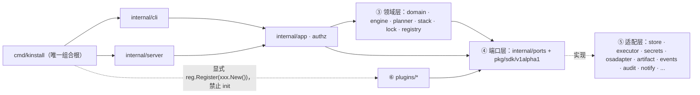

# 05 开发文档

> **本文定位**：面向 kinstall 研发团队的工程手册：工程结构与依赖规则、依赖版本与工具链、核心 Go 接口、CLI / REST API、编码规范、测试、构建发布、插件开发指南与 M0 拆解。架构与设计取舍见「02 平台架构与插件体系」，组件插件设计见 04、06–11。
>
> **版本**：v1.2（S6–S7/U/V，2026-11-26；v1.2 对齐 `ARCHITECTURE.md` 28 包目录与 `depguard` 规则、全量 24 表 `Store` 与 D2 字段、15 个内置 Task 构造器、§8.2 可编译插件骨架、`D1` 长度前缀 AAD、依赖精确版本与 `KI-SRC-0005` 错误码）。依赖版本均于 2026-11-25 / 26 从 proxy.golang.org 与上游发布页实查，引用前请复核。

## 1. 工程结构与依赖规则（K1、ADR-022）

### 1.1 仓库布局（单仓 monorepo，单 Go module）

```text
kinstall/
├── cmd/kinstall/                 # main：只做 wiring（cobra 根命令、依赖注入），不含业务逻辑
├── api/
│   └── openapi.yaml              # REST /api/v1 契约（OpenAPI 3.1，契约优先，ADR-021）
├── internal/                     # 28 个平台私有包（与 ARCHITECTURE §4.2 完全对齐，插件禁止 import）
│   ├── cli/                      # ① 接入：cobra 命令、输出格式（table/json/yaml）、交互确认
│   ├── server/                   # ① 接入：chi 路由、oapi-codegen Strict Server、SSE、go:embed UI
│   ├── app/                      # ② 应用：CLI 与 Server 共用的 8 大同源业务 Facade（G1 §1.2）
│   ├── authz/                    # ② 应用：OIDC / Argon2id / Token 认证、RBAC、四眼审批
│   ├── domain/                   # ③ 领域：零 I/O 核心实体、状态机 allowedTransitions、乐观锁（D1 §1）
│   ├── planner/                  # ③ 领域：Spec × 实际状态（三向合并 3-Way Diff，ADR-070）→ Plan
│   ├── stack/                    # ③ 领域：Stack 多组件复合应用栈拓扑展开与跨实例输出引用（ADR-067）
│   ├── engine/                   # ③ 领域：任务引擎 Pipeline/Phase/TaskRun 调度、租约、Fencing、15 个内置 Task
│   ├── lock/                     # ③ 领域：Stack → Instance → Host(ID 升序) 批量锁（D2 §2.3）
│   ├── registry/                 # ③ 领域：插件注册（启动期显式注册并只读冻结）、兼容矩阵、签名校验
│   ├── ports/                    # ④ 端口：Executor / Store / Secrets / OSAdapter / MediaResolver / EventSink / AuditRecorder
│   ├── executor/                 # ⑤ 适配：SSH / SFTP / local 执行器（ADR-020）
│   │   └── sshx/                 # x/crypto/ssh 封装：双层限流池、ProxyJump、Async Detached、sudo、hostkey
│   ├── store/                    # ⑤ 适配：24 表 Repository（bun + sqlitedialect / pgdialect，ADR-034）
│   │   └── migrate/              # goose 嵌入只前滚迁移执行器
│   ├── secrets/                  # ⑤ 适配：信封加密（AES-256-GCM / SM4-GCM）、KEK Provider（05 §5.5、D1 §3）
│   ├── osadapter/                # ⑤ 适配：osmatch / pkgmap 加载与 OSAdapter 实现（ADR-024 / 029）
│   ├── inventory/                # ⑤ 适配：CMDB 主机/凭据引用/分组、1-RTT Facts 采集与归一化（03 §1–§2）
│   ├── hostinit/                 # ⑤ 适配：22 个初始化模块与 7 个内置 Profile（03 §5–§7、§9）
│   ├── artifact/                 # ⑤ 适配：BOM、Bundle、三元介质源（Local/OBS/Online）、Zot、离线验签（D3）
│   ├── pki/                      # ⑤ 适配：CA 与证书签发、续期、吊销清单
│   ├── template/                 # ⑤ 适配：text/template 渲染器、白名单函数、expr Evaluator（ADR-036）
│   ├── events/                   # ⑤ 适配：事件总线（内存 Hub / PG 独立连接 LISTEN/NOTIFY）
│   ├── audit/                    # ⑤ 适配：防分叉 SHA-256/SM3 审计哈希链与异步 TLS Syslog（G1 §5）
│   ├── notify/                   # ⑤ 适配：5 渠道通知与聚合防风暴（G2 §3）
│   ├── multicluster/             # ⑤ 适配：多集群视图、短期 Kubeconfig、CMDB 双向同步（G2 §1–§2）
│   ├── compliance/               # ⑤ 适配：等保 2.0 三级 / 密评 / CIS 测评证据包（G2 §4）
│   ├── obs/                      # 横切：slog 初始化、两层脱敏 RedactWriter、Prometheus 指标、OTel
│   ├── i18n/                     # 横切：中英文消息目录（05 §5.4，ADR-038）
│   └── version/                  # 横切：ldflags 注入版本、Commit 与 MaxCompatibleSchemaVersion
├── pkg/sdk/v1alpha1/             # 插件 SDK：插件唯一允许依赖的平台包（对外稳定面）
│   ├── component.go              # Component / Operation / Extension 接口
│   ├── task.go                   # TaskSpec 构造器（Task 库的声明式描述，不含执行）
│   ├── types.go                  # Instance、HostView、Facts 视图、Plan、ValidationReport
│   ├── hostreq.go                # HostRequirements、HostRoleClaims
│   └── sdktest/                  # 插件单测工具：Fake RunContext、golden 断言
├── plugins/                      # 内置插件（每个插件一个子目录，只能 import pkg/sdk 与标准库/白名单三方库）
│   ├── kubernetes/
│   │   ├── plugin.yaml
│   │   ├── schema/params.json
│   │   ├── templates/<组件>/<semver 范围>/...
│   │   ├── extensions/{cri,cni,csi,ha,addon}/...
│   │   └── testdata/
│   ├── valkey/  postgresql/  mysql/  opensearch/  kafka/  elkpipeline/  objectstorage/  skywalking/  ...   # 07–11、15–17、P8–P10（目录名 = productId 去连字符，ADR-069）
├── spec/                         # osmatch.yaml / pkgmap.yaml / osmatch_golden.yaml + 生成器（ADR-029）
├── profiles/                     # 内置 Profile YAML（base、k8s-node、database-pg ……，03 §6.1）
├── migrations/
│   ├── sqlite/                   # goose SQL 迁移（只前滚）
│   └── postgres/
├── web/                          # Web UI 源码（Vue 3.5.45 + Element Plus + @hey-api/openapi-ts，ADR-023 定稿见 WEB_DESIGN.md）；构建产物 web/dist 通过 go:embed 打包
├── test/
│   ├── contract/                 # OS 适配器契约测试（testcontainers-go，05 §6.3）
│   ├── e2e/                      # VM 级端到端（14）
│   └── golden/                   # 跨插件 golden 公共工具
├── hack/                         # 构建脚本、代码生成、版本注入、许可证检查
└── docs/                         # 用户手册 / 运维手册 / 插件开发指南（mkdocs 或 Hugo，05 §8.4）
```

### 1.2 依赖方向与禁止规则



| 规则 | 说明 | 强制手段 |
| --- | --- | --- |
| R1 插件只依赖 `pkg/sdk` | `plugins/**` 不得 import `github.com/kinstall/kinstall/internal/**`（ADR-022） | golangci-lint depguard |
| R2 SDK 不依赖 internal | `pkg/sdk/**` 只依赖标准库、`sigs.k8s.io/yaml`、`Masterminds/semver` | depguard |
| R3 internal 不 import 具体插件 | 只有 `cmd/kinstall/plugins.go` 以显式 `reg.Register(xxx.New())` 注册内置插件（禁止 `init()`） | depguard（`internal/**` 禁止 `plugins/**`）+ `gochecknoinits` |
| R4 插件不直接执行 | 插件内禁止 import `x/crypto/ssh`、`os/exec`、`database/sql`、`net/http`（客户端除外由 SDK 提供） | depguard + 代码评审（ADR-003） |
| R5 store 只经 Repository | 业务代码不得直接使用 `bun.DB`，只能通过 `store.Store` 接口 | depguard（仅 `internal/store/**` 可 import `uptrace/bun`） |
| R6 禁用不可移植依赖 | 禁止 CGO（`mattn/go-sqlite3` 等）、`plugin` 包 | depguard + CI `CGO_ENABLED=0` 构建 |

`.golangci.yml` 中 depguard 片段（golangci-lint v2 语法）：

```yaml
version: "2"
linters:
  enable: [depguard, gochecknoinits]
  settings:
    depguard:
      rules:
        entry-only-app:
          files: ["**/internal/cli/**/*.go", "**/internal/server/**/*.go"]
          deny:
            - pkg: "github.com/kinstall/kinstall/internal/engine"
              desc: "接入层必须经 internal/app 调用（ARCHITECTURE §4.3）"
            - pkg: "github.com/kinstall/kinstall/internal/planner"
              desc: "接入层必须经 internal/app 调用"
            - pkg: "github.com/kinstall/kinstall/internal/stack"
              desc: "接入层必须经 internal/app 调用"
            - pkg: "github.com/kinstall/kinstall/internal/store"
              desc: "接入层禁止直访 Store"
            - pkg: "github.com/kinstall/kinstall/internal/executor"
              desc: "接入层禁止直调 Executor"
            - pkg: "github.com/kinstall/kinstall/internal/events"
              desc: "SSE 等事件流经 internal/app 暴露，禁止接入层直连总线"
        plugins-only-sdk:
          files: ["**/plugins/**/*.go"]
          deny:
            - pkg: "github.com/kinstall/kinstall/internal"
              desc: "插件只能依赖 pkg/sdk（ADR-022）"
            - pkg: "golang.org/x/crypto/ssh"
              desc: "插件不得直接 SSH，使用 Task 库（ADR-003）"
            - pkg: "os/exec"
              desc: "插件不得执行本地命令"
            - pkg: "github.com/uptrace/bun"
              desc: "插件不得访问数据库"
        sdk-pure:
          files: ["**/pkg/sdk/**/*.go"]
          allow: ["$gostd", "sigs.k8s.io/yaml", "github.com/Masterminds/semver/v3"]
        internal-no-plugins:
          files: ["**/internal/**/*.go"]
          deny:
            - pkg: "github.com/kinstall/kinstall/plugins"
              desc: "内置插件只在 cmd/kinstall 注册"
        no-cgo-sqlite:
          files: ["$all"]
          deny:
            - pkg: "github.com/mattn/go-sqlite3"
              desc: "需要 CGO，违反 CGO_ENABLED=0（ADR-034）"
            - pkg: "gorm.io/gorm"
              desc: "数据层不用 gorm（ADR-034）"
```

### 1.3 嵌入资源与构建标签

| 资源 | 位置 | 方式 |
| --- | --- | --- |
| 数据库迁移 | `migrations/{sqlite,postgres}/*.sql` | `//go:embed`，goose `SetBaseFS` |
| OS 规则 | `spec/*.yaml` | `//go:embed`；可被外部 revision 覆盖（ADR-029），加载时校验签名与 `revision` |
| 内置 Profile | `profiles/*.yaml` | `//go:embed` |
| 插件模板 | `plugins/<p>/templates/**` | 插件包内 `//go:embed`，通过 `fs.FS` 交给 `template.Renderer` |
| Web UI | `web/dist/**` | `//go:embed`；构建标签 `noui` 时用空 FS，CLI-only 二进制可减小约 10–20 MiB |
| OpenAPI | `api/openapi.yaml` | `//go:embed`，`/api/v1/openapi.yaml` 对外提供 |

构建标签：`noui`（不打包 Web UI）、`nopg`（排除 PostgreSQL 驱动，用于极简 CLI）、`e2e`（端到端测试）、`contract`（容器契约测试）。

### 1.4 模块与命名约定

- Module path 暂定 `github.com/kinstall/kinstall`；单 module，避免多 module 版本漂移。SDK 若未来独立发布，再拆为 `github.com/kinstall/kinstall/pkg/sdk` 子 module（届时保持 import path 不变）。
- 包名单数、小写、无下划线；接口以能力命名（`Executor`、`Renderer`），实现以技术命名（`sshx.Executor`）。
- ID：全局使用 ULID（`oklog/ulid/v2`），带类型前缀：`host_`、`inst_`、`op_`、`plan_`、`tr_`（TaskRun）、`evt_`、`cred_`。
- 时间一律 UTC 存储（`TIMESTAMP` / RFC 3339），展示层本地化。

## 2. 依赖版本与工具链（K6、R-PLAT-07、R-PLAT-08、ADR-034～036）

### 2.1 工具链

| 工具 | 版本（截至 2026-11-26） | 用途 / 约束 |
| --- | --- | --- |
| Go | **1.27.4**（`go.mod` 写 `go 1.27`，`toolchain go1.27.4`）；1.26.11 仍在支持期 | `CGO_ENABLED=0`；目标 linux/amd64、linux/arm64、linux/loong64、darwin/amd64、darwin/arm64 |
| golangci-lint | v2.15.0 | v2 配置格式；启用 depguard、gosec、errorlint、revive、staticcheck 等（05 §5.1） |
| gofumpt | v0.12.0 | 格式化（比 gofmt 更严格） |
| goreleaser | v2.20.3 | 多平台构建、SBOM、cosign 签名（05 §7.2） |
| govulncheck | 随 `golang.org/x/vuln` 最新 | CI 必跑；Critical/High 阻断发布 |
| oapi-codegen | v2.9.0 | 从 `api/openapi.yaml` 生成 chi strict server 与 Go 客户端 |
| mockgen | `go.uber.org/mock` v0.6.0 | 接口 mock |
| goose CLI | v3.30.2 | 本地生成迁移；运行时使用嵌入式 API |

### 2.2 核心依赖版本表

| 领域 | 模块 | 版本 | 选型说明 |
| --- | --- | --- | --- |
| SSH | `golang.org/x/crypto` | v0.59.0 | `ssh`、`ssh/agent`、`ssh/knownhosts`（ADR-020） |
| SFTP | `github.com/pkg/sftp` | v1.13.13 | 文件传输；SFTP 被禁用时退回 stdin 流式 |
| Shell 转义 | `al.essio.dev/pkg/shellescape` | v1.6.1 | 远端命令参数转义（原 alessio/shellescape） |
| CLI | `github.com/spf13/cobra` / `pflag` | v1.10.2 / v1.1.0 | 命令树与补全 |
| 配置 | `github.com/knadh/koanf/v2` | v2.4.1 | 平台配置文件 + 环境变量 + flag 合并；**不用 viper**（v1.21.0 依赖重、键大小写不敏感易出错） |
| HTTP 路由 | `github.com/go-chi/chi/v5` | v5.5.0 | 与 net/http 兼容、轻量 |
| OpenAPI | `github.com/oapi-codegen/oapi-codegen/v2`、`github.com/getkin/kin-openapi` | v2.9.0 / v0.153.0 | 契约优先；请求校验中间件 |
| OIDC | `github.com/coreos/go-oidc/v3` | v3.21.0 | Server 模式 SSO |
| SQLite | `modernc.org/sqlite` | **v1.63.0**（2026-11-22） | 纯 Go（C 转译），支持 linux amd64/arm64/loong64、darwin；ADR-034 |
| PostgreSQL | `github.com/jackc/pgx/v5` | v5.13.0 | Server 模式驱动（`pgx/v5/stdlib`） |
| 查询层 | `github.com/uptrace/bun` + `dialect/sqlitedialect` + `dialect/pgdialect` | v1.3.0 | 轻量 SQL-first 查询构建器，双方言；不用 gorm |
| 迁移 | `github.com/pressly/goose/v3` | v3.30.2 | 嵌入式、按方言分目录、只前滚，PG 使用 advisory lock |
| JSON Schema | `github.com/santhosh-tekuri/jsonschema/v6` | v6.0.3 | params 校验（Draft 2020-12） |
| YAML | `sigs.k8s.io/yaml`、`go.yaml.in/yaml/v3` | v1.6.0 / v3.0.6 | 前者用于 JSON tag 一致的结构体；后者用于保留注释/节点 |
| semver | `github.com/Masterminds/semver/v3` | v3.5.0 | 插件 / 产品版本约束、模板目录选择 |
| 表达式 | `github.com/expr-lang/expr` | **v1.18.1**（2026-11-22） | `when` / `validate`（ADR-036） |
| K8s 客户端 | `k8s.io/client-go`、`k8s.io/apimachinery` | v0.37.3（2026-11-25） | 集群状态采集、SSA；随 BOM 最高 GA 版本升级 |
| Helm | `helm.sh/helm/v4` | v4.3.2 | Addon 安装（`04 §12.2`）；kstatus 由 `fluxcd/cli-utils` v1.4.0 间接提供 |
| OCI | `github.com/oras-project/oras-go/v3`、`github.com/google/go-containerregistry` | v3.0.0 / v0.22.1 | 插件包 / Bundle 分发；镜像 OCI layout 保存与推送 |
| 对象存储 / OBS | `github.com/aws/aws-sdk-go-v2/service/s3`、`github.com/huaweicloud/huaweicloud-sdk-go-obs` | v1.96.0 / v3.25.9 | 统一 S3v4（OBS/OSS/COS/SeaweedFS，含 `WhenRequired` 补丁）与可选华为政企 `obs-native` 驱动（ADR-077，D3 §7） |
| 签名 | `github.com/sigstore/sigstore-go`、`github.com/sigstore/cosign/v3` | v1.4.1 / v3.1.6 | 运行时校验用 sigstore-go（依赖更少）；cosign 只在构建流水线使用 |
| 压缩 | `github.com/klauspost/compress` | v1.20.5 | zstd（Bundle）、gzip |
| 文件监听 | `github.com/fsnotify/fsnotify` | v1.10.1 | 开发模式热加载模板 |
| ID | `github.com/oklog/ulid/v2` | v2.1.2 | 可排序 ID |
| 重试 | `github.com/cenkalti/backoff/v5`、`github.com/sethvargo/go-retry` | v5.0.3 / v0.7.0 | 网络重试统一使用 go-retry；backoff 由间接依赖引入时保持一致版本 |
| 调度 | `github.com/go-co-op/gocron/v2` | v2.23.2 | 维护窗口、巡检、Facts 定时刷新 |
| 并发与限速 | `golang.org/x/sync`、`golang.org/x/time` | v0.25.0 / v0.15.0 | errgroup、semaphore、singleflight；`rate.Limiter` 两级 HTTP 限速（D3 §5.1） |
| 文本/终端/i18n | `golang.org/x/text`、`golang.org/x/term`、`github.com/nicksnyder/go-i18n/v2` | v0.44.0 / v0.48.0 / v2.7.0 | i18n（ADR-038）、密码输入 |
| Excel 导入 | `github.com/xuri/excelize/v2` | v2.11.1 | CMDB 主机 `.xlsx` 批量导入（C5） |
| 密钥与国密 | `github.com/openbao/openbao/api/v2`、`github.com/emmansun/gmsm`（可选） | v2.7.1 / v0.45.4 | OpenBao Transit KEK（ADR-039）；密评可选纯 Go SM4-GCM（替代已停维的 `tjfoc/gmsm` v1.4.1） |
| 日志 | `log/slog`（标准库）+ `github.com/lmittmann/tint` | tint v1.2.1 | 终端彩色输出；Server 用 JSON Handler |
| 指标 | `github.com/prometheus/client_golang` | v1.25.0 | `/metrics` |
| 追踪 | `go.opentelemetry.io/otel` | v1.47.0 | 可选；默认关闭 |
| 外部插件 | `github.com/hashicorp/go-plugin` | v1.8.0 | 三期 gRPC 外部插件（本机进程间） |
| 测试 | `github.com/stretchr/testify`、`go.uber.org/mock`、`github.com/onsi/ginkgo/v2`、`github.com/testcontainers/testcontainers-go`、`github.com/gliderlabs/ssh` | v1.12.1 / v0.6.0 / v2.34.0 / v0.45.0 / v0.3.8 | 单测、mock、e2e 描述、容器契约测试、测试用 SSH 服务器 |

### 2.3 依赖准入与淘汰策略

- **准入条件**（任一不满足需架构评审）：近 12 个月内有发布；许可证在白名单（Apache-2.0、BSD-2/3、MIT、ISC、MPL-2.0；禁止 GPL/AGPL/SSPL 进入二进制）；纯 Go（`CGO_ENABLED=0` 可构建）；`govulncheck` 无未修复的可达漏洞；传递依赖数量可控（新增 > 30 个间接依赖需说明）。
- **版本策略**：`go.mod` 锁定精确版本；Renovate / Dependabot 每周提 PR；安全补丁 72 h 内合入；client-go 主版本随 BOM 支持的最高 K8s GA 版本升级。
- **已否决 / 降级**：

| 候选 | 结论 | 原因 |
| --- | --- | --- |
| gorm + `glebarez/sqlite` | 否决 | glebarez/sqlite v1.11.0 自 2024-03 无发布；gorm 自动迁移与 goose 前滚策略冲突（ADR-034） |
| `ncruces/go-sqlite3` | 备选 | v0.38.1（2026-11-25）正从 wazero 迁移到 wasm2go（discussion #361），编译约 40 s / 4 GiB 内存、单维护者、仍为 v0.x；保留为 modernc 出现阻断性问题时的替换项（通过 `database/sql` 接口隔离） |
| `mattn/go-sqlite3` | 否决 | 需要 CGO |
| sprig 全量函数 | 否决 | v3.3.0 自 2024-08-29 无发布；含 `env`、随机、时间等非确定性函数；改为自维护白名单（ADR-036） |
| riverqueue/river | 否决 | v0.51.2 只支持 PostgreSQL，不覆盖 SQLite 单机模式（ADR-035） |
| Temporal / Argo Workflows | 否决 | 需要额外服务，违背单二进制离线（ADR-035） |
| k0sproject/rig v2 | 仅参考 | v2.4.1；OS 探测与 `osmatch.yaml` 重复，依赖面大（ADR-020） |
| viper | 否决 | 见上；koanf 更轻且大小写敏感 |
| controller-runtime | 不使用 | v0.25.3；kinstall 不运行控制器，直接 client-go 即可 |
| cel-go | 备选 | v0.30.0；通过 `Evaluator` 接口可替换 expr |

## 3. 核心接口（Go 草案）

> 以下为接口草案，用于固定模块边界；`pkg/sdk/v1alpha1` 中的类型对插件可见，`internal/*` 中的接口只供平台内部使用。字段省略了 JSON / bun tag。

### 3.1 资源类型（`internal/store/model` 与 SDK 视图）

```go
// Host：CMDB 主机（03 §1.2 为完整字段）
type Host struct {
    ID          string            // host_<ulid>
    ProjectID   string
    Name        string            // DNS-1123，全局唯一（03 §5.6.1）
    Address     string            // SSH 地址
    Port        int
    CredentialID string
    JumpHostID  *string           // 跳板主机 ID（对应 D2 hosts.jump_host_id）
    Labels      map[string]string // 含 topology.kinstall.io/zone、rack
    State       HostState         // pending / probing / ready / initializing / active / draining / retired（D2 §1.3）
    HostKeyFP   string            // SHA256 指纹（H5）
    FactsRev    int64             // 最近一次 Facts 版本
    CreatedAt, UpdatedAt time.Time
}

// Facts：归一化事实（03 §2），整体存 JSON，关键字段冗余列便于查询
type Facts struct {
    HostID      string
    Rev         int64
    OS          OSInfo            // Family/ID/VersionID/Variant，由 osmatch 判定
    Kernel      string
    Arch        string            // amd64 / arm64 / loong64
    PageSize    int               // 4096 / 16384 / 65536（ADR-028）
    CgroupVer   int               // 1 / 2
    X86Level    string            // x86-64-v2/v3（amd64）
    SecurityMod []string          // selinux / apparmor / kysec / fapolicyd
    SudoImpl    string            // sudo / sudo-rs
    CPU, MemMB  int
    Disks       []Disk
    NICs        []NIC
    CollectedAt time.Time
    Raw         json.RawMessage
}

type Instance struct {
    ID, ProjectID, Env, Name string
    StackID         *string           // 归属 Stack（可空）
    Product         string            // kubernetes | valkey | postgresql | ...
    DeployTarget    string            // host-binary | host-container | kubernetes（对应 D2 deploy_target）
    ProductVersion  string
    BOMRevision     string
    PluginSchemaVer int               // 插件状态 schema 版本（对应 D2 plugin_schema_ver，G1 §6.2）
    DesiredSpecJSON json.RawMessage   // 用户期望规格（Secret 仅引用）
    LastAppliedJSON json.RawMessage   // 3-Way Diff 基线（ADR-070）
    StateJSON       json.RawMessage   // 插件私有持久状态
    OutputsJSON     json.RawMessage   // 对外暴露端点 / secretId（供 Stack 引用）
    State           string
    Version         int64             // 乐观锁版本（ETag）
}

type Plan struct {
    ID          string            // plan_<ulid>
    InstanceID  string
    Operation   string            // install / scale / upgrade ...
    InputHash   string            // Spec + Facts 摘要 + BOM + 插件版本
    Changes     []HostChange      // 每台主机将变更的文件 / 包 / 服务 / 参数
    Pipeline    PipelineSpec      // 展开后的 DAG（持久化，apply 时原样执行）
    Warnings    []Finding
    ExpiresAt   time.Time         // 默认 24 h
}

type Operation struct {
    ID, ProjectID, TargetType, TargetID, Action string
    State          OpState           // awaiting_approval/pending/running/succeeded/failed/rejected/cancelled（ARCHITECTURE §5.2）
    IdempotencyKey string
    RequestedBy    string
    ApprovedBy     string
    LeaseOwner     string
    LeaseExpiresAt time.Time
    FencingToken   int64             // 每次抢占/接管单调 +1（D2 §2.1）
    StartedAt, FinishedAt time.Time
}

type TaskRun struct {
    ID, OperationID, StepKey, HostID, TaskType string
    PhaseIdx        int
    ParamsDigest    string            // 参数 SHA-256（不含明文 Secret）
    State           TaskState         // pending | running | skipped | succeeded | failed | rolled_back
    Attempt         int
    FencingToken    int64
    RemoteRunDir    string
    RemotePGID      int
    RemoteLogOffset int64
    ErrorCode       string
    StartedAt, FinishedAt time.Time
}
```

### 3.2 执行器（`internal/executor`，ADR-020 / 025 / 030）

```go
type Executor interface {
    // Connect 返回一个可复用的主机会话；内部按主机复用 ssh.Client，受 MaxSessions 限流
    Connect(ctx context.Context, target Target) (Session, error)
    Close() error
}

type Target struct {
    HostID     string
    Addr       string
    User       string
    Auth       AuthMaterial   // 解密后的内存凭据，用完清零
    Jumps      []Target
    HostKey    HostKeyPolicy  // TOFU / Pinned / KnownHosts（H5）
    SudoMode   SudoMode       // None / NoPasswd / Password（ADR-030 Mode A/B）
}

type Session interface {
    // Run 在远端执行 POSIX sh 命令；Env 统一 LC_ALL=C；Sudo=true 时包装 sudo -n / sudo -S -p ''
    Run(ctx context.Context, cmd Command) (Result, error)
    Upload(ctx context.Context, r io.Reader, dst string, mode fs.FileMode, owner string) (sha256 string, err error)
    Download(ctx context.Context, src string, w io.Writer) error
    Stat(ctx context.Context, path string) (*RemoteFileInfo, error)
    Close() error
}

type Command struct {
    Script  string            // 已转义的 sh 脚本
    Sudo    bool
    Stdin   io.Reader         // 秘密只走 stdin（02 §9）
    Stdout, Stderr io.Writer  // 引擎接入脱敏写入器 + 日志文件
    Timeout time.Duration
    Setsid  bool              // 取消时杀进程组
}

type Result struct {
    ExitCode int
    Duration time.Duration
}
```

### 3.3 任务引擎（`internal/engine`，ADR-003 / 035）

```go
// PipelineSpec 由插件 Operation.Build 生成（SDK 类型），引擎持久化后执行
type PipelineSpec struct {
    Phases []PhaseSpec
}

type PhaseSpec struct {
    Name        string
    DependsOn   []string
    Hosts       sdk.HostSelector    // 角色 / 标签 / 显式列表
    Tasks       []sdk.TaskSpec
    Concurrency int                 // 默认 10
    Serial      bool                // etcd、DB 主节点
    Rolling     *RollingPolicy      // maxUnavailable + 批次健康门禁
    FailPolicy  FailPolicy          // FailFast / ContinueOnError{MaxFailRatio}
    Lock        HostLockMode        // Shared / Exclusive（reboot、内核升级）
}

// Task 是平台 Task 库中每种任务的实现接口（file.sync、pkg.ensure ……）
type Task interface {
    Name() string                                                   // "file.sync"
    Check(ctx context.Context, rc *RunContext, in sdk.TaskInput) (CheckResult, error) // 是否已是期望状态
    Apply(ctx context.Context, rc *RunContext, in sdk.TaskInput) (ApplyResult, error)
    Rollback(ctx context.Context, rc *RunContext, in sdk.TaskInput, prev ApplyResult) error // 可选：返回 ErrNotSupported
}

type RunContext struct {
    OpID, PhaseName string
    Host     sdk.HostView
    Session  executor.Session
    OS       osadapter.OSAdapter
    Render   template.Renderer
    Secrets  secrets.Resolver       // 只解析插件声明过的 secret 引用
    Artifacts artifact.Locator      // 制品 URL / 本地路径 + sha256
    Log      *slog.Logger
    Notify   func(handler string)   // 触发 handler（去重后在 Phase 末尾执行）
    DryRun   bool
}

type Engine interface {
    Submit(ctx context.Context, op *Operation) error          // 写入 Pending
    Run(ctx context.Context) error                            // 副本主循环：抢占租约、调度、续约
    Cancel(ctx context.Context, opID string, by string) error
    Resume(ctx context.Context, opID string) error
}

type LockKey struct {
    Kind string // stack | instance | host
    ID   string
    Mode string // exclusive | shared
}

type Locker interface {
    // AcquireAll 按 Stack → Instance → Host(ID 升序) 一次性批量获取；任一冲突整体回滚并返回 KI-LOCK-0001（D2 §2.3）
    AcquireAll(ctx context.Context, opID string, fencing int64, keys []LockKey, ttl time.Duration) (release func(context.Context) error, err error)
}
```

### 3.4 插件 SDK（`pkg/sdk/v1alpha1`）

```go
type PluginMeta struct {
    Name, Version, SDKVersion string
    Type        PluginType        // Component / Extension / OSAdapter / InitModule
    Products    []ProductRange
    Platforms   Platforms         // os 族、arch、pageSizes
}

type Component interface {
    Meta() PluginMeta
    Validate(ctx context.Context, req *ValidateRequest) (*ValidationReport, error)
    Plan(ctx context.Context, req *PlanRequest) (*PlanResult, error)
    Operation(name string) (Operation, bool)
    Status(ctx context.Context, req *StatusRequest) (*InstanceStatus, error)
}

// Operation 只“描述”要做什么：返回 Phase/Task DAG，绝不直接执行（ADR-003）
type Operation interface {
    Name() string                        // install / scale / upgrade / backup / restore / reconfigure / uninstall
    Mutating() bool
    Preflight(ctx context.Context, req *OpRequest) (*ValidationReport, error)
    Build(ctx context.Context, req *OpRequest) (*Pipeline, error)
}

// Extension：组件定义的扩展点实现，如 kubernetes 的 cni/calico
type Extension interface {
    Meta() PluginMeta
    Point() string                       // "kubernetes.cni"
    HostRequirements(ctx context.Context, req *ExtRequest) (*HostRequirements, error)
    Contribute(ctx context.Context, req *ExtRequest) (*Contribution, error) // 追加 Phase / 模板变量 / 校验
}

type HostRequirements struct {
    Packages    []string            // 逻辑包名，经 pkgmap 映射（ADR-026 / 029）
    KernelMods  []string
    Sysctls     map[string]string
    Services    []ServiceReq        // enable / disable / mask
    Ports       []PortReq           // 防火墙放行（03 §5.3）
    Profiles    []string            // 需要的主机 Profile
    MinKernel   string
    PageSizes   []int               // ADR-028
    SecurityExec []string           // 需加白的可执行文件（ADR-027，需管理员授权）
}

type HostRoleClaims struct {
    Ports      []PortClaim          // 端口 + 协议，冲突检测
    Dirs       []string             // 数据 / 配置目录
    Disks      []DiskClaim          // 独占盘
    MemoryMB   int                  // 计入容量视图（03 §8.5）
    HugePages  int
}

// TaskSpec 构造器（覆盖全部 15 个内置 Task，与 D2 §5.1 一一对应；实现位于 internal/engine/tasks）
func FileSync(dst string, src TemplateRef, mode fs.FileMode, owner string) TaskSpec
func TemplateRender(dst string, src TemplateRef, mode fs.FileMode, owner string) TaskSpec
func PkgEnsure(logical ...string) TaskSpec
func BinaryInstall(name, version string, artifact ArtifactRef) TaskSpec
func SystemdUnit(name string, unit TemplateRef, opts UnitOpts) TaskSpec
func SysctlApply(dropIn string, params map[string]string) TaskSpec
func KmodEnsure(modules ...string) TaskSpec
func CmdRun(script string, check string) TaskSpec
func WaitTCP(hostPort string, timeout time.Duration) TaskSpec
func WaitHTTP(url string, timeout time.Duration) TaskSpec
func CertIssue(spec CertIssueSpec) TaskSpec
func HelmRelease(rel HelmReleaseSpec) TaskSpec
func DockerEnsure(allowCIDRs []string) TaskSpec                   // 安装 Docker 29 + Compose v5 + DOCKER-USER 规则（ADR-066）
func ImageLoad(imageRef string) TaskSpec                          // 从 Zot / 离线包导入镜像并校验 digest（ADR-066）
func ComposeSync(serviceName, composePath string) TaskSpec        // 渲染 Compose + 预建挂载 + systemd oneshot 启动（ADR-066）

// 版本比较工具：按点分段逐段数值比较（"2.9" < "2.28"），插件禁止直接对版本字符串做 < / > 比较
func DottedVersionLess(a, b string) bool

// 插件导出约定：每个插件包导出 New() 构造函数，由组合根 cmd/kinstall/plugins.go 显式调用
// internal/registry 完成注册并只读冻结（禁止 init() 自注册，D1 §1.1 铁律 3）
type Constructor func() any // Component / Extension / OSAdapter / InitModule
```

### 3.5 OS 适配器与主机初始化（`internal/osadapter`、`internal/hostinit`）

```go
type OSAdapter interface {
    Family() string                                  // rhel-like / debian-like / suse / kylin / openeuler / anolis / uos（spec/osmatch.yaml）
    Match(f *Facts) (MatchResult, error)            // 规则来自 osmatch.yaml（ADR-024）
    PkgName(logical string, f *Facts) ([]string, error) // pkgmap.yaml
    PkgInstallCmd(pkgs []string, opts PkgOpts) string
    PkgQueryCmd(pkgs []string) string
    PkgLockCmd(pkgs []string) string                // exclude / Pin -1 / addlock（ADR-026）
    ServiceCmd(op ServiceOp, unit string) string
    FirewallBackend(f *Facts) FirewallBackend       // firewalld / ufw / nftables / none
    RepoConfig(repo RepoSpec) (path string, content []byte)
}

type InitModule interface {
    Name() string                                    // kernel / packages / firewall / selinux / swap / sysctl / limits / chrony / thp / disk / harden
    DependsOn() []string
    Plan(ctx context.Context, h *HostContext, params map[string]any) ([]sdk.TaskSpec, error)
    Verify(ctx context.Context, h *HostContext, params map[string]any) (*VerifyReport, error) // 03 §7.2
    Backup(ctx context.Context, h *HostContext) (*BackupRef, error)                           // 03 §5.4
}

type Profile struct {
    Name     string                 // base / k8s-node / database-pg ...
    Extends  []string
    Modules  []ModuleRef            // name + params + when(expr)
}
```

### 3.6 BOM 与制品（`internal/artifact`）

```go
type BOM struct {
    Product   string               // kubernetes
    Version   string               // 1.37.2
    Revision  string               // 2026.11.3（独立发布，G8）
    Components []BOMComponent
    Images    []ImageRef           // name + 多架构 index digest（images.lock）
    Signature SignatureRef
}

type BOMComponent struct {
    Name, Version string
    Artifacts []Artifact            // arch × os 维度
    PageSizes []int                 // ADR-028
    License   string                // SPDX，A5
}

type Artifact struct {
    Arch, OS, Kind string           // binary / tarball / rpm / deb / image / chart
    URL       string
    SHA256    string
    Upstream  UpstreamSig           // cosign 身份 / checksum 文件
}

type Store interface {
    ImportBundle(ctx context.Context, path string, opts ImportOpts) (*BundleManifest, error) // 校验签名与 sha256
    Resolve(ctx context.Context, ref ArtifactRef, arch, os string) (*Located, error)        // 本地路径 + HTTP URL
    PushImages(ctx context.Context, layout string, registry string) error                   // OCI layout → Zot
    Verify(ctx context.Context, a Artifact, r io.Reader) error
}
```

### 3.7 PKI 与 Secret（`internal/pki`、`internal/secrets`）

```go
type Issuer interface {
    EnsureCA(ctx context.Context, scope CAScope, spec CASpec) (*CA, error)   // scope：实例 + 用途（etcd-ca、front-proxy-ca、pg-ca）
    Issue(ctx context.Context, caRef CARef, req CertRequest) (*IssuedCert, error)
    Renew(ctx context.Context, certID string) (*IssuedCert, error)
    Revoke(ctx context.Context, certID string, reason int) error
    ListExpiring(ctx context.Context, within time.Duration) ([]CertInfo, error)
}

type CertRequest struct {
    CommonName string
    Orgs       []string
    DNSNames   []string
    IPs        []net.IP              // 双栈 SAN（04 §8）
    Usages     []x509.ExtKeyUsage
    TTL        time.Duration
    KeyAlg     KeyAlg                // ECDSA-P256（默认）/ RSA-2048 / Ed25519（不用于 K8s）
}

// 信封加密：每条机密一个 DEK，DEK 由 KEK 包装（实现细节见 05 §5.5）
type SecretStore interface {
    Put(ctx context.Context, scope Scope, name string, plaintext []byte, meta Meta) (Ref, error)
    Get(ctx context.Context, ref Ref) ([]byte, error)     // 调用方负责用后清零
    Rotate(ctx context.Context, ref Ref) error            // 重新加密（新 DEK）
    RewrapAll(ctx context.Context, newKEK KEKID) error    // KEK 轮换
}

type KEKProvider interface {
    ID() KEKID
    Wrap(ctx context.Context, dek []byte, aad []byte) ([]byte, error)
    Unwrap(ctx context.Context, wrapped []byte, aad []byte) ([]byte, error)
}
```

### 3.8 存储层（`internal/store`，ADR-034）

```go
type Store interface {
    // 底座 13 表（D2 §1.3 migrations/00001_init.sql）
    Projects() ProjectRepo
    Credentials() CredentialRepo
    Hosts() HostRepo                     // 含 facts_json 与冗余查询列
    Stacks() StackRepo
    Instances() InstanceRepo             // 含 instance_host_claims
    Operations() OperationRepo           // 含 ClaimPending + Fencing 校验
    TaskRuns() TaskRunRepo
    OperationEvents() OperationEventRepo // operation_events 单调 seq，SSE 追读
    Locks() LockRepo                     // resource_locks（Stack/Instance/Host）
    Audit() AuditRepo                    // audit_chain_head + audit_logs + audit_syslog_cursor
    // 控制面 11 表（G1 §4.2 + §6.3）
    Approvals() ApprovalRepo             // operation_approvals（chk_no_self_approval）
    MediaPolicies() MediaPolicyRepo      // media_policies（ADR-077）
    Auth() AuthRepo                      // users + user_sessions + api_tokens
    Idempotency() IdempotencyRepo        // idempotency_keys
    Plans() PlanRepo                     // plans
    StateBackups() StateBackupRepo       // instance_state_backups
    Notifications() NotificationRepo     // notification_channels + notification_deliveries
    Kubeconfigs() KubeconfigRepo         // cluster_kubeconfigs
    WithTx(ctx context.Context, fn func(ctx context.Context, s Store) error) error
}
```

> **全库权威 24 张表**（完整可执行 DDL 见 `D2 §1.3` 13 表 + `G1 §4.2` 1 表 + `G1 §6.3` 10 表；ER 图见 `ARCHITECTURE §7`）：
>
> | 分组 | 表清单 | 说明 |
> | --- | --- | --- |
> | 租户与 CMDB | `projects`、`credentials`、`hosts` | 环境/配额/维护窗口在 `projects`；Facts 存于 `hosts.facts_json` + 冗余索引列；`credentials` AAD 见 `D1 §3.1` |
> | 实例与复合栈 | `stacks`、`instances`、`instance_host_claims`、`plans`、`instance_state_backups` | 3-Way Diff 基线在 `instances.last_applied_json`；状态迁移前备份在 `instance_state_backups` |
> | 引擎与并发 | `operations`、`task_runs`、`operation_events`、`resource_locks` | Phase 结构在 `operations.pipeline_json` + `task_runs.phase_idx`；租约/Fencing 在 `operations` |
> | 审计（防分叉） | `audit_chain_head`、`audit_logs`、`audit_syslog_cursor` | 单行链头锚点 + 只追加双链（SHA-256 / SM3）+ 异步 Syslog 游标 |
> | 认证、审批与控制面 | `operation_approvals`、`media_policies`、`users`、`user_sessions`、`api_tokens`、`idempotency_keys` | 数据库级 `chk_no_self_approval`；24h 幂等表 |
> | 通知与多集群 | `notification_channels`、`notification_deliveries`、`cluster_kubeconfigs` | 防风暴通知 + 短期 Kubeconfig 签发吊销台账 |
>
> 注：BOM、离线包、插件资产存本地制品目录 / Zot / OBS（不建冗余表）；迁移版本由 `goose_db_version` 自动维护。

SQLite DSN：`file:/var/lib/kinstall/kinstall.db?_txlock=immediate&_pragma=journal_mode(WAL)&_pragma=busy_timeout(5000)&_pragma=foreign_keys(1)&_pragma=synchronous(NORMAL)`，写连接池 `SetMaxOpenConns(1)`，读连接池独立（与 `D2 §1.1` 一致）。

### 3.9 模板、表达式与事件（`internal/template`、`internal/events`）

```go
type Renderer interface {
    // Render 使用 text/template + missingkey=error + 白名单 FuncMap（02 §13.2）
    Render(ctx context.Context, tpl TemplateRef, vars Vars) ([]byte, error)
    Select(fsys fs.FS, component string, version *semver.Version) (fs.FS, error) // 按 semver 范围选目录
}

type Evaluator interface {
    Compile(expr string, env any) (Program, error)  // 加载期预编译（expr，可换 CEL）
    Eval(p Program, env any) (any, error)
}

type Event struct {
    ID       int64              // 单调递增
    Type     string             // operation.started / task.failed / host.unreachable / cert.expiring ...
    Subject  string             // op_xxx / host_xxx / inst_xxx
    Project  string
    Time     time.Time
    Data     json.RawMessage
}

type Bus interface {
    Publish(ctx context.Context, e Event) error                         // 先落库再广播
    Subscribe(ctx context.Context, filter Filter, afterID int64) (<-chan Event, error) // Last-Event-ID 续传
}
```


## 4. CLI 与 REST API（B8、B12、B14、B15、C5、I4、ADR-021）

### 4.1 CLI 命令树与全局规范

CLI 是平台的一等入口（ADR-001），离线现场直接操作本地 SQLite，传入 `--server <url>` 时转为 REST 客户端。

```text
kinstall
├── host        add | import | list | get | edit | facts | check | init | accept-hostkey | retire | delete
├── hostgroup   create | list | add-host | delete
├── credential  create | list | rotate | delete
├── profile     list | show | apply | verify | drift
├── instance    list | get | create | plan | apply | status | upgrade | scale | backup | restore | reconfigure | uninstall
├── cluster     kubeconfig | health | certs-status | etcd-backup | etcd-restore   # kubernetes 实例快捷入口（02 §14）
├── operation   list | get | logs [-f] | cancel | approve | reject | report      # 断点续装统一使用 apply --resume <opId>
├── bom         list | show | import | verify
├── bundle      build | verify | import | list | prune
├── plugin      list | show | install | upgrade | verify | remove
├── compliance  report | export                                                  # 13 §7
├── export      [-f out.yaml]                                                    # B14 声明式导出
├── apply       -f <spec.yaml> [--plan-only | --plan-id <id> | --resume <opId>]  # B14 声明式应用与断点续装
├── diff        -f <spec.yaml>
├── server      init | start | migrate
├── secrets     rewrap                                                           # KEK 轮换重包装（D1 §3.2、ARCHITECTURE O-11）
├── spec        import | verify                                                  # 外部 OS 规则热加载（D1 §4.2）
├── support-bundle create [--instance <id> | --host <id>]                        # 02 §10
└── version     [--short]
```

| 全局参数 | 说明 |
| --- | --- |
| `-o, --output` | `table`（默认）/ `json` / `yaml` / `markdown`（report） |
| `--server` / `KINSTALL_SERVER` | 远端 Server 地址；为空则使用本地 SQLite |
| `--token` / `KINSTALL_TOKEN` | Server API Token（严禁写进 shell 历史，推荐环境变量或 `--token-file`） |
| `-p, --project` / `-e, --env` | 项目与环境上下文 |
| `--lang` | `zh-CN` / `en-US`（默认取 `LC_ALL` / `LANG`） |
| `--dry-run` | 仅渲染并执行 Check，不做变更 |
| `--yes` | 跳过交互确认（用于 CI） |
| `--accept-new-hostkey` | 允许新主机密钥指纹（记审计，H5） |

**退出码规范**：`0` 成功；`1` 通用错误；`2` 参数 / Spec 校验失败；`3` Plan 发现变更（仅 `diff` / `--detailed-exitcode`）；`4` 权限 / 认证失败；`5` 预检阻断（如 64K 页不兼容、KYSEC 拦截）；`6` 锁冲突 / 超时；`7` 操作被取消；`8` 审批被拒（`rejected`）。

典型工作流示例：

```bash
# 1. 批量导入主机并采集 Facts
kinstall host import -f hosts.xlsx --project prod
kinstall host facts --selector pool=k8s-prod

# 2. 初始化预览与执行
kinstall profile apply k8s-node --selector pool=k8s-prod --dry-run
kinstall profile apply k8s-node --selector pool=k8s-prod --yes

# 3. 声明式安装（两段式 plan -> apply）
kinstall apply -f cluster-prod.yaml --plan-only -o json > plan.json
kinstall apply --plan-id "$(jq -r .id plan.json)"
kinstall operation logs -f "$(jq -r .operationId apply.json)"
```

### 4.2 REST API `/api/v1` 与契约优先（B8、ADR-021）

- **契约优先**：`api/openapi.yaml`（OpenAPI 3.1）为唯一来源；CI 校验 `oapi-codegen v2.9.0` 生成代码无漂移（chi strict server + Go SDK 客户端 + TypeScript 类型）。一期**不提供 gRPC 对外 API**（ADR-021）。
- **协议约定**：
  - **异步长任务**：所有变更操作返回 `202 Accepted` + `Location: /api/v1/operations/{opId}`，响应体为 `Operation` 对象。
  - **两段式变更**：`POST /instances/{id}:plan` 返回 `Plan`（含 `planId`、`inputHash`、`expiresAt`）；`POST /instances/{id}:apply` 必须携带 `planId`，服务端复验 `inputHash` 与过期时间。
  - **幂等**：所有创建与 `:apply` / `:cancel` 变更请求支持 `Idempotency-Key` 请求头（服务端保留 24 h，同键同体返回原结果，同键异体返回 `409 Conflict`）。
  - **乐观锁**：资源返回 `ETag`（对应 `generation` / `updatedAt`），`PUT` / `PATCH` 必须带 `If-Match`，不匹配返回 `412 Precondition Failed`。
  - **分页与过滤**：列表统一游标分页 `?limit=50&cursor=<opaque>`，响应返回 `{items, nextCursor, total}`；标签过滤 `?labelSelector=pool=k8s,zone=az1`。
  - **错误体**：统一 RFC 9457 `application/problem+json`：

```json
{
  "type": "https://kinstall.io/errors/KI-PLAN-0012",
  "title": "目标主机页大小与组件不兼容",
  "status": 422,
  "detail": "主机 node-arm-03 页大小为 65536B，组件 valkey@9.2.0(jemalloc-4k) 仅支持 4096B（ADR-028）",
  "code": "KI-PLAN-0012",
  "instance": "/api/v1/projects/prod/instances/cache-01:plan",
  "traceId": "01JFR8X4K9N2M3Q7V6W8Y9Z0AB",
  "suggestion": "更换为 4K 页内核主机，或选择支持 64K 页的 BOM 构建"
}
```

- **核心路由表**（均挂载于 `/api/v1`）：

| 方法与路径 | 说明 | 返回 |
| --- | --- | --- |
| `GET/POST /projects`、`GET/POST /projects/{p}/environments` | 项目与环境管理 | 200 / 201 |
| `GET/POST /projects/{p}/hosts`、`POST /projects/{p}/hosts:import` | 主机纳管与批量导入 | 200 / 201 / 202 |
| `POST /projects/{p}/hosts/{h}:collect-facts`、`POST ...:init`、`POST ...:retire` | Facts / 初始化 / 退役 | 202 Operation |
| `GET/POST /projects/{p}/credentials`、`POST .../credentials/{c}:rotate` | 凭据管理（永不返回明文） | 200 / 201 |
| `GET/POST /projects/{p}/instances`、`GET/PATCH/DELETE .../instances/{i}` | 实例 CRUD | 200 / 201 / 202 |
| `POST /projects/{p}/instances/{i}:plan` | 生成 Plan（带 diff 与预检报告） | 200 Plan |
| `POST /projects/{p}/instances/{i}:apply` | 引用 `planId` 执行变更 | 202 Operation |
| `POST /projects/{p}/instances/{i}:operate` | 触发 `scale`/`upgrade`/`backup`/`restore`/`reconfigure` | 202 Operation |
| `POST /projects/{p}/clusters/{i}:kubeconfig` | 签发短期 kubeconfig（02 §14） | 200 |
| `GET /operations/{op}`、`POST /operations/{op}:cancel`、`:resume`、`:approve`、`:reject` | 操作查询、控制与审批 | 200 / 202 |
| `GET /operations/{op}/events` | **SSE 实时事件与日志流**，支持 `Last-Event-ID` 断点续传（02 §8） | `text/event-stream` |
| `GET /operations/{op}/report` | 导出操作报告（`Accept: text/markdown` 或 `application/json`） | 200 |
| `GET/POST /boms`、`POST /bundles:import`、`GET/POST /plugins` | 制品、离线包与插件管理 | 200 / 202 |
| `GET /audit-logs`、`POST /compliance:report` | 审计检索与合规报告（13 §7） | 200 |
| `GET /healthz`、`/readyz`、`/metrics`、`/openapi.yaml` | 健康、指标与契约 | 200 |

- **SSE 帧格式**：`id: <monotonic_event_id>\nevent: task.log\ndata: {"opId":"...","host":"...","stream":"stdout","line":"..."}\n\n`，服务端每 15 s 发送 `: keepalive\n\n` 防止反代断连；客户端重连带 `Last-Event-ID` 从 `operation_events` 表追读，多副本无缝切换；终态控制帧 `operation.done` 不携带 `id:` 行（不推进 `Last-Event-ID`，`G1 §3.2`）。

### 4.3 认证、RBAC 与审批门（B12、ADR-037）

- **认证方式（ADR-037）**：
  1. **OIDC SSO**（`go-oidc/v3` v3.21.0）：生产推荐；支持对接 Keycloak / Dex / 企业 IdP，从 `groups` claim 映射项目角色，MFA 由 IdP 承担。
  2. **本地账号**：满足纯离线无 IdP 现场；口令采用 Argon2id 存储，强制复杂度与 5 次失败锁定 15 分钟。
  3. **API Token**：格式 `ki_<8位前缀>_<32字节随机Base62>`，数据库仅存 SHA-256 哈希 + 前缀；创建时必须指定作用域（project/env/只读或特定操作）与过期时间（默认 ≤ 90 天，最长 365 天）。
- **RBAC 权限矩阵**：

| 资源 / 动作 | `admin` | `project-admin` | `operator` | `auditor` | `viewer` |
| --- | :---: | :---: | :---: | :---: | :---: |
| 平台配置 / 插件 / BOM / Bundle 导入 / KEK 轮换 | ✅ | ❌ | ❌ | 读 | ❌ |
| 项目与成员管理 / 审批策略 / 维护窗口 | ✅ | 本项目 | ❌ | 读 | ❌ |
| 主机纳管 / 凭据创建 / 初始化 | ✅ | 本项目 | 本项目 | 读（无凭据） | 读（无凭据） |
| 实例 Plan / Apply / 运维操作 | ✅ | 本项目 | 本项目（高危需审批） | 读 | 读 |
| 审批高风险 Operation（`:approve` / `:reject`） | ✅ | 本项目（非发起人） | ❌ | ❌ | ❌ |
| 审计日志查询与合规报告导出 | ✅ | 本项目 | ❌ | 全局 | ❌ |
| 申请 K8s kubeconfig | `cluster-admin`（短期） | NS `admin` | `edit` | `view` | `view` |

- **审批门（四眼原则）**：环境级策略可指定高风险动作（`etcd-restore`、`ca-rotate`、`uninstall`、`upgrade`、`skip-verify`、prod 环境任意 `apply`）。触发后 Operation 进入 `awaiting_approval`，发出审批事件并通知审批人；**发起人不可审批自己的请求**；超期（默认 24 h）自动过期为 `Cancelled`；全部审批动作写入审计日志。

### 4.4 主机批量导入与外部 CMDB 同步（C5）

- **批量导入格式**：支持 CSV、YAML 与 Excel（`.xlsx`，`github.com/xuri/excelize/v2` v2.11.1）。标准列与 `03 §8` 对齐：`name`、`address`、`port`（默认 22）、`credential`（凭据名）、`jump_hosts`（逗号分隔）、`group`、`zone`、`rack`、`labels`（`k=v;k2=v2`）、`hostkey_fp`（可选预置指纹）。
- **导入流水线**：先 `dry-run` 校验（DNS-1123 主机名唯一性、IP/端口合法性、凭据存在性、重复检测按 `name` 或 `address:port` 幂等 upsert）→ 返回行级错误报告 → 确认后入库并可选触发异步并发 Facts 采集。
- **外部 CMDB 同步**：
  - **拉取适配器（Pull）**：通过插件接口 `InventorySyncer`（配置 cron 周期与外部 REST 端点、字段映射 expr）定期增量同步标签、机房/机架、下线标记；**不自动删除 `InUse` 主机**，仅标记 `cmdb.kinstall.io/upstream-retired=true` 并告警。
  - **推送 Webhook（Push）**：提供 `POST /api/v1/projects/{p}/hosts:sync`（HMAC-SHA256 验签 + 幂等批次 ID），供蓝鲸、NetBox、自研 CMDB 推送变更。

### 4.5 Spec 导入导出与 GitOps（B14）

- `kinstall export --project prod -o yaml` 导出项目下 HostGroup、Profile、Instance 的声明式 YAML（剥离 `status`、`uid`、`generation` 与一切 Secret 明文，凭据仅保留 `secretRef`）。
- `kinstall diff -f specs/` 计算本地 YAML 与平台当前状态的语义差异，供 Git PR Review。
- `kinstall apply -f specs/` 在 CI 中以两段式运行：PR 阶段 `--plan-only` 输出 Plan 摘要贴到 MR 评论；合入后按 `planId` 执行（生产环境可自动停在审批门）。
- 版本化：平台每次 Spec/状态变更在 `instance_state_backups` 与 `instances.last_applied_json` 保留快照，支持 `kinstall instance diff --from-rev 2 --to-rev 3` 与一键按历史版本重新 Plan 回滚。

### 4.6 事件与通知（B15）

- **事件总线**：所有领域事件先写 `operation_events` 表（单调 `seq`），再由后台投递器按订阅规则分发（至少一次投递，幂等键为 `event_id`）。
- **核心事件类型**：`operation.{created,awaiting_approval,started,succeeded,failed,cancelled}`、`task.failed`、`host.{unreachable,drift_detected}`、`cert.expiring`（30/14/7 天）、`backup.{succeeded,failed}`、`security.{signature_skipped,login_locked}`。
- **通知渠道**：
  - **Webhook**：POST JSON，附 `X-Kinstall-Event`、`X-Kinstall-Delivery`、`X-Kinstall-Signature-256: sha256=<hmac>`；指数退避重试 5 次（10 s → 10 min），失败进死信表。
  - **邮件**：标准 SMTP（TLS/STARTTLS），内置中英文模板。
  - **国内 IM**：企业微信群机器人（Markdown）、钉钉机器人（加签 timestamp+HMAC）、飞书自定义机器人（富文本 + 加签），内网支持配置 HTTP 代理。
- **订阅规则**：按 `project` × `environment` × `eventTypes` × `severity` 路由，支持静默窗口与聚合防风暴（同主机同告警 5 分钟合并）。

### 4.7 操作报告模板（I4）

每次 Operation 结束自动生成机器可读 JSON 与可交付 Markdown 报告：

```markdown
# 操作报告：op_01JFR9K2M...（kubernetes / upgrade）
- 项目 / 环境：payment / prod · 实例：k8s-prod（1.36.6 → 1.37.2，BOM 2026.11.3）
- 发起人：alice · 审批人：bob · 关联 Plan：plan_01JFR8...
- 结果：**Succeeded** · 耗时：18m 42s（2026-11-26T02:00:00Z ~ 02:18:42Z）

## 1. 阶段摘要
| Phase | 主机数 | Succeeded | Skipped | Failed | 耗时 |
| --- | ---: | ---: | ---: | ---: | ---: |
| preflight | 6 | 6 | 0 | 0 | 24s |
| control-plane-upgrade (serial) | 3 | 3 | 0 | 0 | 9m 12s |
| worker-upgrade (maxUnavailable=1) | 3 | 3 | 0 | 0 | 8m 40s |

## 2. 实际变更清单（InstalledFile 增量）
- `/opt/kinstall/bin/kube-apiserver/v1.37.2/kube-apiserver`（sha256: `...`，3 台控制面）
- `/etc/kubernetes/apiserver-authentication.yaml`（diff 摘要：+12 -4）

## 3. 告警 / 失败与后续建议
- 无失败；提示：30 天内无到期证书；请按业务验收清单复核核心应用。
```

## 5. 编码规范与安全实现（K2、B18、H7、R-SEC-07）

### 5.1 代码风格与静态检查

- 统一 `gofumpt v0.12.0` + `golangci-lint v2.15.0`；除 §1.2 的 `depguard` 外，启用：`errcheck`、`errorlint`（强制 `%w` 与 `errors.Is/As`）、`govet`、`staticcheck`、`revive`、`gosec`、`bodyclose`、`sqlclosecheck`、`noctx`、`exhaustive`（枚举 switch 全覆盖）、`nilerr`、`wrapcheck`（跨包边界包装错误）。
- 本仓代码禁止使用 `init()`（含插件自注册与任何 I/O；第三方驱动如 `modernc.org/sqlite` 的空导入注册除外）；插件、内置 Task、KEK Provider 一律在组合根 `cmd/kinstall/{app,plugins}.go` 显式构造并注册（`D1 §1.1` 铁律 3，`gochecknoinits` linter 强制）。

### 5.2 错误处理与错误码 `KI-<域>-<4位>`（K2）

- **结构化错误**：`type Error struct { Code string; Domain string; HTTPStatus int; MsgKey string; Args map[string]any; SuggestionKey string; Cause error; Retryable bool }`，实现 `Unwrap()` 与 RFC 9457 映射。
- **错误域**：`API`、`AUTH`、`HOST`、`EXEC`、`OS`、`INIT`、`PLAN`、`ENG`、`LOCK`、`PLG`、`TPL`、`ART`、`SEC`、`PKI`、`DB`、`K8S`、`MW`、`DIFF`（三向漂移，`D2 §3`）、`STACK`（复合栈，`D2 §4`）、`WAIT`（探针超时，`D2 §5`）、`IMG`（镜像引用与重写，`D3 §2`）、`SRC`（三元介质源，`D3 §7`）、`BND`（离线包 / 增量包，`D3 §6.2`）。**同一语义只允许一个错误码**（例：架构 / 页大小不兼容统一为 `KI-PLAN-0012`，外部漂移统一为 `KI-DIFF-0001`），CI 以 `internal/obs/errcodes_test.go` 扫描全仓字面量与本表一致。
- **错误码登记表（核心示例）**：

| 错误码 | HTTP | 可重试 | 含义与建议 |
| --- | :---: | :---: | --- |
| `KI-API-0001` | 400 | 否 | 请求参数 / JSON Schema 校验失败 |
| `KI-API-0002` | 409 | 否 | `Idempotency-Key` 复用但请求体不一致 |
| `KI-API-0003` | 412 | 是 | `If-Match` ETag 冲突，请重新拉取最新资源 |
| `KI-AUTH-0001` | 401 | 否 | 认证失败或 Token 已过期 |
| `KI-AUTH-0002` | 403 | 否 | RBAC 权限不足或企图自审批 |
| `KI-AUTH-0003` | 423 | 否 | 连续登录失败账号锁定 |
| `KI-HOST-0001` | 422 | 否 | 主机名不符合 DNS-1123 或项目内重复 |
| `KI-HOST-0002` | 409 | 否 | 主机端口 / 目录 / 独占盘与已有 `HostRole.Claims` 冲突 |
| `KI-EXEC-0001` | 502 | 是 | SSH 连接失败或超时 |
| `KI-EXEC-0002` | 403 | 否 | SSH 主机密钥指纹变更（H5），阻断连接并提示核验 |
| `KI-EXEC-0003` | 403 | 否 | `sudo` 提权失败（含 `sudo-rs` 规则不兼容） |
| `KI-EXEC-0004` | 422 | 否 | 目标主机安全机制（KYSEC / fapolicyd / noexec）阻断执行（ADR-027） |
| `KI-OS-0001` | 422 | 否 | 未匹配 `osmatch.yaml` 规则或 OS 已 EOL 且未显式允许 |
| `KI-OS-0002` | 422 | 否 | `pkgmap.yaml` 中逻辑包在当前 OS 缺失，需提供离线包 |
| `KI-PLAN-0001` | 409 | 否 | `planId` 已过期或 `inputHash` 已漂移，需重新 Plan |
| `KI-PLAN-0012` | 422 | 否 | 组件与主机架构 / 页大小不兼容（ADR-028） |
| `KI-LOCK-0001` | 409 | 是 | 实例锁或主机排他锁被其他 Operation 占用（含占用者 ID） |
| `KI-ENG-0001` | 500 | 是 | Operation 租约丢失（副本脑裂保护，立即中止当前执行） |
| `KI-PLG-0001` | 422 | 否 | 插件版本与平台 / SDK 不兼容或签名校验失败 |
| `KI-TPL-0001` | 422 | 否 | 模板变量缺失（`missingkey=error`）或调用禁用函数 |
| `KI-ART-0001` | 422 | 否 | 制品 sha256 或 cosign 签名校验失败 |
| `KI-SEC-0001` | 500 | 否 | KEK 不可用或信封解包失败（检查主密钥 / OpenBao 连通性） |
| `KI-PKI-0001` | 422 | 否 | 证书签发参数不合法（如 SAN 缺失、K8s 误用 Ed25519） |
| `KI-DB-0001` | 503 | 是 | 数据库不可用或 schema 版本高于当前二进制（拒绝领取任务） |
| `KI-OS-0003` | 422 | 否 | 主机 glibc < 2.28，不支持 `host-binary`，需改用 `host-container`（ADR-068） |
| `KI-PLAN-0020` / `0021` | 422 | 否 | 拓扑最小主机数 / 反亲和不满足（如 Sentinel 多数派 ≥ 3、Cluster 3 主 3 从 ≥ 3 宿主机） |
| `KI-ENG-0005` | 500 | 是 | Async Detached 任务进程消失且无 `rc` 文件，引擎按幂等策略重跑 `Check → Apply`（`D2 §2.2`） |
| `KI-DIFF-0001` | 409 | 否 | 纯外部漂移：远端被手改而平台 Spec 未变，需 `--adopt` 或 `--force-override`（`D2 §3.1` 场景 3） |
| `KI-DIFF-0002` | 409 | 否 | 双向冲突：Spec 与远端均已变更，必须人工确认（场景 4） |
| `KI-DIFF-0003` | 409 | 否 | 目标路径存在非受管文件，需显式 `adoptExisting: true`（场景 6） |
| `KI-STACK-0001` | 422 | 否 | `Stack` 依赖图存在环（Kahn 拓扑排序失败） |
| `KI-STACK-0002` | 409 | 否 | 被其他 Stack / Instance 引用的底层实例拒绝销毁（返回引用清单） |
| `KI-WAIT-0001` | 504 | 是 | `wait.tcp` / `wait.http` 探针超时 |
| `KI-ART-0002`～`0015` | 422 | 否 | 离线验签细分（信任根加载、SM2 证书、sigstore bundle、SM2 双签不符等，`D3 §1.3`） |
| `KI-IMG-0001`～`0007` | 422 | 否 | 可变标签 / 未钉 digest / 禁用镜像库（Bitnami、MinIO）/ 重写策略非法（`D3 §2`） |
| `KI-SRC-0001`～`0005` | 422 / 502 | 0004 是 | 介质缺失 / 缺 sha256 / 校验不符 / OBS 预签名失败 / `0005` `offlineStrict` 拒绝 online 或非内网白名单 OBS（`D3 §7`，ADR-077） |
| `KI-BND-0001` | 422 | 否 | 增量包导入时本地缺少 `baseRevision` |

### 5.3 日志规范与脱敏（K2）

- 统一标准库 `log/slog`：Server 模式 JSON 输出；CLI 终端用 `tint v1.2.1` 人类可读输出（`--log-format json` 可切 JSON）。
- **标准字段名**：`trace_id`、`op_id`、`plan_id`、`phase`、`task`、`task_run_id`、`host_id`、`host`、`project`、`env`、`instance`、`plugin`、`actor`、`err_code`、`duration_ms`。
- **两层脱敏（`internal/obs/redact`）**：
  1. **键名脱敏**：slog `ReplaceAttr` 拦截包含 `password`、`passwd`、`secret`、`token`、`private_key`、`passphrase`、`authorization`、`dek`、`kek` 的字段，值替换为 `[REDACTED]`。
  2. **流式值脱敏**：远端命令 stdout / stderr 在写入日志文件和 SSE 前经过 `RedactWriter`，匹配：本次 `RunContext` 中实际解析过的全部 Secret 明文（精确子串 + base64 变体）以及正则（PEM 私钥块、`Bearer `、`ki_` Token、URL 内嵌口令 `://user:pass@`），强制替换为 `******`。

### 5.4 国际化（B18、ADR-038）

- **选型（ADR-038）**：`github.com/nicksnyder/go-i18n/v2`（v2.7.0，2026-10-27）+ `golang.org/x/text`（v0.44.0）；默认支持 `zh-CN`（主）与 `en-US`。
- **目录与加载**：消息文件 `internal/i18n/locales/active.{zh-CN,en-US}.toml` 通过 `go:embed` 嵌入，按错误码 `MsgKey` / `SuggestionKey` 与 CLI 帮助文索引；**不翻译**日志结构化键名、资源名与错误码本身（确保检索稳定）。
- **语言协商**：CLI 按 `--lang` > `KINSTALL_LANG` > `LC_ALL`/`LANG` > `zh-CN`；REST API 按 `Accept-Language` 头渲染 RFC 9457 的 `title`/`detail`/`suggestion`。Web UI 共享同一套错误码翻译表。

### 5.5 Secret 信封加密实现（H7、R-SEC-07、ADR-039）

- **算法与结构**：默认 **AES-256-GCM**（12 字节随机 Nonce，`crypto/rand`）；信创密评场景可选 **SM4-GCM**（纯 Go `github.com/emmansun/gmsm` v0.45.4，见 `13 §4`，与 `CGO_ENABLED=0` 兼容）。
- **两级密钥模型**：
  - 每条机密记录生成独立 256-bit **DEK**，用 DEK 加密明文，**AAD 绑定**长度前缀规范字节串 `"kinstall:env:v1|" + <len(table)>:<table>|<len(id)>:<id>|<key_version>`（与 `D1 §3.1` `BuildAAD` 严格一致，防止定界符歧义与跨记录调包）。
  - DEK 由 **KEK** 包装后与密文同表存储：`{kek_id, kek_version, alg, wrapped_dek, nonce, ciphertext, key_version, rotated_at}`。
- **KEK 来源（`KEKProvider`，ADR-039）**：

| Provider | 适用场景 | 说明 |
| --- | --- | --- |
| `file`（默认单机） | CLI / 离线单机 | 权限必须 `0600`（启动时检查，过宽则拒绝启动）；`kinstall server init` 自动生成 32 字节随机主密钥，支持多行密钥环（旧版本用于解密、最新版本用于加密） |
| `env` | 容器化 / CI | `KINSTALL_MASTER_KEY`（base64）；进程读取后从环境副本擦除 |
| `openbao`（推荐生产） | Server / HA | 对接 **OpenBao 2.7.x**（LF 项目、MPL-2.0，2026-11-19 发布 2.7.0；替代改用 BSL 1.1 的 HashiCorp Vault）**Transit Secrets Engine**（`github.com/openbao/openbao/api/v2` v2.7.1），调用 `/v1/transit/encrypt/<key>` 与 `/decrypt/<key>` 包装/解包 DEK，明文密钥永不落部署机内存 |
| `kmip`（扩展） | 公有云 KMS / 密评硬件 | 通过 `KEKProvider` 插件接口对接 KMIP 密码机或云 KMS（与 `D1 §3.1` `kekProvider: kmip` 一致，13 §4） |

- **轮换流程**：
  - **KEK 轮换**：引入新 `kek_version`（OpenBao 调用 `transit/keys/<name>/rotate`）→ 执行 `kinstall secrets rewrap` 批量解包旧 DEK 并用新 KEK 重新包装（仅更新 `wrapped_dek`，不改业务密文，可在线执行且幂等）→ 全部完成后停用旧 KEK 版本。
  - **DEK / 凭据轮换**：`kinstall credential rotate` 生成新 DEK 重加密并递增 `key_version`；SSH 密钥凭据可联动分发新公钥到关联主机后再回收旧公钥。
- **内存与备份**：解密后的 `[]byte` 封装为 `SecretBytes`，`defer s.Zero()` 覆写清零；数据库备份与 KEK 文件**严禁同目录打包**，恢复提示需同步提供 KEK。

### 5.6 并发与 Context 规范

- 一切 I/O、SSH、数据库调用首参必须为 `ctx context.Context`；后台协程统一由 `errgroup.WithContext` 管理，禁止游离 goroutine；连接池与限流用 `golang.org/x/sync/semaphore`。
- 进程收到 `SIGINT`/`SIGTERM` 时：停止领取新 Operation → 通知执行中任务按取消语义收尾（不可中断步骤最多宽限 60 s）→ 主动释放租约（加速其他副本接管）。

### 5.7 Git 工作流与代码评审清单

- 主干开发（`main` 始终可发布）+ 短生命周期特性分支（`feat/`、`fix/`、`docs/`）；Conventional Commits（`feat(engine): add host exclusive lock`）；发布分支 `release/vX.Y`。
- **PR 评审清单**：是否遵守 §1.2 依赖边界？Task 是否实现 Check 幂等？是否有明文密钥泄露风险？错误是否带 `KI-` 错误码与中英文案？模板变更是否更新 golden？是否新增或更新对应单测 / 契约测试？

## 6. 测试体系（J1、J4、J7、R-TEST-04）

> 本节覆盖代码级与容器级自动化测试（修复 `04 §2.4` 对 `05 §6` 的引用）；VM / 实机测试矩阵、故障注入演练与验收报告模板见「14 测试与验收」。

### 6.1 测试分层金字塔

| 层级 | 目录 / 标签 | 工具 | 覆盖目标 | 运行时机 |
| --- | --- | --- | --- | --- |
| L1 单元测试 | `**/*_test.go` | `testing`、`testify`、`mockgen` | Planner、DAG、锁、租约、osmatch、pkgmap、expr、信封加密；核心包行覆盖率 ≥ 80% | 每次 PR |
| L2 模板 Golden 与基线对比（J7） | `plugins/*/testdata/` | `go test -update` + kubeadm 基线 | 全部渲染配置（K8s 1.35–1.38、Profile、中间件）确定性 + 与 kubeadm 语义对比 | 每次 PR |
| L3 执行器与引擎仿真测试 | `internal/{executor,engine}/*_test.go` | `gliderlabs/ssh` + SQLite `:memory:` / PG container | SSH 断连、sudo 密码/失败、SFTP 降级、锁竞争、租约超时接管、二次执行全 Skipped | 每次 PR |
| L4 OS 适配器契约测试（J4） | `test/contract/`（`-tags=contract`） | `testcontainers-go v0.45.0` | 多发行版容器内实测 Facts、pkgmap、服务、防火墙命令 | PR（P0 子集）/ 每日全量 |
| L5 VM 集成与 E2E | `test/e2e/`（`-tags=e2e`） | libvirt/QEMU + `ginkgo/v2`（14） | 真实内核、cgroup v2、systemd、K8s 离线安装、升级、故障注入 | 每日夜间 / 发版前 |

### 6.2 模板 Golden 测试与 kubeadm 基线对比（J7）

- **目录布局**：`plugins/kubernetes/templates/<组件>/<semver>/` 对应 `plugins/kubernetes/testdata/golden/<用例名>/{vars.yaml, expected/<文件名>}`；每次运行渲染全部版本分支（1.35 / 1.36 / 1.37 / 1.38-rc × 单栈/双栈 × containerd/docker × nftables/iptables），输出必须逐字节一致；故意修改模板后通过 `go test ./plugins/... -update` 刷新并在 PR diff 中人工审核。
- **kubeadm `v1beta4` 基线对比（ADR-007、`04 §2.4`）**：
  1. 在 CI 中按 BOM 拉取对应版本的官方 `kubeadm` 二进制；
  2. 用相同集群参数生成 `InitConfiguration` / `ClusterConfiguration`（`kubeadm.k8s.io/v1beta4`），运行 `kubeadm init phase control-plane all --dry-run` 与 `kubeadm config print init-defaults` 提取各组件启动参数与配置文件；
  3. 对比脚本将 kinstall 模板渲染出的 systemd `ExecStart` 参数及 `KubeletConfiguration` / `AuthenticationConfiguration` 等转为规范化键值集，与 kubeadm 基线做语义 diff；
  4. **差异白名单**（`testdata/kubeadm_baseline_allowlist.yaml`）显式记录合理差异及原因（例如：二进制模式无 `--pod-manifest-path`、使用节点本地代理 `127.0.0.1:8443`、显式启用 `secretbox` 静态加密）；未在白名单中的任何新增/删减/废弃参数直接使 CI 失败。

### 6.3 OS 适配器契约测试（J4、R-TEST-04）

- **官方容器镜像可用性核实（截至 2026-11-26）**：

| 发行版 | 官方镜像地址 | 容器内 systemd 可行性 | 说明 |
| --- | --- | --- | --- |
| Rocky Linux 8 / 9 / 10 | `docker.io/rockylinux/rockylinux:{8,9,10}-minimal`（及 ubi-init） | ✅（systemd 镜像） | amd64 + arm64 |
| AlmaLinux 8 / 9 / 10 | `docker.io/almalinux:{8,9,10}` | ✅ | amd64 + arm64 |
| CentOS Stream 9 / 10 | `quay.io/centos/centos:stream{9,10}` | ✅ | amd64 + arm64 |
| Oracle Linux 9 | `container-registry.oracle.com/os/oraclelinux:9` | ✅ | amd64 + arm64 |
| Ubuntu 22.04 / 24.04 / 26.04 | `docker.io/library/ubuntu:{22.04,24.04,26.04}` | 🟡 需预装 systemd 或用轻量 init 镜像 | 26.04 实测 `sudo-rs` + `rust-coreutils` |
| Debian 12 / 13 | `docker.io/library/debian:{12,13}` | 🟡 同上 | amd64 + arm64 |
| openSUSE Leap 15.6 / 16 | `registry.opensuse.org/opensuse/leap:{15.6,16.0}` | ✅ | amd64 + arm64 |
| openEuler 22.03 / 24.03 LTS | `hub.oepkgs.net/openeuler/openeuler` / `docker.io/openeuler/openeuler` | ✅ | 官方 CloudNative SIG 维护，amd64 + arm64 |
| Anolis OS 8 / 23 | `openanolis.cn` / `anolis-registry.cn-zhangjiakou.cr.aliyuncs.com` | ✅ | OpenAnolis 官方镜像仓库 |
| Alibaba Cloud Linux 3 / 4 | `alibaba-cloud-linux-3-registry.cn-hangzhou.cr.aliyuncs.com/alinux3/alinux3` | ✅ | 阿里云 ACR 官方镜像 |
| 麒麟 Kylin V10 / V11、统信 UOS V20 / V25 | **无公开官方容器镜像** | ❌ 无法公网拉取 | 由客户/厂商授权 ISO 通过 `hack/iso2rootfs.sh` 构建私有内网测试镜像，或仅在私有 VM 矩阵执行（14 §4） |

- **容器内运行 systemd**：`testcontainers-go v0.45.0` 使用 `--cgroupns=host`（或 private + 挂载 `/sys/fs/cgroup:rw`）、`tmpfs /run /run/lock`、启动 `/sbin/init`；不需要真实内核升级的用例全部在容器内完成，涉及内核/GRUB/swap/cgroup 切换的用例划归 L5 VM 测试。
- **契约用例清单**（每个 OS 镜像必跑）：①Facts 采集 + `osmatch.yaml` 匹配结果与 `osmatch_golden.yaml` 一致；②`pkgmap.yaml` 核心逻辑包查询/安装/排斥锁（ADR-026）；③`systemd.unit` 写 unit、enable、restart、幂等复跑；④`file.sync` 权限与属主；⑤`sudo`（含 Ubuntu 26.04 `sudo-rs`）与 POSIX sh 脚本（无 bashism、无 Python）；⑥`spec/gen_os_docs.py --check` 退出码 0。

### 6.4 执行器与任务引擎专项测试

- 使用 `github.com/gliderlabs/ssh` v0.3.8 启动进程内可编排测试 SSH 服务器（注入延迟、中途 RST、SFTP 禁用、模拟 `sudo` 口令提示与失败、模拟 `faillock` 限流），验证 `internal/executor` 全路径。
- 任务引擎使用真实 SQLite（WAL）与 PostgreSQL（testcontainers）双后端跑：并发抢占同一 `Pending` Operation（验证仅 1 个副本成功）、租约过期接管、主机排他锁与共享锁互斥、死锁防序（按 HostID 排序加锁）、中断后 `--resume` 跳过已完成且 `InputHash` 一致的 TaskRun、**幂等硬指标（连续两次 `apply`，第二次 100% `Skipped`）**。

### 6.5 测试矩阵与支持等级联动

- PR 门禁跑 P0 代表镜像（Rocky 9、Ubuntu 24.04、openEuler 24.03 LTS）；每日夜间跑全量公开镜像（含 Ubuntu 26.04 `sudo-rs`、Debian 13、Anolis 23、Alinux 3）；P1/P2 与商业信创 OS（麒麟、UOS）进入私有 VM 矩阵（详见 `14 §2`）。

## 7. 构建、发布、CI 与平台升级（K3、K5、B17）

### 7.1 `Makefile` 核心目标

| 目标 | 作用 |
| --- | --- |
| `make generate` | `oapi-codegen`、`mockgen`、`python3 spec/gen_os_docs.py --check` |
| `make lint` | `gofumpt` 检查 + `golangci-lint run` + `govulncheck ./...` |
| `make test` | L1 单元测试 + L2 golden 测试（`-race`） |
| `make test-contract` | L4 容器契约测试（`-tags=contract`） |
| `make build` | `CGO_ENABLED=0 go build -trimpath -ldflags ...` 产出本机二进制 |
| `make release-dry` | `goreleaser release --snapshot --clean` 本地验证全平台产物 |

### 7.2 GoReleaser v2 配置（K3）

`.goreleaser.yaml` 关键配置（goreleaser v2.20.3）：

```yaml
version: 2
env: [CGO_ENABLED=0]
builds:
  - id: kinstall
    main: ./cmd/kinstall
    flags: [-trimpath]
    ldflags:
      - -s -w
      - -X github.com/kinstall/kinstall/internal/version.Version={{.Version}}
      - -X github.com/kinstall/kinstall/internal/version.Commit={{.Commit}}
      - -X github.com/kinstall/kinstall/internal/version.Date={{.Date}}
    targets:
      - linux_amd64
      - linux_arm64
      - linux_loong64
      - darwin_amd64
      - darwin_arm64
archives:
  - formats: [tar.gz]
    files: [LICENSE, NOTICE, README.md]
checksum:
  name_template: checksums.txt
  algorithm: sha256
sboms:
  - artifacts: archive
    cmd: syft
    args: ["$artifact", "--output", "spdx-json=$document"]
signs:
  - cmd: cosign
    signature: "${artifact}.sigstore.json"
    args: ["sign-blob", "--bundle=${signature}", "${artifact}", "--yes"]
    artifacts: checksum
```

- 离线私网发布同时支持 `--key env://COSIGN_PRIVATE_KEY` 密钥签名模式（无外网 Fulcio/Rekor 依赖，12 §3）。
- 产物必须包含：`NOTICE`（第三方许可证汇总）、SPDX SBOM、SHA-256 校验文件、cosign 签名束；体积门禁 `≤ 150 MiB`（`02 §1.4`）。

### 7.3 CI 流水线（K5）


- **arm64 Runner**：开源仓库使用 GitHub Actions 原生 `ubuntu-24.04-arm`，私有部署使用自建鲲鹏 / Ampere / 倚天 Runner（详见 `14 §2`）。
- **依赖与扫描隔离**：CI 中安全扫描工具（`syft`、`grype`、`trivy`）必须按精确版本 + SHA256 / OCI digest 固定，禁止 `:latest`（吸取 2026-03 Trivy 供应链投毒教训，详见 `12 §8`）。

### 7.4 版本号与发布节奏

- 平台遵循 SemVer：`v0.x` 为 M0–M3 迭代期；`v1.0.0` 起保证 `/api/v1` 与 `pkg/sdk/v1` 向后兼容。
- 平台发布周期与 **BOM revision** 解耦（G8）：安全补丁或 K8s 补丁（如 1.37.2 → 1.37.3）只需发布新 BOM 与离线补丁包，无需升级平台二进制。

### 7.5 平台自身升级与状态迁移（B17）

- **数据库迁移**：使用 `goose v3.30.2` 嵌入式只前滚迁移（`migrations/{sqlite,postgres}`）；升级启动前**强制自动备份**：SQLite 执行 `VACUUM INTO '<backup>.db'`（一致性快照），PostgreSQL 提示/执行 `pg_dump` 校验点。
- **多副本滚动升级（HA，02 §8）**：
  1. 首个启动的新版本副本获取 PostgreSQL advisory lock 执行 goose 迁移（遵循 expand-and-contract 原则：新迁移对上一个次版本旧副本保持读写兼容）；
  2. 旧副本心跳检测 `goose_db_version` 高于自身 `MaxCompatibleSchemaVersion` 时，进入排空模式（不再领取新 Operation，跑完手头任务后平滑退出）；
  3. 回滚策略：不执行 `goose down`，如需回退则停服恢复升级前备份。
- **插件状态 Schema 迁移**：每个插件可实现可选接口 `StateMigrator { MigrateState(fromRev int, raw json.RawMessage) (toRev int, next json.RawMessage, err error) }`；平台在加载新插件升级已有 Instance 时按版本链顺序迁移 `instances.state_json` 并在事务中更新 `plugin_schema_ver`（备份落 `instance_state_backups`，`G1 §6.2`）。

## 8. 插件开发指南与文档体系（K4）

### 8.1 新增内置插件标准步骤

1. 在 `plugins/<name>/` 创建目录：`plugin.yaml`、`schema/params.json`、`artifacts.yaml`、`templates/<version-range>/`、`plugin.go`、`ops_install.go`、`plugin_test.go`、`testdata/golden/`。
2. 确认所有 import 仅指向标准库、`pkg/sdk/v1alpha1` 及允许的工具包（运行 `golangci-lint` 验证 depguard）。
3. 声明 `HostRequirements`（逻辑包名必须在 `spec/pkgmap.yaml` 中存在，否则先提 PR 增补 `pkgmap.yaml`）与 `HostRoleClaims`（端口、数据目录、内存占用）。
4. 编写 `Validate` / `Plan` / `Operation`（只通过 SDK Task 构造器编排，不写 SSH 调用）与 `Status`。
5. 在 `cmd/kinstall/plugins.go` 的 `registerBuiltinPlugins(reg)` 中显式添加 `reg.Register(<name>.New())`（禁止空白导入与 `init()`）。
6. 补充 golden 测试、`sdktest.FakeRunContext` 单测与契约测试。

> 二期声明式插件包与三期 gRPC 外部插件开发规范见「06 中间件插件通用规范 §6–§7」。

### 8.2 最小内置插件骨架示例（`plugins/nodeexporter`）

```go
package nodeexporter

import (
    "context"
    "embed"
    "fmt"
    sdk "github.com/kinstall/kinstall/pkg/sdk/v1alpha1"
)

//go:embed plugin.yaml schema/params.json templates/**
var assets embed.FS

// New 由组合根 cmd/kinstall/plugins.go 显式注册（禁止 init() 自注册）
func New() *Plugin { return &Plugin{} }

type Plugin struct{}

func (p *Plugin) Meta() sdk.PluginMeta {
    return sdk.PluginMeta{
        Name: "node-exporter", Version: "0.1.0", SDKVersion: "v1alpha1",
        Type: sdk.PluginComponent,
        Platforms: sdk.Platforms{Arch: []string{"amd64", "arm64"}, PageSizes: []int{4096, 65536}},
    }
}

func (p *Plugin) Validate(_ context.Context, req *sdk.ValidateRequest) (*sdk.ValidationReport, error) {
    rep := sdk.NewValidationReport()
    for _, h := range req.Hosts {
        if err := req.CheckClaims(h.ID, sdk.HostRoleClaims{Ports: []sdk.PortClaim{{Port: 9100, Proto: "tcp"}}}); err != nil {
            rep.Block("KI-HOST-0002", fmt.Sprintf("host %s: %v", h.Name, err))
        }
    }
    return rep, nil
}

func (p *Plugin) Plan(_ context.Context, req *sdk.PlanRequest) (*sdk.PlanResult, error) {
    return &sdk.PlanResult{Summary: fmt.Sprintf("deploy node-exporter %s on %d hosts", req.Instance.ProductVersion, len(req.Hosts))}, nil
}

func (p *Plugin) Status(_ context.Context, _ *sdk.StatusRequest) (*sdk.InstanceStatus, error) {
    return &sdk.InstanceStatus{Health: "healthy"}, nil
}

func (p *Plugin) Operation(name string) (sdk.Operation, bool) {
    if name == "install" {
        return &installOp{}, true
    }
    return nil, false
}

type installOp struct{}

func (o *installOp) Name() string   { return "install" }
func (o *installOp) Mutating() bool { return true }
func (o *installOp) Preflight(_ context.Context, _ *sdk.OpRequest) (*sdk.ValidationReport, error) {
    return sdk.NewValidationReport(), nil
}
func (o *installOp) Build(_ context.Context, req *sdk.OpRequest) (*sdk.Pipeline, error) {
    return &sdk.Pipeline{Phases: []sdk.PhaseSpec{{
        Name: "deploy-node-exporter", Concurrency: 10,
        Tasks: []sdk.TaskSpec{
            sdk.BinaryInstall("node_exporter", req.Instance.ProductVersion, sdk.ArtifactRef{Name: "node_exporter"}),
            sdk.SystemdUnit("kinstall-node-exporter.service", sdk.TemplateRef{FS: assets, Path: "templates/unit.tmpl"}, sdk.UnitOpts{Enable: true, RestartOnChange: true}),
            sdk.WaitHTTP("http://127.0.0.1:9100/metrics", 30e9),
        },
    }}}, nil
}
```

### 8.3 Extension 扩展点开发

组件插件通过 `Registry.Extensions("kubernetes.cni")` 发现扩展实现。例如新增 CNI 扩展只需实现 `sdk.Extension`（`Point() == "kubernetes.cni"`），在 `HostRequirements` 声明内核模块与防火墙端口，在 `Contribute` 追加安装 Helm release / Manifest 的 Phase 即可，无需修改 `plugins/kubernetes` 核心流程。

### 8.4 文档体系与自动生成（K4）

| 文档 | 受众 | 来源与维护方式 |
| --- | --- | --- |
| 用户手册（`docs/user/`） | 运维工程师 | 手工维护 + `cobra/doc` 自动生成 CLI 参考 |
| 运维手册（`docs/ops/`） | 平台管理员 | 覆盖部署、备份恢复、KEK 轮换、HA 升级、排障 |
| REST API 参考 | 集成方 / 前端 | 从 `api/openapi.yaml` 自动渲染（Redoc / Scalar） |
| 插件开发指南 | 插件开发者 | 05 §8 + 06 §6–§7 + `pkg/sdk` GoDoc |
| OS 支持矩阵 | 全员 | `spec/gen_os_docs.py` 自动生成（ADR-029） |

## 9. M0 两周拆解与资源估算（L3、L4）

### 9.1 M0 PoC 两周任务拆解（L3）

**目标**：用 2 周跑通最小垂直切片——同一套二进制在 **Rocky 9（amd64）**、**Ubuntu 24.04（amd64）**、**麒麟 V11（arm64）** 三套环境离线/在线各拉起 1 套 K8s 1.37 单主集群（containerd 2.3 + Calico + 本地代理），并验证二次执行幂等。

| 天数 | 任务 | 角色 | 产出与验收 |
| --- | --- | --- | --- |
| D1 | 仓库初始化、Go 1.27 + golangci-lint v2 depguard、CI 基础流水线、`spec/` 嵌入加载 | 平台架构 | `make lint`、`spec --check` 绿灯 |
| D2–D3 | `internal/executor/sshx`（连接复用、hostkey TOFU、sudo -n/-S、SFTP+降级）+ `gliderlabs/ssh` 单测 | 执行层开发 | 覆盖断连/sudo/SFTP 降级用例 |
| D3–D4 | Facts POSIX 采集脚本 + `osmatch.yaml` / `pkgmap.yaml` 加载 + 3 发行版容器契约测试 | OS/CMDB 开发 | 3 个 OS 准确识别（含页大小、cgroup） |
| D4–D5 | SQLite（modernc + bun + goose）最小 Schema（hosts/facts/instances/operations/task_runs）+ 最小任务引擎（Phase/Task/Check/Apply/断点续装） | 引擎开发 | 连续两次运行第二次全 Skipped |
| D5–D6 | 最小初始化模块（swap/kmod/sysctl/packages/selinux/firewall）+ `k8s-node` Profile | OS/CMDB 开发 | 主机通过 `04 §2.3` 预检 |
| D6–D7 | `pkg/sdk/v1alpha1` 骨架 + 最小 Task 库（`file.sync`/`binary.install`/`systemd.unit`/`cmd.run`/`wait.http`）+ 模板引擎（白名单函数） | 平台架构 | depguard 验证插件零 internal 依赖 |
| D7–D8 | K8s 插件单主最小链路：PKI 签发、etcd 单节点、apiserver/cm/scheduler、kubelet、containerd v4、本地代理 | K8s 插件开发 | Rocky 9 单主集群 `Ready` |
| D9 | Calico + CoreDNS 安装、冒烟测试（Pod 调度、Service 连通、DNS 解析）+ Ubuntu 24.04 回归 | K8s 插件开发 | Rocky 9 & Ubuntu 24.04 双通 |
| D10 | 麒麟 V11（arm64）真机/VM 实测（含 KYSEC 检测、arm64 二进制、64K 页检查）、复跑幂等验收与复盘 | 全员 | 三套集群全部通过退出标准 |

### 9.2 M0 退出标准

1. Rocky 9（amd64）、Ubuntu 24.04（amd64）、麒麟 V11（arm64）均由 `kinstall` 单二进制完成安装，节点 `Ready`，CoreDNS 与跨 Pod 网络通畅；
2. 连续执行两次 `apply`，第二次 100% TaskRun 为 `Skipped`；
3. 中断进程后 `--resume` 可从中断点继续直至成功；
4. `golangci-lint`（含 depguard）、单元测试、K8s 模板 golden 测试全绿；
5. 输出 M0 风险清单与调整项，作为 M1 排期输入。

### 9.3 M1–M5 人力估算（L4）

按 4–6 人核心小团队估算（不含客户现场交付人力）：

| 里程碑 | 周期 | 建议配置 | 估算人月 | 重点交付 |
| --- | --- | --- | ---: | --- |
| M0 PoC | 2 周 | 平台 1 + OS/K8s 2 | 1.5 | 三 OS 单主垂直切片 |
| M1 核心 + K8s MVP | 8 周 | 平台/引擎 2 + OS/CMDB 1 + K8s 2 + 测试 1 | 12.0 | CMDB、初始化全模块、离线 Bundle、三主 HA、Calico/Cilium/CSI |
| M2 K8s 生命周期 | 6 周 | 平台 1 + K8s 2 + 测试 1 | 6.0 | 扩缩容、1.35→1.37 升级、证书轮换、etcd 备份恢复、重置 |
| M3 Server HA + Web UI + 合规 | 8 周 | 后端 2 + 前端 2 + 测试 1 | 10.0 | PG 18 多副本 HA、REST/SSE、RBAC/OIDC、四眼审批、多集群、等保/密评证据包、Vue 3 UI |
| M4 容器目标 + Stack + 首批中间件 | 6 周 | 平台 1 + 中间件 2 + 测试 1 | 6.0 | `host-container`、3-Way Diff、`Stack` 编排、Valkey/Redis、PostgreSQL |
| M5 全栈插件与外部生态 | 持续（首轮 8 周） | 中间件 2 + 供应链/安全 1 + 测试 1 | 8.0 | ELK+Kafka、MySQL、对象存储、SkyWalking、P8–P10 生态、声明式插件包（B7）与 gRPC 外部插件 |

### 9.4 测试环境需求估算（L4）

| 资源 | 规格与数量 | 用途 | 粗估方式（价格以采购时为准） |
| --- | --- | --- | --- |
| amd64 宿主机（KVM/libvirt） | 2 台 × 64C / 256 GiB / 4 TB NVMe | 跑日常 3+3 集群、升级、混沌测试 VM 池 | 一次性采购或按包年云主机折算 |
| arm64 物理机 / 鲲鹏云 | 1 台 × 64C / 128 GiB（含 4K 与 64K 页系统） | 信创 OS（麒麟 V11、openEuler、UOS）与混合架构实测（R-TEST-03） | 鲲鹏 / 倚天按需开机（夜间 CI 约 4 h/日） |
| 纯离线隔离网段 | 独立 VLAN（无外网出口）+ 1 台部署机（8C/32 GiB/2 TB） | 端到端离线 Bundle 构建与安装回归 | 复用宿主机 VLAN |
| CI 制品与镜像缓存 | 10 TB NAS / 对象存储 | 保存离线包、ISO、golden 与夜间测试日志 | 本地共享存储 |

## 附 A. 本文涉及的决策与清单映射

- **ADR**：ADR-020～022、ADR-025、ADR-030、ADR-034（SQLite/bun/goose）、ADR-035（自研任务引擎）、ADR-036（模板白名单 + expr）；本节新增：
  - **ADR-037**：Server 模式认证采用 OIDC（生产推荐）+ 本地账号（Argon2id，离线现场）+ 带作用域短效 API Token；高风险操作启用四眼审批门（05 §4.3）。
  - **ADR-038**：国际化采用 `go-i18n/v2`（v2.7.0）+ `x/text`，嵌入 `zh-CN`/`en-US` 消息目录，按错误码键翻译，结构化日志键与错误码本身不翻译（05 §5.4）。
  - **ADR-039**：平台密钥信封加密默认 AES-256-GCM（密评可选纯 Go SM4-GCM）；KEK 单机默认 `0600` 密钥环文件，生产 HA 推荐 OpenBao 2.7.x Transit Secrets Engine（MPL-2.0），替代 BSL 许可的 HashiCorp Vault（05 §5.5）。
- **关闭设计项**：K1、K6（§1–§2）；B8、B12、B14、B15、B17、B18、C5、H7、I4、J1、J4、J7、K2、K3、K4（设计完成）、K5、L3、L4（§4–§9）。
- **关闭调研项**：R-SEC-07、R-TEST-04（R-PLAT-07/08 已回写 §2）。
- **修复交叉引用**：`04 §2.4` 引用的“05 §6”已在 §6.2 落地。
