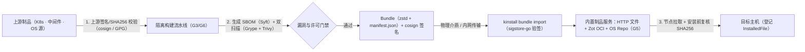

# 12 离线与供应链

> **本文定位**：定义 kinstall 离线交付与软件供应链安全的端到端体系，包括信任链、BOM 目录独立发布、上游制品校验、OS 依赖包闭包构建流水线、内置制品服务（HTTP + Zot + OS 软件源）、Bundle 构建器与增量补丁包、SBOM 与双扫描器漏洞门禁，以及全平台许可证合规汇总（A5）。
>
> **版本**：v1.1（S13/V，2026-11-26；v1.1 对齐 `D3 §1.2` BOM Schema、`manifest.json.sigstore.json`/`sm2sig`/`SHA256SUMS.parts`、`bundleType`、Harbor `v2.16.0` 及 Garage AGPL 红灯策略）。工具版本、K8s 补丁版本与安全事件截至 2026-11-26，引用前请复核。

## 1. 供应链总览与端到端信任链（G1、G2）



**信任链四道防线**：
1. **入库前校验**：所有上游二进制、镜像、Chart 必须经上游签名（K8s cosign 身份、OS RPM/DEB GPG）或上游官方 checksums + 多源比对验证；
2. **构建期门禁**：SBOM 生成、双扫描器漏洞阻断、许可证白名单检查；
3. **打包签名**：Bundle manifest（含全量文件 SHA-256 与镜像多架构 digest）经发布者 cosign 签名（支持在线 Keyless 与内网私钥模式）；
4. **落地复核**：导入时由 `sigstore-go v1.4.1` 验签，目标主机安装前由 `binary.install` / `file.sync` 再次比对 SHA-256 并写入 `InstalledFile`。

## 2. BOM 目录与独立发布（G8、ADR-057）

- **解耦设计（ADR-057）**：BOM 目录独立于 `kinstall` 二进制与插件版本发布，结构为 `<product>/bom-<version>-rev.<YYYY.MM.N>.yaml`（如 `kubernetes/bom-1.37-rev.2026.11.3.yaml`），可通过 `kinstall bom import` 独立导入；小版本安全补丁只需发布新 BOM revision 与增量补丁包，**无需升级平台主程序**。
- **BOM 必需字段**：`product`、`version`、`revision`、`minPlatformVersion`、`minPluginVersion`、`releasedAt`、`spec.binaries[].variants[]`（`arch`、`pageSizes`、`glibcMin`、`file`/URL、`sha256`、上游签名身份，ADR-028/068）+ `spec.imagesLock`（多架构 OCI digest 锁定，完整 Schema 见 `D3 §1.2`）。
- **上游补丁响应流程示例（待办：K8s `2026.12.1` BOM 复核）**：
  - 实查 `dl.k8s.io/release/stable-*.txt`（2026-11-26）：上游已发布 `v1.37.3`、`v1.36.7`、`v1.35.11`（`latest` 为 `v1.38.0-beta.0`）；当前 `04` 冻结的 BOM `2026.11.3` 仍指向 `1.37.2 / 1.36.6 / 1.35.10`。
  - 升级至下一 revision `2026.12.1` 的标准步骤（不直接改动本文档外已有定稿章节）：①核对 CVE 修复说明与 kubeadm `v1beta4` 是否有新参数差异；②更新 BOM YAML 与 `images.lock` digest；③运行 `05 §6.2` 模板 golden + kubeadm 基线 diff；④走 CI 补丁回归并签发增量补丁包（§7）。

## 3. 制品获取与上游签名校验

| 上游类型 | 校验方式 | 身份 / 密钥 |
| --- | --- | --- |
| Kubernetes 二进制 | `cosign verify-blob` | `krel-staging@k8s-releng-prod.iam.gserviceaccount.com`，OIDC `https://accounts.google.com` |
| Kubernetes 镜像 | `cosign verify` | `krel-trust@k8s-releng-prod.iam.gserviceaccount.com`，OIDC `https://accounts.google.com` |
| OS 官方软件包（RPM/DEB） | `rpm --checksig` / `gpgv` | 各发行版官方 GPG 公钥（内置指纹清单于 `spec/gpg-keys/`） |
| 中间件二进制 / Helm Chart | 官方 `.asc` PGP 签名或官方 Release `SHA256SUMS` + cosign | 无上游签名的开源二进制采用“双独立网络源下载比对 SHA-256 + kinstall 构建流水线背书签名” |

## 4. OS 依赖包闭包构建流水线（G3、R-SUP-04）🔬

> 设计已定稿，实际在全部 OS 容器与商业 ISO 上构建闭包需在流水线环境中实测（🔬）。

### 4.1 流水线流程（按 `spec/pkgmap.yaml` 驱动）

1. **输入**：目标 OS × 架构（取自 `spec/osmatch.yaml`）+ 目标插件的 `HostRequirements.Packages`（经 `spec/pkgmap.yaml` 解析为精确发行版包名，**自动排除 ADR-026 禁止的发行版容器包**）。
2. **在对应干净基础容器中计算依赖闭包**：
   - **RPM 族（Rocky / Alma / OL / openEuler / Anolis / Alinux）**：
     ```bash
     dnf install -y dnf-plugins-core createrepo_c
     dnf download --resolve --alldeps --destdir=/out/rpms <pkg_list>
     createrepo_c --checksum sha256 /out/rpms
     ```
     注：使用 `--alldeps` 而非默认忽略已装包，确保目标机最小化安装（minimal）亦不缺传递依赖；对已装基础包体积过大时可对比官方 minimal ISO 清单做差集裁剪。
   - **DEB 族（Ubuntu 22.04/24.04/26.04、Debian 12/13）**：
     ```bash
     # 在全新官方基础容器中仅下载不安装，精确拉取未包含在 minimal 镜像中的全部依赖
     apt-get update && apt-get install -y --download-only -o Dir::Cache::archives=/out/debs <pkg_list>
     dpkg-scanpackages /out/debs /dev/null | gzip -9c > /out/debs/Packages.gz
     # 或用 reprepro / aptly 生成带 Release + InRelease GPG 签名的规范 APT 源
     ```
   - **SUSE 族（openSUSE Leap 15.6 / 16）**：`zypper --pkg-cache-dir /out/rpms install --download-only -y <pkg_list>` + `createrepo_c`。
3. **商业信创 OS（麒麟 Kylin V10/V11、统信 UOS V20/V25）**：因无公网全量源，采用**客户授权 ISO 导入模式**：管理员提供官方安装 ISO / 补丁包 → 流水线挂载 ISO 为本地源 → 在对应 ISO 提取的 chroot/容器中执行相同闭包提取与签名，产出专属离线 repo。
4. **离线仓库签名与洁净验证**：所有自建 RPM/DEB 仓库使用平台仓库 GPG 密钥签名（`repomd.xml.asc` / `InRelease`）；随后启动一个**完全断网（`--network=none`）的全新同版本容器**，只挂载该本地源执行安装验证，全部安装成功方可通过门禁。

## 5. 内置制品服务（G5）

部署机在 `kinstall bundle serve` 或 Server 模式下内置三项轻量服务（均为单进程/低资源，无需外网）：

| 服务 | 实现 | 端口（默认） | 说明 |
| --- | --- | ---: | --- |
| HTTP 二进制与 OS 软件源服务 | Go `net/http`（支持 Range 断点续传、ETag、只读静态目录） | `18080` | 分发 K8s/中间件二进制、OS RPM/DEB 仓库、制品校验清单 |
| 内置 OCI 镜像仓库 | **Zot `v2.1.23`**（CNCF，Apache-2.0，单二进制） | `15000` | 原生 OCI Image Layout、多架构 Index、内容去重（dedupe）、GC、TLS + htpasswd 认证 |
| 外部仓库对接（Server HA 模式） | 客户已有 Harbor（`v2.16.0`，与 `D3`/`P8` 对齐）/ Nexus / Artifactory | 客户配置 | HA 模式下不依赖单机内置服务，改为通过 `oras-go/v3` 与 `go-containerregistry` 推送至外部仓库，平台仅保存元数据（`02 §8`） |

**内置 Zot `config.json` 关键片段**：

```json
{
  "storage": {
    "rootDirectory": "/var/lib/kinstall/registry",
    "dedupe": true,
    "gc": true,
    "gcDelay": "24h",
    "gcInterval": "24h"
  },
  "http": {
    "address": "0.0.0.0",
    "port": "15000",
    "tls": { "cert": "/etc/kinstall/registry/tls.crt", "key": "/etc/kinstall/registry/tls.key" },
    "auth": { "htpasswd": { "path": "/etc/kinstall/registry/htpasswd" } }
  }
}
```

## 6. Bundle 构建器与体积治理（G6）

### 6.1 Bundle 目录结构

```text
kinstall-bundle-k8s-1.37.2-amd64-rocky9.tar.zst
├── manifest.json               # Bundle 元数据：BOM revision、平台最低版本、目标 arch/os、全量文件 sha256 与大小
├── manifest.json.sigstore.json # cosign / sigstore-go 签名束（含公钥指纹或私有 TSA 证明，与 D3 §1.3 对齐）
├── manifest.json.sm2sig        # 国密密评模式 SM2 签名（可选，D3 §1.3）
├── SHA256SUMS.parts            # --split-size 分卷校验清单（可选，D3 §6.2）
├── sbom.spdx.json              # 全量制品合并 SBOM
├── NOTICE                      # 全部包含组件的开源许可证汇总
├── boms/                       # BOM YAML 与 images.lock
├── binaries/<component>/<ver>/<arch[-4k|-64k]>/
├── runtimes/{jdk,maven,node}/<ver>/<arch>/   # 共享底座运行时（D3 §4）
├── closures/{jenkins,neo4j,sonarqube,fonts}/ # 离线扩展闭包（D3 §4.3）
├── charts/<name>-<ver>.tgz
├── images/                     # 标准 OCI Image Layout（blobs/sha256 层全局去重 + index.json 多架构索引）
└── repos/<os-id>-<ver>-<arch>/ # 已签名的 RPM/DEB 离线软件源
```

### 6.2 裁剪、压缩与命令

- **按需裁剪**：`kinstall bundle build --bom k8s@1.37.2 --arch amd64,arm64 --os rocky9,kylin11 --cni calico --csi local-path,nfs --addons metrics-server,coredns --output bundle.tar.zst`；未选中的 CNI / CSI / Addon 与非目标架构层自动剔除。
- **去重与压缩**：镜像层在同一 OCI layout 的 `blobs/sha256` 下天然去重；整体使用 `klauspost/compress` **zstd（level 6）**，支持 `--split-size 2G` 分卷（适应光盘/网闸单文件大小上限），受 `02 §1.4` 体积预算约束（单架构+单 OS ≤ 3 GiB；双架构+3 OS ≤ 8 GiB）。
- **管理命令**：`bundle build` / `bundle verify` / `bundle import` / `bundle list` / `bundle prune`（按引用计数安全清理未使用的旧镜像层与二进制）。

## 7. 增量包与补丁包（G7）

- **生成机制**：`kinstall bundle diff --base manifest-2026.11.3.json --target manifest-2026.12.1.json --output patch-1.37.2-to-1.37.3.tar.zst`，仅打包新增或 SHA-256 变化的二进制、OCI blob 层与 OS 包，并在 `manifest.json` 声明 `baseRevision` 与 `bundleType: incremental`（与 `D3 §6.2` 一致）；通常 K8s 补丁增量包体积仅 200–400 MiB（相比全量 3 GiB 缩减 ~90%）。
- **导入顺序与幂等**：`kinstall bundle import` 校验 `baseRevision` 已存在于本地制品库（缺失则阻断并提示先导入基线包）；支持链式增量；若新补丁包导入后验证异常，因旧版本二进制目录与镜像 digest 均被保留，可随时通过 BOM 切回原 revision 零损耗回滚。

## 8. SBOM 与双扫描器漏洞门禁（G4、R-SUP-05、ADR-058）

### 8.1 2026-03 Trivy 供应链投毒事件与架构反思

- **事实核实**：2026-03-01 Trivy GitHub 仓库遭被盗 PAT 擦除；2026-03-19 攻击者发布投毒版本 `v0.69.4` 及恶意 `trivy-action` / `setup-trivy`（且 2026-03-22 Docker Hub 出现恶意 `0.69.5` / `0.69.6` 镜像，`:latest` 受污染）。
- **工程教训**：安全扫描器本身是高权限 CI 供应链攻击面，**绝不可单点信任单一扫描器或使用浮动标签**。

### 8.2 kinstall SBOM 与漏洞治理决策（ADR-058）

| 环节 | 工具与版本（2026-11） | 策略 |
| --- | --- | --- |
| **SBOM 生成（一等产物）** | **Syft `v1.57.2`**（2026-11-16，Apache-2.0） | 对 `kinstall` 二进制、插件、每个 OCI 镜像与离线 OS 仓库生成 **SPDX 2.3 JSON**（兼出 CycloneDX 1.6），随 Release 与 Bundle 交付 |
| **主漏洞扫描（SBOM-first）** | **Grype `v0.122.1`**（2026-11-18，Apache-2.0） | 直接扫描 Syft 产出的 SBOM（新 CVE 出现时可离线重扫已存 SBOM，无需重拉镜像） |
| **独立交叉扫描（可选双引擎）** | **Trivy `v0.76.2`**（2026-11-05，Apache-2.0） | 仅在**无出网隔离容器**中运行，镜像与二进制按精确 **SHA-256 / OCI digest 固定**（严禁 `:latest` 或未经 SHA 固定的 GitHub Action）；与 Grype 结果交叉比对降低漏报 |
| **Go 可达性扫描** | `govulncheck` | 过滤不可达传递依赖漏洞 |
| **离线漏洞库更新** | Grype DB / Trivy DB 均以 OCI Artifact 打包导入内网 | 内网支持定期导入漏洞库增量包重新评估已部署集群风险 |
| **门禁与 VEX** | OpenVEX 文档随 BOM 发布 | **Critical 可达漏洞阻断发布**；误报或不可利用项须由安全评审签发 VEX 豁免记录并设复审到期日 |

## 9. 全平台许可证合规汇总（A5、ADR-059）

| 层级 | 组件 | 许可证 | 链接 / 交付形态 | 合规与再分发义务 |
| --- | --- | --- | --- | --- |
| **平台 Go 二进制** | `kinstall` 及全部 `go.mod` 依赖 | Apache-2.0 / MIT / BSD / ISC / MPL-2.0 | 静态编译进单二进制 | **白名单强制**：CI 用 `go-licenses` 禁止任何 GPL / AGPL / SSPL / ELv2 依赖进入主二进制；自动生成 `NOTICE` |
| **K8s 核心生态** | Kubernetes、etcd、containerd、runc、CoreDNS、Calico、Cilium、Flannel、Kube-OVN、Helm、Zot、Longhorn、Rook、Envoy Gateway、Headlamp | Apache-2.0 | 独立二进制 / OCI 镜像 | 保留版权与 LICENSE / NOTICE |
| **OS 依赖包** | `iptables`、`nftables`、`conntrack`、`chrony`、`ipvsadm`、`haproxy` 等 | GPLv2 / GPLv3 / LGPL | 独立 OS 包（离线 repo） | 原样再分发；Bundle `NOTICE` 附上游源码仓库 / SRPM 获取指引 |
| **Valkey** | Valkey 9.x / 8.1 | BSD-3-Clause | 独立二进制 | 保留版权声明 |
| **Redis 8（可选）** | Redis 8.x | RSALv2 / SSPLv1 / AGPLv3 | 客户显式勾选 | 默认不打入公共 Bundle；客户选择时提示三选一许可与 AGPL 源码义务 |
| **PostgreSQL 生态** | PostgreSQL、Patroni、pgBackRest、PgBouncer、CNPG | PostgreSQL / MIT / ISC / Apache-2.0 | 独立包 / 镜像 | 保留版权声明 |
| **MySQL 生态** | MySQL Community、Percona Server、XtraBackup | GPLv2 | 独立 `tar.xz` | 原样再分发，Bundle `NOTICE` 附对应版本源码下载链接与书面 Offer |
| **OpenSearch** | OpenSearch 3.x / 2.19、Operator 3.0 | Apache-2.0 | 独立 `tar.gz` / 镜像 | 保留版权与 NOTICE |
| **Elasticsearch（可选）** | ES 9.x / 8.19、ECK 3.5 | ELv2 / SSPL / AGPLv3 | **不入公共 Bundle** | 客户自行按 BOM URL 拉取并遵守 ELv2（ADR-052） |
| **对象存储** | SeaweedFS 4.54 / RustFS 1.0.6（Apache-2.0）；Ceph RGW（LGPL）；Garage v2.5（AGPLv3） | Apache-2.0 / LGPL / AGPLv3 | 独立二进制 / 镜像（Garage 🔴 不入公共包） | 默认 SeaweedFS 无 Copyleft；Garage（AGPLv3）不随公共离线包分发，客户侧按需构建（`D3 §6.3` 红灯层级，ADR-059） |
| **参考仓库** | `cby-chen/Kubernetes` | GPL-3.0 | **仅设计参考，零代码/文本复用** | 严格隔离，不复制任何脚本或段落 |

## 10. 供应链安全基线（SLSA）

- **目标等级**：`kinstall` 自身发布达到 **SLSA Build Level 3**（托管 CI 隔离构建、不可篡改 provenance 证明、`cosign attest` 绑定二进制摘要）。
- **可复现构建**：固定 Go 工具链、`CGO_ENABLED=0`、`-trimpath -buildvcs=false`、固定 `SOURCE_DATE_EPOCH`，确保同源码同环境产出一致哈希。
- **签名密钥管理**：线上发布优先 OIDC Keyless + Rekor 透明日志；企业内网离线构建使用硬件 HSM 或 OpenBao Transit 托管离线签名私钥，严禁私钥明文落 CI 变量。

## 11. 风险与待办

- 商业信创 OS（麒麟 / UOS）依赖包闭包只能依托客户授权 ISO 实测构建（G3 仍留 🔬）；
- 内网环境漏洞库同步频率低时易遗漏零日 CVE，需建立离线 `grype-db` 月度同步 SOP。

## 12. 参考来源

- [Kubernetes Verify Signed Artifacts](https://kubernetes.io/docs/tasks/tools/verify-signed-artifacts/)
- [Zot OCI Registry v2.1.23](https://github.com/project-zot/zot)
- [Anchore Syft v1.57.2 & Grype v0.122.1](https://github.com/anchore/syft)
- [2026-03 Trivy 供应链投毒事件复盘与双扫描器实践](https://www.stephane-robert.info/en/post/trivy-compromised-second-time-poisoned-release/)
- [Trivy vs Grype SBOM-first 工作流（2026-09）](https://devsecops.ae/trivy-vs-grype/)

## 附 A. 本文涉及的决策与清单映射

- **新增 ADR**：
  - **ADR-057**：BOM 目录按 `<product>/bom-<ver>-rev.<YYYY.MM.N>.yaml` 独立发布与签名，与平台/插件版本解耦；补丁升级通过新 BOM revision + 增量补丁包完成（12 §2、§7）。
  - **ADR-058**：吸取 2026-03 Trivy `v0.69.4` 供应链投毒教训，SBOM 与漏洞门禁采用 **Syft v1.57.2（SPDX）+ Grype v0.122.1（SBOM-first 主门禁）**，Trivy `v0.76.2` 仅在无出网隔离容器中按精确 SHA-256 固定作为独立交叉复核；Critical 可达漏洞阻断发布（12 §8）。
  - **ADR-059**：许可证分级治理——主程序 Go 依赖仅允许宽松许可（`go-licenses` CI 门禁，禁止 GPL/AGPL/SSPL/ELv2）；GPLv2/LGPL 独立制品（MySQL/OS 包）原样分发并在 `NOTICE` 提供源码指引；ELv2/SSPL/RSAL 组件（ES/Redis 8）不打入公共离线包（12 §9）。
- **关闭设计项**：A5、G3（设计完成，实测保留 🔬）、G4、G5、G6、G7、G8。
- **关闭调研项**：R-SUP-04（方案完成，商业 ISO 实测 🔬）、R-SUP-05。
- **新增交叉跟踪**：K8s 上游补丁 `1.37.3 / 1.36.7 / 1.35.11` 已登记待下一 BOM revision `2026.12.1` 更新（见 `00 §7`）。
