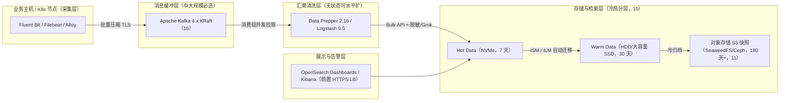

# 15 插件设计：ELK / OpenSearch 日志分析全栈

> **本文定位**：将「10 插件设计：Elasticsearch / OpenSearch」从单一搜索引擎内核扩展为**企业级完整日志采集、缓冲、清洗、存储与可视化全栈方案**，覆盖 **OpenSearch 全栈（默认，纯 Apache-2.0）** 与 **Elastic Stack / ELK 9.5（可选）**，支持 **`host-binary`（二进制 + systemd）、`host-container`（Docker Compose v5）与 `kubernetes`（Operator）** 三种部署形态，跨 `amd64` / `arm64`。通用约定遵循「06 中间件插件通用规范」，复合栈编排依托「02 / 18 `Stack` 模型」。
>
> **版本**：v1.1（S16/V，2026-11-26；v1.1 对齐 Kafka 默认 `4.3.2`、Filebeat 仅路线 B 客户自备遵循 ADR-043、`elk-pipeline` Stack 规范及 `P3` 分域 Topic 清单）。版本号与许可信息截至 2026-11-26，引用前请复核。

## 1. 定位、全栈架构与选型结论（F11、R-MW-08、ADR-071 / ADR-072）

### 1.1 两套全栈路线对照（ADR-071）

企业口中的 “ELK” 在 2026 年实际对应两条完全不同的许可与工程路线，kinstall 通过**统一 `logging-stack` 组合栈（Stack）**同时支持，并以 **OpenSearch Stack 为默认**：

| 层级 | **路线 A：OpenSearch Stack（默认，纯开源）** | **路线 B：Elastic Stack / ELK（可选）** |
| --- | --- | --- |
| **边缘采集层** | **Fluent Bit**（默认，Apache-2.0）或 **Grafana Alloy `v1.22.0`** / **Vector**（MPL-2.0） | **Fluent Bit**（推荐）或客户自备 **Filebeat `9.5.7` / Elastic Agent**（ADR-043 禁默认打包 Filebeat，平台仅渲染配置） |
| **削峰缓冲层**（中大规模必选） | **Apache Kafka `4.3.2`（默认）/ `4.4.0`（可选）（KRaft）**（ADR-073，详见 `16`） | 同左（强烈建议 > 500 GB/日 日志引入 Kafka 削峰防丢） |
| **汇聚清洗层** | **OpenSearch Data Prepper `2.16.x`**（Apache-2.0，支持 OTel / Kafka / Grok / 脱敏 / 路由）或 **Logstash OSS `9.5.7`** | **Logstash `9.5.7`**（ELv2 / OSS Apache-2.0，成熟插件生态） |
| **存储与检索层** | **OpenSearch `3.10.0`**（Apache-2.0，免费安全/RBAC/告警/ISM，`10`） | **Elasticsearch `9.5.7`**（或 `8.19.26`，ELv2 / SSPL / AGPLv3，`10`） |
| **可视化与控制台** | **OpenSearch Dashboards `3.10.0`**（Apache-2.0） | **Kibana `9.5.7`**（ELv2，含 Fleet Server 管理 Elastic Agent） |
| **合规与离线打包** | **全部组件 Apache-2.0 / MIT / MPL-2.0，可直接打入 kinstall 公共离线包** | ES / Kibana / Elastic Agent 属 ELv2，不打入公共离线包，由客户按 BOM URL 自行拉取（ADR-052） |

### 1.2 推荐生产分层数据流



## 2. 版本、许可与 BOM（截至 2026-11-26）

| 组件 | 版本 | 发布日期 | 许可证 | 架构与运行依赖 |
| --- | --- | --- | --- | --- |
| OpenSearch / Dashboards | `3.10.0` | 2026-11-17 | Apache-2.0 | `amd64` / `arm64`（自带 JDK 21 / Node.js，零宿主依赖） |
| OpenSearch Data Prepper | `2.16.x`（tar.gz 含 `jdk` 包） | 2026-07+ | Apache-2.0 | `amd64` / `arm64`（选 `-jdk-` 自带 JDK 发行包） |
| Elastic Stack（ES / Logstash / Kibana / Filebeat / Elastic Agent） | `9.5.7` | 2026-11-23 | ELv2（Logstash OSS / Filebeat OSS 为 Apache-2.0） | `amd64` / `arm64`（ES / Logstash 自带 JDK；Kibana 自带 Node.js） |
| Fluent Bit | `3.x / 4.x` 稳定版 | 持续维护 | Apache-2.0 | `amd64` / `arm64`（极低内存 ~30 MiB） |
| Grafana Alloy | `v1.22.0` | 2026-11-13 | Apache-2.0 | `amd64` / `arm64`（Go 单二进制） |

## 3. 拓扑分级与容量规格建议（ADR-072）

| 规模档位 | 日增原始日志量 | 推荐拓扑 | 角色部署规划 |
| --- | --- | --- | --- |
| **小型（PoC / 边缘）** | < 50 GB / 日 | `all-in-one-lite`（免 Kafka、免独立清洗） | 1–3 台节点：Fluent Bit（或 Alloy）直写 OpenSearch（内置 Ingest Pipeline 简单解析）+ 1 台 Dashboards；支持 **Docker Compose 一键交付** |
| **中型（标准生产）** | 50 GB – 500 GB / 日 | `standard-etl` | 3 台融合 OpenSearch/ES（16C/64G/NVMe）+ 2 台 Data Prepper / Logstash（8C/16G）+ 2 台 Dashboards / Kibana（4C/8G）；可选引入 3 节点 Kafka |
| **大型（核心平台 / 等保集中审计）** | 500 GB – 5 TB+ / 日 | `enterprise-buffered`（**强制 Kafka 削峰 + 冷热分离**） | 3 台独立 `cluster_manager/master`（4C/8G）+ ≥ 3 台 `data_hot`（16C/64G/NVMe，留 7 天）+ ≥ 3 台 `data_warm`（8C/32G/大容量盘，留 30–90 天）+ 3–6 台 Kafka Broker + 3–6 台 Data Prepper/Logstash + 2 台 Dashboards/Kibana + S3 快照仓库（留存 ≥ 180 天满足等保） |

**存储容量估算公式**：
$$\text{有效盘容量} \approx \text{日增原始日志} \times \text{保留天数} \times (1 + \text{副本数}) \times \text{索引膨胀系数}(0.8\sim 1.2) \div 0.75\text{（水位上限）}$$
例如 200 GB/日 × 30 天 × 2（1 副本）× 1.0 ÷ 0.75 ≈ **16 TB 净容量**。

## 4. 三种部署形态对比与选型（`host-binary` / `host-container` / `kubernetes`）

| 形态 | 适用场景 | 实现细节 |
| --- | --- | --- |
| **`host-binary`**（二进制 + systemd） | 大规模生产核心存储节点（`data_hot`/`data_warm`）、物理 NVMe 直通、无 Docker 审批环境 | 全部选用官方自带 JDK/Node 的 `tar.gz` 装入 `/opt/kinstall/bin/<comp>/<ver>/`，零宿主机环境污染；unit 名 `kinstall-logstash-<inst>.service`、`kinstall-dataprepper-<inst>.service`、`kinstall-kibana-<inst>.service` |
| **`host-container`**（Docker Engine 29.10 + Compose v5.8） | 中小型交付、边缘站点、老旧 OS（glibc < 2.28 无法直跑官方二进制）、快速标准化交付 | 平台将完整多架构 OCI 镜像（amd64/arm64）导入本机 Docker，渲染 `docker-compose.yml`（绑定宿主机 XFS `/data` 卷、限制 `mem_limit`/`ulimits.nofile/memlock`、固定 `network_mode: host` 或独立子网）并由 systemd `kinstall-compose-<inst>.service` 守护（详见 `06 §2`、`18 §2`） |
| **`kubernetes`**（Operator） | 已有生产 K8s + 高性能块/本地 NVMe CSI | OpenSearch 全栈用 **OpenSearch K8s Operator 3.0 GA**（含 Dashboards CRD）+ Data Prepper Helm + Fluent Bit DaemonSet；ELK 用 **ECK 3.5.0**（原生统一管理 `Elasticsearch` + `Kibana` + `Logstash` + `Agent` 四个 CRD！） |

## 5. 主机要求与容量声明

- **存储节点**：应用 `base` + `search` Profile（`vm.max_map_count = 1048576`、swap 关闭、`LimitMEMLOCK=infinity`，详见 `10 §5`）。
- **清洗节点（Logstash / Data Prepper）**：应用 `base` Profile；独立 SSD 挂载 `/data/logstash/<inst>/queue` 供**持久化队列（Persistent Queue）**使用，防止下游抖动丢日志；端口放行 Beats `5044`、OTLP/HTTP `21890`/`2021`、监控 API `9600`/`4900`。
- **可视化节点（Kibana / Dashboards）**：端口 `5601`（HTTPS）；需配置高可用反代（Nginx/HAProxy）并共享加密密钥（`xpack.security.encryptionKey` / `opensearch_security.cookie.password` 从 `SecretStore` 统一注入，防止多副本登录态失效）。

## 6. 全栈安装编排（`Stack` 依赖 Pipeline）

当用户提交 `apiVersion: kinstall.io/v1alpha1`、`kind: Stack`（组合 `object-storage` + `kafka` + `opensearch` + `elk-pipeline` 实例，见 `D2 §4.1` / `P3 §4`）时，Planner 自动展开跨组件 DAG：

| 阶段 | 组件 | 关键动作与输出传递 |
| :---: | --- | --- |
| Phase 1 | 共享基础设施 | 创建统一 `logging-ca`（或各实例独立 CA 互信信任链），校验全部主机 Profile 与端口 `Claims` |
| Phase 2 | 存储内核（`10`） | 部署 OpenSearch 3.10 或 ES 9.5 集群；初始化专用写入角色（`log_writer`，仅授目标数据流 `create_doc`/`auto_configure`）与只读/审计角色；自动注入 **ISM / ILM 热温冷策略**与索引模板（按天/按 50 GB Rollover） |
| Phase 3 | 缓冲层（可选，`16`） | 若启用 Kafka 削峰，部署或绑定已有 Kafka 4.x 实例，自动创建分域 Topic：`logs-audit-critical`（RF=3，留 7d）、`logs-app-biz`（RF=3，留 48h）、`logs-access-edge`（RF=3，留 24h，策略见 `P3 §3.1`）与 SCRAM 凭据 |
| Phase 4 | 清洗层 | 部署 Data Prepper 2.16 或 Logstash 9.5；模板自动注入 Kafka bootstrap、OpenSearch/ES 端点、CA 证书与 `{{ secret "log-writer" }}`；启用持久化磁盘队列防丢数；等待健康端口 200 |
| Phase 5 | 可视化层 | 部署 OpenSearch Dashboards / Kibana（HTTPS + 统一 session 加密密钥 + 对接 OIDC），自动导入预置索引模式与大盘模板 |
| Phase 6 | 采集层下发 | 向目标业务主机 / K8s 节点批量下发 Fluent Bit / Alloy 配置（Filebeat 仅路线 B，由客户自行提供二进制，kinstall 仅渲染配置，ADR-043）（支持多行合并 Java 异常栈、JSON 解析、脱敏过滤、TLS 认证与限速防打满宿主机 I/O） |
| Phase 7 | 端到端链路验收 | 在测试机写入带唯一 `trace_token` 的探针日志 → 15 s 内从 OpenSearch / ES 查询检索到该记录 → 验证 Kibana/Dashboards 200 → 登记 `InstalledFile` |

## 7. 关键配置模板与背压调优

### 7.1 Logstash 持久化队列与 JVM（`logstash.yml` + `pipelines.yml`）

```yaml
# /etc/kinstall/logstash/<inst>/logstash.yml
node.name: {{ .Host.Name }}
path.data: /data/logstash/{{ .Instance.Name }}/data
queue.type: persisted                        # 生产强制持久化队列，防 OOM/重启丢日志
path.queue: /data/logstash/{{ .Instance.Name }}/queue
queue.max_bytes: 20gb
queue.checkpoint.writes: 1024
pipeline.workers: {{ .Host.CPU }}
pipeline.batch.size: 1000
pipeline.batch.delay: 50
api.http.host: 127.0.0.1
api.http.port: 9600
```

- **Logstash JVM 堆**：`min(floor(HostMemGB × 0.5), 8 GiB)`（Logstash 并非堆越大越好，堆过大反而增加 GC 停顿；高吞吐优先水平增加无状态 Logstash 实例）。
- **Data Prepper**：默认自带 OpenTelemetry OTLP（traces/logs/metrics）+ Kafka Source + Grok/Mutate/Anonymize 处理器 + OpenSearch Sink（启用 `dlq` 死信写 S3 桶防单条畸形日志阻塞整条管道）。

### 7.2 采集器防自伤护栏（Fluent Bit / Alloy 必配）

- **内存与 CPU 硬限**：systemd `MemoryMax=512M`、`CPUQuota=50%`（防止业务突发打爆日志把宿主机拖死）；
- **磁盘缓冲区**：Fluent Bit `storage.type filesystem` + `storage.max_chunks_up 128` + `storage.total_limit_size 5G`；
- **Java 异常栈多行合并**：默认预置 `multiline` 规则避免堆栈被拆碎成几十条碎片文档。

## 8. 安全、脱敏与等保审计

- **全链路 TLS**：采集器 → Kafka → Data Prepper/Logstash → OpenSearch/ES → Dashboards/Kibana 全程 TLS 1.2/1.3，禁止明文 HTTP 9200 暴露到业务网段。
- **日志敏感字段自动脱敏**：清洗层默认提供可勾选脱敏处理器（身份证号、手机号、银行卡、Bearer Token、密码字段正则掩码），满足《数据安全法》与等保隐私要求。
- **审计留存 ≥ 180 天**：通过 ISM/ILM 自动 7 天热盘 → 30 天温盘 → S3 Object Lock 快照归档 ≥ 180 天，衔接 `13 §3` 等保三级审计要求。

## 9. 监控、运维与告警规则

- **采集器与管道关键指标**：Fluent Bit `/api/v1/metrics/prometheus`（dropped chunks、retry 次数）；Logstash `:9600/_node/stats`（经 `logstash_exporter` 或 Prometheus scrape）；Data Prepper `:4900/metrics/prometheus`（buffer 使用率、DLQ 计数）；存储层告警复用 `10 §10`。
- **关键管道告警**：

```yaml
groups:
  - name: kinstall.elk_pipeline
    rules:
      - alert: LogPipelineQueueNearlyFull
        expr: logstash_node_queue_events_size_in_bytes / logstash_node_queue_max_size_in_bytes > 0.80
        for: 5m
        labels: { severity: warning }
      - alert: LogCollectorDroppedRecords
        expr: increase(fluentbit_output_dropped_records_total[5m]) > 0
        for: 2m
        labels: { severity: critical }
      - alert: LogDashboardDown
        expr: probe_success{job=~"kinstall-dashboards.*"} == 0
        for: 2m
        labels: { severity: critical }
```

- **滚动升级顺序（硬性铁律）**：**先存储层（OpenSearch / ES）→ 再可视化层（Dashboards / Kibana）→ 再清洗层（Data Prepper / Logstash）→ 最后边缘采集器（Fluent Bit / Filebeat）**，且 Elastic Stack 要求各组件 minor 版本严格对齐（如统一 `9.5.7`）。

## 10. 测试与验收

1. **端到端日志闭环**：在 `host-binary` 与 `host-container`（Docker Compose）两种形态下分别跑通 7 阶段安装，验证探针日志 15 s 内可查且异常栈多行合并正确；
2. **下游故障防丢测试**：停掉 OpenSearch 写入节点 5 分钟期间持续以 2,000 EPS 造日志 → 恢复后核对 Kafka 积压与 Logstash/Data Prepper 持久化队列消费归零，零丢数；
3. **ISM/ILM 滚动与归档**：缩短 Rollover 阈值为 10 MiB 验证自动切分索引与 S3 快照。

## 11. 参考来源

- [Elastic Stack 9.5.7 Past Releases（2026-11-23）](https://www.elastic.co/downloads/past-releases)
- [OpenSearch 3.10.0 & Data Prepper 2.16](https://opensearch.org/downloads/)
- [Fluent Bit & Grafana Alloy 日志管道](https://www.parseable.com/blog/log-aggregation-tools)

## 附 A. 本文涉及的决策与清单映射

- **新增 ADR**：
  - **ADR-071**：日志全栈插件采用双路线统一 `Stack` 抽象——默认 **OpenSearch 全栈（Fluent Bit + 可选 Kafka + Data Prepper 2.16 + OpenSearch 3.10 + Dashboards，全 Apache-2.0 可直接入公共离线包）**，可选 **Elastic Stack / ELK 9.5（Filebeat/Elastic Agent + Logstash + ES + Kibana，客户侧合规拉取）**（15 §1）。
  - **ADR-072**：日志全栈按日增量分三档（<50 GB 免缓冲直写、50–500 GB 标准清洗、>500 GB 强制 Kafka 削峰 + 热温冷分层 + S3 180 天归档）；清洗层强制启用持久化磁盘队列防丢数，边缘采集器强制配资源硬限防拖垮业务主机（15 §3、§7）。
- **新增并关闭设计项**：F11。
- **新增并关闭调研项**：R-MW-08。
