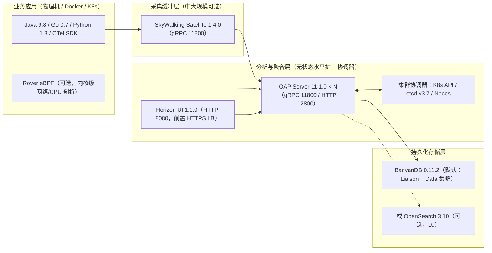

# 17 插件设计：Apache SkyWalking APM（分布式链路与可观测）

> **本文定位**：kinstall Apache SkyWalking APM 平台插件设计，涵盖 **SkyWalking APM 11.1.0 + Horizon UI 1.1.0 + BanyanDB 0.11.2（原生默认存储）/ OpenSearch 3.10（可选存储）+ Satellite 1.4.0 + 多语言 Agent（Java/Go/Python/eBPF Rover）离线包分发**，支持 `host-binary`、`host-container`（Docker Compose v5）与 `kubernetes`（SWCK 0.11.0 / Helm 5.0.0）三种形态，跨 `amd64` / `arm64`。通用约定遵循「06 中间件插件通用规范」。
>
> **版本**：v1.1（S16/V，2026-11-26；v1.1 对齐 `D3 §4.1` 共享 JDK 路径、`06 §1.1` 二进制与数据目录、SWCK Pod/Namespace 标签、`P7` 采样与 Agent 目录）。全部子项目版本均于 2026-11-26 从 Apache SkyWalking 官方发布页核实。

## 1. 定位与结论摘要（F12、R-MW-09、ADR-075 / ADR-076）

- **版本基线（截至 2026-11-26，全 Apache-2.0）**：
  - **SkyWalking OAP Server**：**`11.1.0`**（2026-11-06 发布；11.0 起正式以新一代 **Horizon UI `1.1.0`** 替代旧 Booster UI，原生增强 BanyanDB 尾部采样与 AI/云原生观测）；保守兼容线 `10.4.0`；
  - **默认存储引擎决策（ADR-075）**：**默认采用 SkyWalking 原生自研数据库 BanyanDB `0.11.2`**（2026-11-08 发布，Go 语言单二进制，Apache-2.0），**OpenSearch `3.10.0`（复用 `10`）作为可选**（适用于客户已建大规模 OpenSearch/ES 且希望统一存储团队运维的场景），**PostgreSQL 仅用于开发/极小流量**。
    - *选 BanyanDB 的硬理由*：BanyanDB 专为 APM 指标/链路/日志设计，无 JVM GC 抖动，同等吞吐下**内存与磁盘占用仅约 Elasticsearch 的 1/5**，原生支持 11.x 尾部采样与冷热生命周期，且纯 Go 原生编译完美支持 `amd64` / `arm64`（含 64K 页）。
  - **可选采集网关**：高并发或跨集群/跨机房上报时启用 **SkyWalking Satellite `1.4.0`**（2026-11-12，Go 单二进制，承担 gRPC 负载均衡、本地磁盘缓冲防丢与协议聚合）；
  - **多语言 Agent 离线托管（ADR-076）**：kinstall 不仅安装服务端，还将 **Java Agent `9.8.0`**、**Go Agent `0.7.0`**、**Python `1.3.0`**、**NodeJS `0.9.0`** 与 **Rover eBPF `v0.7.0`** 纳入 BOM 并通过内置制品 HTTP 服务（`12 §5`）离线分发，支持向业务宿主/K8s（经 SWCK Java Agent 自动注入）下发统一探针配置！

## 2. 版本、许可与 BOM（截至 2026-11-26）

| 组件 | 版本 | 发布日期 | 许可证 | 语言 / 架构 |
| --- | --- | --- | --- | --- |
| Apache SkyWalking APM（OAP） | `11.1.0`（可选 GraalVM Distro `0.5.0` 低内存版） | 2026-11-06 | Apache-2.0 | Java（随包 OpenJDK 21，amd64/arm64） |
| SkyWalking Horizon UI | `1.1.0` | 2026-11-06 | Apache-2.0 | 随 APM 或独立镜像（amd64/arm64） |
| **SkyWalking BanyanDB**（默认存储） | `0.11.2` | 2026-11-08 | Apache-2.0 | **Go 单二进制**（amd64/arm64，4K/64K 页兼容） |
| SkyWalking Satellite（可选网关） | `1.4.0` | 2026-11-12 | Apache-2.0 | **Go 单二进制**（amd64/arm64） |
| SkyWalking Java Agent | `9.8.0` | 2026-10-08 | Apache-2.0 | 字节码无侵入探针（ZIP） |
| SkyWalking Go Agent | `0.7.0` | 2026-07-30 | Apache-2.0 | 编译期自动插桩工具 |
| SkyWalking Python / NodeJS | `1.3.0` / `0.9.0` | 2026-08 / 06 | Apache-2.0 | 离线 wheel / npm tgz |
| SkyWalking Rover（eBPF Profiler） | `v0.7.0` | 2024-10（维护较缓，仅按需启用） | Apache-2.0 | Go + eBPF（需内核 ≥ 5.10 + BTF） |
| **SWCK Operator / Helm Chart** | SWCK `0.11.0` / Helm `5.0.0` / BanyanDB Helm `0.7.0` | 2026-09-01 | Apache-2.0 | K8s 部署（amd64/arm64） |

## 3. 架构、集群协调与拓扑规划



| 拓扑 | 角色与节点数 | 集群协调器 | 适用场景与规格 |
| --- | --- | --- | --- |
| `standalone` | 1 台（OAP + Horizon UI + BanyanDB standalone） | `standalone` | 开发/测试/小团队（< 20 服务，4C/8 GiB/100 GiB SSD） |
| `ha-standard` | 2–3 台 OAP（8C/16 GiB）+ 2 台 Horizon UI + 3 节点 BanyanDB 集群（`liaison` + `data` + 内置/复用 `etcd v3.7.4`） | **`etcd`（`host` 模式默认，复用 kinstall etcd 编排）** | **中型生产默认**（20–200 微服务，万级 Span/s） |
| `enterprise-satellite` | 2–4 台 Satellite（4C/8 GiB）+ 3–6 台 OAP（按 `receiver` 与 `aggregator` 角色拆分）+ 独立 BanyanDB 集群（Liaison × 2 + Data × 3+，冷热分层）+ 可选 Kafka 异步传输 | `kubernetes`（K8s 模式）或 `etcd`（host 模式） | 大规模核心生产（> 200 微服务、十万级 Span/s，支持动态尾部采样） |

## 4. 三种部署形态对比

- **`host-binary`（二进制 + systemd）**：OAP 11.1.0 装入 `/opt/kinstall/bin/skywalking/11.1.0/` 并复用底座共享 JDK `/opt/kinstall/runtimes/jdk/temurin-21.0.10-<cpu>/`（`D3 §4.1`，组件目录不重复打包 JDK）；BanyanDB 与 Satellite 按 `06 §1.1` 分别装入 `/opt/kinstall/bin/banyandb/0.11.2/` 与 `/opt/kinstall/bin/skywalking-satellite/1.4.0/`；unit 命名 `kinstall-skywalking-<inst>-{oap,ui,banyandb,satellite}.service`。
- **`host-container`（Docker Engine 29.10 + Compose v5.8）**：使用官方多架构镜像 `apache/skywalking-oap-server:11.1.0`、`apache/skywalking-ui:11.1.0`（内含 Horizon UI 1.1.0 前端）、`apache/skywalking-banyandb:0.11.2`、`apache/skywalking-satellite:1.4.0`，由 kinstall 渲染 `docker-compose.yml`（统一内部网络、挂载宿主机 XFS BanyanDB 数据盘、设置 `JAVA_OPTS`）+ systemd 托管，开箱即用，**中小规模宿主机推荐首选 Docker 模式**。
- **`kubernetes`（SWCK 0.11.0 + Official Helm 5.0.0）**：通过 Helm v4 SDK 安装 **SWCK `0.11.0`**（支持 `OAPServer` / `UI` / `BanyanDB` / `Satellite` CR 与 **JavaAgent Mutating Webhook 自动无侵入注入**——业务命名空间加 Label `swck-injection=enabled` 且 Pod 加 Label `swck-java-agent-injected: "true"` 即可由 MutatingWebhook 自动挂载离线 Agent 镜像（与 `P7 §2.2` 一致）！）或直接安装官方 `skywalking-helm 5.0.0`。

## 5. 主机要求与容量声明

- **Profile**：`base`（BanyanDB 节点配 `nofile >= 65536`、`vm.swappiness = 1`、独立 SSD/NVMe XFS `noatime`）。
- **端口放行**：Agent gRPC 上报 `11800`、HTTP 上报 `12800`、OAP 内部集群聚合 `11800`/`12800`、OAP 自监控 Prometheus `1234`、Horizon UI `8080`（前置 HTTPS 反代暴露 `443`）、BanyanDB gRPC `17912` / HTTP `17913`。
- **`HostRole.Claims`**：端口、BanyanDB 数据盘 `/data/skywalking/<inst>/banyandb`（遵循 `06 §1.1` `/data/<product>/<instance>/`）、OAP 堆内存（按 `AvailRAM × 0.6` 控制，BanyanDB 按 `AvailRAM × 0.7` 留页缓存）。

## 6. 安装流程（`install` Pipeline）

| 顺序 | Phase | 目标角色 | 核心 Task | 并发 | 失败策略 | 幂等判据 |
| :---: | --- | --- | --- | :---: | --- | --- |
| 1 | `preflight` | 全部 | Profile、磁盘空间、端口 Claims、时钟同步（链路耗时计算强依赖时钟 < 20 ms 偏差！） | 并行 10 | `failFast` | 只读 |
| 2 | `pki` | 本地 | 实例独立 CA；签发 gRPC TLS（Agent→Satellite→OAP）、OAP→BanyanDB TLS、UI HTTPS 证书 | 本地 | `failFast` | 证书指纹 |
| 3 | `deploy-storage` | `banyandb` / `etcd` | 启动 etcd 协调器 + BanyanDB 0.11.2（或校验已绑定 OpenSearch 3.10 连通性） | 并行 3 | `failFast` | BanyanDB `/api/healthz` 200 |
| 4 | `deploy-oap` | `oap` | 安装 JDK 21 + OAP 11.1.0（或 Compose 启动）、渲染 `application.yml`（注入存储、etcd 协调器、采样率、TTL、告警 webhook、Prometheus `:1234`）；先单节点 `init` 模式建 Schema，再启动全部 OAP 节点 | 首节点 init 串行，其余并行 | `failFast` | OAP `:12800/graphql` 健康 + 集群成员齐备 |
| 5 | `deploy-gw-ui` | `satellite` / `ui` | 部署可选 Satellite 1.4.0 网关 + Horizon UI 1.1.0（绑定 HTTPS 反代与 OIDC/Basic 鉴权） | 并行 10 | `failFast` | UI HTTP 200 |
| 6 | `publish-agents` | 制品服务 | 将 Java 9.8 / Go 0.7 / Python 1.3 离线 Agent 包与预置 `agent.config` 发布至内置 HTTP 服务（K8s 下推送 Agent Sidecar 镜像至 Zot） | 本地 | `failFast` | 制品可下载且 sha256 匹配 |
| 7 | `verify` | 本地 | 使用内置 OTLP/SW 模拟探针发送 1 条多 Span 分布式 Trace → 10 s 内通过 GraphQL 查回服务拓扑与 Trace 明细 → 登记 `InstalledFile` | 本地 | `failFast` | 拓扑与链路查回成功 |

## 7. 核心配置调优与链路采样治理

- **OAP 集群高可用关键配置（`application.yml` 环境变量注入）**：
  - `SW_CLUSTER=etcd`、`SW_CLUSTER_ETCD_ENDPOINTS=https://...`；
  - `SW_STORAGE=banyandb`、`SW_STORAGE_BANYANDB_TARGETS=...`；
  - `SW_TELEMETRY=prometheus`、`SW_TELEMETRY_PROMETHEUS_PORT=1234`（开启 OAP 自监控）；
  - **数据保留 TTL（防磁盘打爆）**：指标（Metrics）分钟级留 3 天 / 小时级留 15 天 / 天级留 30 天；链路（Trace）与日志（Record）默认留 **7 天**（冷热分层可延至 30 天）。
- **采样策略**：
  - 中小流量（< 5,000 QPS）：全量采集；
  - 高流量：在 Agent 侧按服务配速率上限，或在 **OAP 11.x + BanyanDB 开启原生尾部采样（Trace Tail Sampling）**——保留 **100% 异常链路 + 100% 慢请求（默认 > 2 s，可配）+ 5% 正常请求（可配 1%–10%）**，兼顾排障完整性与存储成本！
- **Agent 离线接入示例（Java，零侵入）**：
  ```bash
  java -javaagent:/opt/kinstall/agents/skywalking-java/9.8.0/skywalking-agent.jar \
       -Dskywalking.agent.service_name=order-service \
       -Dskywalking.collector.backend_service=sw-gw.internal:11800 \
       -Dskywalking.agent.authentication=<secret_token> -jar app.jar
  ```

## 8. 安全设计

- **上报认证与加密**：强制开启 OAP `SW_AUTHENTICATION` Token 鉴权（防止任意节点伪造假链路灌爆存储），生产跨网段上报启用 gRPC TLS；
- **Horizon UI 鉴权**：SkyWalking UI 原生不内置企业多租户登录，kinstall 自动通过前置反向代理（Nginx/Envoy Gateway + `oauth2-proxy`）对接平台统一 OIDC SSO，禁止 8080 端口裸奔；
- **敏感 SQL / 参数脱敏**：预置 Agent 模板默认关闭 SQL 参数明文采集（`plugin.jdbc.trace_sql_parameters=false`），防业务隐私泄露。

## 9. 运维操作、监控与告警规则

- **OAP 自监控（`:1234/metrics`）与 BanyanDB 原生 `/metrics`**：

```yaml
groups:
  - name: kinstall.skywalking
    rules:
      - alert: SkyWalkingOAPDown
        expr: up{job=~"kinstall-skywalking-oap.*"} == 0
        for: 1m
        labels: { severity: critical }
      - alert: SkyWalkingStorageWriteErrors
        expr: increase(persistence_execute_error_count[5m]) > 0
        for: 2m
        labels: { severity: critical }
      - alert: SkyWalkingTraceBufferDropped
        expr: increase(trace_segment_dropped_count[5m]) > 0
        for: 2m
        labels: { severity: warning }
      - alert: BanyanDBDiskHigh
        expr: banyandb_system_disk_usage_ratio > 0.80
        for: 10m
        labels: { severity: warning }
```

- **升级顺序**：先升级 **BanyanDB**（兼容性前置）→ 执行单节点 OAP `init` 同步 Schema → 滚动升级 **OAP** → 升级 **Horizon UI** → 升级 **Satellite** → 业务窗口分批升级语言 **Agent**（Agent 向后兼容旧 OAP，但建议不超过 1 个大版本差）。

## 10. 测试与验收

1. **三形态安装与幂等**：`host-binary`、`host-container`（Docker Compose）与 K8s（SWCK 0.11.0）均通过安装 + 二次执行全 `Skipped`；
2. **全链路与故障演练**：部署 Java + Go 双服务测试应用，验证跨服务调用拓扑、慢 SQL 追踪、错误堆栈与尾部采样生效；强杀 1 台 OAP 验证上报经 Satellite/LB 自动切换不丢链路；
3. **高并发压测**：模拟 10,000 Span/s 持续压测 30 分钟，验证 BanyanDB 写入延迟 < 50 ms、OAP 零 `trace_segment_dropped_count`。

## 11. 参考来源

- [Apache SkyWalking Releases（APM 11.1.0 / Horizon UI 1.1.0 / BanyanDB 0.11.2 / Satellite 1.4.0 / SWCK 0.11.0 / Java Agent 9.8.0）](https://skywalking.apache.org/events/)
- [Apache SkyWalking BanyanDB](https://github.com/apache/skywalking-banyandb)
- [Apache SkyWalking Cloud on Kubernetes（SWCK）](https://github.com/apache/skywalking-swck)

## 附 A. 本文涉及的决策与清单映射

- **新增 ADR**：
  - **ADR-075**：SkyWalking APM 插件默认采用 **APM 11.1.0 + Horizon UI 1.1.0 + 原生 BanyanDB 0.11.2 存储（Go 单二进制、内存/存储仅为 ES 约 1/5、支持原生尾部采样）**，OpenSearch 3.10 作可选；`host` 模式用 etcd 协调，K8s 模式用 SWCK 0.11.0 / Helm 5.0.0（17 §1、§3–§4）。
  - **ADR-076**：SkyWalking 多语言探针（Java 9.8 / Go 0.7 / Python 1.3）纳入平台 BOM 与内置 HTTP/Zot 离线分发（K8s 支持 SWCK 自动注入），默认关闭 SQL 明文参数并强制开启 OAP 上报 Token 与前端 OIDC 反代鉴权（17 §1、§8）。
- **新增并关闭设计项**：F12。
- **新增并关闭调研项**：R-MW-09。
