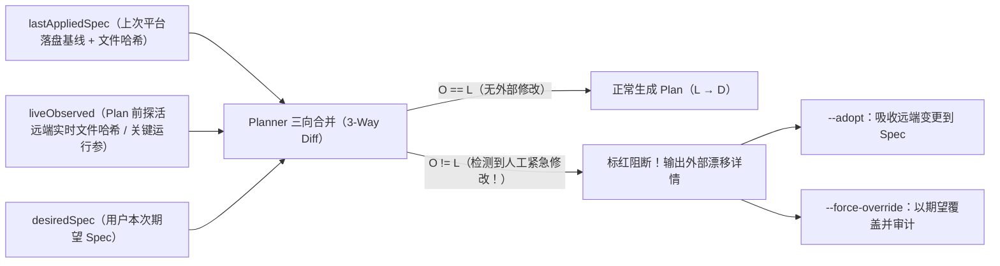
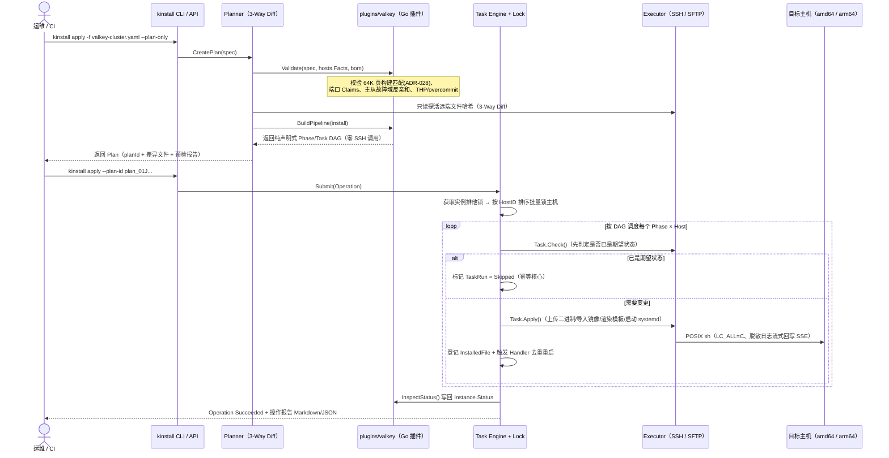

# 18 架构深度评估与端到端开发落地指南

> **本文定位**：对 kinstall 现有整套设计体系（`00`–`17`）进行一次**不粉饰的红队架构评审**，逐一指出哪些设计已经完备可直接开工、哪些存在结构性盲区或落地隐患，并给出具体的架构修补方案（ADR-066～070）；随后以 **Valkey / Redis（单节点、主从+哨兵、3主3从 Cluster × 二进制安装与 Docker 容器安装 × x86_64 与 arm64-4K/64K 环境）** 为端到端代码级参考样板，讲透“整个系统怎么设计、怎么写代码、怎么一步步开发落地”。
>
> **版本**：v1.1（S16 深度评审与落地增补，2026-11-26；v1.1 同步 `Stack` YAML 为 `kinstall.io/v1alpha1` / `instances[]` / `${instances.x.outputs.y}`、`D2 §5.1` 15 个内置 Task、Docker 日志 `100m/3`、`22` 初始化模块与 `sdk.DottedVersionLess`）。

## 1. 现有架构总评：到底 OK 不 OK？

**总体结论：核心架构骨架扎实（85/100），可以直接进入 M0 开发；但在进入大规模生产与多中间件（含 ELK / Kafka / SkyWalking / Docker 容器化部署）落地前，存在 8 项必须立即补齐的结构性盲区，现已同步修正并回写到对应文档。**

### 1.1 12 维度架构红队评分卡

| 评估维度 | 评审结论 | 评分 | 优势与已验证点 | 暴露出的缺口 / 隐患（已在本轮修补） |
| --- | :---: | :---: | --- | --- |
| 1. 平台分层与 Go 工程边界 | ✅ 优秀 | A | 单二进制无 Agent、插件只依赖 `pkg/sdk`（depguard 强约束）、REST+SSE 契约优先，边界极清晰 | 原规划让复杂中间件全走 YAML 声明式包有“YAML 编程”反模式风险 → **已按 ADR-069 修正分工** |
| 2. 数据层与自研任务引擎 | ✅ 优秀 | A | `modernc/sqlite` + `pgx` + `bun` + `goose` 规避了停更的 `glebarez/sqlite`；租约/分级锁/断点续装/二次全 Skipped 设计完整 | 缺 Day-2 外部手动改参的漂移保护 → **已按 ADR-070 补三向合并（3-Way Diff）** |
| 3. 部署形态覆盖度 | ⚠️ **原设计有盲区** | B → **A** | `host` 二进制与 `kubernetes` Operator 完整 | **漏掉企业现场高频的 `host-container`（Docker Engine 29 + Compose v5 + systemd）形态** → **已按 ADR-066 升级为三元目标模型** |
| 4. 多组件复合栈编排 | ⚠️ **原设计有盲区** | B → **A-** | 单组件 `Instance` 模型干净 | 缺跨 Instance 依赖与输出引用（ELK 全栈、SkyWalking 全栈必需） → **已按 ADR-067 引入 `Stack` 模型** |
| 5. OS 适配与 CMDB | ✅ 极佳 | A+ | 48 组官方源实测、`spec/` 单一真相源 + `--check` 门禁、双层 sudo（兼容 `sudo-rs`）、KYSEC/fapolicyd 授权加白 | 商业 OS（UOS/CTyunOS）仍待客户授权真机采样 🔬 |
| 6. 跨架构（x86/arm64）与 64K 页 | ⚠️ **需补强构建链路** | B+ → **A** | ADR-028 预检清晰（2026-11-19 Harbor `#24445` 实证 `valkey` 64K 页崩溃，证明设计极其前瞻） | 原设计只写了“预检阻断”，缺 C/C++（glibc 2.28 + 64K jemalloc）与 JVM（随包 JDK 21）跨架构离线构建规范 → **已按 ADR-068 补齐** |
| 7. Kubernetes 二进制插件 | ✅ 优秀 | A+ | 1.35–1.38 模板分支、kubeadm 基线对比、双栈、Calico nftables、SELinuxMount、本地 L4 代理极其扎实 | 上游新发 `1.37.3/1.36.7/1.35.11` 补丁待入 `2026.12.1` BOM；1.38 GA 待 12 月复核 |
| 8. 中间件生态完备度 | ✅ 现已齐备 | A | Valkey/PG/MySQL/OpenSearch/对象存储（淘汰归档 MinIO）均已完成 | 本轮已补齐 **ELK 全栈（`15`）、Kafka 4.x KRaft（`16`）、SkyWalking 11.x APM（`17`）** |
| 9. 离线与供应链安全 | ✅ 极佳 | A+ | 信任链、Zot、增量包、Syft+Grype 应对 2026-03 Trivy 投毒事件、全平台许可合规 | 200+ 节点同时拉大文件存在部署机网卡瓶颈 → **已补限速 + 区域 Mirror 方案（§2.6）** |
| 10. 安全与等保/密评 | ✅ 优秀 | A | 等保/密评映射、OpenBao 2.7 Transit KEK、纯 Go `emmansun/gmsm`、审计哈希链 | 硬件密码机厂商 SDK 差异需靠三期外部插件隔离 |
| 11. 回滚语义的诚实度 | ⚠️ **原措辞偏乐观** | B+ → **A** | 主机初始化备份回滚与配置回滚清晰 | 对有状态数据库/集群“回滚”未划清红线 → **已在 §2.7 界定三类回滚硬边界** |
| 12. 研发落地可执行性 | ⚠️ **需补代码样板** | B → **A** | `05` 有接口与 M0 拆解 | 缺真实复杂插件（多拓扑 + 二进制/Docker）端到端代码示范 → **已在本文 §3 完整给出** |

---

## 2. 8 大核心架构盲区与系统性修补方案（ADR-066～070）

### 2.1 修补 1：三元部署模型（`host-binary` / `host-container` / `kubernetes`，ADR-066）

在真实企业现场，基础设施交付存在三种并列主流诉求，kinstall 统一抽象为三种一等 `target`：

| 部署目标 | 底层载体 | 最适合的场景 | 优缺点与 kinstall 治理要点 |
| --- | --- | --- | --- |
| **`host-binary`** | 上游二进制 / PGDG 包 + **systemd** | K8s 节点本身；超低延迟核心库（PG / MySQL / Kafka 大吞吐 Broker）；无 Docker 审批的高密环境 | **零容器损耗**；受宿主机 glibc / 页大小约束，需依赖 `03` 完整初始化与 `ADR-068` 构建基线 |
| **`host-container`**（**本轮新增一等目标**） | **Docker Engine `29.10.0` + Docker Compose `v5.8.0`**（或 containerd + `nerdctl`）+ **systemd 托管 Compose unit** | **没有 K8s，但想快速交付 ELK / SkyWalking / Kafka / Redis / Kafbat UI**；**老旧 OS（如 CentOS 7 glibc 2.17）绕过宿主依赖限制**；多实例严格隔离 | ① 镜像由内置 Zot / OCI tarball 离线导入；② **必须以 systemd `kinstall-compose-<inst>.service` 托管**（不用 Docker 自带失控重启），数据目录全部 bind-mount 宿主机 XFS `/data/<product>/<inst>`；③ **关键安全坑治理**：Docker 默认写 `iptables/nft` NAT 会**直接绕过 `ufw` 与 `firewalld`**（2026 实测确认），kinstall 强制在 `DOCKER-USER` 链写源 IP 白名单或默认仅绑定管理内网 IP（`10.0.1.11:6379:6379`，绝不 `0.0.0.0` 裸露）；④ 生产大流量有状态容器（Kafka/ES/Redis）优先 `network_mode: host` 避免桥接转发与 `userland-proxy` 开销 |
| **`kubernetes`** | **成熟开源 Operator + Helm v4 SDK**（CNPG / Percona / Strimzi / OpenSearch Operator / SWCK / Rook） | 已有生产 K8s + 高可靠块/本地 NVMe CSI；多租户自助化与统一 GitOps | 自动化自愈最强；强依赖底层 K8s 与存储高可靠，严禁依赖 Bitnami 公共镜像（ADR-042） |

**平台 Task 库新增 3 个内置幂等 Task（同步至 `02 §3.4`、`05 §3.4`）**：
1. `docker.ensure`：安装 BOM 锁定的 Docker Engine `29.10` + `docker-compose-plugin v5.8.0`（排除发行版旧 `docker.io`/`docker-compose-v2` 冲突，ADR-026），写入 `daemon.json`（显式 `containerd-snapshotter` / 镜像仓库 TLS / `log-driver: json-file` + `max-size: 100m, max-file: 3`（与 `D2 §5.2` 一致） 防容器日志打满磁盘）、配置 `DOCKER-USER` 链规则；
2. `image.load`：按主机架构从内置 Zot 拉取或从离线 OCI tarball 流式导入镜像，以镜像 digest 判定幂等；
3. `compose.sync`：渲染 `docker-compose.yml` 至 `/etc/kinstall/<product>/<instance>/docker-compose.yml` + 渲染 `kinstall-compose-<instance>.service`，比对文件 SHA-256 与运行中容器 Image Digest / Config Hash，变更时触发 `docker compose up -d --remove-orphans` 并执行健康等待。

### 2.2 修补 2：`Stack` 多组件复合栈编排（ADR-067）

解决 ELK（Kafka + Data Prepper/Logstash + OpenSearch/ES + Dashboards/Kibana）与 SkyWalking（etcd + BanyanDB + OAP + Satellite + Horizon UI）这类**多组件强联动场景**：

```yaml
apiVersion: kinstall.io/v1alpha1
kind: Stack
metadata:
  name: prod-observability
  project: platform
  env: prod
spec:
  instances:
    - id: kafka-bus
      product: kafka
      deployTarget: host-binary
      spec: { version: "4.3.2", topology: dedicated-kraft, ... }
    - id: os-logs
      product: opensearch
      deployTarget: host-binary
      spec: { version: "3.10.0", topology: dedicated-roles, ... }
    - id: elk-pipeline
      product: elk-pipeline
      deployTarget: host-container               # 混合目标：底层二进制、清洗/展示容器化！
      dependsOn: [kafka-bus, os-logs]
      spec:
        kafkaEndpoints: "${instances.kafka-bus.outputs.bootstrapServers}"
        kafkaCA: "${instances.kafka-bus.outputs.caCertSecretId}"
        kafkaCredRef: "${instances.kafka-bus.outputs.logWriterSecretId}"
        searchEndpoints: "${instances.os-logs.outputs.httpEndpoints}"
        searchCredRef: "${instances.os-logs.outputs.logWriterSecretId}"
    - id: apm-skywalking
      product: skywalking
      deployTarget: host-container
      spec: { version: "11.1.0", storage: banyandb, ... }
```

- **实现轻量不膨胀**：`Stack` 不另起一套执行引擎，只是 `internal/stack` 在 `Planner` 上层的拓扑展开器——按 `dependsOn` 拓扑排序依次校验、按子 `Instance` 顺序生成联合 `StackPlan`，执行时按层级并发调度各子 `Operation` 并通过 `Instance.Outputs` / `SecretStore` 传递引用。

### 2.3 修补 3：x86_64 与 arm64（4K / 64K 页）异构构建与运行规范（ADR-068）

不同语言编写的基础组件在跨架构、跨 OS 时面临完全不同的兼容陷阱，kinstall 按组件技术栈分四类治理：

| 组件语言类别 | 代表组件 | 真实兼容陷阱（2026 实证） | kinstall 统一离线构建与运行策略（ADR-068） |
| --- | --- | --- | --- |
| **Go 静态二进制** | K8s、etcd、containerd、SeaweedFS、BanyanDB、Satellite、Zot、各 Exporter、kinstall 自身 | 几乎无 glibc 问题；极少数用 `bbolt`（etcd/containerd）禁跨 4K/64K 页直拷数据文件 | `CGO_ENABLED=0` 直接跨平台发布 `amd64` / `arm64`，BOM 标 `pageSizes: [4096, 65536]` |
| **C / C++ 依赖 jemalloc / glibc** | **Valkey / Redis**、MySQL / Percona、PostgreSQL | ① **arm64 64K 页崩溃**（2026-11-19 `goharbor/harbor#24445` 实证 `valkey-photon` 在 64K 内核报 `<jemalloc>: Unsupported system page size` 退出码 139）；② **glibc 版本错配**（Ubuntu 24.04 构建二进制在 EL8/麒麟 V10 `glibc 2.28` 报 `GLIBC_2.38 not found`） | ① **二进制构建基线统一锁定 EL8（glibc 2.28）容器**，对 Valkey/Redis 同时构建 3 份制品：`amd64`、`arm64-4k`、`arm64-64k`（编译参数 `make MALLOC=jemalloc JEMALLOC_CONFIGURE_OPTS="--with-lg-page=16"` + `USE_SYSTEMD=yes BUILD_TLS=yes`），并通过 `ldd` 检查仅依赖基础系统库；② **CentOS 7 / Anolis 7（glibc 2.17）** 或极老内核主机，**自动建议或强制切换 `target: host-container`（Docker 模式）**，彻底消除宿主机 glibc 限制 |
| **JVM 系组件** | OpenSearch / ES、Logstash、Data Prepper、Kafka、SkyWalking OAP、Kafbat UI | 宿主机 JDK 版本乱（JDK 8/11/17/21 混杂）、arm64 缺少合适 JNI（Snappy/LZ4/Netty-tcnative） | ① 凡自带 JDK 的官方包（OpenSearch / ES / Logstash / Data Prepper）直接用官方多架构包；② Kafka / SkyWalking OAP 由 kinstall BOM 绑定**统一随包 OpenJDK 21 LTS**（x86 用 Temurin 21，arm64 鲲鹏/倚天可选毕昇 JDK 21 优化版）装至 `/opt/kinstall/jdk/21/`，unit 显式指定 `JAVA_HOME`，绝不读宿主机 `PATH` 中的 Java |
| **Rust 系组件** | RustFS、Garage、Vector、Fluent Bit（C） | arm64 偶发 CPU 指令集假设（如 LSE atomics） | 静态 musl 或 glibc 2.28 基线构建，CI 在 `ubuntu-24.04-arm` + 鲲鹏物理机实跑冒烟 |

### 2.4 修补 4：Go 插件 vs 声明式插件包的真实工程边界（ADR-069）

- **坦诚纠偏**：如果强行用 YAML DSL 编写 Redis Cluster 槽位分配、Patroni 引导、MySQL MGR `dba.createCluster`、Kafka KRaft `format + quorum check`，YAML 里会充斥大量 hack 式的 bash 拼接，失去编译期类型检查、单测与可维护性。
- **修正分工（ADR-069）**：
  - **强类型 Go 插件（内置或三期 `go-plugin`）**：负责全部有复杂集群引导、分布式共识与动态拓扑计算的**核心产品**（Kubernetes、Valkey/Redis、PostgreSQL、MySQL、OpenSearch/ES/ELK、Kafka、SkyWalking、对象存储）；
  - **YAML 声明式插件包（OCI 分发）**：负责无复杂共识的轻量/周边组件（各类 Exporter、Nginx/HAProxy、简单代理、客户自定义业务基础服务），以及对已有 Go 插件的**新版本 BOM / 配置模板热扩展**。

### 2.5 修补 5：Day-2 外部漂移三向合并（3-Way Diff，ADR-070）



- 防止 DBA 半夜用 `CONFIG SET` / `vi my.cnf` 救急后，下次运维执行 `kinstall apply` 时静默回滚覆盖引发二次故障！

### 2.6 修补 6：大规模节点离线分发与执行器健壮性补充

1. **防打满部署机网卡**：`binary.install` 与 `image.load` 支持节点拉取限速（默认单节点 `50 MB/s` 可配）+ HTTP `Range` 断点续传；当同一操作目标主机 > 50 台或跨机房时，支持在每机房指定 1 台边缘缓存主机运行轻量 Pull-through HTTP/Zot 代理；
2. **磁盘预检硬门槛**：所有写/上传/镜像导入 Task 在 `preflight` 强制校验目标机 `/var/lib/kinstall/tmp` 与 `/data`、`/var/lib/docker`（容器模式）剩余空间 ≥ `2.5 × 最大单制品/镜像总体积`；
3. **跨网闸/堡垒机**：执行器支持多级 `ProxyJump` 链与控制连接心跳（`ServerAliveInterval 15s`），长耗时命令（如 `pg_basebackup`、大镜像 `docker load`）采用远端后台 PID + 轮询状态文件机制，避免 SSH 空闲超时中断导致任务失联。

### 2.7 修补 7：三类回滚的诚实边界

| 变更类别 | 回滚能力 | 机制与红线 |
| --- | --- | --- |
| **A 类：无状态配置与二进制**（unit、nginx、exporter、小版本二进制切换） | ✅ 自动回滚 | 修改前快照至 `/var/lib/kinstall/backups/<opId>/`，失败自动还原文件 + 切回原版本软链 + reload |
| **B 类：主机初始化**（sysctl、firewall、limits、GRUB cgroup 参数） | ✅ 可逆回滚 | 依据 `03 §5.4` 备份快照还原并重载（内核升级回滚靠保留旧内核 GRUB 项） |
| **C 类：有状态数据与元数据变更**（PG/MySQL 大版本升级、etcd 成员变更、Kafka `metadata.version` 提交、Redis Cluster 迁槽） | ❌ **严禁宣称自动原地回滚** | 强制门禁：**升级前必须完成已校验的不可变备份/快照**；若升级中途不可逆失败，走“新建/恢复到备份时间点”的标准灾备预案，防止二次损坏生产数据 |

### 2.8 修补 8：反过度设计的分阶段研发护栏

整个蓝图覆盖 18 篇文档很宏大，但**开发落地必须严格克制、按垂直切片推进**：
- **M0–M1 严禁提前写**：Web UI、PostgreSQL 多副本 HA、OIDC/审批门、gRPC 外部插件、YAML 声明式包解释器、国密网关——M0–M1 只打磨 **CLI + SQLite + SSH 执行器 + `spec/` OS 适配 + 任务引擎 + K8s 离线部署**，先把最难的骨架跑硬！
- **M2–M3 再打开**：生命周期完整闭环 → Server REST/SSE + PG HA + RBAC + Web UI；
- **M4 首个中间件垂直打穿**：用 **Valkey/Redis** 把三元目标（`host-binary` + `host-container` + `kubernetes`）与 `Stack`、3-Way Diff 全部验证跑通，再批量复制 PG / MySQL / Kafka / ELK / SkyWalking / 对象存储插件！

---

## 3. 端到端开发落地样板：Valkey / Redis 全拓扑 × 二进制 & Docker × x86 & arm64

为了让研发团队看到“这套架构落到真实代码里究竟长什么样”，下面以用户点名的 **Redis / Valkey（单节点、主从+哨兵、3主3从 Cluster × 二进制安装 & Docker 容器安装 × x86_64 & arm64 4K/64K 页）** 为完整开发样板，给出从输入 Spec、Go 插件实现、真实渲染模板到引擎执行链路的全部细节。

### 3.1 完整执行调用链（从一条 CLI 命令到远端落盘）



### 3.2 三种拓扑 × 两种宿主机形态的声明式 Spec 示例

#### 样例 A：单节点二进制（`standalone` + `host-binary`，开发/缓存）

```yaml
apiVersion: kinstall.io/v1
kind: Instance
metadata: { name: cache-dev, project: demo, environment: dev }
spec:
  plugin: valkey@0.2.0
  product: valkey
  version: "9.1.4"
  target: host-binary                 # 二进制 + systemd
  topology: standalone
  hosts:
    - selector: { matchNames: [node-x86-01] }
      roles: [data]
  params:
    port: 6379
    tls: { enabled: false }
    memory: { maxmemory: "4gb", maxmemoryPolicy: allkeys-lru }
    persistence: { mode: aof-rdb }
```

#### 样例 B：3 节点主从 + 哨兵二进制（`replication-sentinel` + `host-binary`，arm64 64K 页生产）

```yaml
apiVersion: kinstall.io/v1
kind: Instance
metadata: { name: cache-pay, project: payment, environment: prod }
spec:
  plugin: valkey@0.2.0
  product: valkey
  version: "9.1.4"
  target: host-binary                 # 自动按 Facts.PageSize=65536 选用 arm64-64k 构建！
  topology: replication-sentinel
  hosts:
    - selector: { matchLabels: { pool: cache-arm, zone: az1 } }
      roles: [data-primary, sentinel]
    - selector: { matchLabels: { pool: cache-arm, zone: az2 } }
      roles: [data-replica, sentinel]
    - selector: { matchLabels: { pool: cache-arm, zone: az3 } }
      roles: [data-replica, sentinel]
  params:
    port: 6379
    sentinelPort: 26379
    sentinelQuorum: 2
    downAfterMs: 5000
    failoverTimeoutMs: 60000
    tls: { enabled: true }
    memory: { maxmemory: auto, maxmemoryPolicy: volatile-lru }
    persistence: { mode: aof-rdb, appendfsync: everysec }
```

#### 样例 C：3 主 3 从 Cluster Docker 容器部署（`cluster` + `host-container`，3 台宿主机交叉反亲和）

```yaml
apiVersion: kinstall.io/v1
kind: Instance
metadata: { name: cache-order, project: order, environment: prod }
spec:
  plugin: valkey@0.2.0
  product: valkey
  version: "9.1.4"
  target: host-container              # Docker Engine 29.10 + Compose v5.8 + systemd 托管
  topology: cluster
  hosts:
    # 3 台物理机每台跑 2 个容器实例（7001 + 7002），由插件算法强制交叉主从反亲和！
    - selector: { matchNames: [docker-01, docker-02, docker-03] }
      roles: [cluster-node]
  params:
    shards: 3                         # 3 主 3 从 = 6 实例，分布于 3 宿主机
    replicasPerShard: 1
    instancesPerHost: 2               # 端口自动分配 7001/7002（总线 17001/17002）
    basePort: 7001
    container:
      networkMode: host               # Cluster 强推荐 host 网络，规避 NAT 导致总线 IP 错乱
      imageRef: "valkey/valkey:9.1.4" # 离线环境自动改写为内置 Zot 地址 + 校验 64K 页兼容镜像
      firewallAllowCIDRs: ["10.0.0.0/16"] # 自动写入 DOCKER-USER 链
    tls: { enabled: true }
    memory: { maxmemory: "8gb", maxmemoryPolicy: allkeys-lru }
```

### 3.3 插件工程目录与真实 Go 编排代码（`plugins/valkey/`）

```text
plugins/valkey/
├── plugin.yaml                 # 元数据、支持 targets: [host-binary, host-container, kubernetes]
├── schema/params.json          # JSON Schema 校验
├── plugin.go                   # Component 实现：Validate（64K页/Claims/拓扑反亲和）、Plan、Status
├── topology.go                 # 节点-端口-主从交叉反亲和拓扑规划算法（纯函数，100% 单元测试！）
├── ops_install.go              # install Operation：按 target 分支 host-binary vs host-container
├── ops_lifecycle.go            # scale（集群加节点+reshard/删节点）、upgrade（先从后主）、backup/restore
├── templates/
│   ├── valkey.conf.tmpl        # 统一覆盖 standalone / replica / cluster
│   ├── sentinel.conf.tmpl      # Sentinel 配置
│   ├── users.acl.tmpl          # ACL 最小权限账号
│   ├── valkey.service.tmpl     # host-binary systemd unit
│   ├── sentinel.service.tmpl   # Sentinel systemd unit
│   ├── docker-compose.yml.tmpl # host-container Compose v5 模板
│   └── compose.service.tmpl    # 托管 docker compose 的 systemd unit
└── testdata/golden/            # 6 组 golden（3拓扑 × 2形态）
```

**核心 Go 实现骨架（`plugins/valkey/ops_install.go` 与 `topology.go` 关键逻辑）**：

```go
package valkey

import (
    "context"
    "fmt"
    sdk "github.com/kinstall/kinstall/pkg/sdk/v1alpha1"
)

// Validate：核心门禁——绝不把已知错误带到执行期！
func (p *Plugin) Validate(_ context.Context, req *sdk.ValidateRequest) (*sdk.ValidationReport, error) {
    rep := sdk.NewValidationReport()
    cfg, err := parseParams(req.Instance.Spec)
    if err != nil {
        rep.Block("KI-API-0001", err.Error())
        return rep, nil
    }
    // 1. 按拓扑校验最小节点数与反亲和
    if cfg.Topology == "replication-sentinel" && len(req.Hosts) < 3 {
        rep.Block("KI-PLAN-0020", "replication-sentinel 生产拓扑至少需要 3 台主机（保证 Sentinel 多数派）")
    }
    if cfg.Topology == "cluster" && len(req.Hosts) < 3 {
        rep.Block("KI-PLAN-0021", "cluster 3主3从拓扑至少需要 3 台独立宿主机以实现主从反亲和")
    }
    // 2. 逐主机校验 64K 页（ADR-028）、glibc 基线（ADR-068）与端口 Claims
    slots := planSlots(req.Hosts, cfg) // 计算每台主机的端口、数据目录、主从配对
    for _, h := range req.Hosts {
        if req.Instance.DeployTarget == "host-binary" {
            if !req.BOM.HasArtifact("valkey-tarball", h.Facts.Arch, h.Facts.PageSize) {
                rep.Block("KI-PLAN-0012", fmt.Sprintf(
                    "主机 %s（%s, 页大小 %dB）缺少匹配构建；请导入 64K 页 BOM 或改用 target=host-container",
                    h.Name, h.Facts.Arch, h.Facts.PageSize))
            }
            // 注意：禁止字符串比较（"2.9" > "2.28"），统一用 SDK 的点分数值比较
            if sdk.DottedVersionLess(h.Facts.GlibcVersion, "2.28") {
                rep.Block("KI-OS-0003", fmt.Sprintf(
                    "主机 %s glibc(%s) < 2.28，不支持二进制部署，请改用 target=host-container",
                    h.Name, h.Facts.GlibcVersion))
            }
        }
        if err := req.CheckClaims(h.ID, slots.ClaimsFor(h.ID)); err != nil {
            rep.Block("KI-HOST-0002", err.Error())
        }
    }
    return rep, nil
}

// Build：同一个插件无缝编排 host-binary 与 host-container！
func (o *installOp) Build(_ context.Context, req *sdk.OpRequest) (*sdk.Pipeline, error) {
    cfg, _ := parseParams(req.Instance.Spec)
    slots := planSlots(req.Hosts, cfg)
    pl := &sdk.Pipeline{}

    // Phase 1：所有形态共用的主机内核参数前置（THP=never、overcommit_memory=1、somaxconn；均使用 D2 §5.1 15 个内置 Task）
    // 注：宿主机初始化 Profile("cache") 已通过 HostRequirements.Profiles 声明并由 hostinit 校验
    pl.AddPhase(sdk.PhaseSpec{
        Name: "host-tuning", Concurrency: 10,
        Tasks: []sdk.TaskSpec{
            sdk.SysctlApply("99-kinstall-valkey.conf", map[string]string{"vm.overcommit_memory": "1", "net.core.somaxconn": "4096"}),
            sdk.CmdRun("echo never > /sys/kernel/mm/transparent_hugepage/enabled", `grep -q '\[never\]' /sys/kernel/mm/transparent_hugepage/enabled`),
        },
    })

    // Phase 2：部署运行时与配置文件（按 deployTarget 分支；目录/系统账号等经 compose.sync mounts 或 cmd.run 幂等声明）
    if req.Instance.DeployTarget == "host-container" {
        pl.AddPhase(sdk.PhaseSpec{
            Name: "deploy-docker-valkey", DependsOn: []string{"host-tuning"}, Concurrency: 10,
            Tasks: []sdk.TaskSpec{
                sdk.DockerEnsure(cfg.Container.FirewallAllowCIDRs),   // 安装 Docker 29.10 + Compose v5.8 + DOCKER-USER
                sdk.ImageLoad(cfg.Container.ImageRef),                // 从 Zot / 离线包导入并校验 digest
                sdk.TemplateRender("/etc/kinstall/valkey/{{.Instance.Name}}/valkey.conf", tpl("valkey.conf.tmpl"), 0o640, "root:999"),
                sdk.TemplateRender("/etc/kinstall/valkey/{{.Instance.Name}}/users.acl", tpl("users.acl.tmpl"), 0o640, "root:999"),
                sdk.TemplateRender("/etc/kinstall/valkey/{{.Instance.Name}}/docker-compose.yml", tpl("docker-compose.yml.tmpl"), 0o640, "root:root"),
                // compose.sync 会按显式 mounts 清单自动以 0750 / 999:999 预建数据目录（D2 §5.1 #15）
                sdk.ComposeSync("kinstall-valkey-{{.Instance.Name}}", "/etc/kinstall/valkey/{{.Instance.Name}}/docker-compose.yml"),
            },
        })
    } else {
        // host-binary 路径：按每台主机的 Arch + PageSize 自动选取对应二进制！
        pl.AddPhase(sdk.PhaseSpec{
            Name: "deploy-binary-valkey", DependsOn: []string{"host-tuning"}, Concurrency: 10,
            Tasks: []sdk.TaskSpec{
                sdk.CmdRun("useradd --system --no-create-home --shell /sbin/nologin valkey", "id -u valkey >/dev/null 2>&1"),
                sdk.BinaryInstall("valkey", req.Instance.Version, sdk.ArtifactRef{Name: "valkey-tarball", MatchPageSize: true}),
                sdk.CmdRun("install -d -m 0750 -o valkey -g valkey "+slots.DataDirsJoined(), "test -d "+slots.PrimaryDataDir()),
                sdk.TemplateRender("/etc/kinstall/valkey/{{.Instance.Name}}/valkey.conf", tpl("valkey.conf.tmpl"), 0o640, "root:valkey"),
                sdk.TemplateRender("/etc/kinstall/valkey/{{.Instance.Name}}/users.acl", tpl("users.acl.tmpl"), 0o640, "root:valkey"),
                sdk.SystemdUnit("kinstall-valkey-{{.Instance.Name}}.service", tpl("valkey.service.tmpl"), sdk.UnitOpts{Enable: true}),
            },
        })
    }

    // Phase 3：按拓扑执行幂等引导（standalone 无需引导；sentinel 启动哨兵；cluster 建槽+配反亲和从节点）
    switch cfg.Topology {
    case "replication-sentinel":
        pl.AddPhase(buildSentinelPhase(slots, req.Instance.Target))
    case "cluster":
        pl.AddPhase(buildClusterBootstrapPhase(slots, req.Instance.Target))
    }
    return pl, nil
}
```

### 3.4 关键渲染模板（直接可用，涵盖单节点 / 哨兵 / 集群 & Docker）

#### 1）`templates/valkey.conf.tmpl`（同一份模板兼容 3 种拓扑 + TLS）

```conf
bind {{ .Host.PrivateIP }} 127.0.0.1
protected-mode yes
{{ if .Params.TLS.Enabled }}
port 0
tls-port {{ .Slot.Port }}
tls-cert-file /etc/kinstall/valkey/{{ .Instance.Name }}/pki/server.crt
tls-key-file /etc/kinstall/valkey/{{ .Instance.Name }}/pki/server.key
tls-ca-cert-file /etc/kinstall/valkey/{{ .Instance.Name }}/pki/ca.crt
tls-protocols "TLSv1.2 TLSv1.3"
tls-replication yes
{{ if eq .Params.Topology "cluster" }}tls-cluster yes{{ end }}
{{ else }}
port {{ .Slot.Port }}
{{ end }}

dir {{ .Slot.DataDir }}
aclfile /etc/kinstall/valkey/{{ .Instance.Name }}/users.acl
masteruser repl
masterauth {{ secret "valkey-repl-pass" }}
maxmemory {{ .Slot.MaxMemoryBytes }}
maxmemory-policy {{ .Params.Memory.MaxMemoryPolicy }}
io-threads {{ .Slot.IOThreads }}

# 混合持久化（按 params.persistence.mode 渲染）
{{ if ne .Params.Persistence.Mode "none" }}
appendonly yes
appendfsync {{ .Params.Persistence.AppendFsync }}
aof-use-rdb-preamble yes
save 900 1
save 300 100
{{ else }}
appendonly no
save ""
{{ end }}

{{ if eq .Slot.Role "data-replica" }}
replicaof {{ .Cluster.PrimaryIP }} {{ .Params.Port }}
replica-read-only yes
{{ end }}

{{ if eq .Params.Topology "cluster" }}
cluster-enabled yes
cluster-config-file nodes-{{ .Slot.Port }}.conf
cluster-node-timeout 15000
cluster-announce-ip {{ .Host.PrivateIP }}
cluster-announce-port {{ .Slot.Port }}
cluster-announce-bus-port {{ add .Slot.Port 10000 }}
cluster-require-full-coverage no
{{ end }}
```

#### 2）`templates/sentinel.conf.tmpl`（哨兵模式专用）

```conf
bind {{ .Host.PrivateIP }} 127.0.0.1
port {{ .Params.SentinelPort }}
dir /run/kinstall/valkey-{{ .Instance.Name }}-sentinel
sentinel announce-ip {{ .Host.PrivateIP }}
sentinel monitor {{ .Instance.Name }} {{ .Cluster.PrimaryIP }} {{ .Params.Port }} {{ .Params.SentinelQuorum }}
sentinel auth-user {{ .Instance.Name }} kinstall-admin
sentinel auth-pass {{ .Instance.Name }} {{ secret "valkey-admin-pass" }}
sentinel down-after-milliseconds {{ .Instance.Name }} {{ .Params.DownAfterMs }}
sentinel failover-timeout {{ .Instance.Name }} {{ .Params.FailoverTimeoutMs }}
sentinel parallel-syncs {{ .Instance.Name }} 1
```

> **重要工程坑处理**：Sentinel 运行期会原地改写 `sentinel.conf`（记录最新主节点 IP 与 epoch）！因此 `file.sync` 针对 `sentinel.conf` **必须设置 `manageMode: create-only`（仅首次不存在时渲染，后续切主后绝不用旧主 IP 覆写）**，否则二次 `apply` 会破坏已完成故障转移的拓扑！这是大量自研安装器最常踩的致命坑。

#### 3）`templates/docker-compose.yml.tmpl`（`host-container` 托管模式）

```yaml
services:
  {{- range .Host.Slots }}
  valkey-{{ .Port }}:
    image: {{ $.ResolvedImage }}
    container_name: kinstall-valkey-{{ $.Instance.Name }}-{{ .Port }}
    network_mode: {{ $.Params.Container.NetworkMode }}
    restart: unless-stopped
    user: "999:999"
    command: ["valkey-server", "/etc/valkey/valkey-{{ .Port }}.conf"]
    ulimits:
      nofile: { soft: 65535, hard: 65535 }
    mem_limit: {{ .ContainerMemLimit }}
    volumes:
      - /etc/kinstall/valkey/{{ $.Instance.Name }}:/etc/valkey:ro
      - {{ .DataDir }}:{{ .DataDir }}:rw
    healthcheck:
      test: ["CMD", "valkey-cli", "-p", "{{ .Port }}", "ping"]
      interval: 10s
      timeout: 3s
      retries: 3
  {{- end }}
```

#### 4）Cluster 3 主 3 从幂等引导与主从反亲和逻辑

在 3 台宿主机（`H1`, `H2`, `H3`）每台跑 2 个实例（`7001`, `7002`）时，**绝不可**把 6 个地址直接扔给 `--cluster create --cluster-replicas 1` 赌随机分配（容易把某分片的主从分配到同一宿主机），而是分两步确定性编排：
1. **显式建 3 主**：`valkey-cli --cluster create H1:7001 H2:7001 H3:7001 --cluster-yes`（幂等 `check`：`CLUSTER INFO` 已返回 `cluster_state:ok` 且 `cluster_slots_assigned:16384` 则跳过）；
2. **显式按跨主机环状挂 3 从**：
   - `H2:7002` 作为 `H1:7001` 的从节点（`--cluster add-node H2:7002 H1:7001 --cluster-slave --cluster-master-id <ID_H1_7001>`）；
   - `H3:7002` 作为 `H2:7001` 的从节点；
   - `H1:7002` 作为 `H3:7001` 的从节点；
   - **效果**：任意 1 台物理宿主机彻底宕机，仅丢失 1 个主与 1 个不同分片的从，全部 3 个分片均存活并自动完成故障转移，集群 100% 持续读写！

---

## 4. 整套系统从 0 到 1 工程开发落地路线图

给研发团队的**包级编码先后顺序**（每个阶段严格遵循“先接口 + 单测 + 契约，后业务集成”）：

| 阶段 | 先行落地模块 | 联调验收闭环 |
| :---: | --- | --- |
| **第 1 步（基础设施底座）** | `spec/` 嵌入加载 → `internal/executor/sshx`（`gliderlabs/ssh` 仿真单测）→ `internal/inventory` Facts 采集 → `internal/osadapter`（`testcontainers-go` 契约） | 跑通 Rocky 9 / Ubuntu 24.04 / openEuler 24.03 容器 Facts + 包安装 + sudo 契约 |
| **第 2 步（核心引擎与 SDK）** | `internal/store`（SQLite modernc+bun+goose）→ `internal/lock` → `internal/template`（白名单+expr）→ `internal/engine`（全量 15 个内置 Task，含 `docker.ensure/image.load/compose.sync`，`D2 §5.1`）→ `pkg/sdk/v1alpha1` | 跑通双次 `apply` 100% `Skipped`、中途 `kill -9` + `--resume` 续装、3-Way Diff 漂移拦截单测 |
| **第 3 步（主机初始化 + K8s 垂直切片）** | `internal/hostinit`（22 模块含首尾 `backup/verify` + 7 内置 Profile）→ `internal/pki` → `internal/secrets` → `plugins/kubernetes`（单主→三主 HA→混合架构→生命周期） | Rocky 9 / Ubuntu 24.04 / 麒麟 V11 arm64 离线 30 分钟内拉起 3+3 生产集群并过 `hydrophone` + 15 项故障注入 |
| **第 4 步（Server + 离线供应链 + 合规）** | `internal/artifact`（Zot + Bundle + Syft/Grype）→ `internal/server`（OpenAPI + SSE + PG HA + OIDC/RBAC/审批）→ `internal/audit`（哈希链 + `compliance report`）→ Web UI | 多副本 Server 崩溃租约接管通过、离线全断网 Bundle 交付、输出等保/CIS 证据包 |
| **第 5 步（Valkey 样板 + 全量中间件与 Stack）** | `internal/stack` → 先交付 **`plugins/valkey`（二进制 + Docker 全拓扑样板）** → 批量复制 `postgresql`、`mysql`、`kafka`、`opensearch`、`elkpipeline`、`skywalking`、`objectstorage` → 三期 `go-plugin` 外部插件 | 一键 `kinstall apply -f prod-observability-stack.yaml` 拉起 Kafka + ELK + SkyWalking 全栈并全链路贯通 |

## 附 A. 本文涉及的决策与清单映射

- **新增 ADR**：
  - **ADR-066**：部署目标升级为三元一等模型——`host-binary`（二进制/上游包 + systemd）、`host-container`（Docker Engine 29.10 + Compose v5.8 + systemd 托管 + 强制 `DOCKER-USER` 防火墙治理）、`kubernetes`（成熟开源 Operator + Helm v4 SDK）；平台内置 Task 库新增 `docker.ensure`、`image.load`、`compose.sync`（18 §2.1）。
  - **ADR-067**：引入 `Stack`（多组件复合应用栈）资源模型，支持 `dependsOn` 依赖 DAG 与跨 `Instance` 的端点/CA/凭据引用，支撑 ELK 日志全栈与 SkyWalking APM 等联动部署（18 §2.2）。
  - **ADR-068**：跨架构与跨 OS 离线构建规范——C/C++ 组件（Valkey/PG/MySQL）以 EL8 `glibc 2.28` 为最低编译基线，对 jemalloc 组件同时产出 `amd64` / `arm64-4k` / `arm64-64k(--with-lg-page=16)` 三份制品（老 glibc 2.17 主机自动引导走 `host-container`）；JVM 组件（Kafka/SkyWalking OAP）统一随 BOM 绑定 OpenJDK 21 LTS（18 §2.3）。
  - **ADR-069**：插件形态工程边界——具备复杂分布式共识与引导逻辑的核心产品（K8s、Valkey/Redis、PG、MySQL、OpenSearch/ELK、Kafka、SkyWalking、对象存储）以强类型 Go 插件实现；YAML 声明式插件包专用于无复杂共识的轻量组件及新版本配置/BOM 热扩展（18 §2.4）。
  - **ADR-070**：Planner 引入 Day-2 三向合并（3-Way Diff：`lastApplied` vs `liveObserved` vs `desired`），检测到远端外部手工修改时阻断覆盖并提供 `--adopt` / `--force-override`（记审计）；同时对 Sentinel 等运行期自改配置文件支持 `file.sync` 的 `create-only` 语义（18 §2.5、§3.4）。
- **新增并关闭设计项**：B19（`host-container` 容器部署目标）、B20（`Stack` 复合应用栈）、B21（三向漂移检测）。
- **新增并关闭调研项**：R-PLAT-10（Docker Engine 29.10 + Compose v5.8 容器化部署与 `DOCKER-USER` 防火墙治理）。
