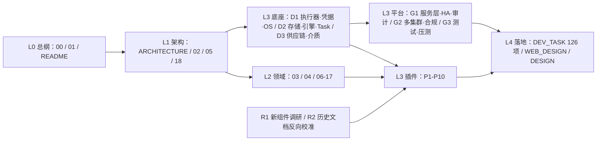
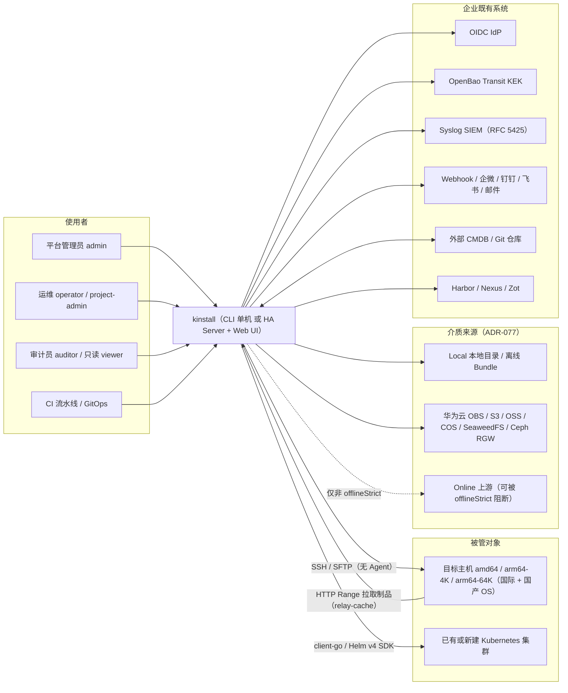
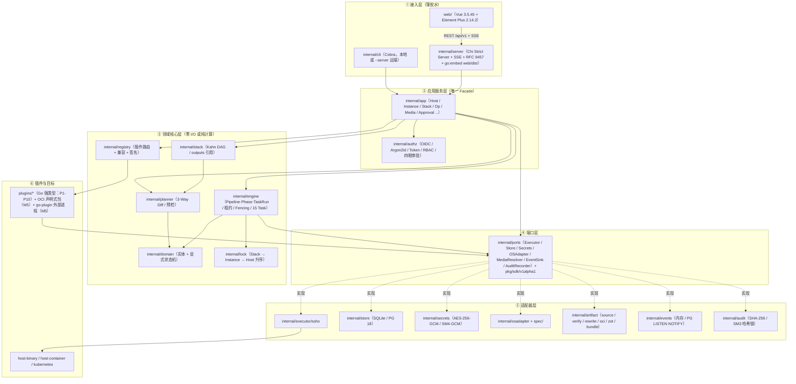
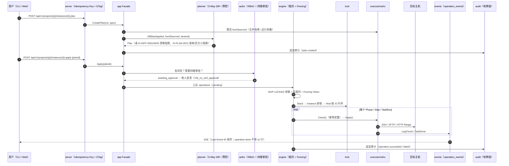
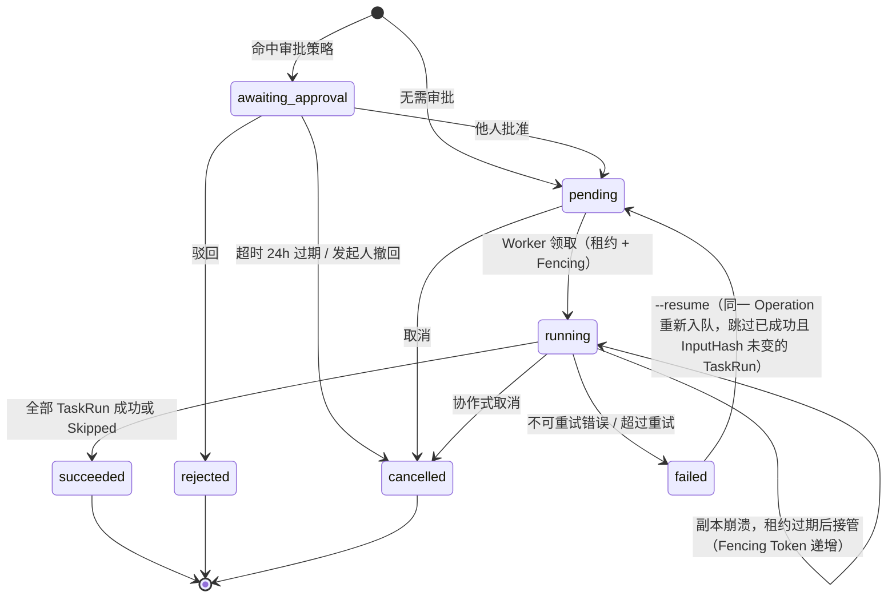
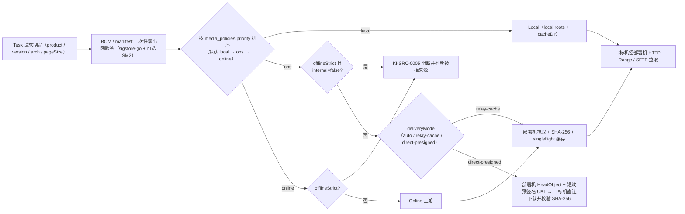
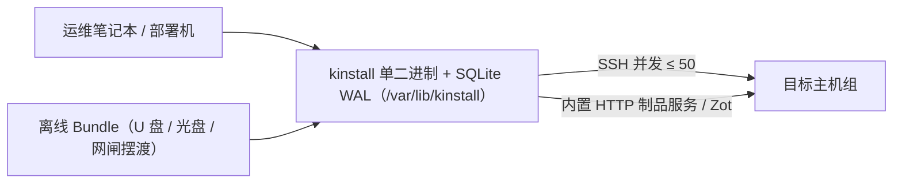
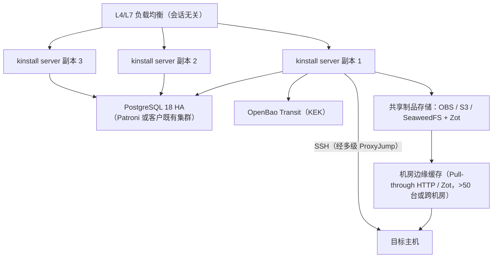
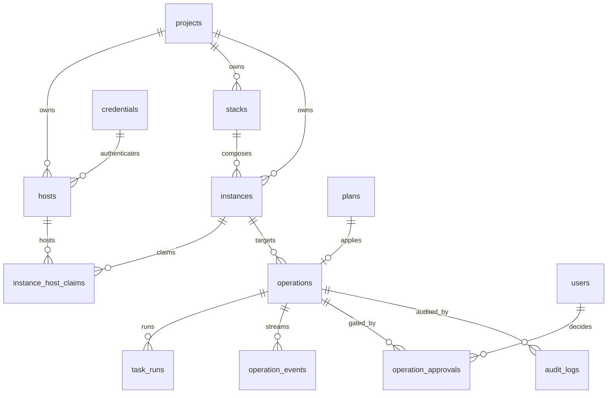
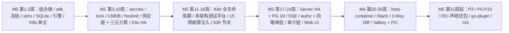

# kinstall 整体架构全景与深度分析优化（`ARCHITECTURE.md`）

> **本文定位**：kinstall 全套 45 篇设计文档的**架构总图与唯一架构口径**。把散落在 `02`、`05`、`18`、`D1–D3`、`G1–G3`、`P1–P10`、`R1–R2`、`WEB_DESIGN.md`、`DESIGN.md` 中的架构决策**收敛成一张可导航的全景图**，并给出**一致性审计发现、架构风险登记册与分优先级的优化建议**（逐条挂到 `DEV_TASK_CHECKLIST.md` 的任务上）。
>
> **阅读对象**：架构师 / Tech Lead（全文）· 各研发组组长（§3–§7、§12）· 新成员（§0–§3）· 评审与验收（§10–§14）。
>
> **口径优先级**：当本文与早期基线（`02 §2`、`02 §11`）冲突时，以 **本文 + 深度设计（D/G/P）+ `DEV_TASK_CHECKLIST.md`** 为准；当本文与深度设计的**实现细节**冲突时，以深度设计为准并回写本文。
>
> **版本**：v1.1（2026-11-26，会话 V：端口层补齐 `MediaResolver/EventSink/AuditRecorder`、对齐 `:plan/:apply` REST 路径与 SSE `operation.done` 无 `id:` 行语义、修正 §5.4 介质流与 §10 验证口径）。ADR 范围 `ADR-001`～`ADR-077`（本文**不新增 ADR**）；任务口径 126 项；数据表 24 张（`D2` 13 + `G1` 11）。

---

## 0. 阅读地图：45 篇文档的分层与依赖

| 层级 | 作用 | 文档 | 单一真相源（SSOT）职责 |
| --- | --- | --- | --- |
| **L0 总纲** | 进度、决策、调研登记 | `README.md`、`文档中心.md`、`00`（132 设计项 + ADR-001～077）、`01`（116 调研项）、`附-2026-11-25` | **ADR 唯一登记处 = `00 §6`** |
| **L1 架构基线** | 平台分层、插件体系、工程规范 | **`ARCHITECTURE.md`（本文）**、`02`、`05`、`18` | **架构口径 = 本文**；**工程规范与依赖版本 = `05 §2`** |
| **L2 领域基线** | OS/CMDB、K8s、各中间件、离线、安全、测试 | `03`、`03-A`、`04`、`06`–`17` | **OS 矩阵 = `spec/`**（`gen_os_docs.py --check` 门禁） |
| **L3 深度设计** | 可直接编码的实现级设计 | 底座 `D1–D3` · 平台 `G1–G3` · 插件 `P1–P10` · 调研 `R1–R2` | **DDL = `D2 §1` + `G1 §6.3`**；**包蓝图 = `G1 §7.2`**；**介质引擎 = `D3 §7`** |
| **L4 落地** | 任务拆解与前端基准 | `DEV_TASK_CHECKLIST.md`（126 项）、`WEB_DESIGN.md`、`DESIGN.md` | **排期 = `DEV_TASK`**；**视觉 Token = `DESIGN.md §6`**；**IA / 前端工程 = `WEB_DESIGN.md`** |



---

## 1. 架构一页纸（Architecture on a Page）

**一句话**：kinstall 是一个 **Go `1.27`（`CGO_ENABLED=0`）单二进制、无 Agent（SSH）、离线优先**的基础设施安装与 CMDB 平台；以**插件**描述“装什么”，以**平台 Task 库**保证“怎么安全地装”，同时支持 **CLI 单机（SQLite）** 与 **多副本 HA Server（PostgreSQL 18 + Web UI）** 两种运行形态。

### 1.1 七条架构硬约束（违背即架构返工）

| # | 约束 | 来源 | 架构后果 |
| :---: | --- | --- | --- |
| C1 | 单二进制、`CGO_ENABLED=0`、`go:embed` Web UI 与 `spec/` | ADR-001 / 023 / 029 | 纯 Go SQLite（`modernc`）、纯 Go 国密（`gmsm`）、零 CDN 前端 |
| C2 | 目标主机零 Agent、零 Python，仅 POSIX sh + coreutils | ADR-004 / 025 | 执行器必须自带连接池、Async Detached、三通道文件分发 |
| C3 | 插件只生成任务、只依赖 `pkg/sdk` | ADR-002 / 003 / 022 / 069 | 插件可纯单测、可 Plan 预览、可平滑外置为 gRPC 进程 |
| C4 | 三元部署目标 `host-binary` / `host-container` / `kubernetes` | ADR-066 | 同一插件按 Strategy 切换目标；Task 库新增 `docker.ensure` / `image.load` / `compose.sync` |
| C5 | 三架构 `amd64` / `arm64-4K` / `arm64-64K` × 国际 + 国产 OS | ADR-028 / 068 / 024 | BOM 标注页大小；C/C++ 组件 EL8 `glibc 2.28` 基线三份构建 |
| C6 | 介质三元来源 Local / OBS·S3 / Online，可 `offlineStrict` | ADR-077 | `internal/artifact/source` 统一解析 + 零出网验签 |
| C7 | 写操作可审计、可审批、可追溯、不可抵赖 | ADR-037 / 062 | 四眼审批、哈希链审计、`Idempotency-Key`、`ETag` |

### 1.2 质量属性优先级（冲突时按此取舍）

```text
安全确定性（不误删、不越权、不静默覆盖）
  > 正确性与幂等（二次执行全 Skipped、崩溃可接管）
    > 离线可交付（零出网也能装完）
      > 可演进（插件/SDK/Schema 可升级）
        > 性能与规模（500 节点验证、1000 节点设计）
          > 体验（Web UI 效率）
```

---

## 2. 系统上下文（C4 L1）



---

## 3. 容器视图与六层分层架构（C4 L2）

### 3.1 规范分层图



### 3.2 各层职责与强制手段

| 层 | 职责（只做什么） | 禁止做什么 | 强制手段 |
| --- | --- | --- | --- |
| ① 接入层 | 参数解析、协议编解码、输出格式化（`-o json/yaml`）、SSE 推流 | 任何业务判断、直接访问 Store / Executor | `depguard`：`internal/cli`、`internal/server` 只可 import `internal/app`、`internal/authz`、`pkg/client` |
| ② 应用层 | 用例编排、事务与锁边界、审批 / 幂等 / 审计切面 | 拼 SQL、直调 SSH | 代码评审 + 包级单测（Fake Store / Fake Executor） |
| ③ 领域层 | 状态机、Diff、DAG、调度、锁序 | `database/sql`、`net/http`、`x/crypto/ssh` | `depguard` R2（`D1 §1.1` 铁律 2） |
| ④ 端口层 | 小接口（≤ 8 方法）与 SDK 稳定面 | 暴露 ORM / 驱动类型 | `apidiff` 守护 `pkg/sdk/v1alpha1` 兼容性 |
| ⑤ 适配器层 | 驱动、协议、加解密、文件系统 | 反向依赖 `internal/app` | `depguard` + 契约测试（同一套测试跑 SQLite 与 PG） |
| ⑥ 插件层 | 输出纯数据 `PipelineSpec` | import `internal/*`、任何 I/O | `depguard` R1（ADR-022）+ `pkg/sdk/v1alpha1/sdktest` |

### 3.3 两种运行形态共享同一内核

| 维度 | CLI 单机 | HA Server |
| --- | --- | --- |
| 入口 | `kinstall instance apply ...` 直接进程内调用 `internal/app` | `kinstall server`，CLI 以 `--server` 走 `pkg/client`（同一 OpenAPI 生成） |
| 存储 | `modernc.org/sqlite` WAL（单写连接 + 读池） | PostgreSQL 18（`pgxpool`）HA |
| 任务领取 | 进程内调度，无竞争 | `FOR UPDATE SKIP LOCKED` + 租约 10s / 30s + 单调 Fencing Token |
| 事件 | 内存 `EventSink` → 终端渲染 | `operation_events` 单调 ID + `LISTEN/NOTIFY` → 任意副本 SSE 续传 |
| 认证 / 审批 | 本机 OS 用户（审计记录操作者，`02 §9`） | OIDC / Argon2id / API Token + 四眼审批（`G1 §4.2`） |
| 规模（`02 §1.4`） | ≤ 500 主机、全局并发 50 台 | ≤ 5,000 主机、并发 200 台（每副本 100） |

---

## 4. 规范包图（Canonical Package Map）

### 4.1 仓库顶层

```text
kinstall/
├── cmd/kinstall/          # 唯一组合根：main.go / app.go / plugins.go（唯一允许 import plugins/*）
├── api/                   # openapi.yaml（OpenAPI 3.1）+ oapi-codegen.yaml
├── pkg/sdk/v1alpha1/      # 插件唯一稳定面（含 builder、sdktest）
├── pkg/client/            # 由 OpenAPI 生成的 Go Client（CLI --server 模式）
├── internal/              # 28 个内部包（§4.2）
├── plugins/               # P1–P10 强类型 Go 插件
├── spec/                  # osmatch.yaml / pkgmap.yaml / osmatch_golden.yaml（go:embed）
├── migrations/{sqlite,postgres}/
├── web/                   # Vue 3.5.45 前端（DESIGN.md + WEB_DESIGN.md）
└── test/{e2e,chaos,contract}/
```

### 4.2 28 个 `internal/` 包 × 层 × 责任组 × 首次落地里程碑

| 层 | 包 | 责任组 | 首次落地 | 深度设计出处 |
| --- | --- | :---: | :---: | --- |
| ① 接入 | `cli` | BASE | M0 | `05 §4.1` |
| ① 接入 | `server` | PLAT | M3 | `G1 §2–§3` |
| ② 应用 | `app` | PLAT（M0 由 BASE 起最小版） | M0 → M3 | `G1 §1` |
| ② 应用 | `authz` | PLAT | M3 | `G1 §4` |
| ③ 领域 | `domain` | BASE | M0 | `D1 §1.1`、`D1 §1.3-C` |
| ③ 领域 | `planner` | BASE | M0（基础 Diff）→ M4（3-Way） | `D2 §3` |
| ③ 领域 | `stack` | BASE | M4 | `D2 §4` |
| ③ 领域 | `engine` | BASE | M0 | `D2 §2`、`D2 §5` |
| ③ 领域 | `lock` | BASE | M1 | `D2 §2.2` |
| ③ 领域 | `registry` | BASE | M0 | `02 §3.6` |
| ④ 端口 | `ports` | BASE | M0 | `D1 §1.2` |
| ⑤ 适配 | `executor`（`sshx` / `local`） | BASE | M0 | `D1 §2` |
| ⑤ 适配 | `store` | BASE | M0 | `D2 §1`、`G1 §6` |
| ⑤ 适配 | `secrets` | BASE | M1 | `D1 §3` |
| ⑤ 适配 | `osadapter` | BASE | M0 | `D1 §4` |
| ⑤ 适配 | `inventory` | BASE | M0（Facts）→ M1（CMDB） | `03`、`D1 §4` |
| ⑤ 适配 | `hostinit` | BASE | M1 | `03 §5–§7` |
| ⑤ 适配 | `artifact` | BASE | M1 | `D3` |
| ⑤ 适配 | `pki` | BASE | M0 | `04 §8` |
| ⑤ 适配 | `template` | BASE | M0 | `02 §13` |
| ⑤ 适配 | `events` | BASE（内存）/ PLAT（PG） | M0 → M3 | `G1 §3` |
| ⑤ 适配 | `audit` | PLAT | M3 | `G1 §5` |
| ⑤ 适配 | `notify` | PLAT | M3 | `G2 §3` |
| ⑤ 适配 | `multicluster` | PLAT | M3 | `G2 §1` |
| ⑤ 适配 | `compliance` | PLAT | M3 | `G2 §4` |
| 横切 | `obs`（slog / metrics / `RedactWriter`） | BASE | M0 | `05 §5` |
| 横切 | `i18n` | BASE | M0 | ADR-038 |
| 横切 | `version` | BASE | M0 | `05 §7.2`、`G1 §6` |

> [!NOTE]
> 本表与 `G1 §7.2`（v1.1 已补齐至 28 包）、`D1 §1`（v1.2 已统一命名）完全一致。早期文档中出现的 `internal/api`、`internal/artifacts`、`internal/plugin`、`internal/obs/events`、`internal/bootstrap/wire.go` 均为**已废弃别名**（见 §12.2 F-01）。

### 4.3 依赖方向矩阵（`depguard` 规则源）

| 发起方 ↓ 可依赖 → | `app` | 领域③ | `ports` / `sdk` | 适配⑤ | `plugins/*` |
| --- | :---: | :---: | :---: | :---: | :---: |
| ① `cli` / `server` | ✅ | ❌ | ❌（仅 `pkg/client`） | ❌ | ❌ |
| ② `app` / `authz` | — | ✅ | ✅ | ✅（经端口或具体类型注入） | ❌ |
| ③ 领域 | ❌ | ✅（同层，禁环） | ✅ | ❌（仅经 `ports`） | ❌ |
| ⑤ 适配器 | ❌ | ✅（仅 `domain` 值对象） | ✅ | ✅（同层，禁环） | ❌ |
| ⑥ `plugins/*` | ❌ | ❌ | ✅（仅 `pkg/sdk/v1alpha1`） | ❌ | ❌ |
| `cmd/kinstall` | ✅ | ✅ | ✅ | ✅ | ✅（唯一） |

**注册与装配**：插件、内置 Task、KEK Provider、OS 适配器一律在 `cmd/kinstall/{app,plugins}.go` **显式构造并注册**，注册表启动后只读冻结；**本仓代码禁止 `init()`**（`gochecknoinits`，`D1 §1.1` 铁律 3、`05 §5.1`）。

---

## 5. 核心运行时流程

### 5.1 写操作全链路：Plan → 审批 → Apply → 观测 → 审计



### 5.2 Operation 状态机（与 `D2` `operations.state` CHECK 枚举一致）



### 5.3 `Stack` 复合栈编排（ADR-067）

- `internal/stack` 是 Planner **之上**的拓扑展开器，不另起执行引擎：Kahn 拓扑排序判环 → 静态校验 `${instances.<name>.outputs.<key>}` → 生成联合 `StackPlan` → 按层并发调度子 `Operation`。
- **凭据类输出只传 `secretId`**，由 `SecretStore` 在目标侧解密；销毁按**拓扑逆序**并逐层确认。
- 典型：`P3` ELK + Kafka 中间消费、`P7` SkyWalking + BanyanDB、`P10` `generic-app`（`sharedNetworkRef` / `externalRefs`）。

### 5.4 三元介质解析（ADR-077，`D3 §7`）



### 5.5 SSE 多副本无丢帧（`G1 §3`）

1. 引擎把事件写入 `operation_events`（单调 ID），PG 下 `NOTIFY` 唤醒各副本；SQLite 下进程内广播。
2. 浏览器经 `fetch` ReadableStream 订阅（`useOperationSSE`），断线带 `Last-Event-ID` 到**任意副本**从库追读。
3. **终止帧 `operation.done` 不携带 `id:` 行**（不推进 `Last-Event-ID`，避免复用末条 `seq` 被去重或将断点重置为 0；`G1 §3.2`、`WEB_DESIGN §4.3`）。

---

## 6. 部署拓扑

### 6.1 CLI 单机（PoC / 离线现场）



### 6.2 HA Server（企业集中管控）



- **副本无状态**：Spec、Operation、租约、锁、事件游标全在 PG；滚动升级用 **Expand-and-Contract** + `MaxCompatibleSchemaVersion` 自动排空旧副本（`G1 §6`）。
- **迁移串行**：`pg_advisory_lock` 下仅 1 个副本执行 `goose.Up()`；SQLite 升级前 `VACUUM INTO` 快照。

### 6.3 跨网闸 / 多机房

| 场景 | 架构手段 | 出处 |
| --- | --- | --- |
| 堡垒机 / 多跳 | `ProxyJump` 链 + 每跳板机握手令牌桶（≤ 6 并发，避开 `MaxStartups=10`） | `D1 §2` |
| 长耗时命令 | 远端 `nohup setsid` + `runs/<id>/` 状态文件轮询，可断点重附 | `D1 §2` |
| 部署机网卡瓶颈 | 单节点限速默认 `50 MB/s` + HTTP Range 续传 + 机房边缘缓存 | `18 §2.6`、`D3 §5` |
| 全断网 | `offlineStrict` + 离线 Bundle 分卷 / 增量补丁 + OS 软件源闭包 | `D3 §6` |

---

## 7. 数据架构（24 张表）

| 组 | 表 | 出处 |
| --- | --- | --- |
| 资源与 CMDB | `projects`、`credentials`、`hosts`、`stacks`、`instances`、`instance_host_claims` | `D2 §1` |
| 执行与并发 | `operations`、`task_runs`、`operation_events`、`resource_locks` | `D2 §1` |
| 审计 | `audit_chain_head`、`audit_logs`、`audit_syslog_cursor` | `D2 §1`（`G1 §5` 扩展同名表） |
| 控制面 | `operation_approvals`、`plans`、`idempotency_keys`、`instance_state_backups` | `G1 §6.3` |
| 身份 | `users`、`user_sessions`、`api_tokens` | `G1 §6.3` |
| 介质与生态 | `media_policies`、`notification_channels`、`notification_deliveries`、`cluster_kubeconfigs` | `G1 §6.3` |



**关键约束摘录**（`D2` / `G1` 已定稿，勿回退）：主键 `VARCHAR(48)` 前缀 ULID；`operations.state` 7 值枚举；`operation_approvals` 使用 `requested_by` / `decided_by` 并带 `chk_no_self_approval`；`idempotency_keys` 主键 `(project_id, actor_id, key_hash)`。

---

## 8. 横切关注点

### 8.1 安全纵深（八层）

| 层 | 机制 | 出处 |
| --- | --- | --- |
| 身份 | OIDC PKCE S256 / 本地 Argon2id + 锁定 / 带作用域短效 API Token | ADR-037、`G1 §4` |
| 授权 | 项目 → 环境 → 资源 × 5 角色；四眼审批（自审硬拦截） | `02 §9`、`G1 §4` |
| 凭据 | 每记录独立 DEK + AAD；KEK 文件 / 环境变量 / OpenBao Transit；SM4-GCM 可选 | ADR-039 / 061、`D1 §3` |
| 传输 | SSH 主机密钥固定；密码走 stdin / `0600` 临时文件；内部 mTLS | `D1 §2` |
| 执行 | 双层 sudo（兼容 `sudo-rs`）；KYSEC / fapolicyd 只检测 + 授权加白 | ADR-027 / 030 |
| 供应链 | cosign / sigstore-go 零出网验签；Syft + Grype（隔离 Trivy）；许可证分级 | ADR-057 / 058 / 059 / 060、`D3 §1` |
| 审计 | 串行防分叉哈希链（SHA-256，密评并行 SM3）+ TLS Syslog 外送 | ADR-062、`G1 §5` |
| 合规 | 等保 2.0 三级 / 密评证据包；国密网关外置 | ADR-060、`G2 §4` |

### 8.2 一致性与并发控制

- **API 层**：`Idempotency-Key`（24h 去重）+ `ETag` / `If-Match` 乐观锁。
- **领域层**：显式状态机 `allowedTransitions` + 行级 `version`。
- **引擎层**：租约 + **单调 Fencing Token**（旧 Worker 复活写入被拒）；锁序固定 `Stack → Instance → Host(ID 升序)` 杜绝死锁。
- **审计层**：`audit_chain_head` 行锁 / `pg_advisory_xact_lock` 串行追加。

### 8.3 多架构 × 多 OS 适配

- `spec/` 是 OS 识别与逻辑包映射的**唯一真相源**，`gen_os_docs.py --check` 作为 CI 门禁。
- 制品按 `arch × pageSize` 选取；C/C++ 组件 EL8 `glibc 2.28` 构建三份；JVM 组件共享底座 `runtime/jdk`（`/opt/kinstall/runtimes/jdk/temurin-21.0.10-<cpu>/`）；老 glibc 主机建议或强制改用 `host-container`。

### 8.4 平台自身可观测性

- `log/slog` JSON + 两层脱敏 `RedactWriter`；`/metrics` 暴露任务数、耗时、失败率、SSH 连接数、租约接管次数；可选 OTel。
- `kinstall support-bundle` 一键收集脱敏诊断包；错误统一 `KI-<域>-<4位>` + RFC 9457 + `traceId`。

---

## 9. 插件生态矩阵（P1–P10）

| 插件 | 核心产品 | `host-binary` | `host-container` | `kubernetes` | 实现 | 里程碑 |
| --- | --- | :---: | :---: | :---: | --- | :---: |
| P1 | Kubernetes 1.35–1.38 二进制 | ✅ | — | — | Go | M0–M2 |
| P2 | Valkey / Redis（单机 / 哨兵 / Cluster） | ✅ | ✅ | ✅ | Go | M4 |
| P3 | OpenSearch / ES + ELK + Kafka 4.x KRaft | ✅ | ✅ | ✅（Strimzi / Operator） | Go + `Stack` | M5 |
| P4 | PostgreSQL（Patroni / CNPG / pgBackRest） | ✅ | ✅ | ✅ | Go | M4 |
| P5 | MySQL InnoDB Cluster + XtraBackup | ✅ | ✅ | ✅ | Go | M5 |
| P6 | 对象存储 SeaweedFS / Ceph RGW | ✅ | ✅ | ✅（Rook） | Go | M5 |
| P7 | SkyWalking 11 + BanyanDB | ✅ | ✅ | ✅（SWCK） | Go + `Stack` | M5 |
| P8 | Harbor / GitLab / Jenkins / SonarQube / Nginx | 部分 | ✅ | ✅ | Go / 声明式 | M5 |
| P9 | RocketMQ / Seata / ZooKeeper | ✅ | ✅ | ✅ | Go | M5 |
| P10 | Milvus / MongoDB / Neo4j / OnlyOffice / `generic-app` | 部分 | ✅ | ✅ | Go / 声明式 | M5 |

> 具体每个插件 × 目标的支持度、版本与许可证以对应 `P*` 文档为准；本表只用于架构层面的覆盖度与排期视图。

---

## 10. 质量属性、容量预算与 SLO

| 维度 | 目标 | 验证手段 | 出处 |
| --- | --- | --- | --- |
| 纳管规模 | CLI ≤ 500 主机；Server ≤ 5,000 主机 | 设计目标；`G3 §4` 验证 500 主机，5,000 为外推（待 M4 压测） | `02 §1.4` |
| K8s 规模 | 设计 1,000 节点；验证 500（20 真机 + 480 `kwok`） | ADR-065 | `G3 §4` |
| 安装时长 | 断网 30 分钟内 3 主 3 从 HA（M1）；1,000 节点 ≤ 2h | `T-M1-25` 验证 3+3 HA 30 min；1,000 节点为外推自 500 节点压测 | `02 §1.4` |
| 崩溃接管 | 租约 10s 心跳 / 30s 过期接管，零重复执行 | 故障注入 | ADR-035 |
| 幂等 | 二次 `apply` 全部 Skipped | E2E | `D2 §5` |
| SSE | PG 切主不断流、零丢帧；端到端延迟 P95 < 500 ms | `T-M3-28`、`G3 §4.2` | `G1 §3` |
| 调度延迟 | Worker 领取延迟 P95 < 1 s | O-05 指标（需 `G3 §4` 补测） | 本文 O-05 |
| 审计 | 3 副本并发零分叉 | `T-M3-08` | `G1 §5` |
| 二进制体积 | ≤ 150 MiB（含 Web UI） | 发布门禁 | `02 §1.4` |
| 前端 | 首屏 JS ≤ 350 KiB gzip（重组件按路由懒加载） | `T-M3-27` | 本文 O-09（新增预算） |

---

## 11. ADR 聚类索引（77 条）

| 簇 | ADR | 主题 |
| --- | --- | --- |
| A 平台内核 | 001–005、020–022、034–036 | 单二进制、插件形态、无 Agent、存储、执行器、API、依赖边界、任务引擎、模板 |
| B 主机与 OS | 006、024–027、029、030 | 初始化 Profile、OS 数据化识别、零依赖、BOM 上游二进制、安全执行控制、sudo 策略 |
| C Kubernetes | 007–011、014–017、019、031–033 | 纯二进制、运行时 / CNI、本地代理 HA、cgroup v2、Gateway API、CSR、双栈、CSI、资源预留 |
| D 安全合规 | 018、037、039、058–062 | 等保加固、认证、信封加密、SBOM / 漏洞、许可证、国密边界、审计哈希链 |
| E 跨架构 | 028、063、068 | 页大小预检、arm64 测试资源、glibc 基线三份构建 |
| F 中间件 | 012、013、040–043、045–056、071–076 | 对象存储、Valkey、host 规范、Bitnami 规避、日志采集、PG / MySQL / 搜索 / Kafka / SkyWalking |
| G 供应链与分发 | 044、057、077 | OCI 声明式包、BOM 目录、三元介质源 |
| H 编排模型 | 066、067、069、070 | 三元目标、`Stack`、Go vs 声明式分工、3-Way Diff |
| I 测试与规模 | 064、065 | 故障注入、500 节点验证 |
| J 前端与 i18n | 023、038 | Web UI 技术栈、国际化 |

---

## 12. 深度分析

### 12.1 架构优势（应坚持）

1. **单内核双形态**：CLI 与 Server 共享 `internal/app`，杜绝“两套业务逻辑”。
2. **插件零副作用**：插件只产出 `PipelineSpec`，Plan 预览、单测、外置 gRPC 全部天然成立。
3. **诚实的回滚边界**：A / B / C 三类回滚明确，C 类（有状态数据）强制先备份、禁止宣称自动回滚（`18 §2.7`）。
4. **离线供应链闭环**：BOM 签名 → 零出网验签 → 三元介质 → relay-cache 限速分发 → 边缘缓存。
5. **并发正确性多重保险**：幂等键 + ETag + 状态机 + 租约 / Fencing + 固定锁序 + 审计链串行。
6. **数据驱动 OS 适配**：`spec/` + golden 测试，新增 OS 不改代码。

### 12.2 一致性审计发现（本轮全仓扫描）

| ID | 发现 | 影响 | 处理 |
| --- | --- | --- | --- |
| **F-01** | 包命名漂移：`D1 §1` 使用 `internal/api`、`internal/artifacts`、`internal/plugin/registry.go`、`internal/obs/events`、`internal/bootstrap/wire.go`；`G1 §7` 使用 `internal/server`、`internal/artifact`、`internal/registry`、`internal/events`、`cmd/kinstall/app.go` | 开仓即出现两套目录，`depguard` 规则无法写对 | ✅ 已修：`D1` → v1.2 统一为 G1 口径 |
| **F-02** | `G1 §7.2` 标题称“18 个 `internal/` 包全覆盖”，实际表内 20 个，且遗漏 `domain`、`ports`、`registry`、`inventory`、`hostinit`、`multicluster`、`compliance`、`version` | 包蓝图不完整，责任组无法认领 | ✅ 已修：`G1` → v1.1 补齐至 28 包，与 §4.2 一致 |
| **F-03** | 路线图口径漂移：`02 §11`（M3 6–8 周、M4 含声明式包、M5 才做 Server HA）与 `18 §2.8`、`DEV_TASK`（M3 第 17–24 周含 PG HA，声明式包在 M5）冲突 | 排期与资源计划误读 | ✅ 已修：`02` → v2.1 标注以 `DEV_TASK` 为唯一排期口径 |
| **F-04** | 插件注册方式冲突：`02 §3.5` 与 `05`（4 处）写 `init()` 自注册；`D1 §1.1` 铁律 3 明确禁止 `init()` | 全局状态、单测串台、装配顺序不透明 | ✅ 已修：`02 §3.5`、`05`（v1.1）改为组合根显式注册 + `gochecknoinits` |
| **F-05** | Vue Flow 2.0 的 npm 包名未写明（实际为 `@xyflow/vue`，与 1.x `@vue-flow/core` 存在破坏性变更） | 前端脚手架易装错包 | ✅ 已修：`WEB_DESIGN §4.1` 写明包名、`@layer xyflow` 与暗色同步 |
| **F-06** | `DESIGN.md` v1.0 暗色 `--ki-text-muted #64748B` 在 L1 上仅 **3.73:1**、在 L3 上 3.02:1；亮色同值在 L3 上 4.34:1，均未达 4.5:1 | 时间戳、占位符等小字不达 WCAG AA | ✅ 已修：`DESIGN.md` v2.0 改为暗 `#8794A8` / 亮 `#5B6B82` 并附实测对比度表 |
| **F-07** | 暗色主按钮 `#3B82F6` 底 + 白字仅 **3.68:1**；危险按钮 `#EF4444` + 白字 3.76:1 | 主操作按钮文字不达标 | ✅ 已修：v2.0 引入 `--ki-brand-solid #2563EB`（5.17:1）与 `--ki-danger-solid #DC2626`（4.83:1） |
| **F-08** | 字体栈缺少麒麟 / UOS / openEuler 桌面常见 CJK 字体（Noto Sans CJK SC、Source Han Sans SC、WenQuanYi） | 信创桌面回退到位图或宋体，观感与对齐失真 | ✅ 已修：v2.0 字体栈补齐，`WEB_DESIGN §2.2` 同步 |
| **F-09** | Element Plus 仅映射了 `--el-color-*` 基色，未映射 `light-3/5/7/8/9`、`dark-2` | EP 的 hover / plain / disabled 色仍为官方默认蓝，主题“半覆盖” | ✅ 已修：v2.0 §6.3 用 `color-mix()` 全量派生 + 静态回退 |
| **F-10** | 原 `02 §2` 分层图只列 5 类插件，未体现 `Stack`、3-Way、介质引擎、审批与审计 | 新成员按旧图理解架构 | ✅ 已修：`02 §2` 加注指向本文 §3 |

### 12.3 架构风险登记册

| ID | 风险 | 可能性 | 影响 | 缓解（架构手段） | 挂载任务 |
| --- | --- | :---: | :---: | --- | --- |
| RA-01 | 范围膨胀：10 插件 × 3 目标 × 3 架构 × 多 OS，126 项任务易并行失控 | 高 | 高 | 坚持 `18 §2.8` 垂直切片：M0–M1 只做 CLI + SQLite + SSH + K8s；M4 用 Valkey 打穿三元目标后再复制 | `T-M0-18`、`T-M4-14` |
| RA-02 | `pkg/sdk/v1alpha1` 频繁破坏性变更 | 中 | 高 | K8s + Valkey 两个差异最大的插件验证后再冻结；`apidiff` 门禁；SDK 同时支持两个版本 | `T-M0-04`、`T-M5-21` |
| RA-03 | SQLite 与 PG 语义差异（`SKIP LOCKED`、`LISTEN/NOTIFY`、类型、时间函数） | 高 | 中 | **同一套仓储契约测试双后端必跑**；SQL 方言差异仅允许出现在 `store/sqlite.go` / `store/postgres.go` | `T-M0-10`、`T-M3-02` |
| RA-04 | SSE 大规模扇出（百人同看日志）压垮 PG | 中 | 中 | `NOTIFY` 只带 ID 不带负载；每副本连接上限 + 退避；`operation_events` 按 Operation 归档压缩 | `T-M3-05`、`T-M3-28` |
| RA-05 | `Stack` 爆炸半径：一次 apply 影响多组件 | 中 | 高 | 按层逐级执行 + 失败即停；高危组件独立审批；逆序销毁预览 | `T-M4-05`、`T-M3-23` |
| RA-06 | KEK 轮换 / OpenBao 不可用 | 低 | 高 | DEK 重包装后台任务；KEK 多后端热切换；启动期自检阻断 | `T-M1-02` |
| RA-07 | 平台自身升级与插件状态迁移（`StateMigrator`）出错 | 中 | 高 | Expand-and-Contract；`MaxCompatibleSchemaVersion` 排空；升级前快照 | `T-M3-09` |
| RA-08 | 3-Way Diff 误报（应用自改文件如 Sentinel、Patroni） | 中 | 中 | `create-only` / `managed-block`；忽略字段白名单由插件声明 | `T-M4-04`、`T-M4-07` |
| RA-09 | 上游版本 / 许可证漂移（MinIO、Bitnami、Redis 已发生） | 高 | 中 | BOM rev 月度节奏；许可证分级门禁；基金会项目优先 | `T-M1-09`、`T-M5-25` |
| RA-10 | 平台自身可观测性不足，现场排障依赖人工 | 中 | 中 | 定义平台 SLI（领取延迟、接管次数、SSE 延迟、SSH 失败率）+ 内置 Grafana 看板模板 | `T-M2-05`、`T-M3-28` |
| RA-11 | 前端体积与首屏性能（xterm + CodeMirror + Vue Flow + EP） | 中 | 低 | 路由级懒加载；重组件按需；CI 体积预算 | `T-M3-14`、`T-M3-27` |
| RA-12 | 设计 Token 漂移（硬编码颜色、对比度回退） | 中 | 中 | Stylelint 严格值 + 对比度脚本 + 双主题截图回归（`DESIGN.md §12`） | `T-M3-15`、`T-M3-27` |

### 12.4 分优先级优化建议（不新增任务，作为既有任务 DoD 追加项）

| ID | 优先级 | 建议 | 落点（追加到该任务 DoD） |
| --- | :---: | --- | --- |
| O-01 | **P0** | `.golangci.yml` 依 §4.3 矩阵生成 `depguard` 规则，并启用 `gochecknoinits` | `T-M0-02` |
| O-02 | **P0** | 建立 `test/contract/store`：同一套仓储测试在 SQLite 与 PG 18 上各跑一遍，作为 PR 门禁 | `T-M0-10`、`T-M3-02` |
| O-03 | **P0** | `pkg/sdk/v1alpha1` 引入 `golang.org/x/exp/cmd/apidiff` 兼容性门禁；冻结点定义为“K8s M0 + Valkey M4 两插件跑通” | `T-M0-04` |
| O-04 | **P0** | 组合根 `cmd/kinstall/app.go` 为唯一装配点，CLI 与 Server 共用 `NewApp()`；禁止任何包级可变全局 | `T-M0-01`、`T-M0-17` |
| O-05 | P1 | 平台 SLI / SLO 指标命名规范（`kinstall_operation_claim_latency_seconds`、`kinstall_lease_takeover_total`、`kinstall_sse_lag_seconds`、`kinstall_ssh_dial_errors_total`）+ 看板模板随包 | `T-M2-05`、`T-M3-28` |
| O-06 | P1 | `NOTIFY` 负载仅含 `operation_id` + `max_event_id`；`operation_events` 按 Operation 完成后归档压缩 | `T-M3-05` |
| O-07 | P1 | `Stack` 执行默认“按层失败即停”，并对含 C 类变更的组件强制单独审批 | `T-M4-05`、`T-M3-07` |
| O-08 | P1 | 插件声明 `driftIgnore` 字段白名单，供 3-Way Diff 消除应用自改误报 | `T-M4-04`、`T-M0-04` |
| O-09 | P1 | 前端体积预算：首屏 JS ≤ 350 KiB gzip；`@xterm/xterm`、`@codemirror/merge`、`@xyflow/vue` 只在对应路由加载 | `T-M3-14`、`T-M3-27` |
| O-10 | P1 | 落地 `DESIGN.md` v2.0 治理：`tokens.css` 三层 Token、Stylelint 严格值、对比度脚本、双主题 × 双密度截图回归 | `T-M3-15`、`T-M3-27` |
| O-11 | P2 | KEK 轮换 Runbook + `kinstall secrets rewrap` 后台任务 | `T-M1-02` |
| O-12 | P2 | 文档 CI：Markdown 相对链接检查 + `spec --check` + ADR 编号唯一性 + Token 一致性（`DESIGN` ⊇ `WEB_DESIGN`） | `T-M0-02` |

---

## 13. 架构演进路线（能力解锁视图）



| 里程碑 | 解锁的架构能力 | 退出门禁 |
| --- | --- | --- |
| M0 | 六层骨架、端口、组合根、SDK v1alpha1 | 3 OS × 2 架构 K8s 单主冒烟（`T-M0-18`） |
| M1 | 凭据、锁、CMDB、介质引擎、离线供应链 | 断网 30 分钟 HA 集群（`T-M1-25`） |
| M2 | 生命周期、测试平台、规模验证 | Conformance + 500 节点（`T-M2-10`、`T-M2-11`） |
| M3 | 多副本控制面、审批审计、Web UI | 3 副本 PG HA 压测（`T-M3-28`） |
| M4 | 三元目标、`Stack`、3-Way Diff | Valkey 3 拓扑 × 2 形态 × 2 架构（`T-M4-14`） |
| M5 | 全插件生态、外部插件 | GA 终验收（`T-M5-25`） |

---

## 14. 架构治理与适应度函数（Fitness Functions）

| 适应度函数 | 守护的架构属性 | 工具 / 门禁 | 运行时机 |
| --- | --- | --- | --- |
| 依赖方向 | 分层与插件隔离 | `golangci-lint v2` `depguard` + `gochecknoinits` | 每个 PR |
| SDK 兼容 | 插件生态稳定 | `apidiff` | 每个 PR（`pkg/sdk/**` 变更时） |
| 双后端一致 | CLI / Server 同语义 | `test/contract/store`（SQLite + PG 18） | 每个 PR |
| OS 矩阵 | 数据驱动适配 | `python3 spec/gen_os_docs.py --check` | 每个 PR |
| 幂等 | 二次执行全 Skipped | E2E 二次 apply 断言 | 每日 |
| 崩溃接管 | 租约 / Fencing 正确 | 15 项故障注入（ADR-064） | 每次发版 |
| 供应链 | 零出网验签、无高危漏洞 | sigstore-go + Syft + Grype + `go-licenses` | 每次构建 |
| 前端视觉 | Token 与对比度 | Stylelint + 对比度脚本 + 截图回归（`DESIGN.md §12`） | 每个前端 PR |
| 文档一致 | 架构口径不漂移 | 链接检查 + ADR 唯一性 + Token 一致性（O-12） | 每个文档 PR |

**变更流程**：任何改变 §1.1 硬约束、§4.3 依赖矩阵或 §7 数据模型的提案，必须先在 `00 §6` 登记新 ADR，再回写本文与对应深度设计；仅改实现细节的变更直接在深度设计中修订并在 `00 §8` 记录会话。

---

## 附 A. 术语与缩写速查

完整术语表见 `02 §1.5`。本文常用：**Facade**（`internal/app` 唯一应用服务层）、**Fencing Token**（单调递增的领取令牌，防止过期 Worker 写入）、**3-Way Diff**（`lastApplied` / `liveObserved` / `desired` 三向合并）、**relay-cache**（目标机经部署机拉取制品的默认交付模式）、**SSOT**（单一真相源）。
