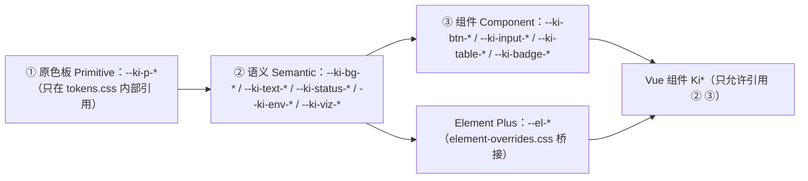
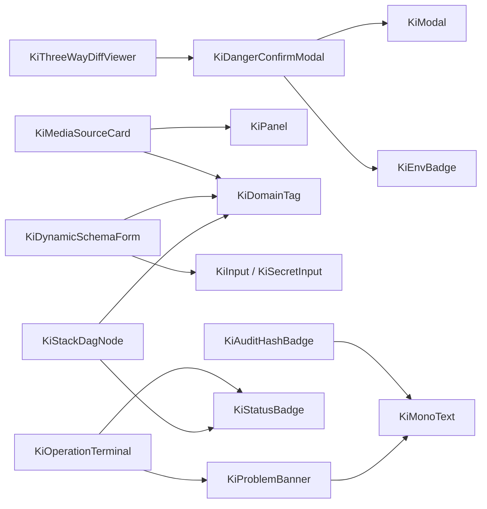

# kinstall 前端 UI 设计系统与组件视觉基准（`DESIGN.md`）

> **本文定位**：kinstall Web 管理控制台的**唯一视觉语言、三层 Design Token、Element Plus `2.14.2` 主题桥接、基础 / 领域组件规范、页面模板、内容与数据格式规范、无障碍与工程治理基准**。
>
> **与 `WEB_DESIGN.md` 的分工**：
> - **`DESIGN.md`（本文）**：定义“**长什么样、每个色值 / 字体 / 间距 / 圆角 / 深度从哪来、每个组件每种状态长什么样、页面骨架怎么排、数据怎么显示、什么是视觉禁区、如何用 CI 守住**”，是设计师、前端工程师与 AI 编码工具生成页面和组件的像素级基准。
> - **[`WEB_DESIGN.md`](./WEB_DESIGN.md)**：定义“**有哪些页面、信息架构（IA）、业务交互流、Vue 3 / Pinia / `@hey-api/openapi-ts` / SSE / `go:embed` 前端工程架构**”。
> - **[`ARCHITECTURE.md`](./ARCHITECTURE.md)**：平台整体架构口径；前端相关风险与优化项见其 §12（RA-11、RA-12、O-09、O-10）。
>
> **版本**：**v2.0**（2026-11-26，会话 U；与 `ADR-023`、`WEB_DESIGN.md` v1.2、`DEV_TASK_CHECKLIST.md` `T-M3-14`～`T-M3-27` 同步）。

---

## 0. 使用方式、浏览器基线与 v2.0 变更摘要

### 0.1 如何使用本文

| 角色 | 必读章节 | 产出物 |
| --- | --- | --- |
| 设计师 | §1–§5、§7–§9 | Figma Variables（由 `tokens.json` 导入，§12.4） |
| 前端工程师 | §2、§6（直接落盘）、§7–§10、§12 | `web/src/styles/*.css`、`Ki*` 组件 |
| AI 编码工具 | §2 Token 命名、§6 代码、§7 状态矩阵、§12.5 红线 | 生成代码只允许引用 `var(--ki-*)` |
| 评审 / QA | §2.9 对比度表、§11、§12 | PR 审查与截图回归基线 |

### 0.2 浏览器与运行环境基线

| 项 | 基线 | 说明 |
| --- | --- | --- |
| 浏览器 | Chromium ≥ 111（Chrome / Edge / 360 极速 / 奇安信可信浏览器 Chromium 内核）· Firefox ≥ 113（含 ESR 115）· Safari ≥ 16.4 | 依赖 `color-mix()`、`:focus-visible`、`:has()`；低于基线时 §6.3 自动回退到静态色值 |
| 最小视口 | `1280 × 720` 全功能；`< 1024px` 只读降级 | 运维场景以桌面为主 |
| 安全策略 | `default-src 'self'`；`style-src 'self' 'unsafe-inline'`（`WEB_DESIGN §4.3` B 节） | **禁止内联 `<script>`**，主题防闪烁脚本必须为外部文件（§6.5） |
| 离线 | 字体、图标、样式 100% 打包进 `web/dist/` | CI 扫描零 `http(s)://` 外链 |

### 0.3 v1.0 → v2.0 变更摘要

| # | 变更 | 原因（实测） |
| :---: | --- | --- |
| 1 | Token 由单层升级为**三层架构**：原色板 → 语义 → 组件 | 主题、密度、高对比模式可独立演进 |
| 2 | `--ki-text-muted`：暗 `#64748B` → **`#8794A8`**；亮 `#64748B` → **`#5B6B82`** | v1.0 暗色在 L1 上仅 3.73:1、亮色在 L3 上 4.34:1，未达 WCAG AA 4.5:1 |
| 3 | 新增 `--ki-brand-solid`（`#2563EB`）与 `--ki-danger-solid`（`#DC2626`）作为承载白字的实底 | v1.0 暗色主按钮 `#3B82F6` + 白字仅 3.68:1，危险按钮 `#EF4444` + 白字 3.76:1 |
| 4 | 新增 `--ki-border-control`（暗 `#64748B` / 亮 `#7A8AA1`） | 输入框边框需 ≥ 3:1（WCAG 1.4.11），v1.0 `#334155` 仅 1.71:1 |
| 5 | 字体栈补齐 `Noto Sans CJK SC` / `Source Han Sans SC` / `WenQuanYi Micro Hei`；等宽栈对齐并补 CJK 回退 | 麒麟 / UOS / openEuler 桌面浏览器回退失真；v1.0 §3.1 与 `tokens.css` 等宽栈不一致 |
| 6 | Element Plus 补齐 `light-3/5/7/8/9`、`dark-2`、按钮 / 输入 / 菜单 / 弹层变量，选择器提升为 `html[data-theme]` | v1.0 仅映射基色，hover / plain / disabled 仍为 EP 默认蓝；`:root` 优先级低于 EP `html.dark` |
| 7 | 新增：环境上下文色、数据可视化色板、ANSI 16 色全表、深度（内高光）体系、排版 / 间距 / 层级 / 动效 Token 全量入 `tokens.css` | v1.0 部分 Token 只在表格中出现、未落入代码 |
| 8 | 新增：组件状态矩阵、页面模板、表单布局、数据格式、通知、RBAC / 环境守卫、CJK 排版、打印、高对比、强制色 | 覆盖运维控制台全部高频场景 |
| 9 | 新增：`fonts.css`、`base.css`、主题引导脚本、Stylelint 配置、对比度脚本、截图回归、Token 版本与 DTCG 导出 | 让基准可被 CI 自动守护 |
| 10 | 基础组件 10 → **12**（新增 `KiEnvBadge`、`KiEmptyState`）；PR 红线 10 → **16** | 生产环境误操作防护、空态一致性 |

---

## 1. 设计哲学与视觉气质

### 1.1 视觉基调：**工业精密控制室（Industrial Precision Control Room）**

kinstall 面向企业生产环境与涉密离线机房的基础设施运维人员。界面气质对标 **Linear 的信息秩序 + Grafana 的数据清晰度 + Cloudflare Dashboard 的精密克制**。

### 1.2 六条设计原则（每条都有可验证判据）

| # | 原则 | 可验证判据 |
| :---: | --- | --- |
| P1 | **功能驱动、零装饰噪音** | 每个视觉元素都能回答“它传达了什么信息或交互意图”；无渐变文字、无发光描边、无背景网格 / 粒子 |
| P2 | **高密度且呼吸有序** | `1440px` 宽下主机表一屏 ≥ 20 行（comfortable）/ ≥ 26 行（compact）；数值列 `tabular-nums` 对齐 |
| P3 | **安全确定性视觉分层** | 只读 / 常规变更 / 漂移冲突 / 高危破坏 四级在色彩、位置、确认流程上可区分；生产环境始终可见（§2.6） |
| P4 | **双主题一等公民** | 所有颜色来自 `var(--ki-*)`；两套主题均通过 §2.9 对比度表 |
| P5 | **克制的深度** | 层级靠“明度阶 + 1px 边框 + 内高光”表达，仅浮层用阴影；卡片嵌套 ≤ 2 层 |
| P6 | **100% 离线零退化** | 断网环境下字体、图标、样式与联网时像素一致 |

---

## 2. 色彩系统与三层 Token 架构

### 2.1 三层 Token 架构



**命名规则**：`--ki-{类别}-{角色}[-{变体}][-{状态}]`，例：`--ki-status-warn-subtle`、`--ki-brand-solid-hover`。

| 层 | 前缀 | 谁可以引用 | 随主题变化 | 随密度变化 |
| --- | --- | --- | :---: | :---: |
| ① 原色板 | `--ki-p-` | **仅 `tokens.css` 内部** | ❌ | ❌ |
| ② 语义 | `--ki-bg-`、`--ki-text-`、`--ki-border-`、`--ki-brand-`、`--ki-status-`、`--ki-badge-`、`--ki-env-`、`--ki-diff-`、`--ki-viz-`、`--ki-ansi-`、`--ki-font-`、`--ki-fs-`、`--ki-space-`、`--ki-radius-`、`--ki-shadow-`、`--ki-z-`、`--ki-dur-`、`--ki-ease` | 全部样式与组件 | ✅ | 部分 |
| ③ 组件 | `--ki-btn-`、`--ki-input-`、`--ki-table-`、`--ki-badge-`（尺寸类）、`--ki-row-h`、`--ki-control-h`、壳层尺寸 | 对应组件 | 少量 | ✅ |

> [!IMPORTANT]
> 组件与页面**禁止直接引用 `--ki-p-*` 原色**，否则主题切换会失效（Stylelint 规则见 §12.2）。

### 2.2 原色板（Primitive Palette）

| 色阶族 | 色值（由浅到深） | 说明 |
| --- | --- | --- |
| `ink`（暗色专用中性） | `1000 #080C12` · `950 #0B0F17` · `900 #111827` · `850 #182235` · `800 #1F2A3E` | 暗色 4 阶表面 + 终端底，略带蓝调避免死黑 |
| `slate` | `50 #F8FAFC` · `75 #F6F8FA` · `100 #F1F5F9` · `200 #E2E8F0` · `300 #CBD5E1` · `400 #94A3B8` · `420 #8794A8` · `480 #7A8AA1` · `500 #64748B` · `560 #5B6B82` · `600 #475569` · `650 #56657C` · `700 #334155` · `800 #1E293B` · `900 #0F172A` | `420 / 480 / 560 / 650` 为 kinstall 为满足对比度而插值的定制阶 |
| `blue` | `50 #EFF6FF` · `200 #BFDBFE` · `300 #93C5FD` · `400 #60A5FA` · `500 #3B82F6` · `550 #2F6FE8` · `600 #2563EB` · `700 #1D4ED8` · `800 #1E40AF` | 品牌精密蓝 |
| `emerald` / `green` | `50 #ECFDF5` · `green-100 #DCFCE7` · `200 #A7F3D0` · `300 #6EE7B7` · `400 #34D399` · `500 #10B981` · `600 #059669` · `700 #047857` | 成功 |
| `sky` | `50 #F0F9FF` · `200 #BAE6FD` · `400 #38BDF8` · `500 #0EA5E9` · `600 #0284C7` · `700 #0369A1` | 运行中 |
| `amber` | `50 #FFFBEB` · `100 #FEF3C7` · `200 #FDE68A` · `400 #FBBF24` · `500 #F59E0B` · `600 #D97706` · `700 #B45309` | 警告 / 漂移 / 64K |
| `red` | `50 #FEF2F2` · `100 #FEE2E2` · `200 #FECACA` · `300 #FCA5A5` · `400 #F87171` · `500 #EF4444` · `600 #DC2626` · `700 #B91C1C` · `800 #991B1B` | 危险 |
| `cyan` | `50 #ECFEFF` · `200 #A5F3FC` · `400 #22D3EE` · `500 #06B6D4` · `700 #0E7490` | `host-container` |
| `teal` | `50 #F0FDFA` · `400 #2DD4BF` · `500 #14B8A6` · `700 #0F766E` | `kubernetes` |
| `fuchsia`（**仅 ANSI 终端**） | `200 #F5D0FE` · `300 #F0ABFC` | 只用于还原 ANSI magenta，**禁止用于任何 UI 元素** |

### 2.3 中性表面与文本层级（语义层）

| 语义层级 | Token | Dark（默认） | Light | 用途 |
| --- | --- | :---: | :---: | --- |
| L0 画布 | `--ki-bg-canvas` | `#0B0F17` | `#F6F8FA` | 应用主背景 |
| L1 容器表面 | `--ki-bg-surface` | `#111827` | `#FFFFFF` | 侧边栏、顶栏、表格容器、面板 |
| L2 抬升表面 | `--ki-bg-elevated` | `#182235` | `#FFFFFF` | Drawer、Modal、Popover、下拉 |
| L3 交互浅底 | `--ki-bg-subtle` | `#1F2A3E` | `#F1F5F9` | Hover 行、表头、次级按钮底 |
| 终端 / 代码底 | `--ki-bg-terminal` | `#080C12` | `#0F172A` | xterm 终端、暗底日志（亮色下仍保持深色） |
| 遮罩 | `--ki-overlay` | `rgba(3,6,12,0.62)` | `rgba(15,23,42,0.40)` | Modal / Drawer 背后遮罩 |
| 内高光 | `--ki-highlight` | `rgba(255,255,255,0.035)` | `rgba(255,255,255,0)` | L1 / L2 顶部 1px 内高光（§4.4） |
| 弱分割线 | `--ki-border-subtle` | `#1E293B` | `#E2E8F0` | 表格行分割、区块分割（装饰性，不承载信息） |
| 标准边框 | `--ki-border-default` | `#334155` | `#CBD5E1` | 面板外框、次级按钮边框 |
| 强边框 | `--ki-border-strong` | `#475569` | `#94A3B8` | Hover 边框、选中行框 |
| **控件边框** | `--ki-border-control` | `#64748B` | `#7A8AA1` | 输入框 / 复选框 / 单选框默认边框（≥ 3:1） |
| 焦点环 | `--ki-border-focus` | `#3B82F6` | `#2563EB` | `:focus-visible` 轮廓 |
| 主文本 | `--ki-text-primary` | `#F1F5F9` | `#0F172A` | 标题、正文、核心数值 |
| 次文本 | `--ki-text-secondary` | `#94A3B8` | `#475569` | 说明、表单标签、表头 |
| 弱提示文本 | `--ki-text-muted` | **`#8794A8`** | **`#5B6B82`** | 占位符、时间戳、帮助文本 |
| 禁用文本 | `--ki-text-disabled` | `#56657C` | `#94A3B8` | 禁用控件文字（WCAG 豁免，但须配合禁用光标与 Tooltip） |
| 链接文本 | `--ki-text-link` | `#60A5FA` | `#2563EB` | 行内链接、可点击 ID |
| 实底上文字 | `--ki-text-on-solid` / `--ki-text-on-brand` | `#FFFFFF` | `#FFFFFF` | 主按钮、危险按钮文字 |

### 2.4 品牌色与六大运维语义色

| 语义角色 | 场景映射 | Dark Solid / Text | Dark Subtle / Border | Light Solid / Text | Light Subtle / Border |
| --- | --- | --- | --- | --- | --- |
| **Brand 精密蓝** | 选中态、链接、当前步骤、焦点 | `#3B82F6` / `#60A5FA` | `rgba(59,130,246,0.14)` / `rgba(59,130,246,0.35)` | `#2563EB` / `#1D4ED8` | `#EFF6FF` / `#BFDBFE` |
| **Success 翠绿** | `Succeeded` / `Healthy` / 验链通过 / Local 源 | `#10B981` / `#34D399` | `rgba(16,185,129,0.14)` / `rgba(16,185,129,0.35)` | `#059669` / `#047857` | `#ECFDF5` / `#A7F3D0` |
| **Running 天蓝** | `Running` / 同步中 / 滚动升级 | `#0EA5E9` / `#38BDF8` | `rgba(14,165,233,0.14)` / `rgba(14,165,233,0.35)` | `#0284C7` / `#0369A1` | `#F0F9FF` / `#BAE6FD` |
| **Warning 琥珀** | `AwaitingApproval` / 漂移 / 证书 30 天 / `arm64-64K` | `#F59E0B` / `#FBBF24` | `rgba(245,158,11,0.15)` / `rgba(245,158,11,0.40)` | `#D97706` / `#B45309` | `#FFFBEB` / `#FDE68A` |
| **Danger 警示红** | `Failed` / 预检阻断 / 篡改 / 销毁 / 🔴受限许可 | `#EF4444` / `#F87171` | `rgba(239,68,68,0.15)` / `rgba(239,68,68,0.40)` | `#DC2626` / `#B91C1C` | `#FEF2F2` / `#FECACA` |
| **Neutral 石板灰** | `Skipped` / `Pending` / `Retired` / `Cancelled` | `#64748B` / `#94A3B8` | `rgba(100,116,139,0.16)` / `rgba(100,116,139,0.32)` | `#64748B` / `#475569` | `#F1F5F9` / `#CBD5E1` |

**实底（承载白字）专用 Token**——主按钮与危险按钮**只能**使用以下实底，不得直接用上表 Solid：

| Token | Dark：默认 / Hover / Active | Light：默认 / Hover / Active | 白字对比度（默认态） |
| --- | --- | --- | :---: |
| `--ki-brand-solid*` | `#2563EB` / `#2F6FE8` / `#1D4ED8` | `#2563EB` / `#1D4ED8` / `#1E40AF` | **5.17:1** |
| `--ki-danger-solid*` | `#DC2626` / `#B91C1C` / `#991B1B` | `#DC2626` / `#B91C1C` / `#991B1B` | **4.83:1** |

> 规则：Success / Running / Warning / Neutral 的 Solid 色**只用于圆点、图标、进度条、描边等非文字元素**（均 ≥ 3:1），**不做白字按钮底色**。

### 2.5 基础设施领域徽章色板（冷色秩序，杜绝暗底紫红霓虹）

| 领域维度 | 枚举值 | Dark Text / BG | Light Text / BG | 视觉意图 |
| --- | --- | --- | --- | --- |
| 三元部署形态 | `host-binary` | `#60A5FA` / `rgba(59,130,246,0.14)` | `#1D4ED8` / `#EFF6FF` | 原生二进制 + systemd |
| | `host-container` | `#22D3EE` / `rgba(6,182,212,0.14)` | `#0E7490` / `#ECFEFF` | Docker Engine 29 + Compose v5 |
| | `kubernetes` | `#2DD4BF` / `rgba(20,184,166,0.14)` | `#0F766E` / `#F0FDFA` | Operator + Helm v4 |
| 架构与页大小 | `amd64` / `arm64-4K` | `#CBD5E1` / `rgba(148,163,184,0.12)` | `#475569` / `#F1F5F9` | 常规低噪声 |
| | **`arm64-64K`** | **`#FBBF24` / `rgba(245,158,11,0.18)`** | **`#B45309` / `#FEF3C7`** | 64K 页 jemalloc 约束（ADR-028） |
| 三元介质源 | `Local` | `#34D399` / `rgba(16,185,129,0.14)` | `#047857` / `#ECFDF5` | 最高确定性 |
| | `OBS · S3` | `#60A5FA` / `rgba(59,130,246,0.14)` | `#1D4ED8` / `#EFF6FF` | 对象存储桶 |
| | `Online` | `#94A3B8` / `rgba(148,163,184,0.14)` | `#475569` / `#F1F5F9` | `offlineStrict` 时划线置灰 |
| 许可证门禁 | 🟢 宽松 / 🟡 传染 / 🔴 受限 | Success / Warning / Danger | 同左 | 🔴 触发合规确认 |

### 2.6 环境上下文色（生产误操作防护）

| 环境 | Token 前缀 | Dark Text / BG | Light Text / BG | 呈现规则 |
| --- | --- | --- | --- | --- |
| `prod` 生产 | `--ki-env-prod-*` | `#F87171` / `rgba(239,68,68,0.15)` | `#B91C1C` / `#FEF2F2` | Topbar `KiEnvBadge`（`ShieldAlert` 图标 + “生产”）常驻；所有写操作确认框标题前置环境名；`document.title` 前缀 `[PROD]` |
| `staging` 预发 | `--ki-env-staging-*` | `#FBBF24` / `rgba(245,158,11,0.15)` | `#B45309` / `#FFFBEB` | Topbar 徽章 + 确认框标注 |
| `dev` / `test` | `--ki-env-dev-*` | `#34D399` / `rgba(16,185,129,0.14)` | `#047857` / `#ECFDF5` | Topbar 徽章 |
| `sandbox` / 未标注 | `--ki-env-sandbox-*` | `#94A3B8` / `rgba(148,163,184,0.14)` | `#475569` / `#F1F5F9` | Topbar 徽章 |

> 环境色**只以徽章形式出现**，禁止整条彩色顶栏、彩色侧边描边或整页染色（避免与状态色混淆，并符合 §12.5 红线 2）。

### 2.7 数据可视化色板（色盲友好，基于 Okabe-Ito 调校）

| 序号 | Token | Dark（L1 / L2 对比度） | Light（白底 / L0 对比度） | 用途约定 |
| :---: | --- | --- | --- | --- |
| 1 | `--ki-viz-1` | `#56B4E9`（7.69 / 6.90） | `#2B8CC4`（3.72 / 3.49） | 第 1 序列 |
| 2 | `--ki-viz-2` | `#E69F00`（7.88 / 7.07） | `#B07800`（3.80 / 3.57） | 第 2 序列 |
| 3 | `--ki-viz-3` | `#34C79A`（8.26 / 7.42） | `#009E73`（3.42 / 3.21） | 第 3 序列 |
| 4 | `--ki-viz-4` | `#F0E442`（13.42 / 12.04） | `#8A6D00`（4.92 / 4.62） | 第 4 序列 |
| 5 | `--ki-viz-5` | `#3D8FD6`（5.15 / 4.62） | `#0072B2`（5.19 / 4.87） | 第 5 序列 |
| 6 | `--ki-viz-6` | `#E8743B`（5.91 / 5.30） | `#D55E00`（3.87 / 3.63） | 第 6 序列 |
| 7 | `--ki-viz-7` | `#D58AB4`（6.86 / 6.16） | `#B3568A`（4.55 / 4.27） | 第 7 序列（仅图表，禁止 UI） |
| 8 | `--ki-viz-8` | `#A3AFC2`（8.00 / 7.18） | `#64748B`（4.76 / 4.47） | 其他 / 汇总 |

- **顺序色阶**（容量热图、利用率）：`--ki-seq-1..5`，暗 `#15233B → #1D3A66 → #255FB0 → #3B82F6 → #93C5FD`，亮 `#EFF6FF → #BFDBFE → #60A5FA → #2563EB → #1E40AF`。
- **阈值着色**（CPU / 内存 / 磁盘水位）：`< 70%` 用 `--ki-status-ok`，`70%–85%` 用 `--ki-status-warn`，`> 85%` 用 `--ki-status-danger`，**并同时显示数值**。
- 图表规则：序列 ≤ 8；超过 8 条合并为“其他”；线宽 `1.5px`；网格线 `--ki-border-subtle`；坐标文字 `--ki-text-muted` `11px`；**状态语义色不得作为普通分类序列色**。

### 2.8 终端 ANSI 16 色（`@xterm/xterm` 主题）

| 索引 | 名称 | 色值 | 对比度（`#080C12`） | 索引 | 名称 | 色值 | 对比度 |
| :---: | --- | --- | :---: | :---: | --- | --- | :---: |
| 0 | black | `#1E293B` | 1.34（仅作底色） | 8 | brightBlack | `#7C8BA1` | 5.66 |
| 1 | red | `#F87171` | 7.08 | 9 | brightRed | `#FCA5A5` | 10.32 |
| 2 | green | `#34D399` | 10.19 | 10 | brightGreen | `#6EE7B7` | 12.86 |
| 3 | yellow | `#FBBF24` | 11.74 | 11 | brightYellow | `#FDE68A` | 15.73 |
| 4 | blue | `#60A5FA` | 7.71 | 12 | brightBlue | `#93C5FD` | 10.87 |
| 5 | magenta | `#F0ABFC` | 11.14 | 13 | brightMagenta | `#F5D0FE` | 14.31 |
| 6 | cyan | `#22D3EE` | 10.84 | 14 | brightCyan | `#A5F3FC` | 15.70 |
| 7 | white | `#CBD5E1` | 13.20 | 15 | brightWhite | `#F1F5F9` | 17.89 |

前景 `--ki-term-fg #E2E8F0`（15.90）、光标 `--ki-term-cursor #60A5FA`、选区 `--ki-term-selection rgba(96,165,250,0.30)`。亮色主题下终端底为 `#0F172A`，上表所有前景色仍 ≥ 5:1。

### 2.9 对比度实测总表（WCAG 2.2，相对亮度公式）

| 前景 → 背景 | Dark L0 / L1 / L2 / L3 | Light 白 / L0 / L3 | 判定 |
| --- | --- | --- | --- |
| `--ki-text-primary` | 17.51 / 16.19 / 14.53 / 13.14 | 17.85 / 16.77 / 16.30 | AAA |
| `--ki-text-secondary` | 7.48 / 6.92 / 6.21 / 5.61 | 7.58 / 7.12 / 6.92 | AA（L0–L2 AAA） |
| `--ki-text-muted` | 6.24 / 5.77 / 5.18 / 4.68 | 5.43 / 5.10 / 4.95 | **AA（v2.0 修复）** |
| `--ki-text-link` | 7.54 / 6.98 / 6.26 / 5.66 | 5.17 / 4.85 / 4.72 | AA |
| `--ki-border-control`（非文字） | — / 3.73 / 3.35 / 3.02 | 3.51 / 3.30 / 3.21 | ≥ 3:1 |
| `--ki-border-focus`（非文字） | — / 4.82 / 4.33 / — | 5.17 / 4.85 / 4.72 | ≥ 3:1 |
| 白字 on `--ki-brand-solid` | 5.17 | 5.17 | AA |
| 白字 on `--ki-danger-solid` | 4.83 | 4.83 | AA |
| 徽章文字 on 对应 Subtle（暗，叠于 L1） | Brand 5.86 · OK 7.38 · Running 6.70 · Warn 8.25 · Danger 5.56 · Neutral 5.85 · Container 7.84 · K8s 7.66 | — | AA |
| 徽章文字 on 对应 Subtle（亮） | — | Brand 6.16 · OK 5.21 · Running 5.57 · Warn 4.84 · Danger 5.91 · Neutral 6.92 · Container 5.15 · K8s 5.25 · 64K 4.51 | AA |
| 终端前景 `#E2E8F0` on Diff 行底（暗） | 新增 13.24 · 删除 13.99 · 漂移 11.94 | 亮色 Diff：`#0F172A` on 新增 16.26 · 删除 14.61 · 漂移 16.03 | AAA |

> 本表由 `web/scripts/contrast-check.mjs`（§12.3）在 CI 中按 `tokens.css` 实际解析值重算，任何一项低于判定阈值即阻断合并。

---

## 3. 排版系统（Typography）

### 3.1 离线自托管字体栈

| Token | 字体栈 | 内嵌子集 |
| --- | --- | --- |
| `--ki-font-sans` | `"Inter", "HarmonyOS Sans SC", "PingFang SC", "Microsoft YaHei", "Noto Sans CJK SC", "Source Han Sans SC", "WenQuanYi Micro Hei", system-ui, sans-serif` | Inter `400/500/600` 拉丁子集 WOFF2（合计 < 95 KiB）；中文使用系统字体，**不内嵌中文全集** |
| `--ki-font-mono` | `"JetBrains Mono", "Cascadia Code", "SFMono-Regular", Consolas, "Noto Sans Mono CJK SC", ui-monospace, monospace` | JetBrains Mono `400/500` 拉丁 + Box-Drawing / Block Elements 子集（< 70 KiB） |

- Inter 启用 `font-feature-settings: "cv05", "cv08"`（带尾小写 `l`、带衬线大写 `I`），消除主机名 `l / I / 1` 歧义；数值场景另加 `tnum`。
- 中文**不使用斜体**、**不使用 700 以上字重**（系统中文字体伪粗会糊）；强调用 `600` 或颜色。

### 3.2 8 级字号标尺（全部落入 `tokens.css`）

| 级别 | Token（字号 / 行高） | 数值 | 字重 | 字距（拉丁） | 场景 |
| --- | --- | :---: | :---: | :---: | --- |
| KPI 大数字 | `--ki-fs-kpi` / `--ki-lh-kpi` | `28px / 34px` | 600 | `-0.025em` | 驾驶舱指标（配 `tnum`） |
| 页面主标题 | `--ki-fs-page` / `--ki-lh-page` | `20px / 28px` | 600 | `-0.015em` | 每页唯一 `<h1>` |
| 区块标题 | `--ki-fs-section` / `--ki-lh-section` | `15px / 22px` | 600 | `-0.01em` | Panel / Drawer / Modal 标题 |
| 子标题 | `--ki-fs-sub` / `--ki-lh-sub` | `13.5px / 20px` | 600 | `0` | 表单分组、卡片头 |
| 正文 / 表格 | `--ki-fs-body` / `--ki-lh-body` | `13px / 20px` | 400 | `0` | 单元格、标签、段落 |
| 辅助 | `--ki-fs-sm` / `--ki-lh-sm` | `12px / 18px` | 400 | `0` | 帮助提示、时间戳、面包屑 |
| 微徽章 / 表头 | `--ki-fs-xs` / `--ki-lh-xs` | `11px / 16px` | 500 | `+0.02em` | 状态徽章、架构标签 |
| 代码 / 终端 | `--ki-fs-mono` / `--ki-lh-mono` | `12.5px / 19.5px` | 400 | `0` | 终端、Diff、YAML、IP、ULID |

> 兼容别名：v1.0 的 `--ki-text-kpi` 等排版名在 v2.0 统一更名为 `--ki-fs-*`（`--ki-text-*` 前缀专属文本颜色，避免语义冲突）。

### 3.3 CJK / 中英混排规则

1. **负字距只作用于拉丁**：标题负 tracking 通过 `:lang(en)` 生效；`:lang(zh)` 下字距恒为 `0`（`base.css` 已内置）。
2. **段落行高**：中文长段落（帮助文档、合规说明）使用 `1.7`；表格与控件维持 `20px` 固定行高保证密度。
3. **中英间距**：微文案中**中文与英文 / 数字之间加半角空格**（`部署 3 台 arm64 主机`）；代码、ID、单位不拆分。
4. **标点**：中文文案用全角标点；代码、路径、命令保留半角。
5. **英文扩展预算**：按钮、标签、表头按中文宽度 **+40%** 预留，超出以省略号截断并提供 Tooltip（`en-US` 切换不得换行破版）。
6. **截断**：表格单元格单行截断；IP / ULID / 哈希使用**中间省略**（`KiMonoText`）；中文名称使用尾部省略。

### 3.4 等宽与数字对齐铁律

凡属以下 **8 类数据**，必须使用 `.ki-mono`（`font-family: var(--ki-font-mono); font-variant-numeric: tabular-nums;`）：① IPv4 / IPv6 / CIDR / 端口；② 前缀 ULID（`op_01J…`）；③ 版本号与 BOM revision；④ SHA-256 / SM3 摘要与 SSH 指纹；⑤ 错误码 `KI-PLAN-0012`；⑥ 容量 / 速率 / 延迟 / 耗时；⑦ 审计 `seq` 与 SSE 事件 ID；⑧ 表格所有右对齐数值列。

---

## 4. 空间、布局、圆角、深度与层级

### 4.1 4px 基准间距标尺（v1.0 的 1–6 阶保持不变，向上扩展）

| Token | 值 | 用途 | Token | 值 | 用途 |
| --- | :---: | --- | --- | :---: | --- |
| `--ki-space-0` | `0` | 重置 | `--ki-space-5` | `20px` | 区块垂直间隔、Drawer 内边距 |
| `--ki-space-half` | `2px` | 图标与徽章微调 | `--ki-space-6` | `24px` | 页面左右边距、Modal 内边距、表单分组间距 |
| `--ki-space-1` | `4px` | 徽章内图标与文字 | `--ki-space-7` | `32px` | 页面区块大间隔 |
| `--ki-space-2` | `8px` | 同组按钮、label 与控件 | `--ki-space-8` | `40px` | 空态上下留白 |
| `--ki-space-3` | `12px` | 单元格水平内边距 | `--ki-space-9` | `48px` | 向导步骤区间隔 |
| `--ki-space-4` | `16px` | 面板内边距、栅格 Gutter、表单字段间距 | `--ki-space-10` | `64px` | 首次空态大留白 |

### 4.2 应用壳层与双密度

| 元素 | Token | comfortable（默认） | compact |
| --- | --- | :---: | :---: |
| Topbar 高 | `--ki-topbar-h` | `48px` | `48px` |
| Sidebar 宽（展开 / 折叠） | `--ki-sidebar-w` / `--ki-sidebar-collapsed-w` | `224px` / `56px` | 同左 |
| 菜单项高 | `--ki-menu-item-h` | `34px` | `30px` |
| Page Header 高 | `--ki-page-header-h` | `56px` | `48px` |
| 表格行高 | `--ki-row-h` | `40px` | `32px` |
| 表头高 | `--ki-table-header-h` | `36px` | `32px` |
| 控件高（按钮 / 输入） | `--ki-control-h` | `32px` | `28px` |
| 小号控件高 | `--ki-control-h-sm` | `24px` | `22px` |
| 徽章高 | `--ki-badge-h` | `22px` | `20px` |
| 面板内边距 | `--ki-panel-pad` | `16px` | `12px` |
| 内容最大宽 | `--ki-content-max` | `1680px` | `1680px` |

- **Topbar**：左品牌 + 项目 / 环境选择器 + `KiEnvBadge`；中 `⌘K` 搜索条（宽 `320px`）；右审批铃铛、离线 / 在线指示、主题、语言、用户菜单。
- **Page Header**：面包屑 + `<h1>` + 状态徽章；右侧最多 **1 个 Primary + 2 个次级 / 下拉**。
- **内容栅格**：12 列 CSS Grid，`gap: var(--ki-space-4)`；终端页 / Diff 页 / DAG 画布页豁免 `max-width`。
- **断点**：`≥ 1920px`（值守大屏，终端三栏）· `1440px`（设计基准）· `1280px`（最小全功能）· `< 1024px`（Sidebar 收为抽屉、只读降级）。

### 4.3 圆角

`--ki-radius-xs 3px`（微徽章）· `--ki-radius-sm 4px`（按钮、输入、Tag）· `--ki-radius-md 6px`（面板、下拉）· `--ki-radius-lg 8px`（Modal、命令面板）· `--ki-radius-pill 999px`（仅开关与圆点）。**禁止 `12px` 以上的大圆角卡片**。

### 4.4 深度体系（Elevation & Depth）

| 层 | 背景 | 边框 | 深度手段 | 典型组件 |
| --- | --- | --- | --- | --- |
| E0 画布 | `--ki-bg-canvas` | — | 无 | 页面底 |
| E1 表面 | `--ki-bg-surface` | `1px --ki-border-subtle` | `--ki-shadow-surface`：顶部 1px 内高光（暗）/ 极淡投影（亮） | 面板、表格容器、Sidebar |
| E2 浮层 | `--ki-bg-elevated` | `1px --ki-border-default` | `--ki-shadow-popover` | 下拉、Popover、Tooltip |
| E3 模态 | `--ki-bg-elevated` | `1px --ki-border-default` | `--ki-shadow-modal` + `--ki-overlay` 遮罩 | Modal、Drawer、命令面板 |

> 暗色主题用**内高光**（`inset 0 1px 0 var(--ki-highlight)`）代替投影制造“面板微微抬起”的质感，避免扁平死板；亮色主题用 `0 1px 2px rgba(15,23,42,0.04)` 的极淡投影。两者都不使用彩色光晕。

### 4.5 Z-Index 阶梯

| Token | 值 | 归属 |
| --- | :---: | --- |
| `--ki-z-base` | `0` | 常规内容 |
| `--ki-z-sticky` | `10` | 固定表头 / 列、吸顶筛选栏、批量操作浮条 |
| `--ki-z-shell` | `100` | Topbar、Sidebar、`KiBanner` |
| `--ki-z-dropdown` | `200` | Select、Popover、Tooltip、右键菜单 |
| `--ki-z-drawer` | `300` | 右侧抽屉 |
| `--ki-z-modal` | `400` | 确认弹窗、`KiDangerConfirmModal` |
| `--ki-z-command` | `500` | `⌘K` 命令面板 |
| `--ki-z-toast` | `600` | Message / Notification |

---

## 5. 图标与动效

### 5.1 图标

- 通用 UI 图标锁定 **`lucide-vue-next`**（按需打包），`stroke-width: 1.65`，尺寸 `14px`（行内 / 徽章）· `16px`（菜单 / 工具栏 / 表单前缀）· `20px`（空态 / 横幅 / 卡片头）。
- 产品徽标放 `web/src/assets/icons/products/`，统一 `24×24` viewBox、单色或双色，暗 / 亮主题均清晰。
- **图标不能单独承载语义**：状态必须“图标 + 文案 + 颜色”三元冗余；纯图标按钮必须有 `aria-label` + Tooltip。

### 5.2 动效 Token 与编排

| Token | 值 | 用途 |
| --- | --- | --- |
| `--ki-dur-instant` | `80ms` | 按下反馈、复选框勾选 |
| `--ki-dur-fast` | `120ms` | Hover、行高亮、焦点边框 |
| `--ki-dur-base` | `180ms` | 下拉展开、Tab 指示条、Modal 淡入缩放（`scale(0.98) → 1`） |
| `--ki-dur-slow` | `240ms` | Sidebar 折叠、Drawer 滑出 |
| `--ki-ease` | `cubic-bezier(0.2, 0, 0, 1)` | 标准（状态切换） |
| `--ki-ease-out` | `cubic-bezier(0.16, 1, 0.3, 1)` | 进入（浮层出现） |
| `--ki-ease-in` | `cubic-bezier(0.4, 0, 1, 1)` | 退出（浮层消失，时长取进入的 75%） |

- **持续动效白名单**（仅此三类）：`Running` 状态圆点（`6px`）缓慢呼吸；`Stack` 画布执行中连线虚线流动；骨架屏明度脉动（`1.6s`）。**严禁**告警数字跳动、标题徽章呼吸、卡片悬浮上浮。
- **`prefers-reduced-motion: reduce`**：所有过渡与动画降为 `0.01ms`，Running 圆点改为静态实心点 + 文案。

---

## 6. 代码基准（直接落盘 `web/src/styles/`）

### 6.1 `tokens.css`（唯一 Token 真相源）

```css
/* web/src/styles/tokens.css — kinstall Design System v2.0.0 */

/* ① Primitive palette：仅供本文件内部引用（Stylelint 禁止组件使用 --ki-p-*） */
:root {
  --ki-p-ink-1000: #080c12;
  --ki-p-ink-950: #0b0f17;
  --ki-p-ink-900: #111827;
  --ki-p-ink-850: #182235;
  --ki-p-ink-800: #1f2a3e;

  --ki-p-slate-50: #f8fafc;
  --ki-p-slate-75: #f6f8fa;
  --ki-p-slate-100: #f1f5f9;
  --ki-p-slate-200: #e2e8f0;
  --ki-p-slate-300: #cbd5e1;
  --ki-p-slate-400: #94a3b8;
  --ki-p-slate-420: #8794a8;
  --ki-p-slate-480: #7a8aa1;
  --ki-p-slate-500: #64748b;
  --ki-p-slate-560: #5b6b82;
  --ki-p-slate-600: #475569;
  --ki-p-slate-650: #56657c;
  --ki-p-slate-700: #334155;
  --ki-p-slate-800: #1e293b;
  --ki-p-slate-900: #0f172a;

  --ki-p-blue-50: #eff6ff;
  --ki-p-blue-200: #bfdbfe;
  --ki-p-blue-300: #93c5fd;
  --ki-p-blue-400: #60a5fa;
  --ki-p-blue-500: #3b82f6;
  --ki-p-blue-550: #2f6fe8;
  --ki-p-blue-600: #2563eb;
  --ki-p-blue-700: #1d4ed8;
  --ki-p-blue-800: #1e40af;

  --ki-p-emerald-50: #ecfdf5;
  --ki-p-green-100: #dcfce7;
  --ki-p-emerald-200: #a7f3d0;
  --ki-p-emerald-300: #6ee7b7;
  --ki-p-emerald-400: #34d399;
  --ki-p-emerald-500: #10b981;
  --ki-p-emerald-600: #059669;
  --ki-p-emerald-700: #047857;

  --ki-p-sky-50: #f0f9ff;
  --ki-p-sky-200: #bae6fd;
  --ki-p-sky-400: #38bdf8;
  --ki-p-sky-500: #0ea5e9;
  --ki-p-sky-600: #0284c7;
  --ki-p-sky-700: #0369a1;

  --ki-p-amber-50: #fffbeb;
  --ki-p-amber-100: #fef3c7;
  --ki-p-amber-200: #fde68a;
  --ki-p-amber-400: #fbbf24;
  --ki-p-amber-500: #f59e0b;
  --ki-p-amber-600: #d97706;
  --ki-p-amber-700: #b45309;

  --ki-p-red-50: #fef2f2;
  --ki-p-red-100: #fee2e2;
  --ki-p-red-200: #fecaca;
  --ki-p-red-300: #fca5a5;
  --ki-p-red-400: #f87171;
  --ki-p-red-500: #ef4444;
  --ki-p-red-600: #dc2626;
  --ki-p-red-700: #b91c1c;
  --ki-p-red-800: #991b1b;

  --ki-p-cyan-50: #ecfeff;
  --ki-p-cyan-200: #a5f3fc;
  --ki-p-cyan-400: #22d3ee;
  --ki-p-cyan-700: #0e7490;

  --ki-p-teal-50: #f0fdfa;
  --ki-p-teal-400: #2dd4bf;
  --ki-p-teal-700: #0f766e;

  --ki-p-fuchsia-200: #f5d0fe; /* ANSI only */
  --ki-p-fuchsia-300: #f0abfc; /* ANSI only */
  --ki-p-white: #ffffff;

  /* ② Theme-independent semantic tokens */
  --ki-font-sans: "Inter", "HarmonyOS Sans SC", "PingFang SC", "Microsoft YaHei", "Noto Sans CJK SC", "Source Han Sans SC", "WenQuanYi Micro Hei", system-ui, sans-serif;
  --ki-font-mono: "JetBrains Mono", "Cascadia Code", "SFMono-Regular", Consolas, "Noto Sans Mono CJK SC", ui-monospace, monospace;

  --ki-fs-kpi: 28px;
  --ki-lh-kpi: 34px;
  --ki-fs-page: 20px;
  --ki-lh-page: 28px;
  --ki-fs-section: 15px;
  --ki-lh-section: 22px;
  --ki-fs-sub: 13.5px;
  --ki-lh-sub: 20px;
  --ki-fs-body: 13px;
  --ki-lh-body: 20px;
  --ki-fs-sm: 12px;
  --ki-lh-sm: 18px;
  --ki-fs-xs: 11px;
  --ki-lh-xs: 16px;
  --ki-fs-mono: 12.5px;
  --ki-lh-mono: 19.5px;
  --ki-fw-regular: 400;
  --ki-fw-medium: 500;
  --ki-fw-semibold: 600;
  --ki-tracking-tight: -0.025em;
  --ki-tracking-snug: -0.015em;
  --ki-tracking-wide: 0.02em;

  --ki-space-0: 0;
  --ki-space-half: 2px;
  --ki-space-1: 4px;
  --ki-space-2: 8px;
  --ki-space-3: 12px;
  --ki-space-4: 16px;
  --ki-space-5: 20px;
  --ki-space-6: 24px;
  --ki-space-7: 32px;
  --ki-space-8: 40px;
  --ki-space-9: 48px;
  --ki-space-10: 64px;

  --ki-radius-xs: 3px;
  --ki-radius-sm: 4px;
  --ki-radius-md: 6px;
  --ki-radius-lg: 8px;
  --ki-radius-pill: 999px;

  --ki-z-base: 0;
  --ki-z-sticky: 10;
  --ki-z-shell: 100;
  --ki-z-dropdown: 200;
  --ki-z-drawer: 300;
  --ki-z-modal: 400;
  --ki-z-command: 500;
  --ki-z-toast: 600;

  --ki-dur-instant: 80ms;
  --ki-dur-fast: 120ms;
  --ki-dur-base: 180ms;
  --ki-dur-slow: 240ms;
  --ki-ease: cubic-bezier(0.2, 0, 0, 1);
  --ki-ease-out: cubic-bezier(0.16, 1, 0.3, 1);
  --ki-ease-in: cubic-bezier(0.4, 0, 1, 1);

  /* ③ Component tokens（comfortable 默认） */
  --ki-topbar-h: 48px;
  --ki-sidebar-w: 224px;
  --ki-sidebar-collapsed-w: 56px;
  --ki-menu-item-h: 34px;
  --ki-page-header-h: 56px;
  --ki-row-h: 40px;
  --ki-table-header-h: 36px;
  --ki-control-h: 32px;
  --ki-control-h-sm: 24px;
  --ki-badge-h: 22px;
  --ki-panel-pad: 16px;
  --ki-content-max: 1680px;
  --ki-drawer-w-sm: 560px;
  --ki-drawer-w-md: 720px;
  --ki-drawer-w-lg: 960px;
  --ki-modal-w-sm: 440px;
  --ki-modal-w-md: 560px;
  --ki-cmdk-w: 600px;
  --ki-btn-px: 12px;
  --ki-input-px: 10px;
  --ki-focus-ring-w: 2px;
}

/* ② Semantic tokens：Dark（默认） */
:root,
[data-theme="dark"] {
  color-scheme: dark;

  --ki-bg-canvas: var(--ki-p-ink-950);
  --ki-bg-surface: var(--ki-p-ink-900);
  --ki-bg-elevated: var(--ki-p-ink-850);
  --ki-bg-subtle: var(--ki-p-ink-800);
  --ki-bg-terminal: var(--ki-p-ink-1000);
  --ki-overlay: rgba(3, 6, 12, 0.62);
  --ki-highlight: rgba(255, 255, 255, 0.035);

  --ki-border-subtle: var(--ki-p-slate-800);
  --ki-border-default: var(--ki-p-slate-700);
  --ki-border-strong: var(--ki-p-slate-600);
  --ki-border-control: var(--ki-p-slate-500);
  --ki-border-focus: var(--ki-p-blue-500);

  --ki-text-primary: var(--ki-p-slate-100);
  --ki-text-secondary: var(--ki-p-slate-400);
  --ki-text-muted: var(--ki-p-slate-420);
  --ki-text-disabled: var(--ki-p-slate-650);
  --ki-text-link: var(--ki-p-blue-400);
  --ki-text-on-solid: var(--ki-p-white);
  --ki-text-on-brand: var(--ki-p-white);

  --ki-brand: var(--ki-p-blue-500);
  --ki-brand-hover: var(--ki-p-blue-400);
  --ki-brand-active: var(--ki-p-blue-600);
  --ki-brand-subtle: rgba(59, 130, 246, 0.14);
  --ki-brand-border: rgba(59, 130, 246, 0.35);
  --ki-brand-solid: var(--ki-p-blue-600);
  --ki-brand-solid-hover: var(--ki-p-blue-550);
  --ki-brand-solid-active: var(--ki-p-blue-700);

  --ki-status-ok: var(--ki-p-emerald-500);
  --ki-status-ok-text: var(--ki-p-emerald-400);
  --ki-status-ok-subtle: rgba(16, 185, 129, 0.14);
  --ki-status-ok-border: rgba(16, 185, 129, 0.35);

  --ki-status-running: var(--ki-p-sky-500);
  --ki-status-running-text: var(--ki-p-sky-400);
  --ki-status-running-subtle: rgba(14, 165, 233, 0.14);
  --ki-status-running-border: rgba(14, 165, 233, 0.35);

  --ki-status-warn: var(--ki-p-amber-500);
  --ki-status-warn-text: var(--ki-p-amber-400);
  --ki-status-warn-subtle: rgba(245, 158, 11, 0.15);
  --ki-status-warn-border: rgba(245, 158, 11, 0.4);

  --ki-status-danger: var(--ki-p-red-500);
  --ki-status-danger-text: var(--ki-p-red-400);
  --ki-status-danger-subtle: rgba(239, 68, 68, 0.15);
  --ki-status-danger-border: rgba(239, 68, 68, 0.4);

  --ki-status-neutral: var(--ki-p-slate-500);
  --ki-status-neutral-text: var(--ki-p-slate-400);
  --ki-status-neutral-subtle: rgba(100, 116, 139, 0.16);
  --ki-status-neutral-border: rgba(100, 116, 139, 0.32);

  --ki-danger-solid: var(--ki-p-red-600);
  --ki-danger-solid-hover: var(--ki-p-red-700);
  --ki-danger-solid-active: var(--ki-p-red-800);

  --ki-badge-binary-text: var(--ki-p-blue-400);
  --ki-badge-binary-bg: rgba(59, 130, 246, 0.14);
  --ki-badge-container-text: var(--ki-p-cyan-400);
  --ki-badge-container-bg: rgba(6, 182, 212, 0.14);
  --ki-badge-k8s-text: var(--ki-p-teal-400);
  --ki-badge-k8s-bg: rgba(20, 184, 166, 0.14);
  --ki-badge-arch-text: var(--ki-p-slate-300);
  --ki-badge-arch-bg: rgba(148, 163, 184, 0.12);
  --ki-badge-arm64k-text: var(--ki-p-amber-400);
  --ki-badge-arm64k-bg: rgba(245, 158, 11, 0.18);

  --ki-env-prod-text: var(--ki-p-red-400);
  --ki-env-prod-bg: rgba(239, 68, 68, 0.15);
  --ki-env-staging-text: var(--ki-p-amber-400);
  --ki-env-staging-bg: rgba(245, 158, 11, 0.15);
  --ki-env-dev-text: var(--ki-p-emerald-400);
  --ki-env-dev-bg: rgba(16, 185, 129, 0.14);
  --ki-env-sandbox-text: var(--ki-p-slate-400);
  --ki-env-sandbox-bg: rgba(148, 163, 184, 0.14);

  --ki-diff-add-bg: rgba(16, 185, 129, 0.14);
  --ki-diff-del-bg: rgba(239, 68, 68, 0.15);
  --ki-diff-drift-bg: rgba(245, 158, 11, 0.18);

  --ki-viz-1: #56b4e9;
  --ki-viz-2: #e69f00;
  --ki-viz-3: #34c79a;
  --ki-viz-4: #f0e442;
  --ki-viz-5: #3d8fd6;
  --ki-viz-6: #e8743b;
  --ki-viz-7: #d58ab4;
  --ki-viz-8: #a3afc2;
  --ki-seq-1: #15233b;
  --ki-seq-2: #1d3a66;
  --ki-seq-3: #255fb0;
  --ki-seq-4: var(--ki-p-blue-500);
  --ki-seq-5: var(--ki-p-blue-300);

  --ki-term-fg: var(--ki-p-slate-200);
  --ki-term-cursor: var(--ki-p-blue-400);
  --ki-term-selection: rgba(96, 165, 250, 0.3);
  --ki-ansi-0: var(--ki-p-slate-800);
  --ki-ansi-1: var(--ki-p-red-400);
  --ki-ansi-2: var(--ki-p-emerald-400);
  --ki-ansi-3: var(--ki-p-amber-400);
  --ki-ansi-4: var(--ki-p-blue-400);
  --ki-ansi-5: var(--ki-p-fuchsia-300);
  --ki-ansi-6: var(--ki-p-cyan-400);
  --ki-ansi-7: var(--ki-p-slate-300);
  --ki-ansi-8: #7c8ba1;
  --ki-ansi-9: var(--ki-p-red-300);
  --ki-ansi-10: var(--ki-p-emerald-300);
  --ki-ansi-11: var(--ki-p-amber-200);
  --ki-ansi-12: var(--ki-p-blue-300);
  --ki-ansi-13: var(--ki-p-fuchsia-200);
  --ki-ansi-14: var(--ki-p-cyan-200);
  --ki-ansi-15: var(--ki-p-slate-100);

  --ki-shadow-surface: inset 0 1px 0 var(--ki-highlight);
  --ki-shadow-popover: 0 8px 24px -4px rgba(0, 0, 0, 0.45), 0 0 0 1px var(--ki-border-default);
  --ki-shadow-modal: 0 20px 48px -12px rgba(0, 0, 0, 0.65), 0 0 0 1px var(--ki-border-default);
  --ki-focus-ring: 0 0 0 var(--ki-focus-ring-w) var(--ki-border-focus);
}

/* ② Semantic tokens：Light */
[data-theme="light"] {
  color-scheme: light;

  --ki-bg-canvas: var(--ki-p-slate-75);
  --ki-bg-surface: var(--ki-p-white);
  --ki-bg-elevated: var(--ki-p-white);
  --ki-bg-subtle: var(--ki-p-slate-100);
  --ki-bg-terminal: var(--ki-p-slate-900);
  --ki-overlay: rgba(15, 23, 42, 0.4);
  --ki-highlight: rgba(255, 255, 255, 0);

  --ki-border-subtle: var(--ki-p-slate-200);
  --ki-border-default: var(--ki-p-slate-300);
  --ki-border-strong: var(--ki-p-slate-400);
  --ki-border-control: var(--ki-p-slate-480);
  --ki-border-focus: var(--ki-p-blue-600);

  --ki-text-primary: var(--ki-p-slate-900);
  --ki-text-secondary: var(--ki-p-slate-600);
  --ki-text-muted: var(--ki-p-slate-560);
  --ki-text-disabled: var(--ki-p-slate-400);
  --ki-text-link: var(--ki-p-blue-600);

  --ki-brand: var(--ki-p-blue-600);
  --ki-brand-hover: var(--ki-p-blue-700);
  --ki-brand-active: var(--ki-p-blue-800);
  --ki-brand-subtle: var(--ki-p-blue-50);
  --ki-brand-border: var(--ki-p-blue-200);
  --ki-brand-solid: var(--ki-p-blue-600);
  --ki-brand-solid-hover: var(--ki-p-blue-700);
  --ki-brand-solid-active: var(--ki-p-blue-800);

  --ki-status-ok: var(--ki-p-emerald-600);
  --ki-status-ok-text: var(--ki-p-emerald-700);
  --ki-status-ok-subtle: var(--ki-p-emerald-50);
  --ki-status-ok-border: var(--ki-p-emerald-200);

  --ki-status-running: var(--ki-p-sky-600);
  --ki-status-running-text: var(--ki-p-sky-700);
  --ki-status-running-subtle: var(--ki-p-sky-50);
  --ki-status-running-border: var(--ki-p-sky-200);

  --ki-status-warn: var(--ki-p-amber-600);
  --ki-status-warn-text: var(--ki-p-amber-700);
  --ki-status-warn-subtle: var(--ki-p-amber-50);
  --ki-status-warn-border: var(--ki-p-amber-200);

  --ki-status-danger: var(--ki-p-red-600);
  --ki-status-danger-text: var(--ki-p-red-700);
  --ki-status-danger-subtle: var(--ki-p-red-50);
  --ki-status-danger-border: var(--ki-p-red-200);

  --ki-status-neutral: var(--ki-p-slate-500);
  --ki-status-neutral-text: var(--ki-p-slate-600);
  --ki-status-neutral-subtle: var(--ki-p-slate-100);
  --ki-status-neutral-border: var(--ki-p-slate-300);

  --ki-badge-binary-text: var(--ki-p-blue-700);
  --ki-badge-binary-bg: var(--ki-p-blue-50);
  --ki-badge-container-text: var(--ki-p-cyan-700);
  --ki-badge-container-bg: var(--ki-p-cyan-50);
  --ki-badge-k8s-text: var(--ki-p-teal-700);
  --ki-badge-k8s-bg: var(--ki-p-teal-50);
  --ki-badge-arch-text: var(--ki-p-slate-600);
  --ki-badge-arch-bg: var(--ki-p-slate-100);
  --ki-badge-arm64k-text: var(--ki-p-amber-700);
  --ki-badge-arm64k-bg: var(--ki-p-amber-100);

  --ki-env-prod-text: var(--ki-p-red-700);
  --ki-env-prod-bg: var(--ki-p-red-50);
  --ki-env-staging-text: var(--ki-p-amber-700);
  --ki-env-staging-bg: var(--ki-p-amber-50);
  --ki-env-dev-text: var(--ki-p-emerald-700);
  --ki-env-dev-bg: var(--ki-p-emerald-50);
  --ki-env-sandbox-text: var(--ki-p-slate-600);
  --ki-env-sandbox-bg: var(--ki-p-slate-100);

  --ki-diff-add-bg: var(--ki-p-green-100);
  --ki-diff-del-bg: var(--ki-p-red-100);
  --ki-diff-drift-bg: var(--ki-p-amber-100);

  --ki-viz-1: #2b8cc4;
  --ki-viz-2: #b07800;
  --ki-viz-3: #009e73;
  --ki-viz-4: #8a6d00;
  --ki-viz-5: #0072b2;
  --ki-viz-6: #d55e00;
  --ki-viz-7: #b3568a;
  --ki-viz-8: var(--ki-p-slate-500);
  --ki-seq-1: var(--ki-p-blue-50);
  --ki-seq-2: var(--ki-p-blue-200);
  --ki-seq-3: var(--ki-p-blue-400);
  --ki-seq-4: var(--ki-p-blue-600);
  --ki-seq-5: var(--ki-p-blue-800);

  --ki-shadow-surface: 0 1px 2px rgba(15, 23, 42, 0.04);
  --ki-shadow-popover: 0 8px 24px -4px rgba(15, 23, 42, 0.12), 0 0 0 1px var(--ki-border-default);
  --ki-shadow-modal: 0 20px 48px -12px rgba(15, 23, 42, 0.2), 0 0 0 1px var(--ki-border-default);
}

/* ③ Density：compact */
[data-density="compact"] {
  --ki-menu-item-h: 30px;
  --ki-page-header-h: 48px;
  --ki-row-h: 32px;
  --ki-table-header-h: 32px;
  --ki-control-h: 28px;
  --ki-control-h-sm: 22px;
  --ki-badge-h: 20px;
  --ki-panel-pad: 12px;
  --ki-btn-px: 10px;
  --ki-input-px: 8px;
}

/* 高对比偏好：边框与弱文本各提升一级（按主题直接取原色，避免同块 var 链式级联） */
@media (prefers-contrast: more) {
  :root,
  [data-theme="dark"] {
    --ki-border-subtle: var(--ki-p-slate-700);
    --ki-border-default: var(--ki-p-slate-600);
    --ki-border-control: var(--ki-p-slate-400);
    --ki-text-muted: var(--ki-p-slate-400);
    --ki-focus-ring-w: 3px;
  }
  [data-theme="light"] {
    --ki-border-subtle: var(--ki-p-slate-300);
    --ki-border-default: var(--ki-p-slate-400);
    --ki-border-control: var(--ki-p-slate-560);
    --ki-text-muted: var(--ki-p-slate-600);
    --ki-focus-ring-w: 3px;
  }
}
```

> [!NOTE]
> `prefers-contrast: more` 块按主题分写并直接引用原色：若写成同块 `--ki-border-subtle: var(--ki-border-default)` + `--ki-border-default: var(--ki-border-strong)`，CSS 会按**同一元素上的最终级联值**解析，`subtle` 会被连带抬到 `strong`，且 `--ki-border-control` 会被**降级**（暗色 `slate-500 → slate-600`）。`[data-theme="light"]` 规则必须写在 `:root` 规则之后，以同特异性后写胜出。该块中禁止出现 `--x: var(--x)` 形式。

### 6.2 `fonts.css`（离线 WOFF2）

```css
/* web/src/styles/fonts.css — 字体文件位于 web/src/assets/fonts/，随 go:embed 打包 */
@font-face {
  font-family: "Inter";
  font-style: normal;
  font-weight: 400;
  font-display: swap;
  src: url("../assets/fonts/inter-latin-400.woff2") format("woff2");
  unicode-range: U+0000-00FF, U+0131, U+0152-0153, U+02BB-02BC, U+02C6, U+02DA, U+02DC, U+2000-206F, U+20AC, U+2122, U+2190-2199, U+2212, U+2215, U+FEFF, U+FFFD;
}
@font-face {
  font-family: "Inter";
  font-style: normal;
  font-weight: 500;
  font-display: swap;
  src: url("../assets/fonts/inter-latin-500.woff2") format("woff2");
  unicode-range: U+0000-00FF, U+0131, U+0152-0153, U+02BB-02BC, U+02C6, U+02DA, U+02DC, U+2000-206F, U+20AC, U+2122, U+2190-2199, U+2212, U+2215, U+FEFF, U+FFFD;
}
@font-face {
  font-family: "Inter";
  font-style: normal;
  font-weight: 600;
  font-display: swap;
  src: url("../assets/fonts/inter-latin-600.woff2") format("woff2");
  unicode-range: U+0000-00FF, U+0131, U+0152-0153, U+02BB-02BC, U+02C6, U+02DA, U+02DC, U+2000-206F, U+20AC, U+2122, U+2190-2199, U+2212, U+2215, U+FEFF, U+FFFD;
}
@font-face {
  font-family: "JetBrains Mono";
  font-style: normal;
  font-weight: 400;
  font-display: swap;
  src: url("../assets/fonts/jetbrains-mono-400.woff2") format("woff2");
  unicode-range: U+0000-00FF, U+2000-206F, U+2190-2199, U+2500-257F, U+2580-259F;
}
@font-face {
  font-family: "JetBrains Mono";
  font-style: normal;
  font-weight: 500;
  font-display: swap;
  src: url("../assets/fonts/jetbrains-mono-500.woff2") format("woff2");
  unicode-range: U+0000-00FF, U+2000-206F, U+2190-2199, U+2500-257F, U+2580-259F;
}
```

### 6.3 `element-overrides.css`（Element Plus `2.14.2` 全量桥接）

加载前提：入口依次引入 `element-plus/dist/index.css` → `element-plus/theme-chalk/dark/css-vars.css` → 本项目样式（§11.1）；`useTheme()` 同步设置 `<html data-theme="dark" class="dark">`（亮色移除 `dark` 类）。EP 暗色变量选择器为 `html.dark`（优先级 0-1-1），因此本文件统一使用 **`html[data-theme]`**（同为 0-1-1，且后加载者胜）。

```css
/* web/src/styles/element-overrides.css */

/* 1. 基础映射（静态回退值，所有浏览器生效） */
html[data-theme] {
  --el-font-family: var(--ki-font-sans);
  --el-font-size-extra-large: var(--ki-fs-section);
  --el-font-size-large: 14px;
  --el-font-size-medium: 14px;
  --el-font-size-base: var(--ki-fs-body);
  --el-font-size-small: var(--ki-fs-sm);
  --el-font-size-extra-small: var(--ki-fs-sm);
  --el-border-radius-base: var(--ki-radius-sm);
  --el-border-radius-small: var(--ki-radius-xs);
  --el-border-radius-round: var(--ki-radius-pill);
  --el-component-size: var(--ki-control-h);
  --el-component-size-small: var(--ki-control-h-sm);
  --el-component-size-large: 36px;

  --el-color-white: var(--ki-p-white);
  --el-color-primary: var(--ki-brand);
  --el-color-primary-light-3: var(--ki-brand-hover);
  --el-color-primary-light-5: var(--ki-brand-border);
  --el-color-primary-light-7: var(--ki-brand-border);
  --el-color-primary-light-8: var(--ki-brand-subtle);
  --el-color-primary-light-9: var(--ki-brand-subtle);
  --el-color-primary-dark-2: var(--ki-brand-active);

  --el-color-success: var(--ki-status-ok);
  --el-color-success-light-3: var(--ki-status-ok-text);
  --el-color-success-light-5: var(--ki-status-ok-border);
  --el-color-success-light-7: var(--ki-status-ok-border);
  --el-color-success-light-8: var(--ki-status-ok-subtle);
  --el-color-success-light-9: var(--ki-status-ok-subtle);
  --el-color-success-dark-2: var(--ki-status-ok-text);

  --el-color-warning: var(--ki-status-warn);
  --el-color-warning-light-3: var(--ki-status-warn-text);
  --el-color-warning-light-5: var(--ki-status-warn-border);
  --el-color-warning-light-7: var(--ki-status-warn-border);
  --el-color-warning-light-8: var(--ki-status-warn-subtle);
  --el-color-warning-light-9: var(--ki-status-warn-subtle);
  --el-color-warning-dark-2: var(--ki-status-warn-text);

  --el-color-danger: var(--ki-status-danger);
  --el-color-danger-light-3: var(--ki-status-danger-text);
  --el-color-danger-light-5: var(--ki-status-danger-border);
  --el-color-danger-light-7: var(--ki-status-danger-border);
  --el-color-danger-light-8: var(--ki-status-danger-subtle);
  --el-color-danger-light-9: var(--ki-status-danger-subtle);
  --el-color-danger-dark-2: var(--ki-danger-solid-hover);

  --el-color-error: var(--el-color-danger);
  --el-color-error-light-3: var(--el-color-danger-light-3);
  --el-color-error-light-5: var(--el-color-danger-light-5);
  --el-color-error-light-7: var(--el-color-danger-light-7);
  --el-color-error-light-8: var(--el-color-danger-light-8);
  --el-color-error-light-9: var(--el-color-danger-light-9);
  --el-color-error-dark-2: var(--el-color-danger-dark-2);

  --el-color-info: var(--ki-status-neutral);
  --el-color-info-light-3: var(--ki-status-neutral-text);
  --el-color-info-light-5: var(--ki-status-neutral-border);
  --el-color-info-light-7: var(--ki-status-neutral-border);
  --el-color-info-light-8: var(--ki-status-neutral-subtle);
  --el-color-info-light-9: var(--ki-status-neutral-subtle);
  --el-color-info-dark-2: var(--ki-status-neutral-text);

  --el-bg-color: var(--ki-bg-surface);
  --el-bg-color-page: var(--ki-bg-canvas);
  --el-bg-color-overlay: var(--ki-bg-elevated);
  --el-fill-color: var(--ki-bg-subtle);
  --el-fill-color-light: var(--ki-bg-subtle);
  --el-fill-color-lighter: var(--ki-bg-subtle);
  --el-fill-color-extra-light: var(--ki-bg-surface);
  --el-fill-color-dark: var(--ki-border-subtle);
  --el-fill-color-darker: var(--ki-border-default);
  --el-fill-color-blank: var(--ki-bg-surface);

  --el-text-color-primary: var(--ki-text-primary);
  --el-text-color-regular: var(--ki-text-primary);
  --el-text-color-secondary: var(--ki-text-secondary);
  --el-text-color-placeholder: var(--ki-text-muted);
  --el-text-color-disabled: var(--ki-text-disabled);

  --el-border-color: var(--ki-border-default);
  --el-border-color-light: var(--ki-border-subtle);
  --el-border-color-lighter: var(--ki-border-subtle);
  --el-border-color-extra-light: var(--ki-border-subtle);
  --el-border-color-dark: var(--ki-border-strong);
  --el-border-color-darker: var(--ki-border-strong);
  --el-border-color-hover: var(--ki-border-strong);

  --el-disabled-bg-color: var(--ki-bg-subtle);
  --el-disabled-text-color: var(--ki-text-disabled);
  --el-disabled-border-color: var(--ki-border-default);
  --el-overlay-color: var(--ki-overlay);
  --el-overlay-color-light: var(--ki-overlay);
  --el-overlay-color-lighter: var(--ki-overlay);
  --el-mask-color: var(--ki-overlay);
  --el-mask-color-extra-light: var(--ki-overlay);

  --el-box-shadow: var(--ki-shadow-modal);
  --el-box-shadow-light: var(--ki-shadow-popover);
  --el-box-shadow-lighter: var(--ki-shadow-popover);
  --el-box-shadow-dark: var(--ki-shadow-modal);
  --el-transition-duration: var(--ki-dur-base);
  --el-transition-duration-fast: var(--ki-dur-fast);
}

/* 2. 现代浏览器：用 color-mix 按 EP 原生比例从基色派生 light-N（随主题表面色自动适配） */
@supports (color: color-mix(in srgb, red 50%, blue)) {
  html[data-theme] {
    --el-color-primary-light-3: color-mix(in srgb, var(--ki-brand) 70%, var(--ki-bg-surface));
    --el-color-primary-light-5: color-mix(in srgb, var(--ki-brand) 50%, var(--ki-bg-surface));
    --el-color-primary-light-7: color-mix(in srgb, var(--ki-brand) 30%, var(--ki-bg-surface));
    --el-color-primary-light-8: color-mix(in srgb, var(--ki-brand) 20%, var(--ki-bg-surface));
    --el-color-primary-light-9: color-mix(in srgb, var(--ki-brand) 10%, var(--ki-bg-surface));
    --el-color-success-light-3: color-mix(in srgb, var(--ki-status-ok) 70%, var(--ki-bg-surface));
    --el-color-success-light-5: color-mix(in srgb, var(--ki-status-ok) 50%, var(--ki-bg-surface));
    --el-color-success-light-7: color-mix(in srgb, var(--ki-status-ok) 30%, var(--ki-bg-surface));
    --el-color-success-light-8: color-mix(in srgb, var(--ki-status-ok) 20%, var(--ki-bg-surface));
    --el-color-success-light-9: color-mix(in srgb, var(--ki-status-ok) 10%, var(--ki-bg-surface));
    --el-color-warning-light-3: color-mix(in srgb, var(--ki-status-warn) 70%, var(--ki-bg-surface));
    --el-color-warning-light-5: color-mix(in srgb, var(--ki-status-warn) 50%, var(--ki-bg-surface));
    --el-color-warning-light-7: color-mix(in srgb, var(--ki-status-warn) 30%, var(--ki-bg-surface));
    --el-color-warning-light-8: color-mix(in srgb, var(--ki-status-warn) 20%, var(--ki-bg-surface));
    --el-color-warning-light-9: color-mix(in srgb, var(--ki-status-warn) 10%, var(--ki-bg-surface));
    --el-color-danger-light-3: color-mix(in srgb, var(--ki-status-danger) 70%, var(--ki-bg-surface));
    --el-color-danger-light-5: color-mix(in srgb, var(--ki-status-danger) 50%, var(--ki-bg-surface));
    --el-color-danger-light-7: color-mix(in srgb, var(--ki-status-danger) 30%, var(--ki-bg-surface));
    --el-color-danger-light-8: color-mix(in srgb, var(--ki-status-danger) 20%, var(--ki-bg-surface));
    --el-color-danger-light-9: color-mix(in srgb, var(--ki-status-danger) 10%, var(--ki-bg-surface));
    --el-color-info-light-3: color-mix(in srgb, var(--ki-status-neutral) 70%, var(--ki-bg-surface));
    --el-color-info-light-5: color-mix(in srgb, var(--ki-status-neutral) 50%, var(--ki-bg-surface));
    --el-color-info-light-7: color-mix(in srgb, var(--ki-status-neutral) 30%, var(--ki-bg-surface));
    --el-color-info-light-8: color-mix(in srgb, var(--ki-status-neutral) 20%, var(--ki-bg-surface));
    --el-color-info-light-9: color-mix(in srgb, var(--ki-status-neutral) 10%, var(--ki-bg-surface));
  }
}

/* 3. 实底按钮：只用 *-solid（白字 ≥ 4.5:1） */
.el-button--primary:not(.is-plain, .is-text, .is-link) {
  --el-button-text-color: var(--ki-text-on-solid);
  --el-button-bg-color: var(--ki-brand-solid);
  --el-button-border-color: var(--ki-brand-solid);
  --el-button-hover-text-color: var(--ki-text-on-solid);
  --el-button-hover-bg-color: var(--ki-brand-solid-hover);
  --el-button-hover-border-color: var(--ki-brand-solid-hover);
  --el-button-active-bg-color: var(--ki-brand-solid-active);
  --el-button-active-border-color: var(--ki-brand-solid-active);
  --el-button-disabled-text-color: var(--ki-text-disabled);
  --el-button-disabled-bg-color: var(--ki-bg-subtle);
  --el-button-disabled-border-color: var(--ki-border-default);
}
.el-button--danger:not(.is-plain, .is-text, .is-link) {
  --el-button-text-color: var(--ki-text-on-solid);
  --el-button-bg-color: var(--ki-danger-solid);
  --el-button-border-color: var(--ki-danger-solid);
  --el-button-hover-text-color: var(--ki-text-on-solid);
  --el-button-hover-bg-color: var(--ki-danger-solid-hover);
  --el-button-hover-border-color: var(--ki-danger-solid-hover);
  --el-button-active-bg-color: var(--ki-danger-solid-active);
  --el-button-active-border-color: var(--ki-danger-solid-active);
  --el-button-disabled-text-color: var(--ki-text-disabled);
  --el-button-disabled-bg-color: var(--ki-bg-subtle);
  --el-button-disabled-border-color: var(--ki-border-default);
}
.el-button {
  padding-inline: var(--ki-btn-px);
  font-weight: var(--ki-fw-medium);
}

/* 4. 输入类控件：边框 ≥ 3:1 */
.el-input,
.el-select,
.el-textarea,
.el-input-number {
  --el-input-bg-color: var(--ki-bg-surface);
  --el-input-text-color: var(--ki-text-primary);
  --el-input-border-color: var(--ki-border-control);
  --el-input-hover-border-color: var(--ki-border-strong);
  --el-input-focus-border-color: var(--ki-border-focus);
  --el-input-placeholder-color: var(--ki-text-muted);
  --el-input-height: var(--ki-control-h);
}
.el-checkbox,
.el-radio {
  --el-checkbox-input-border: 1px solid var(--ki-border-control);
}

/* 5. 表格工业高密度 */
.el-table {
  --el-table-bg-color: var(--ki-bg-surface);
  --el-table-tr-bg-color: var(--ki-bg-surface);
  --el-table-header-bg-color: var(--ki-bg-subtle);
  --el-table-header-text-color: var(--ki-text-secondary);
  --el-table-text-color: var(--ki-text-primary);
  --el-table-row-hover-bg-color: var(--ki-bg-subtle);
  --el-table-current-row-bg-color: var(--ki-brand-subtle);
  --el-table-border-color: var(--ki-border-subtle);
  font-size: var(--ki-fs-body);
}
.el-table th.el-table__cell {
  height: var(--ki-table-header-h);
  font-size: var(--ki-fs-sm);
  font-weight: var(--ki-fw-medium);
}
.el-table td.el-table__cell {
  height: var(--ki-row-h);
  padding-block: var(--ki-space-1);
}

/* 6. 菜单 / 弹层 */
.el-menu {
  --el-menu-bg-color: var(--ki-bg-surface);
  --el-menu-text-color: var(--ki-text-secondary);
  --el-menu-hover-bg-color: var(--ki-bg-subtle);
  --el-menu-active-color: var(--ki-text-primary);
  --el-menu-item-height: var(--ki-menu-item-h);
  --el-menu-sub-item-height: var(--ki-menu-item-h);
  --el-menu-item-font-size: var(--ki-fs-body);
  --el-menu-border-color: var(--ki-border-subtle);
}
.el-dialog {
  --el-dialog-bg-color: var(--ki-bg-elevated);
  --el-dialog-border-radius: var(--ki-radius-lg);
  --el-dialog-padding-primary: var(--ki-space-6);
}
.el-drawer {
  --el-drawer-bg-color: var(--ki-bg-elevated);
  --el-drawer-padding-primary: var(--ki-space-5);
}
```

### 6.4 `base.css`

```css
/* web/src/styles/base.css */
*,
*::before,
*::after {
  box-sizing: border-box;
}

html,
body {
  margin: 0;
  background: var(--ki-bg-canvas);
  color: var(--ki-text-primary);
  font-family: var(--ki-font-sans);
  font-size: var(--ki-fs-body);
  line-height: var(--ki-lh-body);
  font-feature-settings: "cv05", "cv08";
  -webkit-font-smoothing: antialiased;
  -moz-osx-font-smoothing: grayscale;
  text-rendering: optimizeLegibility;
}

h1,
h2,
h3 {
  margin: 0;
  font-weight: var(--ki-fw-semibold);
}
:lang(en) h1 {
  letter-spacing: var(--ki-tracking-snug);
}
:lang(zh) h1,
:lang(zh) h2,
:lang(zh) h3 {
  letter-spacing: 0;
}

a {
  color: var(--ki-text-link);
  text-decoration: none;
}
a:hover {
  text-decoration: underline;
  text-underline-offset: 2px;
}

.ki-mono {
  font-family: var(--ki-font-mono);
  font-size: var(--ki-fs-mono);
  line-height: var(--ki-lh-mono);
  font-variant-numeric: tabular-nums;
  font-feature-settings: normal;
}
.ki-num {
  font-variant-numeric: tabular-nums;
}

.ki-surface {
  background: var(--ki-bg-surface);
  border: 1px solid var(--ki-border-subtle);
  border-radius: var(--ki-radius-md);
  box-shadow: var(--ki-shadow-surface);
}

:focus-visible {
  outline: var(--ki-focus-ring-w) solid var(--ki-border-focus);
  outline-offset: 2px;
}

::selection {
  background: var(--ki-brand-subtle);
  color: var(--ki-text-primary);
}

* {
  scrollbar-width: thin;
  scrollbar-color: var(--ki-border-strong) transparent;
}

@media (prefers-reduced-motion: reduce) {
  *,
  *::before,
  *::after {
    animation-duration: 0.01ms !important;
    animation-iteration-count: 1 !important;
    transition-duration: 0.01ms !important;
    scroll-behavior: auto !important;
  }
}

@media (forced-colors: active) {
  .ki-status-badge,
  .ki-domain-tag,
  .ki-env-badge {
    border: 1px solid CanvasText;
  }
  :focus-visible {
    outline-color: Highlight;
  }
}

@media print {
  html,
  body {
    background: var(--ki-p-white);
    color: var(--ki-p-slate-900);
  }
  .ki-shell-topbar,
  .ki-shell-sidebar,
  .ki-no-print {
    display: none !important;
  }
  .ki-mono {
    white-space: pre-wrap;
    word-break: break-all;
  }
}
```

### 6.5 主题与密度引导（防闪烁、符合 CSP）

- `web/public/theme-boot.js`（**外部文件**，在 `index.html` `<head>` 中以普通 `<script src="/theme-boot.js"></script>` 同步加载，位于样式表之前）：读取 `localStorage['ki.theme']`（`dark | light | system`）与 `localStorage['ki.density']`，在首帧前写入 `<html data-theme data-density>` 与 `class="dark"`；`system` 时跟随 `prefers-color-scheme`。
- `useTheme()` composable：切换时同时更新 `data-theme`、`dark` 类、`@xyflow/vue` 的 `colorMode`、xterm `theme`（从 `--ki-ansi-*` 读取计算值）与 CodeMirror 主题。
- 打印 / 审计导出时由 `@media print` 强制亮色（§6.4），无需切换主题。

---

## 7. 基础组件目录（12 个 `Ki*`）与状态矩阵

### 7.1 组件目录

| 组件 | 变体 / 尺寸 | 结构与交互铁律 |
| --- | --- | --- |
| **`KiButton`** | `primary` / `secondary` / `ghost` / `danger` / `danger-ghost`；`--ki-control-h`（32 / 28），小号 `--ki-control-h-sm` | ① 每区域仅 **1 个** `primary`；② 加载中保持宽度；③ 无权限按 §9.6 处理；④ 图标按钮必须 `aria-label` |
| **`KiInput` / `KiSecretInput`** | 文本、密码、数字步进、CIDR / IP、标签输入 | ① 校验信息固定在控件下方（`12px` 危险文字）；② `KiSecretInput` 创建后永远只显示 `••••••••` 与引用 `cred_01J…` |
| **`KiDataTable`** | 列筛选、密度切换、列显隐、游标分页、批量操作 | ① 文本左对齐、数值右对齐 + `.ki-mono`；② 操作列固定右侧 ≤ 2 项 + `…`；③ 加载用等高骨架行；④ 批量浮条吸顶 |
| **`KiStatusBadge`** | `ok` / `running` / `warn` / `danger` / `neutral` | 三元冗余（圆点或图标 + 文案 + 语义色）；高 `--ki-badge-h`，内边距 `7px`，圆角 `3px` |
| **`KiDomainTag`** | 部署形态 / 架构页大小 / 介质源 / 许可证 | `arm64-64K` 琥珀底 + `⚠ 64K` 前缀；🔴受限许可点击弹合规说明 |
| **`KiEnvBadge`**（v2.0 新增） | `prod` / `staging` / `dev` / `sandbox` | Topbar 常驻；`prod` 带 `ShieldAlert` 图标；点击切换环境需二次确认 |
| **`KiPanel`** | Header + 可选 Toolbar + Body | `.ki-surface` 深度；**卡片嵌套 ≤ 2 层**，内部用分割线不用子卡片 |
| **`KiDrawer` / `KiModal`** | Drawer `560 / 720 / 960`；Modal `440 / 560` | 详情 / 新建一律 Drawer；仅高危确认、短期凭据下载、会话超时用 Modal |
| **`KiMonoText`** | IP、ULID、SHA-256、命令片段 | 中间省略（`sha256:4c27a2…9a5fd3`）+ 悬停显复制按钮，复制后翠绿对勾 1.5 秒 |
| **`KiBanner`** | `info` / `warn` / `danger` / `offline-lock` | `offlineStrict` 时 Topbar 下常驻 `32px` 细条：“严格物理离线模式生效中 · 所有外网介质源与代理已阻断” |
| **`KiEmptyState`**（v2.0 新增） | `first-run` / `no-result` / `no-permission` / `error` | 见 §9.3；图标 `40px` + 1 句说明 + ≤ 1 个 CTA |
| **`KiCommandPalette`** | `⌘K` / `Ctrl+K`，宽 `--ki-cmdk-w`，居顶 `16vh` | 模糊检索主机 / IP / 实例 / Stack / Operation ID 与快捷动作，全键盘操作 |

### 7.2 `KiButton` 状态矩阵（Token 级）

| 变体 | 默认 | Hover | Active | Focus-visible | Disabled | Loading |
| --- | --- | --- | --- | --- | --- | --- |
| `primary` | 底 `--ki-brand-solid`，字 `--ki-text-on-solid` | 底 `--ki-brand-solid-hover` | 底 `--ki-brand-solid-active` | 外加 `--ki-focus-ring`（偏移 2px） | 底 `--ki-bg-subtle`、字 `--ki-text-disabled`、边 `--ki-border-default`，`cursor: not-allowed` | 左侧 `14px` 旋转图标，文案不变、宽度不变、禁止重复点击 |
| `secondary` | 底 `--ki-bg-surface`，边 `--ki-border-default`，字 `--ki-text-primary` | 底 `--ki-bg-subtle`，边 `--ki-border-strong` | 底 `--ki-bg-subtle`，边 `--ki-border-control` | 同上 | 同上 | 同上 |
| `ghost` | 透明，字 `--ki-text-secondary` | 底 `--ki-bg-subtle`，字 `--ki-text-primary` | 底 `--ki-bg-subtle` | 同上 | 字 `--ki-text-disabled` | 同上 |
| `danger` | 底 `--ki-danger-solid`，字 `--ki-text-on-solid` | 底 `--ki-danger-solid-hover` | 底 `--ki-danger-solid-active` | 焦点环仍用 `--ki-border-focus`（不变红，避免与错误态混淆） | 同 `primary` | 同上 |
| `danger-ghost` | 透明，字 `--ki-status-danger-text` | 底 `--ki-status-danger-subtle` | 底 `--ki-status-danger-subtle`，边 `--ki-status-danger-border` | 同上 | 字 `--ki-text-disabled` | 同上 |

### 7.3 输入控件状态矩阵

| 状态 | 边框 | 背景 | 文字 | 附加 |
| --- | --- | --- | --- | --- |
| 默认 | `--ki-border-control` | `--ki-bg-surface` | `--ki-text-primary`，占位 `--ki-text-muted` | — |
| Hover | `--ki-border-strong` | 同上 | 同上 | — |
| Focus | `--ki-border-focus` | 同上 | 同上 | `--ki-focus-ring` |
| 错误 | `--ki-status-danger` | 同上 | 同上 | 下方 `12px` `--ki-status-danger-text` 文案 + `aria-invalid="true"` |
| 警告（如 64K 主机提示） | `--ki-status-warn` | 同上 | 同上 | 下方 `--ki-status-warn-text` 文案 |
| 只读 | `--ki-border-subtle` | `--ki-bg-subtle` | `--ki-text-primary` | 可选中复制，不显示光标 |
| 禁用 | `--ki-border-default` | `--ki-bg-subtle` | `--ki-text-disabled` | Tooltip 说明原因 |

---

## 8. kinstall 8 大基础设施领域复合组件

### 8.1 `KiDangerConfirmModal`（高危破坏与漂移强覆二次确认）
- **触发**：实例 / Stack 销毁、`etcd-restore`、`--force-override`、`--skip-verify`、C 类有状态升级。
- **结构**：标题前置 `KiEnvBadge` + 警示图标 → 危险浅底风险摘要（受影响主机数、数据目录是否保留、是否需四眼审批、是否可回滚）→ 输入目标资源名 → 完全匹配后 `danger` 按钮解锁；默认焦点落在“取消”。

### 8.2 `KiMediaSourceCard`（三元介质源优先级卡片 · ADR-077）
- **结构**：拖拽把手（`GripVertical`，同时支持 `Alt+↑/↓` 键盘排序）+ 序号 `[1]/[2]/[3]` + 源图标（`HardDrive` / `Cloud` / `Globe`）+ 启用开关 + `测试连通` / `同步至 OBS` / `编辑`。
- **状态**：探活成功底栏 `● HeadBucket 200 OK · 18ms · deliveryMode: relay-cache`；`offlineStrict` 时 `Online` 卡片 `opacity: 0.45` + 锁标记 + 开关禁用。

### 8.3 `KiDynamicSchemaForm`（JSON-Schema `x-kinstall-ui` 表单）
- 顶部分节锚点（`基础配置` / `节点拓扑` / `存储与网络` / `安全与合规` / `高级参数`），专家参数默认折叠。
- **`host-role-picker`**：左候选主机（按 `fault_zone / fault_rack` 分组，含架构标签与剩余内存条），右角色槽位；冲突即时红框 + `KI-*` 原因。
- **`deploy-target-cards`**：三列选择卡，选中态 `2px solid var(--ki-brand)` + `--ki-brand-subtle` 底（**这是唯一允许的 2px 品牌描边**，表示单选选中，而非装饰）；不支持的形态置灰并说明原因。
- 表单布局遵循 §9.2。

### 8.4 `KiThreeWayDiffViewer`（`@codemirror/merge`）
- 常规：双栏 `Live Observed | Desired`。
- 外部漂移（`KI-DIFF-0001` 纯外部漂移 / `KI-DIFF-0002` 双向冲突，`D2 §3.1`）：三栏 `Last Applied | Live Observed | Desired`，吸底决策栏默认 `中止并核对`，显式选择 `采纳远端 (--adopt)` / `强行覆盖 (--force-override)`（后者走 `KiDangerConfirmModal`）。
- 色彩：新增 `--ki-diff-add-bg`、删除 `--ki-diff-del-bg`、漂移 `--ki-diff-drift-bg` + 行号槽内 `3px` 琥珀标记（位于 gutter 内，不作为外框描边）；增删同时以 `+` / `-` 符号区分，不单靠颜色。

### 8.5 `KiOperationTerminal`（`@xterm/xterm` SSE 多主机分屏终端）
- 布局：左栏 `280px` 可拖拽 Phase / Host 矩阵树 + 右栏终端（`--ki-bg-terminal`，主题取 §2.8）。
- 工具栏（`36px`）：主机筛选、关键字高亮、仅看错误、自动滚底锁定、下载日志；右端 SSE 状态胶囊：`● 已连接 #48291`（OK）· `◐ 重连追帧中（Last-Event-ID: 48291）`（Warn）· `■ 已结束（Succeeded · 02:14）`（Neutral）。
- 失败节点点击展开 `KiProblemBanner`，提供 **`从断点继续（--resume）`**。

### 8.6 `KiStackDagNode`（Vue Flow 2.0，npm 包 `@xyflow/vue`）
- 卡片宽 `240px`、圆角 `6px`、底 `--ki-bg-surface`、边框 `1.5px`。
- 解剖：顶栏 `34px`（产品徽标 + 实例名 + 版本 / 形态标签）· 中部 `min 44px`（左输入端口、右 `OutputSchema` 输出端口，凭据端口带 `Lock` 图标仅传 `secretId`）· 底栏 `26px`（状态点 + `6 hosts · 3 AZ`）。
- 状态描边：空闲 `--ki-border-default` · 执行中 `--ki-status-running`（入边虚线流动）· 成功 `--ki-status-ok` · 失败 `--ki-status-danger` · 成环连线即时红色虚线拒连。
- `@xyflow/vue` 样式位于 `@layer xyflow`，本组件样式无需 `!important`；`colorMode` 由 `useTheme()` 同步。

### 8.7 `KiAuditHashBadge` 与 `KiProblemBanner`
- **`KiAuditHashBadge`**：最新 `seq`、算法标记（`SHA-256` / `SHA-256 + SM3`）、一键验链；通过显翠绿盾牌，篡改切危险红并高亮受损 `seq` 锚点。
- **`KiProblemBanner`**（RFC 9457）：状态图标 + 标题 + 等宽错误码徽章（`KI-AUTH-0002`）+ 中文详情 + `suggestion` 修复提示 + 右下 `traceId` 复制。

### 8.8 领域组件与基础组件依赖关系



---

## 9. 页面模板、表单与内容规范

### 9.1 六类页面模板

| 模板 | 适用路由（`WEB_DESIGN §1.2`） | 骨架 |
| --- | --- | --- |
| T1 列表页 | 主机、实例、Stack、Operation、审计 | Page Header → 筛选栏（吸顶）→ `KiDataTable` → 游标分页 |
| T2 详情页 | 实例 / 主机 / 集群详情 | Page Header（状态徽章 + 主操作）→ Tabs（概览 / 拓扑 / 配置 / 历史 / 审计）→ 内容；编辑走 Drawer |
| T3 向导页 | 主机初始化、实例创建 | 左侧步骤条（3–5 步）→ 表单区 → 吸底操作栏（上一步 / 保存草稿 / 下一步或生成 Plan） |
| T4 驾驶舱 | `/dashboard` | 4 列 KPI 行 → 12 列网格面板（容量热图、活跃 Operation、待审批、证书 / EOL） |
| T5 执行页 | `/operations/:id` | 全宽：顶部摘要条 → `KiOperationTerminal`（豁免 `max-width`） |
| T6 对比 / 画布页 | Plan Diff、`/stacks/:id/canvas` | 全宽：工具栏 → 主画布 → 吸底决策栏 |

```text
T1 列表页（1440 基准）
┌──────────────────────────────────────────────────────────────────────────┐
│ Topbar 48  [kinstall] [项目 ▾] [生产 ▲]      [⌘K 搜索…]      🔔 ◐ 中 👤 │
├────────┬─────────────────────────────────────────────────────────────────┤
│Sidebar │ 主机 / 列表                                    [导入主机] [⋯]   │  Page Header 56
│ 224    │ [搜索 /] [OS ▾] [架构 ▾] [状态 ▾]   已选 0          [密度] [列] │  筛选栏 sticky
│        │ ┌─────────────────────────────────────────────────────────────┐ │
│        │ │ 主机名      IP            架构        OS        状态   操作  │ │  表头 36
│        │ │ node-01     10.0.1.11     amd64       Rocky 9   ● 在线  ⋯    │ │  行高 40
│        │ │ node-02     10.0.1.12     ⚠ 64K       麒麟 V11  ● 在线  ⋯    │ │
│        │ └─────────────────────────────────────────────────────────────┘ │
│        │                                         ‹ 上一页   下一页 ›     │
└────────┴─────────────────────────────────────────────────────────────────┘
```

### 9.2 表单布局规范

| 规则 | 规范 |
| --- | --- |
| 标签位置 | Drawer（560 / 720）与向导内：**标签在上**；设置页（宽 ≥ 960）：**标签在左，宽 `120px`（`en-US` 下 `160px`）** |
| 字段宽度档 | XS `96px`（端口、副本数）· S `160px`（版本、单位值）· M `320px`（主机名、IP、CIDR）· L `480px`（URL、路径）· Full（YAML、描述） |
| 间距 | 字段间 `--ki-space-4`；分组间 `--ki-space-6`；分组标题 `--ki-fs-sub` |
| 必填 | 标签后 `*`（`--ki-status-danger-text`），并在表单顶部注明“* 为必填” |
| 帮助文本 | 控件下方 `--ki-fs-sm` `--ki-text-muted`；出错时被错误文案替换，不叠加 |
| 校验时机 | 失焦校验 + 提交全量校验；服务端 RFC 9457 `errors[]` 按 `pointer` 回填到字段 |
| 提交 | 吸底操作栏：右侧 Primary，左侧次级；提交中禁用全部输入并保留数据 |
| 敏感字段 | 一律 `KiSecretInput`；不允许浏览器自动填充（`autocomplete="new-password"`） |

### 9.3 状态反馈、空态与微文案

| 场景 | 视觉 | 文案规范（直白、可执行、不甩锅） |
| --- | --- | --- |
| 首次空态 | `KiEmptyState first-run`：`40px` 图标 + 1 句说明 + 1 个 Primary | `尚未纳管主机` / `支持单台录入、Excel/CSV 批量导入或网段自动发现` + `[导入主机]` |
| 筛选无结果 | `no-result`：紧凑行 + Ghost 重置 | `没有匹配当前筛选条件的实例` + `[清空筛选]` |
| 无权限 | `no-permission`：锁图标 + 所需角色 | `需要 project-admin 角色才能查看审批队列，请联系项目管理员` |
| 加载中 | 等高骨架行 / 骨架卡片（禁止整页 Spinner） | — |
| 表单错误 | 红框 + 下方 `12px` 文案 | `Docker 子网 10.240.1.0/24 与主机 node-03 既有路由重叠，请改选建议网段` |
| 自审拦截 | 批准按钮禁用 + Tooltip | `遵循四眼审批策略（ADR-037），发起人不可审批自己的请求，请由其他项目管理员复核` |
| 后端异常 | `KiProblemBanner` + 重试 | 只展示 RFC 9457 `title` / `detail` / `code` / `traceId`，绝不裸露堆栈 |

### 9.4 数据格式规范（`useKiFormat()` 统一实现）

| 数据 | 规则 | 示例 |
| --- | --- | --- |
| 绝对时间 | 用户时区 `YYYY-MM-DD HH:mm:ss`；Tooltip 显示 UTC 与时区名 | `2026-11-26 10:28:26`（悬停：`2026-11-26T02:28:26Z · Asia/Shanghai`） |
| 相对时间 | < 1 分钟 `刚刚`；< 24 小时 `3 分钟前`；≥ 24 小时显示绝对时间 | `3 分钟前` |
| 耗时 | < 1h `mm:ss`；≥ 1h `1h 02m`；进行中实时刷新 | `02:14` |
| 容量（内存 / 磁盘） | IEC 二进制单位，1 位小数 | `15.6 GiB`、`512 MiB` |
| 速率（网络 / 拉取） | 十进制 SI 单位 | `48.2 MB/s`、`940 Mbps` |
| 数字 | 千分位 `,`；百分比 1 位小数 | `12,480`、`73.4%` |
| 空值 | `—`（`--ki-text-muted`），禁止 `null` / `undefined` / 空白 | `—` |
| 布尔 | 文案“是 / 否”或状态徽章，禁止 `true` / `false` | `是` |
| ID / 哈希 | `KiMonoText` 中间省略 + 复制 | `op_01JD…7Q2M` |
| 版本 | 原样等宽，不加 `v` 前缀除非上游自带 | `1.37.2`、`2026.11.3` |

### 9.5 通知与反馈

| 类型 | 组件 | 位置 / 时长 | 用途 |
| --- | --- | --- | --- |
| 轻提示 | `ElMessage` | 顶部居中，3 秒，最多堆叠 3 条 | 保存成功、已复制 |
| 异步结果 | `ElNotification` | 右下角，6 秒（失败常驻直到关闭），附“查看 Operation”链接 | 后台 Operation 完成 / 失败 |
| 页面级 | `KiBanner` | Topbar 下方常驻 | 离线锁定、维护窗口、证书即将到期 |
| 阻断级 | `KiModal` / `KiDangerConfirmModal` | 居中 | 高危确认、会话超时 |

> 禁止：用 Toast 承载表单校验错误；用 Toast 承载需要用户决策的信息；成功提示带“✓ 操作成功！”之外的营销语气。

### 9.6 RBAC 与锁定态的视觉规则

| 情形 | 呈现 |
| --- | --- |
| 当前角色在本项目**永远无法**执行 | **隐藏**入口（菜单、按钮均不渲染） |
| **暂时不可**执行（实例被 `op_…` 锁定、维护窗口外、等待审批） | 按钮**禁用** + Tooltip 说明原因与 `KI-*` 码 + 可跳转到阻塞源 |
| 只读角色（`viewer` / `auditor`） | 表单以只读文本展示（非禁用输入框），隐藏所有写操作 |
| 资源被锁 | 详情页顶部 `KiBanner warn`：`该实例正被 op_01JD…7Q2M 执行（running），写操作已锁定` |

### 9.7 国际化

- 文案 key 采用 `domain.page.element`（如 `host.list.import`）；中文为源语言，英文同步维护；错误码文案与后端 `go-i18n/v2` 目录同源（ADR-038）。
- 日期、数字、单位格式由 `Intl` + `useKiFormat()` 统一，禁止组件内手写格式化。

---

## 10. 无障碍（A11y）与键盘优先

1. **对比度**：文字 ≥ 4.5:1、大字 / 图标 / 控件边框 / 焦点环 ≥ 3:1，以 §2.9 为准并由 CI 校验。
2. **焦点可见**：全局 `:focus-visible` 轮廓（`base.css`），严禁 `outline: none`；弹层开启焦点陷阱，关闭后焦点归还触发元素。
3. **语义 HTML**：每页唯一 `<h1>`；可点击元素一律 `<button>` / `<a>`；表格使用原生 `<table>` 语义（EP 已满足）；状态徽章带 `role="status"` 或可读文本。
4. **动态内容**：SSE 状态胶囊与通知使用 `aria-live="polite"`；危险错误使用 `aria-live="assertive"`。
5. **高对比与强制色**：`prefers-contrast: more` 提升边框与弱文本（`tokens.css`）；`forced-colors: active` 为徽章补系统色边框（`base.css`）。
6. **减少动效**：`prefers-reduced-motion` 全局降级（`base.css`）。
7. **全局快捷键**：`⌘K` / `Ctrl+K` 命令面板 · `/` 聚焦列表搜索 · `g d` / `g h` / `g i` / `g s` / `g o` / `g a` 跳转驾驶舱 / 主机 / 实例 / Stack / 执行中心 / 介质源 · `Esc` 关闭浮层 · `?` 打开快捷键帮助。输入框聚焦时禁用单键快捷键。

---

## 11. 样式工程架构

### 11.1 `web/src/styles/` 文件与加载顺序

```text
web/src/main.ts 引入顺序：
  1. element-plus/dist/index.css                 # EP 组件基础样式
  2. element-plus/theme-chalk/dark/css-vars.css  # EP 官方暗色变量（html.dark）
  3. web/src/styles/fonts.css                    # 本地 WOFF2 @font-face
  4. web/src/styles/tokens.css                   # --ki-* 三层 Token（唯一真相源）
  5. web/src/styles/element-overrides.css        # --el-* → --ki-* 全量桥接
  6. web/src/styles/base.css                     # Reset、排版、焦点、滚动条、打印、强制色
  7. web/src/styles/utilities.css                # 极少量布局辅助类（禁止颜色字面量）
web/public/theme-boot.js                         # 首帧前写入 data-theme / data-density（外部脚本，符合 CSP）
```

### 11.2 组件样式写法约定

- Vue SFC 使用 `<style scoped>`；类名前缀 `ki-`；只引用 `var(--ki-*)`（语义 / 组件层）。
- 组件私有尺寸先定义为组件级变量（如 `.ki-stack-node { --node-w: 240px; }`），再引用。
- 禁止 `!important`（`base.css` 中 reduced-motion / print / forced-colors 三处除外）；禁止 `:deep()` 穿透 EP 内部结构，优先改 `--el-*` 变量。

---

## 12. 治理、质量门禁与 PR 红线

### 12.1 门禁总览

| 门禁 | 工具 | 阻断条件 | 挂载任务 |
| --- | --- | --- | --- |
| 颜色 / 层级 / 字体字面量 | Stylelint（§12.2） | 出现十六进制、`rgb()`、裸 `z-index` 数字、裸 `font-family` | `T-M3-15` |
| 原色板越权 | Stylelint 自定义规则 | 组件引用 `--ki-p-*` | `T-M3-15` |
| 对比度 | `web/scripts/contrast-check.mjs`（§12.3） | §2.9 任一项低于阈值 | `T-M3-27` |
| 视觉回归 | Playwright `toHaveScreenshot`（§12.4） | 像素差 > 0.1% | `T-M3-27` |
| 外链 | 产物扫描 | `web/dist` 出现 `http(s)://` | `T-M3-27` |
| 无障碍 | `@axe-core/playwright` | 出现 `serious` / `critical` 违规 | `T-M3-27` |

### 12.2 Stylelint 配置基准

```json
{
  "extends": ["stylelint-config-standard"],
  "plugins": ["stylelint-declaration-strict-value"],
  "ignoreFiles": ["web/src/styles/tokens.css", "web/dist/**"],
  "rules": {
    "color-no-hex": true,
    "color-named": "never",
    "function-disallowed-list": ["rgb", "rgba", "hsl", "hsla"],
    "scale-unlimited/declaration-strict-value": [
      ["/color$/", "fill", "stroke", "background", "z-index", "font-family", "box-shadow"],
      { "ignoreValues": ["transparent", "currentColor", "inherit", "none", "0", "CanvasText", "Highlight"] }
    ],
    "declaration-property-value-disallowed-list": {
      "outline": ["none", "0"],
      "border-radius": ["/^(1[2-9]|[2-9][0-9])px$/"]
    },
    "custom-property-pattern": "^(ki|el|node|panel)-[a-z0-9-]+$",
    "declaration-no-important": true
  }
}
```

> 原色板越权检查以自定义正则规则实现：在非 `tokens.css` 文件中匹配 `var(--ki-p-` 即报错；`base.css` 的打印块作为唯一白名单（`/* stylelint-disable-next-line */` 并注明原因）。

### 12.3 对比度脚本（CI）

- `web/scripts/contrast-check.mjs`：用 PostCSS 解析 `tokens.css`，按 `[data-theme]` 分别**递归解析 `var()`**，对 rgba 前景 / 背景先按 alpha 与其所在表面合成，再按 WCAG 相对亮度公式计算；断言清单即 §2.9 表格（前景 Token、背景 Token、阈值）。
- 输出 Markdown 报告附在 PR 评论；任何 Token 改动必须同时更新 §2.9 数值。

### 12.4 视觉回归与 Token 版本治理

- **组件演示页**：仅 dev 构建启用的 `/__design` 路由，渲染全部 `Ki*` 组件 × 全部状态（§7.2 / §7.3 矩阵）。
- **截图矩阵**：`dark / light` × `comfortable / compact` × `zh-CN / en-US` = 8 组，Playwright 固定视口 `1440 × 900`、禁用动画、字体加载完成后截图。
- **Token 版本**：`tokens.css` 头注释 `kinstall Design System vX.Y.Z`；删除 / 重命名 Token = 主版本，新增 = 次版本，调值 = 修订版本；主版本变更需同步 `WEB_DESIGN.md §2.2` 速览并在 `00 §8` 记录。
- **设计工具同步**：`web/scripts/tokens-export.mjs` 将 `tokens.css` 导出为 W3C DTCG 格式 `design/tokens.json`，供 Figma Variables / Tokens Studio 导入；**方向单向（代码 → 设计）**，`tokens.css` 永远是真相源。

### 12.5 视觉与样式 PR 十六条红线（违反即打回）

| # | 禁止（Don't） | 正确做法（Do） |
| :---: | --- | --- |
| 1 | 暗底紫红霓虹风（紫色按钮、紫粉渐变、发光外框） | 深空石板底 + 精密钢蓝 + 工业青 / 航海青绿冷色系 |
| 2 | 荧光彩色描边装饰、彩色侧边条、背景网格 / 粒子 / 噪点 | `1px` 中性边框 + 明度阶 + 内高光 |
| 3 | 3 层及以上圆角卡片嵌套 | 最多 2 层，内部用分割线 |
| 4 | 硬编码颜色（`#fff`、`#1890ff`、`rgba(...)`） | 100% `var(--ki-*)` |
| 5 | 页面标题上方呼吸小药丸徽章、渐变文字 | 面包屑 + 纯色 `<h1>` + 右侧紧凑徽章 |
| 6 | 单靠颜色区分状态 / 增删 | 图标或符号 + 文案 + 颜色三元冗余 |
| 7 | IP / 端口 / 容量 / 序号用比例字体 | `.ki-mono` |
| 8 | 整页居中 Loading 遮罩 | 骨架屏 + 局部加载 |
| 9 | 高危操作只弹普通“确定 / 取消” | `KiDangerConfirmModal` 输入资源名强校验 |
| 10 | 引入外部 CDN / Google Fonts / 在线图标库 | 100% 离线打包 |
| 11 | 白字压在 `--ki-brand` / `--ki-status-*` 非 solid 色上 | 只用 `--ki-brand-solid` / `--ki-danger-solid` |
| 12 | 组件直接引用 `--ki-p-*` 原色 | 只引用语义 / 组件层 Token |
| 13 | `outline: none` 或自定义焦点不可见 | 保留 `:focus-visible` 轮廓 |
| 14 | 生产环境无标识、确认框不显示环境 | `KiEnvBadge` 常驻 + 确认框前置环境名 |
| 15 | 内联 `<script>` 或依赖 CSP 放宽 | 外部 `theme-boot.js` |
| 16 | `:deep()` 改 EP 内部结构 / 滥用 `!important` | 改 `--el-*` 变量或组件 Token |
