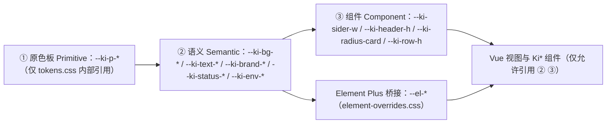

# kinstall 前端 UI 设计系统与组件视觉基准（`DESIGN.md` v3.0）

> **本文定位**：kinstall Web 管理控制台的**唯一视觉语言、三层 Design Token、Element Plus 主题桥接、壳层布局、基础 / 领域组件规范、页面模板、数据格式、无障碍与工程治理基准**。
>
> **v3.0 重构基准**：全面对标成熟企业云运维控制台（参考 `hcs-inspector/frontend` 视觉工程实践），由暗色极客风升级为**浅色优先、清朗克制、高信息密度的企业云基础设施交付控制台（Clean Enterprise Cloud Ops Console）**，同时保留完整暗色模式切换、100% 离线自托管字体/图标、WCAG 2.2 对比度与 Stylelint 自动化守卫。
>
> **与 `WEB_DESIGN.md` 的分工**：
> - **`DESIGN.md`（本文）**：定义“**视觉语言、三层 Token、页面骨架、组件规范、数据排版、视觉红线与 CI 自动化门禁**”。
> - **[`WEB_DESIGN.md`](./WEB_DESIGN.md)**：定义“**信息架构（IA）、业务交互流、Vue 3.5 / Pinia / `@hey-api/openapi-ts` / SSE / `go:embed` 前端工程架构**”。
> - **[`ARCHITECTURE.md`](./ARCHITECTURE.md)**：平台整体架构口径（前端性能与安全红线见 §12：`O-09` 首屏 JS `≤ 350 KiB` gzip、`O-10` 100% 离线零外部 CDN）。

---

## 1. 设计哲学与视觉气质

### 1.1 视觉基调：**清朗精密的企业云运维控制台（Clean Enterprise Cloud Console）**

kinstall 服务于企业生产机房与物理离线/涉密环境的运维团队。v3.0 摒弃厚重压抑的纯黑面板与过度装饰，全面采用类似华为云 HCS 巡检平台与现代云控制台的**浅色高可读视觉体系**（并支持一键切换暗色模式）：

| # | 核心原则 | 可验证判据 |
| :---: | --- | --- |
| P1 | **浅色画布 + 纯白卡片 + 1px 细边框** | 默认画布 `#F4F6FA`，容器卡片纯白 `#FFFFFF`、`10px` 圆角、`1px solid #E5E8EF` 边框 + 极轻投影 `0 1px 2px rgba(16,24,40,0.04)`；仅 Hover / 浮层抬升阴影 |
| P2 | **信息分层清晰、零装饰噪音** | 页内分节统一使用 `3px × 14px` 品牌蓝竖条（`.section-title`）；列表页顶部采用带 `4px` 语义色条的可点击统计筛选条（`.ki-chips`） |
| P3 | **壳层克制、导航高效** | 左侧 `220px`（折叠 `64px`）分组浅色侧栏，激活态为 `#EEF4FF` 浅蓝底 + 左侧 `3px` 品牌蓝指示条；顶栏 `56px` 集成面包屑、全局搜索 `/`、`PageHeader` 刷新按钮、项目/环境胶囊切换、实时状态点与用户卡片 |
| P4 | **高危确定性与环境强隔离** | 生产环境 `PROD` 红色徽标常驻顶栏与浏览器标题；高危变更（破坏实例、强行覆盖漂移、吊销 Kubeconfig）必须经过 `KiDangerConfirmModal`（环境徽标 + 精确输入资源名 + 默认焦点在取消） |
| P5 | **双主题一等公民、全量 Token 驱动** | 默认 `light`，支持 `light / dark / system` 三态无缝切换；组件与页面严禁硬编码十六进制色值或直接引用 `--ki-p-*` 原色板 |
| P6 | **100% 物理离线零退化** | Inter / JetBrains Mono WOFF2 字体、SVG 图标与样式全部打包进 `web/dist/`；严格 CSP 零外链，CI 自动扫描 `http(s)://` 外链 |

---

## 2. 色彩系统与三层 Token 架构

### 2.1 三层 Token 架构

### 2.2 品牌与中性表面层级（Light 默认 / Dark 切换）

| 语义层级 | Token | Light（默认） | Dark | 用途 |
| --- | --- | :---: | :---: | --- |
| L0 页面画布 | `--ki-bg-canvas` | `#F4F6FA` | `#0B0F17` | 主内容区底色、登录页底色 |
| L1 卡片/侧栏/顶栏 | `--ki-bg-surface` | `#FFFFFF` | `#111827` | `.ki-card`、左侧栏、顶栏、表格底 |
| L2 浮层表面 | `--ki-bg-elevated` | `#FFFFFF` | `#182235` | Drawer、Dialog、Popover、命令面板 |
| L3 柔和填充 | `--ki-bg-subtle` | `#F7F8FA` | `#1F2A3E` | 表头、`.kv-grid` 键列、次级块、输入框底 |
| 交互悬停底 | `--ki-bg-hover` | `#F2F6FF` | `#1A2742` | 表格行 Hover、列表项 Hover |
| 侧栏激活底 | `--ki-sider-active-bg` | `#EEF4FF` | `rgba(59,130,246,0.16)` | 侧栏当前菜单项与二级工作区激活标签 |
| 终端 / 代码底 | `--ki-bg-terminal` | `#0F172A` | `#080C12` | xterm 实时终端、3-Way Diff 代码区（双主题均保持深色护眼） |
| 常规边框 | `--ki-border-default` | `#E5E8EF` | `#334155` | 卡片外框、顶栏底线、侧栏右线 |
| 细分割线 | `--ki-border-subtle` | `#EEF0F4` | `#1E293B` | 表格行分割、`.kv-grid` 内框、分组横线 |
| 控件边框 | `--ki-border-control` | `#94A3B8` | `#64748B` | 输入框/下拉框边框（满足 WCAG 1.4.11 ≥ 3:1） |
| 主文字 | `--ki-text-primary` | `#1D2129` | `#F1F5F9` | 标题、KPI 数值、表格主列 |
| 次文字 | `--ki-text-secondary` | `#4E5969` | `#94A3B8` | 正文说明、侧栏菜单、表头 |
| 弱文字 | `--ki-text-muted` | `#6B7785` | `#8794A8` | 辅助标签、时间戳、占位符（满足 WCAG AA ≥ 4.5:1） |

### 2.3 品牌色、语义状态色与环境色

| 类别 | Token | Light（默认） | Dark | 场景 |
| --- | --- | :---: | :---: | --- |
| 品牌主色 | `--ki-brand` | `#1D63F0` | `#3B82F6` | 主按钮、激活导航左竖条、链接、焦点环 |
| 品牌实底（承载白字） | `--ki-brand-solid` | `#1D63F0` | `#2563EB` | 保证白字对比度 ≥ 4.5:1（WCAG AA） |
| 成功 / 正常 | `--ki-status-ok` / `subtle` | `#2E7D32` / `#E8F5E9` | `#10B981` / `rgba(16,185,129,0.14)` | 健康、执行成功、校验通过、在线 |
| 进行中 / 信息 | `--ki-status-running` / `subtle` | `#1976D2` / `#E3F2FD` | `#0EA5E9` / `rgba(14,165,233,0.14)` | 执行中、探测中、信息提示 |
| 警告 / 漂移 / 审批中 | `--ki-status-warn` / `subtle` | `#C75B00` / `#FFF3E0` | `#F59E0B` / `rgba(245,158,11,0.15)` | 外部漂移、待审批、ARM64 64K 页提示 |
| 危险 / 失败 / 阻断 | `--ki-status-danger` / `subtle` | `#D93026` / `#FDECEA` | `#EF4444` / `rgba(239,68,68,0.15)` | 执行失败、篡改告警、阻断、PROD 环境 |
| 中性 / 未知 | `--ki-status-neutral` / `subtle` | `#5F6B7A` / `#F2F3F5` | `#64748B` / `rgba(100,116,139,0.16)` | 未运行、已取消、只读归档 |
| 部署目标色 | `binary` / `host-container` / `kubernetes` | 品牌蓝 / 青 `#0E7490` / 碧绿 `#0F766E` | 浅蓝 / 浅青 / 浅碧 | 三模交付目标徽标 |
| 环境上下文色 | `prod` / `staging` / `dev` / `sandbox` | 红 / 琥珀 / 绿 / 灰 | 同色系暗色变体 | 顶栏环境胶囊与高危弹窗前缀 |

### 2.4 WCAG 2.2 对比度硬约束

由 `web/scripts/contrast-check.mjs` 在 CI 中自动解析 `tokens.css` 验证 32 组前景色/背景色对（覆盖 Light 与 Dark 双主题 + 终端 ANSI 16 色）：
- 正文与辅助文本（`--ki-text-primary` / `secondary` / `muted` 在 `canvas` / `surface` / `subtle` 上）≥ **4.5:1**；
- 实底按钮（白字在 `--ki-brand-solid` / `--ki-danger-solid` 上）≥ **4.5:1**；
- 表单控件边框（`--ki-border-control` 在 `surface` 上）≥ **3.0:1**（WCAG 1.4.11）。

---

## 3. 排版、间距、圆角与阴影体系

### 3.1 字体栈（100% 离线打包 + 国产 OS 友好）

- **界面无衬线**：`"Inter", -apple-system, BlinkMacSystemFont, "PingFang SC", "Microsoft YaHei", "Noto Sans CJK SC", "Source Han Sans SC", "WenQuanYi Micro Hei", sans-serif`
- **数值展示**：`"DIN Alternate", "Inter", system-ui, sans-serif` + `font-variant-numeric: tabular-nums`（`.ki-num`）
- **等宽代码/IP/哈希**：`"JetBrains Mono", SFMono-Regular, Menlo, Consolas, "Noto Sans Mono CJK SC", monospace`（`.ki-mono`）

### 3.2 尺寸与圆角 Token

| Token | 舒适模式（默认） | 紧凑模式 | 说明 |
| --- | :---: | :---: | --- |
| `--ki-sider-w` / `--ki-sider-collapsed-w` | `220px` / `64px` | `220px` / `64px` | 左侧导航宽度 |
| `--ki-header-h` | `56px` | `52px` | 顶部全局工具栏高度 |
| `--ki-menu-item-h` | `40px` | `34px` | 侧栏导航行高 |
| `--ki-radius-card` | `10px` | `10px` | 主卡片 `.ki-card`、KPI 卡片圆角 |
| `--ki-radius-md` / `--ki-radius-sm` | `8px` / `6px` | `8px` / `6px` | 菜单项、筛选块、按钮、输入框 |
| `--ki-row-h` / `--ki-table-header-h` | `44px` / `38px` | `34px` / `32px` | 表格行高与表头高 |
| `--ki-shadow-card` | `0 1px 2px rgba(16,24,40,0.04)` | 同左 | 浅色卡片极轻投影 |
| `--ki-shadow-hover` | `0 6px 18px rgba(16,24,40,0.08)` | 同左 | 可点击卡片 Hover 抬升 |

---

## 4. 壳层架构与页面骨架（对标 `BasicLayout`）

### 4.1 左侧栏（220px / 64px 浅色分组导航）

- **顶部 Logo 区（56px）**：`30×30` 品牌蓝圆角 SVG 盾牌交付图标 + 粗体 `kinstall 交付平台`，底部分割线 `1px solid var(--ki-border-subtle)`。
- **分组导航（4 大分组）**：
  1. **运行总览**：`总览驾驶舱 (/dashboard)`
  2. **基础设施与交付**：`CMDB 主机 (/hosts)`、`实例与插件 (/instances)`、`Stack DAG 编排 (/stacks)`、`多集群管理 (/clusters)`
  3. **执行与审批**：`执行中心 (/operations)`、`四眼审批台 (/operations/approvals)`（带待审批红点数字徽章）
  4. **安全与平台**：`介质源策略 (/artifacts/media-policies)`、`审计与合规 (/security/audit)`、`平台设置 (/settings)`
- **菜单项样式**：高度 `40px`、圆角 `8px`；激活态浅蓝底 + 品牌蓝加粗文字 + 左侧 `3px` 蓝色垂直指示条（`::before`）；折叠态自动显示 `el-tooltip` 悬浮文字提示。
- **底部折耳（48px）**：右对齐圆形折叠按钮（折叠态居中）。

### 4.2 顶部工具栏（56px）

- **左侧**：移动端抽屉菜单按钮（`< 768px` 显示） + Element Plus 面包屑 `所属分组 / 当前页标题（15px 600）`。
- **中右**：全局搜索框（快捷键 `/` 或 `⌘K`），带 `<kbd>/</kbd>` 尾标，支持按模块/主机/实例快速跳转。
- **右侧功能簇**：
  1. **`PageHeader` Teleport 刷新按钮宿主**：各页面通过 `<PageHeader :refresh="load" :refreshing="loading" />` 注册统一的顶栏圆形刷新按钮；
  2. **项目 + 环境胶囊切换器**：带环境色圆点（含外圈光晕）+ 项目名称 + 环境标识 + 下拉切换面板；
  3. **离线安全状态指示灯**：带脉动光环绿点 `离线严格` 或 `在线受控`；
  4. **主题切换（亮/暗）/ 密度切换 / 中英切换** 轻图标按钮；
  5. **待审批铃铛徽标**：直达 `/operations/approvals`；
  6. **用户胶囊**：蓝色渐变圆形首字母头像 + 用户名 + 角色副标题；点击展开用户角色与项目作用域卡片、快捷切换主题/密度、退出登录。

### 4.3 二级工作区导航（`WorkspaceNav`）

多子模块共用一个业务工作区时，在主内容区顶部渲染底部带细边框的横向导航条（圆角 `6px`、激活态浅蓝底加粗）：
- **执行与审批工作区**：`执行中心 (/operations)` · `四眼审批台 (/operations/approvals)`
- **安全与合规工作区**：`审计哈希链 (/security/audit)` · `等保密评中心 (/security/compliance)` · `介质源策略 (/artifacts/media-policies)`

---

## 5. 标准容器、列表页与详情抽屉规范

### 5.1 核心全局布局类（`styles/base.css` & `styles/utilities.css`）

- **`.ki-card`**：白底卡片容器（`padding: 16px 20px; border-radius: 10px; border: 1px solid var(--ki-border-default); box-shadow: var(--ki-shadow-card)`），内含 `.ki-card__title`（`15px` 加粗标题 + `.sub` 副说明 + 右侧链接/操作）。
- **`.section-title`**：抽屉与表单内部分节标题，左侧固定 `3px × 14px` 品牌蓝圆角竖条。
- **`.kv-grid`**：4 列键值对只读信息网（`108px 1fr 108px 1fr`，浅灰键背景 + `1px` 细线格，窄屏自动折为 2 列），用于主机 Facts、实例规格、操作元数据展示。
- **`.filter-bar` / `.table-heading` / `.table-actions`**：统一筛选区与表格工具栏（新建、同步、导出按钮固定置于表格标题行右侧，不挤占顶栏）。
- **行左侧 3px 语义色条**：高危/失败/待审批行首单元格 `box-shadow: inset 3px 0 0 var(--ki-status-*)`。

### 5.2 登录页（`LoginView`）规范

- 全屏浅色画布 `#F4F6FA`，叠加双角极轻品牌蓝径向光晕与 `36px` 渐隐微网格背景；
- 居中 `400px` 纯白卡片（`14px` 圆角、柔和深投影 `0 16px 48px rgba(16,24,40,0.08)`）；
- 顶部品牌 SVG 标志 + 平台中英文标题；Element Plus `size="large"` 账号密码框（带前置图标与密码显隐）、记住账号、内联错误提示与 `42px` 通栏主按钮；底部可折叠本地演示凭据一键填充条。

---

## 6. 组件库清单（基础组件 + 8 大领域组件）

### 6.1 壳层与基础组件（`web/src/components/` & `components/ki/`）

| 组件 | 定位与职责 |
| --- | --- |
| `PageHeader.vue` | Teleport 到顶栏右侧的统一页面刷新按钮（含防重入 loading） |
| `WorkspaceNav.vue` | 关联模块横向二级导航条 |
| `StatCard.vue` | `40×40` 柔和色底图标块 + 标题 + `26px` 等宽粗体数值 + 单位 + 底部明细，支持点击下钻与悬停抬升 |
| `KiStatusBadge.vue` | 三重冗余状态徽标（图标 + 文案 + 语义底色，`role="status"`） |
| `KiEnvBadge.vue` | `PROD / STAGING / DEV / SANDBOX` 环境警示徽标 |
| `KiDomainTag.vue` | 部署目标（`binary` / `host-container` / `kubernetes`）、CPU 架构（`arm64-64K` 琥珀警示）、介质类型、开源许可证红黄绿灯弹窗 |
| `KiMonoText.vue` | 等宽文本中间截断（`sha256:4c27…9a5f`）+ 一键复制（1.5s 绿色勾选反馈） |
| `KiButton` / `KiInput` / `KiSecretInput` | 原生 Token 按钮、表单输入、加密凭据掩码框（`cred_01J…` + `autocomplete="new-password"`） |
| `KiPanel` / `KiDrawer` / `KiModal` / `KiBanner` / `KiEmptyState` / `KiDataTable` | 统一容器、抽屉、弹窗、粘性提示条、四态空状态与游标表格 |
| `KiCommandPalette.vue` | `⌘K` 全局命令跳转面板 + `?` 快捷键速查弹窗 |

### 6.2 八大领域组件（`web/src/components/domain/`）

| # | 组件 | 核心能力 |
| :---: | --- | --- |
| 1 | `KiDangerConfirmModal.vue` | 置顶 `KiEnvBadge` + 红底风险摘要 + 精确匹配目标资源名 + 默认焦点落在「取消」 |
| 2 | `KiMediaSourceCard.vue` | 介质源优先级卡片（`[1]/[2]/[3]`、`GripVertical`、`Alt+↑/↓` 键盘重排、`offlineStrict` 时在线源半透明锁定 + 探测延迟） |
| 3 | `KiDynamicSchemaForm.vue` | 完整支持 7 个 `x-kinstall-ui` 扩展关键字：`group`（`advanced` 默认折叠）、`host-role-picker`（按故障域分组 + 64K 提示）、`credential-select`、`deploy-target-cards`（`2px` 品牌蓝选中卡片）、`cidr-allocator`、`visibleWhen`、`riskWarning` |
| 4 | `KiThreeWayDiffViewer.vue` | 基于 **`@codemirror/merge`** `MergeView` + `@codemirror/lang-yaml` 的实时 3-Way Diff（`lastApplied` / `liveObserved` / `desired`），非颜色 `+`/`-` 标记；选择 `--force-override` 强制弹出 `KiDangerConfirmModal` |
| 5 | `KiOperationTerminal.vue` | 基于 **`@xterm/xterm`** + `@xterm/addon-fit` + **`@xterm/addon-search`**，左侧 `280px` Phase/Host 执行树 + 右侧实时终端（搜索高亮、按主机过滤、仅看错误、日志下载、SSE 断线重连胶囊、失败态 `KiProblemBanner` + `--resume` 续跑） |
| 6 | `KiStackDagNode.vue` + `StackCanvas.vue` | Vue Flow 2.0（`@xyflow/vue`）自定义业务节点（`240px` 宽、头部状态条、左右端口与加密 `Lock` 输出句柄、底部统计条）+ 实时环依赖检测守卫 |
| 7 | `KiAuditHashBadge.vue` | 审计防篡改链横幅（最新 `seq`、`SHA-256 + SM3` 国密双链标识、一键重验与篡改点锚点定位） |
| 8 | `KiProblemBanner.vue` | RFC 9457 错误横幅（`KI-*` 错误码徽章、中文建议、`KiMonoText` `traceId`、`aria-live="assertive"`） |

---

## 7. 前端工程架构与自动化治理门禁

### 7.1 Element Plus 按需引入策略（借鉴 `hcs-inspector` 最佳实践）

- **JS 按需引入**：`vite.config.ts` 启用 `unplugin-vue-components` + `ElementPlusResolver({ importStyle: false })`，仅打包实际使用的组件逻辑，首屏入口 JS 体积控制在 `≤ 350 KiB` gzip（`O-09`）。
- **CSS 顺序确定性**：在 `web/src/main.ts` 按固定顺序一次性导入：
  1. `element-plus/dist/index.css`
  2. `element-plus/theme-chalk/dark/css-vars.css`
  3. `./styles/fonts.css`（本地 WOFF2 字体）
  4. `./styles/tokens.css`（三层 Token 定义）
  5. `./styles/element-overrides.css`（`html[data-theme]` 高优先级覆盖）
  6. `./styles/base.css`（全局排版、`.ki-card`、`.section-title`、`.kv-grid`、打印与强制色）
  7. `./styles/utilities.css`（布局工具类）
- **大依赖分包**：`@codemirror/*`、`@xterm/*`、`@xyflow/vue` 按路由/组件异步懒加载并独立拆包，绝不污染首屏。

### 7.2 自动化 CI 治理门禁

| 门禁 | 命令 | 校验标准 |
| --- | --- | --- |
| OpenAPI 类型生成 | `npm run openapi-ts` | 从 `api/openapi.yaml` 零误差生成 `src/api/gen/` |
| CSS Token 守卫 | `npm run lint:css` | Stylelint 零 hex / 零 rgb / 零 `--ki-p-*` 泄漏 / 零 `!important`（白名单除外） |
| WCAG 2.2 对比度审计 | `npm run contrast-check` | Light + Dark + ANSI 共 32 组对比度 100% 达标 |
| W3C DTCG Token 导出 | `npm run tokens:export` | 同步生成 `design/tokens.json` |
| 单元测试 | `npm run test` | Vitest 验证 SSE 单调去重、格式化、5 角色 RBAC、DAG 环检测 |
| 类型检查与离线打包 | `npm run typecheck && npm run build` | `vue-tsc` 零报错；`web/dist/` 零 `http(s)://` 外链；首屏 JS `≤ 350 KiB` gzip |
| 设计系统陈列室 | `/__design` 路由 | 同屏展示全部基础与领域组件 × 亮暗主题 × 舒适/紧凑密度 |
