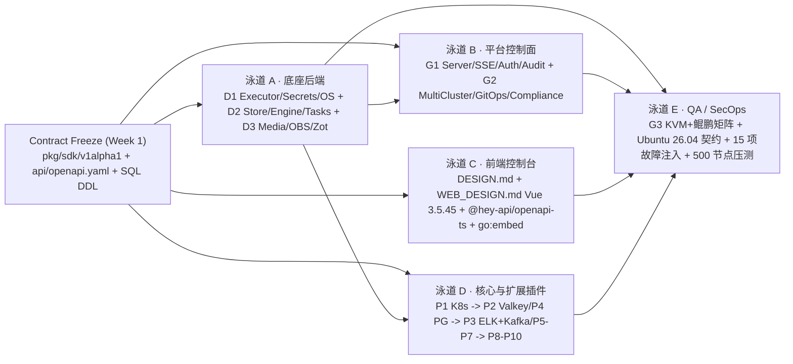

# kinstall 全栈工程开发任务 Checklist（`DEV_TASK_CHECKLIST.md`）

> **版本**：v1.3（配合 `v4.5-complete` 全域深度一致性终审包交付，2026-11-26；v1.3 修正 24 表数量与迁移文件名、`D1`/`WEB_DESIGN` 章节引用、22 个初始化模块、10 个 M0 Task、containerd `2.3`、`kinstall secrets rewrap`、`pageSizes`、kubeconfig 8h/24h、`offlineStrict` 与 ADR-057/058/060 归属；任务总数仍为 126）。
> **定位**：将全套 45 篇设计文档（基线 `00–18` + `ARCHITECTURE.md` + `DESIGN.md` + `WEB_DESIGN.md` + 深度设计 `D1–D3` / `G1–G3` / `P1–P10` / `R1–R2`）转化为面向研发团队的 **126 项原子级可执行工程任务（Jira / GitHub Projects 可直接导入）**，覆盖 Go 1.27 后端、Vue 3.5.45 前端、10 大核心与扩展插件、供应链介质引擎（本地 / 在线 / 华为云 OBS·S3）及多架构自动化验证门禁。

---

## 1. 多团队并行研发拓扑与角色分工

| 泳道代码 | 负责范围 | 主参考设计文档 |
| :---: | --- | --- |
| **`BASE`** | 执行器、信封加密、OS 适配、存储迁移、任务引擎、15 Tasks、供应链与本地/在线/OBS 三元介质引擎 | `D1`、`D2`、`D3`、`03`、`05`、`12` |
| **`PLAT`** | `internal/app` Facade、OpenAPI 3.1 Strict Server、多副本 SSE、OIDC/Argon2/四眼审批、审计链、多集群、GitOps、通知、等保密评 | `G1`、`G2`、`02`、`05`、`13` |
| **`WEB`** | 独立 Vue 3 控制台、Design Tokens、11 核心页面（含 OBS 介质源中心）、动态插件表单、3-Way Diff、SSE 分屏终端、Stack 画布、`go:embed` | `WEB_DESIGN.md`、`G1 §2–§3` |
| **`PLUG`** | `plugins/*` 强类型 Go 插件（P1–P10，仅依赖 `pkg/sdk/v1alpha1`）+ OCI 声明式插件包 + `hashicorp/go-plugin` 外部插件 | `P1–P10`、`04`、`06–11`、`15–18` |
| **`QA`** | CI 门禁、`testcontainers` 契约测试、三层多架构 KVM/鲲鹏平台、15 项故障注入、500 节点 `kwok` 压测、SBOM/CVE 门禁 | `G3`、`14`、`12 §8` |

---

## 2. 阶段任务总览（共 126 项原子开发任务）

| 里程碑 | 周期 | 任务数 | 里程碑硬退出门禁（Go/No-Go） |
| --- | :---: | :---: | --- |
| **M0 · 工程骨架与垂直切片 PoC** | 第 1–2 周 | 18 项 | Rocky 9 + Ubuntu 24.04 + 麒麟 V11 跑通单主 K8s 安装，连续两次 `apply` 第二次 **100% `Skipped`**；`depguard` & `CGO_ENABLED=0` 全绿 |
| **M1 · 底座封板 + CMDB + 三元介质引擎 + K8s HA MVP** | 第 3–10 周 | 25 项 | 30 分钟内纯离线拉起 3+3 HA K8s；**本地 / 华为云 OBS 私有桶 / 在线** 三元解析与 64K 页拦截全通过；22 个主机初始化模块（含首尾 `backup/verify`）`verify` 全绿 |
| **M2 · K8s 完整生命周期 + 多架构验证与 500 节点压测** | 第 11–16 周 | 15 项 | `1.35→1.37` 滚动升级数据面成功率 ≥ 99.9%；15 项自动化故障注入全过；`hydrophone` Conformance + 20 真机 + 480 `kwok` 达标 |
| **M3 · 平台控制面 HA + 完整 Web UI + 合规实操** | 第 17–24 周 | 28 项 | 3 副本 PG HA 压测无双写；PG 切主 SSE 零丢帧；SQL+Go 双重防自审；20 并发审计链零分叉；Web UI 零外网 CDN 打包通过 Lighthouse ≥ 90 |
| **M4 · 容器化目标 + `Stack` + 3-Way Diff + 核心插件第一批（P2/P4）** | 第 25–30 周 | 15 项 | Docker 29 `DOCKER-USER` 防火墙重启不失效；3-Way Diff 6 场景全过；Valkey（单/哨兵/Cluster × 二进制/Docker × 64K）与 PG（Patroni + `pgBackRest` PITR）离线 E2E 全过 |
| **M5 · 全栈核心插件（P3/P5/P6/P7）+ 扩展生态（P8–P10）+ 外部插件** | 第 31 周+ | 25 项 | **大型 ELK/OpenSearch + Kafka 4.x `KIP-848` + Data Prepper `acknowledgments` + OBS DLQ** 压测零丢日志；MySQL/SeaweedFS/SkyWalking 及 P8–P10 全量通过离线与许可证总闸 |

---

## 3. M0：工程骨架与垂直切片 PoC（第 1–2 周 · 18 项）

### 3.1 仓库、契约与 CI 地基（`BASE` / `QA`）
- [ ] **`T-M0-01`** `[BASE]` 初始化 Go `1.27.4` 单仓目录树（`cmd/kinstall`、`api/`、`pkg/sdk/v1alpha1`、`internal/*`、`plugins/*`、`migrations/{sqlite,postgres}`、`spec/`、`web/`），按 `G1 §7.1` 与 `05 §2.2` 锁定 `go.mod` — *DoD*: `CGO_ENABLED=0 go build ./cmd/kinstall` 产出 linux/amd64 与 linux/arm64 静态二进制。
- [ ] **`T-M0-02`** `[QA]` 配置 `.golangci.yml`（v2 + `depguard` 强制 R1–R6 铁律：`plugins/**` 仅可 import `pkg/sdk/v1alpha1`、禁止 `mattn/go-sqlite3`/`gorm`/`tjfoc/gmsm`）与 `Makefile` / GitHub Actions PR 流水线 — *DoD*: 故意在 `plugins/` 引入 `internal/` 触发 CI 红灯阻断。
- [ ] **`T-M0-03`** `[BASE]` 将 `spec/{osmatch.yaml,pkgmap.yaml,osmatch_golden.yaml}` 经 `//go:embed` 嵌入 `internal/osadapter`，并将 `python3 spec/gen_os_docs.py --check` 接入 CI — *DoD*: Go 侧回放全部 71 组 golden 样本与 2,880 项 `pkgmap` 100% 匹配。
- [ ] **`T-M0-04`** `[BASE]` 冻结 `pkg/sdk/v1alpha1` 稳定接口（`Plugin`、`Planner`、`Lifecycle`、`PipelineSpec`、`Phase`、`TaskSpec`、`MediaRef`、`HostRequirements`、`HostRoleClaims`）及 `pkg/sdk/v1alpha1/sdktest` Fake 桩 — *DoD*: 仅依赖标准库 + `sigs.k8s.io/yaml` + `Masterminds/semver/v3`。
- [ ] **`T-M0-05`** `[BASE]` 实现统一错误码 `KI-<域>-<4位>`、中英文 `go-i18n/v2` 目录（ADR-038）、`log/slog` JSON/彩色 Handler 与跨块滑动窗口脱敏 `RedactWriter`（`D1 §2.6`） — *DoD*: 单字节流式吐出明文/Base64/URL 编码机密测试 100% 脱敏零泄露。

### 3.2 执行器、OS 识别与存储引擎（`BASE`）
- [ ] **`T-M0-06`** `[BASE]` 实现 `internal/executor/sshx` 双层限流连接池（单主机 `MaxSessions` 信号量 + 建连令牌桶）、ProxyJump 多跳、`known_hosts` TOFU/固定校验与 `legacy_rsa` 回退（`D1 §2.1–§2.2`） — *DoD*: `gliderlabs/ssh` 仿真单测通过高并发连接复用与指纹变更阻断。
- [ ] **`T-M0-07`** `[BASE]` 实现 `sshx` Async Detached 远端执行器（`nohup setsid` + `runs/<id>/{script.sh,pid,stdout.log,stderr.log,rc}`（`pid` 存 PGID）断点重附）与 `sudo -n/-S` 提权封装（兼容 `sudo-rs#1668` 与 `pam_faillock` 熔断，`D1 §2.3–§2.4`） — *DoD*: 模拟中途断开 SSH 后重附拿到完整日志与真实退出码，不重跑脚本。
- [ ] **`T-M0-08`** `[BASE]` 实现三通道原子文件分发（`pkg/sftp` `UseConcurrentWrites(true)` + 临时文件 `fsync` + `mv -f` 原子替换、SFTP 禁用时退回 `stdin` 流式、大文件 HTTP Range 拉取，`D1 §2.5`） — *DoD*: 100 MB 文件传输校验 SHA-256 一致且断网不留半截目标文件。
- [ ] **`T-M0-09`** `[BASE]` 实现 1-RTT POSIX 零 Python Facts 采集脚本（OS/内核/`arch`/`getconf PAGESIZE`/`glibc`/`cgroup`/`x86-64` 级别/`machine-id`/安全模块/`sudo-rs`/磁盘网卡）与 7 族 `OSAdapter`（`D1 §4`） — *DoD*: `testcontainers-go` 跑通 Rocky 9 / Ubuntu 24.04 / openEuler 24.03 契约测试。
- [ ] **`T-M0-10`** `[BASE]` 实现 `internal/store` 双驱动仓储：`modernc.org/sqlite` 读写池分离（`MaxOpenConns(1)` 写池 + `_txlock=immediate` + `WAL` + `busy_timeout=10000`）与 `pgx/v5` 连接池 + `uptrace/bun`（`D2 §1.1`） — *DoD*: 30 并发写 SQLite 零 `SQLITE_BUSY` 报错。
- [ ] **`T-M0-11`** `[BASE]` 落地 `migrations/{sqlite,postgres}/00001_init.sql`（`D2 §1.3` 全量 13 张核心表，主键统一 `VARCHAR(48)` 前缀 ULID、含 `subnets_json`/`state_json`/`operations.state` CHECK/防分叉 `audit_chain_head`+`audit_logs`）并集成嵌入式 `goose` 只前滚迁移 — *DoD*: SQLite 内存库与真实 PG 18 容器 `goose.Up()` 均零报错通过。
- [ ] **`T-M0-12`** `[BASE]` 实现 `internal/engine` 自研任务引擎状态机（Pipeline → Phase → Step → TaskRun、单调 Fencing Token 租约抢占与 10s/30s 心跳、僵尸写回拒绝、断点续装 `--resume`，`D2 §2`） — *DoD*: 仿真 Worker A 停顿超时被 Worker B 接管，A 写回影响 0 行并自动取消本地 ctx。
- [ ] **`T-M0-13`** `[BASE]` 实现 `internal/template` 模板引擎（`text/template` `missingkey=error` + 自维护白名单函数表 + semver 目录匹配 + `expr v1.18.1` 预编译沙箱，ADR-036） — *DoD*: Golden 测试连续执行 10 次输出字节级完全一致。

### 3.3 最小内置 Task 库与 K8s PoC 闭环（`BASE` / `PLUG`）
- [ ] **`T-M0-14`** `[BASE]` 实现 M0 必备 10 个内置 Task（`file.sync` 含 SHA-256 幂等、`template.render`、`pkg.ensure`、`binary.install`、`systemd.unit`、`sysctl.apply`、`kmod.ensure`、`cmd.run`、`wait.tcp`/`wait.http`，`D2 §5`） — *DoD*: 每个 Task 均具备 `Check()` / `Apply()` 单测且二次执行 100% 返回 `Skipped`。
- [ ] **`T-M0-15`** `[BASE]` 实现 `internal/pki` 轻量内建 CA 与 X.509 证书签发器（支持 SAN 预留 VIP/域名、独立每实例 CA、证书到期检查） — *DoD*: 生成 K8s 全套 CA/apiserver/etcd/kubelet 证书并通过 `openssl verify`。
- [ ] **`T-M0-16`** `[PLUG]` 实现 `plugins/kubernetes` M0 最小单主安装链路（etcd v3.7.4、kube-apiserver/controller-manager/scheduler、containerd `2.3`、kubelet、Go 本地代理 `127.0.0.1:8443`、Calico、CoreDNS） — *DoD*: 仅依赖 `pkg/sdk/v1alpha1`。
- [ ] **`T-M0-17`** `[BASE]` 实现 `internal/cli` 基础命令树（`host add/probe`、`instance plan/apply/status`、`operation logs`，`-o json/yaml/table`）并接入 `cmd/kinstall/app.go` 显式 DI — *DoD*: CLI 零业务逻辑，全部经 `internal/app` Facade 调用。
- [ ] **`T-M0-18`** `[QA]` 执行 M0 退出门禁实测：在 Rocky 9（amd64）、Ubuntu 24.04（amd64）、麒麟 V11（arm64）完成单主 K8s 安装 + 连续两次 `apply` — *DoD*: 第二次 `apply` 100% Task 为 `Skipped`、`kubectl get nodes` `Ready`。

---

## 4. M1：底座封板 + CMDB + 本地/在线/OBS 三元介质引擎 + K8s HA MVP（第 3–10 周 · 25 项）

### 4.1 凭据加密、锁机制与 CMDB 主机初始化（`BASE`）
- [ ] **`T-M1-01`** `[BASE]` 实现 `internal/secrets` 信封加密（每记录独立 DEK + AAD 绑定、AES-256-GCM 默认 + `emmansun/gmsm v0.45.4` 纯 Go SM4-GCM 可选、内存 `clear()` 清零，`D1 §3`） — *DoD*: 篡改密文或调换记录 ID（AAD 不匹配）必解失败。
- [ ] **`T-M1-02`** `[BASE]` 实现 KEK 三后端（`0600` 本地密钥环文件、环境变量、**OpenBao 2.7.2 Transit `derived=true` + `context` 规避 `/rewrap` AAD 缺陷**）与 `kinstall secrets rewrap` 在线密钥轮换（`D1 §3.2`、`ARCHITECTURE O-11`） — *DoD*: 真实 OpenBao 2.7 容器测试 `encrypt → rotate → rewrap → decrypt` 全通。
- [ ] **`T-M1-03`** `[BASE]` 实现 `internal/lock` 两级防死锁资源锁（`Stack → Instance 排他 → Host 按 ID 字典序升序批量共享/排他`）与维护窗口门禁（`D2 §2.3`） — *DoD*: 100 并发交叉主机组合压测零死锁。
- [ ] **`T-M1-04`** `[BASE]` 实现 `internal/inventory` 主机批量导入（`.xlsx` via `excelize v2.11.1` / CSV / YAML）、网段自动发现、SSH 公钥批量分发与 `gocron/v2` 定时 Facts 刷新/巡检 — *DoD*: 500 行 `.xlsx` 导入耗时 < 2s 且冲突主机名精准报行号。
- [ ] **`T-M1-05`** `[BASE]` 实现 `instance_host_claims` 容量与冲突静态预检（端口碰撞、数据目录重叠、**Docker Bridge `subnets_json` 撞网检测**、内存与大页扣减，`D2 §1.3` / `R2`） — *DoD*: 复现 `R2` Sonar/Attu 9000 端口冲突与 Docker 子网碰撞测试 100% 在 Plan 阶段阻断。
- [ ] **`T-M1-06`** `[BASE]` 实现 `internal/hostinit` 全部 22 个主机初始化模块（含首尾 `backup/verify`，执行体 20 个）与 7 个内置 Profile（`base` / `k8s-node` / `database-pg` / `database-mysql` / `search` / `cache` / `object-storage`），含内核/cgroup v2 切换重启编排、磁盘分区 LVM + XFS `ftype=1`、冲突容器包排斥锁（ADR-026） — *DoD*: 每个模块均具备独立 `verify` 与初始化前备份回滚。
- [ ] **`T-M1-07`** `[BASE]` 实现安全执行控制兼容模块（KYSEC / `fapolicyd` / SELinux / `noexec` 检测阻断与显式授权后按文件加白入 `InstalledFile`，ADR-027）与等保主机加固模块 `harden`（`03 §9`，含执行账号 `faillock` 豁免） — *DoD*: 绝不自动关闭 SELinux/KYSEC，通过加固与执行器共存回归测试。
- [ ] **`T-M1-08`** `[BASE]` 实现主机配置漂移检测与 `kinstall host check` 9 大持续巡检基线（时间偏差、swap 复开、sysctl/THP 漂移、磁盘/inode 水位、证书到期、未纳管端口、OS EOL 180d，`03 §7.3 / §8.4`） — *DoD*: 手工修改 `vm.swappiness` 后巡检精准报漂移项。

### 4.2 离线供应链、跨架构构建与本地/在线/OBS 三元介质引擎（`BASE`）
- [ ] **`T-M1-09`** `[BASE]` 实现 `internal/artifact/bom` BOM 目录独立加载与校验器（`<product>/bom-<ver>-rev.<YYYY.MM.N>.yaml`、`images.lock` 多架构 digest 锁定、`pageSizes` 4K/64K 兼容标记（`D3 §1.2`），ADR-028/057） — *DoD*: arm64 64K 页主机选 4K jemalloc 构建必在 Plan 期报错阻断。
- [ ] **`T-M1-10`** `[BASE]` 实现 `internal/artifact/verify` 零出网验签引擎：`sigstore-go v1.4.1` 离线 `trusted_root.json` 验证（规避 `kyverno#18525` 空指针）+ `emmansun/gmsm` SM2/SM3 国密双签（`D3 §1`） — *DoD*: 断网容器内篡改 1 字节 BOM 或 Bundle 均被拒绝。
- [ ] **`T-M1-11`** `[BASE]` **实现 `internal/artifact/source` 本地 / 华为云 OBS·S3·OSS·COS / 在线三元介质解析引擎（`D3 §7`、ADR-077）**：优先级责任链 + `singleflight` 并发去重缓存 + `offlineStrict`/`strictLocal` 策略门禁 — *DoD*: Local 未命中自动回退 OBS、OBS 未命中回退 Online；开启 `offlineStrict` 仅允许 local 与 `internal: true` 内网白名单 OBS，硬拒 online 与公网/非白名单 OBS（`KI-SRC-0005`）。
- [ ] **`T-M1-12`** `[BASE]` 实现 `ObjectStoreSource` 双驱动：`aws-sdk-go-v2/service/s3` 统一 S3v4 驱动（强制 `BaseEndpoint` + `RequestChecksumCalculationWhenRequired` + `ResponseChecksumValidationWhenRequired` 规避国产云 `aws-chunked` 坑，支持 AK/SK `credentialRef` 与 ECS IAM 委托 STS）+ 可选华为官方 `obs-native` 驱动 — *DoD*: 针对华为云私有 OBS 桶 / SeaweedFS S3 实测 `HeadObject`/`GetObject`/`PutObject` 全通。
- [ ] **`T-M1-13`** `[BASE]` 实现三元介质双交付通道：`relay-cache`（默认零出网目标机走部署机 HTTP Range）与 `direct-presigned`（15 分钟短效只读预签名直拉 + 自动注册 `RedactWriter` 脱敏防日志泄密）及 CLI `artifact verify-sources` / `pull` / `sync-to-obs` — *DoD*: 确认日志与 `operation_events` 零预签名 `Signature` 残留。
- [ ] **`T-M1-14`** `[BASE]` 实现 `internal/artifact/rewrite` 全局 `registryMirror` 镜像重写引擎与 `/etc/docker/certs.d` / containerd `hosts.toml` 私有 CA 自动下发（零 `insecure-registries`，`D3 §2` / `R2`） — *DoD*: 离线重写 `docker.io`/`ghcr.io`/`registry.k8s.io`/`quay.io` 及裸镜像名 100% 命中私仓。
- [ ] **`T-M1-15`** `[BASE]` 实现 `internal/artifact/server` 保留 `io.ReadSeeker` 的 HTTP Range 两级限速分发服务（全局总带宽 + 单连接限速 `x/time/rate`）与 `internal/artifact/zot` Zot `v2.1.23` 主库/区域 Pull-Through 边缘缓存管理（含 `compat: ["docker2s2"]` + `scrub`，`D3 §5`） — *DoD*: 50 节点并发拉取 500 MB 包不打满千兆网口且支持 `curl -C -` 断点续传。
- [ ] **`T-M1-16`** `[BASE]` 实现 `internal/artifact/oci`（`oras-go/v3 v3.0.0` 多根图同步与 Split-Host 鉴权）、流式 zstd 分卷 Bundle 构建器与 `bundle diff` 增量补丁包生成器（`D3 §1 / §6`） — *DoD*: 小版本补丁增量包体积 < 全量包的 15%。
- [ ] **`T-M1-17`** `[BASE]` 实现 `internal/artifact/runtime` 底座多版本无侵入运行时管理器（`runtime/{jdk,maven,node}`：Temurin ≥ 2026-11-18 CSPU / 毕昇 JDK、多 JDK 并存不污染系统 `JAVA_HOME`、`cacerts` 幂等注入私有 CA、`.mavenrc` 隔离，`D3 §4` / `R2`） — *DoD*: 同主机并行运行 JDK 8/17/21 与 Maven 3.9/3.10 互不干扰。
- [ ] **`T-M1-18`** `[QA]` 搭建 EL8 `glibc 2.28` + `amd64`/`arm64-4K`/`arm64-64K(--with-lg-page=16)` 跨架构离线构建与 OS 包闭包流水线，接入 Syft `v1.57.2` + Grype `v0.122.1` + 隔离 Trivy `v0.76.2` + `go-licenses` 许可总闸（`D3 §3 / §6`） — *DoD*: CI 自动阻断 ELv2/SSPL/RSAL 进入公共离线包与 Critical 可达漏洞。

### 4.3 Kubernetes 生产级 HA MVP（`PLUG`）
- [ ] **`T-M1-19`** `[PLUG]` 实现 `plugins/kubernetes` 1.35–1.37 多版本模板分支（`04 §2.4`）与 `kubeadm v1beta4` CI 语义基线对比测试（J7） — *DoD*: 模板关键安全与运行参数偏离 `kubeadm` 基线必在 CI 报警。
- [ ] **`T-M1-20`** `[PLUG]` 实现三主/五主高可用拓扑、外置 etcd v3.7.4 集群、节点本地 Go 代理（健康检查/熔断/热加载）与外部 LB / VIP 入口（`04 §3 / §9`、`P1`） — *DoD*: 杀掉任意 1 台控制面节点，集群 API 请求抖动 < 2s。
- [ ] **`T-M1-21`** `[PLUG]` 实现混合架构集群（`amd64` + `arm64-4K` + `arm64-64K`）：多架构 OCI Index 强校验、节点自动打标/防误调度与跨页大小保护（`04 §3.4`、`P1 §2`） — *DoD*: 单架构镜像在混合集群预检报错拦截。
- [ ] **`T-M1-22`** `[PLUG]` 实现 CRI（containerd v4 默认 + Docker 29 + `cri-dockerd ≥ 0.4.11` 兼容）、CNI（Calico nftables 默认 + Cilium / Flannel / Kube-OVN 可选）与新建集群双栈网络（ADR-014/015/031） — *DoD*: 内核 ≥ 5.13 + nft ≥ 1.0.1 自动启用双侧 nftables，不满足自动降级双侧 iptables。
- [ ] **`T-M1-23`** `[PLUG]` 实现 CSI Extension 接入框架（local-path / NFS / Longhorn / Rook-Ceph / OpenEBS / 厂商 CSI Extension 包），强制声明 `selinuxMount` 属性与主机依赖预检（ADR-032） — *DoD*: 共享文件类 CSI 声明 `selinuxMount: true` 被静态校验拒绝。
- [ ] **`T-M1-24`** `[PLUG]` 实现 `helm.release` 任务（`helm.sh/helm/v4 v4.3.2` SDK SSA + `kstatus`）与冻结 BOM `2026.11.3` Addon（Headlamp、Envoy Gateway API、kube-prometheus-stack、kubelet-csr-approver、NodeLocal DNSCache、cert-manager、MetalLB/kube-vip） — *DoD*: 二进制控制面 Prometheus 监控与告警规则自动接入。
- [ ] **`T-M1-25`** `[QA]` 执行 M1 退出门禁实测：纯断网环境下 30 分钟内拉起 3 控制面 + 3 工作节点 HA K8s 集群（含混合架构与 OBS/本地介质切换验证） — *DoD*: 全流程无外网请求，验收报告全项绿灯。

---

## 5. M2：K8s 完整生命周期 + 多架构验证与 500 节点压测（第 11–16 周 · 15 项）

- [ ] **`T-M2-01`** `[PLUG]` 实现 K8s `scale`（平滑增删控制面/工作节点：etcd 成员安全增删、本地代理上游列表热刷新、安全 `drain`/`delete` 与残留清理，`04 §13`、`P1 §4`） — *DoD*: 3 主扩 5 主再缩 3 主全程业务零中断。
- [ ] **`T-M2-02`** `[PLUG]` 实现 K8s `upgrade`（`1.35 → 1.36 → 1.37` 逐次版本滚动升级、etcd 先行快照、SELinux enforcing 下 1.36→1.37 `SELinuxMount` 卷标签冲突预检审计、双栈预检） — *DoD*: 升级全程数据面探针请求成功率 ≥ 99.9%。
- [ ] **`T-M2-03`** `[PLUG]` 实现 K8s `rotate-certs`（全链路 leaf 证书与双 CA 过渡零停机轮换）、`etcd-backup`（支持本地/S3/华为云 OBS 定时上传与完整性校验）与 `etcd-restore`（停控制面→恢复快照→重建成员→恢复业务） — *DoD*: 演练删除测试 Namespace 后经 `etcd-restore` 100% 找回。
- [ ] **`T-M2-04`** `[PLUG]` 实现 K8s `uninstall / reset`（按逆序停服、卸载挂载点、清理 CNI 接口与 nftables/iptables 链、释放 `instance_host_claims`） — *DoD*: `reset` 后同批主机可立即干净重装。
- [ ] **`T-M2-05`** `[BASE]` 实现 `kinstall support-bundle` 脱敏诊断包采集器（自动收集平台日志、Operation 快照、远端组件日志/systemd 状态/网络拓扑并经 `RedactWriter` 脱敏）与 `kinstall operation report` Markdown/JSON 报告生成器 — *DoD*: 诊断包自动扫描零明文凭据。
- [ ] **`T-M2-06`** `[QA]` 搭建 `G3 §1` 三层多架构自动化测试平台：Layer 1 GitHub Actions `ubuntu-24.04-arm` + Layer 2 按需鲲鹏/倚天云主机 + Layer 3 固定物理 KVM 集群（x86_64 + 鲲鹏 920 64K 页 + 麒麟/UOS 授权 ISO） — *DoD*: 夜间自动化调度流水线就绪。
- [ ] **`T-M2-07`** `[QA]` 落地 L4 `testcontainers-go` 容器契约测试流水线，重点覆盖 **Ubuntu 26.04 `sudo-rs` + Rust `uutils` coreutils** 专项回归（`G3 §2`） — *DoD*: 全套 POSIX Facts 脚本与 22 个初始化模块在 Ubuntu 26.04 全绿。
- [ ] **`T-M2-08`** `[QA]` 执行 12 组正交 VM 矩阵 E2E 回归（涵盖国际主流 + openEuler/Anolis/麒麟/UOS + 4K/64K 页 + Calico nftables 实机验证，以 `G3 §1.1` M01–M12 为唯一权威） — *DoD*: 产出完整矩阵报告并回填 `01` 实机项（R-NET-06 / R-OS-07 / D5）。
- [ ] **`T-M2-09`** `[QA]` 编写并执行 `test/e2e/chaos/` 全部 **15 项自动化故障注入脚本**（ADR-064：权威 15 项清单见 `14 §6` 与 `G3 §3.1` `FI-01–FI-15`，含节点本地代理 8 项、etcd 故障/灾备、VIP、containerd、证书续期、部署机断连重附、多副本 Fencing 接管；中间件扩展 `FX-01–FX-08` 见 `G3 §3.2`） — *DoD*: 15/15 项自动恢复并满足 RTO/RPO 红线。
- [ ] **`T-M2-10`** `[QA]` 在真机 HA 集群执行 `hydrophone v0.8.0` 完整 Kubernetes Conformance 认证套件 — *DoD*: 0 失败项，留存 JUnit XML 证据。
- [ ] **`T-M2-11`** `[QA]` 按 `G3 §4` SOP 执行 **500 节点混合压测**（20 台真实 VM 验证真实 CNI/镜像/调度数据面 + 480 台 `kwok v0.8.0` 节点 + `kube-burner v2.8.7` 验证控制面与 etcd WAL fsync p99 < 25 ms） — *DoD*: 明确分列控制面与真机数据面两套压测指标并达标。
- [ ] **`T-M2-12`** `[QA]` 补齐商业 OS（麒麟 V10/V11、UOS V20/V25）离线 ISO 依赖闭包流水线实测（关闭 `G3` 实机项） — *DoD*: 商业 OS 纯断网完整初始化与 K8s 安装成功。
- [ ] **`T-M2-13`** `[PLUG]` 2026-12-16 后跟进 **K8s 1.38 GA** 复核（关闭 `E14` / `R-RT-07`：`cri-dockerd` `RuntimeConfig` 实测转正）并发布 BOM revision `2026.12.1`（纳入 `1.37.3`/`1.36.7`/`1.35.11` 补丁） — *DoD*: 通过独立 BOM 升级与增量补丁包验证。
- [ ] **`T-M2-14`** `[PLUG]` 落地全版本模板实物与 golden 回归基线（关闭 `E15`） — *DoD*: 1.35–1.38 全部配置模板覆盖 golden 测试。
- [ ] **`T-M2-15`** `[QA]` 编写平台与 K8s 标准化《故障诊断与应急恢复手册》（关闭 `I3`） — *DoD*: 覆盖 Top 30 现场错误码（`KI-*`）排障步骤。

---

## 6. M3：平台控制面 HA + 完整 Web UI + 多集群与合规实操（第 17–24 周 · 28 项）

### 6.1 平台控制面后端（`PLAT`，严格对齐 `G1` & `G2`）
- [ ] **`T-M3-01`** `[PLAT]` 冻结 `api/openapi.yaml`（OpenAPI 3.1，覆盖 Project/Host/Credential/MediaPolicy/Plugin/Instance/Stack/Plan/Operation/Approval/Cluster/Audit/Compliance/Notify 全部端点），配置 `api/oapi-codegen.yaml` 生成 `internal/server/gen` 与 `pkg/client` — *DoD*: CI `make generate && git diff --exit-code` 零漂移。
- [ ] **`T-M3-02`** `[PLAT]` 落地 `migrations/{sqlite,postgres}/0002_platform_control_plane.sql`（`G1 §6.3` 新增 10 张控制面表：`media_policies`、`users`、`user_sessions`、`api_tokens`、`idempotency_keys`、`plans`、`instance_state_backups`、`notification_channels`、`notification_deliveries`、`cluster_kubeconfigs`）与 `0003_approvals.sql`（`G1 §4.2` `operation_approvals` 含 `chk_no_self_approval`） — *DoD*: 全库 **24 张表**（D2 13 + G1 11）在 SQLite 与 PG 18 均通过 `goose.Up()` 与外键完整性测试。
- [ ] **`T-M3-03`** `[PLAT]` 实现 `internal/app` 8 大同源业务 Facade Service（`Project`、`Host`、`MediaPolicy`、`Instance`、`Stack`、`Operation`、`Auth`、`Audit`，`G1 §1.2`）并重构 CLI `--server` 模式直连 `pkg/client` — *DoD*: 同一用例在本地模式与远端模式行为 100% 一致。
- [ ] **`T-M3-04`** `[PLAT]` 实现 `internal/server` Chi 路由与中间件链：TraceID、限流、RFC 9457 `ProblemDetails`（双语 `Accept-Language`）、`Idempotency-Key`（24h 并发去重 + 换体 `409 KI-API-0002`）与 `ETag`/`If-Match`（`412 KI-API-0003`，`G1 §2`） — *DoD*: 10 并发同 Key 压测仅执行 1 次下游写操作。
- [ ] **`T-M3-05`** `[PLAT]` 实现多副本无丢帧 SSE 引擎（`internal/server/sse.go` + `internal/events`）：`http.NewResponseController(w).SetWriteDeadline(time.Time{})` + 单帧 10s 保护 + 15s keepalive + 先订阅后追读 + 独立直连 PG `LISTEN/NOTIFY`（断连自动 `resync` 脉冲，`G1 §3`） — *DoD*: 2 副本跨节点 45s 持续日志流不断连、断线带 `Last-Event-ID` 零漏帧零重帧。
- [ ] **`T-M3-06`** `[PLAT]` 实现 `internal/authz` 三合一认证：OIDC SSO（`coreos/go-oidc/v3` PKCE S256 + DB Session 吊销）、Argon2id 本地账号（OWASP 2026 基线 + 跨副本共享 5 次错锁 15 分钟 `423 Locked`）与短效作用域 API Token（`ki_<8>_<32>` 只存 SHA-256，`G1 §4.1`） — *DoD*: 覆盖 Mock OIDC IdP 与暴力破解锁定测试。
- [ ] **`T-M3-07`** `[PLAT]` 实现项目/环境/资源 5 角色 RBAC 鉴权矩阵与**四眼审批状态机**（Go 业务层 + PostgreSQL/SQLite `chk_no_self_approval` 约束双重防自审，高危动作自动停在 `awaiting_approval`，`G1 §4.2`） — *DoD*: 绕过业务层直写 SQL 企图自审被 DB 约束阻断。
- [ ] **`T-M3-08`** `[PLAT]` 实现 `internal/audit` 高并发防分叉审计哈希链（`audit_chain_head` + PG `pg_advisory_xact_lock` + `.UTC().Truncate(time.Microsecond)` 精度对齐 + SHA-256/SM3 并行链）、`kinstall audit verify` 与异步 RFC 5425 TLS Syslog Outbox 外送器（`G1 §5`） — *DoD*: 20 并发写 2,000 条记录零分叉，手工篡改 1 字节 `verify` 精准定位 `seq`。
- [ ] **`T-M3-09`** `[PLAT]` 实现 HA 滚动升级机制（`pg_advisory_lock` 串行迁移、SQLite `VACUUM INTO` 升级前自动快照、`MaxCompatibleSchemaVersion` 门禁触发旧副本自动 `Draining` + `/readyz` 返 `503`）与插件 `StateMigrator`（`G1 §6`） — *DoD*: 3 副本并发冷启与双版本滚动升级回归测试全通过。
- [ ] **`T-M3-10`** `[PLAT]` 实现 `internal/multicluster` 多集群管理：跨集群健康聚合、短效 RBAC kubeconfig 签发（默认 8h，硬上限 24h，`admin` 仅绑定 `kinstall:cluster-admin` 且最长 4h，**严禁签发 `O=system:masters`**）与一键吊销（`G2 §1`） — *DoD*: 吊销后 5 秒内原 kubeconfig 访 API 返 `401/403`。
- [ ] **`T-M3-11`** `[PLAT]` 实现外部 CMDB 双向同步接口（Pull/Push Webhook + 字段映射 + 冲突告警）与 GitOps 两段式流水线 CLI（`kinstall spec export/diff/apply --ci` 退出码规范，`G2 §2`） — *DoD*: GitLab CI / GitHub Actions MR Plan + Merge Apply 样板跑通。
- [ ] **`T-M3-12`** `[PLAT]` 实现 `internal/notify` 多通道通知引擎（Webhook / 邮件 / 企业微信 / 钉钉 / 飞书），内置时间窗口防风暴折叠聚合、指数退避重试与签名校验（`G2 §3`） — *DoD*: 1 分钟内注入 100 条同实例告警自动折叠为 1 条汇总通知。
- [ ] **`T-M3-13`** `[PLAT]` 实现 `internal/compliance` 等保 2.0 三级与密评实操证据包引擎（`kinstall compliance report`：并发汇总主机 `harden verify` + 二进制适配 `kube-bench v0.16.0` + 审计链全量验链 + PKI/OpenBao/SM4 状态 + 最近备份演练记录 → 签名 `evidence.tar.gz`）与外围 Tongsuo TLCP 国密双证书网关配置模板（`G2 §4`） — *DoD*: 生成的证据包通过离线校验并含完整等保/密评对照表。

### 6.2 独立前端控制台（`WEB`，严格对齐 `DESIGN.md`、`WEB_DESIGN.md` & ADR-023）
- [ ] **`T-M3-14`** `[WEB]` 初始化 `web/` 工程脚手架：Vue `3.5.45` + TypeScript `5.9` + Vite `6.4+` + Element Plus `2.14.2` + Pinia `3.0.4` + Vue Router `4.6+` + `lucide-vue-next`（纯原生 CSS Variables 体系、零 Tailwind/UnoCSS 与零外网 CDN），锁定 **`@hey-api/openapi-ts`**（CI 显式黑名单拦截 `openapi-typescript-codegen` `CVE-2026-108551`） — *DoD*: `pnpm openapi-ts && pnpm typecheck && pnpm build` 全通且离线断网加载 0 外链请求。
- [ ] **`T-M3-15`** `[WEB]` 严格按 **[`DESIGN.md`](./DESIGN.md)** 落地视觉设计系统基座：`web/src/styles/{fonts,tokens,element-overrides,base,utilities}.css`（三层 Token、暗/亮双主题、双密度 `40px/32px`、12 大基础 `Ki*` 组件与 `lucide-vue-next` 离线图标）、外置 `theme-boot.js`（CSP 合规防闪烁）、全局壳层与 `⌘K` 命令面板，接入 Stylelint 强制禁止硬编码十六进制色值与 16 条 PR 视觉红线（`DESIGN.md §12`） — *DoD*: 深/浅主题与紧凑密度一键切换无闪烁、`DESIGN.md §2.9` 对比度脚本全绿（正文 ≥ 4.5:1、控件边界 ≥ 3:1）与 Stylelint 零违规。
- [ ] **`T-M3-16`** `[WEB]` 实现登录认证页（OIDC SSO 跳转 + 本地 Argon2id 登录 + 5 次锁定倒计时提示）、RBAC 指令级按钮权限控制与 API Token 管理页（明文一次性复制展示） — *DoD*: `viewer` 角色隐藏/禁用全部写操作按钮。
- [ ] **`T-M3-17`** `[WEB]` 实现 **全局总览驾驶舱**（资源健康度、活跃 Operation 实时卡片、主机容量水位热图、证书/OS EOL 倒计时预警、待办审批红点，`WEB_DESIGN.md §3.1`） — *DoD*: 首屏渲染 < 1.5s。
- [ ] **`T-M3-18`** `[WEB]` 实现 **CMDB 主机纳管与初始化向导页**（高密度主机表、`arch`/`PageSize` 64K 高亮标签、`.xlsx` 拖拽批量导入预览、Facts 详情抽屉、22 模块初始化与 Profile 选择器、漂移巡检对比，`WEB_DESIGN.md §1.2` `/hosts` 路由） — *DoD*: 导入错误行内联标红定位。
- [ ] **`T-M3-19`** `[WEB]` **实现制品介质源配置中心（`/artifacts/media-policies`，对接 ADR-077，`WEB_DESIGN.md §3.2`）**：拖拽调整 Local / 华为云 OBS·S3 / Online 优先级顺序、AK/SK 选 `credentialRef` 不露明文、`deliveryMode`（`relay-cache` vs `direct-presigned`）与 `offlineStrict` 开关、一键连通性探活卡片与一键 `sync-to-obs` 进度追踪 — *DoD*: 完整联调 `MediaPolicyService` 全部 4 个 REST 端点。
- [ ] **`T-M3-20`** `[WEB]` 实现 **插件目录与 JSON-Schema `x-kinstall-ui` 动态表单渲染引擎**（完整支持 7 个规范关键字：`group`、`host-role-picker`、`credential-select`、`deploy-target-cards`、`cidr-allocator`、`visibleWhen`、`riskWarning`，`WEB_DESIGN.md §3.3` / `DESIGN.md §8.3`） — *DoD*: 仅凭插件 `params.json` Schema 零前端改码自动渲染 K8s / Valkey / ELK 安装表单。
- [ ] **`T-M3-21`** `[WEB]` 实现 **Plan 3-Way Diff 交互对比器**（`@codemirror/merge` 并排展示 `lastApplied` vs `liveObserved` vs `desired`，高亮远端漂移冲突行并提供 `Adopt` / `Force Override` 显式二次确认弹窗，`WEB_DESIGN.md §3.4`） — *DoD*: 命中 `KI-DIFF-0001` / `KI-DIFF-0002` 漂移阻断时必须输入实例名确认方可覆盖。
- [ ] **`T-M3-22`** `[WEB]` 实现 **基于 `fetch` ReadableStream 的 `useOperationSSE` Composable**（支持 `Authorization` 头、`Last-Event-ID` 断点续传、45s 心跳看门狗自动重连、`AbortController` 卸载清理）与 **`@xterm/xterm` 多主机分屏实时终端**（Phase 时间轴 + 主机过滤 + 搜索 + 日志下载，`WEB_DESIGN.md §3.5 / §4.3`） — *DoD*: 模拟断网 10s 恢复后无缝接续终端日志无重复行。
- [ ] **`T-M3-23`** `[WEB]` 实现 **`Stack` 复合应用栈可视化 DAG 拓扑画布**（**Vue Flow `2.0` `xyflow`** 自动分层排版、节点健康态实时联动、跨实例引用连线悬浮预览、单步下钻实例详情与安全逆序销毁预览，`WEB_DESIGN.md §3.6`） — *DoD*: 渲染 P3 完整 ELK+Kafka 5 节点复合栈 60 FPS 流畅缩放拖拽。
- [ ] **`T-M3-24`** `[WEB]` 实现 **四眼审批队列页**（展示 Plan 变更摘要、禁止发起人按钮灰显并提示理由、批准/驳回必填意见）与 **多集群管理页**（集群概览、短效 kubeconfig 签发下载弹窗与一键吊销） — *DoD*: 联调双重防自审错误码优雅展示。
- [ ] **`T-M3-25`** `[WEB]` 实现 **审计哈希链查验与等保密评合规中心页**（多条件检索、一键在线触发 `audit verify` 链完整性校验动画、Syslog 外送延迟状态、等保/密评证据包一键生成下载） — *DoD*: 篡改演练时标红异常 `seq`。
- [ ] **`T-M3-26`** `[WEB]` 打通 `web/dist` → Go `internal/server/embed_ui.go`（`//go:embed` + HTML5 History 回退 `index.html` + `/assets/*` 长期缓存 + 严格 CSP 响应头，`WEB_DESIGN.md §4.3` B 节） — *DoD*: 单二进制启动后访问根路径零 404、零控制台报错。
- [ ] **`T-M3-27`** `[QA]` 执行前端发布门禁（`WEB_DESIGN.md §5`）：`pnpm openapi-ts` 契约零漂移、`vue-tsc --noEmit` 0 报错、Vitest 核心 Composable 单测、Playwright E2E（登录→配 OBS 源→Plan Diff→审批→SSE 终端）、Lighthouse 离线性能 ≥ 90 — *DoD*: 全部门禁进 CI。
- [ ] **`T-M3-28`** `[QA]` 执行 M3 平台 HA 综合压测（3 副本 Server + PG 18 Patroni HA，覆盖 PG 主备切换 SSE 不断流、20 并发审计链写入与滚动升级） — *DoD*: 通过 `G1 §8.1` 全部 5 类验收用例。

---

## 7. M4：容器化一等目标 + `Stack` + 3-Way Diff + 第一批中间件插件（第 25–30 周 · 15 项）

### 7.1 三元目标、复合栈与三向合并底座升级（`BASE`）
- [ ] **`T-M4-01`** `[BASE]` 实现 `docker.ensure` 内置 Task（离线二进制安装 Docker Engine `29.10.0` + Docker Compose CLI `v5.8.0`、排除 Ubuntu 滞后 `docker-compose-v2`、**`docker.service` 锁定 `LimitNOFILE=1048576` 禁 `infinity` 防 systemd 252+ 假死**、合法 `daemon.json` 含独立数据盘 `data-root` 校验与 `json-file` 日志轮转、`/etc/docker/certs.d` 私有 CA，`D2 §5` / `R2`） — *DoD*: 校验生成的 `daemon.json` 经 `json.Unmarshal` 强校验零语法错误，且 `LimitNOFILE` 不得为 `infinity`。
- [ ] **`T-M4-02`** `[BASE]` 实现 Docker Engine 29 双防火墙后端持久化守卫（`iptables` 场景维护 `DOCKER-USER` 链白名单；`nftables` 场景维护独立持久化 table + systemd drop-in 保证 `dockerd` 重启不冲掉规则，`D2 §5.2`） — *DoD*: 宿主机外网 IP 扫描容器映射端口被精确拦截，重启 `docker.service` 后规则仍生效。
- [ ] **`T-M4-03`** `[BASE]` 实现 `image.load`（联动 `D3 §7` `MediaResolver` 与 `registryMirror` 重写，支持 Zot/Harbor 拉取或离线 tar 流式 `docker load`）与 `compose.sync`（显式 `mounts: [{type: file|dir, uid, gid, mode}]` 原子预建防单文件被建为目录、禁 `chmod 777` 与默认 `privileged: true`、`0600 .env` 密钥隔离、生成合法 `Type=oneshot` + `RemainAfterExit=yes` 且**不含非法 `Restart=`** 的 `kinstall-compose-<inst>.service`，`D2 §5` / `R2`） — *DoD*: `systemd-analyze verify` 零告警；缺省空单文件挂载点 `up` 后类型为常规文件非目录。
- [ ] **`T-M4-04`** `[BASE]` 实现 `internal/planner/diff3way.go` Day-2 三向合并引擎（`lastApplied` vs `liveObserved` vs `desired` 6 场景矩阵、`KI-DIFF-0001` 外部漂移 / `KI-DIFF-0002` 双向冲突阻断、`--adopt` / `--force-override`）与 `file.sync` 的 `create-only` / `managed-block` 模式（ADR-070，`D2 §3`） — *DoD*: Sentinel 自写 `sentinel.conf` 后再次 `apply` 不覆盖运行态。
- [ ] **`T-M4-05`** `[BASE]` 实现 `internal/stack` 复合应用栈编排器（Kahn 拓扑排序判环、`${instances.<name>.outputs.<key>}` 与 **`externalRefs` 只读云/存量服务引用** 静态校验、白名单 **`urlEncode`** 模板函数与原始/转义双态脱敏、同层并行执行、销毁前反向引用检查且绝不触碰 `externalRefs`，`D2 §4`） — *DoD*: 循环依赖与引用不存在字段均在 Plan 期拦截（`KI-STACK-0001/0002`），`stack uninstall` 零触碰外部引用资源。

### 7.2 核心插件 P2：Valkey / Redis 全拓扑 × 三元形态（`PLUG`）
- [ ] **`T-M4-06`** `[PLUG]` 实现 `plugins/valkey` 强类型 Go 插件（默认 Valkey `9.1.4/9.2.0` BSD，显式可选 Redis `8.x` 不入公共离线包，ADR-013），支持 `host-binary` / `host-container` / `kubernetes`（Spotahome/Valkey Operator）三元目标 — *DoD*: 对照 `18 §3` 样板代码与 `P2`。
- [ ] **`T-M4-07`** `[PLUG]` 实现全拓扑编排：单节点、1主2从 + 3哨兵（`sentinel.conf` 强制 `create-only`）、3主3从 Cluster（环状跨故障域反亲和配对，杜绝主从落同机/同机架，`P2 §1`） — *DoD*: 任一宿主机/机架宕机 Cluster 自动完成主从切换。
- [ ] **`T-M4-08`** `[PLUG]` 实现 Valkey 生产稳定性治理：arm64 64K 页强制匹配 `--with-lg-page=16` jemalloc 构建、THP 关闭 + `vm.overcommit_memory=1` + RDB/AOF COW 内存预留校验、全链路 TLS + ACL、平滑迁槽扩容与小版本滚动升级（`P2 §2`） — *DoD*: 64K 页主机误选 4K 包必阻断；切主/扩容/升级演练全过。

### 7.3 核心插件 P4：PostgreSQL 高可用与 PITR（`PLUG`）
- [ ] **`T-M4-09`** `[PLUG]` 实现 `plugins/postgresql`（PG `18.7` 默认 / `19.0` GA；有 PGDG 源用 PGDG 包，国产 OS 用 EL8 容器编译包，ADR-047），强制 `initdb --data-checksums`，支持声明式幂等 **`bootstrapDatabases`**（最小权限账号、严禁业务 `SUPERUSER`/`WITH GRANT OPTION`、按校验和防重跑 `initSqlRef` 并导出加密 `dsnSecretRef`，`P4 §3`） — *DoD*: 通过 `database-pg` Profile（含动态大页联动）校验且超权授权声明在 `Validate()` 被硬拦截。
- [ ] **`T-M4-10`** `[PLUG]` 实现 `host-binary` HA 拓扑：Patroni `4.1.5` + etcd v3.7.4 DCS + PgBouncer `1.24.x` + HAProxy/VIP 读写分离路由（5000 写 / 5001 只读），配置 `use_pg_rewind: true` 与脑裂双主防护（`P4 §1`） — *DoD*: 杀主库 15 秒内完成自动切主，旧主拉起后自动 `pg_rewind` 归队。
- [ ] **`T-M4-11`** `[PLUG]` 集成 **`pgBackRest >= 2.60.0`**（强制 ≥ 2.59.3 修复加密子密钥缺陷，ADR-046），打通本地 / SeaweedFS / 华为云 OBS 仓库全增量备份 + WAL 归档与 `kinstall instance restore --target-time` PITR 任意时间点恢复闭环（`P4 §2`） — *DoD*: 演练误 `DROP TABLE` 后恢复至删除前 1 秒数据 100% 完整。
- [ ] **`T-M4-12`** `[PLUG]` 实现 PG `kubernetes` 目标（CloudNativePG `1.30.1` + Barman Cloud Plugin `0.15.1` via Helm v4 SDK）与跨大版本平滑升级编排（`P4 §4`） — *DoD*: K8s 形态通过备份恢复与故障切换验收。
- [ ] **`T-M4-13`** `[PLUG]` 落地 Valkey & PostgreSQL Prometheus Exporter（`redis_exporter` / `postgres_exporter`）、Fluent Bit 日志模板与告警规则 — *DoD*: 指标与告警在测试集群触发验证。
- [ ] **`T-M4-14`** `[QA]` 完成 M4 全套离线 E2E 验收（Valkey 3 拓扑 × 二进制/Docker × amd64/arm64-64K + PG HA 切主 + PITR + 滚动升级） — *DoD*: 验收报告全绿。
- [ ] **`T-M4-15`** `[BASE]` 补充 `internal/store` 与 `WEB` 对 Valkey/PG 专属运维动作（切主、迁槽、备份、PITR 恢复表单）的 OpenAPI 与 UI 联调 — *DoD*: Web 控制台一键触发 PITR 恢复成功。

---

## 8. M5：全栈核心插件（P3/P5/P6/P7）+ 扩展生态（P8–P10）+ 外部插件（第 31 周+ · 25 项）

### 8.1 核心插件 P3：大型 ELK / OpenSearch + Apache Kafka 4.x KRaft 中间消费全链路（`PLUG`）
- [ ] **`T-M5-01`** `[PLUG]` 实现 `plugins/kafka`（Apache Kafka `4.3.2/4.4.0` KRaft 纯无 ZooKeeper 架构、KIP-858 多盘 JBOD、随 BOM 绑定 `runtime/jdk` 21、JVM 堆锁定 6–8 GiB 留 75%–85% 内存给 Page Cache、`KIP-848` `group.protocol=consumer` 默认开启、`jmx_exporter` + `kafka_exporter` 双轨、Kafbat UI / Cruise Control、K8s Strimzi ≥ `1.3.2` 修复 `CVE-2026-55226`，`16` / `P3`） — *DoD*: 3 节点 KRaft 离线拉起、拔盘 JBOD 容灾与 `KIP-848` 零全局 STW 重平衡验证通过。
- [ ] **`T-M5-02`** `[PLUG]` 实现 `plugins/search`（默认 OpenSearch `3.10.0` Apache-2.0 + Operator `3.0 GA`；可选 ES `9.5/8.19` + ECK `3.5` 不入公共离线包），锁定堆上限 `min(50% RAM, 31 GiB)` + `bootstrap.memory_lock: true` + `vm.max_map_count=1048576` + 禁 NFS `path.data` + 热/温/冷节点角色与 180 天 ISM 自动转存 S3/OBS（`10` / `P3`） — *DoD*: 滚动重启节点分片零丢数据。
- [ ] **`T-M5-03`** `[PLUG]` 实现 `plugins/elk` 大型日志全栈采集与清洗插件：Fluent Bit 边缘采集（内存硬限 ≤ 256 MiB + 2 GiB 本地磁盘缓冲）、OpenSearch Data Prepper `2.16/2.17`（开启端到端 **`acknowledgments: true`** + S3/华为云 OBS 死信队列 DLQ）与可选 Filebeat/Logstash（`15` / `P3`） — *DoD*: 注入畸形 JSON / Mapping 类型冲突毒丸日志 100% 落入 DLQ 不阻断主管道。
- [ ] **`T-M5-04`** `[PLUG]` 落地 **`P3` 大型 ELK + Kafka 中间消费一键 `Stack` 编排模板与五大深水区治理**（三档规模自动选型、Topic 分区数 = Data Prepper 总消费线程数 = 索引主分片倍数自动校验、4 级背压传导、Mapping 爆炸字段数硬拦截、180 天冷归档，`P3 §3–§4`） — *DoD*: 模拟 OpenSearch 下游停服 10 分钟，Kafka 平滑蓄水 50 GB 后恢复消费零丢日志零 OOM。

### 8.2 核心插件 P5 / P6 / P7（`PLUG`）
- [ ] **`T-M5-05`** `[PLUG]` 实现 `plugins/mysql`（MySQL `8.4/9.7 LTS` 禁 8.0，官方 Generic Linux `tar.xz` / 可选 Percona Server 开源审计）：InnoDB Cluster（MGR 单主 + MySQL Router + MySQL Shell）、大事务流控与防脑裂、**声明式最小权限 `bootstrapDatabases`**（强制 `caching_sha256_password` + `hostCIDR` 限定、严禁 `*.*` / 通配库前缀 / `WITH GRANT OPTION`、幂等 `initSqlRef` 并导出加密 `dsnSecretRef`，`09` / `P5 §1, §3`） — *DoD*: 杀主库 10 秒内自动选主且 Router 自动切流；超权授权声明在 `Validate()` 被硬拦截。
- [ ] **`T-M5-06`** `[PLUG]` 实现 MySQL 物理热备（同主版本 `Percona XtraBackup 8.4/9.7` + binlog 归档 PITR 闭环，支持本地/SeaweedFS/OBS）与 K8s Percona Operator `1.3.0` / MOCO（`P5 §2, §4`） — *DoD*: 完成物理热备 + binlog PITR 演练验收。
- [ ] **`T-M5-07`** `[PLUG]` 实现 `plugins/objectstore` 单插件多引擎抽象（正式淘汰 MinIO CE，ADR-012/054）：默认 **SeaweedFS `4.54`**（热写跨故障域副本 + 冷卷后台转 Reed-Solomon EC 10+4 纠删码、JBOD 独立 XFS 盘禁硬 RAID 叠软 EC、全链路 TLS + SSE-S3 + Object Lock WORM 防勒索），大规模 Ceph RGW，可选 RustFS `1.0.6` / Garage `v2.5.0`（`11` / `P6`） — *DoD*: 统一暴露 `OutputSchema` 供 PG/MySQL/ELK/K8s etcd 备份直接挂载，并与外部华为云 OBS 支持跨站复制联邦。
- [ ] **`T-M5-08`** `[PLUG]` 实现 `plugins/skywalking`（Apache SkyWalking `11.1.0` + Horizon UI `1.1.0` + 默认原生 **BanyanDB `0.11.2`** Go 单二进制存储 / 可选 OpenSearch），支持 Satellite `1.4.0` 负载均衡、Kafka 异步传输通道、原生尾部采样与 SWCK `0.11.0` K8s 自动探针注入（`17` / `P7`） — *DoD*: OAP 上报 Token 与 UI OIDC 鉴权强制开启，默认关闭 SQL 明文参数防泄密。
- [ ] **`T-M5-09`** `[PLUG]` 将 SkyWalking 多语言离线探针（Java `9.8` / Go `0.7` / Python `1.3`）纳入 BOM 与 `D3 §7` 三元介质分发服务 — *DoD*: 离线业务容器一键挂载探针并上报全链路 Trace。

### 8.3 扩展生态插件 P8–P10（`PLUG`，闭环 `R1` 15 项调研与 `R2` 实战反哺）
- [ ] **`T-M5-10`** `[PLUG]` 实现 `P8` **Harbor `2.16`** 插件（全量 arm64 原生支持、内部 Valkey 64K 页适配、接入统一 `registryMirror` 私有 CA 与对象存储后端，`P8 §1`） — *DoD*: arm64 64K 页离线部署 Harbor 2.16 推拉镜像全通。
- [ ] **`T-M5-11`** `[PLUG]` 实现 `P8` **GitLab `19` / 轻量 Forgejo** 与 **SonarQube `26.x`** 插件（PG 后端复用、修复 `R2` `sonar.properties` 拼写与 `9000` 端口冲突、集成离线插件闭包） — *DoD*: 零外网启动且 Webhook 自动联动 CI。
- [ ] **`T-M5-12`** `[PLUG]` 实现 `P8` **Jenkins `2.580+`** 插件（内置 JCasC 声明式配置 + 9 个 detached 核心插件离线闭包 + 联动底座 `runtime/{jdk,maven,node}` 多版本无侵入构建机，`D3 §4` / `P8 §2`） — *DoD*: 离线安装后零手工点向导，同一构建机并跑 JDK 8/17/21 流水线。
- [ ] **`T-M5-13`** `[PLUG]` 实现 `P8` **Reposilite（Maven 私服）/ Verdaccio（Npm 私服）** 与 **Nginx L4/L7 统一网关插件**（Stream TCP/UDP 四层代理 + HTTP 七层反代 + 国密 Tongsuo TLCP 可选模式，`R2` / `P8`） — *DoD*: 全套内网 Maven/Npm 构建零出网。
- [ ] **`T-M5-14`** `[PLUG]` 实现 `P9` **Apache RocketMQ `5.5.1`** 插件（DLedger Controller 自动选主模式、**强制显式绑定宿主机业务网卡 `brokerIP1`** 根治 `R2` 容器内网漂移坑、离线 Dashboard，`P9 §1`） — *DoD*: 主 Broker 宕机自动切主，外部客户端收发不飘内网 IP。
- [ ] **`T-M5-15`** `[PLUG]` 实现 `P9` **Apache Seata `2.6.0`** 插件（原生 Raft 高可用 + 内置 NamingServer 免外部注册中心）与 **Apache ZooKeeper `3.9.7`**（仅作遗留生态兼容专用插件，`P9 §2–§3`） — *DoD*: Seata 3 节点 Raft 切主期间分布式事务回滚正常。
- [ ] **`T-M5-16`** `[PLUG]` 实现 `P10` **Milvus `2.6.26/3.0.5` + Attu** 向量检索插件（Apache-2.0、Woodpecker 轻量模式可选、修复 `CVE-2026-26190` 强鉴权、Attu 默认端口解耦 `19001` 防与 Sonar 9000 碰撞，`P10 §1`） — *DoD*: 离线部署 + 向量建索引与 TopK 检索验证通过。
- [ ] **`T-M5-17`** `[PLUG]` 实现 `P10` **MongoDB `8.0.37` / PSMDB** 插件（遵循 🔴 SSPLv1 合规隔离不入公共离线包、客户侧按 `artifacts.yaml` 经 OBS/本地源拉取，含副本集与分片集群，`P10 §2`） — *DoD*: 公共离线包构建 CI 校验不含 SSPL 制品。
- [ ] **`T-M5-18`** `[PLUG]` 实现 `P10` **Neo4j（含离线 APOC 闭包防启动连 GitHub）+ PostgreSQL Apache AGE 开源图数据库替代** 插件（`P10 §3` / `R2`） — *DoD*: 断网启动 Neo4j 加载 APOC 零报错；明确提示 Neo4j CE 无原生高可用集群。
- [ ] **`T-M5-19`** `[PLUG]` 实现 `P10` **OnlyOffice 双模式封装**（默认推荐 **Mode A: Docs `10.0` 独立服务**，零 `privileged`/零 `chmod 777` + 离线 Noto CJK 中文字体闭包 + 强制 JWT；**Mode B: 遗留 Workspace 12** 强制独立 VM 隔离与四眼 `allowPrivileged` 守卫并阻断内嵌 EOL ES 7.16 误用）、**Rancher Multi-Cluster Addon** 与 **Zabbix `7.x`** 传统基础设施监控插件（`P10 §4`） — *DoD*: Docs `10.0` 非特权模式离线渲染中文 Word/Excel 正常；未审批启用 Workspace `privileged` 被拦截。
- [ ] **`T-M5-20`** `[PLUG]` 实现 `P10` **`generic-app` 通用企业业务容器栈插件**（将 `R2` 历史文档中任意 Spring Boot / Vue / Python 业务容器纳入声明式管理：自动 `registryMirror` 重写、独立防撞子网或受管 **`sharedNetworkRef`**、显式 `mounts: [{type: file|dir}]` 预建、**`externalRefs` + `urlEncode`** 混合云连接、健康探针、日志接入 Fluent Bit 与 SkyWalking 探针挂载，`P10 §5`） — *DoD*: 1 份 YAML 一键拉起业务前后端并与底座数据库/缓存及外部云托管 DDS 联动，且缺省单文件挂载点零误建目录。

### 8.4 声明式插件包、外部进程插件与生态演进（`BASE` / `PLUG` / `QA`）
- [ ] **`T-M5-21`** `[BASE]` 实现二期 **OCI 声明式插件包加载器**（`oras-go/v3` + `sigstore-go` 验签、仅允许内置 15 Tasks + 白名单模板函数 + 预编译 `expr`，ADR-044/069） — *DoD*: 无需重编译主程序即可热加载新的轻量声明式组件包。
- [ ] **`T-M5-22`** `[BASE]` 实现三期 **`hashicorp/go-plugin v1.8.0` 外部进程插件协议**（本机 gRPC 仅交换 `PipelineSpec` 绝不暴露 SSH 连接与 Secret 明文），并交付厂商 CSI / 硬件密码机 HSM 外部插件 SDK 示例（ADR-044/061） — *DoD*: 外部插件进程崩溃不影响主平台进程且无权限读取主进程内存密钥。
- [ ] **`T-M5-23`** `[QA]` 持续扩展信创矩阵：补齐授权真机 UOS / CTyunOS 采样回填 `spec/osmatch.yaml` 与 `pkgmap.yaml`（关闭 `R-OS-22`） — *DoD*: `gen_os_docs.py --check` 通过。
- [ ] **`T-M5-24`** `[PLUG]` 远期评估与预研：GPU/NPU（NVIDIA / 昇腾驱动与设备插件 + AI Reranker，E21）、LoongArch64 组件构建（E22）及 Nacos（F7） — *DoD*: 输出独立 RFC/ADR 评审结论。
- [ ] **`T-M5-25`** `[QA]` 执行全平台 GA 终验收：全量 10 大插件离线打包、Syft+Grype+隔离 Trivy 漏洞清零、许可证总闸、等保 2.0 三级与密评模拟评测 — *DoD*: 签署 `v1.0.0` GA 正式发布。

---

## 9. 跨全周期不可违背的 10 条 CI 自动化工程红线

| # | 红线门禁 | 自动化检查命令 / 工具 | 违反后果 |
| :---: | --- | --- | --- |
| 1 | **纯 Go 静态单二进制** | `CGO_ENABLED=0 go build ./...` + `depguard` 禁 `mattn/go-sqlite3` | 阻断合并 |
| 2 | **插件严格隔离（ADR-022）** | `golangci-lint`（`depguard`：`plugins/**` 仅可依赖 `pkg/sdk/v1alpha1`） | 阻断合并 |
| 3 | **OS 规范单一真相（ADR-029）** | `python3 spec/gen_os_docs.py --check` | 阻断合并 |
| 4 | **OpenAPI 3.1 前后端零漂移** | `make generate && pnpm openapi-ts && git diff --exit-code` | 阻断合并 |
| 5 | **禁用高危历史依赖** | CI 黑名单拦截 `openapi-typescript-codegen`（`CVE-2026-108551`）、`tjfoc/gmsm`、Bitnami、Promtail | 阻断合并 |
| 6 | **零明文泄露测试** | `RedactWriter` 跨块滑窗单测 + 诊断包/审计表/预签名 URL 正则扫描 | 阻断合并 |
| 7 | **数据库只前滚 + 双驱动一致** | SQLite & PG 18 容器全量 `goose.Up()` + `chk_no_self_approval` 单元测试 | 阻断合并 |
| 8 | **前端零外网 CDN 离线可用** | `web/dist` 静态产物扫描零外链 `http(s)://` + CSP 强校验 | 阻断发布 |
| 9 | **供应链双扫描与签名（ADR-057 / 058 / 060）** | `syft` SPDX SBOM + `grype` 主门禁 + 隔离容器 `trivy` 交叉复核 + `cosign`/SM2 签名 | 阻断发布 |
| 10 | **许可证总闸（ADR-059）** | `go-licenses check` 禁 GPL/AGPL/SSPL/ELv2 入主程序；公共离线包禁 ES/Redis/MongoDB/Neo4j 等受限制品 | 阻断发布 |

## 10. `ARCHITECTURE.md` 优化项 → 既有任务挂载表

> 以下 12 项架构优化（`ARCHITECTURE.md §12.4`）**不新增任务编号**，全部并入既有任务的 DoD；评审时按此表核对。

| 优化项 | 优先级 | 并入任务 | 追加 DoD |
| :---: | :---: | --- | --- |
| O-01 | P0 | `T-M0-02` | `depguard` 规则按 `ARCHITECTURE.md §4.3` 依赖矩阵生成，启用 `gochecknoinits` |
| O-02 | P0 | `T-M0-10`、`T-M3-02` | `test/contract/store` 同一套仓储测试在 SQLite 与 PG 18 上双跑 |
| O-03 | P0 | `T-M0-04` | `pkg/sdk/v1alpha1` 接入 `apidiff` 兼容性门禁 |
| O-04 | P0 | `T-M0-01`、`T-M0-17` | `cmd/kinstall/app.go` 为唯一组合根，CLI 与 Server 共用 `NewApp()` |
| O-05 | P1 | `T-M2-05`、`T-M3-28` | 平台 SLI / SLO 指标命名规范与看板模板 |
| O-06 | P1 | `T-M3-05` | `NOTIFY` 负载仅含 `operation_id` + `max_event_id` |
| O-07 | P1 | `T-M4-05`、`T-M3-07` | `Stack` 按层失败即停，C 类变更组件强制单独审批 |
| O-08 | P1 | `T-M4-04`、`T-M0-04` | 插件 `driftIgnore` 白名单 |
| O-09 | P1 | `T-M3-14`、`T-M3-27` | 首屏 JS ≤ 350 KiB gzip，重组件路由级懒加载 |
| O-10 | P1 | `T-M3-15`、`T-M3-27` | `DESIGN.md` v2.0 治理：三层 Token、Stylelint、对比度脚本、截图回归 |
| O-11 | P2 | `T-M1-02` | KEK 轮换 Runbook + `kinstall secrets rewrap` |
| O-12 | P2 | `T-M0-02` | 文档 CI：相对链接、`spec --check`、ADR 唯一性、Token 一致性 |
