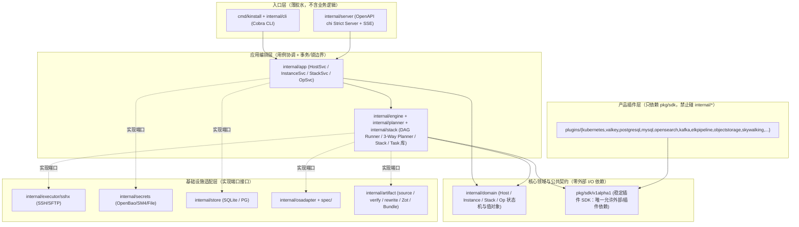
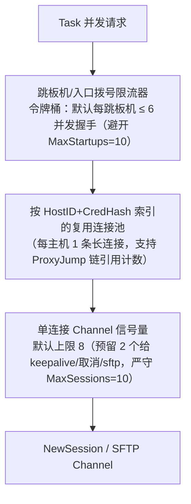

# D1 底座深度设计（模块 1）：工程代码方案、初始设计模式 + SSH/SFTP 执行器、凭据加密与 OS/Facts 适配

> **本文定位**：kinstall 分模块像素级深度设计系列第 1 篇（底座开篇），先确立全仓统一的**代码开发方案、包依赖铁律与 9 大初始设计模式**，再深挖底座第一块基石 `internal/executor/sshx`、`internal/secrets`、`internal/inventory/facts`、`internal/osadapter`、`internal/obs/redact`。内容覆盖底层协议陷阱、状态机、精确 POSIX 脚本、信封格式、Go 生产级代码骨架与真实容器测试门禁，研发可直接按本文建仓编码。
>
> **版本**：v1.3（2026-11-26；v1.3 对齐 `OpState` 7 态与状态迁移、`sdk.Error` 统一错误模型、插件目录命名及 `kinstall secrets rewrap`）。全部上游行为与缺陷均于 2026-11-26 联网实证核查。

## 0. 分模块深度设计总路线（先底座 → 再平台 → 再各插件）

| 阶段 | 模块编号 | 主题 | 状态 |
| --- | :---: | --- | :---: |
| **一、先底座** | **D1** | **代码开发方案与初始设计模式 + SSH/SFTP 执行器、凭据信封加密（OpenBao 2.7 / SM4）与 OS/Facts 适配层** | **✅ 本文** |
| | D2 | 存储层完整 DDL（SQLite/PG）、自研任务引擎、租约/Fencing 锁、3-Way Diff、`Stack` 复合栈与全部 15 个内置 Task（含 Docker/Compose + `DOCKER-USER`） | ⬜ 下一步 |
| | D3 | 离线供应链、跨架构构建（x86_64 / arm64-4K / arm64-64K / glibc 2.28 / 随包 JDK 21）、Zot + HTTP 分发限速与区域边缘缓存、Syft+Grype 信任链 | ⬜ |
| **二、再平台** | G1 | 平台服务与多副本 HA：CLI / OpenAPI 3.1 + SSE（`Last-Event-ID` + PG `LISTEN/NOTIFY`）、OIDC/RBAC/四眼审批、审计哈希链与滚动升级 `StateMigrator` | ⬜ |
| | G2 | 平台控制台与生态集成：多集群统一管理、Web UI 信息架构与插件动态表单协议、CMDB 批量导入/同步/GitOps/通知、等保 2.0 三级与密评交付实操 | ⬜ |
| | G3 | 平台工程质量与验证体系：多架构 KVM + 鲲鹏测试平台自动化编排、Ubuntu 26.04 容器契约、15 项故障注入脚本与 500 节点 `kwok` 压测 SOP | ⬜ |
| **三、再各插件** | P1 | Kubernetes 二进制插件深化（1.35–1.38、混合架构、Calico+nftables、CSI SELinuxMount、本地代理 HA、BOM `2026.12.1` 补丁流程） | ⬜ |
| | P2 | Valkey / Redis 插件深度设计（单节点 / 主从+哨兵 / Cluster 环状反亲和、二进制 vs Docker vs K8s、64K jemalloc、迁槽与 COW 治理） | ⬜ |
| | **P3** | **大型 ELK / OpenSearch + Apache Kafka 4.x KRaft 中间消费全链路深度设计**（分区对齐、背压传导、Rebalance 治理、DLQ、Mapping 爆炸防护、冷热与 S3 归档） | ⬜ |
| | P4 | PostgreSQL 插件深度设计（Patroni + etcd + PgBouncer + HAProxy/VIP + pgBackRest 2.60 PITR + CNPG + 脑裂与 `pg_rewind`） | ⬜ |
| | P5 | MySQL 插件深度设计（8.4/9.7 LTS + MGR InnoDB Cluster + Router + XtraBackup PITR + 大事务流控） | ⬜ |
| | P6 | 对象存储插件深度设计（SeaweedFS 热副本冷 EC 10+4 / Ceph RGW / RustFS / Garage 与全栈备份闭环） | ⬜ |
| | P7 | Apache SkyWalking 11.x APM 插件深度设计（BanyanDB 0.11 vs OpenSearch、Satellite、尾部采样、多语言离线 Agent 与 Kafka 异步通道） | ⬜ |

---

## 1. 工程代码开发方案与初始设计模式总览（从 0 到 1 编码总纲）

在写第一行业务代码之前，必须先锁死**架构边界、依赖方向、装配方式与设计模式选型**，避免项目演进到 5–8 个中间件插件后退化成“到处直调 SSH、到处硬编码 `if os == centos`、循环引用改不动”的意大利面代码。

### 1.1 代码分层与单向依赖铁律（六边形架构 + `depguard` 编译门禁）

kinstall 采用**轻量六边形（端口与适配器）架构 + 领域分包**，拒绝 Java 式过度抽象的 6 层贫血结构，坚持 Go 惯用的**“消费方定义小接口、提供方返回具体结构体、依赖单向向内汇聚”**：



**五条不可违背的工程铁律（写入 `.golangci.yml` v2 `depguard` 与 CI 门禁）**：
1. **插件隔离铁律（ADR-022）**：`plugins/**` 仅允许 `import` Go 标准库、`pkg/sdk/v1alpha1` 及少量纯值库（如 `semver`），**编译期禁止引用 `internal/*` 或任何 SSH / DB 驱动**；插件只能输出纯数据 `PipelineSpec`，零副作用，从而天然支持单测、Plan 预览与未来平滑抽离为 gRPC 外部插件。
2. **领域零 I/O 铁律**：`internal/domain/**` 禁止引用 `database/sql`、`net/http`、`golang.org/x/crypto/ssh`；所有状态机流转、容量冲突校验、版本号比较均可毫秒级纯内存单测。
3. **禁止 `init()` 隐式全局注册**：严禁在插件或驱动包中通过 `func init() { Register(...) }` 产生隐藏全局状态（会导致单测并发串台与依赖顺序不透明）；所有插件、内置 Task、KEK Provider 全部在唯一组合根 `cmd/kinstall/app.go`（`G1 §7.3`）通过**显式构造函数**注册装配。
4. **显式构造函数 DI，拒绝反射型 DI 框架**：不用 `uber-go/fx` / `dig`（运行时才报缺少依赖且堆栈难追踪），使用纯 Go `NewApp(cfg, deps)` 显式传递依赖，编译期 100% 检查完备性，测试时直接传 `FakeExecutor` / 内存 SQLite。
5. **错误与上下文统一规范**：所有跨层错误必须封装为带错误码的 `CodedError`（`KI-<域>-<4位>`，实现 `Unwrap()` 与 `Retryable() bool`）；所有外部调用必须首个参数传 `ctx context.Context` 贯穿超时、取消、`trace_id`、`operator_id`。

### 1.2 全系统 9 大初始设计模式映射表（用在哪、为何用、反过度设计红线）

| 设计模式 | 落地代码包 | 解决的核心工程问题 | 反过度设计红线 |
| --- | --- | --- | --- |
| **1. 装饰器链（Decorator / Middleware）** | `internal/executor/sshx`、`internal/server/middleware` | 把 SSH 的**连接池限流**、**`faillock` 认证熔断**、**跨块流式脱敏与审计**、**可重试分类退避**解耦为正交可组合的薄装饰器；HTTP 层同理组合鉴权、RBAC、审批、幂等键、审计链 | 最多 4 层装饰器，每层职责单一且必须可独立单测，禁止相互隐式依赖执行顺序 |
| **2. 策略模式（Strategy）** | `internal/osadapter`、`internal/secrets`、`internal/executor/sshx`（三通道传输）、`plugins/*/target_*.go` | 运行时按主机 OS 族切换包管理/防火墙策略；按体积与能力自动选 SFTP / stdin / HTTP 传输策略；**同一中间件插件按 `host-binary` / `host-container` / `kubernetes` 切换部署策略**，复用公共 Spec 校验与拓扑规划 | 仅在真正存在 ≥ 2 种行为分支的点抽策略接口；7 个 OS 族共享 `spec/` 数据驱动引擎，不写 7 份重复代码 |
| **3. 命令 + 模板方法（Command + Template Method）** | `internal/engine/tasks`（15 个内置 Task）+ `TaskRunner` | 每个内置 Task 只专注自己的 `Check()` / `Apply()` / `Rollback()` 原子契约；`TaskRunner` 统一控制**主机锁校验 → 脱敏注入 → 幂等前置 Check → DryRun 短路 → 重试/Async 托管 → 结果入库与事件广播** | 禁止任何 Task 绕过 `TaskRunner` 自写重试循环或自写日志脱敏 |
| **4. 适配器模式（Adapter / Port）** | `Executor`（`sshx` / `localx` / `mockx`）、`Store`（SQLite / PostgreSQL）、`EventBus`（内存 / PG `LISTEN`） | 隔离第三方驱动与协议差异，使单机 CLI 与多副本 HA Server 共享 100% 同一套领域与引擎代码，且无真实主机/DB 也能跑全量核心单测 | 端口接口保持小而精（≤ 8 个方法），不为了“未来可能换库”暴露底层 ORM 细节 |
| **5. 显式状态机（State Machine）** | `internal/domain`（`Host`、`Operation`、`TaskRun`、`Credential`、`HostKey`） | 杜绝各处随意 `host.Status = "ready"` 导致非法状态跳转与并发覆盖；集中维护合法迁移表 `allowedTransitions` + 乐观锁 `version` 校验 | 状态数控制在 5–8 个清晰节点，状态流转逻辑留在 `domain` 层不散落到 Handler 或 SQL |
| **6. 建造者 + 组合/DAG（Builder + Composite）** | `pkg/sdk/v1alpha1/builder.go`、`internal/stack` | 插件通过流畅 `PipelineBuilder` 声明式生成不可变 `PipelineSpec`（`Phase` 串行 + `Step` 并发 DAG）；`Stack` 将多个 `Instance` 按 `dependsOn` 组合为外层 DAG 并静态解析 `${instances.X.outputs.Y}` | Builder 仅做结构组装与基础必填校验，不执行网络/磁盘 I/O |
| **7. 工厂 + 显式注册表（Factory + Registry）** | `internal/registry/registry.go`、`internal/engine/tasks/registry.go` | 按 `(product, target, semver)` 路由插件工厂；按 `TaskType` 校验并反序列化强类型参数，供 Go 内置插件、YAML 声明式包、gRPC 外部插件三方共用 | 注册表启动期构建完毕后即**只读冻结**（无需运行期加锁），避免并发读写 map 竞态 |
| **8. 函数选项（Functional Options）** | `sshx.NewPool(cfg, secretStore, logger, opts...)`、`secrets.NewEnvelopeStore(repo, kek, alg, opts...)`、`engine.NewWorker(..., opts...)` | 构造参数多且带安全默认值时（如 `MaxSessions=8`、`KeepAlive=15s`），保持 API 向后兼容且调用点自文档化 | 仅对 ≥ 3 个可选参数的构造器使用，简单 1–2 参数函数直接传参 |
| **9. 观察者 / 事件流（Observer / Pub-Sub）** | `internal/events`（`EventSink`，内存 / PG `LISTEN/NOTIFY` 双实现） | 任务引擎只向 `EventSink` 发送结构化事件（`TaskStarted` / `LogChunk` / `TaskDone` / `DriftDetected`），彻底解耦 CLI 终端渲染、Web SSE 推送、审计链落盘与企微/钉钉/Webhook 通知 | 同步关键事件（状态落库/审计）与异步旁路通知（Webhook）明确隔离，通知失败绝不阻塞主安装流程 |

### 1.3 初始核心 Go 代码骨架示范（建仓即落地）

#### A. 装饰器链装配 `Executor`（组合根 `cmd/kinstall/app.go` 调用的 `BuildExecutor()`，`G1 §7.3`）

```go
// 显式构造函数装配：无全局状态、无反射魔法、编译期检查完备性
func BuildExecutor(pool *sshx.Pool, auditor obs.Auditor, logger *slog.Logger) ports.Executor {
    var exec ports.Executor = sshx.NewBaseExecutor(pool)
    // 由内向外包裹：网络瞬断重试 -> 认证/faillock 熔断 -> 跨块脱敏与执行审计
    exec = sshx.NewRetryDecorator(exec, sshx.WithMaxAttempts(4), sshx.WithJitter(0.25))
    exec = sshx.NewCircuitBreakerDecorator(exec, sshx.TripOnNonRetryableAuth())
    exec = sshx.NewRedactingAuditDecorator(exec, auditor, logger)
    return exec
}
```

#### B. 带错误码与可重试语义的统一错误模型（与 `05 §5.2` 统一，由 `pkg/sdk/v1alpha1/errors.go` 导出）

```go
type Error struct {
    Code          string         // 如 "KI-EXEC-0003"
    Domain        string         // API | AUTH | HOST | EXEC | OS | INIT | PLAN | ENG | LOCK | PLG | TPL | ART | SEC | PKI | DB | DIFF | STACK | WAIT | IMG | SRC | BND
    HTTPStatus    int            // 供 RFC 9457 渲染
    MsgKey        string         // go-i18n 消息键
    Args          map[string]any // 结构化排障上下文（严禁含明文 Secret）
    SuggestionKey string
    Retryable     bool           // 关键契约：认证失败/HostKey变更/KYSEC 必须为 false！
    Cause         error
}

func (e *Error) Error() string { return fmt.Sprintf("[%s] %s", e.Code, e.MsgKey) }
func (e *Error) Unwrap() error { return e.Cause }

func IsRetryable(err error) bool {
    var ce *Error
    if errors.As(err, &ce) {
        return ce.Retryable
    }
    return false // 未知错误默认不盲目重试，防产生副作用或触发 faillock
}
```

#### C. 显式状态机守卫（`internal/domain/statemachine.go`，与 `D2` CHECK 枚举及 `ARCHITECTURE §5.2` 100% 一致）

```go
type OpState string

const (
    OpAwaitingApproval OpState = "awaiting_approval"
    OpPending          OpState = "pending"
    OpRunning          OpState = "running"
    OpSucceeded        OpState = "succeeded"
    OpFailed           OpState = "failed"
    OpRejected         OpState = "rejected"
    OpCancelled        OpState = "cancelled"
)

var opTransitions = map[OpState][]OpState{
    OpAwaitingApproval: {OpPending, OpRejected, OpCancelled},
    OpPending:          {OpRunning, OpCancelled},
    OpRunning:          {OpRunning /* 租约过期接管, fencing_token+1 */, OpSucceeded, OpFailed, OpCancelled},
    OpFailed:           {OpPending /* --resume 同一 Operation 重新入队 */},
}

func (s OpState) CanTransitionTo(next OpState) bool {
    for _, allowed := range opTransitions[s] {
        if allowed == next {
            return true
        }
    }
    return false
}
```

### 1.4 工程开发落地策略（Contract-First + 垂直切片 + 并行协作）

为保证 2–4 人小团队在 M0–M5 阶段**不互相阻塞、每天都能跑通可验收的闭环**，采用“**契约先行 → 垂直切片 → 横向铺开**”三步开发法：

1. **第 1 步（契约先行，第 1–2 天冻结）**：先提交 `pkg/sdk/v1alpha1`、`internal/ports`（`Executor` / `Store` / `Secrets` / `OSAdapter`）、`internal/domain` 状态机、`.golangci.yml`（含 `depguard`）和 `spec/` 嵌入脚本，CI 绿灯后即可拆分多人并行开发：
   - **研发 A（底座执行与 OS 线）**：沿本文 D1 实现 `sshx` + `secrets` + `facts` + `osadapter`（用 `gliderlabs/ssh` 与真实 OpenBao/OS 容器自测）；
   - **研发 B（底座存储与引擎线）**：沿 D2 实现 SQLite/PG DDL + `TaskRunner` + 租约/Fencing 锁 + 15 个内置 Task（用 `FakeExecutor` 自测）；
   - **研发 C（平台与首插件线）**：先在 `FakeExecutor` 上跑通 K8s / Valkey 插件的 `Plan()` Golden 快照与 3-Way Diff 测试，等 A/B 合流立即接真机联调。
2. **第 2 步（最小垂直切片 M0，第 1–2 周）**：按“**底座 D1+D2 最小闭环 → CLI 单机命令 → 单产品冒烟 + 二次全 `Skipped` 幂等**”打通全链路，绝不在底层没跑通前堆砌复杂 Web UI 或十几个插件。
3. **第 3 步（四层测试金字塔防回归）**：
   - **L1（毫秒级，每次保存可跑）**：`domain` 状态机、`Plan()` DAG 结构、3-Way Diff 算法、`RedactWriter` 跨块 Fuzz；
   - **L2（秒级，PR 必跑）**：`gliderlabs/ssh` 仿真限流/熔断/断连、模板 Golden 快照 + `kubeadm` 基线对比、`spec/gen_os_docs.py --check`；
   - **L3（分钟级，PR 必跑）**：`testcontainers-go` 真实容器契约（OpenBao 2.7.2 负向 AAD 测试、SQLite/PG 并发抢锁、Rocky 9 / Ubuntu 26.04 `sudo-rs` 契约）；
   - **L4（夜间/发版，G3 详解）**：KVM + 鲲鹏多架构 E2E、15 项故障注入与 500 节点 `kwok` 压测。

---

## 2. 执行器深度设计（`internal/executor/sshx`，ADR-020 / 025 / 030）

### 2.1 连接池与双层并发限流（解决 `MaxSessions` 与 `MaxStartups` 两大真实生产杀手）

运维工具批量并发操作 50–200 台主机时，最常见的隐蔽失败不是超时，而是触发 sshd 两个默认硬限：
1. **`MaxSessions`（OpenSSH 默认 `10`）**：单条 TCP SSH 连接上同时打开的 session/sftp channel 超过 10 个，sshd 直接返回 `SSH_OPEN_ADMINISTRATIVELY_PROHIBITED`。
2. **`MaxStartups`（OpenSSH 默认 `10:30:100`）**：尤其是经过**统一跳板机（Bastion / ProxyJump）**并发连接 100 台目标机时，跳板机 sshd 处于未认证握手态的连接数 > 10 就开始按 30% 概率随机丢弃 TCP，报 `kex_exchange_identification: Connection closed by remote host`！

**kinstall 双层连接池设计**：



- **引用计数关闭（防 ProxyJump 隧道泄漏）**：若 A 跳板机同时承载 B、C、D 三台目标机的隧道，连接池以 `jumpKey` 共享 A 的 `ssh.Client` 并维护 `refCount`；只有当所有下游目标机连接空闲过期（默认 idle TTL `5 min`）归零后，才关闭跳板机 TCP 连接。
- **Keepalive 与半开死连接自愈**：每个活跃 `ssh.Client` 启动独立探活协程，每 **15 s** 发送 `client.SendRequest("keepalive@openssh.com", true, nil)`（单次超时 5 s，同时开启底层 TCP `SetKeepAlive(true)`）；连续 **3 次**失联判定为 NAT/防火墙/堡垒机静默丢包死连接，立即标记 `broken` 并从池中驱逐，新请求自动重连。

### 2.2 OpenSSH 9/10 算法兼容与主机密钥状态机（H5）

- **算法默认与 legacy 隔离**：`golang.org/x/crypto/ssh`（v0.59.0）默认优先 `ssh-ed25519`、`ecdsa-sha2-*`、`rsa-sha2-512`、`rsa-sha2-256`。对老旧 **CentOS 7（OpenSSH 7.4，仅支持已废弃的 `ssh-rsa` SHA-1）**，**绝不全局放宽算法**，仅当主机 CMDB 属性显式标记 `ssh.legacyRSA=true` 时，才在该主机 `ClientConfig.HostKeyAlgorithms` 末尾追加 `ssh.KeyAlgoRSA` 并写入审计警告。
- **主机密钥指纹校验状态机**：
  - `Pinned`（生产推荐）：导入主机时预置 `SHA256:<base64>` 指纹，握手回调严格比对，不符返回 `KI-EXEC-0002`（`Retryable=false`）立即阻断；
  - `TOFU`（首次信任，默认单机）：首次连接将指纹原子写入 CMDB `hosts.hostkey_fp` 并记审计；后续变更一律阻断，除非管理员显式 `kinstall host accept-hostkey <id>`（记审计，留旧指纹历史）。

### 2.3 同步执行 vs 持久化异步脱离执行（Async Detached Runner）

**痛点**：`pg_basebackup`、`docker load 3GB`、`dnf upgrade`、内核安装等命令常运行 5–30 分钟。若走普通同步 SSH `session.Run()`，一旦堡垒机 `TMOUT` / 防火墙空闲断连或部署机重启，SSH channel 断开向远端发 SIGHUP 直接把升级命令杀在半路，造成半残状态！且 OpenSSH `< 7.9` 不支持 `session.Signal()`，即使支持也无法可靠杀掉子进程组。

**kinstall 双执行模式规范**：

| 模式 | 适用场景 | 执行机制 |
| --- | --- | --- |
| **Sync 模式**（默认） | 预计 < 60 s 的短命令（Facts 采集、stat、check、systemctl reload） | 直接 `session.Start` + `setsid` 包裹；stdout/stderr 经 `RedactWriter` 实时流式推送；取消时通过独立管理 session 发 `kill -TERM -- -<pgid>` → 等 5 s → `kill -KILL -- -<pgid>` |
| **Async Detached 模式**（长任务强制） | 预计 > 60 s 或不可被网络抖动打断的任务（`pkg.ensure`、`image.load`、`backup/restore`、`upgrade`） | 通过**零 Agent 远端工作目录** `/var/lib/kinstall/tmp/runs/<task_run_id>/` 实现断点可重附（见下方精确协议） |

**Async Detached 远端状态机目录结构与 POSIX 启动封装**：

```sh
# 远端目录：/var/lib/kinstall/tmp/runs/<task_run_id>/
#   script.sh   (0700，上传的任务脚本)
#   pid         (子进程组 PGID)
#   stdout.log  (追加写)
#   stderr.log  (追加写)
#   rc.tmp -> rc (原子 mv 写入最终退出码，存在即代表结束！)
#   heartbeat   (可选：每秒更新时间戳供死锁判断)

# 1. 启动（单次短 SSH 调用，立即返回 PGID）
RUN_DIR='/var/lib/kinstall/tmp/runs/tr_01J...'
mkdir -p "$RUN_DIR" && chmod 0700 "$RUN_DIR"
nohup setsid sh -c '
  echo $$ > "$1/pid"
  LC_ALL=C PATH="/usr/local/bin:/usr/sbin:/sbin:$PATH" sh "$1/script.sh" >"$1/stdout.log" 2>"$1/stderr.log"
  rc=$?
  printf "%d\n" "$rc" > "$1/rc.tmp" && mv -f "$1/rc.tmp" "$1/rc"
' _ "$RUN_DIR" </dev/null >/dev/null 2>&1 &

# 2. 增量轮询（每 2s 一次，即使 SSH 中途断开重连也可无缝继续！）
# 读取 rc（若存在）+ 从上次字节偏移 offset 增量拉取日志（tail -c +$((offset+1))）+ 检查 kill -0 "$pgid" 进程存活
```

- **崩溃恢复联动**：当 Server 副本崩溃、新副本接管租约（D2）后，只需对处于 `Running` 的 `TaskRun` 检查远端 `$RUN_DIR/rc` 与 `$RUN_DIR/pid` 存活状态，就能精准判断任务是“仍在跑（继续附着读日志）”、“已成功（读 rc=0 直接收尾）”还是“异常退出”，彻底消除重入副作用！

### 2.4 `sudo` / `sudo-rs` / `pam_faillock` / `noexec` 生产陷阱与熔断策略

1. **`sudo-rs`（Ubuntu 25.10 / 26.04 LTS 默认）实证陷阱（`sudo-rs#1668`，2026-08/11 核实）**：
   - 无 TTY 下管道传密码若不加 `-S`，`sudo-rs` 直接报 `sudo: A terminal is required to authenticate`；
   - `sudo-rs` 密码提示由 PAM 动态生成（如 `[sudo: authenticate] Password:`），Ansible 等传统工具因正则匹配旧提示文本而挂死；
   - **kinstall 铁律**：
     - 优先探测免密：`sudo -n true 2>/dev/null`（Mode A 默认 `NOPASSWD: ALL`，ADR-030）；
     - 必须口令提权时，固定使用 **`sudo -S --prompt "" -- <cmd>`**（绝不申请 PTY，绝不匹配提示符文案），口令通过独立管道首行写入 stdin 后紧跟命令载荷（或脚本已写入 `0700` 文件，stdin 仅送 `password\n` 后立刻关闭 EOF，防止业务命令误读口令！）；
     - 若任务命令本身需要读取 stdin（如 `cat > file` 降级写文件），则通过一次性随机命名管道或 `0600` 临时文件解耦，**绝不把 sudo 密码与业务 stdin 混流**。
2. **`pam_faillock` 防锁死熔断（等保加固开启 5 次失败锁定 15 分钟）**：

| 错误类别 | 典型特征 | `Retryable` | 处理策略 |
| --- | --- | :---: | --- |
| **认证 / 密钥 / sudo 口令错误** | `ssh: unable to authenticate`、`Sorry, try again`、`is not in the sudoers file` | **❌ 严禁重试** | 立即熔断整个 Host 的待发认证请求，标红报错 `KI-EXEC-0003` / `KI-AUTH-0001`，保护运维账号不被 `faillock` 锁死 |
| **主机密钥指纹变更** | `KI-EXEC-0002` | **❌ 严禁重试** | 立即阻断，记安全审计事件 |
| **安全执行控制拦截** | `EACCES`/`EPERM` + 检测到 `KYSEC`/`fapolicyd`/`noexec` | **❌ 严禁重试** | 返回 `KI-EXEC-0004` 与精确拦截文件路径，等待管理员显式授权加白（ADR-027） |
| **网络瞬断 / 建连风暴** | `connection reset`、`EOF`、`i/o timeout`、`MaxStartups` 拒绝 | **✅ 指数退避重试** | 1s → 2s → 4s → 8s（带 ±25% Jitter，最多 4 次） |
| **包锁占用** | `dpkg frontend lock` / `dnf lock` | **✅ 退避重试** | 每 5s 重试，最长等待 120s |

3. **`/tmp` `noexec` 与磁盘空间前置校验**：首次连接主机初始化工作区时执行 `mkdir -p /var/lib/kinstall/tmp && chmod 0700 /var/lib/kinstall/tmp`，并运行 `findmnt -n -o OPTIONS --target /var/lib/kinstall/tmp` 确认挂载选项**不含 `noexec`**（若 `/var` 亦被客户挂了 `noexec`，支持在 Host 属性覆盖 `workDir`，并在 preflight 直接阻断提示）。

### 2.5 文件传输三通道与原子替换规范

| 通道 | 触发条件 | 性能与可靠性细节 |
| --- | --- | --- |
| **通道 1：SFTP 并发写（默认）** | 文件 ≤ 10 MiB 且远端开启 SFTP 子系统 | **`pkg/sftp v1.13.13` 默认关闭并发写（`restic#4209` 实证导致高延迟链路极慢）**；kinstall 显式启用 `sftp.UseConcurrentWrites(true)` + `sftp.MaxPacket(64 * 1024)`，配合**完整失败重传 + 写后 SHA-256 校验**确保安全与高吞吐并存 |
| **通道 2：SSH stdin 流式降级** | SFTP 子系统被等保加固禁用（`Subsystem sftp` 被注释） | 退回 `sh -c 'cat > "$1" && chmod "$2" "$1"' _ "$TMP" "$MODE"`，流式直传并同步在本地/远端计算 SHA-256 |
| **通道 3：制品 HTTP Range 拉取** | 大文件（> 10 MiB，如 K8s/Kafka/Valkey/JDK/OCI 包）或并发主机 > 5 台 | 远端执行 `curl -fSL --retry 3 --limit-rate 50M -C - -o "$TMP" "$URL"`（无 `curl` 降级 `wget -c`），拉完校验 `sha256sum`（免占用部署机 SSH CPU 加密开销） |

**原子替换铁律（防半写入与跨分区 `EXDEV` 错误）**：
- 严禁直接覆写目标文件（如 `/etc/kubernetes/kubelet.yaml` 写到一半断电会导致服务无法重启）！
- 临时文件**必须建在目标文件同一目录下**（如 `<dir>/.kinstall.tmp.<ulid>`，绝不建在 `/tmp` 后 `mv`——跨分区 `mv` 不是原子 `rename(2)` 而是拷贝+删除，且易报 `EXDEV`）→ 设置最终 `mode` 与 `chown user:group`（显式同时指定属主和属组，规避 `uutils` `chown user:` 不改属组的差异！）→ `fsync` → 原子 `mv -f "$TMP" "$DST"`。
- 若启用 SELinux enforcing，在原子替换系统配置（`/etc/systemd/system`、`/etc/sysctl.d` 等）后按需调用 `restorecon "$DST"` 修复安全上下文。

### 2.6 流式脱敏写入器（`internal/obs/redact`）跨 Chunk 边界防漏算法

**常见 Bug**：朴素的 `bytes.ReplaceAll(chunk, secret, "******")` 会在 `secret` 恰好被 SSH 拆在两个 TCP 包（chunk 1 结尾是 `mySe`，chunk 2 开头是 `cret123`）时**完全漏脱敏**，把明文密码打进日志！

**kinstall 滑动保留窗口实现规范**：
- `RedactWriter` 维护当前 `RunContext` 中所有已注册机密（明文 + Base64 变体 + URL 编码变体）的最大长度 $L_{\max}$；
- 每次 `Write(p)` 将 `p` 拼接到内部缓冲 `buf`，在 `buf` 上执行 Aho-Corasick（或 Trie）多模式替换 + 通用正则（PEM 私钥块、`Bearer `、`ki_` Token、`://user:pass@`）；
- **仅刷出 `buf[:len(buf)-L_max]`**，保留最后 $L_{\max}$ 字节等待下次 `Write()` 拼接；命令结束 `Close()` 时对剩余尾字节执行最终脱敏并全部刷出。
- 这样即便远端按单字节吐出密钥，也能保证 **100% 零泄露**，且内存占用恒为 $O(L_{\max})$（通常 < 4 KiB）。

---

## 3. 凭据与信封加密深度设计（`internal/secrets`，H7 / R-SEC-07 / ADR-039 / 061）

### 3.1 信封二进制结构与 Canonical AAD 编码

每条机密记录（SSH 私钥/密码、CA 私钥、中间件账号密码、API Token 密钥）独立生成 256-bit **DEK**（`crypto/rand`），以 **Envelope v1** 落库：

```json
{
  "v": 1,
  "alg": "aes-256-gcm",          // 可选 "sm4-gcm"（密评场景，emmansun/gmsm v0.45.4）
  "kekProvider": "openbao",      // file | env | openbao | kmip
  "kekId": "kinstall-prod-kek",
  "kekVersion": 3,
  "wrappedDek": "vault:v3:...",  // file/env 模式为 base64(nonce12 || gcm_ct || tag16)
  "nonce": "<base64-12B>",       // 每条记录每次写入全新随机 96-bit Nonce（单 DEK 仅用 1 次，远离 NIST 2^32 碰撞线）
  "ciphertext": "<base64>",      // 含 16B GCM Auth Tag
  "keyVersion": 2                // 业务凭据轮换版本号
}
```

**Canonical AAD 构造（防跨表/跨记录密文调包攻击）**：
- 若攻击者把数据库里普通用户的密文行直接复制到管理员行，由于每行解密时强制传入绑定主键的 AAD，GCM Tag 校验必败：
  ```go
  // 使用明确长度/不可歧义分隔的规范字节串（绝不简单字符串拼接）
  func BuildAAD(table, recordID string, keyVersion int) []byte {
      return []byte(fmt.Sprintf("kinstall:env:v1|%d:%s|%d:%s|%d",
          len(table), table, len(recordID), recordID, keyVersion))
  }
  ```

### 3.2 OpenBao `2.7.2` Transit 引擎集成与两大隐蔽生产坑规避

**2026-11 联网实证发现的两大致命陷阱（必须写入代码与 CI 契约测试）**：
1. **陷阱 1（非派生密钥静默忽略 `context`）**：在 OpenBao Transit 中，若密钥创建时 `derived=false`（默认），API 传入 `context` 参数会**被静默忽略**！拿错误的 `context` 去调 `/decrypt` 居然能解密成功！（RustFS OpenBao 集成文档 2026 实测确认）。
2. **陷阱 2（`/rewrap` 不支持 `associated_data`）**：对非派生密钥改传 `associated_data` 虽然在 `/encrypt` 和 `/decrypt` 生效，但 Vault/OpenBao `/transit/rewrap` 接口**不识别 `associated_data` 且静默忽略未知字段**（`hashicorp/vault#31791` 2026-02 与 `JiRaska/open-bank-oss#11038` 双重实证）。

**kinstall 唯一安全正解**：
- 初始化 OpenBao Transit KEK 时**强制指定 `type=aes256-gcm96 derived=true`**（启动自检 `GET /v1/transit/keys/<name>` 核验 `derived == true`，否则拒绝启动！）；
- 包装 / 解包 / **服务端无明文轮换（`rewrap`）** 三条路径统一传入 **`context = base64("kinstall:dek:" + table + ":" + recordID)`**；
  - 新建凭据：优先单次调用 `/v1/transit/datakey/plaintext/<name>`（传入 `bits=256`、`context=...`），1 次 RTT 拿到高熵 DEK 明文与 `vault:vN:...` 密文；
  - KEK 轮换（`kinstall secrets rewrap`）：管理员在 OpenBao 执行 `/v1/transit/keys/<name>/rotate` 后，平台分批（每批 100 条）调用 **`/v1/transit/rewrap/<name>` 的 `batch_input`**（每项携带 `ciphertext` + `context`），**全程 DEK 明文永不离开 OpenBao 进程**！
- **传输与凭据强约束**：生产模式强制 `https://` + 校验 CA（仅显式 `--dev-insecure` 允许 HTTP）；OpenBao Token 文件强制检查权限 `0600`；OpenBao 处于 `sealed` 封存态时，所有凭据读取立即返回 `KI-SEC-0001 (503 ServiceUnavailable)`，**绝无明文缓存降级**，OpenBao 解封后自动恢复无需重启 kinstall。

### 3.3 Go 内存安全与 SSH 密钥无中断轮换协议

```go
// SecretBytes：防止意外被 slog / fmt / json 打印，并提供显式清零
type SecretBytes struct{ buf []byte }

func (s *SecretBytes) Bytes() []byte { return s.buf }
func (s *SecretBytes) Zero() {
    clear(s.buf)             // Go 1.21+ 内建清零
    runtime.KeepAlive(s.buf) // 提示编译器勿将清零作为死存储优化消除
    s.buf = nil
}
func (s SecretBytes) String() string               { return "[REDACTED]" }
func (s SecretBytes) GoString() string             { return "[REDACTED]" }
func (s SecretBytes) MarshalJSON() ([]byte, error) { return []byte(`"[REDACTED]"`), nil }
func (s SecretBytes) LogValue() slog.Value         { return slog.StringValue("[REDACTED]") }
```

**SSH 公私钥在线无中断轮换四步协议（`kinstall credential rotate`）**：
1. 平台生成新 Ed25519 密钥对写入 `credentials`（状态 `Rotating`，保留旧密钥）；
2. 用**旧密钥**连接关联全部主机，将新公钥原子追加至目标用户 `~/.ssh/authorized_keys`（带注释 `# kinstall:cred_<id>:v<new>`）；
3. 用**新密钥**发起真实 SSH 探活连接，全量主机验证成功（若任一台失败，仅回滚新公钥，旧密钥完好，零失联！）；
4. 将新密钥切为 `Active`，再通过新密钥从全部主机 `authorized_keys` 中精准移除带旧版本号注释的公钥行，销毁旧密钥。

---

## 4. 零依赖 Facts 采集与 OS 适配层深度设计（`internal/inventory/facts` & `internal/osadapter`）

### 4.1 单次 SSH 往返（1-RTT）POSIX `sh` 全量采集脚本规范

**为什么必须 1-RTT？** 若每采一项（os-release、内核、CPU、内存、磁盘、网卡、cgroup、页大小、glibc、安全模块、sudo）各开 1 次 SSH exec，单台主机需 15–20 次 RTT，跨机房 50 ms 延迟下 200 台主机光采 Facts 就要数分钟且高频触发 `MaxSessions`。合并为**单个只读 POSIX `sh` 脚本**，1 次执行（< 150 ms）全部采完！

**安全序列化格式（无 Python / 无 jq / 零注入风险）**：
- 严禁在远端用 `sh` 手工拼 JSON（主机名、磁盘型号、挂载路径若含双引号/反斜杠/换行符会直接拼出非法 JSON 或注入）；
- 统一采用 **`@SECTION:<name>` + 原样输出块**（或单行 `KEY=VALUE`），由部署机 Go 侧强类型解析器归一化！

**完整 1-RTT POSIX 采集脚本核心蓝本（兼容 `dash` / `bash` / `uutils` / `busybox`）**：

```sh
#!/bin/sh
# kinstall facts collector v1 (POSIX sh, zero Python/jq, LC_ALL=C)
export LC_ALL=C PATH="/usr/local/sbin:/usr/local/bin:/usr/sbin:/usr/bin:/sbin:/bin"

kv() { printf '%s=%s\n' "$1" "$2"; }

echo '@BEGIN:KV'
kv hostname     "$(hostname 2>/dev/null || uname -n)"
kv fqdn         "$(hostname -f 2>/dev/null || hostname 2>/dev/null || uname -n)"
kv kernel       "$(uname -r)"
kv arch         "$(uname -m)"
kv page_size    "$(getconf PAGESIZE 2>/dev/null || echo 4096)"
kv glibc        "$(getconf GNU_LIBC_VERSION 2>/dev/null || (ldd --version 2>&1 | head -n1))"
kv machine_id   "$(cat /etc/machine-id 2>/dev/null || cat /var/lib/dbus/machine-id 2>/dev/null || echo '')"
kv cgroup_fs    "$(stat -fc %T /sys/fs/cgroup 2>/dev/null || echo unknown)"
kv systemd_ver  "$(systemd --version 2>/dev/null | head -n1 || systemctl --version 2>/dev/null | head -n1 || echo '')"
kv nft_ver      "$(nft --version 2>/dev/null | head -n1 || echo '')"
kv sudo_ver     "$(sudo --version 2>/dev/null | head -n1 || echo '')"
kv selinux      "$(getenforce 2>/dev/null || echo Disabled)"
kv apparmor     "$(cat /sys/module/apparmor/parameters/enabled 2>/dev/null || echo N)"
kv kysec        "$(command -v getstatus >/dev/null 2>&1 && getstatus 2>/dev/null | tr '\n' ';' || echo '')"
kv fapolicyd    "$(systemctl is-active fapolicyd 2>/dev/null || echo inactive)"
kv swap_kb      "$(awk '/^SwapTotal:/{print $2}' /proc/meminfo 2>/dev/null || echo 0)"
kv mem_kb       "$(awk '/^MemTotal:/{print $2}' /proc/meminfo 2>/dev/null || echo 0)"
kv hugepage_kb  "$(awk '/^Hugepagesize:/{print $2}' /proc/meminfo 2>/dev/null || echo 0)"
kv cpu_cores    "$(nproc 2>/dev/null || grep -c ^processor /proc/cpuinfo)"
kv numa_nodes   "$(ls -d /sys/devices/system/node/node[0-9]* 2>/dev/null | wc -l | tr -d ' ')"
# x86-64-v2/v3 级别判定（仅 x86_64）
kv x86_flags    "$(awk -F: '/^flags/{print $2; exit}' /proc/cpuinfo 2>/dev/null | tr -s ' ')"
# 精准主出口 IP 与默认网卡（避开 docker0 / cali* / cni0 / 虚拟 VIP）
kv default_rt   "$(ip -o route show default 2>/dev/null | head -n1 || echo '')"
kv primary_ip4  "$(ip -4 -o route get 1.1.1.1 2>/dev/null | awk '{for(i=1;i<=NF;i++)if($i=="src"){print $(i+1);exit}}')"
kv primary_ip6  "$(ip -6 -o route get 2606:4700:4700::1111 2>/dev/null | awk '{for(i=1;i<=NF;i++)if($i=="src"){print $(i+1);exit}}')"
echo '@END:KV'

echo '@BEGIN:OS_RELEASE'
cat /etc/os-release 2>/dev/null || true
echo '@END:OS_RELEASE'

echo '@BEGIN:KYINFO'
cat /etc/.kyinfo 2>/dev/null || true
echo '@END:KYINFO'

echo '@BEGIN:NICS'
ip -o addr show 2>/dev/null || true
echo '@END:NICS'

echo '@BEGIN:DISKS'
lsblk -P -b -o NAME,TYPE,SIZE,ROTA,FSTYPE,MOUNTPOINT,WWN,SERIAL 2>/dev/null || true
echo '@END:DISKS'

echo '@BEGIN:MOUNTS'
df -P -B1 2>/dev/null || true
echo '@END:MOUNTS'
```

**Go 侧归一化关键规则**：
1. **克隆机 `machine-id` 冲突检测**：批量采集后在项目内检查 `machine_id` 唯一性，发现多台主机重复（VM 模板克隆未重置常见病）在 Facts 报告标红并触发 `03 §5.6.1` 修复任务，防止 DHCP/Calico/systemd-journald 错乱；
2. **`glibc` 版本解析**：优先提取 `getconf GNU_LIBC_VERSION` 中的 `X.Y`（如 `2.39`），若输出含 `musl` 则标记 `libc=musl`；供 `ADR-068` 判定二进制兼容性；
3. **主 IP 选择兜底**：在纯离线无默认网关环境中 `ip route get 1.1.1.1` 可能为空，Go 侧自动降级为匹配与 `Host.Address`（SSH 连接地址）同网段且非虚拟前缀（排除 `lo`、`docker*`、`br-*`、`veth*`、`cali*`、`flannel*`、`cilium*`、`cni*`、`kube-ipvs*`）的网卡 IP；
4. **`x86-64-v3` 判定**：检查 `x86_flags` 同时包含 `avx2`、`bmi1`、`bmi2`、`fma`、`movbe`、`f16c`（RHEL 10 / Rocky 10 硬门槛）。

### 4.2 `spec/` 规则热加载与 `OSAdapter` 实现（ADR-024 / ADR-029）

- 启动时先加载 `//go:embed` 的内置 `spec/osmatch.yaml` 与 `spec/pkgmap.yaml`；若 `/var/lib/kinstall/spec/` 下存在管理员通过 `kinstall spec import` 导入的更高 `revision` 且经 `sigstore-go` 验签通过的规则包，则热覆盖内置规则（零二进制升级即可支持新 OS SP！）。
- `OSAdapter` 为薄策略对象：7 个 OS 族（`rhel-like`、`debian-like`、`suse`、`kylin`、`openeuler`、`anolis`、`uos`）共享同一套由 `osmatch.yaml` 与 `pkgmap.yaml` 驱动的匹配与包名映射引擎，仅在 4 个真正存在命令语义差异的接口上分族实现：
  1. 包管理命令（`dnf`/`yum` vs `apt-get` vs `zypper`）及排斥锁（`exclude=` vs `Pin-Priority: -1` vs `zypper addlock`，ADR-026）；
  2. 防火墙后端（`firewalld` vs `ufw` vs `nftables`）；
  3. 软件源配置文件格式与优先级；
  4. 内核 GRUB 更新（`grubby` vs `update-grub` vs `grub2-mkconfig`）。

---

## 5. D1 模块验收测试清单（PR 必须全部通过）

| 测试类别 | 测试工具 / 环境 | 必过用例 |
| --- | --- | --- |
| **架构与依赖门禁** | `golangci-lint v2`（`depguard`） | `plugins/**` 引用 `internal/*` 必编译失败；`internal/domain/**` 引用 `ssh`/`sql` 必失败；无任何 `init()` 全局插件注册 |
| **SSH 仿真测试** | `gliderlabs/ssh v0.3.8` | ①单连接并发 20 通道受 `MaxSessions=8` 信号量保护无拒连；②10 台跳板机并发握手受 `MaxStartups=6` 令牌桶限速；③注入 TCP RST 验证 Keepalive 45s 内摘除重连；④注入认证失败验证**重试次数 = 0**（防 `faillock` 锁账号）；⑤禁用 SFTP 验证自动降级 stdin 流式上传 + SHA-256 + 原子 rename；⑥Async Detached 断连重附与进程组 `kill -TERM -- -<pgid>` 清理零僵尸进程 |
| **流式脱敏单测** | `testing` + Fuzz | 按 1 字节、3 字节随机切分 chunk 注入明文密钥/Base64/PEM，验证输出零敏感子串泄露 |
| **OpenBao 实容器测试** | `testcontainers-go` + **真实 OpenBao 2.7.2 容器** | ①`derived=true` + `context` 加密/解密成功；②**负向必测**：篡改 `context` 或 AAD 必须解密失败且 `/rewrap` 失败（验证非 mock 假绿灯！）；③`/rotate` + 批量 `/rewrap` 后旧密文平滑升版本且明文解密一致；④封存（seal）OpenBao 返回 `KI-SEC-0001`，解封后自动恢复；⑤纯 Go `emmansun/gmsm v0.45.4` SM4-GCM 完整加解密与篡改拦截 |
| **OS/Facts 契约测试** | `testcontainers-go`（Rocky 9 / Ubuntu 24.04 / **Ubuntu 26.04 `sudo-rs`+`uutils`** / openEuler 24.03 / Anolis 23） | 1-RTT 采集脚本在无 Python/无 jq 下执行成功；`osmatch` 与 `osmatch_golden.yaml` 71 样本 100% 匹配；Ubuntu 26.04 验证 `sudo -S --prompt ""` 提权成功且 `chown user:group` 行为一致 |

## 6. 参考实证来源

- [`trifectatechfoundation/sudo-rs#1668`（2026-08）与 Ubuntu 26.04 `sudo-rs` 迁移指南（2026-11-09）](https://thebackroomtech.com/ubuntu-26-04-rust-sudo-rs-migration-guide/)
- [`pkg/sftp` `UseConcurrentWrites` 与 `restic#4209` 性能分析](https://github.com/restic/restic/issues/4209)
- [OpenBao 2.7.x Transit Secrets Engine API](https://openbao.org/docs/api/secret/transit/)
- [OpenBao `context` vs `associated_data` 实测行为（RustFS 文档）与 `/rewrap` AAD 边界（`hashicorp/vault#31791` / `JiRaska/open-bank-oss#11038`）](https://github.com/hashicorp/vault/issues/31791)
- [MariaDB Shell Linux 探测实践（`getconf GNU_LIBC_VERSION`）](https://mariadb.com/docs/tools/community/mariadb-shell/installation/linux-and-macos)
