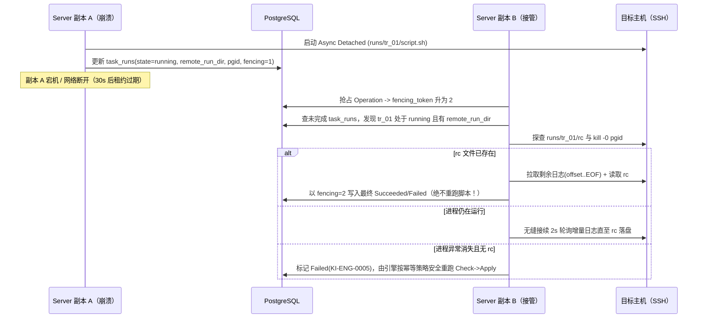

# D2 底座深度设计（模块 2）：存储层完整 DDL、任务引擎与 Fencing 锁、3-Way Diff、`Stack` 及全量 15 个内置 Task

> **本文定位**：kinstall 分模块像素级深度设计系列第 2 篇（底座 2/3），对应代码包 `internal/store`、`internal/engine`、`internal/lock`、`internal/planner`、`internal/stack`、`internal/engine/tasks`。本文把“存储、并发、幂等、漂移、复合栈编排与宿主机/容器原子任务”全部落到**可直接执行的 SQL DDL、状态机与防死锁锁协议、Go 核心算法与精确 Task 契约**。
>
> **版本**：v1.5（底座 2/3，2026-11-26；v1.5 统一 PostgreSQL 18 / `VARCHAR(48)` 前缀 ULID 描述、修复 Fencing UPDATE `FOR SHARE` 竞态、明确 SQLite 独立方言与 `operation_events` 事务有序提交防止 SSE 跳帧）。SQLite `modernc.org/sqlite` 并发机制与 Docker Engine 29 防火墙后端行为均于 2026-11-26 联网实证核查；`v1.4` 补齐 `Stack.externalRefs` + `urlEncode` 双态脱敏、`docker.service` `LimitNOFILE=1048576` / 独立 `data-root` 门禁与 `compose.sync` 显式 `file|dir` 挂载预建及安全禁令。

---

## 1. 存储层双后端规范与完整 DDL（`internal/store`，ADR-005 / ADR-034）

### 1.1 SQLite（单机 CLI）2026 生产级并发与防踩坑规范

单机模式选用纯 Go **`modernc.org/sqlite v1.63.0`**（`CGO_ENABLED=0` 零交叉编译阻力）+ **`uptrace/bun v1.3.0`** + **`goose v3.30.2`**。2026-09/11 实证的 5 大 SQLite 生产暗坑必须在 `store/sqlite.go` 一次根治：

1. **连接池物理隔离（1 写 + 4 读）**：WAL 模式允许读与写并发，但 SQLite 同一时刻仍仅允许 **1 个活跃写事务**。若读写共用 `MaxOpenConns(1)`，写事务期间误调 `db.Query` 会永久死锁；若开多写连接则会高频触发 `SQLITE_BUSY`。
   - **kinstall 规范**：拆分为两个 `*sql.DB` 句柄：
     - `writeDB`：`SetMaxOpenConns(1)`、`SetMaxIdleConns(1)`、DSN 强制 `_txlock=immediate`（每个写事务直接 `BEGIN IMMEDIATE`，避免“先读后写升级锁”绕过 `busy_timeout` 直接报 `SQLITE_BUSY`！）；
     - `readDB`：`SetMaxOpenConns(4)`、DSN 强制 `mode=ro`（或 `_pragma=query_only(ON)`），专供 CLI 查询、SSE 追读日志、Facts 列表。
2. **连接级 PRAGMA 必须走 DSN，禁止单次 `Exec("PRAGMA ...")`**：`journal_mode=WAL` 是库级持久化的，但 `foreign_keys`、`busy_timeout`、`synchronous`、`cache_size` 都是**单连接局部属性**，必须通过 URL 编码后的 DSN `_pragma` 参数下发到每条新建连接，并启用 **`sqlite.StrictPragmas = true`** 防止多语句 PRAGMA 注入：
   ```text
   file:/var/lib/kinstall/kinstall.db?_txlock=immediate&_pragma=journal_mode(WAL)&_pragma=synchronous(NORMAL)&_pragma=foreign_keys(ON)&_pragma=busy_timeout(5000)&_pragma=cache_size(-64000)&_pragma=temp_store(MEMORY)
   ```
3. **启动首连串行初始化 WAL**：新库首次建文件切 `journal_mode=WAL` 需要独占锁；必须先对 `writeDB.PingContext(ctx)` 并跑完 `goose.Up` 后，再打开 `readDB`，否则并发首连会报 `SQLITE_BUSY`。
4. **绝不跨 SSH/HTTP 持写事务（规避 `busy_timeout` 吞噬短 `context` 超时）**：实测 `modernc.org/sqlite` 持有写锁时，竞争方即便传 100 ms context deadline 也会被 `busy_timeout=5000` 阻塞满 5 s 才返回！因此所有写事务严格控制在 **< 20 ms 纯 DB 读写**内提交，绝不在事务内做任何网络/SSH I/O。
5. **防 WAL Checkpoint 饥饿**：任何漏关的 `sql.Rows` 或长读事务都会卡住默认 1000 页的自动 Checkpoint，导致 `-wal` 文件无限膨胀拖慢全库。所有查询必须立即 `defer rows.Close()` + 检查 `rows.Err()`，后台每 5 分钟执行一次非阻塞 `PRAGMA wal_checkpoint(PASSIVE)` 并暴露 `kinstall_sqlite_wal_pages` 指标。

### 1.2 PostgreSQL（Server HA 模式）规范

- 驱动：`github.com/jackc/pgx/v5 v5.13.0`（`pgxpool`），默认 `MaxConns=25`、`MinConns=4`、`MaxConnLifetime=30m`、`DefaultQueryExecMode=QueryExecModeCacheStatement`。
- 数据库版本：**PostgreSQL 18**（18.7，与 P4 插件同源）；表时间统一 `TIMESTAMPTZ`，JSON 字段在 PG 用 `JSONB`（SQLite 用 `TEXT` + `CHECK (json_valid(...))`），资源主键统一 **`VARCHAR(48)`（前缀 + ULID，时间有序、免自增冲突、无需集中发号器）**。

### 1.3 完整双端核心 DDL SQL（`migrations/00001_init.sql`，PostgreSQL 语法基准 + SQLite 差异注记）

> SQLite 与 PG 各自维护一份 `migrations/sqlite/` 与 `migrations/postgres/` 嵌入脚本（差异极小，主要在 `JSONB` vs `TEXT`、`TIMESTAMPTZ` vs `TEXT`、`BIGSERIAL` vs `INTEGER PRIMARY KEY AUTOINCREMENT`），CI 强制双向 `goose up` + 契约测试核验字段 100% 对等。

```sql
-- +goose Up
-- 注：所有资源主键统一采用 VARCHAR(48) 存储带前缀 ULID（如 prj_<26> / host_<26> / inst_<26> / op_<26> / cred_<26> / stack_<26>），
--     与 05 §3.1 及 G1 §7 严格一致（杜绝 CHAR(26) 截断前缀 ULID 的运行期报错）。

-- 1. 项目与环境（多租户与 RBAC 隔离根）
CREATE TABLE projects (
    id          VARCHAR(48) PRIMARY KEY,
    name        VARCHAR(64) NOT NULL UNIQUE,
    description TEXT NOT NULL DEFAULT '',
    created_at  TIMESTAMPTZ NOT NULL DEFAULT NOW(),
    updated_at  TIMESTAMPTZ NOT NULL DEFAULT NOW()
);

-- 2. 凭据库（全部机密载荷按 D1 §3 Envelope v1 加密存储，严禁明文）
CREATE TABLE credentials (
    id            VARCHAR(48) PRIMARY KEY,
    project_id    VARCHAR(48) NOT NULL REFERENCES projects(id) ON DELETE RESTRICT,
    name          VARCHAR(128) NOT NULL,
    kind          VARCHAR(32) NOT NULL,          -- ssh_key | ssh_password | sudo_password | api_token | ca_key | s3_aksk | registry_auth | webhook_secret
    state         VARCHAR(24) NOT NULL,          -- active | rotating | revoked
    key_version   INTEGER NOT NULL DEFAULT 1,
    envelope_json JSONB NOT NULL,                -- D1 Envelope v1（当前版本）
    prev_envelope JSONB,                         -- 仅 rotating 期间暂存旧密钥供回滚
    created_by    VARCHAR(128) NOT NULL,
    version       BIGINT NOT NULL DEFAULT 1,     -- 乐观锁
    created_at    TIMESTAMPTZ NOT NULL DEFAULT NOW(),
    updated_at    TIMESTAMPTZ NOT NULL DEFAULT NOW(),
    UNIQUE (project_id, name)
);

-- 3. CMDB 主机表（含故障域、HostKey 指纹、Facts 归一化快照）
CREATE TABLE hosts (
    id              VARCHAR(48) PRIMARY KEY,
    project_id      VARCHAR(48) NOT NULL REFERENCES projects(id) ON DELETE RESTRICT,
    name            VARCHAR(128) NOT NULL,       -- DNS-1123 唯一标识
    address         VARCHAR(128) NOT NULL,       -- SSH 入口 IP/域名
    ssh_port        INTEGER NOT NULL DEFAULT 22,
    ssh_user        VARCHAR(64) NOT NULL,
    credential_id   VARCHAR(48) NOT NULL REFERENCES credentials(id) ON DELETE RESTRICT,
    jump_host_id    VARCHAR(48) REFERENCES hosts(id) ON DELETE RESTRICT,
    legacy_rsa      BOOLEAN NOT NULL DEFAULT FALSE,
    work_dir        VARCHAR(255) NOT NULL DEFAULT '/var/lib/kinstall/tmp',
    hostkey_mode    VARCHAR(16) NOT NULL DEFAULT 'tofu', -- pinned | tofu
    hostkey_fp      VARCHAR(128) NOT NULL DEFAULT '',    -- SHA256:...
    state           VARCHAR(24) NOT NULL DEFAULT 'pending', -- pending|probing|ready|initializing|active|draining|retired
    fault_zone      VARCHAR(64) NOT NULL DEFAULT '',     -- 可用区/机房
    fault_rack      VARCHAR(64) NOT NULL DEFAULT '',     -- 机架
    labels_json     JSONB NOT NULL DEFAULT '{}',
    facts_json      JSONB NOT NULL DEFAULT '{}',         -- D1 1-RTT 采集归一化结果（含 page_size/glibc/machine_id/x86_level）
    facts_at        TIMESTAMPTZ,
    os_family       VARCHAR(32) NOT NULL DEFAULT '',
    os_id           VARCHAR(64) NOT NULL DEFAULT '',
    os_version      VARCHAR(32) NOT NULL DEFAULT '',
    arch            VARCHAR(16) NOT NULL DEFAULT '',     -- amd64 | arm64
    page_size       INTEGER NOT NULL DEFAULT 4096,
    init_profile    VARCHAR(64) NOT NULL DEFAULT '',
    version         BIGINT NOT NULL DEFAULT 1,
    created_at      TIMESTAMPTZ NOT NULL DEFAULT NOW(),
    updated_at      TIMESTAMPTZ NOT NULL DEFAULT NOW(),
    UNIQUE (project_id, name),
    UNIQUE (project_id, address, ssh_port)
);
CREATE INDEX idx_hosts_project_state ON hosts(project_id, state);
CREATE INDEX idx_hosts_fault_domain ON hosts(project_id, fault_zone, fault_rack);

-- 4. 复合应用栈（Stack，ADR-067）
CREATE TABLE stacks (
    id                VARCHAR(48) PRIMARY KEY,
    project_id        VARCHAR(48) NOT NULL REFERENCES projects(id) ON DELETE RESTRICT,
    env               VARCHAR(32) NOT NULL,
    name              VARCHAR(128) NOT NULL,
    spec_yaml         TEXT NOT NULL,
    resolved_dag_json JSONB NOT NULL DEFAULT '{}',
    state             VARCHAR(24) NOT NULL DEFAULT 'pending',
    version           BIGINT NOT NULL DEFAULT 1,
    created_at        TIMESTAMPTZ NOT NULL DEFAULT NOW(),
    updated_at        TIMESTAMPTZ NOT NULL DEFAULT NOW(),
    UNIQUE (project_id, env, name)
);

-- 5. 产品实例表（K8s / Valkey / PG / MySQL / ES / Kafka / SkyWalking / ObjectStorage 等）
CREATE TABLE instances (
    id                  VARCHAR(48) PRIMARY KEY,
    project_id          VARCHAR(48) NOT NULL REFERENCES projects(id) ON DELETE RESTRICT,
    stack_id            VARCHAR(48) REFERENCES stacks(id) ON DELETE RESTRICT,
    env                 VARCHAR(32) NOT NULL,
    name                VARCHAR(128) NOT NULL,
    product             VARCHAR(64) NOT NULL,     -- k8s | valkey | postgresql | kafka | ...
    deploy_target       VARCHAR(24) NOT NULL,     -- host-binary | host-container | kubernetes
    product_version     VARCHAR(64) NOT NULL,
    bom_revision        VARCHAR(64) NOT NULL,
    plugin_schema_ver   INTEGER NOT NULL DEFAULT 1, -- 供 StateMigrator 前滚迁移（G1 §6）
    desired_spec_json   JSONB NOT NULL,
    last_applied_json   JSONB,                    -- 供 3-Way Diff 基线（ADR-070）
    state_json          JSONB NOT NULL DEFAULT '{}', -- 插件持久化运行态（版本受 plugin_schema_ver 管控）
    outputs_json        JSONB NOT NULL DEFAULT '{}', -- 对外暴露的端点/CA Ref/密文凭据 ID（供 Stack 引用）
    state               VARCHAR(24) NOT NULL DEFAULT 'pending',
    version             BIGINT NOT NULL DEFAULT 1,
    created_at          TIMESTAMPTZ NOT NULL DEFAULT NOW(),
    updated_at          TIMESTAMPTZ NOT NULL DEFAULT NOW(),
    UNIQUE (project_id, env, name)
);
CREATE INDEX idx_instances_stack ON instances(stack_id);

-- 6. 主机与实例角色及容量声明（防端口、数据目录与 Docker Bridge 子网冲突，C11 / R2）
CREATE TABLE instance_host_claims (
    id           VARCHAR(48) PRIMARY KEY,
    instance_id  VARCHAR(48) NOT NULL REFERENCES instances(id) ON DELETE CASCADE,
    host_id      VARCHAR(48) NOT NULL REFERENCES hosts(id) ON DELETE RESTRICT,
    role         VARCHAR(64) NOT NULL,           -- master | worker | sentinel | broker | controller | ...
    ports_json   JSONB NOT NULL DEFAULT '[]',    -- 占用端口数组 [6379, 16379]
    paths_json   JSONB NOT NULL DEFAULT '[]',    -- 占用数据目录 ["/data/valkey/cache-01"]
    subnets_json JSONB NOT NULL DEFAULT '[]',    -- 占用 Docker Bridge 子网 ["10.240.1.0/24"]（防与宿主机路由/K8s CIDR 撞网）
    mem_mb       INTEGER NOT NULL DEFAULT 0,
    UNIQUE (instance_id, host_id, role)
);
CREATE INDEX idx_claims_host ON instance_host_claims(host_id);

-- 7. 运维操作与租约表（Operation：任务引擎核心调度单元 + Fencing Token + 四眼审批联动）
CREATE TABLE operations (
    id               VARCHAR(48) PRIMARY KEY,
    project_id       VARCHAR(48) NOT NULL REFERENCES projects(id) ON DELETE RESTRICT,
    target_type      VARCHAR(24) NOT NULL,       -- host | instance | stack
    target_id        VARCHAR(48) NOT NULL,
    action           VARCHAR(32) NOT NULL,       -- init | install | apply | scale | upgrade | backup | restore | uninstall
    state            VARCHAR(24) NOT NULL CHECK (state IN (
                         'awaiting_approval', 'pending', 'running',
                         'succeeded', 'failed', 'rejected', 'cancelled'
                     )),
    idempotency_key  VARCHAR(128),
    requested_by     VARCHAR(128) NOT NULL,
    approved_by      VARCHAR(128),
    pipeline_json    JSONB NOT NULL,             -- 冻结的不可变 PipelineSpec（含每个 Phase/Step/Task）
    -- 租约与防脑裂单调 Fencing Token（每次抢占/接管严格 +1）
    lease_owner      VARCHAR(128),               -- Server 副本唯一 ID（hostname+ulid）
    lease_expires_at TIMESTAMPTZ,
    fencing_token    BIGINT NOT NULL DEFAULT 0,
    error_code       VARCHAR(32),
    error_message    TEXT,
    started_at       TIMESTAMPTZ,
    finished_at      TIMESTAMPTZ,
    created_at       TIMESTAMPTZ NOT NULL DEFAULT NOW(),
    updated_at       TIMESTAMPTZ NOT NULL DEFAULT NOW(),
    UNIQUE (project_id, idempotency_key)
);
CREATE INDEX idx_ops_claimable ON operations(state, lease_expires_at) WHERE state IN ('pending', 'running');
CREATE INDEX idx_ops_target ON operations(target_type, target_id, created_at DESC);

-- 8. 原子任务执行记录表（支持断点续装、Async Detached 重附、3-Way Diff 快照）
CREATE TABLE task_runs (
    id                  VARCHAR(48) PRIMARY KEY,
    operation_id        VARCHAR(48) NOT NULL REFERENCES operations(id) ON DELETE CASCADE,
    phase_idx           INTEGER NOT NULL,
    step_key            VARCHAR(128) NOT NULL,
    host_id             VARCHAR(48) REFERENCES hosts(id) ON DELETE SET NULL,
    task_type           VARCHAR(64) NOT NULL,     -- file.sync | docker.ensure | ...
    params_digest       CHAR(64) NOT NULL,        -- 参数 SHA-256（不含 Secret 明文）
    state               VARCHAR(24) NOT NULL,     -- pending | running | skipped | succeeded | failed | rolled_back
    attempt             INTEGER NOT NULL DEFAULT 0,
    fencing_token       BIGINT NOT NULL DEFAULT 0,-- 写入必须匹配当前 Operation fencing_token！
    remote_run_dir      VARCHAR(255),             -- Async Detached 远端目录 /var/lib/kinstall/tmp/runs/<id>
    remote_pgid         INTEGER,
    remote_log_offset   BIGINT NOT NULL DEFAULT 0,
    drift_summary_json  JSONB,                    -- Check() 产出的三向 diff 摘要
    backup_ref_json     JSONB,                    -- Apply() 前记录的回滚锚点（原文件备份路径等）
    error_code          VARCHAR(32),
    error_detail        TEXT,
    started_at          TIMESTAMPTZ,
    finished_at         TIMESTAMPTZ,
    UNIQUE (operation_id, phase_idx, step_key)
);
CREATE INDEX idx_task_runs_op ON task_runs(operation_id, phase_idx);

-- 9. 操作事件与日志流（支持 SSE Last-Event-ID 断线无损追读）
CREATE TABLE operation_events (
    seq           BIGSERIAL PRIMARY KEY,         -- 全局单调递增事件 ID，直接作为 SSE `id:`
    operation_id  VARCHAR(48) NOT NULL REFERENCES operations(id) ON DELETE CASCADE,
    task_run_id   VARCHAR(48),
    event_type    VARCHAR(32) NOT NULL,          -- op.state | task.state | task.log | drift.warn
    payload_json  JSONB NOT NULL,                -- 已经 D1 RedactWriter 脱敏
    created_at    TIMESTAMPTZ NOT NULL DEFAULT NOW()
);
CREATE INDEX idx_op_events_replay ON operation_events(operation_id, seq);
-- 并发保序规则（防 BIGSERIAL 乱序提交导致 SSE 跳帧）：写入某 operation_id 的事件事务须先执行
-- SELECT 1 FROM operations WHERE id = $1 FOR UPDATE（SQLite 依赖 BEGIN IMMEDIATE 单写串行），保证同一 Operation 的 seq 分配序 == 提交可见序。

-- 10. 分布式资源锁表（实例锁 + 主机共享/排他锁，ADR-035）
CREATE TABLE resource_locks (
    resource_type  VARCHAR(16) NOT NULL,         -- stack | instance | host
    resource_id    VARCHAR(48) NOT NULL,
    lock_mode      VARCHAR(16) NOT NULL,         -- exclusive | shared
    holder_op_id   VARCHAR(48) NOT NULL REFERENCES operations(id) ON DELETE CASCADE,
    fencing_token  BIGINT NOT NULL,
    expires_at     TIMESTAMPTZ NOT NULL,
    acquired_at    TIMESTAMPTZ NOT NULL DEFAULT NOW(),
    PRIMARY KEY (resource_type, resource_id, holder_op_id)
);
CREATE INDEX idx_locks_lookup ON resource_locks(resource_type, resource_id, expires_at);

-- 11. 防篡改审计哈希链（ADR-062，与 G1 §5 严格统一：由单行链头锚点 + Advisory Lock 串行分配 seq，杜绝 BIGSERIAL 多副本分叉！）
CREATE TABLE audit_chain_head (
    chain_id    SMALLINT PRIMARY KEY CHECK (chain_id = 1),
    last_seq    BIGINT NOT NULL DEFAULT 0,
    last_sha256 CHAR(64) NOT NULL DEFAULT '0000000000000000000000000000000000000000000000000000000000000000',
    last_sm3    CHAR(64) NOT NULL DEFAULT '0000000000000000000000000000000000000000000000000000000000000000'
);
INSERT INTO audit_chain_head (chain_id) VALUES (1) ON CONFLICT DO NOTHING;

CREATE TABLE audit_logs (
    seq            BIGINT PRIMARY KEY,            -- 严禁自增！由事务内 audit_chain_head.last_seq + 1 分配
    occurred_at    TIMESTAMPTZ NOT NULL,          -- Go 侧 .UTC().Truncate(time.Microsecond) 对齐 PG 精度
    actor_id       VARCHAR(128) NOT NULL,
    actor_type     VARCHAR(24) NOT NULL,          -- user | token | system
    source_ip      VARCHAR(64) NOT NULL DEFAULT '',
    project_id     VARCHAR(48) NOT NULL DEFAULT '',
    action         VARCHAR(64) NOT NULL,          -- instance.apply | approval.approve | credential.rotate ...
    target_type    VARCHAR(32) NOT NULL,
    target_id      VARCHAR(64) NOT NULL,
    result         VARCHAR(16) NOT NULL,          -- success | denied | failure
    err_code       VARCHAR(32) NOT NULL DEFAULT '',
    trace_id       VARCHAR(64) NOT NULL DEFAULT '',
    payload_json   TEXT NOT NULL,                 -- 已脱敏摘要（严禁任何明文 Secret 或 Presigned URL）
    prev_sha256    CHAR(64) NOT NULL,
    record_sha256  CHAR(64) NOT NULL,
    prev_sm3       VARCHAR(64) NOT NULL DEFAULT '',
    record_sm3     VARCHAR(64) NOT NULL DEFAULT '' -- 密评模式并行写入（ADR-061/062）
);
CREATE INDEX idx_audit_logs_time ON audit_logs(occurred_at DESC);
CREATE INDEX idx_audit_logs_target ON audit_logs(project_id, target_type, target_id, seq DESC);

-- 12. 异步 RFC 5425 TLS Syslog 外送进度游标（SIEM 抖动永不阻塞主事务）
CREATE TABLE audit_syslog_cursor (
    sink_id        VARCHAR(64) PRIMARY KEY,
    last_sent_seq  BIGINT NOT NULL DEFAULT 0,
    updated_at     TIMESTAMPTZ NOT NULL DEFAULT NOW()
);
```

---

## 2. 自研任务引擎状态机、租约/Fencing 锁与防死锁协议（`internal/engine` & `internal/lock`）

### 2.1 租约抢占与单调 **Fencing Token**（彻底根治 GC 停顿导致的双写脑裂）

**经典分布式坑**：Server 副本 A 正在跑 Operation X（租约 30 s），若 A 发生网络分区或长 GC 停顿 35 s，副本 B 见租约过期合法接管了 X 并继续执行。此时 A 醒来，若不加防护把过期的 `task_runs` 结果写回数据库，就会覆盖 B 的真实进度！

**kinstall Fencing Token 强约束 SQL**：

```sql
-- 1. Worker 抢占待执行或已过期的 Operation（PostgreSQL 专用语法；SQLite 在 BEGIN IMMEDIATE 单写事务中使用独立方言 SQL，不含 FOR UPDATE / SKIP LOCKED / NOW() / INTERVAL）
WITH candidate AS (
    SELECT id FROM operations
    WHERE (state = 'pending')
       OR (state = 'running' AND lease_expires_at < NOW())
    ORDER BY created_at ASC
    FOR UPDATE SKIP LOCKED
    LIMIT 1
)
UPDATE operations o
SET state            = 'running',
    lease_owner      = $1,                       -- 本副本 worker_id
    lease_expires_at = NOW() + INTERVAL '30 seconds',
    fencing_token    = o.fencing_token + 1,      -- 单调递增 Fencing Token！
    started_at       = COALESCE(o.started_at, NOW())
FROM candidate c
WHERE o.id = c.id
RETURNING o.id, o.fencing_token, o.pipeline_json;

-- 2. 心跳续约（每 10s 执行一次；若返回 0 行说明租约已被抢走，立即 cancel 本地 ctx！）
UPDATE operations
SET lease_expires_at = NOW() + INTERVAL '30 seconds'
WHERE id = $1 AND lease_owner = $2 AND fencing_token = $3 AND state = 'running';

-- 3. 任何 TaskRun 状态更新都必须携带 Fencing 校验 + FOR SHARE 锁定 operations 行（防 READ COMMITTED 快照竞态！）
UPDATE task_runs t
SET state = $4, remote_log_offset = $5, finished_at = $6, error_code = $7, fencing_token = $3
FROM (
    SELECT id FROM operations
    WHERE id = $2 AND fencing_token = $3 AND lease_owner = $8
    FOR SHARE                                     -- 阻塞并发接管直至本写入完成或立即观测新 fencing_token
) o
WHERE t.id = $1 AND t.operation_id = o.id
  AND t.fencing_token <= $3;                      -- 单调栅栏 + 写入更新 task_runs.fencing_token
```

### 2.2 崩溃接管与 D1 Async Detached 无缝续跑流程



### 2.3 两级防死锁资源锁协议（ADR-035）

**死锁场景**：Op 1（给集群 A 扩容）锁了 Host-1 想锁 Host-2；同时 Op 2（主机巡检/初始化）锁了 Host-2 想锁 Host-1 → 经典 AB-BA 死锁。

**kinstall 数学证明无死锁的两级顺序加锁规则**：
1. **锁层级严格固定**：`Stack 锁` → `Instance 锁（排他）` → `Host 锁集合（严格按 host_id 字典序升序排序后在单个事务内一次性全有或全无申请）`！
2. **Host 锁双模式**：
   - **排他锁（`exclusive`）**：内核升级、重启、`harden`、磁盘格式化、防火墙重构（独占整台主机）；
   - **共享锁（`shared`）**：同一台主机上不同实例部署互不冲突的独立组件（如同一台宿主机同时部署两个不同端口的 Valkey 容器实例，各自持自身 `instance` 排他锁 + 共同持该主机 `host` 共享锁）。
3. **冲突检测规则（单事务原子判定）**：先清理 `expires_at < NOW()` 的过期死锁，再检查：
   - 若申请 `exclusive`：目标资源上**不得存在任何**其他 `holder_op_id` 的未过期锁；
   - 若申请 `shared`：目标资源上**不得存在**其他 `holder_op_id` 的 `exclusive` 锁。
   - 任一资源冲突则整体回滚，返回 `KI-LOCK-0001`（附当前持锁 `holder_op_id` 与持锁操作人），绝不部分持锁等待。
4. **维护窗口门禁**：对声明 `disruptive=true`（涉及重启/切主/短暂断连）的 Operation，调度器在抢占前核验项目配置的 `MaintenanceWindow`（Cron + 时长 + 时区），窗口外保持 `pending`（除非带四眼审批的 `--emergency-override`）。

---

## 3. Day-2 三向合并（3-Way Diff）与 `create-only` 保护（`internal/planner`，ADR-070）

**生产痛点**：Day-1 用 kinstall 装好集群后，现场 DBA 在 Day-30 紧急手工改了 `/etc/kinstall/valkey/prod/valkey.conf` 的 `maxmemory`；到了 Day-60 运维通过平台修改了一个无关参数并点 `apply`。如果平台只做 `desired vs live` 两向对比，会静默把 DBA 的线上紧急调优覆盖回滚，酿成 P1 故障！

### 3.1 三向状态定义与 6 场景决策矩阵

每个受管文件（`file.sync` / `template.render` / `compose.sync`）在 `instances.last_applied_json` 记录上次由 kinstall 写入的规范内容哈希 `H_base`（及结构化关键项快照）；`Check()` 时采集远端实时文件哈希 `H_live`，并与本次渲染目标哈希 `H_desired` 对比：

| 场景 | `H_base` vs `H_live` | `H_base` vs `H_desired` | `H_live` vs `H_desired` | 语义解读 | 默认引擎动作 |
| :---: | :---: | :---: | :---: | --- | --- |
| **1** | 相等 | 相等 | 相等 | 零变更、零漂移 | **`Skipped`**（100% 幂等） |
| **2** | 相等 | 不等 | 不等 | 正常平台变更（远端未被手改） | **`Update`**（安全覆写 + 原子替换） |
| **3** | 不等 | 相等 | 不等 | **纯外部漂移**（平台 Spec 没变，但远端被人工改了） | **默认阻断 `KI-DIFF-0001`**，展示精确 unified diff，提示 `--adopt`（吸收为新基线）或 `--force-override`（按平台 Spec 强行拉齐） |
| **4** | 不等 | 不等 | 不等 | **双向冲突**（平台 Spec 改了，远端也被人工改了） | **强制阻断 `KI-DIFF-0002`**，展示三方 diff（base / live / desired），严禁自动覆盖，必须人工确认 `--force-override` 或先修改 Spec |
| **5** | 不等 | 不等 | 相等 | 远端已人工改成与平台目标完全一致 | **`Converged`**（更新 `last_applied` 基线，不触碰文件/不重启服务！） |
| **6** | 无 `H_base` | — | 文件已存在 | 首次接管或目标路径已有非受管文件 | 默认阻断 `KI-DIFF-0003`（防误覆写存量配置），需显式 `adoptExisting: true` |

### 3.2 `create-only` 模式（专治 Sentinel / Patroni / 动态自写配置）

Valkey Sentinel 启动后会自己往 `sentinel.conf` 尾部重写 `sentinel myid`、`sentinel known-replica`、`sentinel current-epoch`！若对其做普通全文件哈希对比，每次 `apply` 都会误报漂移并覆盖掉运行期拓扑状态！

**`file.sync` / `template.render` 显式支持三种管理模式**：
- `managed`（默认）：完整 3-Way Diff 强管控；
- `create-only`：仅在远端文件不存在时创建（并记审计）；文件已存在时 `Check()` 永远返回 `Skipped`（后续变更走组件原生动态命令，如 `SENTINEL SET` / `CONFIG SET`）；
- `managed-block`：只用 `# BEGIN kinstall:<id>` / `# END kinstall:<id>` 围栏管控文件内的特定片段（适用于 `/etc/hosts`、`/etc/security/limits.conf`、`/etc/sysctl.conf`），绝不破坏客户已有内容。

---

## 4. `Stack` 复合栈 DAG 编排引擎（`internal/stack`，ADR-067）

大型组件栈（如 **ELK/OpenSearch + Kafka 4.x + Data Prepper + SeaweedFS S3** 或 **Milvus + etcd + SeaweedFS S3 + 外部云托管 MongoDB DDS/OBS**）天然包含跨实例与跨外部存量服务的依赖。`Stack` 解决“人工先装 A、抄 IP/密码/CA、再改 B 的 YAML、再装 B”的脆弱流程。

### 4.1 声明式引用语法与静态校验

```yaml
apiVersion: kinstall.io/v1alpha1
kind: Stack
metadata:
  name: prod-logging
  project: core-ops
  env: prod
spec:
  # ★ 可选：声明式引入外部存量 / 云托管服务（如华为云 OBS/DDS/RDS 或既有 ES），仅只读引用，不托管生命周期
  externalRefs:
    - id: cloud-dds
      kind: mongodb
      endpoints: ["10.20.8.11:8635", "10.20.8.12:8635"]
      credentialRef: "cred_01JEXT_DDS_APP" # 仅引用加密库 secretId，严禁明文密码
      tlsCA: "cred_01JEXT_DDS_CA"

  instances:
    - id: s3
      product: object-storage
      deployTarget: host-binary
      spec: { engine: seaweedfs, ... }

    - id: kafka
      product: kafka
      deployTarget: host-binary
      spec: { version: "4.3.2", mode: kraft, ... }

    - id: opensearch
      product: opensearch
      dependsOn: [s3]
      spec:
        snapshotRepo:
          s3Endpoint: "${instances.s3.outputs.s3Endpoint}"
          caSecretRef: "${instances.s3.outputs.caCertSecretId}"
          akSecretRef: "${instances.s3.outputs.bucketCreds.loggingBackup}"

    - id: dataprepper
      product: elk-pipeline
      dependsOn: [kafka, opensearch]
      spec:
        kafkaBrokers: "${instances.kafka.outputs.bootstrapServers}"
        sinkEndpoint: "${instances.opensearch.outputs.httpEndpoints}"
```

### 4.2 编排、外部引用与级联销毁规则

1. **Plan 期静态校验（零远程调用即可报错）**：
   - 使用 Kahn 算法做拓扑排序并检测环路（有环立即拒收 `KI-STACK-0001`）；
   - 校验所有 `${instances.<id>.outputs.<key>}` 的 `<id>` 必须出现在当前节点的 `dependsOn` 闭包内，且 `<key>` 必须存在于上游插件 `PluginMeta.OutputSchema` 声明中（杜绝拼错字段跑到一半才炸！）；校验所有 `${externalRefs.<id>.<field>}` 必须已在 `spec.externalRefs` 显式声明且 `credentialRef` 在当前项目 `credentials` 表存在；
   - 凭据类输出**绝不以明文存入 `outputs_json`**，仅暴露 `secretId`（如 `cred_01J...`），下游在执行期经 `internal/secrets` 按需解密并直接注入 `RedactWriter` 脱敏集合！
2. **混合云/存量服务外部引用（`externalRefs`）与 `urlEncode` 模板函数**：
   - 面对企业混合架构（例如自建 Milvus + 华为云托管 MongoDB DDS / RDS / OBS），`externalRefs` 将外部服务只读接入统一依赖图，Plan 期执行只读连通性/凭据存在性校验，**绝不接管外部服务的安装、重启或卸载生命周期**；
   - `internal/template` 确定性白名单函数库内置 **`urlEncode`**（底层调用标准库 `url.QueryEscape`），专用于安全拼接含特殊字符（`@`、`:`、`/`、`%`、`#`）的 DSN 密码（如 `mongodb://user:{{ urlEncode .Secrets.ddsPass }}@host:8635/...`），并且**原始密文与转义后密文同步注册进 `RedactWriter` 脱敏集合**，杜绝转义形态绕过日志脱敏！
3. **分层并发执行**：同一拓扑层级（如上面 `s3` 与 `kafka` 互不依赖）并行发起子 `Operation`；上游任一实例失败，下游立即阻断不启动。
4. **逆序安全销毁**：`kinstall stack uninstall` 严格按**逆拓扑序**销毁（`dataprepper` → `opensearch` → `kafka` & `s3`）；若某底层实例（如 `s3`）仍被**其他 Stack** 或独立 `Instance` 引用，强制拒绝销毁并返回引用清单 `KI-STACK-0002`；**`externalRefs` 声明的外部/云托管资源永远只读解绑，绝不执行任何远端销毁操作**。

---

## 5. 全部 15 个内置 Task 精确契约（`internal/engine/tasks`，ADR-003 / ADR-066）

所有插件（Go / YAML / gRPC）只能组合以下 **15 个平台内置原子 Task**。每个 Task 均由 `TaskRunner` 模板方法统一包裹锁校验、脱敏、DryRun 与状态入库。

### 5.1 15 个内置 Task 完整 `Check` / `Apply` / `Rollback` 契约总表

| # | TaskType | 幂等 `Check()` 逻辑 | 原子 `Apply()` 逻辑 | `Rollback()` 边界（诚实回滚） |
| :---: | --- | --- | --- | --- |
| 1 | `file.sync` | 对比远端 `stat(mode/uid/gid)` + `sha256sum` 执行 3-Way Diff（支持 `managed` / `create-only` / `managed-block`） | 按 D1 §2.5 三通道传至同目录 `.kinstall.tmp.<ulid>` → `chmod` → `chown user:group` → `fsync` → 原子 `mv` → 按需 `restorecon` | 从本次备份路径 `/var/lib/kinstall/backups/<op>/<id>` 原子还原旧文件（若新建则删除） |
| 2 | `template.render` | 在部署机本地用确定性白名单模板引擎渲染出目标字节流（含 Secret 占位解密与脱敏注册），复用 `file.sync` 3-Way Diff | 复用 `file.sync` 原子落盘 | 复用 `file.sync` 还原备份 |
| 3 | `pkg.ensure` | 通过 `OSAdapter` 查询逻辑包（`spec/pkgmap.yaml`）实际安装状态与冲突包清单（ADR-026） | 加排斥锁（`exclude`/`Pin -1`/`addlock`）→ Async Detached 执行 `dnf`/`apt-get`/`zypper`（带 120s 包锁等待重试） | **尽力而为**：仅卸载本次新装且无其他依赖的包；跨版本系统包升级标记为不可自动回滚 |
| 4 | `binary.install` | 比对目标 `/opt/kinstall/bin/<prod>/<ver>/<bin>` 存在性、权限与 SHA-256；校验 `PageSize` 与 `glibc` 兼容性（ADR-028/068） | 经 `D3 §7` `MediaResolver` 按优先级解析介质源（**本地 / 华为云 OBS·S3 桶 / 在线**）：`relay-cache` 模式由部署机单次拉取缓存后走通道 3 限速 HTTP 或通道 1 推送，`direct-presigned` 模式向同 VPC 目标机下发 15 分钟短效 OBS 预签名 URL 直拉（全程进 `RedactWriter` 脱敏）→ 目标机验 SHA-256 → 原子 `mv` → 原子更新 `current` 软链（`ln -sfn`） | 将 `current` 软链原子切回上一版本目录（零停机毫秒级回退） |
| 5 | `systemd.unit` | 对比 unit 文件哈希、`systemctl is-enabled`、`systemctl is-active` 及是否因依赖配置变化触发 `restartOnChange` | 原子写 `/etc/systemd/system/<unit>` → `daemon-reload` → `enable` → `start/reload/restart` → 校验 `ActiveState=active` | 还原旧 unit 文件 → `daemon-reload` → 重启旧版本服务 |
| 6 | `sysctl.apply` | 读取 `/proc/sys/...` 实时内核值与 `/etc/sysctl.d/99-kinstall-*.conf` 内容比对 | 原子写 drop-in 文件 → `sysctl --system`（或按文件 `--load`）→ 回读校验 | 还原旧 drop-in 并重刷 `sysctl`（仅作用于运行态安全参数） |
| 7 | `kmod.ensure` | 检查 `/sys/module/<mod>` 是否已加载且 `/etc/modules-load.d/kinstall-*.conf` 已持久化 | 写持久化配置 → `modprobe <mod>` → 校验加载成功 | 仅删持久化配置（不强行 `rmmod` 防破坏正在使用内核模块的业务） |
| 8 | `cmd.run` | 执行声明的只读 `creates` 路径检查或 `checkCmd`（返回 0 即判定已收敛跳过！） | 按超时阈值自动选 Sync 或 Async Detached 执行，stdout/stderr 全程走 `RedactWriter` | 若声明 `rollbackCmd` 则执行，否则标记为 `non-reversible` |
| 9 | `wait.tcp` | 非修改探针：在远端或部署机探测目标 `host:port` TCP 握手是否通 | 轮询等待至 `timeout`（带间隔与退避），超时返回 `KI-WAIT-0001` | 无副作用，无需回滚 |
| 10 | `wait.http` | 非修改探针：探测指定 URL（支持自定义 CA / mTLS / 期望状态码与 JSON/body 关键字） | 轮询等待至健康收敛 | 无副作用，无需回滚 |
| 11 | `cert.issue` | 检查目标证书存在性、签发者 CA 指纹、SAN（IP+DNS）完全匹配且剩余有效期 > 30%（避免无谓轮换） | 部署机内存签发叶子证书（私钥永不经落盘明文传输）→ 经 `file.sync` `0600` 原子写入远端 | 还原上一组证书/私钥文件（用于误签回退） |
| 12 | `helm.release` | 通过 Go Helm v4 SDK 读取集群内目标 release revision、Chart digest 与渲染 manifest diff | 执行 `helm upgrade --install --atomic --wait --timeout`（离线 Chart 来自 Zot OCI 或 `D3 §7` 多源解析） | 调用 Helm SDK `Rollback` 回滚至上一个成功 revision |
| 13 | **`docker.ensure`** | 检查 `dockerd` 版本（基线 `29.10.0`）、Compose 插件（`v5.8.0`）、`docker.service` `LimitNOFILE=1048576`（严禁 `infinity`）、`daemon.json` 哈希、数据盘 `data-root` 分区容量与防火墙守卫规则 | 离线安装上游静/动态二进制包（ADR-026 禁发行版旧包）→ 渲染合法 `docker.service`（锁定 `LimitNOFILE=1048576` 防 systemd 252+ 容器 `closefrom()` 假死/OOM）与 `daemon.json`（强制独立数据盘 `data-root` 默认 `/data/docker` + `json-file` 日志轮转 + `json.Unmarshal` 预检）→ 启停 `docker.service` → **安装防火墙白名单守卫**（见 §5.2） | 还原旧 `daemon.json`、`docker.service` 与防火墙规则（不卸载已有容器数据目录） |
| 14 | **`image.load`** | 按项目全局 `registryMirror` 重写目标镜像引用后，执行 `docker image inspect <ref>` 核验精确 `RepoDigests`（`sha256:...`）是否已在本地存在 | **Async Detached**：① 私仓/在线回源模式 `docker pull <mirror>/<repo>@sha256:...`（Zot 可按需回源或从 OBS 预导 OCI 归档入库）；② 纯介质包模式经 `D3 §7` `MediaResolver`（本地限速 HTTP / OBS 短效预签名流式拉取 `zstd -dc \| docker load`）→ 验 SHA-256 → `docker tag` → 清理临时文件 | 仅清理临时下载文件（不盲目 `rmi` 防删掉共享基础层） |
| 15 | **`compose.sync`** | 校验 `compose.yaml` 中镜像经全局 `registryMirror` 重写且无 `:latest`、Docker Bridge 子网（或 `sharedNetworkRef`）已登记 `subnets_json` 且与宿主机路由零冲突、**校验所有显式挂载点 `mounts: [{src, dst, type: file\|dir, uid, gid, mode}]` 存在性与类型一致**、校验零 `chmod 777` 且默认零 `privileged: true`、3-Way Diff 与 `docker compose ps --format json` 核验所有服务 `running`/`healthy` | ① 按 `mounts` 清单在 `up` 前**原子预创建空文件（`type: file`）与目录（`type: dir`）并设置精确 `uid:gid` 与 `0750`/`0640` 权限**（根治宿主机缺单文件被 Docker 建为目录导致容器崩毁的经典陷阱，严禁 `chmod 777` 与一次性 `docker cp` 抽配置）；② 敏感变量仅渲染进 `0600 .env` / secret 文件挂载（严禁明文落入 `compose.yaml`），默认拦截 `privileged: true`（仅四眼审批且显式 `allowPrivileged: true` 方放行）；③ 生成标准合法宿主 `systemd` unit（`Type=oneshot` + `RemainAfterExit=yes`，**严禁**对 `oneshot` 写非法的 `Restart=`；单容器重启策略由 Compose `restart: unless-stopped` 负责）→ **Async Detached** 执行 `docker compose up -d --remove-orphans --wait` | 还原旧 `compose.yaml`/`.env` → 重执行 `docker compose up -d` 拉回旧镜像版本（数据卷保留不动） |

### 5.2 深度攻坚：`docker.ensure` 生产红线与 Docker 29 防火墙绕过治理（2026-11 实证定稿）

**真实生产高危洞**：在 Linux 主机上，只要执行 `docker run -p 6379:6379`，Docker 默认会在 `FORWARD` / `PREROUTING` 注入放行规则，**完全绕过主机 `firewalld` / `ufw` 入站规则**，导致未授权内网/公网直接连上容器里的 Redis/ES/MongoDB！此外，历史手工脚本在 `docker.service` 中普遍遗留 `LimitNOFILE=infinity`——在 **systemd 252+ 与 Linux 6.x 内核**上，该项会将容器默认 `RLIMIT_NOFILE` 膨胀为 **`1,073,741,816`（10 亿）**，导致容器内 Java/Python/Erlang/MySQL 调用 `closefrom()` 或遍历 FD 时直接假死数分钟或 OOM！

**2026-11 Docker Engine 29 实证新陷阱（`docs.docker.com/engine/network/firewall-nftables/`）**：
- Docker 29 引入了实验性 `"firewall-backend": "nftables"`：该后端创建 `ip docker-bridges` / `ip6 docker-bridges` 表，**彻底移除了 `DOCKER-USER` 链！** 传统基于 `DOCKER-USER` 的脚本和 `ufw-docker` 在此模式下**完全失效**（且 `ufw-docker` 在 Docker 28/29 仍有未修复链变更缺陷）；
- 同时 Docker 29 明确声明 `nftables` 后端仍为 **experimental**（不支持 Swarm/overlay），**生产默认仍为 `iptables`（在现代 OS 上走 `iptables-nft` 兼容层，保留 `DOCKER-USER` 链）**。

**kinstall `docker.ensure` 生产基线与双后端防火墙铁律**：

1. **零号防线（`docker.service` 与 `data-root` 硬门禁）**：
   - `docker.service` 强制锁定 **`LimitNOFILE=1048576`**（Preflight 拦截并拒绝 `LimitNOFILE=infinity`），`LimitNPROC=infinity`、`TasksMax=infinity`、`Delegate=yes`、`KillMode=process`；
   - `daemon.json` 强制指定独立数据盘 **`"data-root": "/data/docker"`**（可按项目覆盖，但 Preflight 检测若指向容量不足或与系统根分区 `/` 共用且可用空间 < 50 GiB 则阻断提示，防镜像层打爆系统盘导致整机宕机）。
2. **第一道防线（架构级最小暴露）**：`compose.sync` 渲染端口映射时，对无需跨节点暴露的管理/内部端口（如 exporter、本机代理），**强制绑定 `127.0.0.1:<port>:<port>`**；对需集群内访问的端口，绑定主机业务私网 IP `<primary_ip>:<port>:<port>`（绝不裸写 `0.0.0.0`），并配合第二道防火墙白名单。
3. **第二道防线（`daemon.json` 锁定生产默认后端 + 独立持久化 systemd 守卫服务）**：
   - kinstall 生成的 `/etc/docker/daemon.json` 显式锁定 `"firewall-backend": "iptables"`（直到 Docker 上游将 `nftables` 标为 GA）、`"live-restore": true`（重启 dockerd 不杀业务容器）、`"log-driver": "json-file"` + `max-size: "100m" / max-file: "3"`（防容器日志打爆磁盘）、`"exec-opts": ["native.cgroupdriver=systemd"]`；
   - 创建随 `docker.service` 联动重放的持久化服务 **`/etc/systemd/system/kinstall-docker-fw.service`**（`After=docker.service`、`BindsTo=docker.service`、`PartOf=docker.service`），解决 `systemctl restart docker` 或主机重启后防火墙规则丢失的经典痛点！

```sh
#!/bin/sh
# /opt/kinstall/libexec/docker-fw-apply.sh (幂等加载，支持 iptables 与未来 nftables 双分支)
set -eu

BACKEND="$(docker info --format '{{.FirewallBackend.Driver}}' 2>/dev/null || echo iptables)"
EXT_IFACE="${KINSTALL_EXT_IFACE:-$(ip -4 route show default | awk '{print $5; exit}')}"
ALLOW_CIDRS="${KINSTALL_DOCKER_ALLOW_CIDRS:-10.0.0.0/8 172.16.0.0/12 192.168.0.0/16}"

if [ "$BACKEND" = "nftables" ]; then
  # Docker 29 实验性 nftables 后端：绝不修改 Docker 独占的 ip docker-bridges 表！
  # 建独立 table inet kinstall_docker_guard，在 priority filter - 5 先于 Docker 放行前拦截
  nft -f - <<EOF
table inet kinstall_docker_guard
delete table inet kinstall_docker_guard
table inet kinstall_docker_guard {
  set allow_v4 { type ipv4_addr; flags interval; elements = { $(echo "$ALLOW_CIDRS" | sed 's/ /, /g') } }
  chain forward {
    type filter hook forward priority filter - 5; policy accept;
    iifname "$EXT_IFACE" ct state established,related accept
    iifname "$EXT_IFACE" ip saddr @allow_v4 accept
    iifname "$EXT_IFACE" oifname "br-*" drop
    iifname "$EXT_IFACE" oifname "docker0" drop
  }
}
EOF
else
  # Docker 29 生产默认 iptables(iptables-nft) 后端：原子刷新 DOCKER-USER 链
  iptables -N DOCKER-USER 2>/dev/null || true
  iptables -F DOCKER-USER
  iptables -A DOCKER-USER -m conntrack --ctstate ESTABLISHED,RELATED -j RETURN
  iptables -A DOCKER-USER -i lo -j RETURN
  # 容器出网与网桥互访放行，仅对外部入口网卡做白名单收敛
  for cidr in $ALLOW_CIDRS; do
    iptables -A DOCKER-USER -i "$EXT_IFACE" -s "$cidr" -j RETURN
  done
  iptables -A DOCKER-USER -i "$EXT_IFACE" -j DROP
  iptables -A DOCKER-USER -j RETURN
fi
```

---

## 6. D2 模块验收测试清单（PR 必须全部通过）

| 测试类别 | 测试工具 / 环境 | 必过用例 |
| --- | --- | --- |
| **SQLite 并发与迁移** | `testing` + `modernc.org/sqlite` | ① 100 并发读 + 20 并发写下，读写分离池 + `_txlock=immediate` 零 `SQLITE_BUSY` 失败；② 故意漏关 `Rows` 验证 WAL 页数告警指标触发；③ `StrictPragmas` 拦截恶意 `;ATTACH` 注入；④ 双向 `goose` 迁移字段与 PG 100% 对等 |
| **PG 租约与 Fencing 拦截** | `testcontainers-go` + **真实 PG 18** | ① 3 个模拟 Worker 并发抢占 50 个 Operation，每个 Operation 仅被恰好 1 个 Worker 抢中；② **核心必测**：模拟 Worker A 暂停 35 s 租约过期被 Worker B 抢占（`fencing_token` 1→2），A 醒来尝试以 `fencing=1` 写回 `task_runs`，必须**0 行受影响且立即自停**；③ AB-BA 并发抢占重叠 Host 集合验证零死锁、精确返回 `KI-LOCK-0001` |
| **3-Way Diff 矩阵** | 单元测试 + Golden | 6 种状态矩阵 100% 覆盖；`create-only` 在远端自改（模拟 Sentinel）后返回 `Skipped`；`managed-block` 不破坏围栏外客户配置 |
| **`Stack` DAG 编排** | `FakeExecutor` 端到端 | 环路检测阻断；未声明 `dependsOn` 跨引用阻断；同层节点并发执行；上游失败阻断下游；被外部引用的共享实例拒绝级联销毁；`externalRefs` 销毁期零触碰且 `urlEncode` 原始/转义双态脱敏通过 |
| **Docker 29 基线与防火墙实测** | Rocky 9 + Ubuntu 24.04 VM（Docker 29.10） | ① `docker.service` `LimitNOFILE=1048576`（非 `infinity`）且 `compose.sync` `type: file` 挂载在宿主机文件不存在时正确预建空文件而非目录；② 启动映射容器后，非白名单来源 IP 访问容器发布端口必须被 `DOCKER-USER`（及 `nftables` 模式 `kinstall_docker_guard`）100% `DROP`；执行 `systemctl restart docker` 与主机重启后规则自动恢复有效 |

## 7. 参考实证来源

- [SQLite in Go: Drivers, WAL, Locking and Production Patterns（2026-09，`modernc.org/sqlite` `_txlock=immediate` 与 `busy_timeout` 实测）](https://www.alekseialeinikov.com/en/blog/topics/programming/sqlite-in-go-drivers-wal-locking-production-patterns)
- [Docker Engine 29: Docker with nftables（`DOCKER-USER` 移除与独立表优先级规范）](https://docs.docker.com/engine/network/firewall-nftables/)
- [Docker Engine 29 `DOCKER-USER` 与 `ufw-docker` 变更实测（2026-09/10）](https://qsa.sh/news/docker-ufw-bypass)
