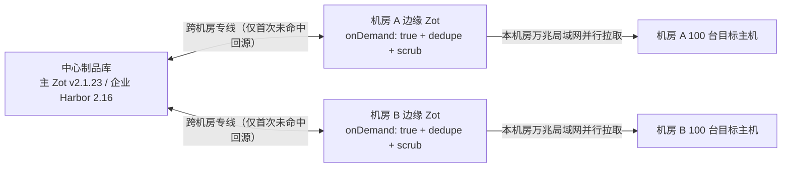
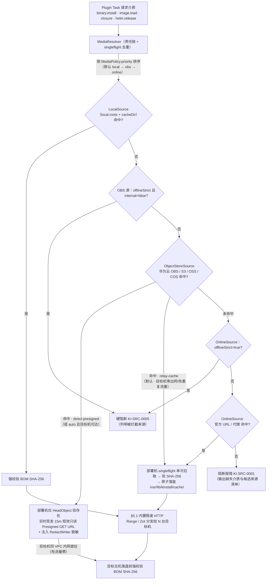

# D3 底座深度设计（3/3 · 底座封板）：离线供应链、跨架构构建与分发体系

> **本文定位**：kinstall **第一阶段底座封板文档（D3，3/3）**，面向供应链与构建/分发研发团队，将基线 `12-离线与供应链.md`、`05 §1.1/§2` 以及扩展调研 `R1`（15 项新增组件）、`R2`（历史安装文档 16 项真实生产坑诊断）的全部离线与多架构需求收敛为**可直接编码落地的像素级工程方案**。
>
> **覆盖范围**：设计项 `B6`、`G1–G8`、`A5`；关联 ADR-026、028、042、057、058、059、060、061、068、**077**。
>
> **版本**：v1.2（底座 3/3 封板，2026-11-26；v1.2 修复 §7.4 `MediaResolver` 尊重 `priority`/`LocalRoots`/`OfflineStrict`/`deliveryMode=auto` 与 `KI-SRC-0005`、统一 `offlineStrict` 允许 `internal: true` 内网白名单 OBS、对齐 `12 §6.1` 目录映射）。所有关键事实（Zot `v2.1.23`、`sigstore-go v1.4.1` / `kyverno#18525` 私有 TSA 离线坑、`oras-go/v3 v3.0.0`、`Jenkins 2.580.1+` 9 个 detached 插件离线坑、Temurin `CVE-2026-114938`、Syft `v1.57.2` / Grype `v0.122.1` / Trivy `v0.76.2`、华为云 2026 新建 OBS 桶默认禁止公开策略与 `aws-sdk-go-v2` `WhenRequired` 兼容补丁）均于 2026-11 实查核验。

---

## 0. 包边界与底座封板总览（`internal/artifact/`）

遵循 `D1 §1.1` 六边形单向依赖铁律，离线与多源制品供应链子系统全部收敛于 `internal/artifact/`（仅通过 `pkg/sdk/v1alpha1` 的只读 `ArtifactResolver` 接口向插件暴露已解析的制品路径与重写后的镜像引用，插件永远不直接触碰网络、OBS 凭据或签名校验）：

```text
internal/artifact/
├── bom/            # BOM YAML 解析、revision 独立版本管理、images.lock Digest 强校验（ADR-057）
├── source/         # ★ 统一多源介质解析引擎：Local 本地 / 华为云 OBS & S3·OSS·COS / Online 在线 + singleflight 缓存 + 短效预签名（ADR-077）
├── verify/         # sigstore-go v1.4.1 零出网 trusted_root.json 验签 + emmansun/gmsm SM2/SM3 双签
├── rewrite/        # 全局 registryMirror 镜像自动重写引擎 + certs.d 私有 CA 自动下发（R2 核心）
├── oci/            # oras-go/v3 v3.0.0 OCI Layout / Registry 同步、多根图拷贝、Split-Host 鉴权
├── server/         # 内置 HTTP Range 断点续传 + 两级令牌桶限速分发服务端（防百台并发打爆网卡）
├── zot/            # 内置 Zot v2.1.23 主仓库与区域 Pull-Through 边缘缓存配置生成与生命周期托管
├── runtime/        # 底座共享二进制工具链封装：JDK(8/17/21/25) + Maven(3.10) + Node.js(26/24)
├── closure/        # 离线第三方闭包构建器：OS RPM/DEB/ISO 源、Jenkins 2.580+ 插件、Neo4j APOC、字体
└── bundle/         # Bundle 裁剪、OCI 层去重、zstd 流式分卷、Manifest Diff 增量补丁与引用计数 GC
```

---

## 1. 端到端离线信任链与 `sigstore-go` / `oras-go/v3` 工程实现（G1、G2、G8）

### 1.1 四道零信任防线架构

```mermaid
flowchart LR
  UP["上游制品源<br/>K8s · 中间件 · OS 源 · 插件"] -->|"防线 1：上游 cosign / GPG / 双源 SHA-256 校验"| BLD["隔离构建流水线<br/>EL8 glibc 2.28 · 4K/64K · OS/插件闭包"]
  BLD -->|"防线 2：Syft SBOM + Grype 主门禁 + 隔离 Trivy + 许可闸口"| SIGN["打包与双轨签名<br/>zstd 分卷 + cosign Bundle + 可选 SM2/SM3"]
  SIGN -->|"光盘 / 网闸 / 移动介质"| IMP["内网部署机 bundle import<br/>防线 3：sigstore-go 零出网 trusted_root.json 验签"]
  IMP -->|"oras-go/v3 推送"| SRV["分发层<br/>限速 HTTP Range + Zot v2.1.23 主库 / 区域边缘缓存"]
  SRV -->|"防线 4：目标机落盘前复核 SHA-256 + 写入 InstalledFile"| NODE["目标主机<br/>amd64 · arm64-4K · arm64-64K"]
```



### 1.2 BOM `revision` 与 `images.lock` 精确契约（ADR-057 / ADR-068）

BOM 与平台二进制版本彻底解耦，每个产品按 `<product>/bom-<major.minor>-rev.<YYYY.MM.N>.yaml` 独立签名发布。任何组件均须声明 `arch`、`pageSizes`（ADR-028）、`glibcMin`（ADR-068）及 SPDX `license`（ADR-059）：

```yaml
apiVersion: kinstall.io/v1alpha1
kind: BillOfMaterials
metadata:
  product: valkey
  version: "9.1.4"
  revision: "2026.11.4"
  minPlatformVersion: ">=0.1.0"
  minPluginVersion: ">=0.1.0"
  releasedAt: "2026-11-26T00:00:00Z"
spec:
  binaries:
    - name: valkey-server
      version: "9.1.4"
      license: BSD-3-Clause
      variants:
        - arch: amd64
          pageSizes: [4096]
          glibcMin: "2.28"
          file: "binaries/valkey/9.1.4/amd64/valkey-9.1.4-el8-amd64.tar.zst"
          sha256: "e3b0c44298fc1c149afbf4c8996fb92427ae41e4649b934ca495991b7852b855"
        - arch: arm64
          pageSizes: [4096]
          glibcMin: "2.28"
          file: "binaries/valkey/9.1.4/arm64-4k/valkey-9.1.4-el8-arm64-4k.tar.zst"
          sha256: "1111111111111111111111111111111111111111111111111111111111111111"
        - arch: arm64
          pageSizes: [65536]        # 编译期强制 JEMALLOC --with-lg-page=16（ADR-028）
          glibcMin: "2.28"
          file: "binaries/valkey/9.1.4/arm64-64k/valkey-9.1.4-el8-arm64-64k.tar.zst"
          sha256: "2222222222222222222222222222222222222222222222222222222222222222"
  imagesLock:
    - key: valkey
      canonicalRef: "docker.io/valkey/valkey:9.1.4-alpine"
      # 强制绑定多架构 OCI Index Digest，严禁浮动标签
      indexDigest: "sha256:aaaaaaaaaaaaaaaaaaaaaaaaaaaaaaaaaaaaaaaaaaaaaaaaaaaaaaaaaaaaaaaa"
      platforms: ["linux/amd64", "linux/arm64"]
      license: BSD-3-Clause
      pageSizeCompatible: [4096]    # 64K 页主机启动容器前由 Preflight 拦截并要求切用 64K 专用构建镜像！
```

### 1.3 `sigstore-go v1.4.1` 零出网离线验签与 2026-11 私有 TSA 陷阱规避

**2026-11 实证工程坑（`kyverno/kyverno#18525`，2026-11-08 披露）**：
- 在纯内网离线环境（无公网访问 Rekor 透明日志、启用私有 RFC 3161 TSA 签名时间戳）下使用 Cosign v3 / `sigstore-go v1.4.x` 验签 Sigstore Bundle（`.sigstore.json`）时，若走跳过公网 Sigstore 基础设施的路径且未构造非空 `TrustedMaterial`（误将 TSA 证书链塞进旧版 `TSACertificate` 字段），`sigstore-go` 在校验证书时间戳时会直接对 nil 接口调用 `TimestampingAuthorities()` 引发 **nil pointer panic**！
- **Cosign v3.1+ 官方规范解法**：所有离线验签一律统一走 **`trusted_root.json`（TUF 离线根快照 / `cosign trusted-root create --tsa=...` 生成）**，绝不混用遗留散装 PEM 参数，也绝不在线请求 TUF 远端！

**双轨离线验签实现骨架（`internal/artifact/verify/verifier.go`）**：

```go
package verify

import (
	"crypto/sha256"
	"encoding/hex"
	"encoding/json"
	"errors"
	"fmt"
	"os"

	"github.com/emmansun/gmsm/sm2"
	"github.com/emmansun/gmsm/sm3"
	"github.com/emmansun/gmsm/smx509"
	"github.com/sigstore/sigstore-go/pkg/bundle"
	"github.com/sigstore/sigstore-go/pkg/root"
	"github.com/sigstore/sigstore-go/pkg/verify"
)

type Mode string

const (
	ModePublicKeyless Mode = "sigstore-keyless" // 线上官方发布包：内嵌 trusted_root.json + Rekor 离线包含证明
	ModeAirgapPrivate Mode = "airgap-private"   // 内网私有构建：企业私有 Root CA + 私有 RFC3161 TSA (trusted_root.json)
)

type OfflineConfig struct {
	Mode            Mode
	TrustedRootPath string // 必需！永不在线拉取 TUF；airgap 场景由 cosign trusted-root create --tsa=... 生成
	ExpectedIssuer  string // Keyless 模式必填，如 "https://token.actions.githubusercontent.com"
	ExpectedSAN     string // Keyless 模式必填，如 "https://github.com/kinstall/kinstall/.github/workflows/release.yml@refs/tags/..."
	RequireSM2Dual  bool   // 密评模式：强制叠加 SM2/SM3 双签校验（ADR-060 / ADR-061）
	SM2CertPEMPath  string
}

type OfflineVerifier struct {
	cfg             OfflineConfig
	trustedMaterial root.TrustedMaterial
	sm2PubKey       *sm2.PublicKey
}

func NewOfflineVerifier(cfg OfflineConfig) (*OfflineVerifier, error) {
	if cfg.TrustedRootPath == "" {
		return nil, errors.New("KI-ART-0001: offline verification requires explicit trusted_root.json path")
	}
	// 关键：从本地快照加载非空 TrustedMaterial（同时承载 CA、Rekor 与私有 TSA，彻底规避 kyverno#18525 空指针坑）
	tr, err := root.NewTrustedRootFromPath(cfg.TrustedRootPath)
	if err != nil {
		return nil, fmt.Errorf("KI-ART-0002: load trusted_root.json: %w", err)
	}
	v := &OfflineVerifier{cfg: cfg, trustedMaterial: tr}
	if cfg.RequireSM2Dual {
		pemBytes, err := os.ReadFile(cfg.SM2CertPEMPath)
		if err != nil {
			return nil, fmt.Errorf("KI-ART-0003: read SM2 cert: %w", err)
		}
		cert, err := smx509.ParseCertificatePEM(pemBytes)
		if err != nil {
			return nil, fmt.Errorf("KI-ART-0004: parse SM2 cert: %w", err)
		}
		pub, ok := cert.PublicKey.(*sm2.PublicKey)
		if !ok {
			return nil, errors.New("KI-ART-0005: certificate public key is not SM2")
		}
		v.sm2PubKey = pub
	}
	return v, nil
}

// VerifyManifest 零出网校验 Bundle manifest.json 的 Sigstore Bundle（及密评模式下的 SM2/SM3 双签）
func (v *OfflineVerifier) VerifyManifest(manifestPath, sigstoreBundlePath, sm2SigPath string) error {
	b, err := bundle.LoadJSONFromPath(sigstoreBundlePath)
	if err != nil {
		return fmt.Errorf("KI-ART-0010: load sigstore bundle: %w", err)
	}
	var vOpts []verify.VerifierOption
	switch v.cfg.Mode {
	case ModePublicKeyless:
		// 离线验证包含证明（Inclusion Proof）与 SCT，无需联网查询 Rekor
		vOpts = append(vOpts,
			verify.WithSignedCertificateTimestamps(1),
			verify.WithTransparencyLog(1),
			verify.WithObserverTimestamps(1),
		)
	case ModeAirgapPrivate:
		// 纯内网私有发布：无公网 Rekor，使用 trusted_root.json 内置的私有 RFC3161 TSA 时间戳证明签发时证书有效
		vOpts = append(vOpts, verify.WithSignedTimestamps(1))
	default:
		return fmt.Errorf("KI-ART-0011: unsupported verify mode %q", v.cfg.Mode)
	}

	sev, err := verify.NewVerifier(v.trustedMaterial, vOpts...)
	if err != nil {
		return fmt.Errorf("KI-ART-0012: init sigstore verifier: %w", err)
	}

	raw, err := os.ReadFile(manifestPath)
	if err != nil {
		return err
	}
	sum := sha256.Sum256(raw)

	var idOpt verify.PolicyOption
	if v.cfg.ExpectedIssuer != "" {
		certID, err := verify.NewShortCertificateIdentity(v.cfg.ExpectedIssuer, "", v.cfg.ExpectedSAN, "")
		if err != nil {
			return err
		}
		idOpt = verify.WithCertificateIdentity(certID)
	} else {
		idOpt = verify.WithoutIdentitiesUnsafe() // 仅限静态受控私钥/私有 CA 场景由调用方显式约束
	}

	policy := verify.NewPolicy(verify.WithArtifactDigest("sha256", sum[:]), idOpt)
	if _, err := sev.Verify(b, policy); err != nil {
		return fmt.Errorf("KI-ART-0013: sigstore signature verification failed: %w", err)
	}

	// 密评模式：并行校验 SM2 + SM3 签名侧车文件（manifest.json.sm2sig）
	if v.cfg.RequireSM2Dual {
		sigBytes, err := os.ReadFile(sm2SigPath)
		if err != nil {
			return fmt.Errorf("KI-ART-0014: read SM2 dual signature: %w", err)
		}
		sm3Sum := sm3.Sum(raw)
		if !sm2.VerifyASN1WithSM2(v.sm2PubKey, nil, raw, sigBytes) {
			return fmt.Errorf("KI-ART-0015: SM2 dual signature invalid (sm3=%s)", hex.EncodeToString(sm3Sum[:]))
		}
	}
	return nil
}
```

### 1.4 `oras-go/v3 v3.0.0` OCI 制品分发与 Split-Host 内网鉴权

2026-11-01 正式 GA 的 **`github.com/oras-project/oras-go/v3 v3.0.0`**（要求 Go ≥ 1.26，与 kinstall Go `1.27.4` 完美匹配）被选为 Bundle OCI Layout、声明式插件包（ADR-044）、BOM 目录与漏洞库 OCI Artifact 的统一读写引擎。落地必须启用三项 v3 新特性：

1. **多根图原子拷贝（Multi-Root Graph Copy）**：将 Bundle 内 `images/` 的标准 OCI Image Layout 同步至内置 Zot 或企业 Harbor 时，通过 `oras.CopyGraph` 一次性复制多架构 OCI Index + 全部子平台 Manifest + 附着的 Referrers（Cosign 签名、SPDX SBOM、OpenVEX），保持摘要 100% 不变；
2. **内网 Split-Host Bearer Token 域放行（防 SSRF 同时兼容自建 GitLab/Harbor）**：v3 默认仅拦截 loopback / link-local / 云元数据（`169.254.169.254`）作为 Token 认证域，天然兼容客户内网 Registry 与 Auth Server 分离部署在不同 RFC1918 私网 IP 的拓扑；
3. **按仓库级凭据隔离**：`oras-go/v3` 按仓库而非仅按主机缓存认证，支持同一 Harbor 实例内“从公共只读镜像项目复制到项目专属私库”双凭据无冲突推送。

---

## 2. 全局 `registryMirror` 镜像自动重写与私仓 CA 治理引擎（`internal/artifact/rewrite`，R2 反哺核心）

> **痛点根除**：`R2` 审计 `old-install.md` 发现，历史上几乎所有离线/半离线交付事故都源自“到处硬编码公网镜像（甚至混用脆弱的三方加速站）、反复手工 `docker pull / tag / push`、并且图省事把企业私仓塞进 `insecure-registries`”。kinstall 将其收口为**全平台唯一的声明式镜像重写网关**。

### 2.1 六条不可违反的镜像重写铁律

| # | 铁律 | 反例（拦截或自动修正） | 正例（重写后输出） |
| :---: | --- | --- | --- |
| 1 | **强制标准化 Docker Hub 隐式域与 `library/`** | `nginx:1.28.1`、`valkey/valkey:9.1.4` | 归一化为 `docker.io/library/nginx:1.28.1`、`docker.io/valkey/valkey:9.1.4` 后再映射 |
| 2 | **零 `:latest` 与可变标签阻断** | `neo4j:latest`、`attu`（无 tag） | 预检报错 `KI-IMG-0001`；生产必须经 `images.lock` 绑定精确 `@sha256:<64hex>` |
| 3 | **禁止冻结/停服镜像库（ADR-012 / ADR-042）** | `docker.io/bitnami/*`、`quay.io/minio/minio:*` | 预检硬阻断 `KI-IMG-0002`（附替代指引：SeaweedFS / 官方上游镜像） |
| 4 | **双映射模式 + 幂等防套娃** | 已重写为 `zot.local:15000/...` 再进重写器 | 检测到已命中 `mirrorHost` 前缀时原样返回，永不产生 `zot/zot/...` |
| 5 | **全目标形态统一注入** | 仅重写 `compose.yaml` 漏掉 K8s Helm / 静态 Pod | `image.load`、`compose.sync`、`helm.release` 与 K8s 静态 Pod 全部复用同一个 `Rewriter` 实例 |
| 6 | **零 `insecure-registries`，全量下发私有 CA** | 在 `daemon.json` 写 `"insecure-registries": ["10.x:5000"]` | `docker.ensure` / CRI 初始化自动落盘 `/etc/docker/certs.d/<host>:<port>/ca.crt` 与 `/etc/containerd/certs.d/<host>:<port>/hosts.toml`（含 `ca = ...`） |

### 2.2 核心代码实现（`internal/artifact/rewrite/rewriter.go`）

```go
package rewrite

import (
	"errors"
	"fmt"
	"regexp"
	"strings"
)

type Strategy string

const (
	// StrategyPreserveRegistry 保留源域名防命名空间碰撞（内置 Zot 推荐默认）
	// 例：docker.io/library/nginx:1.28.1@sha256:... -> reg.local:15000/docker.io/library/nginx:1.28.1@sha256:...
	StrategyPreserveRegistry Strategy = "preserve-registry"

	// StrategyFlatProject 压平至单一 Harbor 项目（适配客户已有 Harbor 按项目隔离权限）
	// 例：docker.io/library/nginx:1.28.1@sha256:... -> harbor.corp/kinstall-mirror/nginx:1.28.1@sha256:...
	StrategyFlatProject Strategy = "flat-project"
)

type Config struct {
	MirrorHost       string            // 如 "zot.kinstall.local:15000" 或 "harbor.corp.local"
	ProjectPrefix    string            // FlatProject 模式必填，如 "kinstall-mirror"
	Strategy         Strategy          // 默认 StrategyPreserveRegistry
	RequireDigest    bool              // 生产环境强制 true
	AllowMutableTag  bool              // 仅本地开发模式可设 true
	PerRegistryRules map[string]string // 可选覆盖：如 {"ghcr.io": "harbor.corp.local/ghcr-proxy"}
	DeniedPrefixes   []string          // 默认含 "docker.io/bitnami/", "quay.io/minio/", "docker.io/minio/"
}

type ParsedRef struct {
	Registry string // 总是显式（如 "docker.io"、"registry.k8s.io"、"harbor.local:8443"）
	Repo     string // 如 "library/nginx" 或 "valkey/valkey"
	Tag      string // 如 "9.1.4-alpine"（可选）
	Digest   string // 如 "sha256:..."（生产必填）
}

var (
	digestRe = regexp.MustCompile(`^sha256:[a-f0-9]{64}$`)
	defaultDenied = []string{
		"docker.io/bitnami/",
		"docker.io/bitnamilegacy/",
		"docker.io/minio/",
		"quay.io/minio/",
	}
)

type Rewriter struct {
	cfg Config
}

func New(cfg Config) (*Rewriter, error) {
	if cfg.Strategy == "" {
		cfg.Strategy = StrategyPreserveRegistry
	}
	if cfg.Strategy == StrategyFlatProject && strings.TrimSpace(cfg.ProjectPrefix) == "" {
		return nil, errors.New("KI-IMG-0003: flat-project strategy requires projectPrefix")
	}
	if len(cfg.DeniedPrefixes) == 0 {
		cfg.DeniedPrefixes = defaultDenied
	}
	cfg.MirrorHost = strings.TrimRight(strings.TrimSpace(cfg.MirrorHost), "/")
	cfg.ProjectPrefix = strings.Trim(strings.TrimSpace(cfg.ProjectPrefix), "/")
	return &Rewriter{cfg: cfg}, nil
}

// ParseNormalized 按 OCI / Docker 规范补齐隐式 docker.io 与 library/
func ParseNormalized(raw string) (ParsedRef, error) {
	s := strings.TrimSpace(raw)
	if s == "" {
		return ParsedRef{}, errors.New("KI-IMG-0004: empty image reference")
	}
	var ref ParsedRef
	// 1. 拆离 @digest
	if idx := strings.Index(s, "@"); idx >= 0 {
		ref.Digest = s[idx+1:]
		if !digestRe.MatchString(ref.Digest) {
			return ParsedRef{}, fmt.Errorf("KI-IMG-0005: invalid image digest %q", ref.Digest)
		}
		s = s[:idx]
	}
	// 2. 拆离 :tag（注意不能把域名里的 :port 误判为 tag！）
	lastSlash := strings.LastIndex(s, "/")
	lastColon := strings.LastIndex(s, ":")
	if lastColon > lastSlash {
		ref.Tag = s[lastColon+1:]
		s = s[:lastColon]
	}
	// 3. 识别域名（含 '.' 或 ':' 或为 "localhost"）
	firstSlash := strings.Index(s, "/")
	if firstSlash < 0 {
		ref.Registry = "docker.io"
		ref.Repo = "library/" + s
	} else {
		head := s[:firstSlash]
		if strings.ContainsAny(head, ".:") || head == "localhost" {
			ref.Registry = head
			ref.Repo = s[firstSlash+1:]
		} else {
			ref.Registry = "docker.io"
			ref.Repo = s
		}
	}
	if ref.Registry == "index.docker.io" || ref.Registry == "registry-1.docker.io" {
		ref.Registry = "docker.io"
	}
	if ref.Registry == "docker.io" && !strings.Contains(ref.Repo, "/") {
		ref.Repo = "library/" + ref.Repo
	}
	return ref, nil
}

// Rewrite 输出满足合规门禁与私仓路由的最终镜像引用
func (r *Rewriter) Rewrite(raw string) (string, error) {
	ref, err := ParseNormalized(raw)
	if err != nil {
		return "", err
	}
	// 1. 禁止 :latest 与无版本裸引用
	if !r.cfg.AllowMutableTag {
		if ref.Tag == "latest" || (ref.Tag == "" && ref.Digest == "") {
			return "", fmt.Errorf("KI-IMG-0001: mutable or untagged image forbidden: %q", raw)
		}
	}
	if r.cfg.RequireDigest && ref.Digest == "" {
		return "", fmt.Errorf("KI-IMG-0006: production image must pin @sha256 digest: %q", raw)
	}
	// 2. 阻断已冻结/停服镜像库（Bitnami / MinIO）
	full := ref.Registry + "/" + ref.Repo
	for _, denied := range r.cfg.DeniedPrefixes {
		if strings.HasPrefix(full, denied) {
			return "", fmt.Errorf("KI-IMG-0002: image %q violates platform ban prefix %q", raw, denied)
		}
	}
	// 3. 构建后缀（同时保留 :tag 与 @digest 便于人工排障，containerd/docker 按 digest 强校验）
	suffix := ""
	if ref.Tag != "" {
		suffix += ":" + ref.Tag
	}
	if ref.Digest != "" {
		suffix += "@" + ref.Digest
	}
	// 4. 若未配 MirrorHost 或已经指向 MirrorHost，幂等返回防套娃
	if r.cfg.MirrorHost == "" || ref.Registry == r.cfg.MirrorHost {
		return ref.Registry + "/" + ref.Repo + suffix, nil
	}
	// 5. 优先命中按源域名的独立映射规则（如多项目代理）
	if override, ok := r.cfg.PerRegistryRules[ref.Registry]; ok {
		return strings.TrimRight(override, "/") + "/" + ref.Repo + suffix, nil
	}
	// 6. 按全局策略重写
	switch r.cfg.Strategy {
	case StrategyPreserveRegistry:
		if r.cfg.ProjectPrefix != "" {
			return r.cfg.MirrorHost + "/" + r.cfg.ProjectPrefix + "/" + ref.Registry + "/" + ref.Repo + suffix, nil
		}
		return r.cfg.MirrorHost + "/" + ref.Registry + "/" + ref.Repo + suffix, nil
	case StrategyFlatProject:
		// 将 "library/nginx" -> "nginx"，保留多级仓库的末两段避免不同上游重名
		repo := strings.TrimPrefix(ref.Repo, "library/")
		return r.cfg.MirrorHost + "/" + r.cfg.ProjectPrefix + "/" + repo + suffix, nil
	default:
		return "", fmt.Errorf("KI-IMG-0007: unknown rewrite strategy %q", r.cfg.Strategy)
	}
}
```

### 2.3 私有 CA 自动下发（告别 `insecure-registries`）

当部署机启用自签 CA 或企业内网根 CA 托管 Zot / Harbor HTTPS 时，`docker.ensure` 与 K8s CRI 初始化 Task 自动把平台受管 CA 落盘到双运行时的标准信任目录（无需重启宿主系统信任库亦可即时生效）：

- **Docker Engine 29**：`/etc/docker/certs.d/<mirror_host_with_port>/ca.crt`（权限 `0644`，Docker Daemon 动态热读取，无需重启 `dockerd`）；
- **containerd 2.3 LTS**：在 `config.toml` 开启 `[plugins."io.containerd.cri.v1.images".registry] config_path = "/etc/containerd/certs.d"`，并为目标私仓与上游被拦截域下发 `/etc/containerd/certs.d/<upstream_or_mirror>/hosts.toml`：

```toml
# /etc/containerd/certs.d/zot.kinstall.local:15000/hosts.toml
server = "https://zot.kinstall.local:15000"

[host."https://zot.kinstall.local:15000"]
  capabilities = ["pull", "resolve"]
  ca = "/etc/kinstall/pki/registry-ca.crt"
```

---

## 3. 跨架构与多页大小离线构建流水线（EL8 `glibc 2.28` + `amd64` / `arm64-4K` / `arm64-64K`）

### 3.1 四类制品构建矩阵与 ABI 兼容铁律（ADR-028 / ADR-068）

| 制品类别 | 代表组件 | 编译基座 | 产物变体矩阵 | 预检与兼容红线 |
| --- | --- | --- | --- | --- |
| **Go 纯静态二进制** | `kinstall`、K8s、etcd、SeaweedFS、Zot、BanyanDB、Caddy、Prometheus | Go `1.27.4` (`CGO_ENABLED=0`) | `linux/amd64`、`linux/arm64`（可选 `loong64`） | 零 glibc 依赖；通过 `-trimpath -buildvcs=false` + `SOURCE_DATE_EPOCH` 可复现构建；64K 页天生兼容（但严禁跨页大小直拷 bbolt 数据目录） |
| **C/C++ 常规组件** | PostgreSQL、MySQL、Nginx、HAProxy、Patroni(Python venv)、Fluent Bit | **EL8 容器 (`glibc 2.28`)** | `amd64`、`arm64` | 产物经 `verify-glibc-abi.sh` 强制断言符号上限 `<= GLIBC_2.28`（兼容 Rocky/Alma/OL 8–10、openEuler 22/24、麒麟 V10 SP3/V11、Ubuntu 22/24/26）；**CentOS 7 (`glibc 2.17`) 强制路由至 `host-container`** |
| **C/C++ jemalloc 组件** | **Valkey 9.1/9.2**、Redis 8、**Harbor 2.16 外置 Valkey**、RocksDB 类引擎 | **EL8 容器 (`glibc 2.28`)** | **`amd64` + `arm64-4k` + `arm64-64k`** 三产物 | `arm64-64k` 必须显式传 `--with-lg-page=16` 编译 jemalloc；目标机 `Facts.PageSize == 65536` 时若错配 4K 产物立即在 Preflight 阻断 `KI-PLAN-0012`（ADR-028，与 `05 §5.2` 登记表一致） |
| **JVM / 托管运行时组件** | Kafka 4.x、OpenSearch 3.10、SkyWalking OAP、Jenkins 2.580、RocketMQ 5.5、Seata 2.6、SonarQube 26.x | 上游官方 Tarball + 底座 **`runtime/jdk`** | `amd64`、`arm64`（纯字节码复用 + 分架构 JNI `.so` 如 Netty/Snappy/RocksDB） | 严禁依赖宿主机自带随机 JDK；每个组件在 BOM 中绑定底座 `runtime/jdk` 精确主版本（默认 Temurin 21 LTS ≥ 2026-11-18 CSPU） |

### 3.2 EL8 `glibc 2.28` + `arm64-64K` jemalloc 生产构建配方与 ABI 门禁

```dockerfile
# build/builders/valkey-el8.Dockerfile
# 固定使用 Rocky Linux 8 (glibc 2.28) 作为跨发行版最大公约数 ABI 底座
FROM rockylinux:8.10@sha256:0000000000000000000000000000000000000000000000000000000000000000 AS builder
ARG VALKEY_VERSION=9.1.4
ARG PAGE_SIZE_BITS=12   # amd64 与 arm64-4k 用 12 (4KB)；arm64-64k 必须传 16 (64KB)！

RUN dnf install -y gcc gcc-c++ make pkgconfig openssl-devel systemd-devel tar zstd binutils && dnf clean all
WORKDIR /src
COPY valkey-${VALKEY_VERSION}.tar.gz .
# 构建前已由前置步骤校验官方 SHA-256 与 GPG 签名
RUN tar -xzf valkey-${VALKEY_VERSION}.tar.gz && cd valkey-${VALKEY_VERSION} && \
    # 针对 jemalloc 显式注入目标页大小，彻底根除鲲鹏/麒麟 64K 页启动崩溃（ADR-028 / Harbor#24445）
    (cd deps/jemalloc && ./configure --with-lg-page=${PAGE_SIZE_BITS} --with-jemalloc-prefix=je_ --enable-prof) && \
    make -j"$(nproc)" USE_SYSTEMD=yes BUILD_TLS=yes MALLOC=jemalloc && \
    make PREFIX=/out install
```

**编译后强制 ABI + 页大小门禁脚本（CI 任何一项失败立即阻断发版）**：

```sh
#!/bin/sh
# hack/ci/verify-binary-abi.sh <binary_path> <max_glibc> <expected_arch>
set -eu
BIN="$1"; MAX_GLIBC="${2:-2.28}"; EXPECT_ARCH="$3"

# 1. 校验 ELF 目标架构（防止交叉编译错放包）
FILE_OUT="$(readelf -h "$BIN" | awk '/Machine:/ {print $2, $3}')"
case "$EXPECT_ARCH" in
  amd64) echo "$FILE_OUT" | grep -qi "X86-64" || { echo "FAIL: arch mismatch: $FILE_OUT"; exit 1; } ;;
  arm64) echo "$FILE_OUT" | grep -qi "AArch64" || { echo "FAIL: arch mismatch: $FILE_OUT"; exit 1; } ;;
esac

# 2. 校验最高 GLIBC 版本符号 <= 2.28（杜绝误编进 GLIBC_2.34+ 导致 EL8 / 麒麟 V10 无法启动）
MAX_FOUND="$(objdump -T "$BIN" 2>/dev/null | grep -oE 'GLIBC_[0-9]+\.[0-9]+' | sed 's/GLIBC_//' | sort -V | tail -n1 || true)"
if [ -n "$MAX_FOUND" ]; then
  HIGHEST="$(printf '%s\n%s\n' "$MAX_GLIBC" "$MAX_FOUND" | sort -V | tail -n1)"
  if [ "$HIGHEST" != "$MAX_GLIBC" ]; then
    echo "FAIL: $BIN requires GLIBC_$MAX_FOUND > allowed GLIBC_$MAX_GLIBC"
    exit 1
  fi
fi

# 3. 检查动态依赖白名单（禁止绑定宿主机可能缺失的非常规共享库如 libjemalloc.so 或 libicu）
echo "OK: $BIN arch=$EXPECT_ARCH max_glibc=${MAX_FOUND:-static}"
```

**Harbor 2.16.0 在 64K 页主机上的自动协同（R1 实证 `goharbor/harbor#24445`）**：
- 若部署目标主机 `Facts.Arch == "arm64" && Facts.PageSize == 65536`，Harbor 插件的 `Validate()` 自动拒绝内嵌 Redis 模式，改为在 `Stack` 编排中自动联动部署本流水线产出的 **`valkey-9.1.4-arm64-64k`** 作为 Harbor 外部 KV 缓存，彻底规避官方内置 Redis 容器在 64K 页崩溃的问题。

---

## 4. 底座共享二进制工具链与离线扩展闭包（`internal/artifact/runtime` & `closure`，R1 + R2 反哺核心）

> **设计动机**：`R1` 与 `R2`（`old-install.md` 实战审计）共同证明，**JDK、Maven、Node.js** 不是普通孤立的业务插件，而是被 Kafka、OpenSearch、SkyWalking、Jenkins、SonarQube、RocketMQ、Seata 及 CI/CD 构建机高频复用的**底座运行时工具链**；同时，离线环境下 Jenkins、Neo4j APOC、SonarQube 与 OnlyOffice 的第三方扩展极易偷偷访问 GitHub 导致现场部署中断。因此全部下沉至底座 `D3` 统一治理！

### 4.1 非侵入多版本目录布局与环境变量铁律

```text
/opt/kinstall/runtimes/
├── jdk/
│   ├── temurin-8u462/          # 仅供遗留 Java 8 应用显式绑定，绝不进系统全局 PATH
│   ├── temurin-17.0.17/        # 过渡业务（如老版 Spring Boot 3）
│   ├── temurin-21.0.10-cspu/   # 平台默认 LTS（>= 2026-11-18 CSPU，修复 CVE-2026-114938）
│   ├── bisheng-21.0.10/        # 可选：鲲鹏 arm64 专享（开启 KAE 硬件加解密与 NUMA 调优）
│   ├── temurin-25.0.2-cspu/    # 新一代 LTS（Spring Boot 4 / 现代云原生）
│   └── default -> temurin-21.0.10-cspu   # 仅作 /etc/kinstall/env.d/jdk-default.sh 引用，不篡改 /usr/bin/java！
├── maven/
│   └── 3.10.2/                 # 原样解压官方包，严禁编辑 bin/mvn！
└── node/
    ├── 24.22.3/                # 维护期 LTS
    └── 26.13.1/                # 当前推荐 LTS
```

**三条零污染铁律（彻底根治 `old-install.md` 中“手改 `/etc/profile` + 手改 `bin/mvn`”历史顽疾）**：
1. **禁止篡改宿主机 `/usr/bin/java` 与 `/etc/profile`**：所有受 kinstall 托管的 JVM/Node 服务在其独立 `systemd` unit 中显式注入 `Environment="JAVA_HOME=/opt/kinstall/runtimes/jdk/<ver>"` 与 `Environment="PATH=/opt/kinstall/runtimes/jdk/<ver>/bin:/usr/local/sbin:/usr/local/bin:/usr/sbin:/usr/bin"`，同一主机可稳定并发运行 JDK 8（老业务）+ JDK 21（Kafka/Jenkins/SkyWalking）+ JDK 25（新微服务）互零干扰！
2. **Maven 切换 JDK 走标准 `/etc/kinstall/maven/mavenrc` 与 `.mvn/jvm.config`**：通过 `M2_HOME=/opt/kinstall/runtimes/maven/3.10.2` 与 `MAVEN_ARGS="--settings /etc/kinstall/maven/settings.xml"` 绑定私仓（Reposilite / Nexus）与内网镜像源，**永远不修改 `bin/mvn` 源码**；CI 任务按项目指定 `JAVA_HOME=/opt/kinstall/runtimes/jdk/<ver> mvn ...` 即可无缝多版本构建。
3. **Node.js 离线构建走 `/etc/kinstall/node/npmrc` + `NODE_EXTRA_CA_CERTS`**：默认指向内网 **Verdaccio** 私仓，自动注入 `NODE_EXTRA_CA_CERTS=/etc/kinstall/pki/root-ca.pem` 与 `COREPACK_ENABLE_DOWNLOAD_PROMPT=0` + 离线预置 `corepack` 缓存（pnpm/yarn），断网下执行 `npm ci` / `pnpm install --offline` 零报错。

### 4.2 `runtime/jdk` 安全基线与幂等 `cacerts` 私有 CA 注入

- **强制安全版本门禁（2026-11 实证）**：BOM 预检拒绝任何早于 **2026-11-18 CSPU** 的 JDK 21/25 构建（封堵 `CVE-2026-114938 "java4shell"` 严重漏洞）；
- **幂等 CA 注入 Task 逻辑**：安装每个 JDK 版本后，自动扫描平台信任根目录 `/etc/kinstall/pki/trust-anchors/*.crt`，按 `alias="kinstall-ca-<sha256前12位>"` 调用该 JDK 自带 `keytool -list` 检查，不存在则执行：
  ```sh
  "$JDK_HOME/bin/keytool" -importcert -noprompt -trustcacerts \
    -alias "kinstall-ca-${CA_FP12}" \
    -file "$CA_FILE" \
    -keystore "$JDK_HOME/lib/security/cacerts" \
    -storepass changeit
  ```
  同时保留原 `cacerts.kinstall.orig` 备份，卸载 CA 时按 `kinstall-ca-*` 前缀精确删除，彻底消灭 Java/Jenkins/Maven/SkyWalking 连接自签私仓时的 `PKIX path building failed`。

### 4.3 四大离线第三方扩展 / 插件闭包构建器（`internal/artifact/closure`）

| 生态组件 | 离线真实必败陷阱（2026-11 实证 + R2 审计） | kinstall 底座离线闭包构建方案 |
| --- | --- | --- |
| **Jenkins `2.580.3 LTS`** | **2026-11-19 重大变更**：自 `2.580.1` 起，核心 WAR 移除了 **9 个原内置 detached 插件**（含 `bouncycastle-api`、`jaxb`、`sshd` 等），断网环境只放 `jenkins.war` + 业务插件将直接启动失败！此外 `master.key` 不可与 `JENKINS_HOME` 打在同一个备份包里 | 在联网构建容器调用官方 `jenkins-plugin-cli --war jenkins.war --plugin-file plugins.lock.txt --plugin-download-directory /out/plugins` 递归解析全部传递依赖，并**强制合入 9 个 detached 插件清单**；产出物按 SHA-256 写入 Bundle `closures/jenkins/<ver>/plugins/`；目标机同步至 `$JENKINS_HOME/plugins/` 并禁用在线更新中心检查（`hudson.model.UpdateCenter.xml` 指向内网空清单元数据） |
| **Neo4j 5.x/2025.x + APOC** | `old-install.md` 误配 `NEO4J_PLUGINS=["apoc"]`，容器每次启动均尝试从 **GitHub Releases 在线下载 APOC JAR**，断网直接卡死/崩溃！ | 禁用 `NEO4J_PLUGINS` 在线拉取；构建期按精确 Neo4j 版本锁定并校验 `apoc-<ver>-core.jar`（与可选 `apoc-<ver>-extended.jar`）打入 `closures/neo4j/<ver>/plugins/`，运行期以只读挂载至 `/plugins` 并自动配置 `dbms.security.procedures.unrestricted=apoc.*` |
| **SonarQube Community Build 26.x** | 离线无法访问 Marketplace 下载中文语言包 `sonar-l10n-zh` 与定制规则插件，且插件版本与 SonarQube 26.x API 强绑定 | 在 BOM 中通过 `extraPlugins[]` 显式锁定每个 `.jar` 的 URL、版本兼容范围与 SHA-256，预检版本兼容性后打入 `closures/sonarqube/<ver>/plugins/`，随 `file.sync` 原子落盘至 `extensions/plugins/` |
| **OnlyOffice Docs 10.0** | 离线容器默认缺失常用中文字体（宋体/黑体/仿宋/楷体），文档渲染错位乱码 | 构建合规字体闭包 `closures/fonts/cjk-base/`（默认打包 Apache/OFL 开源 **Noto CJK / 思源字体**；企业已有商业版权字体通过 `--extra-fonts-dir` 私有注入），挂载至 `/usr/share/fonts/custom` 后由 Post-Hook 幂等触发 `documentserver-generate-allfonts.sh` |

---

## 5. 大规模并发分发、HTTP Range 限速与 Zot `v2.1.23` 边缘缓存（G5）

### 5.1 内置 HTTP Range 两级限速分发服务端（`internal/artifact/server/ratelimit_fs.go`）

**要解决的工程痛点**：当 kinstall 并发初始化 50–200 台主机（拉取 `kubelet`、`containerd`、Valkey、JDK 21 Tarball 及 OS RPM/DEB 包）时，若内置 HTTP 服务不限速，百台万兆节点瞬间打满部署机出口网卡，不仅导致下载集体超时，更会**把同一网卡上的 SSH 控制信道与任务租约心跳打丢，触发误判假死！**

**关键实现细节（不可踩的 Go 标准库坑）**：
- 不能简单用 `io.Copy` 包装 `http.ResponseWriter` 限速（会破坏 `http.ServeContent` 对 `Range` / `If-Range` / `ETag` / `206 Partial Content` 的原生支持，导致 `curl -C -` 断点续传失效）；
- 正确设计是实现 **`throttledReadSeeker`**：在保留 `io.ReadSeeker`（让 `http.ServeContent` 原生计算 `Content-Length` 与处理分片偏移）的前提下，在 `Read()` 内依次通过 **单 IP 令牌桶** + **全局令牌桶**（`golang.org/x/time/rate`），并且每次 `WaitN` 都绑定 `r.Context()`（客户端断连瞬间立刻释放配额不阻塞 goroutine）；
- 在连接入口叠加 **最大并发下载信号量（默认 64）**，超限时返回标准 `429 Too Many Requests` + `Retry-After: 5`，配合目标机 `curl --retry 8 --retry-all-errors` 实现无雪崩削峰。

```go
package server

import (
	"context"
	"io"
	"net"
	"net/http"
	"os"
	"path/filepath"
	"strings"
	"sync"
	"time"

	"golang.org/x/time/rate"
)

type RateLimitConfig struct {
	GlobalBytesPerSec int64 // 默认 400 MiB/s（根据部署机网卡速率可调）
	PerIPBytesPerSec  int64 // 默认 50 MiB/s
	BurstBytes        int   // 默认 4 MiB（必须 >= readChunkSize）
	MaxConcurrent     int   // 默认 64（超限返 429 + Retry-After）
}

type ArtifactHTTPServer struct {
	rootDir   string
	cfg       RateLimitConfig
	globalLim *rate.Limiter
	sem       chan struct{}

	mu      sync.Mutex
	ipLims  map[string]*ipBucket
}

type ipBucket struct {
	lim      *rate.Limiter
	lastSeen time.Time
}

func NewArtifactHTTPServer(rootDir string, cfg RateLimitConfig) *ArtifactHTTPServer {
	if cfg.GlobalBytesPerSec <= 0 {
		cfg.GlobalBytesPerSec = 400 << 20
	}
	if cfg.PerIPBytesPerSec <= 0 {
		cfg.PerIPBytesPerSec = 50 << 20
	}
	if cfg.BurstBytes < 256<<10 {
		cfg.BurstBytes = 4 << 20
	}
	if cfg.MaxConcurrent <= 0 {
		cfg.MaxConcurrent = 64
	}
	return &ArtifactHTTPServer{
		rootDir:   filepath.Clean(rootDir),
		cfg:       cfg,
		globalLim: rate.NewLimiter(rate.Limit(cfg.GlobalBytesPerSec), cfg.BurstBytes),
		sem:       make(chan struct{}, cfg.MaxConcurrent),
		ipLims:    make(map[string]*ipBucket),
	}
}

func (s *ArtifactHTTPServer) limiterForIP(ip string) *rate.Limiter {
	s.mu.Lock()
	defer s.mu.Unlock()
	now := time.Now()
	if b, ok := s.ipLims[ip]; ok {
		b.lastSeen = now
		return b.lim
	}
	// 轻量惰性清理超过 10 分钟不活跃的 IP 桶防内存缓慢增长
	if len(s.ipLims) > 1024 {
		for k, v := range s.ipLims {
			if now.Sub(v.lastSeen) > 10*time.Minute {
				delete(s.ipLims, k)
			}
		}
	}
	lim := rate.NewLimiter(rate.Limit(s.cfg.PerIPBytesPerSec), s.cfg.BurstBytes)
	s.ipLims[ip] = &ipBucket{lim: lim, lastSeen: now}
	return lim
}

func (s *ArtifactHTTPServer) ServeHTTP(w http.ResponseWriter, r *http.Request) {
	if r.Method != http.MethodGet && r.Method != http.MethodHead {
		http.Error(w, "method not allowed", http.StatusMethodNotAllowed)
		return
	}
	// 1. 并发闸门：满载时快速返回 429 引导目标机指数退避，保护 SSH 控制面
	select {
	case s.sem <- struct{}{}:
		defer func() { <-s.sem }()
	default:
		w.Header().Set("Retry-After", "5")
		http.Error(w, "artifact server busy, retry later", http.StatusTooManyRequests)
		return
	}

	// 2. 路径防穿越（仅允许 rootDir 下的常规文件，拒绝目录遍历与符号链接逃逸）
	cleanRel := filepath.Clean("/" + r.URL.Path)
	fullPath := filepath.Join(s.rootDir, cleanRel)
	realPath, err := filepath.EvalSymlinks(fullPath)
	if err != nil || !strings.HasPrefix(realPath, s.rootDir+string(os.PathSeparator)) {
		http.NotFound(w, r)
		return
	}
	f, err := os.Open(realPath)
	if err != nil {
		http.NotFound(w, r)
		return
	}
	defer f.Close()

	st, err := f.Stat()
	if err != nil || st.IsDir() {
		http.NotFound(w, r)
		return
	}

	// 3. 保留完整 io.ReadSeeker 交由 http.ServeContent 原生处理 Range / 206 / ETag / Last-Modified
	clientIP, _, err := net.SplitHostPort(r.RemoteAddr)
	if err != nil {
		clientIP = r.RemoteAddr
	}
	trs := &throttledReadSeeker{
		ctx:       r.Context(),
		rs:        f,
		globalLim: s.globalLim,
		ipLim:     s.limiterForIP(clientIP),
		maxChunk:  min(256<<10, s.cfg.BurstBytes),
	}
	w.Header().Set("Cache-Control", "public, max-age=86400, immutable")
	http.ServeContent(w, r, st.Name(), st.ModTime(), trs)
}

type throttledReadSeeker struct {
	ctx       context.Context
	rs        io.ReadSeeker
	globalLim *rate.Limiter
	ipLim     *rate.Limiter
	maxChunk  int
}

func (t *throttledReadSeeker) Seek(offset int64, whence int) (int64, error) {
	return t.rs.Seek(offset, whence)
}

func (t *throttledReadSeeker) Read(p []byte) (int, error) {
	// 限制单次 Read <= maxChunk（<= BurstBytes），避免 rate.WaitN 因 n > burst 报错
	if len(p) > t.maxChunk {
		p = p[:t.maxChunk]
	}
	n, err := t.rs.Read(p)
	if n > 0 {
		if wErr := t.ipLim.WaitN(t.ctx, n); wErr != nil {
			return n, wErr
		}
		if wErr := t.globalLim.WaitN(t.ctx, n); wErr != nil {
			return n, wErr
		}
	}
	return n, err
}
```

### 5.2 Zot `v2.1.23` 主仓库与区域 Pull-Through 边缘缓存（2026-11 实证定稿）

当部署规模超过 **50 台节点** 或存在 **跨机房 / 跨低带宽专线** 时，单靠中心部署机 Zot 拉取多 GiB 容器镜像会成为瓶颈。kinstall 支持一键在每个区域/机房拉起 1 台轻量 **Zot `v2.1.23` Pull-Through 边缘缓存节点**（单 Go 二进制，内存占用仅 ~80 MiB），自动对接中心 Zot 或客户 Harbor：



**Zot `v2.1.23` 区域 Pull-Through 边缘缓存生产 `config.json`（2026-11 官方文档实测核验）**：

```json
{
  "distSpecVersion": "1.1.1",
  "storage": {
    "rootDirectory": "/var/lib/kinstall/zot-edge",
    "dedupe": true,
    "gc": true,
    "gcDelay": "24h",
    "gcInterval": "24h"
  },
  "http": {
    "address": "0.0.0.0",
    "port": "15000",
    "compat": ["docker2s2"],
    "tls": {
      "cert": "/etc/kinstall/zot/tls.crt",
      "key": "/etc/kinstall/zot/tls.key"
    },
    "auth": {
      "htpasswd": { "path": "/etc/kinstall/zot/htpasswd" },
      "failDelay": 3
    }
  },
  "log": {
    "level": "info",
    "output": "/var/log/kinstall/zot.log"
  },
  "extensions": {
    "scrub": {
      "enable": true,
      "interval": "24h"
    },
    "sync": {
      "enable": true,
      "credentialsFile": "/etc/kinstall/zot/upstream-creds.json",
      "registries": [
        {
          "urls": ["https://hub-registry.corp.local:15000"],
          "onDemand": true,
          "maxRetries": 3,
          "retryDelay": "5s",
          "tlsVerify": true,
          "certDir": "/etc/kinstall/zot/upstream-ca",
          "content": [
            {
              "prefix": "**"
            }
          ]
        }
      ]
    }
  }
}
```

**三项 2026-11 实证必守运维红线**：
1. **必配 `"compat": ["docker2s2"]`**：Zot 默认以纯 OCI 1.1 运行；未显式开启 `docker2s2` 兼容时，回源拉取或推送仍采用 Docker Schema 2 Manifest 的遗留上游镜像（如部分中间件官方老包或业务自建镜像）会直接返回 `400 MANIFEST_INVALID`！
2. **严禁对 Docker Hub 启用 `pollInterval` 轮询**：Docker Hub 不提供 `/v2/_catalog` 且对匿名/高频轮询限流封禁；对外网半离线代理只允许 **`"onDemand": true`** 按需拉取，定时预热同步仅可用于企业内部主 Zot 或 Harbor。
3. **必开 `extensions.scrub`**：边缘缓存节点往往使用普通盘，开启每 24h `scrub` 自动对存储层做 SHA-256 完整性巡检，提前拦截磁盘静默坏块导致的镜像层损坏。

---

## 6. OS 离线软件源闭包、Bundle 分卷/增量补丁与安全/许可门禁（G3、G4、G6、G7、A5）

### 6.1 `spec/pkgmap.yaml` 驱动的 OS 包离线闭包与商业信创 ISO 闭环（G3）

基于 `spec/pkgmap.yaml`（64 逻辑包 + 6 冲突排斥项），流水线按 `OS × Arch` 矩阵自动产出已签名离线软件源并执行 **零出网容器洁净安装验收**：

1. **开源 RPM 族（Rocky / Alma / OL / openEuler / Anolis / Alinux）**：
   - 在官方同版本 `minimal` 容器中执行 `dnf download --resolve --alldeps --destdir=/out/rpms <resolved_pkgs>`（自动排除 ADR-026 禁止的发行版 `docker`/`containerd`/`runc`）；
   - 生成仓库索引与 GPG 签名：`createrepo_c --checksum sha256 /out/rpms` + `gpg --detach-sign --armor /out/rpms/repodata/repomd.xml`。
2. **开源 DEB 族（Ubuntu 22.04/24.04/26.04、Debian 12/13）**：
   - 在干净官方基础容器中执行 `apt-get install -y --download-only -o Dir::Cache::archives=/out/debs <resolved_pkgs>`；
   - 使用 `reprepro` 生成标准 `Packages.gz`、`Release` 与 GPG 内嵌签名 `InRelease`。
3. **商业信创 OS（麒麟 Kylin V10/V11、统信 UOS V20/V25）授权 ISO 导入闭环**：
   - 提供标准 CLI：`kinstall closure build-from-iso --os kylin-v11 --arch arm64 --iso /mnt/Kylin-Server-V11-arm64.iso --packages-profile k8s-node --out repos/kylin-v11-arm64/`；
   - 流程：只读回环挂载 ISO（`mount -o loop,ro`）→ 写入临时 `repo` 指向 ISO 内部 `AppStream/BaseOS` → 在目标架构隔离容器/chroot 中只针对 ISO 本地源解析全部传递依赖并拷出对应 RPM + 重建 `createrepo_c` 签名源；**全程零公网访问，完全符合商业 OS 授权边界**。
4. **洁净验收门禁**：拉起 `docker run --rm --network=none -v /out/repo:/repo:ro <base_image>`，清空容器内置全部 repo 文件仅保留 `/repo`，验证所有逻辑包 100% 离线安装成功且无缺依赖报错。

### 6.2 Bundle 目录、`manifest.json` Schema、流式分卷与增量补丁（G6、G7）

**`manifest.json` 精确结构**：

```json
{
  "schemaVersion": "v1alpha1",
  "bundleId": "bnd_01JCZ9F8R7K2M4N6P8Q0R2S4T6",
  "bundleType": "incremental",
  "baseRevision": "2026.11.3",
  "targetRevision": "2026.12.1",
  "minPlatformVersion": ">=0.1.0",
  "createdAt": "2026-12-01T02:00:00Z",
  "architectures": ["amd64", "arm64"],
  "osRepos": ["rocky-9-amd64", "kylin-v11-arm64"],
  "bomRevisions": [
    { "product": "kubernetes", "version": "1.37.3", "revision": "2026.12.1" }
  ],
  "ociIndexDigest": "sha256:bbbbbbbbbbbbbbbbbbbbbbbbbbbbbbbbbbbbbbbbbbbbbbbbbbbbbbbbbbbbbbbb",
  "splitPolicy": { "enabled": true, "partSizeBytes": 4294967296, "partCount": 2 },
  "files": [
    {
      "path": "binaries/kubernetes/1.37.3/amd64/kube-apiserver",
      "size": 124567890,
      "sha256": "cccccccccccccccccccccccccccccccccccccccccccccccccccccccccccccccc"
    }
  ]
}
```

**三项核心工程机制**：
1. **OCI Blob 全局去重 + `klauspost/compress` zstd 流式分卷**：同一 Bundle 内所有插件镜像共享单一 `images/blobs/sha256/` 目录（相同 Alpine / Distroless / JDK 基础层自动只存一份）；打包支持 `--split-size 2G` 或 `4G`（适配网闸/光盘单文件体积上限），生成 `.tar.zst.part001`..`.partNNN` 与 `SHA256SUMS.parts`；导入端支持流式拼接解压（**不需要在磁盘上占用 2 倍空间先 `cat` 成完整单文件**！）。
2. **`bundle diff` 增量补丁算法**：对比 `base/manifest.json` 与 `target/manifest.json` 的 `files[]` 哈希映射及 OCI `blobs/sha256/` 集合，仅打包新增或哈希变化的条目（通常 K8s 补丁升级如 `1.37.2 → 1.37.3` 增量包仅 200–400 MiB，缩减 ~90%）；导入端强校验本地制品库已存在 `baseRevision`（缺失报错 `KI-BND-0001`），并保留旧版本目录实现 BOM 秒级切回。
3. **引用计数安全 GC（`kinstall bundle prune`）**：扫描平台数据库 `instances` + `boms` 中仍在活跃引用的二进制路径与 OCI Digest 集合，仅清理零引用的历史旧版文件与孤儿镜像层，绝不误删在运集群扩容/修复所需的制品！

### 6.3 双扫描器漏洞门禁（ADR-058）与全生态许可证合规总闸（ADR-059，含 R1 15 项扩展）

#### 双引擎隔离扫描流水线（应对 2026-03 Trivy `v0.69.4` 投毒事件）

```sh
# 1. Syft v1.57.2 生成一等产物 SPDX 2.3 JSON SBOM（二进制/镜像/OS 仓全覆盖）
syft scan dir:/build/bundle-stage -o spdx-json=/out/sbom.spdx.json

# 2. 主门禁：Grype v0.122.1 基于离线 DB 扫描 SBOM（Critical 漏洞阻断，支持 OpenVEX 豁免）
grype sbom:/out/sbom.spdx.json \
  --offline --db-cache-dir /opt/vuln-db/grype \
  --vex /build/openvex.json \
  --fail-on critical -o json > /out/grype-report.json

# 3. 交叉复核：Trivy v0.76.2 仅在【无出网 + 只读根文件系统 + 精确 @sha256 镜像摘要】沙箱中运行
docker run --rm --network=none --read-only \
  -v /build/bundle-stage:/scan:ro \
  -v /opt/vuln-db/trivy:/root/.cache/trivy:ro \
  ghcr.io/aquasecurity/trivy@sha256:<PINNED_V0_76_2_DIGEST> \
  rootfs --offline-scan --skip-db-update --severity CRITICAL --exit-code 1 /scan

# 4. OpenVEX 过期自动拦截（防止永久豁免漏洞腐烂）
kinstall vex lint --file /build/openvex.json --fail-if-expired
```

#### 全平台 + R1 扩展生态许可证合规红黄绿总闸（CI 自动强制校验）

| 合规等级 | 许可证类型 | 代表组件（含基线 00–18 + R1 扩展 15 项） | 交付与打包红线 |
| :---: | --- | --- | --- |
| **🟢 绿灯（宽松许可）** | Apache-2.0 / MIT / BSD / ISC / PostgreSQL / MPL-2.0 | `kinstall` 主程序 Go 依赖、K8s、etcd、containerd、Valkey、PostgreSQL、OpenSearch 3.10、Kafka 4.x、SkyWalking 11.x、SeaweedFS、RustFS、Zot、Harbor 2.16、Jenkins、Maven 3.10、Reposilite、Node.js、Verdaccio、ZooKeeper 3.9、RocketMQ 5.5、Seata 2.6、Milvus 2.6/3.0 + Attu、Rancher 2.14、Forgejo/MIT、Nginx | **允许打入公共离线 Bundle**；主二进制经 `go-licenses` CI 强制仅允许绿灯依赖；自动汇总写入 `NOTICE` |
| **🟡 黄灯（弱/文件级传染或原样分发型 Copyleft）** | GPLv2 / LGPLv2.1 / GPLv2+CE / LGPLv3 | OS 依赖包（`iptables`/`nftables`/`chrony`/`haproxy`）、MySQL Community / Percona Server / XtraBackup、Ceph RGW、Eclipse Temurin OpenJDK（GPLv2+CE）、SonarQube Community Build（LGPL-3.0）、GitLab CE（MIT+核心混合） | **严禁静态链接进 `kinstall` 二进制**；仅允许作为独立上游二进制/RPM/DEB/镜像原样再分发，Bundle `NOTICE` 自动附精确源码包/SRPM 链接与书面 Offer |
| **🔴 红灯（强网络传染 AGPL / 非 OSI 源码可用 SSPL·ELv2·RSAL）** | AGPLv3 / SSPLv1 / ELv2 / RSALv2 | Elasticsearch / Kibana / ECK（ELv2/SSPL/AGPL）、Redis 8（RSAL/SSPL/AGPL）、MongoDB / PSMDB（SSPL）、OnlyOffice Docs（AGPLv3）、Garage（AGPLv3）、Neo4j CE（GPLv3）、Zabbix 7（AGPLv3） | **严禁进入 kinstall 公共官方 Bundle！** 插件仅提供 BOM 定义与部署编排，客户须显式确认许可证条款后在自有环境通过 `kinstall bundle build --include-restricted=<name> --accept-license` 独立构建私有离线包 |

---

## 7. 统一多源制品介质解析与拉取引擎（本地 / 在线 / 华为云 OBS·S3 桶）（`internal/artifact/source`，ADR-077）

> **核心诉求**：kinstall 所有插件的安装包介质（二进制 `tar.zst`、容器镜像 OCI 归档、Helm Chart、OS 离线软件源、JDK/Maven/Node 工具链、Jenkins/APOC/字体闭包及完整 Bundle）均必须透明支持 **三大一等介质来源**：
> 1. **本地介质（`local`）**：部署机本地离线目录 / 已导入 Bundle / 缓存池 `/var/lib/kinstall/cache/`（零外网）；
> 2. **对象存储桶（`obs` / `s3`）**：**华为云 OBS 私有桶**（原生 `obs-native` 或 S3v4 兼容双驱动），并同一套引擎平滑通吃阿里云 OSS、腾讯云 COS、AWS S3 及平台自建 SeaweedFS / Ceph RGW；
> 3. **在线源（`online`）**：上游官方 Release URL / 企业内网 HTTP(S) 制品库（支持 `HTTP_PROXY`/`HTTPS_PROXY`/`SOCKS5` 与域名白名单）。

### 7.1 三源瀑布策略链与双交付通道架构



**四大真实网络场景与推荐策略组合**：

| 现场场景 | `priority` 优先级链 | `offlineStrict` | `deliveryMode` 交付模式 | 容器镜像联动策略 |
| --- | --- | :---: | --- | --- |
| **A. 纯物理隔离 / 涉密内网** | `[local]`（或 `[local, obs(internal:true)]`） | `true`（仅允许 local 与 `internal: true` 内网白名单 OBS，硬拒 online 与公网/非白名单 OBS，返回 `KI-SRC-0005`） | `relay-cache` | 仅读本地 Bundle OCI Layout 导入内置 Zot |
| **B. 华为云 / 混合云 VPC 交付（同 Region）** | `[local, obs]` | `false`（仅放行白名单 OBS 内网 Endpoint） | **`direct-presigned`**（百台并发同 VPC 内网直拉，免公网流量费、零部署机网卡瓶颈）或 `relay-cache`（安全区隔离目标机无 OBS 路由时） | ① OBS 存放预导出 `images/*.oci.tar.zst`，`direct-presigned` 流式 `curl \| zstd -dc \| docker load`；② 或由部署机导入内置 Zot / 企业 SWR·Harbor |
| **C. 企业半离线（有内网 OBS + 受控出网代理）** | `[local, obs, online]` | `false` | `relay-cache`（部署机集中拉取 1 份，目标机全程无需出网！） | Zot 开启 `onDemand: true` 经企业代理拉取一次并永久缓存 |
| **D. 公网开发 / CI 联调** | `[local, online]` | `false` | `relay-cache`（首次在线拉取并校验 BOM SHA-256 写入本地缓存，二次零下载） | 同上，且可一键 `kinstall artifact sync-to-obs` 将缓存沉淀进团队 OBS 桶 |

### 7.2 统一声明式配置（`MediaPolicy` YAML）与 OBS 桶同构目录规范

支持**全局默认 → 项目级 → 单实例级**三层覆盖；凭据（AK/SK）强制引用平台信封加密库 `credentials`（`D1 §3`），**严禁任何明文 SK 出现在 YAML、数据库参数或目标主机**：

```yaml
apiVersion: kinstall.io/v1alpha1
kind: MediaPolicy
metadata:
  name: prod-huaweicloud-obs
  scope: project           # global | project | instance
spec:
  offlineStrict: false     # 设为 true 时仅允许 local 与 internal: true 的内网白名单 OBS，硬阻断 online 与公网/非白名单 OBS（KI-SRC-0005）
  priority: [local, obs, online]
  deliveryMode: auto       # auto（同 VPC 自动选 direct-presigned，跨网自动降级 relay-cache）| relay-cache | direct-presigned

  local:
    roots:
      - /var/lib/kinstall/bundles
      - /var/lib/kinstall/cache
    maxCacheBytes: 107374182400   # 本地缓存池上限 100 GiB（按 LRU 清理零引用项）

  objectStore:
    provider: huawei-obs          # huawei-obs | aliyun-oss | tencent-cos | aws-s3 | seaweedfs | ceph-rgw
    internal: false               # true 表示受控内网白名单 OBS（offlineStrict=true 时仍允许访问）
    driver: s3                    # 默认 s3（aws-sdk-go-v2 + WhenRequired 兼容补丁）；华为政企 HCS/PFS 可切 obs-native
    endpoint: "https://obs.cn-north-4.myhuaweicloud.com"
    # 若部署机在公网/管理网而目标机在华为云同 VPC，可单独声明目标机直拉使用的内网 Endpoint
    targetDirectEndpoint: "https://obs.cn-north-4.myhuaweicloud.com"
    region: "cn-north-4"
    bucket: "corp-kinstall-artifacts"
    prefix: "prod/v2026.11"
    addressingStyle: auto         # auto（公有云域名用 virtual-host，IP/自建用 path）| virtual-host | path
    authType: aksk                # aksk | ecs-agency（华为云 ECS 委托临时令牌，零静态 AK/SK！）| sts
    credentialRef: "cred_01JCZ..." # 指向 internal/secrets 加密库；ecs-agency 模式可省略
    presignTTL: "15m"             # direct-presigned 短效预签名有效期（强制 <= 30m）
    customCAPath: ""              # 企业私有化 HCS OBS / 自建 Ceph RGW 自签根 CA

  online:
    enabled: true
    proxyURL: "http://proxy.corp.local:3128"
    allowHosts:                   # 严格出网白名单防 SSRF，仅允许 BOM 官方受信任域名
      - "dl.k8s.io"
      - "github.com"
      - "objects.githubusercontent.com"
      - "archive.apache.org"
      - "downloads.apache.org"
      - "cdn.mysql.com"
      - "artifacts.opensearch.org"
    requireChecksumVerify: true   # 强制核对 BOM SHA-256（缺哈希直接拒下！）
    autoMirrorToLocalCache: true  # 在线拉取通过校验后自动写回本地缓存供其他节点复用
```

**OBS / S3 桶标准目录布局（与 `12 §6.1` 离线 Bundle 目录语义一一对应；唯一差异为 `images/` 在 Bundle 中为 OCI Image Layout，在 OBS 桶中按制品存放 `.oci.tar.zst` 归档供预签名直拉或同步至 Zot）**：

```text
obs://<bucket>/<prefix>/
├── boms/<product>/bom-<major.minor>-rev.<YYYY.MM.N>.yaml
├── binaries/<product>/<version>/<arch[-4k|-64k]>/<filename>
├── runtimes/{jdk,maven,node}/<version>/<arch>/<filename>
├── images/<product>/<name>-<version>-<arch>.oci.tar.zst   # 供离线/OBS 模式直接 load 或导入 Zot
├── charts/<name>-<version>.tgz
├── closures/{jenkins,neo4j,sonarqube,fonts}/...
├── repos/<os-id>-<ver>-<arch>/...
└── bundles/kinstall-bundle-<name>.tar.zst[.part001]
```

### 7.3 2026-11 华为云 OBS 与国产云 S3 兼容四大实战陷阱及治理

1. **陷阱 1 · 华为云 2026 新建 OBS 桶默认禁用公开策略与公开 ACL（官方公告实证）**：
   - 切勿假设“把安装包丢到公开读 OBS 桶里让目标机直接 `curl`”。kinstall 默认全部按**严格私有桶**设计：支持 **加密 AK/SK** 与 **华为云 ECS IAM 委托（通过 `169.254.169.254` 动态换取短效 `AK + SK + SecurityToken`，零静态密钥落地！）**；目标机永不持有任何 AK/SK。
2. **陷阱 2 · `aws-sdk-go-v2` 尾随校验和（`aws-chunked` Trailer）导致国产云 / 自建 S3 报错 400/501（2025–2026 实证 `velero#9804` / `multica#6260` / `redpanda#3864`）**：
   - 新版 `aws-sdk-go-v2/service/s3` 默认在 HTTPS 下注入 `STREAMING-UNSIGNED-PAYLOAD-TRAILER` 尾随校验和，阿里云 OSS、腾讯云 COS、华为云 OBS、Ceph RGW、OpenStack Swift 均可能直接拒收（且仅设环境变量在旧版 config 模块下无效）。
   - **硬性代码规范**：在创建 `*s3.Client`、`manager.Uploader` 与 `manager.Downloader` 时，**必须在代码选项层显式锁定**：
     - `o.BaseEndpoint = aws.String(cfg.Endpoint)`（设在 S3 client 层，防自定义 Endpoint 签名失配）；
     - `o.RequestChecksumCalculation = aws.RequestChecksumCalculationWhenRequired`；
     - `o.ResponseChecksumValidation = aws.ResponseChecksumValidationWhenRequired`。
3. **陷阱 3 · Virtual-Hosted vs Path-Style 域名与华为云 HCS 私有化差异**：
   - 华为云公有云 OBS（`obs.<region>.myhuaweicloud.com`）与阿里云 OSS 要求 **Virtual-Hosted Style（`UsePathStyle = false`）**；而企业私有化 HCS OBS（常为 IP+端口）、自建 SeaweedFS / Ceph RGW 往往需 **Path-Style（`UsePathStyle = true`）**。`addressingStyle: auto` 自动识别 Endpoint 是否为 IP/内网端口或自建厂商并精准切换。
   - 若客户处于华为政企专属 HCS（使用原生 OBSv2 签名或开启并行文件系统 PFS），可通过配置 `driver: obs-native` 无缝切换至华为官方 Apache-2.0 Go SDK（`github.com/huaweicloud/huaweicloud-sdk-go-obs/obs`），完整支持 `obs.CreateSignedUrl` 与 ECS 委托刷新。
4. **陷阱 4 · `direct-presigned` 预签名 URL 凭据防泄漏**：
   - 预签名 URL 携带临时签名与 `AccessKeyId` / `X-Amz-Signature` 查询串。kinstall 强制规定：**① 预签名 URL 永不持久化进数据库 `task_runs.args_json` 或 `audit_logs`**（数据库仅存逻辑键 `obs://bucket/prefix/binaries/...`）；**② 执行器在拼接远端 `curl` 命令前自动把生成的完整预签名 URL 注册进 D1 §2.6 `RedactWriter` 滑动窗口脱敏集合**，日志与 Web SSE 实时终端一律脱敏为 `obs://<bucket>/<key> [PRESIGNED-REDACTED]`。

### 7.4 核心 Go 代码落地骨架（`internal/artifact/source/`）

```go
package source

import (
	"context"
	"crypto/sha256"
	"encoding/hex"
	"errors"
	"fmt"
	"io"
	"net"
	"net/url"
	"os"
	"path/filepath"
	"sort"
	"strings"
	"time"

	"github.com/aws/aws-sdk-go-v2/aws"
	"github.com/aws/aws-sdk-go-v2/credentials"
	"github.com/aws/aws-sdk-go-v2/service/s3"
	"golang.org/x/sync/singleflight"
)

// ArtifactSpec 由 BOM 解析后交给 MediaResolver，强制携带预期 SHA-256
type ArtifactSpec struct {
	LogicalPath string // 同构相对路径，如 "binaries/valkey/9.1.4/arm64-64k/valkey-9.1.4-el8-arm64-64k.tar.zst"
	UpstreamURL string // 在线官方回退地址（可选）
	SHA256      string // 必填！任何来源拉取后必须 100% 匹配
	SizeBytes   int64
}

type DeliveryPlan struct {
	Mode          string // "relay-cache" | "direct-presigned"
	SourceUsed    string // "local" | "obs" | "online"
	LocalFilePath string // relay-cache 模式：部署机本地已校验缓存路径（供 §5.1 HTTP Range 分发）
	DirectURL     string // direct-presigned 模式：短效只读预签名 URL（调用方必须立即注册进 RedactWriter！）
	RedactedLabel string // 供审计与日志展示的安全标签，如 "obs://corp-bucket/prod/binaries/..."
	SHA256        string
}

// ArtifactSource 统一介质源策略接口（Local / OBS·S3 / Online 三种实现完全解耦）
type ArtifactSource interface {
	Name() string     // "local" | "obs" | "online"
	Priority() int    // 来自 MediaPolicy.priority，数值越小越优先
	IsInternal() bool // OBS 源是否属于受控内网白名单（offlineStrict=true 时仍允许）
	Exists(ctx context.Context, spec ArtifactSpec) (bool, error)
	FetchTo(ctx context.Context, spec ArtifactSpec, dst io.Writer) error
	// PresignGet 仅对象存储源实现；不支持直拉的源返回 "", ErrPresignNotSupported
	PresignGet(ctx context.Context, spec ArtifactSpec, ttl time.Duration) (rawURL string, label string, err error)
}

var ErrPresignNotSupported = errors.New("presigned direct download not supported by this source")

// MediaResolver 责任链 + singleflight 防并发雪崩解析器
type MediaResolver struct {
	sources       []ArtifactSource
	localRoots    []string // MediaPolicy.spec.local.roots，如 ["/var/lib/kinstall/bundles"]
	cacheDir      string
	offlineStrict bool   // true 时仅放行 local 与 internal=true 的内网白名单 OBS
	deliveryMode  string // "auto" | "relay-cache" | "direct-presigned"
	presignTTL    time.Duration
	sf            singleflight.Group
}

func (r *MediaResolver) Resolve(ctx context.Context, spec ArtifactSpec, targetCanReachOBS bool) (*DeliveryPlan, error) {
	if len(spec.SHA256) != 64 {
		return nil, fmt.Errorf("KI-SRC-0002: artifact %q missing valid sha256", spec.LogicalPath)
	}
	// 严格按 MediaPolicy.priority 稳定排序（不写死顺序）
	ordered := append([]ArtifactSource(nil), r.sources...)
	sort.SliceStable(ordered, func(i, j int) bool { return ordered[i].Priority() < ordered[j].Priority() })

	cachedPath := filepath.Join(r.cacheDir, filepath.FromSlash(spec.LogicalPath))
	var blocked []string

	for _, src := range ordered {
		// offlineStrict 门禁：仅允许 local 与 internal=true 的内网白名单 OBS
		if r.offlineStrict && (src.Name() == "online" || (src.Name() == "obs" && !src.IsInternal())) {
			blocked = append(blocked, src.Name())
			continue
		}
		if src.Name() == "local" {
			// 依次检索配置的 local.roots（离线 Bundle 目录）与 cacheDir
			for _, root := range append(append([]string(nil), r.localRoots...), r.cacheDir) {
				p := filepath.Join(root, filepath.FromSlash(spec.LogicalPath))
				if verifyFileSHA256(p, spec.SHA256) == nil {
					return &DeliveryPlan{
						Mode:          "relay-cache",
						SourceUsed:    "local",
						LocalFilePath: p,
						RedactedLabel: "local://" + spec.LogicalPath,
						SHA256:        spec.SHA256,
					}, nil
				}
			}
			continue
		}

		ok, err := src.Exists(ctx, spec)
		if err != nil || !ok {
			continue
		}
		// auto 模式按目标机连通性自动选择 direct-presigned 或 relay-cache
		effMode := r.deliveryMode
		if effMode == "auto" {
			if targetCanReachOBS {
				effMode = "direct-presigned"
			} else {
				effMode = "relay-cache"
			}
		}
		if effMode == "direct-presigned" && targetCanReachOBS {
			rawURL, label, pErr := src.PresignGet(ctx, spec, r.presignTTL)
			if pErr == nil {
				return &DeliveryPlan{
					Mode:          "direct-presigned",
					SourceUsed:    src.Name(),
					DirectURL:     rawURL, // 执行器必须将其注入 RedactWriter！
					RedactedLabel: label,
					SHA256:        spec.SHA256,
				}, nil
			}
		}
		// relay-cache：用 singleflight 保证百台并发只拉 1 份，并强校验 SHA-256 后原子落盘
		val, err, _ := r.sf.Do(spec.LogicalPath+"@"+spec.SHA256, func() (any, error) {
			if err := fetchAndVerifyAtomic(ctx, src, spec, cachedPath); err != nil {
				return nil, err
			}
			return cachedPath, nil
		})
		if err != nil {
			continue // 单源偶发故障允许自动回退到优先级链中的下一个源
		}
		return &DeliveryPlan{
			Mode:          "relay-cache",
			SourceUsed:    src.Name(),
			LocalFilePath: val.(string),
			RedactedLabel: src.Name() + "://" + spec.LogicalPath,
			SHA256:        spec.SHA256,
		}, nil
	}
	if r.offlineStrict && len(blocked) > 0 {
		return nil, fmt.Errorf("KI-SRC-0005: artifact %q not in local/internal-obs; blocked sources under offlineStrict: %s",
			spec.LogicalPath, strings.Join(blocked, ","))
	}
	return nil, fmt.Errorf("KI-SRC-0001: artifact %q not found in any configured source", spec.LogicalPath)
}

func fetchAndVerifyAtomic(ctx context.Context, src ArtifactSource, spec ArtifactSpec, finalPath string) error {
	if err := os.MkdirAll(filepath.Dir(finalPath), 0o755); err != nil {
		return err
	}
	tmp, err := os.CreateTemp(filepath.Dir(finalPath), ".kinstall-fetch-*.tmp")
	if err != nil {
		return err
	}
	tmpPath := tmp.Name()
	defer os.Remove(tmpPath)

	h := sha256.New()
	if err := src.FetchTo(ctx, spec, io.MultiWriter(tmp, h)); err != nil {
		_ = tmp.Close()
		return err
	}
	if err := tmp.Sync(); err != nil {
		_ = tmp.Close()
		return err
	}
	if err := tmp.Close(); err != nil {
		return err
	}
	got := hex.EncodeToString(h.Sum(nil))
	if !strings.EqualFold(got, spec.SHA256) {
		return fmt.Errorf("KI-SRC-0003: sha256 mismatch from %s for %s: got=%s want=%s", src.Name(), spec.LogicalPath, got, spec.SHA256)
	}
	return os.Rename(tmpPath, finalPath)
}

// S3CompatConfig 统一对接华为云 OBS（S3v4）、阿里云 OSS、腾讯云 COS、AWS S3、SeaweedFS、Ceph RGW
type S3CompatConfig struct {
	Endpoint        string
	DirectEndpoint  string // 可选：专供目标机同 VPC 预签名直拉
	Region          string
	Bucket          string
	Prefix          string
	AccessKey       string
	SecretKey       string
	SessionToken    string // ECS 委托 / STS 临时凭据
	AddressingStyle string // "auto" | "virtual-host" | "path"
	Priority        int    // 来自 MediaPolicy.priority
	Internal        bool   // true 表示受控内网白名单 OBS（offlineStrict=true 时仍放行）
}

type S3CompatSource struct {
	cfg           S3CompatConfig
	client        *s3.Client
	presignClient *s3.PresignClient
}

func NewS3CompatSource(cfg S3CompatConfig) (*S3CompatSource, error) {
	usePath := shouldUsePathStyle(cfg.Endpoint, cfg.AddressingStyle)
	baseCfg := aws.Config{
		Region:      cfg.Region,
		Credentials: credentials.NewStaticCredentialsProvider(cfg.AccessKey, cfg.SecretKey, cfg.SessionToken),
	}
	// ★ 关键 2026 兼容补丁（velero#9804 / multica#6260 / redpanda#3864）：
	// 在 S3 Client 选项层显式设 BaseEndpoint + WhenRequired，彻底规避 aws-chunked 尾随校验和破坏 OBS/OSS/COS/Ceph
	newClient := func(ep string) *s3.Client {
		return s3.NewFromConfig(baseCfg, func(o *s3.Options) {
			o.BaseEndpoint = aws.String(ep)
			o.UsePathStyle = usePath
			o.RequestChecksumCalculation = aws.RequestChecksumCalculationWhenRequired
			o.ResponseChecksumValidation = aws.ResponseChecksumValidationWhenRequired
		})
	}
	cli := newClient(cfg.Endpoint)
	directEP := cfg.DirectEndpoint
	if directEP == "" {
		directEP = cfg.Endpoint
	}
	return &S3CompatSource{
		cfg:           cfg,
		client:        cli,
		presignClient: s3.NewPresignClient(newClient(directEP)),
	}, nil
}

func (s *S3CompatSource) Name() string     { return "obs" }
func (s *S3CompatSource) Priority() int    { return s.cfg.Priority }
func (s *S3CompatSource) IsInternal() bool { return s.cfg.Internal }

func (s *S3CompatSource) objectKey(logicalPath string) string {
	p := strings.Trim(s.cfg.Prefix, "/")
	if p == "" {
		return strings.TrimLeft(logicalPath, "/")
	}
	return p + "/" + strings.TrimLeft(logicalPath, "/")
}

func (s *S3CompatSource) PresignGet(ctx context.Context, spec ArtifactSpec, ttl time.Duration) (string, string, error) {
	if ttl <= 0 || ttl > 30*time.Minute {
		ttl = 15 * time.Minute
	}
	key := s.objectKey(spec.LogicalPath)
	out, err := s.presignClient.PresignGetObject(ctx, &s3.GetObjectInput{
		Bucket: aws.String(s.cfg.Bucket),
		Key:    aws.String(key),
	}, s3.WithPresignExpires(ttl))
	if err != nil {
		return "", "", fmt.Errorf("KI-SRC-0004: presign obs object %s: %w", key, err)
	}
	return out.URL, fmt.Sprintf("obs://%s/%s (presigned, ttl=%s)", s.cfg.Bucket, key, ttl), nil
}

func shouldUsePathStyle(endpoint, style string) bool {
	switch style {
	case "path":
		return true
	case "virtual-host":
		return false
	default: // auto：IP 地址或 localhost 切 path-style；公有云 OBS/OSS/COS 域名切 virtual-host
		u, err := url.Parse(endpoint)
		if err != nil {
			return false
		}
		host := u.Hostname()
		return host == "localhost" || net.ParseIP(host) != nil
	}
}
```

> **华为云原生驱动说明（`driver: obs-native`）**：实现同一 `ArtifactSource` 接口（`internal/artifact/source/obs_native.go`），内部调用 Apache-2.0 官方库 `github.com/huaweicloud/huaweicloud-sdk-go-obs/obs`（`obs.New(ak, sk, endpoint, obs.WithSecurityToken(sts))`、`GetObject`、`CreateSignedUrl`），当客户华为云 HCS 私有化或并行文件系统（PFS）桶要求原生 OBSv2 签名或 ECS 委托自动轮换时直接生效，对上层插件完全透明。

### 7.5 三向介质流转与预检闭环 CLI

| CLI 命令 | 用途 | 关键保障 |
| --- | --- | --- |
| `kinstall artifact verify-sources --bom <prod>@<ver>` | 安装前一次性 Dry-Run 探活本地 / OBS 桶 / 在线源连通性与全量对象存在性 | 缺任何二进制/镜像/闭包立即列出清单并阻断，绝不装到半途报错 |
| `kinstall artifact pull --bom <prod>@<ver> --from obs\|online` | 将指定插件全量介质预拉取至部署机 `/var/lib/kinstall/cache` | 全程 `singleflight` 并发去重 + SHA-256 原子落盘 |
| `kinstall artifact sync-to-obs --from <bundle-or-cache> --to obs://<bucket>/<prefix>` | 将离线 Bundle 或在线拉取缓存一键同步沉淀至企业华为云 OBS / S3 私有桶 | 先 `HeadObject` 比对大小与用户元数据 `x-amz-meta-kinstall-sha256`，已存在且一致自动跳过（秒级增量同步）；上传自动关闭 `aws-chunked` 尾随校验和防国产云 400 拒收 |

---

## 8. D3 模块验收测试清单与参考实证来源

### 8.1 D3 必过验收测试清单（底座封板门禁）

| 测试类别 | 测试环境 / 工具 | 必过用例 |
| --- | --- | --- |
| **零出网双轨验签** | 断网容器（`--network=none`）+ `sigstore-go` + `emmansun/gmsm` | ① 用 `trusted_root.json` 离线验签含私有 RFC3161 TSA 时间戳的 Sigstore Bundle 通过（验证零网络请求且不触发 `kyverno#18525` 空指针）；② 篡改 `manifest.json` 1 字节立即报错 `KI-ART-0013`；③ 开启密评双签时，篡改 `.sm2sig` 立即报错 `KI-ART-0015` |
| **`registryMirror` 重写矩阵** | Go 单元测试（20+ 边界表驱动） | 覆盖裸名（`nginx:1.28.1`）、带库名（`valkey/valkey:9.1`）、带端口私仓、同时含 `:tag@sha256:`、禁止 `:latest`（`KI-IMG-0001`）、拦截 Bitnami/MinIO（`KI-IMG-0002`）、重复调用 100% 幂等不套娃 |
| **三元介质源（Local / OBS·S3 / Online）** | SeaweedFS S3 容器 + 华为云 OBS 测试私有桶 + 断网容器 | ① 优先级回退链 `[local, obs, online]`：删本地自动回源 OBS、断 OBS 自动回退在线，落盘缓存后二次 100% 命中本地；② 开启 `offlineStrict: true` 时任何 online 及 `internal: false` 的公网/非白名单 OBS 尝试硬阻断（返回 `KI-SRC-0005`）；③ **并发雪崩压测**：50 协程同时解析同一 200 MiB 包，校验 `singleflight` 使上游 OBS 仅收到恰好 **1 次** `GetObject`；④ **`direct-presigned` 脱敏断言**：生成的 15 分钟预签名 URL 在目标机直拉成功且校验 SHA-256，同时断言数据库 `task_runs`、审计表与 `RedactWriter` 输出中**零签名查询串泄露**；⑤ **`WhenRequired` 兼容验证**：向非 AWS S3 兼容服务端（SeaweedFS/OBS）执行 `sync-to-obs` 上传与分片下载零 `400/501` 校验和报错 |
| **跨架构 ABI 与 64K 校验** | Rocky 8 容器 + 鲲鹏 64K VM | ① `verify-binary-abi.sh` 断言 Valkey/PG 制品最高符号 `<= GLIBC_2.28`；② 64K 页主机上错传 `arm64-4k` Valkey 在 Preflight 阻断，传入 `arm64-64k`（`--with-lg-page=16`）正常启动并通过 `redis-benchmark`；③ Harbor 2.16 在 64K 主机强制外置 64K Valkey |
| **底座多版本 Runtime 隔离** | Rocky 9 + Ubuntu 24.04 容器 | ① 同机安装 Temurin JDK 8 + 21 + 25，`/usr/bin/java` 与 `/etc/profile` 零改动；② 自动注入私有 CA 至各版本 `cacerts` 并验证 HTTPS 访问自签 Zot 无 `PKIX` 错；③ Maven 3.10 通过 `mavenrc` 切换 JDK 21/17 编译通过且 `bin/mvn` 校验和与官方原包 100% 一致 |
| **离线扩展闭包断网启动** | `--network=none` 断网容器 | ① **Jenkins `2.580.3`** 携带含 9 个 detached 插件的闭包在纯断网容器一次启动成功且无 `MissingDependency`；② **Neo4j** 挂载离线 `apoc-core.jar`（禁 `NEO4J_PLUGINS`）断网启动且 `RETURN apoc.version()` 成功 |
| **HTTP Range 限速与 Zot 边缘缓存** | 20 并发客户端压测 + Zot `v2.1.23` 容器 | ① 模拟中断后 `curl -C -` 返回 `206 Partial Content` 且最终 SHA-256 一致；② 单 IP 实测吞吐收敛在配置上限 ±5% 内，超 64 并发精确返回 `429` + `Retry-After: 5`；③ 边缘 Zot 首次拉取 Docker Schema 2 镜像回源命中（验证 `compat: ["docker2s2"]`），断开中心后二次拉取 100% 本地命中 |
| **流式分卷、增量包与双扫描** | CI 流水线端到端 | ① `--split-size 2G` 产出分卷流式导入成功（验证磁盘额外开销 < 10%）；② `bundle diff` 生成增量包体积缩减 > 85% 且缺失 `baseRevision` 时拒绝导入；③ 故意塞入含 Critical CVE 依赖包验证 Grype 阻断、过期 OpenVEX 阻断、`go-licenses` 拦截 GPL 依赖进入主二进制 |

### 8.2 参考实证来源（2026-11 核验）

- [Zot OCI Registry `v2.1.23` Mirroring & Sync 配置文档（2026-11-02）](https://zotregistry.dev/v2.1.23/articles/mirroring/)
- [ORAS Go `v3.0.0` GA（2026-11-01，模块 `github.com/oras-project/oras-go/v3`）与 ORAS CLI `v1.4.0`（2026-11-17）](https://github.com/oras-project/oras-go/releases)
- [Sigstore `sigstore-go v1.4.x` / Cosign v3 离线私有 TSA `trusted_root.json` 实证（`kyverno/kyverno#18525`，2026-11-08）](https://github.com/kyverno/kyverno/issues/18525)
- [Jenkins `2.580.1+` LTS 移除 9 个内置 detached 插件离线升级警示（2026-11-19）](https://www.jenkins.io/changelog-stable/)
- [Eclipse Temurin 21/25 LTS 2026-11-18 CSPU 安全更新（修复 `CVE-2026-114938`）](https://adoptium.net/)
- [华为云 OBS 官方 Go SDK（`huaweicloud-sdk-go-obs`）及 2026 新建 OBS 桶默认禁止公开桶策略与公开 ACL 公告（2026-07/09）](https://support.huaweicloud.com/sdk-go-devg-obs/obs_23_0001.html)
- [`aws-sdk-go-v2` S3 兼容后端（OSS/COS/OBS/Ceph/Swift）尾随校验和 `RequestChecksumCalculationWhenRequired` 与 `BaseEndpoint` 实证（`velero#9804` 2026-05 / `multica#6260` 2026-08 / `redpanda-connect#3864`）](https://github.com/velero-io/velero/issues/9804)
- [Anchore Syft `v1.57.2` & Grype `v0.122.1`（2026-11）与 2026-03 Trivy 供应链投毒事件复盘](https://github.com/anchore/syft)
