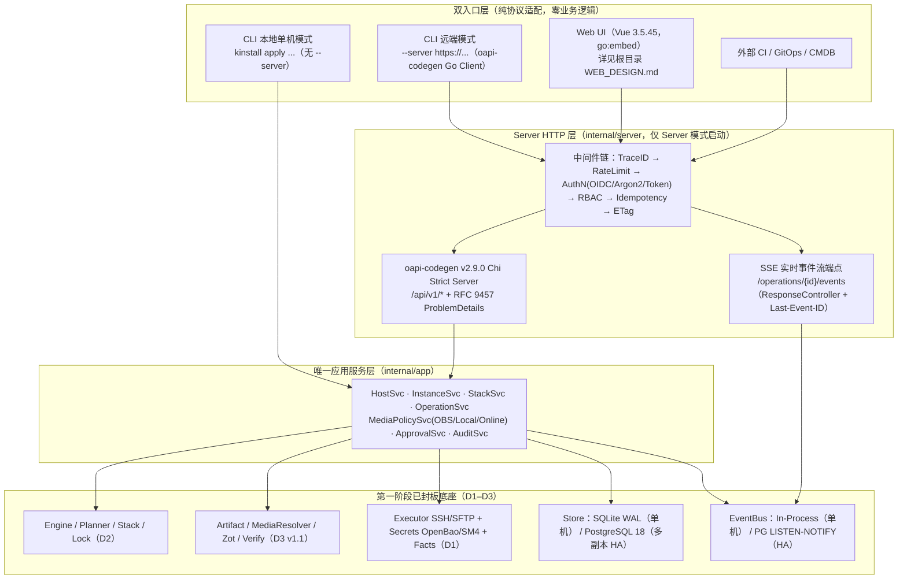
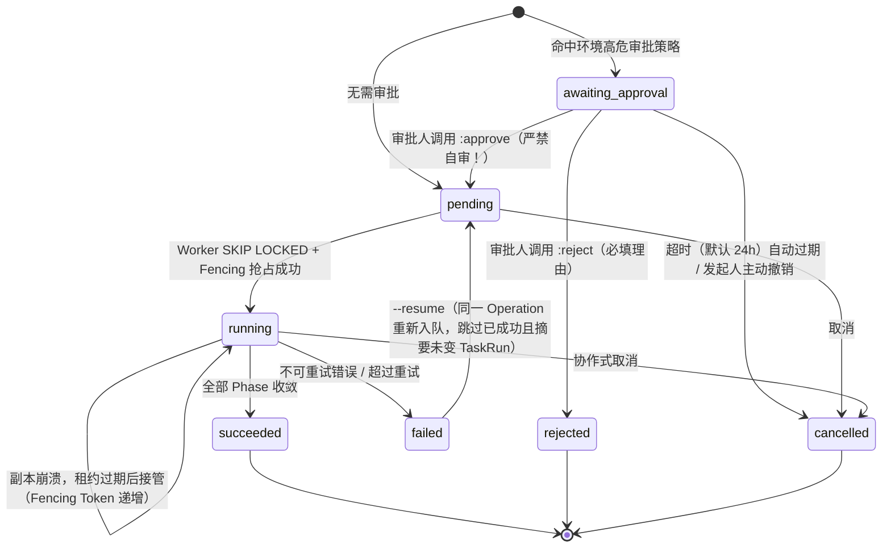
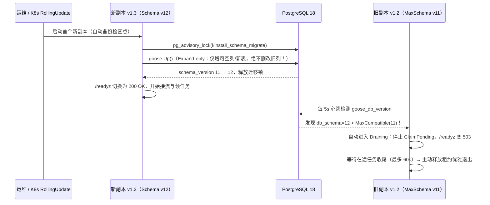

# G1 平台深度设计（1/3）：服务层高可用、审批审计与全仓 Go 后端完整代码方案

> **本文定位**：kinstall **第二阶段平台层首篇深度设计（G1，1/3）**，承接已全量封板的底座层（`D1` 执行器/安全/Facts、`D2` 存储/任务引擎/15 Tasks、`D3 v1.1` 离线供应链与本地/在线/OBS·S3 三元介质引擎），将基线 `02 §8–§9`、`05-开发文档.md`、`13 §5` 转化为**可直接建仓开干的平台服务层工程规范 + 全仓 Go 后端完整代码落地方案**。
>
> **覆盖范围**：设计项 `B8`、`B10`、`B11`、`B12`、`B17`、`B18`、`H2`、`I4`、`K1–K3`、`K6`；关联 ADR-021、022、034、035、037、038、039、061、062、077。
>
> **版本**：v1.2（平台 1/3，2026-11-26；v1.2 修复幂等中间件主键与 `MaxBytesReader`/`WithoutCancel`、SSE 经 `internal/app` 调用与并发保序、四眼审批 `snake_case` 状态图、审计全列哈希与独立 SM3 链、`media_policies` 三级作用域与 `auto` 模式、组合根 `BuildExecutor` 与严格逆序停机）。所有关键技术事实（`oapi-codegen v2.9.0` 原生 OpenAPI 3.1、`http.ResponseController.SetWriteDeadline` SSE 长流治理、PG `LISTEN/NOTIFY` 跨副本事件总线、高并发审计哈希链防分叉、`Expand-and-Contract` 滚动升级）均于 2026-11 实查核验。

---

## 1. 平台服务层总览与 CLI / Server 同源双模架构（B10）

### 1.1 同源双模总体架构

kinstall 同时面向“**单机离线交付（无外部 DB，直接敲 CLI）**”与“**企业多团队集中管控（多副本 HA Server + PostgreSQL 18 + Web UI + OpenBao）**”两种运行形态。为彻底消除“CLI 写一套逻辑、Server 又写一套逻辑”的双重维护灾难，平台在 `internal/app/` 确立**唯一应用服务层（Application Service Facade）**：



### 1.2 `internal/app` 领域应用服务边界总表

| 应用服务 | 核心职责 | 事务与安全不变量 |
| --- | --- | --- |
| `ProjectService` | 项目、环境、配额、审批策略、维护窗口 CRUD | 环境变更强校验 ETag；删除项目前断言零活跃实例 |
| `HostService` | 主机 CRUD、Excel/CSV 批量导入、Facts 采集、初始化与漂移巡检 | 凭据创建只写密文不返明文；主机名同项目 DNS-1123 唯一 |
| `MediaPolicyService` | **本地 / 华为云 OBS·S3 / 在线** 三元介质源配置、连通性探活、一键 `sync-to-obs`（ADR-077） | AK/SK 仅存 `credentialRef`；开启 `offlineStrict` 时仅允许 local 与 `internal: true` 的内网白名单 OBS，硬拒 online 与公网/非白名单 OBS（`KI-SRC-0005`） |
| `InstanceService` | 实例 CRUD、`Plan()`（3-Way Diff + 预检）、`Apply(planId)`、生命周期操作 | `Apply` 必验 `planId` 未过期且 `inputHash` 一致；高危动作自动停在审批门 |
| `StackService` | 多组件复合栈拓扑展开、跨实例输出引用校验、分层并发与安全逆序销毁 | Kahn 判环；禁止级联销毁仍被其他 Stack 引用的共享底层实例 |
| `OperationService` | 查询、取消、续装（`--resume`）、四眼审批（`:approve` / `:reject`）、报告导出 | 数据库 + 业务层双重禁止发起人自审；全生命周期写 `audit_logs` |
| `AuthService` | OIDC 登录交换、Argon2id 本地登录（含 5 次锁定）、短效作用域 Token 管理 | Token 只存 SHA-256 哈希；锁定状态持久化至 DB（多副本共享） |
| `AuditService` | 防篡改哈希链写入（SHA-256 + 可选 SM3）、离线 `verify`、异步 TLS Syslog 外送 | 事务内通过 PG Advisory Lock 串行推进链头，零分叉 |

---

## 2. OpenAPI 3.1 契约优先、RFC 9457、`Idempotency-Key` 与 `ETag`（B8、ADR-021）

### 2.1 2026-11 `oapi-codegen v2.9.0` 原生 OpenAPI 3.1 工程实践

2026-11 实证：`oapi-codegen v2` 已正式支持 **OpenAPI 3.0 与 3.1**（含 JSON Schema Draft 2020-12 对齐、`type: [string, "null"]` 可空语法、`oneOf + const` 枚举与 Chi Strict Server 生成）。整个平台以 **`api/openapi.yaml`** 作为前后端与 CLI 客户端的唯一真实契约：

- **Go 服务端与 Go CLI 客户端**：`oapi-codegen -config api/oapi-codegen.yaml api/openapi.yaml` 生成 `internal/server/gen/openapi.gen.go`（Chi Strict Server 接口）与 `pkg/client/client.gen.go`（供 CLI `--server` 模式直调）；
- **前端 Vue 3 TypeScript 契约（对接根目录 `WEB_DESIGN.md` / ADR-023）**：使用 **`@hey-api/openapi-ts`**（`npx @hey-api/openapi-ts -i api/openapi.yaml -o web/src/api/gen`，正式禁用存在 CVSS 9.8 RCE `CVE-2026-108551` 的 `openapi-typescript-codegen`）自动生成全量强类型请求/响应定义与 SDK，CI 校验 `git diff --exit-code` 保证零漂移！

```yaml
# api/oapi-codegen.yaml
package: gen
output: internal/server/gen/openapi.gen.go
generate:
  chi-server: true
  strict-server: true
  models: true
  embedded-spec: true
output-options:
  skip-prune: false
  nullable-type: true
```

**`api/openapi.yaml` 关键规范片段（含 `MediaPolicy` 与两段式 `:plan`/`:apply`）**：

```yaml
openapi: 3.1.0
info:
  title: kinstall Control Plane API
  version: 1.0.0
paths:
  /api/v1/projects/{projectId}/media-policies:
    get:
      operationId: listMediaPolicies
      summary: 查询项目介质源策略（Local / OBS·S3 / Online）
      responses:
        "200": { description: OK }
    post:
      operationId: createMediaPolicy
      parameters:
        - $ref: "#/components/parameters/IdempotencyKey"
      responses:
        "201": { description: Created }
        "409": { $ref: "#/components/responses/ProblemConflict" }
  /api/v1/projects/{projectId}/media-policies/{policyId}:test:
    post:
      operationId: testMediaPolicyConnectivity
      summary: 探活本地目录 / 华为云 OBS 私有桶凭证 / 在线代理连通性
      responses:
        "200": { description: Connectivity probe report }
  /api/v1/projects/{projectId}/instances/{instanceId}:plan:
    post:
      operationId: planInstance
      responses:
        "200":
          description: 返回含 3-Way Diff 与 Preflight 报告的 Plan（默认 24 h 有效，inputHash 漂移即失效）
  /api/v1/projects/{projectId}/instances/{instanceId}:apply:
    post:
      operationId: applyInstance
      parameters:
        - $ref: "#/components/parameters/IdempotencyKey"
        - $ref: "#/components/parameters/IfMatch"
      responses:
        "202":
          description: Accepted，异步执行或停在四眼审批门
          headers:
            Location:
              schema: { type: string }
components:
  schemas:
    ProblemDetails:
      type: object
      required: [type, title, status, code, traceId]
      properties:
        type: { type: string, format: uri }
        title: { type: string }
        status: { type: integer }
        detail: { type: string }
        code: { type: string, pattern: "^KI-[A-Z]+-[0-9]{4}$" }
        instance: { type: string }
        traceId: { type: string }
        suggestion: { type: [string, "null"] }
```

### 2.2 `Idempotency-Key` 幂等与 `ETag` 并发控制中间件（`internal/server/middleware/idempotency.go`）

为防止弱网重试或前端双击导致重复触发 K8s 升级/扩缩容，所有写路由（`POST` 创建与 `:apply`/`:operate`/`:approve`）均通过数据库级幂等表 `idempotency_keys`（见 §6.3）保护（保留 24 小时）：

```go
package middleware

import (
	"bytes"
	"context"
	"crypto/sha256"
	"encoding/hex"
	"errors"
	"io"
	"net/http"
	"time"
)

type IdempotencyRecord struct {
	ProjectID  string // 对应 idempotency_keys PK (project_id, actor_id, key_hash)
	ActorID    string
	KeyHash    string // SHA-256(Idempotency-Key)
	Endpoint   string
	ReqSHA256  string
	State      string // "in_progress" | "completed"
	StatusCode int
	RespBody   []byte
	ExpiresAt  time.Time
}

type IdempotencyStore interface {
	// Acquire 原子 INSERT ON CONFLICT DO NOTHING：若已存在则返回已有记录（created=false）
	Acquire(ctx context.Context, rec IdempotencyRecord) (existing *IdempotencyRecord, created bool, err error)
	Complete(ctx context.Context, projectID, actorID, keyHash string, status int, body []byte) error
	Abort(ctx context.Context, projectID, actorID, keyHash string) error
}

func Idempotency(store IdempotencyStore, writeProblem func(http.ResponseWriter, *http.Request, error)) func(http.Handler) http.Handler {
	return func(next http.Handler) http.Handler {
		return http.HandlerFunc(func(w http.ResponseWriter, r *http.Request) {
			key := r.Header.Get("Idempotency-Key")
			if key == "" || (r.Method != http.MethodPost && r.Method != http.MethodPut && r.Method != http.MethodPatch) {
				next.ServeHTTP(w, r)
				return
			}
			// 限制单次请求体最大 4 MiB：超限明确返回 413（禁止 LimitReader 静默截断）
			r.Body = http.MaxBytesReader(w, r.Body, 4<<20)
			rawBody, err := io.ReadAll(r.Body)
			if err != nil {
				var maxErr *http.MaxBytesError
				if errors.As(err, &maxErr) {
					w.WriteHeader(http.StatusRequestEntityTooLarge)
					return
				}
				writeProblem(w, r, err)
				return
			}
			r.Body = io.NopCloser(bytes.NewReader(rawBody))
			sum := sha256.Sum256(rawBody)
			reqHash := hex.EncodeToString(sum[:])
			kSum := sha256.Sum256([]byte(key))
			keyHash := hex.EncodeToString(kSum[:])
			actorID := ActorFromContext(r.Context()).ID
			projectID := ProjectIDFromRequest(r) // 全局接口取 "_"
			endpoint := r.Method + " " + r.URL.Path

			existing, created, err := store.Acquire(r.Context(), IdempotencyRecord{
				ProjectID: projectID,
				ActorID:   actorID,
				KeyHash:   keyHash,
				Endpoint:  endpoint,
				ReqSHA256: reqHash,
				State:     "in_progress",
				ExpiresAt: time.Now().UTC().Add(24 * time.Hour),
			})
			if err != nil {
				writeProblem(w, r, err)
				return
			}
			if !created {
				if existing.ReqSHA256 != reqHash || existing.Endpoint != endpoint {
					writeProblem(w, r, ErrIdempotencyConflict) // 409 KI-API-0002
					return
				}
				if existing.State == "in_progress" {
					w.Header().Set("Retry-After", "1")
					writeProblem(w, r, ErrIdempotencyInProgress) // 409
					return
				}
				w.Header().Set("Content-Type", "application/json")
				w.Header().Set("X-Idempotency-Replayed", "true")
				w.WriteHeader(existing.StatusCode)
				_, _ = w.Write(existing.RespBody)
				return
			}

			rec := &responseRecorder{ResponseWriter: w, status: http.StatusOK}
			next.ServeHTTP(rec, r)
			// 使用 context.WithoutCancel 防止客户端提前断连导致幂等键卡死在 in_progress 24h
			persistCtx, cancel := context.WithTimeout(context.WithoutCancel(r.Context()), 5*time.Second)
			defer cancel()
			if rec.status >= 500 {
				// 服务端 5xx 错误不锁定幂等键，允许客户端安全重试
				_ = store.Abort(persistCtx, projectID, actorID, keyHash)
				return
			}
			_ = store.Complete(persistCtx, projectID, actorID, keyHash, rec.status, rec.buf.Bytes())
		})
	}
}
```

- **`ETag` / `If-Match` 乐观并发铁律**：每个可变资源（`Host`、`Instance`、`Stack`、`MediaPolicy`、`Credential`）均在 HTTP 响应头输出标签 `ETag: "v-<version>"`；所有 `PUT`/`PATCH`/`:apply` 必须携带 `If-Match`，底层 SQL 执行 `UPDATE ... SET ..., version = version + 1, updated_at = NOW() WHERE id = $1 AND version = $2`（与 `D2 §1.3` / `G1 §6.3` 的 `version` 乐观锁列严格一致），受影响行数为 0 时精确返回 `412 Precondition Failed` (`KI-API-0003`)。

---

## 3. 多副本无状态 SSE 实时事件流：`Last-Event-ID` + PG `LISTEN/NOTIFY`（B8、B11）

> **多副本痛点**：在 3 副本 HA 部署下，Worker B 正在执行 K8s 升级并产出日志，而用户的浏览器 SSE 长连接落在了负载均衡后的 Replica A 上。若事件只走内存 channel，用户根本看不到日志；若靠高频轮询数据库，百人同时看日志会把 PG 打满。

### 3.1 2026-11 Go SSE + PG `LISTEN/NOTIFY` 五大生产坑封堵方案

| 生产深坑 | 后果 | kinstall 强制工程解 |
| --- | --- | --- |
| **1. `http.Server.WriteTimeout` 杀 SSE**（2026-11 Go SSE 实证） | 全局 `WriteTimeout: 30s` 会在连接建立 30 秒后强行断开 SSE | 在 SSE handler 内调用 `rc := http.NewResponseController(w); rc.SetWriteDeadline(time.Time{})` 仅对当前流清除总写超时，并在**每次写入单帧前设 10s 临时 deadline、写完立即清零**（既不断正常长连，又能快速踢掉半死客户端） |
| **2. Nginx / Envoy / 国密网关缓冲与空闲超时** | 前端卡顿收不到实时行，或 60s 无输出被反代掐断 | 强制响应头 `X-Accel-Buffering: no`、`Cache-Control: no-cache, no-transform`，每 **15 秒**发 `: keepalive\n\n` 注释心跳 |
| **3. PG `NOTIFY` 8000B 上限与 PgBouncer 事务池不兼容** | 大日志直接报错；经 PgBouncer 事务池 `LISTEN` 静默失效 | **`operation_events` 表（`seq`）是唯一真相源，`NOTIFY` 只传 64B 轻量唤醒脉冲** `{"op":"op_...","seq":48291}`；监听器使用**直连 PG 主库（或 session 端口）的独立连接**，不占主 `pgxpool` 槽位；断线指数退避重连后广播 `resync` 脉冲，触发所有活跃 SSE 句柄立即从 DB 补读，PG 主从切换期间 **零事件丢失** |
| **4. 终态 Operation 订阅死等 & 重复 ID 丢帧死循环** | 任务已结束前端仍挂起，或终态帧复用最后 `seq` 被前端单调去重误吞引发无限重连 | 每次追读结束检查 Operation 状态：若已终态，发送**不带 `id:` 的控制帧** `event: operation.done` 后立即 `return`；主循环强监听 `r.Context().Done()` + 优雅停机 `shutdownCtx.Done()` |
| **5. `BIGSERIAL` 并发乱序提交导致 SSE 永久跳帧** | 并发写入 `operation_events` 时，高 `seq` 先提交被 `ListAfter` 推进 `lastSentSeq`，后提交的低 `seq` 永不可见 | 同一 `operation_id` 写入事件事务内先执行 `SELECT 1 FROM operations WHERE id = $1 FOR UPDATE`（SQLite 走 `BEGIN IMMEDIATE` 单写），确保同一 Operation 的 `seq` 分配序与提交可见序严格一致（`D2 §1.3`） |

### 3.2 PG 跨副本事件总线与 SSE Handler 生产代码骨架

```go
// internal/events/pg_bus.go（核心片段）
package events

import (
	"context"
	"encoding/json"
	"sync"
	"time"

	"github.com/jackc/pgx/v5"
)

const pgChannel = "kinstall_events"

type notifyPulse struct {
	OpID string `json:"op"`
	Seq  int64  `json:"seq"`
}

type PGHub struct {
	directDSN string // 直连 PG（绕过 PgBouncer transaction pool）
	mu        sync.RWMutex
	subs      map[string]map[chan struct{}]struct{} // opID -> 轻量非阻塞信号集（容量 1 合并脉冲）
}

// NotifyInTx 在写入 operation_events 表的同一个事务内发送极简唤醒信号（事务回滚则自动不发！）
func NotifyInTx(ctx context.Context, tx pgx.Tx, opID string, seq int64) error {
	payload, _ := json.Marshal(notifyPulse{OpID: opID, Seq: seq})
	_, err := tx.Exec(ctx, "SELECT pg_notify($1, $2)", pgChannel, string(payload))
	return err
}

func (h *PGHub) SubscribeWakeup(opID string) (ch <-chan struct{}, unsubscribe func()) {
	c := make(chan struct{}, 1)
	h.mu.Lock()
	if h.subs[opID] == nil {
		h.subs[opID] = make(map[chan struct{}]struct{})
	}
	h.subs[opID][c] = struct{}{}
	h.mu.Unlock()
	return c, func() {
		h.mu.Lock()
		delete(h.subs[opID], c)
		if len(h.subs[opID]) == 0 {
			delete(h.subs, opID)
		}
		h.mu.Unlock()
	}
}

func (h *PGHub) broadcastAllResync() {
	h.mu.RLock()
	defer h.mu.RUnlock()
	for _, set := range h.subs {
		for ch := range set {
			select {
			case ch <- struct{}{}:
			default: // 已有待处理脉冲，自动合并防背压
			}
		}
	}
}

// RunListenLoop 独立后台重连循环：PG 切主/闪断恢复后立刻广播全量 resync 脉冲
func (h *PGHub) RunListenLoop(ctx context.Context) error {
	backoff := time.Second
	for {
		if err := h.listenOnce(ctx); err != nil && ctx.Err() == nil {
			select {
			case <-ctx.Done():
				return ctx.Err()
			case <-time.After(backoff):
				backoff = min(backoff*2, 15*time.Second)
			}
			continue
		}
		return ctx.Err()
	}
}

func (h *PGHub) listenOnce(ctx context.Context) error {
	conn, err := pgx.Connect(ctx, h.directDSN)
	if err != nil {
		return err
	}
	defer conn.Close(context.Background())
	if _, err := conn.Exec(ctx, "LISTEN "+pgChannel); err != nil {
		return err
	}
	// 连接建立或重连成功，立刻唤醒所有活跃 SSE 客户端从 DB 补读断线期间可能错过的事件！
	h.broadcastAllResync()
	for {
		n, err := conn.WaitForNotification(ctx)
		if err != nil {
			return err
		}
		var p notifyPulse
		if json.Unmarshal([]byte(n.Payload), &p) == nil {
			h.wakeOp(p.OpID)
		}
	}
}
```

```go
// internal/server/sse.go（完整无丢帧 SSE Handler）
package server

import (
	"fmt"
	"net/http"
	"strconv"
	"time"
)

func (s *Server) handleOperationEventsSSE(w http.ResponseWriter, r *http.Request, opID string) {
	// 1. 先验权与 Operation 存在性，再提交 HTTP 200 头（已提交后不可再写 404/500！）
	if _, err := s.ops.GetForActor(r.Context(), ActorFromContext(r.Context()), opID); err != nil {
		s.writeProblem(w, r, err)
		return
	}
	var lastSentSeq int64
	if hdr := r.Header.Get("Last-Event-ID"); hdr != "" {
		if parsed, err := strconv.ParseInt(hdr, 10, 64); err == nil && parsed > 0 {
			lastSentSeq = parsed
		}
	}

	// 2. 清除全局 WriteTimeout，设置反代零缓冲头
	rc := http.NewResponseController(w)
	_ = rc.SetWriteDeadline(time.Time{})
	w.Header().Set("Content-Type", "text/event-stream; charset=utf-8")
	w.Header().Set("Cache-Control", "no-cache, no-transform")
	w.Header().Set("Connection", "keep-alive")
	w.Header().Set("X-Accel-Buffering", "no")
	w.WriteHeader(http.StatusOK)

	// 3. 先订阅再追读（关键顺序：防止追读与订阅间隙丢失边界事件！）
	wakeupCh, unsub := s.hub.SubscribeWakeup(opID)
	defer unsub()

	writeFrame := func(seq int64, eventName string, data []byte) error {
		_ = rc.SetWriteDeadline(time.Now().Add(10 * time.Second))
		defer func() { _ = rc.SetWriteDeadline(time.Time{}) }()
		switch {
		case data == nil:
			// 注释心跳帧（: keepalive），仅保活不推进客户端 Last-Event-ID
			if _, err := fmt.Fprintf(w, ": %s\n\n", eventName); err != nil {
				return err
			}
		case seq > 0:
			// 持久化业务事件帧（对应 operation_events.seq）
			if _, err := fmt.Fprintf(w, "id: %d\nevent: %s\ndata: %s\n\n", seq, eventName, data); err != nil {
				return err
			}
		default:
			// 控制帧（如 operation.done）：显式不带 id:，避免复用最后一条 seq 被前端单调去重误吞引发死循环重连！
			if _, err := fmt.Fprintf(w, "event: %s\ndata: %s\n\n", eventName, data); err != nil {
				return err
			}
		}
		return rc.Flush()
	}

	replayAndCheckDone := func() (done bool, err error) {
		for {
			// 严格遵循 ARCHITECTURE §4.3：internal/server 仅经 internal/app Facade 访问事件流，禁止直连 Store
			batch, err := s.app.Operations().ListEventsAfter(r.Context(), opID, lastSentSeq, 200)
			if err != nil {
				return false, err
			}
			for _, ev := range batch {
				if ev.Seq <= lastSentSeq {
					continue // 严格单调去重
				}
				if err := writeFrame(ev.Seq, ev.EventType, ev.PayloadJSON); err != nil {
					return false, err
				}
				lastSentSeq = ev.Seq
			}
			if len(batch) < 200 {
				break
			}
		}
		curState, err := s.app.Operations().GetState(r.Context(), opID)
		if err != nil {
			return false, err
		}
		if curState.IsTerminal() {
			_ = writeFrame(0, "operation.done", []byte(fmt.Sprintf(`{"opId":%q,"state":%q}`, opID, curState)))
			return true, nil
		}
		return false, nil
	}

	// 首次追读（若 Operation 已终态，推送历史日志与 done 帧后立即优雅结束）
	if done, err := replayAndCheckDone(); err != nil || done {
		return
	}

	keepalive := time.NewTicker(15 * time.Second)
	fallbackPoll := time.NewTicker(5 * time.Second) // 兜底防极端网络丢通知
	defer keepalive.Stop()
	defer fallbackPoll.Stop()

	for {
		select {
		case <-r.Context().Done():
			return
		case <-s.shutdownCtx.Done():
			_ = writeFrame(0, "server-draining-reconnect", nil)
			return
		case <-keepalive.C:
			if err := writeFrame(0, "keepalive", nil); err != nil {
				return
			}
		case <-wakeupCh:
			if done, err := replayAndCheckDone(); err != nil || done {
				return
			}
		case <-fallbackPoll.C:
			if done, err := replayAndCheckDone(); err != nil || done {
				return
			}
		}
	}
}
```

---

## 4. 认证（OIDC / Argon2id / API Token）、RBAC 与四眼审批状态机（B12、ADR-037）

### 4.1 三合一认证链实现规范（`internal/authz/`）

| 认证方式 | 适用场景 | 工程安全红线 |
| --- | --- | --- |
| **OIDC SSO（`coreos/go-oidc/v3` v3.21.0）** | 生产推荐（Keycloak / Dex / 企微 / 钉钉 / 企业 IdP） | Web 登录强制 **Authorization Code + PKCE (S256)** + `state` + `nonce`；服务端签发 HttpOnly / Secure / SameSite=Lax 会话 Cookie（存 DB Session ID，支持主动吊销）；按 `groups` Claim 动态映射角色，禁止信任未验签 JWT |
| **Argon2id 本地账号** | 纯离线无 IdP 现场 | 参数锁定 OWASP 2026 基线：`Argon2id(time=3, memory=64 MiB, threads=4, keyLen=32, salt=16B)`；校验采用 `subtle.ConstantTimeCompare` 防时序攻击；失败计数存 `users.failed_login_attempts` & `locked_until`（多副本共享），连错 **5 次锁定 15 分钟**返回 `423 Locked`（`KI-AUTH-0003`） |
| **短效作用域 API Token** | CLI `--server` / CI GitOps / 外部 CMDB | 格式 `ki_<8位前缀>_<32字节Base62>`；DB 仅存 `token_prefix` + `SHA-256(full_token)` + `scopes_json`（限定项目/环境/操作集）+ `expires_at`（默认 90 天，硬上限 ≤ 365 天）；明文仅在创建响应展示 1 次 |

### 4.2 四眼审批状态机（Go 业务层 + SQL 约束双重防自审）

高风险动作（`prod` 环境 `apply`、`upgrade`、`uninstall`、`etcd-restore`、`ca-rotate`、`--force-override` 覆盖外部漂移、`--skip-verify`）命中环境级 `approval_policy` 时，Operation 不直接进入 `Pending`，而是进入 **`AwaitingApproval`** 阻断状态：



**数据库 + 代码双重防自审保证**：

```sql
-- migrations/postgres/0003_approvals.sql（与 SQLite 同步；并入 0002/0003 平台迁移流）
CREATE TABLE IF NOT EXISTS operation_approvals (
  operation_id  VARCHAR(48) PRIMARY KEY REFERENCES operations(id) ON DELETE CASCADE,
  project_id    VARCHAR(48) NOT NULL REFERENCES projects(id) ON DELETE RESTRICT,
  env_name      VARCHAR(32) NOT NULL,
  requested_by  VARCHAR(128) NOT NULL,
  reason        TEXT NOT NULL DEFAULT '',
  status        VARCHAR(24) NOT NULL CHECK (status IN ('pending','approved','rejected','expired','cancelled')),
  decided_by    VARCHAR(128),
  decision_note TEXT NOT NULL DEFAULT '',
  expires_at    TIMESTAMPTZ NOT NULL,
  created_at    TIMESTAMPTZ NOT NULL DEFAULT NOW(),
  decided_at    TIMESTAMPTZ,
  -- ★ 数据库级硬约束：哪怕业务层出现 Bug，也绝对禁止发起人自审通过！
  CONSTRAINT chk_no_self_approval CHECK (decided_by IS NULL OR decided_by <> requested_by)
);
```

- **原子审批通过事务（`ApprovalService.Approve`）**：在单一事务内执行：
  1. 校验当前调用者拥有该项目 `admin` 或 `project-admin` 权限且 `actor.ID != req.RequestedBy`（否则返回 `403 KI-AUTH-0002`）；
  2. `UPDATE operation_approvals SET status='approved', decided_by=$1, decision_note=$2, decided_at=NOW() WHERE operation_id=$3 AND status='pending' AND expires_at > NOW() AND requested_by <> $1`（防并发重复审批或过期审批）；
  3. 同步推进 `UPDATE operations SET state='pending', approved_by=$1, updated_at=NOW() WHERE id=$3 AND state='awaiting_approval'`（列名与 `D2 §1.3` `operations.state` 严格一致）；
  4. 同事务写入 `audit_logs` 哈希链并发送 `operation_events` 通知（`operation.approved`），Worker 池 1 秒内无缝领走执行。

---

## 5. 高并发防分叉审计哈希链与异步 TLS Syslog 外送（H2、ADR-062）

> **多副本并发陷阱**：单机 SQLite 下写 `audit_logs` 天然串行；但在 3 副本 PostgreSQL HA 模式下，若 Pod A 与 Pod B 同时读出同一条最新 `record_sha256` 并各自计算下一条哈希，就会出现两条记录指向同一个 `prev_sha256`，**直接导致哈希链分叉、`kinstall audit verify` 验链失败！**

### 5.1 数据库串行锚点与异步 Outbox Schema

> `audit_chain_head`、`audit_logs`、`audit_syslog_cursor` 三张审计表的唯一权威 DDL 位于 **`D2 §1.3`（`migrations/00001_init.sql` 第 11–13 张表）**，本节不再重复定义以避免列类型漂移。核心约束：应用 DB 账号对 `audit_logs` 仅授予 `INSERT + SELECT`（显式 `REVOKE UPDATE/DELETE`）；密评模式下可按每小时或每 10,000 条生成 SM2 签名锚点一并记录。

### 5.2 防分叉审计写入与离线验链代码骨架（`internal/audit/chain.go`）

```go
package audit

import (
	"context"
	"crypto/sha256"
	"encoding/hex"
	"fmt"
	"time"

	"github.com/emmansun/gmsm/sm3"
)

const pgAuditChainLockKey int64 = 0x6b696e7374616c6c // "kinstall" 固定 64 位事务级咨询锁键

// ComputeCanonicalHashes 覆盖 audit_logs 除哈希列外的全部业务列（含 actor_type/source_ip/project_id/err_code/trace_id）；
// SHA-256 链与 SM3 国密链输入完全相互独立（SM3 链使用 SM3(payload) 与 prevSM3，不依赖 SHA-256 满足密评要求）。
func ComputeCanonicalHashes(seq int64, occurredAt time.Time, e Entry, prevSHA, prevSM3 string, enableGM bool) (shaHex, sm3Hex string) {
	ts := occurredAt.UTC().Format(time.RFC3339Nano)
	fields := fmt.Sprintf("%d|%s|%s|%s|%s|%s|%s|%s|%s|%s|%s|%s",
		seq, ts, e.ActorID, e.ActorType, e.SourceIP, e.ProjectID,
		e.Action, e.TargetType, e.TargetID, e.Result, e.ErrCode, e.TraceID,
	)
	payloadSHA := sha256.Sum256([]byte(e.PayloadJSON))
	shaInput := prevSHA + "|" + fields + "|" + hex.EncodeToString(payloadSHA[:])
	s256 := sha256.Sum256([]byte(shaInput))
	shaHex = hex.EncodeToString(s256[:])
	if enableGM {
		payloadSM3 := sm3.Sum([]byte(e.PayloadJSON))
		gmInput := prevSM3 + "|" + fields + "|" + hex.EncodeToString(payloadSM3[:])
		gmSum := sm3.Sum([]byte(gmInput))
		sm3Hex = hex.EncodeToString(gmSum[:])
	}
	return shaHex, sm3Hex
}

// Append 在单一短事务内加锁推进链头（PG 用 pg_advisory_xact_lock + FOR UPDATE；SQLite 用单写事务）
// 耗时 < 1 ms，零网络调用；TLS Syslog 外送由独立后台协程按 audit_syslog_cursor 异步消费
func (a *Recorder) Append(ctx context.Context, e Entry) (int64, error) {
	now := time.Now().UTC().Truncate(time.Microsecond) // 与 PG TIMESTAMPTZ 微秒精度对齐，防止验链精度漂移！
	var assignedSeq int64
	err := a.store.Tx(ctx, func(ctx context.Context, tx AuditTx) error {
		if err := tx.AcquireChainLock(ctx, pgAuditChainLockKey); err != nil {
			return err
		}
		head, err := tx.GetHeadForUpdate(ctx)
		if err != nil {
			return err
		}
		nextSeq := head.LastSeq + 1
		recSHA, recSM3 := ComputeCanonicalHashes(nextSeq, now, e, head.LastSHA256, head.LastSM3, a.enableGM)
		if err := tx.InsertRecord(ctx, Record{
			Seq: nextSeq, OccurredAt: now, Entry: e,
			PrevSHA256: head.LastSHA256, RecordSHA256: recSHA,
			PrevSM3: head.LastSM3, RecordSM3: recSM3,
		}); err != nil {
			return err
		}
		if err := tx.UpdateHead(ctx, nextSeq, recSHA, recSM3); err != nil {
			return err
		}
		assignedSeq = nextSeq
		return nil
	})
	return assignedSeq, err
}
```

> **微妙精度防坑点（已写入上方代码）**：PostgreSQL `TIMESTAMPTZ` 精度为**微秒（µs）**，而 Go `time.Now()` 在 Linux 上精度为**纳秒（ns）**！若未做 `.Truncate(time.Microsecond)` 直接用纳秒参与哈希计算，落库后再读出验链会因末尾 3 位纳秒被 PG 截断导致 **100% 误报篡改**！上述代码通过强制微秒截断彻底根除该隐蔽 Bug。

---

## 6. 多副本无状态 HA 滚动升级与插件 `StateMigrator`（B11、B17）

### 6.1 零停机滚动升级协议（Expand-and-Contract + 旧副本自动排空）



### 6.2 五条不可违反的滚动升级工程红线（含插件 `StateMigrator`）

1. **严格 Expand-and-Contract 迁移**：同一版本新增字段必须可空或带默认值；删除废弃列必须推迟到下一个大/次版本确认旧副本 100% 退场后执行；
2. **启动期自动快照**：单机 SQLite 在 `goose.Up()` 前自动执行一致性快照 `VACUUM INTO '/var/lib/kinstall/backups/pre-upgrade-<ts>.db'`；
3. **版本门禁防脑裂**：每个二进制在编译期写死 `const MaxCompatibleSchemaVersion = N`；旧副本发现数据库版本高于自身上限时，**立即拒领新 Operation**（返回 `KI-DB-0001`）并进入优雅排空，杜绝旧代码写坏新 Schema 字段；
4. **插件状态机迁移器（`StateMigrator`）**：每个插件可选实现 `MigrateState(fromRev int, raw json.RawMessage) (toRev int, next json.RawMessage, err error)`；升级已有实例前，平台在持有实例排他锁的事务中自动备份旧状态至 `instance_state_backups`，按版本链逐级演进 `instances.state_json` 与 `instances.plugin_schema_ver`；
5. **诚实回滚原则**：数据库只前滚不写 `goose down`；若升级后发生不可预期严重故障，按标准 SOP 停服并通过升级前快照恢复。

### 6.3 平台控制面全量扩展 DDL（`migrations/postgres/0002_platform_control_plane.sql`）

> 与 `D2 §1.3` 底座 `migrations/00001_init.sql`（13 表）及 `G1 §4.2` `0003_approvals.sql`（1 表，表 14）严格互补，本节 10 张控制面表（表 15–24）构成全平台 **24 张完整零缺口表结构**（已在真实 SQLite + 外键开启环境下通过全部 DDL 与 `chk_no_self_approval` 实测；SQLite 迁移仅将 `TIMESTAMPTZ`→`TEXT`、`JSONB`→`TEXT`，全部外键与 `CHECK` 约束 100% 保持一致）。

```sql
-- +goose Up
-- 15. 三元介质源策略表（Local / 华为云 OBS·S3·OSS·COS / Online，支持 global / project / instance 三级作用域，ADR-077）
CREATE TABLE IF NOT EXISTS media_policies (
    id              VARCHAR(48) PRIMARY KEY,
    scope           VARCHAR(16) NOT NULL DEFAULT 'project' CHECK (scope IN ('global', 'project', 'instance')),
    project_id      VARCHAR(48) REFERENCES projects(id) ON DELETE RESTRICT,
    instance_id     VARCHAR(48) REFERENCES instances(id) ON DELETE CASCADE,
    name            VARCHAR(128) NOT NULL,
    is_default      BOOLEAN NOT NULL DEFAULT FALSE,
    delivery_mode   VARCHAR(24) NOT NULL DEFAULT 'auto' CHECK (delivery_mode IN ('auto', 'relay-cache', 'direct-presigned')),
    offline_strict  BOOLEAN NOT NULL DEFAULT FALSE,
    strict_local    BOOLEAN NOT NULL DEFAULT FALSE,
    sources_json    JSONB NOT NULL,               -- 优先级数组 [{type,priority,internal,endpoint,bucket,prefix,driver,credentialRef,verifyTls}]
    last_probe_json JSONB NOT NULL DEFAULT '{}',  -- 最近一次 :test 连通性探活结果
    last_probed_at  TIMESTAMPTZ,
    version         BIGINT NOT NULL DEFAULT 1,
    created_at      TIMESTAMPTZ NOT NULL DEFAULT NOW(),
    updated_at      TIMESTAMPTZ NOT NULL DEFAULT NOW(),
    CHECK (
        (scope = 'global'   AND project_id IS NULL     AND instance_id IS NULL) OR
        (scope = 'project'  AND project_id IS NOT NULL AND instance_id IS NULL) OR
        (scope = 'instance' AND project_id IS NOT NULL AND instance_id IS NOT NULL)
    ),
    UNIQUE (scope, project_id, instance_id, name)
);

-- 16. 平台用户表（OIDC SSO 与 Argon2id 本地账号统一建模，跨副本共享防爆破锁定）
CREATE TABLE IF NOT EXISTS users (
    id                    VARCHAR(48) PRIMARY KEY,
    username              VARCHAR(128) NOT NULL UNIQUE,
    display_name          VARCHAR(128) NOT NULL DEFAULT '',
    auth_source           VARCHAR(16) NOT NULL CHECK (auth_source IN ('local', 'oidc')),
    oidc_issuer           VARCHAR(255) NOT NULL DEFAULT '',
    oidc_subject          VARCHAR(255) NOT NULL DEFAULT '',
    password_hash         TEXT NOT NULL DEFAULT '', -- Argon2id PHC 字符串（OIDC 账号为空）
    role_bindings_json    JSONB NOT NULL DEFAULT '[]', -- [{projectId, env, role}]
    failed_login_attempts INTEGER NOT NULL DEFAULT 0,
    locked_until          TIMESTAMPTZ,              -- 连续错 5 次锁 15 分钟（423 Locked）
    disabled              BOOLEAN NOT NULL DEFAULT FALSE,
    created_at            TIMESTAMPTZ NOT NULL DEFAULT NOW(),
    updated_at            TIMESTAMPTZ NOT NULL DEFAULT NOW()
);
CREATE UNIQUE INDEX IF NOT EXISTS idx_users_oidc_sub ON users(oidc_issuer, oidc_subject) WHERE auth_source = 'oidc';

-- 17. Web 服务端会话表（支撑 HttpOnly Cookie 主动吊销与多副本共享）
CREATE TABLE IF NOT EXISTS user_sessions (
    id          VARCHAR(48) PRIMARY KEY,
    user_id     VARCHAR(48) NOT NULL REFERENCES users(id) ON DELETE CASCADE,
    token_hash  CHAR(64) NOT NULL UNIQUE,
    source_ip   VARCHAR(64) NOT NULL DEFAULT '',
    user_agent  VARCHAR(255) NOT NULL DEFAULT '',
    expires_at  TIMESTAMPTZ NOT NULL,
    revoked_at  TIMESTAMPTZ,
    created_at  TIMESTAMPTZ NOT NULL DEFAULT NOW()
);
CREATE INDEX IF NOT EXISTS idx_user_sessions_exp ON user_sessions(expires_at);

-- 18. 短效作用域 API Token 表（仅存前缀 + SHA-256，绝不存明文）
CREATE TABLE IF NOT EXISTS api_tokens (
    id           VARCHAR(48) PRIMARY KEY,
    user_id      VARCHAR(48) NOT NULL REFERENCES users(id) ON DELETE CASCADE,
    project_id   VARCHAR(48) REFERENCES projects(id) ON DELETE CASCADE,
    name         VARCHAR(128) NOT NULL,
    token_prefix VARCHAR(16) NOT NULL,            -- ki_<8位>
    token_hash   CHAR(64) NOT NULL UNIQUE,
    scopes_json  JSONB NOT NULL DEFAULT '[]',
    expires_at   TIMESTAMPTZ NOT NULL,
    last_used_at TIMESTAMPTZ,
    revoked_at   TIMESTAMPTZ,
    created_at   TIMESTAMPTZ NOT NULL DEFAULT NOW()
);

-- 19. API 写请求幂等表（24h 窗口防重放 + 同 Key 换体返回 409 KI-API-0002，与 §2.2 ActorID 严格对齐）
CREATE TABLE IF NOT EXISTS idempotency_keys (
    project_id    VARCHAR(48) NOT NULL REFERENCES projects(id) ON DELETE CASCADE,
    actor_id      VARCHAR(128) NOT NULL,
    key_hash      CHAR(64) NOT NULL,
    endpoint      VARCHAR(128) NOT NULL,
    request_hash  CHAR(64) NOT NULL,
    status        VARCHAR(16) NOT NULL CHECK (status IN ('in_progress', 'completed')),
    response_code INTEGER,
    response_body TEXT,
    expires_at    TIMESTAMPTZ NOT NULL,
    created_at    TIMESTAMPTZ NOT NULL DEFAULT NOW(),
    PRIMARY KEY (project_id, actor_id, key_hash)
);
CREATE INDEX IF NOT EXISTS idx_idem_expires ON idempotency_keys(expires_at);

-- 20. 声明式 Plan 快照表（支撑两段式 :plan -> :apply 的过期与 inputHash 强校验）
CREATE TABLE IF NOT EXISTS plans (
    id                VARCHAR(48) PRIMARY KEY,
    project_id        VARCHAR(48) NOT NULL REFERENCES projects(id) ON DELETE CASCADE,
    target_type       VARCHAR(24) NOT NULL CHECK (target_type IN ('host', 'instance', 'stack')),
    target_id         VARCHAR(48) NOT NULL,
    input_hash        CHAR(64) NOT NULL,
    diff_json         JSONB NOT NULL,             -- 3-Way Diff 明细（供前端 @codemirror/merge 渲染）
    warnings_json     JSONB NOT NULL DEFAULT '[]',
    pipeline_json     JSONB NOT NULL,
    created_by        VARCHAR(128) NOT NULL,
    expires_at        TIMESTAMPTZ NOT NULL,
    consumed_by_op_id VARCHAR(48) REFERENCES operations(id) ON DELETE SET NULL,
    created_at        TIMESTAMPTZ NOT NULL DEFAULT NOW()
);
CREATE INDEX IF NOT EXISTS idx_plans_target ON plans(target_type, target_id, created_at DESC);

-- 21. 插件状态迁移前自动备份表（供 G1 §6 StateMigrator 留档审计）
CREATE TABLE IF NOT EXISTS instance_state_backups (
    id                VARCHAR(48) PRIMARY KEY,
    instance_id       VARCHAR(48) NOT NULL REFERENCES instances(id) ON DELETE CASCADE,
    from_schema_ver   INTEGER NOT NULL,
    to_schema_ver     INTEGER NOT NULL,
    raw_state_json    JSONB NOT NULL,
    created_at        TIMESTAMPTZ NOT NULL DEFAULT NOW()
);

-- 22. 事件通知通道表（Webhook / 邮件 / 企微 / 钉钉 / 飞书，G2 §3）
CREATE TABLE IF NOT EXISTS notification_channels (
    id             VARCHAR(48) PRIMARY KEY,
    project_id     VARCHAR(48) NOT NULL REFERENCES projects(id) ON DELETE CASCADE,
    name           VARCHAR(128) NOT NULL,
    kind           VARCHAR(24) NOT NULL CHECK (kind IN ('webhook', 'email', 'wecom', 'dingtalk', 'feishu')),
    config_json    JSONB NOT NULL,                -- 端点/收件人/防风暴折叠窗口等非密配置
    credential_ref VARCHAR(48) REFERENCES credentials(id) ON DELETE RESTRICT,
    events_json    JSONB NOT NULL DEFAULT '[]',
    enabled        BOOLEAN NOT NULL DEFAULT TRUE,
    created_at     TIMESTAMPTZ NOT NULL DEFAULT NOW(),
    updated_at     TIMESTAMPTZ NOT NULL DEFAULT NOW(),
    UNIQUE (project_id, name)
);

-- 23. 通知投递与防风暴去重记录表（G2 §3）
CREATE TABLE IF NOT EXISTS notification_deliveries (
    id            VARCHAR(48) PRIMARY KEY,
    channel_id    VARCHAR(48) NOT NULL REFERENCES notification_channels(id) ON DELETE CASCADE,
    dedup_key     VARCHAR(128) NOT NULL,
    event_count   INTEGER NOT NULL DEFAULT 1,
    status        VARCHAR(16) NOT NULL CHECK (status IN ('pending', 'sent', 'failed')),
    attempt       INTEGER NOT NULL DEFAULT 0,
    last_error    TEXT NOT NULL DEFAULT '',
    window_end_at TIMESTAMPTZ NOT NULL,
    sent_at       TIMESTAMPTZ,
    created_at    TIMESTAMPTZ NOT NULL DEFAULT NOW()
);
CREATE INDEX IF NOT EXISTS idx_notify_dedup ON notification_deliveries(channel_id, dedup_key, window_end_at);

-- 24. 多集群短期 RBAC Kubeconfig 签发与吊销台账表（G2 §1）
CREATE TABLE IF NOT EXISTS cluster_kubeconfigs (
    id             VARCHAR(48) PRIMARY KEY,
    instance_id    VARCHAR(48) NOT NULL REFERENCES instances(id) ON DELETE CASCADE,
    user_id        VARCHAR(48) NOT NULL REFERENCES users(id) ON DELETE CASCADE,
    k8s_role       VARCHAR(64) NOT NULL CHECK (k8s_role IN ('cluster-admin', 'ns-admin', 'edit', 'view')), -- 对应 G2 §1 四档 RBAC 组
    namespaces_json JSONB NOT NULL DEFAULT '[]',
    cert_serial    VARCHAR(128) NOT NULL DEFAULT '',
    expires_at     TIMESTAMPTZ NOT NULL,
    revoked_at     TIMESTAMPTZ,
    revoked_by     VARCHAR(128),
    created_at     TIMESTAMPTZ NOT NULL DEFAULT NOW()
);
CREATE INDEX IF NOT EXISTS idx_cluster_kc_inst ON cluster_kubeconfigs(instance_id, expires_at);
```

---

## 7. 全仓 Go 后端完整代码落地方案（面向工程团队直接开仓编码）

> 本节回应全栈研发落地需求，给出 kinstall Go 后端（Go `1.27.4`、`CGO_ENABLED=0`）的**完整依赖锁定表（与 `05 §2.2` 严格同步）、全仓包职责矩阵、`cmd/kinstall` 显式 DI 总装配代码与分阶段工程实施蓝图**。

### 7.1 全仓 `go.mod` 核心依赖锁定表（2026-11 实查 · 与 `05 §2.2` 100% 对齐 · 宽松绿灯许可）

| 领域 | Go Module Path | 锁定版本 | 许可证 | 关键工程约束 |
| --- | --- | --- | :---: | --- |
| **CLI & 配置** | `github.com/spf13/cobra` | `v1.10.2` | Apache-2.0 | 子命令树 + Shell 自动补全 |
| | `github.com/knadh/koanf/v2` | `v2.4.1` | MIT | 替代 Viper（避免大小写键名折叠坑） |
| **HTTP & 契约** | `github.com/go-chi/chi/v5` | `v5.5.0` | MIT | 轻量标准 `net/http` 路由，兼容 `ResponseController` |
| | `github.com/oapi-codegen/oapi-codegen/v2` | `v2.9.0` | Apache-2.0 | OpenAPI 3.1 → Chi Strict Server + Go Client |
| **数据库 & 迁移** | `modernc.org/sqlite` | `v1.63.0` | BSD-3 | 纯 Go 零 CGO，读写池分离 + `_txlock=immediate`（D2） |
| | `github.com/jackc/pgx/v5` | `v5.13.0` | MIT | 高性能 PG 驱动 + 独立 `LISTEN/NOTIFY` 连接 |
| | `github.com/uptrace/bun` | `v1.3.0` | BSD-2 | SQLite / PG 双 dialect 统一仓储（ADR-034） |
| | `github.com/pressly/goose/v3` | `v3.30.2` | MIT | `//go:embed` 只前滚 SQL 迁移 |
| **远程执行 & 同步** | `golang.org/x/crypto` | `v0.59.0` | BSD-3 | `x/crypto/ssh` + `argon2`（D1） |
| | `github.com/pkg/sftp` | `v1.13.13` | BSD-2 | `UseConcurrentWrites(true)` 高速分发（D1） |
| | `golang.org/x/sync` | `v0.25.0` | BSD-3 | `errgroup` + `semaphore` + `singleflight`（D1/D3） |
| | `golang.org/x/time` | `v0.15.0` | BSD-3 | `rate.Limiter` 两级 HTTP 限速（D3） |
| **安全 · 凭据 · 认证** | `github.com/openbao/openbao/api/v2` | `v2.7.1` | MPL-2.0 | Transit KEK `derived=true` + `context`（D1） |
| | `github.com/emmansun/gmsm` | `v0.45.4` | MIT | 纯 Go SM2/SM3/SM4-GCM，禁 `tjfoc/gmsm`（ADR-061） |
| | `github.com/coreos/go-oidc/v3` | `v3.21.0` | Apache-2.0 | OIDC SSO + PKCE + JWKS 校验 |
| **供应链 · OCI · OBS** | `github.com/sigstore/sigstore-go` | `v1.4.1` | Apache-2.0 | 零出网 `trusted_root.json` 验签（D3） |
| | `github.com/oras-project/oras-go/v3` | `v3.0.0` | Apache-2.0 | OCI Layout/Artifact 多根图拷贝（D3） |
| | `github.com/aws/aws-sdk-go-v2/service/s3` | `v1.96.0` | Apache-2.0 | 统一 S3v4（OBS/OSS/COS/SeaweedFS）+ `WhenRequired`（D3 §7） |
| | `github.com/huaweicloud/huaweicloud-sdk-go-obs` | `v3.25.9` | Apache-2.0 | 可选 `obs-native` 驱动（华为政企 HCS/PFS，D3 §7） |
| | `github.com/klauspost/compress` | `v1.20.5` | BSD-3 | 高性能 zstd 流式分卷压缩解压 |
| **K8s · Helm · 模板** | `helm.sh/helm/v4` | `v4.3.2` | Apache-2.0 | K8s Operator / Addon 原生部署 |
| | `github.com/expr-lang/expr` | `v1.18.1` | MIT | 安全表达式求值（ADR-036） |
| | `github.com/Masterminds/semver/v3` | `v3.5.0` | MIT | 版本范围选模板与兼容矩阵 |
| **可观测 · i18n · 工具** | `github.com/oklog/ulid/v2` | `v2.1.2` | Apache-2.0 | 有序前缀 ID（`op_`、`inst_`、`host_`） |
| | `github.com/nicksnyder/go-i18n/v2` | `v2.7.0` | MIT | 中英文错误码与建议翻译（ADR-038） |
| | `github.com/xuri/excelize/v2` | `v2.11.1` | BSD-3 | CMDB `.xlsx` 批量导入 |
| | `github.com/prometheus/client_golang` | `v1.25.0` | Apache-2.0 | `/metrics` 指标暴露 |
| **测试专用** | `github.com/testcontainers/testcontainers-go` | `v0.45.0` | MIT | 真实 PG 18 + 多发行版 systemd 容器契约 |
| | `github.com/gliderlabs/ssh` | `v0.3.8` | BSD-3 | 进程内可控故障 SSH 仿真服务器 |

### 7.2 全仓包结构 × 核心文件 × 职责蓝图（28 个 `internal/` 包全覆盖，v1.1 与 `ARCHITECTURE.md §4` 对齐）

| 目录 | 核心 Go 文件 | 唯一职责与接口归属 | 关联深度文档 |
| --- | --- | --- | --- |
| `cmd/kinstall/` | `main.go`, `app.go`, `plugins.go` | **唯一组合根（Composition Root）**：显式构造所有依赖并按正确顺序启动/优雅退出；唯一允许 import `plugins/*` | `D1 §1`、`G1 §7.3` |
| `api/` | `openapi.yaml`, `oapi-codegen.yaml` | OpenAPI 3.1 唯一契约源（生成 Go Strict Server、Go Client、TS Schema） | `G1 §2` |
| `pkg/sdk/v1alpha1/` | `plugin.go`, `task.go`, `types.go`, `media.go`, `sdktest/` | **插件唯一允许依赖的稳定面**（`depguard` 强制）；声明式 Task 构造器、Fake 测试桩 | `D1 §1`、`05 §3.4` |
| `internal/app/` | `host_svc.go`, `instance_svc.go`, `stack_svc.go`, `op_svc.go`, `media_svc.go`, `approval_svc.go` | CLI 本地模式与 Server REST 模式共享的唯一业务用例编排层 | `G1 §1` |
| `internal/cli/` | `root.go`, `host.go`, `instance.go`, `stack.go`, `artifact.go`, `server.go`, `output.go` | Cobra 命令树；自动根据 `--server` 切换本地 `internal/app` 或远端 `pkg/client` | `05 §4.1` |
| `internal/server/` | `server.go`, `handlers.go`, `sse.go`, `problem.go`, `embed_ui.go`, `middleware/{auth,rbac,idempotency,etag,ratelimit}.go` | Chi 路由、Strict Server 实现、SSE 实时终端流、RFC 9457、`//go:embed web/dist` | `G1 §2–§3` |
| `internal/authz/` | `oidc.go`, `local_argon2.go`, `token.go`, `rbac.go`, `approval.go` | OIDC PKCE、Argon2id+锁定、短效 Token、5 角色权限评估、四眼审批 | `G1 §4` |
| `internal/audit/` | `chain.go`, `verify.go`, `syslog_forwarder.go` | 串行防分叉 SHA-256/SM3 哈希链、离线验链、RFC 5425 TLS Syslog 异步外送 | `G1 §5` |
| `internal/store/` | `store.go`, `sqlite.go`, `postgres.go`, `migrate.go`, `repo_*.go` | SQLite 读写分离池 / PG 18 `pgxpool`、全量 24 张表仓储（D2 13 + G1 11）、`goose` 迁移与锁 | `D2 §1`、`G1 §6` |
| `internal/engine/` | `runner.go`, `worker.go`, `fencing.go`, `tasks/*.go`（15 文件） | Pipeline/Phase/TaskRun 调度、SKIP LOCKED + 单调 Fencing Token、全量 15 个内置 Task | `D2 §2 / §5` |
| `internal/planner/` | `planner.go`, `diff3way.go`, `preflight.go` | Day-2 三向合并（6 场景矩阵）、`create-only`/`managed-block`、容量与 64K 预检 | `D2 §3` |
| `internal/stack/` | `dag.go`, `resolver.go`, `orchestrator.go` | Kahn 拓扑判环、`${instances.x.outputs.y}` 静态校验与安全逆序销毁 | `D2 §4` |
| `internal/lock/` | `manager.go` | 按 `Stack → Instance → Host（ID 升序）` 一次性批量获取共享/排他锁、维护窗口门禁 | `D2 §2.2` |
| `internal/executor/` | `sshx/{pool,runner,async,sudo,sftp,hostkey}.go`, `local.go` | 双层限流连接池、Async Detached 断点重附、`sudo-rs`/`faillock` 熔断、3 通道文件分发 | `D1 §2` |
| `internal/secrets/` | `envelope.go`, `kek_file.go`, `kek_openbao.go`, `cipher_aes.go`, `cipher_sm4.go` | AES-256-GCM / SM4-GCM 信封加密、OpenBao `derived=true`+`context`、内存清零 | `D1 §3` |
| `internal/osadapter/` | `loader.go`, `facts.go`, `adapter_*.go` | 嵌入 `spec/osmatch.yaml` + `pkgmap.yaml`、1-RTT POSIX Facts 脚本与各 OS 族适配器 | `D1 §4` |
| `internal/artifact/` | `bom/`, `source/`, `verify/`, `rewrite/`, `oci/`, `server/`, `zot/`, `runtime/`, `closure/`, `bundle/` | 完整供应链：零出网验签、本地/OBS·S3/在线三元解析、`registryMirror`、限速 HTTP 与 Zot | `D3 v1.1` |
| `internal/events/` & `notify/` & `obs/` & `pki/` & `template/` & `i18n/` | 各核心领域支撑实现 | PG `LISTEN/NOTIFY` 总线、Webhook/企微/钉钉/飞书、两层脱敏 `RedactWriter`、内建 CA、白名单模板、`go-i18n` | `D1–D3`、`G1–G2` |
| `internal/domain/` | `host.go`, `instance.go`, `stack.go`, `operation.go`, `statemachine.go` | **零 I/O 领域核心**：实体/值对象、`allowedTransitions` 显式状态机、乐观锁 `version`（禁止 import `database/sql`/`net/http`/`ssh`） | `D1 §1.1`、`D1 §1.3-C` |
| `internal/ports/` | `executor.go`, `store.go`, `secrets.go`, `osadapter.go` | 跨层核心端口小接口（每个 ≤ 8 方法），由 `executor`/`store`/`secrets`/`osadapter` 提供实现 | `D1 §1.2` |
| `internal/registry/` | `registry.go`, `compat.go`, `signature.go` | 插件工厂按 `(product, target, semver)` 路由；启动期构建后只读冻结；SDK 兼容矩阵与签名校验 | `02 §3.6`、`D1 §1.2` |
| `internal/inventory/` | `facts/`, `hosts.go`, `labels.go` | CMDB 主机/凭据引用/标签/故障域、1-RTT POSIX Facts 采集 | `03`、`D1 §4` |
| `internal/hostinit/` | `modules/*.go`, `profiles.go` | 22 个主机初始化模块（含首尾 `backup/verify`）+ 7 个内置 Profile，备份与可逆回滚 | `03 §5–§7` |
| `internal/multicluster/` & `internal/compliance/` | `kubeconfig.go`, `cmdbsync.go` / `djcp.go`, `evidence.go` | 多集群视图与短期 Kubeconfig；等保 2.0 三级 / 密评实操与证据包导出 | `G2 §1–§4` |
| `internal/version/` | `version.go` | `-ldflags -X` 注入版本、Commit、构建时间与 `MaxCompatibleSchemaVersion` | `05 §7.2`、`G1 §6` |

### 7.3 显式构造函数总装配与优雅停机代码骨架（`cmd/kinstall/app.go`）

贯彻 `D1 §1`“零全局变量、显式依赖注入、优雅停机逆序释放”铁律：

```go
// cmd/kinstall/app.go
package main

import (
	"context"
	"errors"
	"fmt"
	"log/slog"
	"net/http"
	"os/signal"
	"syscall"
	"time"

	"golang.org/x/sync/errgroup"

	"github.com/kinstall/kinstall/internal/app"
	"github.com/kinstall/kinstall/internal/artifact/source"
	"github.com/kinstall/kinstall/internal/audit"
	"github.com/kinstall/kinstall/internal/authz"
	"github.com/kinstall/kinstall/internal/engine"
	"github.com/kinstall/kinstall/internal/events"
	"github.com/kinstall/kinstall/internal/executor/sshx"
	"github.com/kinstall/kinstall/internal/lock"
	"github.com/kinstall/kinstall/internal/obs"
	"github.com/kinstall/kinstall/internal/planner"
	"github.com/kinstall/kinstall/internal/registry"
	"github.com/kinstall/kinstall/internal/secrets"
	"github.com/kinstall/kinstall/internal/server"
	"github.com/kinstall/kinstall/internal/stack"
	"github.com/kinstall/kinstall/internal/store"
)

func runServer(cfg ServerConfig) error {
	// 1. 捕获 SIGINT/SIGTERM，驱动全局优雅退出
	rootCtx, stop := signal.NotifyContext(context.Background(), syscall.SIGINT, syscall.SIGTERM)
	defer stop()

	logger := obs.NewLogger(cfg.LogFormat, cfg.LogLevel)

	// 2. 初始化存储层（自动备份 + Advisory Lock 串行 goose.Up + Schema 版本兼容校验）
	st, err := store.OpenAndMigrate(rootCtx, cfg.DB, logger)
	if err != nil {
		return fmt.Errorf("init store: %w", err)
	}
	defer st.Close()

	// 3. 初始化底座组件（D1–D3）
	kekProv, err := secrets.NewKEKProvider(cfg.Secrets)
	if err != nil {
		return fmt.Errorf("init kek provider: %w", err)
	}
	secretStore := secrets.NewEnvelopeStore(st.Credentials(), kekProv, cfg.Secrets.Algorithm)
	execPool := sshx.NewPool(cfg.SSH, secretStore, logger)
	defer execPool.Close()

	lockMgr := lock.NewManager(st.Locks())
	mediaResolver := source.NewResolverFactory(st.MediaPolicies(), secretStore, cfg.Artifact.CacheDir)
	eventHub := events.NewHub(cfg.DB, logger) // SQLite=内存 Hub；PG=独立 LISTEN/NOTIFY 连接

	// 4. 初始化平台治理层（G1）：审计哈希链 + 执行器装饰链（D1 §1.3-A）+ 认证/RBAC/审批 + 引擎/Planner/Stack
	auditRec := audit.NewRecorder(st.Audit(), cfg.Compliance.EnableGM)
	exec := BuildExecutor(execPool, auditRec, logger) // 重试 → 熔断 → 跨块脱敏审计（杜绝裸用 execPool 绕过脱敏）
	syslogFwd := audit.NewSyslogForwarder(st.Audit(), cfg.Compliance.Syslog, logger)
	authSvc := authz.NewService(st.Auth(), cfg.Auth, auditRec)
	reg := registry.New()
	registerBuiltinPlugins(reg) // 由 cmd/kinstall/plugins.go 显式注册，禁止 init() 与全局可变单例
	reg.Freeze()

	planEngine := planner.New(st, reg, exec, mediaResolver)
	taskWorker := engine.NewWorker(st, lockMgr, exec, secretStore, mediaResolver, eventHub, auditRec, logger)
	stackOrch := stack.NewOrchestrator(st, planEngine, taskWorker)

	facade := app.NewFacade(st, reg, planEngine, stackOrch, taskWorker, authSvc, auditRec, mediaResolver, eventHub)

	// 5. 构建 HTTP Server（接入层仅依赖 facade / authSvc，绝不直连 Store 或 eventHub）
	httpSrv := &http.Server{
		Addr:              cfg.ListenAddr,
		Handler:           server.NewRouter(rootCtx, facade, authSvc, logger),
		ReadHeaderTimeout: 10 * time.Second,
		WriteTimeout:      30 * time.Second,
		IdleTimeout:       120 * time.Second,
	}

	// 6. 并发托管后台协程 + 严格逆序优雅停机（先停 HTTP 接流 → 再取消 workerCtx 排空租约 → 最后由 defer 关闭 SSH/DB 池）
	workerCtx, cancelWorker := context.WithCancel(context.Background())
	defer cancelWorker()
	g, gCtx := errgroup.WithContext(workerCtx)
	g.Go(func() error { return eventHub.RunListenLoop(gCtx) })
	g.Go(func() error { return taskWorker.RunClaimLoop(gCtx) }) // 内部同步执行 Schema 版本心跳与自动 Draining
	g.Go(func() error { return syslogFwd.RunLoop(gCtx) })
	httpErrCh := make(chan error, 1)
	go func() {
		logger.Info("kinstall server listening", slog.String("addr", cfg.ListenAddr))
		if err := httpSrv.ListenAndServe(); !errors.Is(err, http.ErrServerClosed) {
			httpErrCh <- err
			return
		}
		httpErrCh <- nil
	}()

	select {
	case <-rootCtx.Done():
		logger.Info("shutdown signal received, stopping HTTP then draining worker...")
		shutCtx, cancel := context.WithTimeout(context.Background(), 20*time.Second)
		defer cancel()
		_ = httpSrv.Shutdown(shutCtx) // ① 先停 HTTP 接流
		cancelWorker()                 // ② 再通知 Worker 排空在途任务并释放租约
	case err := <-httpErrCh:
		cancelWorker()
		return err
	}
	return g.Wait()
}
```

### 7.4 多团队并行开仓落地排期（Contract-First 垂直切片）

| 里程碑 | 核心编码包（可直接对应 Git Feature Branch） | 并行小组分工 | 退出硬门禁 |
| --- | --- | --- | --- |
| **M0（第 1–2 周）** | `pkg/sdk/v1alpha1`、`internal/{executor/sshx,osadapter,store(sqlite),engine,template}`、最小 K8s 单主 | **组 A（底座执行/OS）** + **组 B（引擎/存储）** 围绕冻结的 SDK 契约并行 | Rocky 9 + Ubuntu 24 + 麒麟 V11 两次 `apply` 第二次 100% `Skipped` |
| **M1（第 3–10 周）** | `internal/{inventory,hostinit,secrets,lock,pki,artifact/*}`（含 D3 本地/OBS/在线三元引擎）+ K8s HA 完整插件 | **组 A（CMDB/主机初始化）** + **组 B（供应链/OBS/Zot）** + **组 C（K8s 插件）** | 30 分钟离线完成 3+3 HA K8s；OBS/本地/在线回退与 64K 预检全绿 |
| **M2（第 11–16 周）** | K8s 生命周期（扩缩/升级/续证/恢复）、`test/{contract,e2e}`、故障注入与 500 节点压测（见 G3） | **组 C（K8s 生命周期）** + **组 D（QA/测试平台）** | 15 项故障注入 + `hydrophone` Conformance + `1.35→1.37` 升级通过 |
| **M3（第 17–24 周）** | `api/openapi.yaml`、`internal/{server,authz,audit,events,notify,app}`、`web/`（按根目录 **`DESIGN.md` / `WEB_DESIGN.md`**） | **组 A/B（Server HA+审批+审计）** + **前端组（Vue 3 按 `openapi.yaml` Mock 并行）** | 3 副本 PG HA 压测、PG 切主 SSE 零丢帧、审计链零分叉、合规证据包导出 |
| **M4–M5（第 25 周+）** | `internal/stack`、`plugins/{valkey,postgresql,mysql,opensearch,kafka,elkpipeline,objectstorage,skywalking}` 及 P8–P10 扩展插件 | 按插件独立平行冲刺（只依赖 `pkg/sdk/v1alpha1`，`depguard` 强隔离） | 各插件全拓扑 × 二进制/Docker/K8s 三形态离线 E2E 验收 |

---

## 8. G1 模块验收测试清单与参考实证来源

### 8.1 G1 必过验收测试清单（PR & 发版门禁）

| 测试类别 | 测试环境 / 工具 | 必过用例 |
| --- | --- | --- |
| **OpenAPI 3.1 契约与幂等/ETag** | `oapi-codegen` + `httptest` + PG 18 | ① CI 执行 `make generate && git diff --exit-code` 验证 Go/TS 代码与 `api/openapi.yaml` 零漂移；② 10 并发同 `Idempotency-Key` 同请求体仅触发 1 次下游操作，换体必返 `409 KI-API-0002`；③ 旧 `If-Match` 必返 `412 KI-API-0003`；④ 按 `Accept-Language: zh-CN/en-US` 验证 RFC 9457 双语翻译 |
| **多副本 SSE + PG `LISTEN/NOTIFY`** | 2 个真实 Server 副本 + PG 18 容器 | ① 客户端连 Replica A、Worker 在 Replica B 持续输出 45 秒日志（超过全局 `WriteTimeout: 30s`），验证流不断连、每 15s 收到 `: keepalive`、日志延迟 < 200 ms；② 模拟断开客户端后带 `Last-Event-ID` 重连至 Replica B，断言严格递增无漏帧无重帧；③ 模拟杀掉 LISTEN 连接触发重连，验证自动 `resync` 补齐断连期间写入的全部事件 |
| **认证、RBAC 与双重防自审** | 单元测试 + Mock OIDC IdP + PG 18 | ① 本地账号连错 5 次立即返回 `423 Locked`（跨副本共享生效）；② 发起人尝试调用 `:approve` 审批自己的 Operation，Go 业务层拦截返回 `403 KI-AUTH-0002`；③ 绕过业务层直接 SQL 更新 `decided_by = requested_by`，触发数据库 `chk_no_self_approval` 约束报错 |
| **高并发审计哈希链 & 篡改检测** | PG 18 + 20 并发写入协程 | ① 20 并发协程同时写入 2,000 条审计记录，执行 `kinstall audit verify` 100% 连续通过（验证 `pg_advisory_xact_lock` 零分叉且微秒截断零精度漂移）；② 密评模式下同时验证 SHA-256 与 SM3 双链；③ 手工 SQL 改写中间任意一行 `payload_json` 1 字节，`verify` 精确报出被篡改的 `seq`；④ 停止模拟 TLS Syslog 接收端后主业务不受影响，重启后自动按游标补齐全部离线期间日志 |
| **HA 滚动升级与 `StateMigrator`** | 真实双版本进程 + PG 18 | ① 3 副本并发冷启仅 1 个执行 `goose.Up()`，另 2 个等待后平滑就绪；② 模拟数据库升至 `schema=12` 后，限制 `MaxCompatibleSchemaVersion=11` 的旧副本自动切入 `Draining`、`/readyz` 返 `503` 且拒领新任务 |

### 8.2 参考实证来源（2026-11 核验）

- [`oapi-codegen v2` OpenAPI 3.0 & 3.1 官方支持与 Chi Strict Server 规范（2026-10/11）](https://github.com/oapi-codegen/oapi-codegen)
- [Go SSE 生产实践：`http.NewResponseController.SetWriteDeadline`、`Last-Event-ID` 与反代心跳（2026-11）](https://encore.dev/articles/go-sse)
- [Go OpenAPI 工具链对比：`oapi-codegen` vs `ogen` vs `go-swagger`（2026-11）](https://encore.dev/articles/go-swagger)
- [RFC 9457: Problem Details for HTTP APIs](https://www.rfc-editor.org/rfc/rfc9457)
- [RFC 5425: Transport Layer Security (TLS) Transport Mapping for Syslog](https://www.rfc-editor.org/rfc/rfc5425)
- [OWASP Password Storage Cheat Sheet（Argon2id 参数基线）](https://cheatsheetseries.owasp.org/cheatsheets/Password_Storage_Cheat_Sheet.html)
