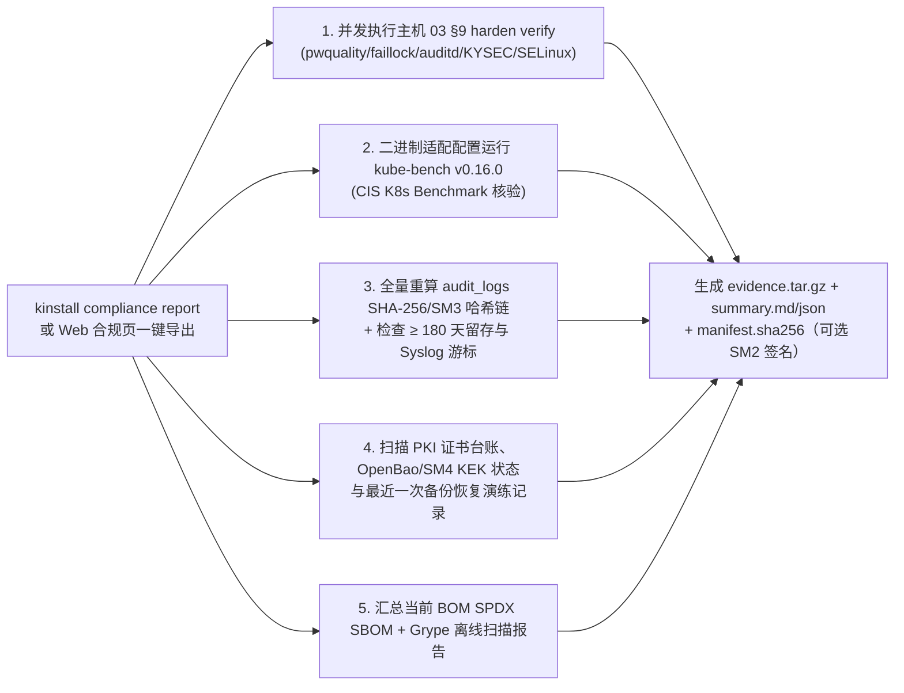

# G2 平台深度设计（2/3）：多集群管理、生态集成与等保密评实操

> **本文定位**：kinstall **第二阶段平台层中篇（G2，2/3）**，与独立前端总纲 [WEB_DESIGN.md](../WEB_DESIGN.md) 配套交付，覆盖多集群统一管理（E19）、外部 CMDB 双向同步（C5）、GitOps 流水线（B14）、通知防风暴投递器（B15）以及等保 2.0 三级与密评实操证据包引擎（H3/H4）。
>
> **版本**：v1.1（平台 2/3，2026-11-26；v1.1 安全修复 `admin` 禁用 `O=system:masters` 改为可吊销 `kinstall:cluster-admin`、对齐 24 表真实表名及通知聚合键与五大渠道标题）。

---

## 1. 多集群统一管理与短期 Kubeconfig 签发（E19、`internal/multicluster`）

kinstall Server 作为多集群控制平面，严禁向开发/运维分发永不过期的 `cluster-admin` 静态证书！全部走**短期 X.509 客户端证书签发（或 OIDC 代理）+ 按需 RBAC 绑定 + 审计闭环**：

1. **受管集群注册与状态汇聚**：
   - 每个由 kinstall 安装的 K8s 集群在安装完成时自动将 `cluster-ca` 证书（私钥存 `credentials` 加密库）、VIP/APIServer 入口及只读健康巡检凭据写入 `instances.state_json` 与 `cluster_kubeconfigs` 表（24 表规范，`G1 §6.3`）；
   - 后台每 30s 通过 `client-go` 轻探针采集：APIServer `/readyz`、节点总数/Ready 数、`amd64`/`arm64-4K`/`arm64-64K` 架构分布、etcd 成员健康与 WAL 延迟、30 天内到期证书计数，供 Web 驾驶舱与 `/clusters` 视图秒级展示。
2. **短期 Kubeconfig 签发算法（`POST /api/v1/projects/{p}/clusters/{id}:kubeconfig`）**：
   - 按调用者在平台项目中的 RBAC 角色自动映射 K8s Group（`admin → kinstall:cluster-admin`〔ClusterRoleBinding 绑定内置 `ClusterRole/cluster-admin`，需二次确认且最长 `4h`；**严禁签发 `O=system:masters` 证书**，以保证解绑即即时吊销〕、`project-admin → kinstall:ns-admin`、`operator → kinstall:edit`、`auditor/viewer → kinstall:view`，对应 `cluster_kubeconfigs.k8s_role` 四档枚举）；
   - 在部署机内存生成临时 ECDSA-P256 密钥对，用该集群 `client-ca` 签发短期叶子证书（`CN = "kinstall-user:<actor>:<ulid>"`、`O = [<mapped_group>]`、默认 `TTL = 8h`，硬上限 `24h`）；
   - 响应体返回完整 `kubeconfig` YAML（`Cache-Control: no-store`）并**立即清零私钥内存**，同时在 `audit_logs` 登记 `cert_serial`、`actor`、`ttl` 与目标集群 ID。
   - 吊销与紧急切断：K8s 原生不校验证书 CRL，应急切断通过删除对应 `ClusterRoleBinding` 或对单用户移除其临时组映射（`CN` 精准拒绝 Webhook/RBAC 剔除）实现。
3. **Headlamp 多集群入口**：平台自动向受管集群 Headlamp 注入集群上下文并联动 OIDC SSO，点击 Web 控制台“进入集群工作负载”无缝免密登录。

---

## 2. 外部 CMDB 双向同步与 GitOps 流水线（C5、B14）

### 2.1 外部 CMDB 同步（Pull + Push 双模，`internal/inventory/sync`）

- **Pull 定时拉取适配器**：配置 `SyncSource`（端点 URL、认证凭据引用、Cron 周期、字段映射 `expr` 表达式，如 `labels.rack = raw.cabinet_code`），每轮拉取计算差异，仅增量更新标签、机房/机架与自定义属性。
- **Push Webhook 推送（`POST /api/v1/projects/{p}/hosts:sync`）**：
  - 强制验签：`X-Kinstall-Timestamp`（±5 分钟防重放）+ `X-Kinstall-Signature: sha256=HMAC(secret, ts + "." + body)`；
  - 幂等批次号 `batchId` 防重复入库。
- **保护在运主机铁律**：当外部 CMDB 标记某台主机下线/报废，但 kinstall 检测到该主机仍存在活跃 `instance_host_claims`（处于 `InUse`）时，**严禁自动删除主机记录**，仅打标 `cmdb.kinstall.io/upstream-retired=true` 并触发 `host.upstream_retired` 高优先级告警由运维执行规范退役（`03 §5.7`）。

### 2.2 GitOps 声明式工作流（`kinstall export` / `diff` / `apply`）

```yaml
# .gitlab-ci.yml / GitHub Actions 典型 GitOps 流水线（两段式：MR Plan → Merge Apply）
stages: [plan, apply]

plan_infra:
  stage: plan
  rules: [if: '$CI_PIPELINE_SOURCE == "merge_request_event"']
  script:
    - kinstall diff -f infra/prod/ --server "$KINSTALL_SERVER" -o markdown > plan-comment.md
    - kinstall apply -f infra/prod/ --plan-only --server "$KINSTALL_SERVER" -o json > plan.json
  artifacts:
    paths: [plan.json, plan-comment.md]

apply_infra:
  stage: apply
  rules: [if: '$CI_COMMIT_BRANCH == "main"']
  script:
    # 生产环境自动进入 AwaitingApproval，推送企微/钉钉审批卡片，审批通过后由 Server HA Worker 执行
    - kinstall apply -f infra/prod/ --yes --server "$KINSTALL_SERVER" --wait-timeout 45m
```

- **版本回滚**：每次 Spec/状态变更在 `instance_state_backups` 与 `instances.last_applied_json` 存不可变快照（对应 24 表规范，`G1 §6.3`）；支持 `kinstall instance diff --from-rev 4 --to-rev 5` 与 `kinstall instance plan --rollback-to-rev 4`。

---

## 3. 事件通知引擎与防风暴聚合（B15、`internal/notify`）

### 3.1 五大渠道适配与可靠投递

| 渠道 | 签名 / 安全机制 | 离线 / 内网适配 |
| --- | --- | --- |
| **通用 Webhook** | `X-Kinstall-Event`、`X-Kinstall-Delivery`、`X-Kinstall-Signature-256: sha256=<hmac>` | 严禁访问 loopback/云元数据 IP（防 SSRF），支持自签 CA |
| **企业微信群机器人** | Markdown 卡片（含 Operation 链接、状态、审批入口） | 支持配置企业统一 HTTP 代理 |
| **钉钉机器人** | `timestamp` + HMAC-SHA256 Base64 URL 编码加签 | 同上 |
| **飞书自定义机器人** | `timestamp` + HMAC-SHA256 签名 + Interactive 卡片 | 同上 |
| **邮件（SMTP）** | STARTTLS / SMTPS + 加密 SMTP 凭据引用 | 内网 Exchange / Postfix 零外网依赖 |

### 3.2 告警防风暴与死信重试架构

- **滑动窗口聚合（默认 5 分钟）**：对同 `(project_id, event_type)` 的高频抖动事件（如网络抖动触发 20 台主机失联）按窗口合并为单条摘要卡片（窗口内受影响 `host_id` 汇总为列表）（如“prod 环境 18 台主机巡检失联，首台 node-03…”），避免 IM 群刷屏淹没关键审批消息；
- **异步出箱与退避重试**：`notification_deliveries` 表（`G1 §6.3` 表 23）持久化每条待投递任务，后台 Worker 按 `10s → 30s → 2m → 5m → 10m` 指数退避重试 5 次，仍失败转 `dead_letter` 供 Web 控制台一键重放。

---

## 4. 等保 2.0 三级与密评实操交付引擎（H3、H4、`internal/compliance`）

将 `13-安全合规.md` 的条款映射落地为**一键可执行的合规核验与证据包流水线**（`kinstall compliance report --standard mlps3,gm,cis --project prod --output evidence.tar.gz`）：

### 4.1 证据包自动采集流水线



### 4.2 密评（GB/T 39786-2021）外围国密网关（Tongsuo TLCP）标准接入模板

遵循 ADR-060，平台前端/API 外围前置双证书国密网关（支持商密认证硬件网关或 OpenAtom Tongsuo Nginx），转发至内部 kinstall Server TLS 1.3 端口，同时保留透传头供审计准确记录真实客户端 IP：

```nginx
# /etc/tongsuo-nginx/conf.d/kinstall-tlcp.conf（外围国密双证书 TLCP 接入示例）
server {
    listen 443 ssl;
    enable_ntls on;
    ssl_sign_certificate      /etc/kinstall/gm-pki/sign.crt;
    ssl_sign_certificate_key  /etc/kinstall/gm-pki/sign.key;
    ssl_enc_certificate       /etc/kinstall/gm-pki/enc.crt;
    ssl_enc_certificate_key   /etc/kinstall/gm-pki/enc.key;
    ssl_protocols             TLSv1.2 TLSv1.3 NTLSv1.1;

    location /api/v1/operations/ {
        proxy_pass https://kinstall_server_upstream;
        proxy_http_version 1.1;
        proxy_buffering off;               # ★ 严禁缓冲 SSE 实时事件流！
        proxy_read_timeout 3600s;
        proxy_set_header X-Real-IP $remote_addr;
        proxy_set_header X-Forwarded-For $proxy_add_x_forwarded_for;
    }
    location / {
        proxy_pass https://kinstall_server_upstream;
        proxy_set_header Host $host;
        proxy_set_header X-Real-IP $remote_addr;
    }
}
```

---

## 5. G2 模块验收测试清单

| 测试类别 | 必过用例 |
| --- | --- |
| **多集群短期凭证** | 签发 `viewer` 角色 1h kubeconfig 验证仅能 `get pods` 不能 `delete`；到期后自动 401；`audit_logs` 留存完整序列号与操作者 |
| **CMDB 同步与保护** | Webhook 伪造签名返回 401；外部 CMDB 标记 `InUse` 主机下线时断言主机不被删除且正确打标告警 |
| **通知防风暴** | 30 秒内向同一项目注入 50 条失联事件，断言 IM 渠道仅发出 1 条聚合摘要消息；模拟渠道 500 失败 5 次进入 `dead_letter` |
| **合规证据包** | 运行 `kinstall compliance report --standard mlps3,gm` 生成 `.tar.gz`，自动校验包内 6 类子报告完整、无明文私钥泄露且 `audit-verify.json` 为 PASS |
