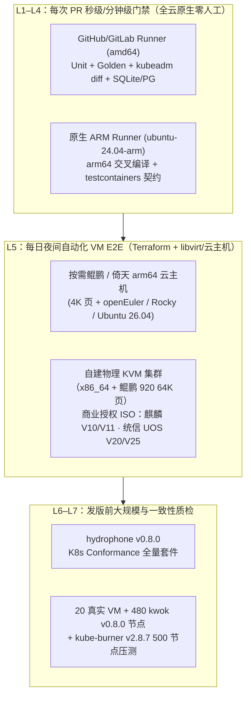

# G3 平台深度设计（3/3 · 平台层封板）：多架构测试平台、故障注入与 500 节点压测 SOP

> **本文定位**：kinstall **第二阶段平台层封板文档（G3，3/3）**，将 `14-测试与验收.md` 与 `05 §6` 转化为可自动化执行的 CI/CD 验证平台工程蓝图：12 组正交 VM 矩阵自动化编排、Ubuntu 26.04 `sudo-rs`/`uutils` 容器契约、15 项自动化故障注入脚本架构、以及 **20 真机 + 480 `kwok` 节点 = 500 节点规模压测 SOP**（含 2026 实证诚实边界声明）。
>
> **覆盖范围**：设计项 `J1–J7`；关联 ADR-063、064、065。
>
> **版本**：v1.1（平台 3/3 封板，2026-11-26；v1.1 修正麒麟 V10 SP3=64K / V11=4K 实测口径、§2 契约计数 5 项、§3 对齐 `14 §6` ADR-064 `FI-01–FI-15` 并拆分中间件扩展场景 `FX-01–FX-08`、修正 20 真机 + 480 `kwok` = 500 节点与完整 `hydrophone` 套件）。

---

## 1. 三层多架构测试平台架构（ADR-063）

### 1.1 12 组正交 VM 矩阵自动化编排（`test/e2e/matrix.yaml`）

通过 Terraform (`dmacvicar/libvirt` 或华为云/阿里云 provider) + Cloud-Init 自动拉起干净快照，每次测试结束自动 `destroy` 并收集 `/var/log/kinstall` 与 `journalctl` 失败诊断包：

| 组号 | OS × 架构 × 页大小 | 关键差异特性验证 | 频率 |
| :---: | --- | --- | --- |
| M01 | Rocky 9.x / `amd64` / 4K | 默认 P0 基线：containerd 2.3 + Calico nftables + 3+3 HA | 每次 PR（核心子集）/ 每日 |
| M02 | Rocky 8.10 / `amd64` / 4K | `glibc 2.28` ABI 下限验证 + cgroup v1→v2 重启切换 | 每日 |
| M03 | Ubuntu 24.04 / `amd64` / 4K | `apt` + `ufw` + `systemd-resolved` + Docker 29 `DOCKER-USER` | 每次 PR |
| M04 | **Ubuntu 26.04 / `amd64` / 4K** | **`sudo-rs`（`sudo -S --prompt ""`）+ `rust-coreutils` 专项回归** | 每日 |
| M05 | Debian 13 / `amd64` / 4K | 纯净 `nftables`（无 firewalld/ufw）+ 无默认 sudo | 每日 |
| M06 | openEuler 24.03 LTS / **`arm64` / 4K** | 信创开源基线 + 双栈 + 毕昇 JDK 21 | 每日 |
| M07 | **麒麟 Kylin V10 SP3 / `arm64` / 64K（鲲鹏）** | **64K 页 jemalloc（Valkey/Harbor）+ 老内核 4.19 降级 iptables + `glibc 2.28` + KYSEC（`03-A §5` 实测 64K，ADR-027/028）** | 每日（私有 KVM，ADR-067） |
| M08 | **麒麟 Kylin V11 / `arm64` / 4K（鲲鹏）** | 信创最新 4K 页基线 + KYSEC 按文件加白 + `nftables`（`03-A §5` 实测 V11 为 4K） | 每日 / 每周 |
| M09 | 统信 UOS V25 / `amd64` / 4K | 授权 ISO 离线软件源闭包 + UOS 安全策略 | 每周 / 发版前 |
| M10 | Anolis 23 / `arm64` / 4K | 阿里云倚天平台兼容 + `dnf` 冲突排斥锁 | 每日 |
| M11 | openSUSE Leap 16 / `amd64` / 4K | `zypper` + `addlock` + SELinux enforcing | 每周 |
| M12 | **混合架构集群（3×`amd64` + 2×`arm64-4K` + 1×`arm64-64K`）** | **多架构 OCI Index 校验、64K 页 taint/label 隔离与跨架构调度** | 每日 / 发版前 |

---

## 2. L4 容器契约测试流水线（含 Ubuntu 26.04 `sudo-rs` 专项）

`test/contract/osadapter_test.go`（`-tags=contract`）基于 `testcontainers-go v0.45.0` 在真实发行版容器内运行 systemd 并执行 5 项硬契约：
1. **1-RTT POSIX Facts 脚本回归**：验证输出严格符合 `spec/osmatch_golden.yaml` 且全程零 Python、零 bashism、兼容 `uutils`（Rust coreutils，严禁依赖 GNU 独有长参数如 `--preserve-root`）；
2. **`sudo-rs` 提权回归（Ubuntu 26.04）**：模拟 `sudo -S --prompt ""` 经 stdin 传密提权与故意传错口令触发 `pam_faillock` 零重试熔断；
3. **`pkgmap.yaml` 全量映射与冲突排斥锁**：验证 `exclude` / `Pin: -1` / `addlock` 生效且 ADR-026 禁用的发行版 `docker.io`/`containerd.io` 无法误装；
4. **`file.sync` 与 `systemd.unit` 两次执行 100% `Skipped` 幂等断言**；
5. **Docker 29 防火墙守卫容器验证**：验证 `kinstall-docker-fw.service` 在 `systemctl restart docker` 后自动重放 `DOCKER-USER` / `inet kinstall_docker_guard`。

---

## 3. 15 项自动化故障注入脚本规范（ADR-064、`test/e2e/chaos/`）

所有故障注入封装为 `ginkgo/v2` 套件，运行期间并行启动持续 HTTP/TCP 探测协程（每 100 ms 发起请求），**硬门禁：数据面请求成功率 ≥ 99.9%，控制面与中间件在 SLA 内自动自愈无数据丢失**。

### 3.1 ADR-064 权威 15 项（与 `14 §6` `FI-01～FI-15` 编号 100% 一致）

| 编号 | 故障域 | 注入动作（自动化命令） | 预期恢复行为与 SLA 门禁 |
| :---: | --- | --- | --- |
| `FI-01～FI-08` | **节点本地代理 8 项** | 按 `04 §9.3` 逐项自动化注入（单控制面 `kill -9`、端口 hang、半开连接、后端热更新、代理进程 `kill -9`、全部失联恢复等） | 故障摘除 ≤ 5 s，代理 systemd `Restart=always` 1 s 内拉起，kubelet / Pod 零感知 |
| `FI-09` | etcd 单成员宕机 + 磁盘慢 | `virsh destroy` 1 台控制面 / `iptables DROP` 2379/2380 + `dm-delay` 注入 30 ms fsync 延迟 | 剩余 2 节点 5 s 内选新 Leader，写请求恢复；延迟超阈值触发 `EtcdDiskWalFsyncDurationHigh` |
| `FI-10` | 控制面 VIP 漂移 | 强杀当前持有 VIP 的控制面节点 | Keepalived / kube-vip ≤ 5 s 漂移至备控制面，集群外 `kubectl get nodes` 恢复 |
| `FI-11` | 运行时 containerd 重启 | 工作节点 `systemctl restart containerd` | 已运行容器不断流（containerd-shim 托管），节点保持 `Ready` |
| `FI-12` | 节点证书到期轮换 | 缩短测试集群 kubelet 证书 TTL 为 10 分钟 | `kubelet-csr-approver` 自动校验 CN/SAN 续期（ADR-017），拒绝伪造 SAN 的恶意 CSR |
| `FI-13` | 部署机中断与 SSH 闪断 | 安装中途 `kill -9 kinstall` 或 Async Detached 期间切断 SSH 20 s | 目标机后台进程不中断，重连按 `pid`/`rc` 与 `stdout.log` 偏移接续读日志（`D1 §2.3`）；`kinstall apply --resume <opId>` 已收敛步骤 100% `Skipped` |
| `FI-14` | Server 多副本崩溃租约接管 & 脑裂 | 暂停 Worker A 35 s 令租约过期被 Worker B 接管，再唤醒 A | 30 s 后 B 抢占（`fencing_token+1`）并接续 Async `rc`；A 醒来旧 `fencing_token` 写回受影响 0 行并立即自停 |
| `FI-15` | etcd 灾难恢复 | 删除全部 3 节点 etcd 数据目录后审批执行 `kinstall cluster etcd-restore` | 从最新 S3/OBS 快照 5 分钟内无损拉起全集群，业务 Deployment 恢复 |

### 3.2 中间件与升级扩展演练场景（`FX-01～FX-08`，不计入 ADR-064 的 15 项基线）

| 编号 | 故障域 | 注入动作 | 预期恢复行为与 SLA 门禁 |
| :---: | --- | --- | --- |
| `FX-01` | Worker 硬断电 | `virsh destroy` 1 台 Worker VM | K8s 按配置驱逐并重建副本，StatefulSet 经 PVC 正常迁移 |
| `FX-02` | PG 切主 | 强杀 Patroni Primary + 模拟网络隔离 | 15 s 内新 Primary 接管，VIP 漂移，旧主经 `pg_rewind` 自动回追零脑裂 |
| `FX-03` | Valkey 切主 | 强杀哨兵/Cluster 中 1 台 Master | 10 s 内自动 Failover 提升 Replica，客户端读/写自动切新主 |
| `FX-04` | MySQL MGR | 断网隔离 3 节点 MGR 中 1 台主节点 | 多数派 15 s 内自动选新主，MySQL Router 零人工切换写流量 |
| `FX-05` | Kafka Broker | 强杀 3 节点 KRaft 集群中 1 台节点 | ISR 副本（`min.insync.replicas=2`）持续可写零丢失，恢复后自动追齐 |
| `FX-06` | 对象存储盘损 | 拔除 SeaweedFS 纠删码（10+4）任意 2 块数据盘 | S3 GET 读写 100% 成功，补盘后后台重建分片 |
| `FX-07` | 制品库断中心 | 边缘 Zot 缓存命中后切断中心网络 | 区域内新增节点拉取缓存镜像 100% 本地成功；OBS 故障自动回退本地缓存 |
| `FX-08` | 逐级滚动升级 | `K8s 1.35.10 → 1.36.6 → 1.37.2` 连续升级（含 SELinuxMount 审计） | 全程数据面请求成功率 ≥ 99.9%，升级后 `hydrophone` 完整套件全绿 |

---

## 4. 500 节点规模压测 SOP（20 真机 + 480 `kwok` 节点，ADR-065）

### 4.1 诚实测试边界声明（2026 业界实证）

- **`kwok v0.8.0` 压测有效域**：真实压测 **APIServer、Controller Manager、Scheduler、etcd 写路径、Watch 扇出与 kinstall 自身 CMDB/控制面性能**；
- **`kwok` 不覆盖域**：无法模拟真实容器镜像拉取、CNI 数据面路由编程（`nftables`/`eBPF`）与 kubelet 绑定延迟——因此 **数据面与 CNI 延迟 SLO 必须在同集群的 20 台真实 VM 上单独实测**，绝不用模拟数据粉饰数据面指标！

### 4.2 标准执行步骤与准出红线

1. **底座搭建**：使用 kinstall 离线部署 `3 控制面（8C/16G + 独立 NVMe SSD 盘 ≥ 16K IOPS 堆叠 etcd）+ 17 真实 Worker VM`（合计 20 台真实节点 VM，与 ADR-065 及 `14 §8` 一致）；
2. **注入 480 个 `kwok` 模拟节点**：部署 `kwok v0.8.0` 控制器并批量创建 480 个带 `kwok.x-k8s.io/node=fake` 污点的模拟节点（总规模 500 节点）；
3. **运行 `kube-burner v2.8.7` Cluster-Density 压测**：向 500 节点集群持续创建/轮转 **15,000 Pod + 1,500 Service + 3,000 ConfigMap/Secret**（持续 30 分钟）；
4. **同步执行 `hydrophone v0.8.0`**：在 20 台真实节点上跑通 Kubernetes 官方完整 Conformance 套件（0 失败，与 `14 §8` 及 `T-M2-10` 一致）；
5. **硬性准出 SLI 红线（全部达标方签发验收报告）**：

| 指标 | 准出红线 | 采集来源 |
| --- | --- | --- |
| APIServer mutating 请求 p99 延迟 | `< 1.0 s` | Prometheus `apiserver_request_duration_seconds` |
| APIServer read-only (LIST/GET) p99 延迟 | `< 1.0 s`（非 LIST `< 200 ms`） | Prometheus |
| etcd WAL `fsync` p99 延迟 | **`< 25 ms`**（超 25 ms 触发磁盘 IOPS 告警） | `etcd_disk_wal_fsync_duration_seconds` |
| 真实节点 Calico/nftables 新 Service 路由生效 p99 | `< 3.0 s` | 20 台真实 VM 探针 |
| kinstall Server 并发管理 500 主机 Facts 采集内存峰值 | `< 1.5 GiB`，SSE 端到端延迟 `< 500 ms` | kinstall `/metrics` |

---

## 5. 平台层封板声明（G1–G3 + `WEB_DESIGN.md` 全量就绪）

至此，**第一阶段底座（D1–D3）与第二阶段平台层（G1–G3 + `WEB_DESIGN.md`）全部深度设计封板**，正式进入**第三阶段各核心插件（P1–P7）与扩展生态插件（P8–P10）**！
