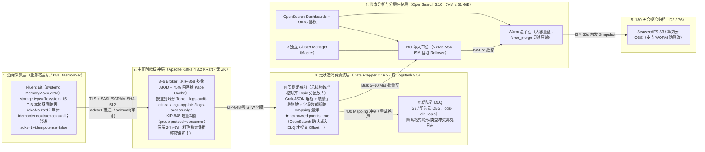

# P3 核心插件深度设计（3/7）：大型 ELK / OpenSearch + Apache Kafka 4.x KRaft 中间消费全链路深度设计

> **本文定位**：kinstall 第三阶段核心重磅深度设计（整合 `plugins/kafka/` + `plugins/search/` + `plugins/elk/` + `Stack` 复合栈编排，**ADR-051～053 / ADR-067 / ADR-071～074**），专门解决**大型生产系统（日增日志 500 GB ～ 10 TB+，峰值 10 万～100 万 EPS）引入 Apache Kafka 4.x KRaft 作为中间削峰消费层**时的全部硬核架构难题：分区对齐、端到端背压传导、Rebalance 风暴消除（KIP-848）、端到端 ACK 与死信队列（DLQ）、Mapping 字段爆炸熔断、冷热分离与 OBS/S3 180 天归档。
>
> **版本**：v1.1（核心插件 3/7，2026-11-26；v1.1 修复 librdkafka `enable.idempotence` 与 `acks=all` 约束、统一 Data Prepper `2.16.x` / T2 3 节点融合 / T3 500 GB–5 TB+ & 3–6 Broker / Fluent Bit 512M+5G / 统一分域 Topic 及 `product: opensearch`）。所有关键技术特性（**OpenSearch `3.10.0` + Data Prepper `2.16.x`（ADR-071）** End-to-End Acks & DLQ、**Apache Kafka `4.3.2 / 4.4.0` KRaft + KIP-848 增量均衡 + KIP-858 JBOD**、Elastic Stack `9.5.7` 可选红灯许可边界）均于 2026-11 实查核验；全链路兼容 `amd64` / `arm64-4K` / `arm64-64K`（Kafka / OpenSearch / Data Prepper 均运行于底座多架构 `runtime/jdk` 21，Fluent Bit C 二进制在 64K 页主机强制匹配 D3 `--with-lg-page=16` jemalloc 或 `glibc malloc` 专用构建）。

---

## 1. 为什么大型 ELK 必须引入 Kafka 中间消费？三档规模选型红线（ADR-072）

当业务高峰（促销、发布故障、DDoS、微服务雪崩打印海量 Java 堆栈）瞬间将日志流量放大 **10×～50×** 时，如果边缘采集器直写 ES/OpenSearch 或直推 Logstash/Data Prepper：
1. ES/OpenSearch 写入线程池队列迅速打满报 `429 EsRejectedExecutionException`，导致采集器阻塞、宿主机磁盘/内存爆掉甚至拖垮业务进程；
2. 搜索引擎集群做滚动升级、重启或磁盘故障恢复期间（10–60 分钟），全网日志彻底丢失！

因此 kinstall 将日志全栈明确划分为**三档标准架构**，并默认提供 **全 Apache-2.0 可打入公共离线包的 OpenSearch 全栈**（Elastic Stack / ELK 9.5.7 作为客户侧红灯许可按需可选路线，ADR-052 / ADR-071）：

| 规模档位 | 日增日志量 | 推荐拓扑（均由 `Stack` 一键编排） | Kafka 缓冲 | 存储生命周期 |
| --- | --- | --- | :---: | --- |
| **T1 · 轻小型** | `< 50 GB/天` | Fluent Bit → OpenSearch 3.10（3 节点）+ Dashboards | 否（节省资源） | 热存 14–30 天 + 定期 S3/OBS 快照 |
| **T2 · 中型标准** | `50 – 500 GB/天` | Fluent Bit → Data Prepper 2.16.x（2 节点持久化缓冲）→ OpenSearch 3.10（3 节点融合 `converged-3node`，与 `10`/`15` 一致；独立 Master 仅 T3） | 可选（高突增业务推荐开启） | 热 7 天 → 温 30 天 → OBS/S3 快照 180 天 |
| **T3 · 大型高并发（本文核心）** | **`500 GB – 5 TB+/天`** | **Fluent Bit（本地磁盘缓冲）→ Apache Kafka 4.x KRaft（3–6 Broker JBOD，可水平扩展）→ Data Prepper 2.16.x（或 Logstash 9.5）消费清洗群（+ S3/OBS DLQ）→ OpenSearch 3.10（3 独立 Master + N Hot + M Warm + 2 Coord）→ SeaweedFS / 华为云 OBS 180 天冷归档** | **★ 强制必选** | 热 3–7 天（NVMe）→ 温 30 天（HDD/SATA SSD）→ **OBS/S3 归档 ≥ 180 天（满足等保 2.0 三级）** |

---

## 2. 大型 ELK + Kafka 4.x 中间消费端到端数据流与背压架构



---

## 3. 五大核心工程深水区像素级设计（大型生产成败关键）

### 3.1 分区数、消费者线程数与搜索分片数“黄金对齐公式”

大型日志管道最常见的性能杀手不是机器不够，而是**分区数与消费并发错配导致单分区积压（Lag）或空转浪费**：

1. **Kafka Topic 分区数计算公式**：
   - 按单分区安全持续写入吞吐 **`10 MiB/s`（压缩后）** 与目标峰值流量计算：`P = ceil(PeakThroughput_MBps / 10)`，并向上取整为 **Broker 数量 × Data Prepper 实例数 的公倍数**（推荐基线：`12 / 24 / 36 / 48 / 72` 分区）；
   - **Topic 隔离铁律**：严禁把全公司所有日志混进一个 `all-logs` Topic！至少按业务敏感度与吞吐拆分为：
     - `logs-audit-critical`（安全/等保审计日志：`acks=all`、`min.insync.replicas=2`、`retention.ms=604800000` 7 天，独立消费者组避免被普通应用日志堵死）；
     - `logs-app-biz`（核心业务 JSON/Java 日志：`compression.type=zstd`、`retention.ms=172800000` 48h）；
     - `logs-access-edge`（Nginx/Envoy 高峰访问日志：`retention.ms=86400000` 24h，允许极端风暴下主动降采样）。
2. **消费端线程数对齐铁律**：
   - `Data Prepper 实例数 × 单实例 workers`（或 Logstash `实例数 × consumer_threads`）**必须 `<=` Topic 分区数**（最好正好等于或整除分区数，如 24 分区 = 4 实例 × 6 线程）；超出分区数的线程永远处于空闲，反而加剧 Rebalance 开销！
3. **OpenSearch 索引分片对齐**：
   - 通过 **ISM（Index State Management）Rollover** 控制单主分片大小严格落在 **`30 – 50 GiB`**（且 `max_age: 1d`），单节点分片数严格控制在 `<= 20 shards / GiB Heap`（31 GiB 堆最多 600 分片），杜绝“按天建过多小分片把 Cluster State 撑爆”！

### 3.2 Kafka 4.x `KIP-848` 彻底根治大规模 Rebalance 风暴（2026-11 实证）

- **传统痛点**：在 Kafka 3.x 时代，当 20 个消费节点中有 1 个因为 GC 停顿超过 `max.poll.interval.ms` 或做滚动发布重启时，触发全组 **Stop-The-World Rebalance**，所有 20 个消费者同时停掉消费、撤销全部分区、重新分配，引发分钟级 Lag 尖刺甚至连锁超时雪崩！
- **Kafka 4.x KRaft 生产铁律**：
  1. 服务端默认开启 KIP-848 新代协议；所有消费端（Data Prepper / Logstash / 业务消费端）显式启用 **`group.protocol = consumer`**，由 Broker 协调**增量分区迁移**（仅重分配故障节点的那几个分区，其余 19 个节点 0 停顿持续索引！）；
  2. 消费端调优基线：`max.poll.records = 1000`（防止单批拉太大清洗耗时超过 `max.poll.interval.ms` 踢出消费组）、`max.poll.interval.ms = 300000`（5 分钟）、`session.timeout.ms = 45000`、`fetch.min.bytes = 65536`、`fetch.max.wait.ms = 500`（攒批减少网络小包）；
  3. **Broker 内存与 JBOD 调优（ADR-073）**：Kafka 4.x 强制使用底座 `runtime/jdk` **OpenJDK 21**；Broker JVM 堆锁定 **`6 – 8 GiB`**（使用 G1GC），将 **75%–85% 宿主机物理内存留给 Linux Page Cache**（实现零拷贝 `sendfile` 消费全命中内存）；多块数据盘直接走 **KIP-858 原生 JBOD**（每块独立 XFS，不用软件 RAID），单盘损坏仅下线该盘分区而不拖垮整台 Broker！

### 3.3 端到端 ACK + 死信队列（DLQ）杜绝“毒丸日志堵死全管道”

**最惨烈的日志管道线上事故**：某个开发把原本是 `long` 类型的字段 `user_id` 突然打印成了字符串 `"guest"`，OpenSearch Bulk 持续返回 `400 mapper_parsing_exception`。如果消费端无限重试，整个分区卡死；如果盲目吞掉错误并自动提交 Offset，故障排查证据悄然消失！

**kinstall Data Prepper `2.16 / 2.17` 生产级 Pipeline 配置模板（Apache-2.0，开箱即用）**：

```yaml
# /etc/kinstall/dataprepper/prod-logging/pipelines/kafka-to-opensearch.yaml
logs-ingest-pipeline:
  workers: 6
  delay: "100"
  buffer:
    bounded_blocking:
      buffer_size: 4096
      batch_size: 512
  source:
    kafka:
      acknowledgments: true                 # ★ 端到端确认：必须 OpenSearch 写入成功或安全入 DLQ 才提交 Kafka Offset！
      bootstrap_servers:
        - "${instances.kafka.outputs.bootstrapServers}"
      encryption:
        type: ssl
      authentication:
        sasl:
          scram:
            username: "${secret:kafka_consumer_user}"
            password: "${secret:kafka_consumer_pass}"
      topics:
        - name: "logs-app-biz"
          group_id: "dp-logs-app-biz-v1"
          workers: 6
          auto_offset_reset: "earliest"
          auto_commit: false                # ★ 严禁自动提交！由 AcknowledgmentSet 回调精确驱动提交
          commit_interval: "5s"
          max_poll_records: 1000
          consumer_max_poll_interval: "300s"
          serde_format: "json"
          # 启用 Kafka 4.x KIP-848 增量均衡，彻底消除滚动升级 STW 停顿
          additional_properties:
            group.protocol: "consumer"
  processor:
    # 1. 敏感字段脱敏（手机号/身份证/Authorization Bearer）
    - obfuscate:
        source: "message"
        patterns:
          - "(?i)(bearer\\s+[a-z0-9._-]+)"
    # 2. ★ 防 Mapping 爆炸：将未知动态嵌套对象压平或转存为 JSON 字符串，保护集群字段数上限
    - parse_json:
        source: "message"
        destination: "parsed"
        handle_failed_events_option: "skip" # 非 JSON 行保留原样不炸管道
  sink:
    - opensearch:
        hosts: ["${instances.opensearch.outputs.httpEndpoints}"]
        cert: "/etc/kinstall/dataprepper/prod-logging/certs/os-ca.crt"
        username: "${secret:os_ingest_user}"
        password: "${secret:os_ingest_pass}"
        index_type: "custom"
        index: "logs-app-biz-write"         # 写入别名（指向 ISM 自动 Rollover 的 Data Stream / Alias）
        bulk_size: 5                        # 单 Bulk 5 MiB（兼顾吞吐与 GC 停顿）
        flush_timeout: 5000
        max_retries: 5
        dlq:
          # ★ 写失败（如 400 Mapping 类型冲突或重试耗尽）的毒丸日志自动隔离至 OBS/SeaweedFS S3 DLQ！
          # 入 DLQ 成功后释放正向 Acknowledgment，释放当前 Kafka 分区继续消费后续正常日志！
          s3:
            bucket: "${instances.s3.outputs.dlqBucket}"
            key_path_prefix: "dlq/logs-app-biz/"
            endpoint: "${instances.s3.outputs.s3Endpoint}"
            region: "us-east-1"
            path_style_access: true
```

### 3.4 四级端到端背压传导与故障自保护矩阵

| 故障节点 | 背压传导链与数据零丢失保障 | 平台自动告警阈值 |
| --- | --- | --- |
| **OpenSearch 写入变慢 / 滚动升级不可用** | Data Prepper Bulk 降速 → `bounded_blocking` 缓冲满 → 暂停调用 Kafka `poll()`（但不超 `max.poll.interval` 心跳隔离）→ **数据平稳积压在 Kafka 磁盘（48–72h 容量预算）** → 搜索恢复后自动追平，业务宿主机零感知！ | `kafka_consumergroup_lag > 500,000` 或预计追平时间 > 15 min |
| **Kafka 某 Broker 宕机 / 磁盘满** | 副本数 `RF=3` + `min.insync.replicas=2` 自动切 Leader 继续写；若整个 Kafka 不可用，**Fluent Bit 启用 `storage.type filesystem` + `storage.total_limit_size 5G` 写宿主机本地盘**（与 `15 §7.2` 一致），满 5G 时按 `storage.pause_on_chunks_overlimit on` 暂停 tail 读取保护宿主机内存与磁盘绝不被打爆！ | `UnderReplicatedPartitions > 0`；Fluent Bit `storage_overlimit > 0` |
| **业务突发打印恶意大字段 / 10 万个随机 JSON Key（Mapping 爆炸）** | OpenSearch 索引模板预设 `index.mapping.total_fields.limit: 1000` + `dynamic: strict`（或仅开放 `flattened` 类型承载任意 `ext_kv` 标签）→ 超标文档被拒后直接进 **Data Prepper S3/OBS DLQ**，绝不拖垮 Master 节点 Cluster State！ | `dlq_documents_total` 5 分钟增量 > 100 |

### 3.5 OpenSearch 3.10 生产 JVM 与 ISM 冷热归档硬规范（ADR-053）

- **JVM 堆严格公式**：`Xms = Xmx = min(floor(MemTotal * 0.50), 31 GiB)`（严禁超 31 GiB 破坏 JVM CompressedOops 指针压缩！），强制 `bootstrap.memory_lock: true`、`vm.max_map_count = 1048576`、禁 Swap、禁 NFS 作为 `path.data`；
- **角色严格分离（T3 规模）**：3 台独立 `cluster_manager`（4C/8G，绝不存数据、不承接查询，防止大聚合 OOM 导致选主脑裂）+ N 台 `data(hot)`（NVMe）+ M 台 `data(warm)` + 2 台 `coordinating`；
- **ISM 全自动生命周期**：`Hot (0–7d, Rollover 40GiB/1d)` → `Warm (7–30d, force_merge to 1 segment + read_only + 副本降为 0 或 1)` → `Snapshot to SeaweedFS/华为云 OBS (保留 ≥ 180 天满足等保三级)` → `Delete 本地索引释放磁盘`。

---

## 4. 一键编排完整 `Stack` YAML 样板（D2 §4 复合栈实战）

借助底座 `Stack` DAG 编排引擎，运维只需一份声明式 YAML 即可完成 **SeaweedFS S3 + Apache Kafka 4.3.2 KRaft + OpenSearch 3.10 + Data Prepper 2.16 + Fluent Bit** 全栈自动依赖部署与凭据/CA 零手工抄写自动传递：

```yaml
apiVersion: kinstall.io/v1alpha1
kind: Stack
metadata:
  name: prod-t3-logging-platform
  project: core-ops
  env: prod
spec:
  instances:
    - id: s3
      product: object-storage
      deployTarget: host-binary
      spec:
        engine: seaweedfs
        version: "4.54"
        buckets:
          - { name: logging-snapshots, wormDays: 180 }
          - { name: logging-dlq, retentionDays: 30 }

    - id: kafka
      product: kafka
      deployTarget: host-binary
      spec:
        version: "4.3.2"
        mode: kraft
        jvmHeapGB: 8
        brokers: { selector: "role=kafka-broker", minCount: 3 }
        jbodDataDirs: ["/data/kafka-disk1", "/data/kafka-disk2"]
        topics:
          - { name: "logs-app-biz", partitions: 24, replicationFactor: 3, retentionHours: 48, compression: "zstd" }
          - { name: "logs-audit-critical", partitions: 12, replicationFactor: 3, retentionHours: 168, minInsyncReplicas: 2 }

    - id: opensearch
      product: opensearch
      deployTarget: host-binary
      dependsOn: [s3]
      spec:
        engine: opensearch
        version: "3.10.0"
        roles:
          clusterManager: { selector: "role=os-master", count: 3 }
          hotData: { selector: "role=os-hot", count: 3 }
          warmData: { selector: "role=os-warm", count: 3 }
        snapshotRepo:
          endpoint: "${instances.s3.outputs.s3Endpoint}"
          bucket: "logging-snapshots"
          caSecretRef: "${instances.s3.outputs.caCertSecretId}"
          credSecretRef: "${instances.s3.outputs.bucketCreds.loggingSnapshots}"
        ismPolicy: { hotDays: 7, warmDays: 30, archiveDays: 180 }

    - id: dataprepper
      product: elk-pipeline
      deployTarget: host-binary
      dependsOn: [kafka, opensearch, s3]
      spec:
        engine: data-prepper
        version: "2.16.0"
        nodes: { selector: "role=log-ingest", count: 4 }
        workersPerNode: 6                # 4 × 6 = 24，精准对齐 logs-app-biz 24 分区！
        kafkaBootstrap: "${instances.kafka.outputs.bootstrapServers}"
        kafkaCredSecretRef: "${instances.kafka.outputs.clientCreds.dataprepper}"
        opensearchEndpoints: "${instances.opensearch.outputs.httpEndpoints}"
        dlqS3Endpoint: "${instances.s3.outputs.s3Endpoint}"
        dlqBucket: "logging-dlq"
```

---

## 5. P3 专项验收测试清单

| 场景 | 必过验证指标 |
| --- | --- |
| **10× 突发日志洪峰削峰** | 向 Fluent Bit 注入 10 万 EPS 持续 10 分钟并人工暂停 OpenSearch 写入 5 分钟：业务宿主机 Fluent Bit 内存 `< 512 MiB`（`MemoryMax=512M`）、磁盘缓冲 `< 5 GiB`、零丢日志；OpenSearch 恢复后 Data Prepper 10 分钟内 Lag 归零 |
| **KIP-848 零 STW 均衡验证** | 4 台 Data Prepper 满载消费 24 分区时强杀其中 1 台，断言其余 3 台的消费速率零跌零停顿，故障节点 6 分区 5 秒内被增量接管 |
| **毒丸日志 Mapping 冲突隔离** | 注入 1,000 条字段类型冲突（`user_id: "invalid_str"`）与 2,000 个随机 Key 的恶意日志，断言 100% 自动落入 OBS/S3 DLQ、OpenSearch Cluster State 健康绿灯、同分区后续正常日志零阻塞 |
| **180 天归档与恢复演练** | 触发 ISM 快照至 SeaweedFS / 华为云 OBS，删除本地温索引后执行跨集群快照恢复验证日志 100% 可检索 |
