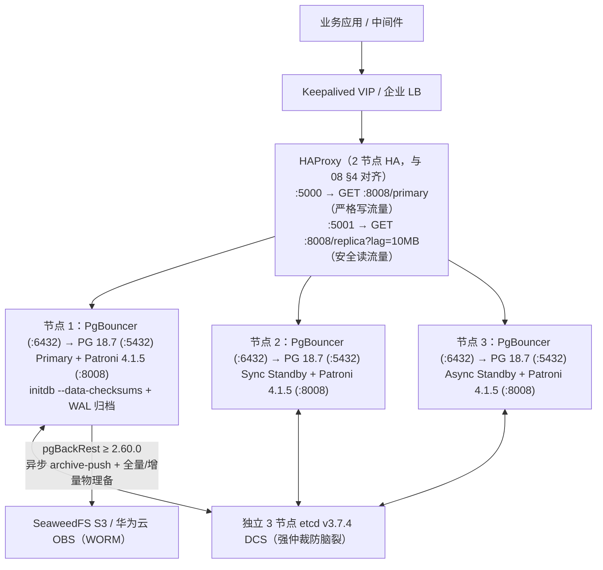

# P4 核心插件深度设计（4/7）：PostgreSQL 高可用与 PITR 深度设计

> **本文定位**：kinstall 第三阶段关系型数据库核心插件（`plugins/postgresql/`，**ADR-045 / 046 / 047 / 066 / 068**），将 `08-插件-PostgreSQL.md` 深化为覆盖 `host-binary`（Patroni + etcd + PgBouncer + HAProxy/VIP）、`host-container` 与 `kubernetes`（CloudNativePG 1.30.1 + Barman Cloud Plugin）的像素级工程方案。
>
> **版本**：v1.2（核心插件 4/7，2026-11-26；v1.2 对齐 `08` 拓扑图每节点 PgBouncer + HAProxy 探活 `:8008`、`syncProfile: async|sync|sync-strict` 及 `AvailRAM` + 64 GiB 上限内存公式）。默认 **PostgreSQL `18.7`**（可选 `19.0` GA），全量支持 `amd64` / `arm64-4K` / `arm64-64K`（PG 原生采用 `glibc malloc` 非 jemalloc，64K 页主机直接兼容且需按页大小校验大页配置）；制品在有 PGDG 官方源 OS 使用 PGDG 包，在无 PGDG 源的国产信创 OS（openEuler/麒麟/统信）使用 D3 EL8 `glibc 2.28` 构建的同版本包；`v1.1` 新增声明式最小权限 `bootstrapDatabases` 编排（§3）。

---

## 1. 生产高可用拓扑与读写分离路由架构（`host-binary` 默认）



### 关键架构决策（全部固化进插件 `Validate()` 与模板）

1. **为什么否决 repmgr / pg_auto_failover？**：只有 **Patroni `4.1.5` + 3 节点 etcd `v3.7.4` DCS** 能在网络分区下借助分布式租约 TTL 彻底避免双主脑裂（旧主一旦无法续租 etcd，Patroni 强制将其降级为只读 `demote`，即使网络恢复也不会接受脏写）。
2. **强制 `initdb --data-checksums` + `pg_rewind` 自动回追**：
   - 初始化强制开启页校验和（PG 18 默认开启且配合 `pgBackRest >= 2.60.0` 在恢复期自动拦截静默磁盘坏页，规避 `2.59.3` 之前加密子密钥缺陷，ADR-046）；
   - 开启 `wal_log_hints = on` 与 `use_pg_rewind: true`，旧主故障恢复重新入群时，Patroni 自动运行 `pg_rewind` 毫秒级对齐时间线（Timeline），**无需手工全量重做 `pg_basebackup`**！
3. **RPO 零丢分档策略（参数名与 `08 §7.1` 统一为 `syncProfile`）**：
   - `syncProfile: async`：纯异步低延迟（`synchronous_mode: false`）；
   - `syncProfile: sync`（默认）：`synchronous_mode: true`、`synchronous_mode_strict: false`（至少 1 个同步从库确认才提交，所有从库宕机时自动降级保写可用）；
   - `syncProfile: sync-strict`（金融核心账务）：`synchronous_mode: true`、`synchronous_mode_strict: true`（至少 3 节点部署，确保严格 RPO = 0）。
4. **内存与内核调优公式（自动联动 `database-pg` Profile，与 `08 §7.1` 一致，设 `AvailRAM = HostMemMB − OSReserveMB`）**：
   - `shared_buffers = min(AvailRAM × 0.25, 64 GiB)`、`effective_cache_size = AvailRAM × 0.75`、`maintenance_work_mem = min(AvailRAM × 0.05, 2 GiB)`、`huge_pages = try`（自动计算并向主机 `database-pg` Profile 申请精准 `vm.nr_hugepages` 避免大页浪费）；
   - `vm.dirty_background_bytes = 67108864`（64 MiB）、`vm.dirty_bytes = 536870912`（512 MiB），彻底消除 Linux 默认按内存百分比刷脏页引发的 30 秒 IO 尖刺卡顿！

---

## 2. `pgBackRest >= 2.60.0` 备份与任意时间点恢复（PITR）闭环

- **全链路 S3 / 华为云 OBS 归档**：借助 `Stack` 自动引用 SeaweedFS 或直接配置企业华为云 OBS 私有桶（走 S3v4 + `repo1-s3-uri-style=host/path` 按厂商适配），配置 AES-256-CBC 加密（口令存平台 `secrets` 加密库，绝不写死明文）；
- **标准备份策略**：每周日全量（`full`）+ 每日差异（`diff`）+ 实时连续 WAL `archive-push`（开启 `archive-async=y` + 本地 spool 目录防 OBS 短暂抖动阻塞主库 WAL 生成）；
- **一键自动化 PITR 演练命令**：`kinstall instance restore pg-prod --target-time "2026-11-26T04:15:30Z" --target-instance pg-pitr-verify`，支持把历史任意秒的数据无侵入恢复到独立演练实例做业务核验（直接写入 `13 §7` 等保合规证据包！）。

---

## 3. 声明式业务库与最小权限账号编排（`bootstrapDatabases`）

针对企业交付中普遍存在的“手工执行 `GRANT ALL ... WITH GRANT OPTION` / 弱口令建库 / 重复初始化 SQL 失败”痛点，`plugins/postgresql` 内置声明式幂等 **`bootstrapDatabases`** 子块：

```yaml
bootstrapDatabases:
  - name: sonarqube
    owner: sonar_app
    encoding: UTF8
    credentialRef: "cred_01JPG_SONAR_APP"   # 平台自动生成高熵密码并加密存库
    privileges: [CONNECT, CREATE_SCHEMA_OWNED] # 严格最小权限：严禁 SUPERUSER / CREATEROLE / WITH GRANT OPTION
    initSqlRef: "artifacts/init/sonar_v1.sql"  # 可选：按 SHA-256 记录至 kinstall_schema_migrations，保证 100% 幂等不重复执行
```

- **权限安全红线**：`Validate()` 硬拦截任何试图为业务账号授予 `SUPERUSER`、`BYPASSRLS`、`CREATEROLE` 或 `WITH GRANT OPTION` 的声明；每个业务库自动创建独立 `owner` Role 并撤销 `PUBLIC` 在目标库 `public` schema 的默认 `CREATE` 权限（PG 15+ 默认安全基线）；
- **自动凭据导出与 `Stack` 联动**：初始化完成后向实例 `outputs.databases.<name>.dsnSecretRef` 导出加密引用（含经 `urlEncode` 安全转义的特殊字符凭据），供下游 `P8`（Harbor / SonarQube / GitLab）、`P10`（OnlyOffice / Zabbix / `generic-app`）通过 `${instances.pg-main.outputs.databases.<name>.dsnSecretRef}` 零抄写直连。

---

## 4. Kubernetes 形态与跨大版本在线升级

- **Kubernetes 目标（ADR-045）**：基于 Helm v4 部署 **CloudNativePG `1.30.1`** + **Barman Cloud Plugin `0.15.1`**（原生 `Cluster` CR 管理滚动升级、PVC 自动扩容、同步副本与对象存储 PITR，严禁手写裸 StatefulSet）。
- **无损滚动升级**：
  - **小版本升级（如 `18.6 → 18.7`）**：先逐台更新所有 Standby 二进制与重启 → Patroni `switchover` 将主库优雅切至已升级 Standby（中断 < 2s）→ 升级原主库；
  - **跨大版本升级（如 `18.x → 19.x`）**：优先采用 **Logical Replication 蓝绿零停机升级**（插件自动建 Publication/Subscription 追平增量后校验序列号与行校验和再切 VIP）或窗口期 `pg_upgrade --link` 极速原地升级（带 `VACUUM` 前置校验与全量备份快照兜底）。
