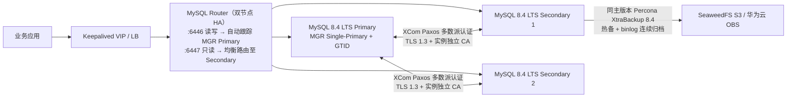

# P5 核心插件深度设计（5/7）：MySQL InnoDB Cluster 与物理热备深度设计

> **本文定位**：kinstall 第三阶段 MySQL 核心插件深度设计（`plugins/mysql/`，**ADR-048 / 049 / 050 / 066 / 068**），将 `09-插件-MySQL.md` 深化为覆盖 `MySQL 8.4 LTS / 9.7 LTS`（严禁已 EOL 的 8.0）、InnoDB Cluster（MGR + MySQL Router + MySQL Shell）、Percona XtraBackup PITR 与 Percona Operator / MOCO 的生产级落地方案。
>
> **版本**：v1.2（核心插件 5/7，2026-11-26；v1.2 对齐 `09` `innodb_redo_log_capacity` 公式与 `8.4.10 → 8.4.11` 升级示例）。`host-binary` 默认使用官方 Generic Linux `tar.xz`（`glibc 2.28`，`amd64/arm64`）；等保三级审计刚需场景提供 **Percona Server for MySQL** 可选项以启用开源 `audit_log_filter` 插件；`v1.1` 新增声明式最小权限 `bootstrapDatabases` 编排（§3）。

---

## 1. 高可用架构：InnoDB Cluster（MGR 单主默认）与读写路由



### 核心生产治理细节

1. **严禁使用多主模式（Multi-Primary）作为默认**：MGR 多主在热点行并发更新下极易触发乐观锁冲突回滚与 DDL 死锁，生产统一锁定 **`group_replication_single_primary_mode = ON`**，所有集群编排通过官方 **MySQL Shell (`mysqlsh`)** 执行幂等 `dba.createCluster()` / `cluster.addInstance()`（带 `recoveryMethod: "clone"`，新增/重装节点直接走原生 InnoDB Clone 插件秒级拉全量，告别手工导 SQL！）。
2. **大事务流控与防节点踢出（MGR 头号线上杀手）**：
   - 强制设置 `group_replication_transaction_size_limit = 157286400`（150 MiB 硬上限，拦截一次性 `DELETE 500万行` 把 XCom 消息队列打死导致全集群僵死！）；
   - 开启 `group_replication_flow_control_mode = QUOTA`（设置 `certifier_threshold = 25000`、`applier_threshold = 25000`），防止某个慢从节点把整集群写入拖垮或被无限甩开；
   - 设置 `group_replication_member_expel_timeout = 5` + `group_replication_autorejoin_tries = 3`，网络微抖动 5 秒内不误踢节点、短暂失联后自动重加集群；
   - `binlog_transaction_dependency_tracking = WRITESET` + `replica_parallel_workers = min(8, CPU/2)` + `replica_preserve_commit_order = ON`，保障高并发场景从库回放零延迟。
3. **InnoDB 关键参数自动推导（`database-mysql` Profile）**：
   - `innodb_buffer_pool_size = floor((MemTotal - OSReserveMB) * 0.65)`、`innodb_redo_log_capacity = clamp(BufferPoolGB × 0.25, 2 GiB, 16 GiB)`（与 `09 §7.1` 一致）（替代已废弃的 `innodb_log_file_size`）、`innodb_flush_method = O_DIRECT`、`innodb_flush_log_at_trx_commit = 1`、`sync_binlog = 1`（双一强一致）；
   - 数据盘独立 XFS `noatime,nodiratime`，IO 调度设为 `none`（NVMe）或 `mq-deadline`（SATA/SAS）。

---

## 2. 物理热备（Percona XtraBackup）与 PITR 恢复闭环（ADR-049）

- **严格同主版本绑定**：BOM 预检强制 `MySQL 8.4.x ↔ Percona XtraBackup 8.4.x`、`MySQL 9.7.x ↔ XtraBackup 9.7.x`（跨主版本备份/恢复必败）；
- **零主库压力备份**：定时备份任务自动探测当前 `Secondary` 节点并在从库执行 `xtrabackup --backup --stream=xbstream | zstd -T4` 直接流式上传至 **SeaweedFS S3 / 华为云 OBS**（避免落盘占双倍空间），同时由 binlog 归档守护进程实时将切段的 `mysql-bin.*` 同步至同一桶；
- **PITR 恢复流程**：`kinstall instance restore mysql-prod --target-time "..."` 自动拉取最近全量流式解压 → `xtrabackup --prepare` → 按 `xtrabackup_binlog_info` 精确提取起始 GTID/Pos → 重放目标时间点前的增量 binlog 至独立恢复节点并自动核验表完整性。

---

## 3. 声明式业务库与最小权限账号编排（`bootstrapDatabases`）

针对传统手工脚本中频现的 `GRANT ALL PRIVILEGES ON 'app%'.* ... WITH GRANT OPTION`、`GRANT CREATE ON *.*` 与固定弱口令隐患，`plugins/mysql` 内置声明式幂等 **`bootstrapDatabases`** 子块：

```yaml
bootstrapDatabases:
  - name: seata_core
    charset: utf8mb4
    collation: utf8mb4_0900_ai_ci
    user: seata_app
    hostCIDR: "10.20.%.%"                  # 强制限定客户端来源网段（拒绝默认无限制 '%' 暴露公网）
    credentialRef: "cred_01JMY_SEATA_APP"  # 强制 caching_sha2_password + 平台高熵随机口令
    privileges: [SELECT, INSERT, UPDATE, DELETE, CREATE, ALTER, INDEX, REFERENCES]
    initSqlRef: "artifacts/init/seata_store_v2.6.sql" # 按 SHA-256 幂等校验执行，禁止重复导入脏数据
```

- **权限安全红线**：`Validate()` 硬拦截任何面向业务账号的 `*.*` 全局授权、通配库前缀授权（如 `'hzero%'.*`）、`SUPER` / `GRANT OPTION` 与弱认证插件 `mysql_native_password`（MySQL 8.4 默认禁用、9.x 已移除）；
- **自动凭据导出与 `Stack` 联动**：仅在当前 MGR Primary 上幂等执行建库、建用户与可选初始化 SQL（自动同步至全部 Secondary），并向 `outputs.databases.<name>.dsnSecretRef` 导出经 `urlEncode` 安全转义的加密连接引用，供下游 `P9`（Seata）、`P8`（Jenkins/DevOps）与 `P10`（`generic-app`）零手工抄写直接引用。

---

## 4. Kubernetes 形态与滚动升级

- **Kubernetes 目标（ADR-048）**：默认通过 Helm v4 部署 **Percona Operator for MySQL (PS) `1.3.0`**（Apache-2.0，内置 MGR/半同步 + HAProxy/Router + XtraBackup S3 定时备份），追求极致轻量极简可选 **Cybozu MOCO `v0.38.0`**（GTID 半同步）。
- **无损滚动升级（如 `8.4.10 → 8.4.11`）**：逐台下线 Secondary（`STOP GROUP_REPLICATION` → 替换 `/opt/kinstall/bin/mysql/` 软链 → 重启自动升级数据字典 → 重加集群追齐 GTID）→ 执行 `cluster.setPrimaryInstance()` 优雅切主（Router 秒级无感切换）→ 升级原 Primary。
