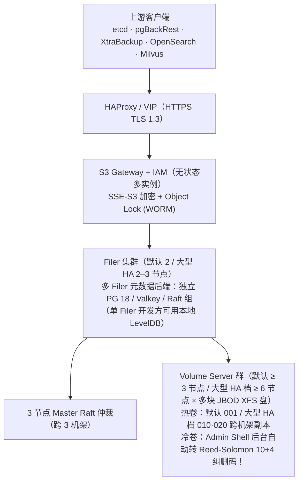

# P6 核心插件深度设计（6/7）：对象存储插件（SeaweedFS / Ceph RGW / RustFS / Garage）

> **本文定位**：kinstall 第三阶段统一对象存储核心插件深度设计（`plugins/objectstorage/`，product ID `object-storage`，**ADR-012 / ADR-054 / ADR-055 / ADR-056**）。因 MinIO 社区版已于 2026-04 正式归档且公共镜像下线，本插件采用**“单插件多引擎 + 统一 S3 OutputSchema”**抽象，成为全平台（K8s etcd、PG pgBackRest、MySQL XtraBackup、OpenSearch ISM、Data Prepper DLQ、Milvus 向量存储）的**内网私有 S3 基座**。
>
> **版本**：v1.1（核心插件 6/7，2026-11-26；v1.1 对齐 Rook `v1.21.3`、`object-storage` 目录/unit 规范、区分默认与大型 HA 档位及多 Filer 元数据口径）。

---

## 1. 四引擎分层选型与统一 `OutputSchema` 契约

| 引擎 | 版本与许可证 | 定位与适用场景 | 推荐形态 |
| --- | --- | --- | --- |
| **SeaweedFS（默认通用）** | `4.54`（Apache-2.0，🟢入公共包） | 中小到大型内网 S3、备份归档、Milvus/ELK 底层存储；单 Go 二进制跨 `amd64/arm64-64K` 零依赖 | `host-binary` / `host-container` / K8s Operator |
| **Ceph RGW（超大规模 / K8s）** | Reef/Squid + Rook `v1.21.3`（1.20+ 依赖 `ceph-csi-operator`，LGPL/Apache-2.0） | PB 级统一块/文件/对象存储，已有 Ceph 底座或 K8s 融合存储场景 | `kubernetes`（Rook-Ceph） |
| **RustFS（轻量极速备选）** | `1.0.6`（Apache-2.0，🟢入公共包） | Rust 原生高性能 S3，兼容 MinIO 概念且资源极低 | `host-binary` / `host-container` |
| **Garage（跨机房边缘轻量）** | `v2.5.0`（AGPLv3，🔴客户侧按需构建） | 弱网/多地边缘小规模 geo-distributed S3 同步 | `host-binary` |

**跨插件无缝集成标准输出（供 `Stack` 中下游通过 `${instances.s3.outputs.*}` 零手工对接）**：
- `s3Endpoint`（如 `https://s3.prod.internal:8333`）
- `caCertSecretId`（实例独立 CA 证书引用）
- `bucketCreds.<bucketKey>`（按桶严格最小权限隔离的 IAM AK/SK 加密 `secretId`，绝不给业务发全局 root AK/SK！）

---

## 2. SeaweedFS 4.54 生产级“热副本 + 冷纠删码（EC 10+4）”架构（ADR-055）

### 四项生产铁律（杜绝常见数据丢失事故）

1. **JBOD 独立 XFS 盘，严禁硬件 RAID 叠软件纠删码**：每台 Volume Server 的每块物理盘独立格式化为 XFS 并挂载为 `/data/object-storage/<instance>/disk{1..N}`（遵循 `06 §1.1` 与 `11 §5`，unit 为 `kinstall-object-storage-<instance>-{master,volume,filer,s3}.service`）；硬件 RAID5/6 再叠软件 3 副本或 EC 会导致写入放大 4× 且重建风暴拖死磁盘。
2. **热写副本 + 冷转 EC 10+4（空间利用率从 33% 提升至 71.4%）**：
   - 新写入热数据走跨机架 3 副本（保证毫秒级写延迟）；
   - 平台自动部署定时治理任务（`weed shell` `ec.encode -fullPercent=95 -quietFor=24h`〔大型高写入 HA 档可按需下调至 `1h`〕+ `ec.balance`），将写满静默的冷 Volume 后台转换为 **Reed-Solomon 10+4 纠删码**（可容忍任意 4 个分片/4 块盘同时损坏零数据丢失！）。
3. **全链路 mTLS + 按桶最小权限 IAM + WORM 防勒索（ADR-056）**：
   - 自动签发实例独立 CA，强制开启 S3 HTTPS 与内部 Master/Filer/Volume gRPC mTLS（`/etc/kinstall/object-storage/<instance>/security.toml`）；
   - 针对 `etcd-backup`、`pg-backup`、`logging-snapshots` 等合规备份桶强制启用 **Object Lock（Governance / Compliance WORM）**，即便业务侧 AK/SK 泄露或遭勒索病毒入侵，锁定周期（如 30/180 天）内也无法覆盖或删除历史备份！
4. **Filer 元数据高可用与定期快照**：多 Filer 生产集群禁止使用单机本地 LevelDB，自动绑定 PostgreSQL / Valkey（或内置 Raft 元数据组；仅单 Filer 开发测试允许嵌入式 LevelDB）并每日定时备份 Filer Meta，确保极端灾难下可 100% 重建目录树。

---

## 3. 全栈备份闭环与外部华为云 OBS 联邦互补

- **纯内网无云场景**：通过 `P6` 部署本地 SeaweedFS 4.54，作为 K8s / 数据库 / ELK / Milvus 的统一本地 S3 底座；
- **混合云 / 异地容灾场景**：支持配置 SeaweedFS `filer.backup` / `rclone` 定时异步将本地关键备份桶加密同步至**企业华为云 OBS 私有桶**（复用 `D3 §7` S3v4 `WhenRequired` 兼容通道），实现“本地秒级恢复 + 云端异地容灾”双保险！
