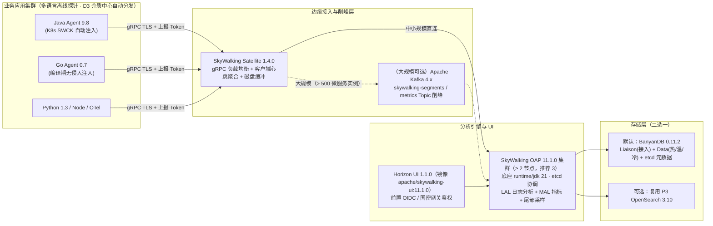

# P7 核心插件深度设计（7/7）：Apache SkyWalking 11.x APM 与 BanyanDB 深度设计

> **本文定位**：kinstall 第三阶段 APM 分布式链路追踪与可观测核心插件深度设计（`plugins/skywalking/`，**ADR-075 / ADR-076**），将 `17-插件-SkyWalking-APM.md` 深化为覆盖 **SkyWalking OAP `11.1.0` + Horizon UI `1.1.0` + 原生 BanyanDB `0.11.2`（默认）/ OpenSearch + Satellite `1.4.0` + Kafka 4.x 异步削峰 + 多语言离线探针分发** 的完整生产方案。
>
> **版本**：v1.1（核心插件 7/7，2026-11-26；v1.1 对齐 `17` OAP ≥ 2 节点、Satellite 生产推荐/可选、采样阈值 `> 2 s` + 5%、TTL 7d、Agent 路径与 SWCK Namespace+Pod 标签）。全栈 Apache-2.0 绿灯许可，可完整打入公共离线 Bundle；全量兼容 `amd64` / `arm64-4K` / `arm64-64K`（BanyanDB 与 Satellite 为纯 Go 静态二进制无 jemalloc 限制，OAP 基于底座多架构 `runtime/jdk` 21 运行）。

---

## 1. 大中小型分档架构与 BanyanDB 原生存储选型（ADR-075）

为什么 SkyWalking 11.x 默认推荐 **BanyanDB `0.11.2`** 而非传统的 Elasticsearch？
- **资源开销锐减 ~80%**：BanyanDB 是专为 APM 时序/链路/拓扑设计的 Go 原生分布式数据库（单静态二进制，零 JVM GC 停顿），同等 Trace 写入吞吐下内存占用仅为 ES/OpenSearch 的 **1/5**，磁盘压缩比提升 2×–3×，且原生支持冷热温分层与高效尾部采样索引！

---

## 2. 四大生产级关键治理方案

### 2.1 Satellite + Kafka 双重抗突刺与尾部采样（Tail-Based Sampling）

- **gRPC 长连接均衡痛点**：Java Agent 默认直连 OAP 时，因 HTTP/2 gRPC 复用单条 TCP 连接，普通 L4 LB 会导致扩容后的新 OAP 节点零流量！kinstall 生产集群**默认推荐**前置 **SkyWalking Satellite `1.4.0`**（中小集群可选直连 OAP，与 `17 §3` 一致），以 L7 gRPC 帧粒度将流量均匀打散至全部 OAP 节点，并在 OAP 滚动升级时提供本地磁盘队列缓冲。
- **大规模异步解耦**：当纳管微服务超过 500 实例或突发异常引发 Trace 暴增时，通过 `Stack` 联动 P3 **Apache Kafka 4.x**（启用 `kafka-fetcher` 插件），将 `skywalking-segments`、`skywalking-meters`、`skywalking-logs` 异步削峰，彻底隔离 APM 波动对业务应用线程的影响。
- **智能尾部采样（Tail-Based Sampling）**：全量保留 **100% 慢请求（默认 > 2 s，可按业务调整）与 100% 错误/异常 Trace**，对正常快速请求按配置比例（默认 5%，可配 1%–10%）采样落盘，在保证故障 100% 可追溯的前提下将存储成本再降 85%！

### 2.2 多语言离线 Agent 统一治理与 K8s SWCK 自动注入（ADR-076）

1. **离线介质库统一托管**：将 `skywalking-java-agent-9.8.0.tgz`、`skywalking-go-0.7.0`、`skywalking-python-1.3.0`（含离线 wheel 依赖闭包）纳入平台 BOM，通过 D3 本地 / OBS 桶 / 在线三元引擎分发至主机 `/opt/kinstall/agents/skywalking-java/9.8.0/`（各语言按 `/opt/kinstall/agents/skywalking-<lang>/<ver>/` 分目录，与 `17 §7` 一致） 或内置 Zot initContainer 镜像；
2. **K8s 零代码改造注入**：Kubernetes 目标通过 Helm v4 自动部署 **SWCK（SkyWalking Cloud on Kubernetes）`0.11.0`** Operator，业务命名空间加 Label `swck-injection=enabled` 且 Pod 加 Label `swck-java-agent-injected: "true"` 即可由 MutatingWebhook 自动挂载内网私有 Zot 中的离线 Agent 镜像，**零外网拉取、零业务 Dockerfile 改动**！

### 2.3 安全与隐私红线（防止 APM 变成“明文数据泄漏黑洞”）

- **默认关闭 SQL / HTTP 敏感明文采集**：模板强制锁定 `plugin.jdbc.trace_sql_parameters = false` 与 `plugin.http.include_http_headers` 脱敏白名单（严格剔除 `Authorization`、`Cookie`、`X-Api-Key`），避免生产用户密码、身份证、Token 通过慢 SQL 链路明文落入 APM 库！
- **上报链路认证与 UI 鉴权**：OAP 强制开启 `receiver-sharing-server` TLS + 共享上报 Token（`agent.authentication`）；Horizon UI 前置 Nginx/Envoy OIDC 认证反代（或对接 kinstall 平台统一 SSO），杜绝 APM 控制台内网裸奔。

### 2.4 OAP 协调与生命周期

- `host-binary` / `host-container` 模式使用平台 etcd `v3.7.4` 作为 OAP Cluster Coordinator 与 BanyanDB 元数据中心（绝不引入老旧 ZooKeeper），使用底座 `runtime/jdk` **Temurin 21 LTS** 隔离运行；
- BanyanDB 自动配置分层 TTL（`metrics: 30d`、`traces: 7d`、`logs: 7d`〔可按合规 Profile 延至 14d/30d〕，与 `17 §7` 一致），并对接 P6 SeaweedFS / 华为云 OBS 定时冷备份。
