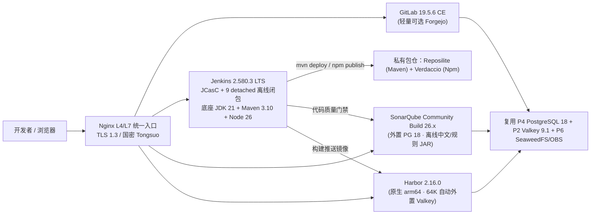

# P8 扩展插件深度设计（8/10）：DevOps 交付栈（Harbor / GitLab / Jenkins / SonarQube / Reposilite / Verdaccio / Nginx）

> **本文定位**：将 `R1`（DevOps 工具链 2026-11 实证）与 `R2`（`old-install.md` 真实踩坑诊断）收敛为生产级 **企业内网 DevOps 交付全栈**，全部复用底座 `D3` 的 `runtime/{jdk,maven,node}`、全局 `registryMirror`、离线插件闭包与本地/在线/OBS 三元介质引擎。
>
> **版本**：v1.0（扩展插件 8/10，2026-11-26）。

---

## 1. 全栈架构与组件矩阵

| 组件 | 锁定版本（2026-11） | 许可分级 | 推荐形态 | 关键架构规避点 |
| --- | --- | :---: | --- | --- |
| **Harbor** | `2.16.0` | 🟢 Apache-2.0 | `host-container` / `kubernetes` | 官方已全量提供原生 `arm64` 镜像；**64K 页主机自动通过 `Stack` 外置 P2 64K Valkey**（彻底规避 `goharbor/harbor#24445` 内置 Redis 崩溃！）；生产强制外置 P4 PG + P6 SeaweedFS/OBS 实现多副本无状态 HA |
| **GitLab CE / Forgejo** | GitLab `19.5.6` / Forgejo 最新 | 🟡 MIT+核心 / 🟢 MIT | `host-container` / `kubernetes` | 内存 `< 8 GiB` 节点自动提示切轻量 **Forgejo**；生产 GitLab 外置 PG/Valkey/OBS，关闭内存消耗巨大的内嵌 Prometheus，内置 Runner 自动注册模板 |
| **Jenkins** | **`2.580.3 LTS`** | 🟢 MIT | `host-binary` / `host-container` / `kubernetes` | 强制绑定底座 `runtime/jdk` **21 LTS**（已彻底弃用 JDK 17）；消费 `D3 §4.3` 含 **9 个 detached 插件**的离线 `.jpi` 闭包；**全量通过 JCasC（Configuration as Code）声明式配置**零手工点击；`master.key` 独立加密存平台 `secrets` 严禁随 `JENKINS_HOME` 同包备份 |
| **SonarQube** | **Community Build `26.x`** | 🟡 LGPL-3.0 | `host-container` / `kubernetes` | 自动配置宿主机 `vm.max_map_count = 524288`、`fs.file-max = 131072`；模板强制写精确文件名 `sonar.properties`（根治 `old-install.md` 拼写错 `sonar.properies`！）；外置 P4 PG 18；挂载 `D3 §4.3` `extraPlugins[]` 离线中文包；端口 `9000` 登记 `HostRoleClaims` 与 Milvus Attu 自动防撞 |
| **Reposilite + Verdaccio** | Reposilite `3.5+` / Verdaccio `6.x` | 🟢 Apache-2.0 / MIT | `host-container` / `host-binary` | 替代转向闭源限制的 Nexus CE；分别对接底座 `runtime/maven` `/etc/kinstall/maven/settings.xml` 与 `runtime/nodejs` `/etc/kinstall/node/npmrc`，支持纯离线私库与受控代理缓存双模式 |
| **Nginx L4/L7 网关** | Nginx `1.28 LTS` / OpenResty | 🟢 BSD-2 | `host-binary` / `host-container` | 支持 `stream{}` L4 TCP/UDP 转发与 `http{}` L7 HTTPS/WebSocket/SSE（自动配 `proxy_buffering off`）；**任何配置变更强制先运行 `nginx -t` 预检**，失败零影响线上不执行 `reload` |

---

## 2. Jenkins JCasC + 多版本无侵入构建机联动规范

在纯离线 CI/CD 流水线机上，kinstall 通过底座 `D3 §4` 在同一台 Agent 上同时安装 **JDK 8 + 17 + 21 + 25**、**Maven 3.10.2**（配置 `/etc/kinstall/maven/mavenrc`，绝不手改 `bin/mvn`）与 **Node.js 26/24**（`NODE_EXTRA_CA_CERTS` 信任私仓 CA），并在 Jenkins JCasC YAML 中自动声明 `tool.jdk`、`tool.maven`、`tool.nodejs` 路径与 Harbor/Reposilite/Verdaccio 加密凭据引用，交付后开箱即可构建全公司老/新业务项目。
