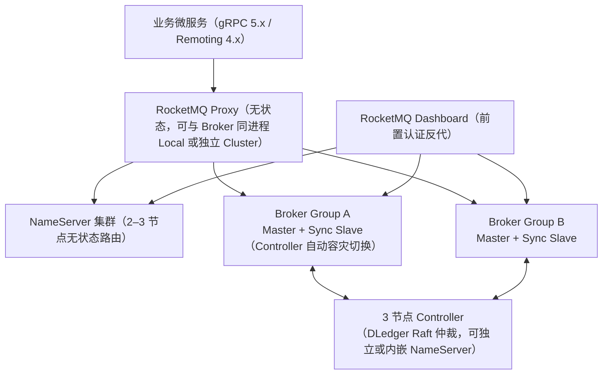

# P9 扩展插件深度设计（9/10）：业务消息与分布式事务（RocketMQ 5.5 / Seata 2.6 / ZooKeeper 3.9）

> **本文定位**：覆盖企业微服务核心业务中间件——**Apache RocketMQ `5.5.1`（事务消息/延迟消息/死信队列，与 P3 日志流 Kafka 形成互补）**、**Apache Seata `2.6.0`（AT/TCC/Saga 分布式事务）** 以及面向存量老系统的 **Apache ZooKeeper `3.9.7` 兼容插件**。全栈均为 **🟢 Apache-2.0 绿灯许可**，可直接纳入公共离线 Bundle。
>
> **版本**：v1.0（扩展插件 9/10，2026-11-26）。三款组件均基于底座多架构 `runtime/jdk` 21 运行，原生兼容 `amd64` / `arm64-4K` / `arm64-64K`（`host-container` 多架构镜像经 `images.lock` 校验，RocketMQ `glibc` 依赖遵循 EL8 基线）。

---

## 1. Apache RocketMQ `5.5.1`（DLedger Controller 自动选主模式）

### 1.1 架构设计（告别易脑裂的静态主从，全面采用 5.x Controller + Proxy）

### 1.2 根治历史生产坑的四大强校验铁律（R1 + R2 `old-install.md` 反哺）

1. **自动注入宿主机业务私网 IP 至 `brokerIP1`（根治 `old-install.md` 头号容器死坑！）**：
   - `host-container` 模式下若未在 `broker.conf` 显式写入 `brokerIP1 = <宿主机私网IP>`，Broker 会将 Docker 内部 `172.18.x.x` 注册进 NameServer，导致宿主机外部全部业务应用发消息必超时！kinstall 模板强制自动提取目标主机 `Facts.PrimaryIP` 渲染 `brokerIP1` 与 `brokerIP2`。
2. **底座 `runtime/jdk` 21 绑定 + 堆/直接内存分离**：
   - 独立绑定 `/opt/kinstall/runtimes/jdk/temurin-21.0.10-cspu`，Broker 堆内存 `Xms = Xmx = min(8 GiB, MemTotal * 0.40)`，将剩余内存留给 Linux Page Cache 加速 `CommitLog` 顺序写与零拷贝消费；强制独立挂载 XFS 数据盘至 `/data/rocketmq/<instance>/store`，预检磁盘使用率阈值 `diskMaxUsedSpaceRatio = 85`（防止 CommitLog 满盘停写）。
3. **开启 ACL 2.0 认证与 TLS 传输**：彻底告别无密码裸奔，默认生成 `plain_acl.yml`（管理员 + 按 Topic 隔离的业务读写账号，密文受平台 `secrets` 管控），Dashboard 强制开启登录认证并接入企业反代。
4. **滚动升级与零消息丢失**：升级前检查 `SYNC_MASTER` 副本同步水位（`slaveFallBehind == 0`），先升 Slave → Controller 优雅切主 → 升原 Master，全程业务零感知。

---

## 2. Apache Seata `2.6.0`（原生 Raft 高可用 + NamingServer）

- **去外部依赖架构（2026 推荐）**：Seata 2.6 原生 **Raft 事务存储模式 + NamingServer** 彻底告别早期“必须外挂 MySQL 存 `global_table/lock_table` 导致高并发锁表 + 必须先装 Nacos 才能注册”的沉重耦合（若企业已有 Nacos/PG 亦支持显式切换 `db` 模式）！
- **3 节点奇数 Raft 集群部署**：跨机架 3 节点部署 Seata TC（绑定底座 JDK 21，强制持久化 `/data/seata/<instance>/raft` 至低延迟 SSD），自动配置 `server.raft.group`、`session.store-mode = raft`、强随机生成 `console.user.password` 与 `security.secretKey`（严禁使用默认弱口令 `seata/seata`！）。
- **与 `Stack` 输出联动**：对外暴露 `namingEndpoints`、`txServiceGroup` 与加密 `authSecretRef`，下游业务微服务可直接引用。

---

## 3. Apache ZooKeeper `3.9.7`（遗留生态兼容专用插件）

- **明确边界**：kinstall 新建 Kafka 4.x（KRaft）、SkyWalking 11.x（etcd）、Patroni（etcd）均**彻底去 ZooKeeper**；本插件专供企业存量 Hadoop / HBase / Dubbo / 老版业务系统过渡兼容。
- **生产硬规范**：
  1. 强制奇数节点（3/5 节点，2 节点直接 Preflight 阻断），跨故障域部署；
  2. **`dataLogDir`（事务 WAL 盘）与 `dataDir`（快照盘）物理分离**，避免快照刷盘拖慢投票心跳引发假性 Leader 切换；
  3. 强制 `autopurge.snapRetainCount = 5`、`autopurge.purgeInterval = 12` 防历史快照撑爆磁盘；
  4. 安全收敛：`4lw.commands.whitelist = ruok,mntr,stat`（仅允许本机/监控网段访问，关闭高危 `wchs`/`dump`/`kill`），开启 Quorum TLS 与 Digest/SASL 认证，绑定底座 JDK 21。
